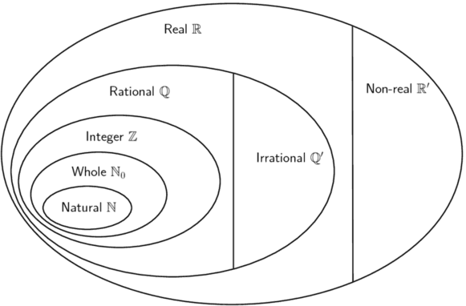

# Chapter 1: Exponents and surds

## 1.1 Revision (EMBF2)

### The number system (EMBF3)

- Discuss the number system; explain the difference between real and non-real numbers.
- Encourage learners not to use calculators in this chapter.
- Common misconception: \(\pi\) (irrational) ≈ \(\frac{22}{7}\) (rational).
- Explain that the square root of a negative number is non-real.
- Discuss raising a negative number to even and odd powers.
- Explain that surds are a special notation or way of expressing rational exponents.
- Key strategy in manipulation of exponential expressions: express base in terms of its prime
                          factors.
- Emphasize the principle of equivalence and using the additive inverse in the simplification of
                          equations (and not “simply taking term to the other side”).
- Rationalising the denominators is a useful tool for working with special angles in Trigonometry.
- Learners should leave their final answers as mixed fractions.
- Answers should always be written with positive exponents.

The diagram below shows the structure of the number system:

We use the following definitions:

- \(\mathbb{N}\): natural numbers are \(\{1; \; 2; \; 3; \; \ldots\}\)
- \(\mathbb{N}_0\): whole numbers are \(\{0; \; 1; \; 2; \; 3; \; \ldots\}\)
- \(\mathbb{Z}\): integers are \(\{\ldots; \; -3; \; -2; \; -1; \; 0; \; 1; \; 2; \; 3; \;
                          \ldots\}\)
- \(\mathbb{Q}\): rational numbers are numbers which can be written as \(\frac{a}{b}\) where \(a\)
                          and \(b\) are integers and \(b\ne 0\), or as a terminating or recurring decimal number.
  Examples: \(-\frac{7}{2}; \; -\text{2,25}; \; 0; \; \sqrt{9}; \; \text{0,}\dot{8}; \;
                          \frac{23}{1}\)
- \(\mathbb{Q}'\): irrational numbers are numbers that cannot be written as a fraction with the
                          numerator and denominator as integers. Irrational numbers also include decimal numbers that
                          neither terminate nor recur.
  Examples: \(\sqrt{3}; \; \sqrt[5]{2}; \; \pi; \; \frac{1 + \sqrt{5}}{2}; \;
                          \text{1,27548}\ldots\)
- \(\mathbb{R}\): real numbers include all rational and irrational numbers.
- \(\mathbb{R}'\): non-real numbers or imaginary numbers are numbers that are not real.
  Examples: \(\sqrt{-25}; \; \sqrt[4]{-1}; \; -\sqrt{-\frac{1}{16}}\)

<QuizCard id="m11-01-01a" title="Interactive Exercise 1.1" question="Choose the correct symbol for the set of rational numbers." options=[] answer="2" hint="" explanation="Recall the correct symbol The correct symbol for the set of rational numbers is \(\mathbb{Q}\) . Why is \(\mathbb{Q}\) the symbol for the rational numbers? \"Q\" stands for quotient. (Quotient means to divide one number by another.) The rational numbers are the quotient of two integers, so the symbol is \(\mathbb{Q}\) ! Submit your answer as: \(\mathbb{Q}\)" />

<QuizCard id="m11-01-01a" title="Interactive Exercise 1.1" question="Choose the correct symbol for the set of irrational numbers." options=[] answer=" 0 " hint="" explanation="Recall the correct symbol The correct symbol for the set of irrational numbers is \(\mathbb{Q}^{\prime}\) . TIP: In set notation, the dash in \({\color{MediumVioletRed}{\mathbb{Q}}}{\color{blue}{^{\prime}}}\) means \" not \". So \({\color{MediumVioletRed}{\mathbb{Q}}}{\color{blue}{^{\prime}}}\) means \" not \({\color{MediumVioletRed}{\mathbb{Q}}}\) \". This is exactly what the irrational numbers are - all of the real numbers that are not rational ! Submit your answer as: \(\mathbb{Q}^{\prime}\)" />

<QuizCard id="m11-01-01a" title="Interactive Exercise 1.1" question="Complete the table by choosing a tick (✔) or a cross (✘) to indicate whether or not the number belongs to each set. (Numbers can belong to more than one set.)" options=["\u2714", "\u2718", "\u2714", "\u2718", "\u2714", "\u2718", "\u2714", "\u2718", "\u2714", "\u2718", "\u2714", "\u2718", "\u2714", "\u2718", "\u2714", "\u2718", "\u2714", "\u2718", "\u2714", "\u2718", "\u2714", "\u2718", "\u2714", "\u2718"] answer="0, 1, 0, 1, 0, 1, 0, 0, 1, 1, 0, 0" hint="" explanation="Think about the sets of numbers and how they fit together The natural numbers ( \(\mathbb{N}\) ) are the counting numbers. They start at \(\text{1}\) and go up by \(\text{1}\) each time: \(\{{\color{MediumVioletRed}{1; 2; 3; \ldots}}\}\) The whole numbers ( \(\mathbb{N}_{0}\) ) are the set of all of the natural numbers and zero : \(\{{\color{blue}{0;}} \; {\color{MediumVioletRed}{1; 2; 3; \ldots}}\}\) The integers ( \(\mathbb{Z}\) ) are the set of all of the natural numbers , zero ,  and negatives of the natural numbers : \(\{{\color{ForestGreen}{\ldots; -2; -1;}} \; {\color{blue}{0;}} \; {\color{MediumVioletRed}{1; 2; \ldots}}\}\) The rational numbers ( \(\mathbb{Q}\) ) are numbers that can be written as \(\frac{a}{b}\) where \(a\) and \(b\) are integers, and \(b \neq 0\) . They include all of the integers, whole numbers, and natural numbers, plus fractions. The irrational numbers ( \(\mathbb{Q}^{\prime}\) ) are numbers that can't be written as \(\frac{a}{b}\) where \(a\) and \(b\) are integers, and \(b \neq 0\) . They are separate from all of the rational numbers! Classify \(\sqrt{121}\) First, we must try to simplify the number (if possible). \[ 					\begin{array}{c} 						\sqrt{121} = 11 					\end{array} 				\] ✔ \(\mathbb{N}\) : \(\text{11}\) is a natural number, so \(\sqrt{121}\) is a natural number . ✔ \(\mathbb{N}_{0}\) : All natural numbers are whole numbers, so \(\sqrt{121}\) is a whole number . ✔ \(\mathbb{Z}\) : All whole numbers are integers, so \(\sqrt{121}\) is an integer . ✔ \(\mathbb{Q}\) : All integers are rational numbers, so \(\sqrt{121}\) is a rational number . ✘ \(\mathbb{Q}^{\prime}\) : No rational numbers are irrational, so \(\sqrt{121}\) is not an irrational number . ✔ \(\mathbb{R}\) : All rational numbers are real numbers, so \(\sqrt{121}\) is a real number . Classify \(-\frac{6}{10}\) \[ 					\begin{array}{c} 						-\frac{6}{10} = -\frac{3}{5} 					\end{array} 				\] ✘ \(\mathbb{N}\) : \(-\frac{3}{5}\) is a fraction, so \(-\frac{6}{10}\) is not a natural number . ✘ \(\mathbb{N}_{0}\) : For the same reason, \(-\frac{6}{10}\) is not a whole number . ✘ \(\mathbb{Z}\) : \(-\frac{6}{10}\) is also not an integer . ✔ \(\mathbb{Q}\) : \(-\frac{6}{10}\) can be written as \(\frac{a}{b}\) , where \(a\) and \(b\) are integers and \(b  eq 0\) . Therefore \(-\frac{6}{10}\) is a rational number . ✘ \(\mathbb{Q}^{\prime}\) : No rational numbers are irrational, so \(-\frac{6}{10}\) is not an irrational number . ✔ \(\mathbb{R}\) : All rational numbers are real numbers, so \(-\frac{6}{10}\) is a real number . Submit your answer as: ✔ and ✘ and ✔ and ✘ and ✔ and ✘ and ✔ and ✔ and ✘ and ✘ and ✔ and ✔" />

<QuizCard id="m11-01-01a" title="Interactive Exercise 1.1" question="Consider each of the following statements, and decide whether they are true or false ." options=["True", "False", "True", "False"] answer="0, 1" hint="" explanation="Recall the different types of numbers The natural numbers are the counting numbers. They start at \(\text{1}\) and go up by \(\text{1}\) each time: \(\{{\color{MediumVioletRed}{1; 2; 3; \ldots}}\}\) The whole numbers are the set of all of the natural numbers and zero : \(\{{\color{blue}{0;}} \; {\color{MediumVioletRed}{1; 2; 3; \ldots}}\}\) The integers are the set of all of the natural numbers , zero ,  and negatives of the natural numbers : \(\{{\color{ForestGreen}{\ldots; -2; -1;}} \; {\color{blue}{0;}} \; {\color{MediumVioletRed}{1; 2; \ldots}}\}\) The rational numbers are numbers that can be written as \(\frac{a}{b}\) where \(a\) and \(b\) are integers, and \(b \neq 0\) . They include all of the integers, whole numbers, and natural numbers, plus fractions. The irrational numbers are numbers that can't be written as \(\frac{a}{b}\) where \(a\) and \(b\) are integers, and \(b \neq 0\) . They are separate from all of the rational numbers! Decide whether the statements are true or false 1. Some integers are whole numbers. True \(0\, ; 1\, ; 2\, ; 3\, ; \ldots\) are all integers that are also                 whole numbers. So it is true that some integers are whole numbers. TIP: It is not true to say that all integers                 are whole numbers, because all of the negative integers are not whole numbers                 (such as \(-\text{5}\) ). 2. All whole numbers are natural numbers. False All of the natural numbers are included in the set of whole numbers. But, \(\text{0}\) is a whole number that is not a natural number. Therefore not all whole numbers are natural numbers. Submit your answer as: True and False" />

<QuizCard id="m11-01-01a" title="Interactive Exercise 1.1" question="Is the following number rational or irrational? \( \qquad 0,3691215 \ldots\)" options=["rational", "irrational", "it is impossible to know"] answer="irrational" hint="" explanation="Use what you know about rational and irrational numbers The correct answer is 'irrational.' Irrational numbers are the opposite of rational numbers: they cannot be written as a fraction with two integers.  This means that if you try to calculate the value of \(0,3691215 \ldots\) with your calculator, you will find that it is quite a long decimal number.  In fact, when you write an irrational number as a decimal, it will never terminate (end) and it will never repeat. You can find more on rational and irrational numbers in Section 1.2 of Everything Maths, Grade 10 . Submit your answer as: irrational" />

<QuizCard id="m11-01-01a" title="Interactive Exercise 1.1" question="Is the following number rational or irrational? \( \qquad \sqrt{57}\)" options=["rational", "irrational", "it is impossible to know"] answer="irrational" hint="" explanation="Use what you know about rational and irrational numbers The correct answer is 'irrational.' Irrational numbers are the opposite of rational numbers: they cannot be written as a fraction with two integers.  This means that if you try to calculate the value of \(\sqrt{57}\) with your calculator, you will find that it is quite a long decimal number.  In fact, when you write an irrational number as a decimal, it will never terminate (end) and it will never repeat. You can find more on rational and irrational numbers in Section 1.2 of Everything Maths, Grade 10 . Submit your answer as: irrational" />

## The number system

### Textbook Exercise 1.1

Use the list of words below to describe each of the following numbers (in some cases multiple
                            words will be applicable):

- Natural (\(\mathbb{N}\))
- Whole (\(\mathbb{N}_0\))
- Integer (\(\mathbb{Z}\))
- Rational (\(\mathbb{Q}\))
- Irrational (\(\mathbb{Q}'\))
- Real (\(\mathbb{R}\))
- Non-real (\(\mathbb{R}'\))

**Problem:**
\(\sqrt{7}\)

**Solution:**
\(\mathbb{R}; \mathbb{Q}'\)

**Problem:**
\(\text{0,01}\)

**Solution:**
\(\mathbb{R}; \mathbb{Q}\)

**Problem:**
\(16\frac{2}{5}\)

**Solution:**
\(\mathbb{R}; \mathbb{Q}\)

**Problem:**
\(\sqrt{6\frac{1}{4}}\)

**Solution:**
\(\mathbb{R}; \mathbb{Q}\)

**Problem:**
\(\text{0}\)

**Solution:**
\(\mathbb{R}; \mathbb{Q}; \mathbb{Z}; \mathbb{N}_0\)

**Problem:**
\(2\pi\)

**Solution:**
\(\mathbb{R}' \mathbb{Q}'\)

**Problem:**
\(-\text{5,3}\dot{8}\)

**Solution:**
\(\mathbb{R}; \mathbb{Q}\)

**Problem:**
\(\frac{1-\sqrt{2}}{2}\)

**Solution:**
\(\mathbb{R}; \mathbb{Q}'\)

**Problem:**
\(-\sqrt{-3}\)

**Solution:**
\(\mathbb{R}'\)

**Problem:**
\((\pi)^2\)

**Solution:**
\(\mathbb{R}; \mathbb{Q}'\)

**Problem:**
\(-\frac{9}{11}\)

**Solution:**
\(\mathbb{R}; \mathbb{Q}\)

**Problem:**
\(\sqrt[3]{-8}\)

**Solution:**
\(\mathbb{R}; \mathbb{Q}; \mathbb{Z}\)

**Problem:**
\(\frac{22}{7}\)

**Solution:**
\(\mathbb{R}; \mathbb{Q}\)

**Problem:**
\(\text{2,45897}\ldots\)

**Solution:**
\(\mathbb{R}; \mathbb{Q}'\)

**Problem:**
\(\text{0,}\overline{65}\)

**Solution:**
\(\mathbb{R}; \mathbb{Q}\)

**Problem:**
\(\sqrt[5]{-32}\)

**Solution:**
\(\mathbb{R}; \mathbb{Q}; \mathbb{Z}\)

### Laws of exponents (EMBF4)

We use exponential notation to show that a number or variable is multiplied by itself a certain number of
                times.
                The exponent, also called the index or power, indicates the number of times the multiplication is
                repeated.

\[a^n = a \times a \times a \times \ldots \times a \quad (n \text{ times}) \qquad
                \left(a \in \mathbb{R}, n \in \mathbb{N}\right)\]

Examples:

2. \(2 \times 2 \times 2 \times 2 = 2^4\)
4. \(\text{0,71} \times \text{0,71} \times \text{0,71} = (\text{0,71})^3\)
6. \((\text{501})^2 = \text{501} \times \text{501}\)
8. \(k^6 = k \times k \times k \times k \times k \times k\)

For \(x^2\), we say \(x\) is squared and for \(y^3\), we say that \(y\) is cubed. In the last example we
                have \(k^6\); we say that \(k\) is raised to the sixth power.

We also have the following definitions for exponents. It is important to remember that we always write
                the final answer with a positive exponent.

- \({a}^{0}=1\) (\(a \ne 0\) because \(0^0\) is undefined)
- \({a}^{-n}=\frac{1}{{a}^{n}}\) (\(a \ne 0\) because \(\frac{1}{0}\) is undefined)

Examples:

2. \(5^{-2} = \dfrac{1}{5^2} = \dfrac{1}{25}\)
4. \((-36)^0 x = (1)x = x\)
6. \(\dfrac{7p^{-1}}{q^{3}t^{-2}} = \dfrac{7t^2}{pq^3}\)

We use the following laws for working with exponents:

- \({a}^{m} \times {a}^{n}={a}^{m+n}\)
- \(\frac{{a}^{m}}{{a}^{n}}={a}^{m-n}\)
- \({\left(ab\right)}^{n}={a}^{n}{b}^{n}\)
- \({\left(\frac{a}{b}\right)}^{n}=\frac{{a}^{n}}{{b}^{n}}\)
- \({\left({a}^{m}\right)}^{n}={a}^{mn}\)

                where \(a > 0\), \(b > 0\) and \(m, n \in \mathbb{Z}\).

 

                
<a href="http://www.khanacademy.org/embed_video?v=tOuCdKqO6-s">Video:
                        222P</a>

            

<Callout type="tip" title="Worked example 1: Laws of exponents">
**Question:**
Simplify the following:

2. \(5(m^{2t})^p \times 2(m^{3p})^t\)
4. \(\dfrac{8k^3x^2}{(xk)^2}\)
6. \(\dfrac{2^2 \times 3 \times 7^4}{(7 \times 2)^4}\)
8. \(3(3^b)^a\)

2. \(5(m^{2t})^p \times 2(m^{3p})^t = 10m^{2pt + 3pt} = 10m^{5pt}\)
4. \(\dfrac{8k^3x^2}{(xk)^2} = \dfrac{8k^3x^2}{x^2k^2} = 8k^{(3-2)}x^{(2-2)} = 8k^1x^0 = 8k\)
6. \(\dfrac{2^2 \times 3 \times 7^4}{(7 \times 2)^4} = \dfrac{2^2 \times 3 \times 7^4}{7^4 \times
                           2^4} = 2^{(2-4)} \times 3 \times 7^{(4-4)} = 2^{-2} \times 3 = \frac{3}{4}\)
8. \(3(3^b)^a = 3 \times 3^{ab} = 3^{ab + 1}\)
</Callout>

<QuizCard id="m11-01-01b" title="Interactive Exercise 1.2" question="Simplify: \[                 \begin{array}{c}                     \text{5}^{2x} \times \text{5}^{11x}                 \end{array}             \] INSTRUCTION: Your answer must have brackets around the exponent, like this: 13^(6x) ." options=[] answer="
                    5**(13x)
                " hint="Your answer should be a mathematical expression. You can use the following symbols to write mathematical expressions: add: + subtract: − multiply: ∗ divide: / exponent: ^ The following special symbols are also recognised: pi (π): pi infinity (∞): oo It is also possible to write certain functions: √: sqrt( ) log: log( ) sin: sin( ) cosec: cosec( ) cos: cos( ) sec: sec( ) tan: tan( ) cot: cot( ) To write a logarithm with a specific base, use the underscore _ symbol.                For example, log of x base 3 can be written as: log_3 x" explanation="Recall how to combine terms with the same base This question is actually the same as working out \( \text{5}^2 \times \text{5}^5 \) . Because the bases are the same you must add the exponents: \[                     \begin{array}{c}                     \text{5}^2 \times \text{5}^5 = \text{5}^{7}                     \end{array}                 \] Simplify the expression \[                     \begin{aligned}                         \text{5}^{2x} \times \text{5}^{11x}                         &= \text{5} ^{2x + 11x } \\                         &= \text{5} ^{13x}                     \end{aligned}                 \] The correct answer is \(\text{5}^{13x}\) . NOTE: You must type the answer like this: \(\text{5}\) ^(13x). The brackets are required because the exponent has more than one factor. Submit your answer as:" />

<QuizCard id="m11-01-01b" title="Interactive Exercise 1.2" question="Simplify the following expression: \[\begin{array}{c}\dfrac{\text{16} x^{6} a^{9}}{\text{8} x^{3} a^{4}}\end{array}\] INSTRUCTION: Use the ^ symbol to type an exponent if necessary. For example for \(x^2\) type x ^ 2." options=[] answer=" 2*x**3*a**5 " hint="Your answer should be a mathematical expression. You can use the following symbols to write mathematical expressions: add: + subtract: − multiply: ∗ divide: / exponent: ^ The following special symbols are also recognised: pi (π): pi infinity (∞): oo It is also possible to write certain functions: √: sqrt( ) log: log( ) sin: sin( ) cosec: cosec( ) cos: cos( ) sec: sec( ) tan: tan( ) cot: cot( ) To write a logarithm with a specific base, use the underscore _ symbol.                For example, log of x base 3 can be written as: log_3 x" explanation="The key to this question is the fact that \( \dfrac{a}{a} = 1 \) . In this question, there is, for example, a part which includes \( \dfrac{x^{\text{6}}}{x^{\text{3}}} \) . This actually means \( \dfrac{xxxxxx}{xxx} \; \) . .. and a lot of those variables cancel!  In fact, the 3 \( x \) 's in the denominator will cancel 3 of the \( x \) 's from the numerator.  That will leave 6 - 3 = 3 \( x \) 's after the cancellation, which is why we must subtract the exponents when we divide variables as in this question. When you subtract the exponents, you are actually cancelling factors! This looks like: \[                     \begin{aligned}                     &\frac{\text{16}x^{\text{6}}a^{\text{9}}}{\text{8}x^{\text{3}}a^{\text{4}}}\\                     &= \text{2}x^{(\text{6} - \text{3})}a^{(\text{9} - \text{4})}	\\                     &= \text{2}x^{\text{3}}a^{\text{5}}                     \end{aligned}                 \] The final answer is \( \text{2}x^{3} a^{5} \) . Submit your answer as:" />

<QuizCard id="m11-01-01b" title="Interactive Exercise 1.2" question="Simplify: \[             	\begin{array}{c}             		\dfrac{\text{2}^{n-13}}{\text{2}^{n-14}}              	\end{array}             \]" options=[] answer=" ['2', '2^1'] " hint="Your answer should be a mathematical expression. You can use the following symbols to write mathematical expressions: add: + subtract: − multiply: ∗ divide: / exponent: ^ The following special symbols are also recognised: pi (π): pi infinity (∞): oo It is also possible to write certain functions: √: sqrt( ) log: log( ) sin: sin( ) cosec: cosec( ) cos: cos( ) sec: sec( ) tan: tan( ) cot: cot( ) To write a logarithm with a specific base, use the underscore _ symbol.                For example, log of x base 3 can be written as: log_3 x" explanation="Apply the exponent rule about subtracting the exponents The bases are the same and we are dividing: in this case we have an exponent rule that says we will subtract the exponents.  Remember to put brackets around the exponent from the denominator, because we must subtract all of that exponent. \[                 	\begin{array}{c}                     	\dfrac{\text{2}^{ n -13}} {\text{2}^{ n -14}} = \text{2}^{(n -13) - (n -14)}                      \end{array}                 \] Simplify the exponent and evaluate the expression if possible Simplify the exponent (be careful with the minus sign!) and then work out the final answer. \[                     \begin{aligned} 	                    \text{2}^{(n-13) {\color{red}{- (n-14)}}} 	                    &= \text{2}^{n-13 {\color{red}{- n+14}}} \\ 	                    &= \text{2}^{1} \\ 	                    &= \text{2}                     \end{aligned}                 \] The answer is \( \text{2} \) . Submit your answer as:" />

<Callout type="tip" title="Worked example 2: Laws of exponents">
**Question:**
Simplify:\(\dfrac{3^m - 3^{m+1}}{4 \times 3^m - 3^m}\)

**Simplify to a form that can be factorised:**
\[\dfrac{3^m - 3^{m+1}}{4 \times 3^m - 3^m} = \dfrac{3^m - (3^{m} \times 3)}{4 \times 3^m - 3^m}\]

**Take out a common factor:**
\[\begin{align*}
                    &= \dfrac{3^m(1 - 3)}{3^m(4 - 1)}
                    \end{align*}\]

**Cancel the common factor and simplify:**
\[\begin{align*}
                    &= \frac{1 - 3}{4 - 1} \\
                    &= - \frac{2}{3}
                    \end{align*}\]
</Callout>

<QuizCard id="m11-01-01c" title="Interactive Exercise 1.3" question="Simplify: \[\begin{array}{c}\dfrac{\text{5}^{x}+ \text{5}^{x+1}}{\text{2} \times \text{5}^{x}+ \text{5}^{x}}\end{array}\] Give an exact answer (no rounding off)." options=[] answer=" 2 " hint="You should enter a number here. If you want to, you can use a space to separate thousands.                Example: 12 800,25 For scientific notation you need to use the multiply symbol                ( ∗ ) and the exponent symbol ( ^ ). For example 6,673 × 10 −11 should be written as: 6,673 ∗ 10^−11" explanation="Factorise out the common factors in the numerator and the denominator Notice that both the numerator and the denominator of the fraction are binomials. Furthermore, the expression \( \text{5}^{x} \) is in all four terms in the fraction, twice on top and twice on the bottom.  In a situation like this, the first thing you must do is to factorise out that common piece. \[                     \begin{aligned}                     &\frac{\text{5}^{x}+ \text{5}^{x+1}}{\text{2} \times \text{5}^{x}+ \text{5}^{x}} \\[0.1cm]                     &= \frac{\text{5}^{x}(\text{1} +\text{5}^{1})}{\text{5}^{x}(\text{2} +\text{1})}                     \end{aligned}                 \] Cancel where possible and simplify what remains Now you can cancel the factors of \( \text{5}^{x} \) (anything divided by itself is equal to one).  Then carry on with the remaining calculations. \[                     \begin{aligned}                     \frac{\text{5}^{x}(\text{1} +\text{5}^{1})}{\text{5}^{x}(\text{2} +\text{1})}                     &= \frac{(\text{1} +\text{5}^{1})}{(\text{2} +\text{1})} \\[0.1cm]                     &= \frac{\text{1} +\text{5}}{\text{2} +\text{1}} \\[0.1cm]                     &= \frac{\text{6}}{\text{3}} \\  &= 2                     \end{aligned}                 \] The correct answer is \(\text{2}\) . Submit your answer as:" />

<QuizCard id="m11-01-01c" title="Interactive Exercise 1.3" question="Simplify: \[\begin{array}{c}\dfrac{\text{11}^{z}- \text{11}^{z+1}}{\text{3} \times \text{11}^{z}+ \text{11}^{z}}\end{array}\] Give an exact answer (no rounding off)." options=[] answer=" -5/2 " hint="You should enter a number here. If you want to, you can use a space to separate thousands.                Example: 12 800,25 For scientific notation you need to use the multiply symbol                ( ∗ ) and the exponent symbol ( ^ ). For example 6,673 × 10 −11 should be written as: 6,673 ∗ 10^−11" explanation="Factorise out the common factors in the numerator and the denominator Notice that both the numerator and the denominator of the fraction are binomials. Furthermore, the expression \( \text{11}^{z} \) is in all four terms in the fraction, twice on top and twice on the bottom.  In a situation like this, the first thing you must do is to factorise out that common piece. \[                     \begin{aligned}                     &\frac{\text{11}^{z}- \text{11}^{z+1}}{\text{3} \times \text{11}^{z}+ \text{11}^{z}} \\[0.1cm]                     &= \frac{\text{11}^{z}(\text{1} -\text{11}^{1})}{\text{11}^{z}(\text{3} +\text{1})}                     \end{aligned}                 \] Cancel where possible and simplify what remains Now you can cancel the factors of \( \text{11}^{z} \) (anything divided by itself is equal to one).  Then carry on with the remaining calculations. \[                     \begin{aligned}                     \frac{\text{11}^{z}(\text{1} -\text{11}^{1})}{\text{11}^{z}(\text{3} +\text{1})}                     &= \frac{(\text{1} -\text{11}^{1})}{(\text{3} +\text{1})} \\[0.1cm]                     &= \frac{\text{1} -\text{11}}{\text{3} +\text{1}} \\[0.1cm]                     &= \frac{-\text{10}}{\text{4}} \\  &= - \frac{5}{2}                     \end{aligned}                 \] The correct answer is \( - \dfrac{5}{2} \) . Submit your answer as:" />

## Laws of exponents

### Textbook Exercise 1.2

Simplify the following:

**Problem:**
\(4 \times 4^{2a} \times 4^2 \times 4^a\)

**Solution:**
\begin{align*}
                            4 \times 4^{2a} \times 4^2 \times 4^a
                            &= 4^{1+2a+2+a} \\
                            &= 4^{3a+3}
                            \end{align*}

**Problem:**
\(\dfrac{3^2}{2^{-3}}\)

**Solution:**
\begin{align*}
                            \dfrac{3^2}{2^{-3}}
                            &= 3^2 \times 2^3 \\
                            &= 9 \times 8 \\
                            &= 72
                            \end{align*}

**Problem:**
\((3p^5)^2\)

**Solution:**
\begin{align*}
                            (3p^5)^2
                            &= 3^2 \times p^{10} \\
                            &= 9 p^{10}
                            \end{align*}

**Problem:**
\(\dfrac{k^2k^{3x-4}}{k^x}\)

**Solution:**
\begin{align*}
                            \dfrac{k^2k^{3x-4}}{k^x}
                            &= \dfrac{k^{3x-2}}{k^x} \\
                            &= k^{3x-2-(x)} \\
                            &= k^{2x-2}
                            \end{align*}

**Problem:**
\((5^{z-1})^2+5^z\)

**Solution:**
\[(5^{z-1})^2+5^z = 5^{2z-2}+5^z\]

**Problem:**
\((\frac{1}{4})^0\)

**Solution:**
\[\left ( \frac{1}{4} \right )^0 = 1\]

**Problem:**
\((x^2)^5\)

**Solution:**
\[\left ( x^2 \right )^5 = x^{10}\]

**Problem:**
\(\left( \frac{a}{b} \right)^{-2}\)

**Solution:**
\begin{align*}
                            \left ( \frac{a}{b} \right )^{-2}
                            &= \frac{a^{-2}}{b^{-2}} \\
                            &= \frac{b^2}{a^2}
                            \end{align*}

**Problem:**
\((m+n)^{-1}\)

**Solution:**
\[\left ( m+n \right )^{-1} = \frac{1}{m+n}\]

**Problem:**
\(2(p^t)^s\)

**Solution:**
\[2\left ( p^t \right )^s = 2p^{ts}\]

**Problem:**
\(\dfrac{1}{\left(\frac{1}{a}\right)^{-1}}\)

**Solution:**
\[\dfrac{1}{\left ( \frac{1}{a} \right )^{-1}} = \dfrac{1}{a}\]

**Problem:**
\(\frac{k^{0}}{k^{-1}}\)

**Solution:**
\[\frac{k^{0}}{k^{-1}} = k\]

**Problem:**
\(\dfrac{-2}{-2^{-a}}\)

**Solution:**
\begin{align*}
                            \dfrac{-2}{-2^{-a}}
                            &= 2 \times 2^a \\
                            &= 2^{a+1}
                            \end{align*}

**Problem:**
\(\dfrac{-h}{(-h)^{-3}}\)

**Solution:**
\begin{align*}
                            \frac{-h}{\left ( -h \right )^{-3}}
                            &= -h\left ( -h \right )^3 \\
                            &= -h\left ( -h^3 \right ) \\
                            &= h^4
                            \end{align*}

**Problem:**
\(\left( \dfrac{a^2b^3}{c^3d} \right)^2\)

**Solution:**
\[\left ( \frac{a^2b^3}{c^3d} \right )^2 = \frac{a^4b^6}{c^6d^2}\]

**Problem:**
\(10^{7}(7^{0}) \times 10^{-6}(-6)^{0}-6\)

**Solution:**
\begin{align*}
                            10^{7}\left ( 7^{0} \right ) \times 10^{-6}\left ( -6 \right )^{0}-6
                            &= 10^7(1) \times 10^{-6}(1) - 6 \\
                            &= 10^1 - 6 \\
                            &= 4
                            \end{align*}

**Problem:**
\(m^3n^2 \div nm^2 \times \frac{mn}{2}\)

**Solution:**
\begin{align*}
                            m^3n^2 \div nm^2 \times \frac{mn}{2}
                            &= m^3n^2 \times \frac{1}{m^2n} \times \frac{mn}{2} \\
                            &= \frac{m^3n^2}{m^2n} \times \frac{mn}{2} \\
                            &= \frac{m^2n^2}{2}
                            \end{align*}

**Problem:**
\((2^{-2}-5^{-1})^{-2}\)

**Solution:**
\begin{align*}
                            \left ( 2^{-2}-5^{-1} \right )^{-2}
                            &= \left ( \frac{1}{4} - \frac{1}{5} \right )^{-2} \\
                            &= \left ( \frac{1}{20} \right )^{-2} \\
                            &= 20^2 \\
                            &= \text{400}
                            \end{align*}

**Problem:**
\((y^2)^{-3} \div \left( \frac{x^2}{y^3} \right)^{-1}\)

**Solution:**
\begin{align*}
                            \left ( y^2 \right )^{-3} \div \left ( \frac{x^2}{y^3} \right )^{-1}\div
                            \frac{y^{-2}}{x^{-2}}
                            &= \frac{1}{y^6} \times \frac{x^2}{y^3} \times \frac{y^{2}}{x^{2}} \\
                            &= \frac{1}{y^7}
                            \end{align*}

**Problem:**
\(\dfrac{2^{c-5}}{2^{c-8}}\)

**Solution:**
\begin{align*}
                            \dfrac{2^{c-5}}{2^{c-8}}
                            &= 2^{(c-5)-(c-8)} \\
                            &= 2^{c-5-c+8} \\
                            &= 2^{3} \\
                            &= 8
                            \end{align*}

**Problem:**
\(\dfrac{2^{9a} \times 4^{6a} \times 2^2}{8^{5a}}\)

**Solution:**
\begin{align*}
                            \dfrac{2^{9a} \times 4^{6a} \times 2^2}{8^{5a}}
                            &= \frac{2^{9a} \times 2^{12a} \times 2^2}{2^{15a}} \\
                            &= \frac{2^{9a+12a+2}}{2^{15a}} \\
                            &= 2^{21a+2-15a} \\
                            &= 2^{6a+2}
                            \end{align*}

**Problem:**
\(\dfrac{20t^5p^{10}}{10t^4p^9}\)

**Solution:**
\begin{align*}
                            \dfrac{20t^5p^{10}}{10t^4p^9}
                            &= 2t^{5-4}p^{10-9} \\
                            &= 2pt
                            \end{align*}

**Problem:**
\(\left( \dfrac{9q^{-2s}}{q^{-3s}y^{-4a-1}} \right)^2\)

**Solution:**
\begin{align*}
                            \left( \dfrac{9q^{-2s}}{q^{-3s}y^{-4a-1}} \right)^2
                            &= \frac{\left( 9q^{-2s} \right)^2}{\left( q^{-3s}y^{-4a-1} \right)^2} \\
                            &= \frac{ 81q^{-4s} }{ q^{-6s}y^{-8a-2} } \\
                            &= \frac{ 81q^{6s} }{ q^{4s}y^{-(8a+2)} } \\
                            &= 81q^{2s} y^{8a+2}
                            \end{align*}
