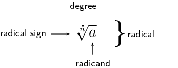

## 1.2 Rational exponents and surds (EMBF5)

The laws of exponents can also be extended to include the rational numbers.
            A rational number is any number that can be written as a fraction with an integer in the numerator and in
            the denominator.
            We also have the following definitions for working with rational exponents.

- If \(r^n = a\), then \(r = \sqrt[n]{a} \quad (n \geq 2)\)
- \(a^{\frac{1}{n}} = \sqrt[n]{a}\)
- \(a^{-\frac{1}{n}} = (a^{-1})^{\frac{1}{n}} = \sqrt[n]{\frac{1}{a}}\)
- \(a^{\frac{m}{n}} = (a^{m})^{\frac{1}{n}} = \sqrt[n]{a^m}\)

            where \(a > 0\), \(r > 0\) and \(m,n \in \mathbb{Z}\), \(n \ne 0\).

For \(\sqrt{25} = 5\), we say that \(\text{5}\) is the square root of \(\text{25}\) and for \(\sqrt[3]{8} =
            2\), we say that \(\text{2}\) is the cube root of \(\text{8}\).
            For \(\sqrt[5]{32} = 2\), we say that \(\text{2}\) is the fifth root of \(\text{32}\).

When dealing with exponents, a root refers to a number that is repeatedly multiplied by itself a certain
            number of times to get another number.
            A radical refers to a number written as shown below.

 

            
<a href="http://www.khanacademy.org/embed_video?v=6QJtWfIiyZo">Video: 223K</a>
            

        

The radical symbol and degree show which root is being determined. The radicand is the number under the
            radical symbol.

- If \(n\) is an even natural number, then the radicand must be positive, otherwise the roots are not
                      real. For example, \(\sqrt[4]{16} = 2\) since \(2 \times 2 \times 2 \times 2 = 16\), but the roots
                      of \(\sqrt[4]{-16}\) are not real since \((-2) \times (-2) \times (-2) \times (-2) \ne -16\).
- If \(n\) is an odd natural number, then the radicand can be positive or negative. For example,
                      \(\sqrt[3]{27} = 3\) since \(3 \times 3 \times 3 = 27\) and we can also determine \(\sqrt[3]{-27} =
                      -3\) since \((-3) \times (-3) \times (-3) = -27\).

A surd is a radical which results in an irrational number. Irrational numbers are numbers that cannot be
            written as a fraction with the numerator and the denominator as integers. For example, \(\sqrt{12}\),
            \(\sqrt[3]{\text{100}}\), \(\sqrt[5]{25}\) are surds.

<Callout type="tip" title="Worked example 3: Rational exponents">
**Question:**
Write each of the following as a radical and simplify where possible:

2. \(18^\frac{1}{2}\)
4. \((-\text{125})^{-\frac{1}{3}}\)
6. \(4^\frac{3}{2}\)
8. \((-81)^\frac{1}{2}\)
10. \((\text{0,008})^\frac{1}{3}\)

2. \(18^\frac{1}{2} = \sqrt{18}\)
4. \((-\text{125})^{-\frac{1}{3}} = \sqrt[3]{(-\text{125})^{-1}} = \sqrt[3]{\dfrac{1}{-\text{125}}} =
                       \sqrt[3]{\dfrac{1}{(-5)^3}} = -\dfrac{1}{5}\)
6. \(4^\frac{3}{2} = (4^3)^{\frac{1}{2}} = \sqrt{4^3} = \sqrt{64} = 8\)
8. \((-81)^\frac{1}{2} = \sqrt{-81} =\) not real
10. \((\text{0,008})^\frac{1}{3} = \sqrt[3]{\dfrac{8}{\text{1 000}}} = \sqrt[3]{\dfrac{2^3}{10^3}}
                       = \frac{2}{10} = \dfrac{1}{5}\)
</Callout>

<QuizCard id="m11-01-02a" title="Interactive Exercise 1.5" question="Evaluate the expression shown.  Your answer should be an integer. \( \qquad 64^{\frac{1}{3}}  \)" options=[] answer="4" hint="You should enter a number here. If you want to, you can use a space to separate thousands.                Example: 12 800,25 For scientific notation you need to use the multiply symbol                ( ∗ ) and the exponent symbol ( ^ ). For example 6,673 × 10 −11 should be written as: 6,673 ∗ 10^−11" explanation="When you see a fraction in the exponent, as in this question, remember the statement \"inside over outside.\"  The top of the fraction goes inside the root, and the bottom of the fraction goes outside the root.  For this question that means: \[\begin{array}{c}64^{\frac{1}{3}} = \sqrt[3] {64^{1}} \quad \textrm{or just} \quad  \sqrt[3] {64}\end{array}\] So \( 64^{\frac{1}{3}} \) represents the cubed root of 64, which is equal to 4 (because \( 4^{3} = 64  \) ). Submit your answer as:" />

<QuizCard id="m11-01-02a" title="Interactive Exercise 1.5" question="Evaluate the expression shown without using a calculator. \[                 \begin{array}{c}                     (\text{16})^{- \frac{\text{3}}{\text{2}}}                 \end{array}             \] NOTE: It is easy to type this into a calculator to get the answer.  However, it is very important for you to understand what the fraction in the exponent                 is telling you , not your calculator!  Also, it is often true that for a question like this you must show your working to get                 full marks. INSTRUCTION: Give your answer as a fraction." options=[] answer="1/64" hint="You are expected to write a fraction here. You can write pure fractions using the division symbol: / For example, to write the fraction \(-\frac{2}{3}\) the correct input would be: -2/3 You can also write mixed numbers by first writing the integer part, then a space and                then the fraction part. For example, to write \(2 \frac{1}{8}\) the correct input                would be: 2 1/8" explanation="Rewrite the expression with a positive exponent First, we can deal with the negative in the exponent. Separate the negative from the rest of the exponent, and then we will get the reciprocal of \(\text{16}\) . \[                     \begin{aligned}                     (\text{16})^{- \frac{\text{3}}{\text{2}}} &=                     \left((\text{16})^{-1}\right)^{\frac{\text{3}}                     {\text{2}}} \\                     &= \left(\frac{1}{16} \right)^{\frac{\text{3}}{\text{2}}}                     \end{aligned}                 \] Rewrite the exponent with a root and evaluate it The denominator of an exponent means the same as taking that root. For example, \(9^\frac{1}{2}\) means the same as \(\sqrt{9}\) and \(x^\frac{1}{3}\) means the same as \(\sqrt[3]{x}\) . \"Inside over outside\" tells us to rewrite the expression like this: \[                     \begin{array}{c}                     \sqrt {\left(\frac{1}{16}\right)^{ 3}}                     \end{array}                 \] Now we have a choice because we must do two things: we need to find a square root, and we also need to raise a number to the exponent \(\text{3}\) . But it is our choice which one we will do first; and the best first step is to do the root first, because it will make the number smaller. \[         \begin{aligned}         \sqrt {\left(\frac{1}{\text{16}}\right)^{\text{3}}} &=         \left(\sqrt {\left(\frac{1}{\text{16}}\right)}\right)^         {\text{3}} \\         &= \left(\frac{1}{4} \right)^{\text{3}}         \end{aligned}         \] Working out the last part we find that \((\text{16})^{-\frac{\text{3}}{\text{2}}}\) is equal to \(\dfrac{1}{64}\) . Submit your answer as:" />

<Callout type="note" title="Note">
<VideoPlayer src="http://www.khanacademy.org/embed_video?v=4F6cFLnAAFc" title="Video: 223M" />
</Callout>

<Callout type="tip" title="Worked example 4: Rational exponents">
**Question:**
Simplify without using a calculator:

                \[\left(\frac{5}{4^{-1}-9^{-1}}\right)^{\frac{1}{2}}\]

**Write the fraction with positive exponents in the denominator:**
\[\left( \dfrac{5}{\frac{1}{4} - \frac{1}{9}} \right)^{\frac{1}{2}}\]

**Simplify the denominator:**
\begin{align*}
                    &= \left( \dfrac{5}{\frac{9-4}{36}} \right)^{\frac{1}{2}} \\
                    &= \left( \dfrac{5}{\frac{5}{36}} \right)^{\frac{1}{2}} \\
                    &= \left( 5 \div \frac{5}{36} \right)^{\frac{1}{2}} \\
                    &= \left( 5 \times \frac{36}{5} \right)^{\frac{1}{2}} \\
                    &= (36)^{\frac{1}{2}}
                    \end{align*}

**Take the square root:**
\begin{align*}
                    &= \sqrt{36}\\
                    &= 6
                    \end{align*}
</Callout>

<Callout type="note" title="Note">
<VideoPlayer src="https://www.youtube.com/embed/NuccqpiUHrk" title="Video: 223N" />
</Callout>

## Rational exponents and surds

### Textbook Exercise 1.3

Simplify the following and write answers with positive exponents:

**Problem:**
\(\sqrt{49}\)

**Solution:**
\(\sqrt{49} = 7\)

**Problem:**
\(\sqrt{36^{-1}}\)

**Solution:**
\begin{align*}
                            36^{-\frac{1}{2}}
                            &= \frac{1}{36^{\frac{1}{2}}} \\
                            &= \frac{1}{\sqrt{36}} \\
                            &= \frac{1}{6}
                            \end{align*}

**Problem:**
\(\sqrt[3]{6^{-2}}\)

**Solution:**
\begin{align*}
                            6^{-\dfrac{2}{3}}
                            &= \frac{1}{6^{\frac{2}{3}}}\\
                            &= \frac{1}{\sqrt[3]{6^2}} \\
                            &= \frac{1}{\sqrt[3]{36}}
                            \end{align*}

**Problem:**
\(\sqrt[3]{-\dfrac{64}{27}}\)

**Solution:**
\begin{align*}
                            \sqrt[3]{-\dfrac{64}{27}}
                            &= \sqrt[3]{-\frac{4^3}{3^3}} \\
                            &= \sqrt[3]{ \left( -\frac{4}{3} \right)^3} \\
                            &= -\frac{4}{3}
                            \end{align*}

**Problem:**
\(\sqrt[4]{(16x^4)^3}\)

**Solution:**
\begin{align*}
                            \sqrt[4]{(16x^4)^3}
                            &= \left( (16x^4)^3 \right)^{\frac{1}{4}} \\
                            &= \left( 2^4x^4 \right)^{\frac{3}{4}} \\
                            &= 2^3x^3 \\
                            &= 8x^3
                            \end{align*}

Simplify:

**Problem:**
\({s}^{\frac{1}{2}}÷{s}^{\frac{1}{3}}\)

**Solution:**
\begin{align*}
                            s^{\frac{1}{2}} \div s^{\frac{1}{3}}
                            &= s^{\frac{1}{2}} \times \frac{1}{s^{\frac{1}{3}}} \\
                            &= s^{\frac{1}{2} - \frac{1}{3}} \\
                            &= s^{\frac{3}{6} - \frac{2}{6}} \\
                            &= s^{\frac{1}{6}}
                            \end{align*}

**Problem:**
\({\left(64{m}^{6}\right)}^{\frac{2}{3}}\)

**Solution:**
\begin{align*}
                            \left( 64m^6 \right)^{\frac{2}{3}}
                            &= \left( 2^6 \right)^{\frac{2}{3}} \left( m^6 \right)^{\frac{2}{3}} \\
                            &= \left( 2^4 \right) \left( m^4 \right) \\
                            &= 16m^4
                            \end{align*}

**Problem:**
\(\dfrac{12m^{ \frac{7}{9}}}{8m^{- \frac{11}{9}}}\)

**Solution:**
\begin{align*}
                            \dfrac{12m^{\frac{7}{9}}}{8m^{-\frac{11}{9}}}
                            &= \frac{3}{2} m^{ \frac{7}{9} - \left( - \frac{11}{9} \right)} \\
                            &= \frac{3}{2} m^{\frac{18}{9}} \\
                            &= \frac{3}{2}m^{2}
                            \end{align*}

**Problem:**
\(\left(5x\right)^0 + 5x^0 - \left(\text{0,25}\right)^{-\text{0,5}} + 8^{\frac{2}{3}}\)

**Solution:**
\begin{align*}
                            \left(5x\right)^0 + 5x^0 - \left(\text{0,25}\right)^{-\text{0,5}} + 8^{\frac{2}{3}}
                            &= \left(1 \right) + 5(1)- \left( \frac{1}{4} \right)^{-\frac{1}{2}} + \left(2^3
                            \right)^{\frac{2}{3}} \\
                            &= 6 - 4^{\frac{1}{2}} + 4 \\
                            &= 10 - 2 \\
                            &= 8
                            \end{align*}

**Problem:**
Use the laws to re-write the following expression as a power of \(x\):

                        \(x\sqrt{x\sqrt{x\sqrt{x\sqrt{x}}}}\)

**Solution:**
\begin{align*}
                        x \sqrt{x \sqrt{x\sqrt{x\sqrt{x}}}}
                        &= x \times x^{\frac{1}{2}} \times x^{\frac{1}{4}} \times x^{\frac{1}{8}} \times
                        x^{\frac{1}{16}} \\
                        &= x^{\frac{16}{16}} \times x^{\frac{8}{16}} \times x^{\frac{4}{16}} \times
                        x^{\frac{2}{16}}\times x^{\frac{1}{16}} \\
                        &= x^{\frac{31}{16}}
                        \end{align*}

### Simplification of surds (EMBF6)

We have seen in previous examples and exercises that rational exponents are closely related to surds. It
                is often useful to write a surd in exponential notation as it allows us to use the exponential laws.

The additional laws listed below make simplifying surds easier:

- \(\sqrt[n]{a}\sqrt[n]{b} = \sqrt[n]{ab}\)
- \(\sqrt[n]{\dfrac{a}{b}} = \dfrac{\sqrt[n]{a}}{\sqrt[n]{b}}\)
- \(\sqrt[m]{\sqrt[n]{a}} = \sqrt[mn]{a}\)
- \(\sqrt[n]{a^m} = a^{\frac{m}{n}}\)
- \(\left( \sqrt[n]{a} \right)^m = a^{\frac{m}{n}}\)

<Callout type="tip" title="Worked example 5: Simplifying surds">
**Question:**
Show that:

2. \(\sqrt[n]{a} \times \sqrt[n]{b} = \sqrt[n]{ab}\)
4. \(\sqrt[n]{\dfrac{a}{b}} = \dfrac{\sqrt[n]{a}}{\sqrt[n]{b}}\)

2. \begin{align*}
                           \sqrt[n]{a} \times \sqrt[n]{b}
                           &= a^{\frac{1}{n}} \times b^{\frac{1}{n}} \\
                           &= (ab)^{\frac{1}{n}} \\
                           &= \sqrt[n]{ab}
                           \end{align*}
4. \begin{align*}
                           \sqrt[n]{\frac{a}{b}}
                           &= \left( \frac{a}{b} \right)^{\frac{1}{n}} \\
                           &= \dfrac{a^{\frac{1}{n}}}{b^{\frac{1}{n}}} \\
                           &= \dfrac{\sqrt[n]{a}}{\sqrt[n]{b}}
                           \end{align*}
</Callout>

Examples:

2. \(\sqrt{2} \times \sqrt{32} = \sqrt{2 \times 32} = \sqrt{64} = 8\)
4. \(\dfrac{\sqrt[3]{24}}{\sqrt[3]{3}} = \sqrt[3]{\dfrac{24}{3}} = \sqrt[3]{8} = 2\)
6. \(\sqrt{\sqrt{81}} = \sqrt[4]{81} = \sqrt[4]{3^4} = 3\)

### Like and unlike surds (EMBF7)

Two surds \(\sqrt[m]{a}\) and \(\sqrt[n]{b}\) are like surds if \(m=n\), otherwise they are called unlike
                surds. For example, \(\sqrt{\frac{1}{3}}\) and \(-\sqrt{61}\) are like surds because \(m = n = 2\).
                Examples of unlike surds are \(\sqrt[3]{5} \text{ and } \sqrt[5]{7y^3}\) since \(m \ne n\).

### Simplest surd form (EMBF8)

We can sometimes simplify surds by writing the radicand as a product of factors that can be further
                simplified using \(\sqrt[n]{ab} = \sqrt[n]{a} \times \sqrt[n]{b}\).

<Callout type="note" title="Note">
<VideoPlayer src="http://www.khanacademy.org/embed_video?v=BpBh8gvMifs" title="Video:
                        2242" />
</Callout>

<Callout type="tip" title="Worked example 6: Simplest surd form">
**Question:**
Write the following in simplest surd form: \(\sqrt{50}\)

**Write the radicand as a product of prime factors:**
\begin{align*}
                        \sqrt{50} &= \sqrt{5 \times 5 \times 2} \\
                        &= \sqrt{5^2 \times 2}
                        \end{align*}

**Simplify using \(\sqrt[n]{ab} = \sqrt[n]{a} \times \sqrt[n]{b}\):**
\begin{align*}
                        &= \sqrt{5^2} \times \sqrt{2} \\
                        &= 5 \times \sqrt{2} \\
                        &= 5\sqrt{2}
                        \end{align*}
</Callout>

Sometimes a surd cannot be simplified. For example, \(\sqrt{6}, \sqrt[3]{30} \text{ and } \sqrt[4]{42}\)
                are already in their simplest form.

<Callout type="tip" title="Worked example 7: Simplest surd form">
**Question:**
Write the following in simplest surd form: \(\sqrt[3]{54}\)

**Write the radicand as a product of prime factors:**
\begin{align*}
                        \sqrt[3]{54} &= \sqrt[3]{3 \times 3 \times 3 \times 2} \\
                        &= \sqrt[3]{3^3 \times 2}
                        \end{align*}

**Simplify using \(\sqrt[n]{ab} = \sqrt[n]{a} \times \sqrt[n]{b}\):**
\begin{align*}
                        &= \sqrt[3]{3^3} \times \sqrt[3]{2} \\
                        &= 3 \times \sqrt[3]{2} \\
                        &= 3\sqrt[3]{2}
                        \end{align*}
</Callout>

<QuizCard id="m11-01-02c" title="Interactive Exercise 1.7" question="Simplify the surd below.  Write your answer with a fractional exponent. \[\begin{array}{c}\sqrt[3]{\text{250}}\end{array}\] INSTRUCTION: You must put brackets on the exponent for this answer. For example: for the answer \( 2 \cdot 5^{\frac{1}{2}} \; \) you should type: 2 * 5^(1/2) for the answer \( 2 \cdot 5^{\frac{1}{3}} \; \) you should type: 2 * 5^(1/3)" options=[] answer="['5*2^(1/3)', '2^(1/3)*5', '5*(2)^(1/3)', '(2)^(1/3)*5', '5*(2^(1/3))', '(2^(1/3))*5', '5*((2)^(1/3))', '((2)^(1/3))*5']" hint="Your answer should be a mathematical expression. You can use the following symbols to write mathematical expressions: add: + subtract: − multiply: ∗ divide: / exponent: ^ The following special symbols are also recognised: pi (π): pi infinity (∞): oo It is also possible to write certain functions: √: sqrt( ) log: log( ) sin: sin( ) cosec: cosec( ) cos: cos( ) sec: sec( ) tan: tan( ) cot: cot( ) To write a logarithm with a specific base, use the underscore _ symbol.                For example, log of x base 3 can be written as: log_3 x" explanation="To start this question, we must break the radicand (the number inside the root) into a product which includes a cube number.  In this case we can find a factor of \(\text{125}\) in the radicand: \[\begin{array}{c}\sqrt[3]{\text{250}} =  \sqrt[3]{\text{125} \times \text{2}}\end{array}\] Now we can simplfy the part of the root with the cube number. \[                     \begin{aligned}                     \sqrt[3]{\text{250}} & = \sqrt[3]{\text{125} \times \text{2}}	\\                     & = \sqrt[3]{\text{125}} \times \sqrt[3]{\text{2}}		\\                     &= \text{5} \sqrt[3]{\text{2}} 	\\                     & = \text{5}\left( \text{2} \right)^{\frac{1}{3}}                     \end{aligned}                 \] That does it: \( \sqrt[3]{\text{250}} = \text{5} \left( \text{2} \right)^{\frac{1}{3}}  \) . TIP: Any root can be rewritten as a fractional exponent using the general mathematical rule \(\sqrt[n]{x} = x^{\frac{1}{n}}\) . Because of this, a square root is simply expressed as a power of \(\frac{1}{2}\) , and a cube root is expressed as a power of \(\frac{1}{3}\) . Submit your answer as:" />

<QuizCard id="m11-01-02c" title="Interactive Exercise 1.7" question="Simplify the surd below without using a calculator. \[\begin{array}{c}\left(\text{208}\right)^{\frac{1}{2}}\end{array}\] INSTRUCTION: Write your answer with an exponent rather than a root (type ^(1/2) for a square root or ^(1/3) for a cube root )." options=[] answer="['4*13^(1/2)', '4*(13)^(1/2)', '4(13^(1/2))']" hint="Your answer should be a mathematical expression. You can use the following symbols to write mathematical expressions: add: + subtract: − multiply: ∗ divide: / exponent: ^ The following special symbols are also recognised: pi (π): pi infinity (∞): oo It is also possible to write certain functions: √: sqrt( ) log: log( ) sin: sin( ) cosec: cosec( ) cos: cos( ) sec: sec( ) tan: tan( ) cot: cot( ) To write a logarithm with a specific base, use the underscore _ symbol.                For example, log of x base 3 can be written as: log_3 x" explanation="In this case, the expression has a rational exponent; to start this question it is helpful to rewrite the expression with a root!  After that, we must break the radicand (the number inside the root) into a product which includes a square number.  In this case we can find a factor of \(\text{16}\) in the radicand. \[\begin{array}{c}\sqrt{\text{208}} = \sqrt{\text{16} \times \text{13}}\end{array}\] Now we can simplify the part of the root with the square number. \[                     \begin{aligned}                         \sqrt{\text{208}} & = \sqrt{\text{16} \times \text{13}}  \\                         & = \sqrt{\text{16}} \times \sqrt{\text{13}} \\                         &= \text{4}\sqrt{\text{13}} \\                         & = \text{4}  (\text{13})^{\frac{1}{2}}                     \end{aligned}                 \] Submit your answer as:" />

<Callout type="tip" title="Worked example 8: Simplest surd form">
**Question:**
Simplify: \(\sqrt{\text{147}}+\sqrt{\text{108}}\)

**Write the radicands as a product of prime factors:**
\begin{align*}
                        \sqrt{\text{147}} + \sqrt{\text{108}} &= \sqrt{49 \times 3} + \sqrt{36 \times 3} \\
                        &= \sqrt{7^2 \times 3} + \sqrt{6^2 \times 3}
                        \end{align*}

**Simplify using \(\sqrt[n]{ab} = \sqrt[n]{a} \times \sqrt[n]{b}\):**
\begin{align*}
                        &= \left( \sqrt{7^2} \times \sqrt{3} \right) + \left( \sqrt{6^2} \times \sqrt{3} \right)\\
                        &= \left( 7 \times \sqrt{3} \right) + \left( 6 \times \sqrt{3} \right) \\
                        &= 7\sqrt{3} + 6\sqrt{3}
                        \end{align*}

**Simplify and write the final answer:**
\[13 \sqrt{3}\]
</Callout>

<Callout type="tip" title="Worked example 9: Simplest surd form">
**Question:**
Simplify: \(\left( \sqrt{20} - \sqrt{5} \right)^2\)

**Factorise the radicands were possible:**
\[\left( \sqrt{20} - \sqrt{5} \right)^2 = \left( \sqrt{4 \times 5} - \sqrt{5} \right)^2\]

**Simplify using \(\sqrt[n]{ab} = \sqrt[n]{a} \times \sqrt[n]{b}\):**
\begin{align*}
                        &= \left( \sqrt{4} \times \sqrt{5} - \sqrt{5} \right)^2 \\
                        &= \left( 2 \times \sqrt{5} - \sqrt{5} \right)^2 \\
                        &= \left( 2\sqrt{5} - \sqrt{5} \right)^2
                        \end{align*}

**Simplify and write the final answer:**
\begin{align*}
                        &= \left( \sqrt{5} \right)^2 \\
                        &= 5
                        \end{align*}
</Callout>

<QuizCard id="m11-01-02d" title="Interactive Exercise 1.8" question="Simplify the expression shown by collecting like surds where possible. \[                 \begin{aligned}                 \sqrt[3]{\text{48}} + \sqrt[3]{\text{750}}                 \end{aligned}             \] INSTRUCTIONS: Do not use a calculator. Write your answer with an exponent. Type ?^(1/2) for a square root                         or ?^(1/3) for a cube root." options=[] answer="7*6^(1/3)" hint="Your answer should be a mathematical expression. You can use the following symbols to write mathematical expressions: add: + subtract: − multiply: ∗ divide: / exponent: ^ The following special symbols are also recognised: pi (π): pi infinity (∞): oo It is also possible to write certain functions: √: sqrt( ) log: log( ) sin: sin( ) cosec: cosec( ) cos: cos( ) sec: sec( ) tan: tan( ) cot: cot( ) To write a logarithm with a specific base, use the underscore _ symbol.                For example, log of x base 3 can be written as: log_3 x" explanation="Rewrite each term with a cube number Begin by simplifying each term. Look for a cube number inside of each radicand.                     For the first term, we can rewrite \( \text{48} \) as \( \text{8} \times \text{6} \) . For the second term you can rewrite \( \text{750} \) as \( \text{125} \times \text{6} \) . Then the question changes to this: \[                     \begin{aligned}                     \sqrt[3] {\text{48}} + \sqrt[3] {\text{750}} = \sqrt[3] {\text{8} \times \text{6}} + \sqrt[3] {\text{125} \times \text{6}}                     \end{aligned}                 \] Simplify each term The next thing to do is simplify each of the surds as much as possible: \[                     \begin{aligned}                     \sqrt[3] {\text{48}} + \sqrt[3] {\text{750}} & = \sqrt[3] {\text{8} \times \text{6}} + \sqrt[3] {\text{125} \times \text{6}}        \\                     & = \text{2} \sqrt[3] {\text{6}} +  \text{5}\sqrt[3] { \text{6}}                      \end{aligned}                 \] Combine the terms if possible Now we can combine the terms. This is possible because the roots are identical. \[                     \begin{aligned}                     & = \text{2} \sqrt[3] {\text{6}} +  \text{5}\sqrt[3] { \text{6}}  \\                     & = \text{7} \sqrt[3] {\text{6}} \\                     & = \text{7} (\text{6})^{\frac{1}{3}}                     \end{aligned}                 \] NOTE: It is possible to type the question into a calculator and get the correct answer.                     But on a test or an exam, you will only get full marks if you show the steps. \( \sqrt[3]{\text{48}} + \sqrt[3]{\text{750}} \) is equal to \( \text{7}                     (\text{6})^{\frac{1}{3}} \) . Submit your answer as:" />

<QuizCard id="m11-01-02d" title="Interactive Exercise 1.8" question="Simplify the expression shown by collecting like surds where possible. \[                 \begin{aligned}                 \sqrt{\text{50}} - \sqrt{\text{32}}                 \end{aligned}             \] INSTRUCTIONS: Do not use a calculator. Write your answer with an exponent. Type ?^(1/2) for a square root                         or ?^(1/3) for a cube root." options=[] answer="['1*2^(1/2)', '1*sqrt(2)']" hint="Your answer should be a mathematical expression. You can use the following symbols to write mathematical expressions: add: + subtract: − multiply: ∗ divide: / exponent: ^ The following special symbols are also recognised: pi (π): pi infinity (∞): oo It is also possible to write certain functions: √: sqrt( ) log: log( ) sin: sin( ) cosec: cosec( ) cos: cos( ) sec: sec( ) tan: tan( ) cot: cot( ) To write a logarithm with a specific base, use the underscore _ symbol.                For example, log of x base 3 can be written as: log_3 x" explanation="Rewrite each term with a square number Begin by simplifying each term. Look for a square number inside of each radicand.                     For the first term, we can rewrite \( \text{50} \) as \( \text{25} \times \text{2} \) . For the second term you can rewrite \( \text{32} \) as \( \text{16} \times \text{2} \) . Then the question changes to this: \[                     \begin{aligned}                     \sqrt {\text{50}} - \sqrt {\text{32}} = \sqrt {\text{25} \times \text{2}} - \sqrt {\text{16} \times \text{2}}                     \end{aligned}                 \] Simplify each term The next thing to do is simplify each of the surds as much as possible: \[                     \begin{aligned}                     \sqrt {\text{50}} - \sqrt {\text{32}} & = \sqrt {\text{25} \times \text{2}} - \sqrt {\text{16} \times \text{2}}        \\                     & = \text{5} \sqrt {\text{2}} - \left( \text{4}\sqrt { \text{2}} \right)                     \end{aligned}                 \] Combine the terms if possible Now we can combine the terms. This is possible because the roots are identical. \[                     \begin{aligned}                     & = \text{5} \sqrt {\text{2}} - \left( \text{4}\sqrt { \text{2}} \right) \\                     & = \text{} \sqrt {\text{2}} \\                     & = \text{} (\text{2})^{\frac{1}{2}}                     \end{aligned}                 \] NOTE: It is possible to type the question into a calculator and get the correct answer.                     But on a test or an exam, you will only get full marks if you show the steps. \( \sqrt{\text{50}} - \sqrt{\text{32}} \) is equal to \( \text{}                     (\text{2})^{\frac{1}{2}} \) . Submit your answer as:" />

<Callout type="tip" title="Worked example 10: Simplest surd form with fractions">
**Question:**
Write in simplest surd form: \(\sqrt{75} \times \sqrt[3]{(48)^{-1}}\)

**Factorise the radicands were possible:**
\begin{align*}
                        \sqrt{75} \times \sqrt[3]{(48)^{-1}} &= \sqrt{25 \times 3} \times \sqrt[3]{\frac{1}{48}} \\
                        &= \sqrt{25 \times 3} \times \frac{1}{\sqrt[3]{8 \times 6}}
                        \end{align*}

**Simplify using \(\sqrt[n]{ab} = \sqrt[n]{a} \times \sqrt[n]{b}\):**
\begin{align*}
                        &= \sqrt{25} \times \sqrt{3} \times \frac{1}{\sqrt[3]{8} \times \sqrt[3]{6}} \\
                        &= 5 \times \sqrt{3} \times \frac{1}{2 \times \sqrt[3]{6}}
                        \end{align*}

**Simplify and write the final answer:**
\begin{align*}
                        &= 5\sqrt{3} \times \frac{1}{2\sqrt[3]{6}} \\
                        &= \frac{5\sqrt{3}}{2\sqrt[3]{6}}
                        \end{align*}
</Callout>

<QuizCard id="m11-01-02e" title="Interactive Exercise 1.9" question="Simplify the expression below without using a calculator. \[                     \begin{array}{c}                         \qquad  \dfrac{\sqrt[4]{6^{-6}}} {\sqrt[9]{6^{3}} \; \sqrt[6]{6^{-23}}}                     \end{array}                 \]" options=[] answer="36" hint="You are expected to write a fraction here. You can write pure fractions using the division symbol: / For example, to write the fraction \(-\frac{2}{3}\) the correct input would be: -2/3 You can also write mixed numbers by first writing the integer part, then a space and                then the fraction part. For example, to write \(2 \frac{1}{8}\) the correct input                would be: 2 1/8" explanation="The first step in this question is to rewrite the roots as exponents.  That will let us use the exponent rules to simplify the entire fraction.  Notice that you should simplify any of the fractions that you get in the exponents (as always with fractions!). \[                         \begin{aligned}                         & \;  \dfrac{\sqrt[4]{6^{-6}}} {\sqrt[9]{6^{3}} \; \sqrt[6]{6^{-23}}}\\                          = & \;  \dfrac{(6)^{\frac{-6}{4}}} {(6)^{\frac{3}{9}} \; (6)^{\frac{-23}{6}} }	\\                          = & \;  \dfrac{(6)^{- \frac{3}{2}}} {(6)^{\frac{1}{3}} \; (6)^{- \frac{23}{6}}}                         \end{aligned}                     \] At this point, there are two parts in the denominator which we can combine by adding their exponents: \[                         \begin{aligned}                         & \;  \dfrac{(6)^{- \frac{3}{2}}} {(6)^{\frac{1}{3}} \; (6)^{- \frac{23}{6}}} \\                         = & \;  \dfrac{(6)^{- \frac{3}{2}}} {(6)^{\left( \frac{1}{3} \right) + \left( - \frac{23}{6} \right)}}	\\                         = & \;  \dfrac{(6)^{- \frac{3}{2}}} {(6)^{- \frac{7}{2}}}                         \end{aligned}                     \] Now use the rule for exponents in fractions: subtract the lower exponent from the upper one: \[                         \begin{aligned}                         & \;  \dfrac{(6)^{- \frac{3}{2}}} {(6)^{- \frac{7}{2}}} \\                         = & \;  (\text{6})^{\left(- \frac{3}{2}\right) - \left(- \frac{7}{2}\right)}	\\                         = & \;  (\text{6})^{\text{2}}                         \end{aligned}                     \] After all of that, all of those roots simplify to \(\text{2}\) , and the answer is \( 36 \) . Submit your answer as:" />

## Simplification of surds

### Textbook Exercise 1.4

Simplify the following and write answers with positive exponents:

**Problem:**
\(\sqrt[3]{16} \times \sqrt[3]{4}\)

**Solution:**
\(\sqrt[3]{16} \times \sqrt[3]{4} = \sqrt[3]{16 \times 4} = \sqrt[3]{64} = 4\)

**Problem:**
\(\sqrt{a^2b^3} \times \sqrt{b^5c^4}\)

**Solution:**
\(\sqrt{a^2b^3} \times \sqrt{b^5c^4} = \sqrt{a^2b^8c^4} = ab^4c^2\)

**Problem:**
\(\dfrac{\sqrt{12}}{\sqrt{3}}\)

**Solution:**
\(\dfrac{\sqrt{12}}{\sqrt{3}} = \sqrt{\dfrac{12}{3}} = \sqrt{4} = 2\)

**Problem:**
\(\sqrt{x^2y^{13}} \div \sqrt{y^5}\)

**Solution:**
\(\sqrt{x^2y^{13}} \div \sqrt{y^5} = \sqrt{\frac{x^2y^{13}}{y^5}} = \sqrt{x^2y^8} =
                                    xy^4\)

Simplify the following:

**Problem:**
\(\left( \dfrac{1}{a} - \dfrac{1}{b} \right)^{-1}\)

**Solution:**
\begin{align*}
                                \left( \dfrac{1}{a} - \dfrac{1}{b} \right)^{-1} &= \left( \dfrac{b - a}{ab}
                                \right)^{-1} \\
                                &= \frac{ab}{b - a}
                                \end{align*}

**Problem:**
\(\dfrac{b-a}{a^{\frac{1}{2}} - b^{\frac{1}{2}}}\)

**Solution:**
\begin{align*}
                                \dfrac{b-a}{a^{\frac{1}{2}} - b^{\frac{1}{2}}} &= - \dfrac{a - b}{a^{\frac{1}{2}} -
                                b^{\frac{1}{2}}} \\
                                &= - \dfrac{ \left( a^{\frac{1}{2}} \right)^2- \left( b^{\frac{1}{2}}
                                \right)^2}{a^{\frac{1}{2}} - b^{\frac{1}{2}}} \\
                                &= - \dfrac{ \left( a^{\frac{1}{2}} - b^{\frac{1}{2}} \right)\left( a^{\frac{1}{2}}
                                + b^{\frac{1}{2}} \right) } {a^{\frac{1}{2}} - b^{\frac{1}{2}}} \\
                                &= - \left( a^{\frac{1}{2}} + b^{\frac{1}{2}} \right)
                                \end{align*}

### Rationalising denominators (EMBF9)

It is often easier to work with fractions that have rational denominators instead of surd denominators.
                By rationalising the denominator, we convert a fraction with a surd in the denominator to a fraction
                that has a rational denominator.

<Callout type="tip" title="Worked example 11: Rationalising the denominator">
**Question:**
Rationalise the denominator:
                        \[\frac{5x-16}{\sqrt{x}}\]

**Multiply the fraction by \(\frac{\sqrt{x}}{\sqrt{x}}\):**
Notice that \(\frac{\sqrt{x}}{\sqrt{x}}=1\), so the value of the fraction has not been changed.

                    \[\frac{5x - 16}{\sqrt{x}} \times \frac{\sqrt{x}}{\sqrt{x}} = \frac{\sqrt{x}(5x - 16)}{\sqrt{x}
                    \times \sqrt{x}}\]

**Simplify the denominator:**
\begin{align*}
                        &= \frac{\sqrt{x}(5x - 16)}{\left( \sqrt{x}\right)^2} \\
                        &= \frac{\sqrt{x}(5x - 16)}{x}
                        \end{align*}

The term in the denominator has changed from a surd to a rational number. Expressing the surd in
                        the numerator is the preferred way of writing expressions.
</Callout>

<Callout type="tip" title="Worked example 12: Rationalising the denominator">
**Question:**
Write the following with a rational denominator:
                        \[\frac{y-25}{\sqrt{y}+5}\]

**Multiply the fraction by \(\frac{\sqrt{y}-5}{\sqrt{y}-5}\):**
To eliminate the surd from the denominator, we must multiply the fraction by an expression that
                        will result in a difference of two squares in the denominator.

                    \[\frac{y-25}{\sqrt{y}+5} \times \frac{\sqrt{y}-5}{\sqrt{y}-5}\]

**Simplify the denominator:**
\begin{align*}
                        &= \frac{(y-25)(\sqrt{y}-5)}{(\sqrt{y}+5)(\sqrt{y}-5)} \\
                        &= \frac{(y-25)(\sqrt{y}-5)}{(\sqrt{y})^2 -25} \\
                        &= \frac{(y-25)(\sqrt{y}-5)}{y-25} \\
                        &= \sqrt{y}-5
                        \end{align*}
</Callout>

<Callout type="note" title="Note">
<VideoPlayer src="https://www.youtube.com/embed/Z3db5itCIiQ" title="Video: 2249" />
</Callout>

## Rationalising the denominator

### Textbook Exercise 1.5

Rationalise the denominator in each of the following:

**Problem:**
\(\dfrac{10}{\sqrt{5}}\)

**Solution:**
\begin{align*}
                            \dfrac{10}{\sqrt{5}}
                            &=\frac{10}{\sqrt{5}} \times \frac{\sqrt{5}}{\sqrt{5}} \\
                            &=\frac{10\sqrt{5}}{5} \\
                            &= 2\sqrt{5}
                            \end{align*}

**Problem:**
\(\dfrac{3}{\sqrt{6}}\)

**Solution:**
\begin{align*}
                            \dfrac{3}{\sqrt{6}}
                            &=\frac{3}{\sqrt{6}} \times \dfrac{\sqrt{6}}{\sqrt{6}} \\
                            &=\frac{3\sqrt{6}}{6} \\
                            &=\frac{\sqrt{6}}{2}
                            \end{align*}

**Problem:**
\(\dfrac{2}{\sqrt{3}} \div \dfrac{\sqrt{2}}{3}\)

**Solution:**
\begin{align*}
                            \dfrac{2}{\sqrt{3}} \div \dfrac{\sqrt{2}}{3}
                            &=\dfrac{2}{\sqrt{3}} \div \dfrac{\sqrt{2}}{3} \\
                            &=\dfrac{2}{\sqrt{3}} \times \dfrac{3}{\sqrt{2}} \\
                            &=\dfrac{6}{\sqrt{6}} \times \dfrac{\sqrt{6}}{\sqrt{6}} \\
                            &=\frac{6\sqrt{6}}{6} \\
                            &=\sqrt{6}
                            \end{align*}

**Problem:**
\(\dfrac{3}{\sqrt{5}-1}\)

**Solution:**
\begin{align*}
                            \dfrac{3}{\sqrt{5}-1}
                            &=\dfrac{3}{\sqrt{5}-1} \times \dfrac{\sqrt{5}+1}{\sqrt{5}+1} \\
                            &=\dfrac{3\sqrt{5}+3}{5-1} \\
                            &= \dfrac{3\sqrt{5}+3}{4}
                            \end{align*}

**Problem:**
\(\dfrac{x}{\sqrt{y}}\)

**Solution:**
\begin{align*}
                            \dfrac{x}{\sqrt{y}}
                            &=\dfrac{x}{\sqrt{y}}\times \dfrac{\sqrt{y}}{\sqrt{y}} \\
                            &=\dfrac{x\sqrt{y}}{y}
                            \end{align*}

**Problem:**
\(\dfrac{\sqrt{3} + \sqrt{7}}{\sqrt{2}}\)

**Solution:**
\begin{align*}
                            \dfrac{\sqrt{3} + \sqrt{7}}{\sqrt{2}}
                            &=\dfrac{\sqrt{3}+\sqrt{7}}{\sqrt{2}} \times \dfrac{\sqrt{2}}{\sqrt{2}} \\
                            &=\dfrac{\sqrt{3}\sqrt{2}+\sqrt{7}\sqrt{2}}{2} \\
                            &=\dfrac{\sqrt{6}+\sqrt{14}}{2}
                            \end{align*}

**Problem:**
\(\dfrac{3\sqrt{p} - 4}{\sqrt{p}}\)

**Solution:**
\begin{align*}
                            \dfrac{3\sqrt{p} - 4}{\sqrt{p}}
                            &=\dfrac{3\sqrt{p}-4}{\sqrt{p}} \times \dfrac{\sqrt{p}}{\sqrt{p}} \\
                            &=\dfrac{3\left ( \sqrt{p} \right )^2-4\left ( \sqrt{p} \right )}{p} \\
                            &=\dfrac{3p-4\sqrt{p}}{p}
                            \end{align*}

**Problem:**
\(\dfrac{t-4}{\sqrt{t} + 2}\)

**Solution:**
\begin{align*}
                            \dfrac{t-4}{\sqrt{t} + 2}
                            &=\dfrac{t-4}{\sqrt{t}+2} \times \dfrac{\sqrt{t}-2}{\sqrt{t}-2} \\
                            &=\dfrac{\left ( t-4 \right )\left ( \sqrt{t}-2 \right )}{t-4} \\
                            &=\sqrt{t}-2
                            \end{align*}

**Problem:**
\(\left( 1 + \sqrt{m} \right)^{-1}\)

**Solution:**
\begin{align*}
                            \left( 1 + \sqrt{m} \right)^{-1}
                            &=\frac{1}{1+\sqrt{m}}\times \frac{1-\sqrt{m}}{1-\sqrt{m}} \\
                            &=\frac{1-\sqrt{m}}{1-m}
                            \end{align*}

**Problem:**
\(a \left( \sqrt{a} \div \sqrt{b} \right)^{-1}\)

**Solution:**
\begin{align*}
                            a \left( \sqrt{a} \div \sqrt{b} \right)^{-1}
                            &=a\left ( \sqrt{a} \times\frac{1}{\sqrt{b}} \right )^{-1} \\
                            &=a\left ( \frac{\sqrt{a}}{\sqrt{b}} \right )^{-1} \\
                            &=a\frac{\sqrt{b}}{\sqrt{a}} \times \frac{\sqrt{a}}{\sqrt{a}} \\
                            &=\frac{a\sqrt{ab}}{a} \\
                            &=\sqrt{ab}
                            \end{align*}
