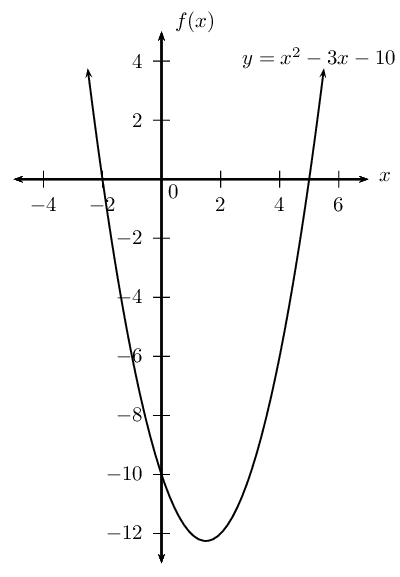
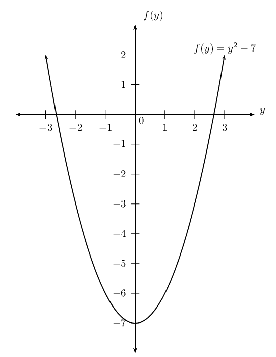

# Chapter 2: Equations and inequalities

## 2.1 Revision (EMBFF)

### Solving quadratic equations using factorisation (EMBFG)

- Discuss terminology.
- Emphasize the golden rule of solving equations: what you do to the left-hand side (LHS), you must do to
              the right-hand side (RHS). The LHS must always equal the RHS.
- Emphasize using equivalence and the additive inverse in equations (and not “taking the term to the
              other side”).
- Graphs have been included to help learners visualize answers. Encourage learners to draw quick sketches
              even if a graph is not required in the solution.
- Encourage learners to check that an expression has been correctly factorised by expanding the brackets to
              get back to the original expression.
- Encourage learners to check their answers (solutions) but substituting back into the original equation and
              making sure the solution satisfies the equation.
- Both methods for completing the square have been included:
- Taking the square root of both sides of the equation. This is the preferred and easier method. Remember to
              include \(\pm\)so as not to lose one solution.
- Factorising: this method is used in Grade 12 for the equation of a circle.
- A common mistake made by learners is writing the quadratic formula as \(x = -b \pm \frac{b^2 –
              4ac}{2a}\).
- For the nature of roots investigation, allow learners to discover the connection between answers obtained
              using the quadratic formula and the value of the discriminant.
- Word problems: encourage learners to develop their skills in interpreting word problems by drawing
              sketches and making tables of the given information.

| Terminology: |  |
| --- | --- |
| Expression | An expression is a term or group of terms consisting of numbers, variables and the basic operators (\(+,
            -, \times, \div, x^n\)). |
| Equation | A mathematical statement that asserts that two expressions are equal. |
| Inequality | An inequality states the relation between two expressions (\(>, <, \geq, \leq\)). |
| Solution | A value or set of values that satisfy the original problem statement. |
| Root | A root of an equation is the value of \(x\) such that \(f(x)=0\). |

A quadratic equation is an equation of the second degree; the exponent of one variable is \(\text{2}\).

The following are examples of quadratic equations:

      \begin{align*}
      2x^2-5x &= 12 \\
      a(a-3)-10 &= 0 \\
      \frac{3b}{b+2} + 1 &= \frac{4}{b+1}
      \end{align*}

A quadratic equation has at most two solutions, also referred to as roots. There are some situations, however,
        in which a quadratic equation has either one solution or no solutions.

| \(\begin{aligned}
              y &= (x-2)(x+2) \\
              &= x^2 - 4
              \end{aligned}\) Graph of a quadratic equation with two roots: \(x = -2\) and \(x = 2\). | \(y = x^2\) Graph of a quadratic equation with one root: \(x = 0\). | \(y = x^2 + x + 1\) Graph of a quadratic equation with no real roots. |

One method for solving quadratic equations is factorisation. The standard form of a quadratic equation is
        \(ax^2+bx+c=0\) and it is the starting point for solving any equation by factorisation.

It is very important to note that one side of the equation must be equal to zero.

## Zero product law

Solve the following equations:

2. \(6 \times 0 = \text{?}\)
4. \(-25 \times 0 = \text{?}\)
6. \(0 \times \text{0,69} = \text{?}\)
8. \(7 \times \text{?} = 0\)

Now solve for the variable in each of the following:

2. \(6 \times m = 0\)
4. \(32 \times x \times 2 = 0\)
6. \(11(z-3) = 0\)
8. \((k+3)(k-4) = 0\)

To obtain the two roots we use the fact that if \(a\times b=0\), then \(a=0\) and/or \(b=0\). This is called
        the zero product law.

### Method for solving quadratic equations (EMBFH)

2. Rewrite the equation in the standard form \(a{x}^{2}+bx+c=0\).
4. Divide the entire equation by any common factor of the coefficients
               to obtain a simpler equation of the form \(a{x}^{2}+bx+c=0\), where \(a\), \(b\) and \(c\) have no common
               factors.
6. Factorise \(a{x}^{2}+bx+c=0\) to be of the form \(\left(rx+s\right)\left(ux+v\right)=0\).
8. The two solutions are
             \[\begin{array}{r@{\;}l@{\qquad\qquad}r@{\;}l}
             (rx+s) &= 0 & (ux+v) &= 0 \\
             \text{So } x &= -\dfrac{s}{r} & \text{So } x &= -\dfrac{v}{u}
             \end{array}\]
10. Always check the solution by substituting the answer back into the original equation.

<Callout type="tip" title="Worked example 1: Solving quadratic equations using factorisation">
**Question:**
Solve for \(x\): \(\phantom{\rule{3.33333pt}{0ex}}x\left(x-3\right)=10\)

**Rewrite the equation in the form \(a{x}^{2}+bx+c=0\):**
Expand the brackets and subtract \(\text{10}\) from both sides of the equation

          \({x}^{2}-3x-10=0\)

**Factorise:**
\(\left(x+2\right)\left(x-5\right)=0\)

**Solve for both factors:**
\begin{align*}
            x+2 &= 0 \\
            x &= -2
            \end{align*}

or

\begin{align*}
            x-5 &= 0 \\
            x &= 5
            \end{align*}

The graph shows the roots of the equation \(x=-2\) or \(x=5\). This graph does not form part of the answer
            as the question did not ask for a sketch. It is shown here for illustration purposes only.

**Check the solution by substituting both answers back into the original equation:**

**Write the final answer:**
Therefore \(x=-2\) or \(x=5\).
</Callout>

<Callout type="tip" title="Worked example 2: Solving quadratic equations using factorisation">
**Question:**
Solve the equation: \(2{x}^{2}-5x-12=0\)

**There are no common factors:**

**The quadratic equation is already in the standard form \(a{x}^{2}+bx+c=0\):**

**Factorise:**
We must determine the combination of factors of \(2 \text{ and } 12\) that will give a middle term
            coefficient of \(\text{5}\).

We find that \(2 \times 1 \text{ and } 3 \times 4\) give a middle term coefficient of \(\text{5}\) so we
            can factorise the equation as
            \[(2x+3)(x-4) = 0\]

**Solve for both roots:**
We have

\begin{align*}
            2x+3 &= 0 \\
            x &= - \frac{3}{2}
            \end{align*}

or

\begin{align*}
            x-4 &= 0 \\
            x &= 4
            \end{align*}

**Check the solution by substituting both answers back into the original equation:**

**Write the final answer:**
Therefore, \(x=-\frac{3}{2}\) or \(x=4\).
</Callout>

<QuizCard id="m11-02-01a" title="Interactive Exercise 2.1" question="Solve for \(p\) : \[                 \begin{array}{c}                     5 p = p^{2} - 7 p + 32                 \end{array}             \]" options=[] answer="4, 8" hint="You should enter a number here. If you want to, you can use a space to separate thousands.                Example: 12 800,25 For scientific notation you need to use the multiply symbol                ( ∗ ) and the exponent symbol ( ^ ). For example 6,673 × 10 −11 should be written as: 6,673 ∗ 10^−11" explanation="Write the equation in standard form This is a quadratic equation, so we want to solve by factorising. But, first we need the equation to be                     in standard form, \(ap^2 + bp + c = 0\) . \[                     \begin{aligned}                     5 p &= p^{2} - 7 p + 32 \\                     5 p \, {\color{red}{- \, 5 p}} &= p^{2} - 7 p + 32 \, {\color{red}{- \, 5 p}} \\                     0 &= p^{2} - 12 p + 32                     \end{aligned}                 \] Factorise the quadratic trinomial \[                     \begin{aligned}                     0 &= p^{2} - 12 p + 32 \\                     0 &= (p - 4)(p - 8)                     \end{aligned}                 \] Set each factor \(= 0\) and solve for \(p\) \[                     \begin{array}{c}                         0 = {\color{MediumVioletRed}{(p - 4)}}{\color{teal}{(p - 8)}}                     \end{array}                 \] \[                     \begin{aligned}                         \therefore {\color{MediumVioletRed}{p - 4}} &= 0 \qquad \text{or}&                         {\color{teal}{p - 8}} &= 0 \\                         \therefore p &= 4 \qquad                         \text{or}& p &= 8                     \end{aligned}                 \] NOTE: You must give both answers, because they are both equally valid. Submit your answer as: and" />

<Callout type="tip" title="Worked example 3: Solving quadratic equations using factorisation">
**Question:**
Solve for \(y\): \(y^2-7 = 0\)

**Factorise as a difference of two squares:**
We know that

\[\left( \sqrt{7} \right)^2 = 7\]

We can write the equation as
            \[y^2 - (\sqrt{7})^2 = 0\]

**Factorise:**
\begin{align*}
            (y - \sqrt{7})(y + \sqrt{7}) &= 0 \\
            \text{Therefore } y = \sqrt{7} &\text{ or } y = -\sqrt{7}
            \end{align*}

Even though the question did not ask for a sketch, it is often very useful to draw the graph. We can let
            \(f(y) = y^2-7\) and draw a rough sketch of the graph to see where the two roots of the equation lie.

**Check the solution by substituting both answers back into the original equation:**

**Write the final answer:**
Therefore \(y = \pm \sqrt{7}\).
</Callout>

<QuizCard id="m11-02-01b" title="Interactive Exercise 2.2" question="Solve for \(a\) : \[\begin{array}{c}(5 a + 9)^{2} - 49 = 0\end{array}\] INSTRUCTION: Give your answers as simplified fractions." options=[] answer="
                	['-2/5', '-0.4']
                ,
                	['-16/5', '-3.2']
                " hint="You should enter a number here. If you want to, you can use a space to separate thousands.                Example: 12 800,25 For scientific notation you need to use the multiply symbol                ( ∗ ) and the exponent symbol ( ^ ). For example 6,673 × 10 −11 should be written as: 6,673 ∗ 10^−11" explanation="Solve the equation by taking the square root To solve this equation it is very important to recognise that the binomial \(5 a + 9\) is squared. This allows us to easily simplify                     the equation by taking the square root. \[                     \begin{aligned}                         (5 a + 9)^{2} - 49 &= 0 \\                         (5 a + 9)^{2} &= 49 \\                         5 a + 9   &= {\color{red}{\pm \sqrt{49}}} \\                         5 a + 9   &= {\color{red}{\pm7}}                     \end{aligned}                 \] This gives us two linear equations: \(5 a + 9 = 7\,\) or \(\,5 a + 9 = - 7\) . We will solve each of these separately. \[                     \begin{aligned}                         \therefore 5 a + 9  &= {\color{red}{7}}                         \qquad \textbf{or}&                         5 a + 9 &= {\color{red}{- 7}}  \\ 5 a &= -2 & 5 a &= -16                     \end{aligned}                 \] \[                     \begin{array}{c}                 		\therefore a = - \dfrac{2}{5}                 		\quad \textbf{or} \quad                 		a = - \dfrac{16}{5}                     \end{array}                 \] NOTE: You can also solve this equation by getting the equation into standard form, and then factorising a 	                	quadratic trinomial: \[ 	                    \begin{aligned} 	                		(5 a + 9)^2 - 49 &= 0 \\ 	                		\therefore 25 a^{2} + 90 a + 81 - 49 &= 0 \\ 	                		\therefore 25 a^{2} + 90 a + 32 &= 0 \\ 	                		\therefore \left(5 a + 2\right) \left(5 a + 16\right) &= 0 	                    \end{aligned} 	                \] \[ 	                    \begin{array}{c} 	                		\therefore a = - \dfrac{2}{5} 	                		\quad \textbf{or} \quad 	                		a = - \dfrac{16}{5} 	                    \end{array} 	                \] Submit your answer as: and" />

<Callout type="tip" title="Worked example 4: Solving quadratic equations using factorisation">
**Question:**
Solve for \(b\): \[\frac{3b}{b+2} + 1 = \frac{4}{b+1}\]

**Determine the restrictions:**
The restrictions are the values for \(b\) that would result in the denominator being equal to \(\text{0}\),
            which would make the fraction undefined. Therefore \(b ≠ -\text{2}\) and \(b ≠ -\text{1}\).

**Determine the lowest common denominator:**
The lowest common denominator is \(\left(b+2\right)\left(b+1\right)\).

**Multiply each term in the equation by the lowest common denominator and simplify:**
\begin{align*}
          \frac{3b(b+2)(b+1)}{b+2} + (b+2)(b+1) &= \frac{4(b+2)(b+1)}{b+1} \\
          3b(b+1) + (b+2)(b+1) &= 4(b+2) \\
          3b^2 + 3b + b^2+3b+2 &= 4b+8 \\
          4b^2 + 2b - 6 &= 0 \\
          2b^2 + b - 3 &= 0
          \end{align*}

**Factorise and solve the equation:**
\begin{align*}
          (2b + 3)(b - 1)&= 0\\
          2b + 3 =0 & \text{ or } b-1 = 0 \\
          b = -\frac{3}{2} & \text{ or } b = 1
          \end{align*}

**Check the solution by substituting both answers back into the original equation:**

**Write the final answer:**
Therefore \(b=-1\frac{1}{2}\) or \(b = 1\).
</Callout>

<QuizCard id="m11-02-01c" title="Interactive Exercise 2.3" question="Solve for \(y\) : \[ 			    \begin{array}{c} 					\dfrac{6}{y} =y + 1 			    \end{array} 			\]" options=[] answer="
					2
				,
					-3
				" hint="You should enter a number here. If you want to, you can use a space to separate thousands.                Example: 12 800,25 For scientific notation you need to use the multiply symbol                ( ∗ ) and the exponent symbol ( ^ ). For example 6,673 × 10 −11 should be written as: 6,673 ∗ 10^−11" explanation="Rewrite the equation in standard form TIP: First, multiply by the lowest common denominator . Then we have a quadratic 						equation, so we need to: write in standard form: \(ay^2 + by + c = 0\) factorise set the factors equal to zero and solve for \(y\) The lowest common denominator is \(y\) : \[ 				    \begin{aligned} 						\dfrac{6}{y} &=y + 1 \\ 						\dfrac{6}{y} \, {\color{blue}{\times \, y}} &=y \, {\color{blue}{\times \, y}} + 1 \, {\color{blue}{\times \, y}} \\ 						\therefore 6 &=y^{2} + y 				    \end{aligned} 				\] Now, we will gather all the terms on the right hand side of the equation so that 					the equation is in standard form. \[ 				    \begin{aligned} 						6 \,{\color{red}{- \, 6}} &=y^{2} + y \,{\color{red}{- \, 6}} \\ 						\therefore 0 &=y^{2} + y - 6 				    \end{aligned} 				\] Factorise the quadratic trinomial \[ 				    \begin{array}{c} 						\therefore 0 ={\color{MediumVioletRed}{(y - 2)}}{\color{teal}{(y + 3)}} 				    \end{array} 				\] TIP: Remember that you can multiply out the brackets to check whether you have factorised correctly! Set factors equal to \(\text{0}\) and solve for \(y\) \[ 				    \begin{array}{ccc} 						{\color{MediumVioletRed}{y - 2}} = 0 &\text{or}& 						{\color{teal}{y + 3}} = 0 \\ 						\therefore y = 2 &\text{or}& 						y = -3 				    \end{array} 				\] NOTE: You must give both answers because both are equally valid solutions. Submit your answer as: and" />

<Callout type="tip" title="Worked example 5: Squaring both sides of the equation">
**Question:**
Solve for \(m\): \(m + 2 = \sqrt{7 + 2m}\)

**Square both sides of the equation:**
Before we square both sides of the equation, we must make sure that the radical is the only term on one
            side of the equation and all other terms are on the other, otherwise squaring both sides will make the
            equation more complicated to solve.\[(m + 2)^2 = \left( \sqrt{7 + 2m} \right)^2\]

**Expand the brackets and simplify:**
\begin{align*}
            (m + 2)^2 &= \left( \sqrt{7 + 2m} \right)^2 \\
            m^2 + 4m + 4 &= 7 + 2m \\
            m^2 + 2m - 3 &= 0
            \end{align*}

**Factorise and solve for \(m\):**
\begin{align*}
            (m - 1)(m + 3) &= 0 \\
            \text{Therefore } m = 1 &\text{ or } m = -3
            \end{align*}

**Check the solution by substituting both answers back into the original equation:**
To find the solution we squared both sides of the equation. Squaring an expression changes negative values
            to positives and can therefore introduce invalid answers into the solution. Therefore it is very important
            to check that the answers obtained are valid. To test the answers, always substitute back into the original
            equation.

If \(m=1\):
            \begin{align*}
            \text{RHS } &= \sqrt{7 + 2(1)} \\
            &= \sqrt{9} \\
            &= 3 \\
            \text{LHS } &= 1 + 2 \\
            &= 3 \\
            \text{LHS } &= \text{RHS }
            \end{align*}
            Therefore \(m = 1\) is valid.

If \(m=-3\):
            \begin{align*}
            \text{RHS } &= \sqrt{7 + 2(-3)} \\
            &= \sqrt{1} \\
            &= 1 \\
            \text{LHS } &= -3 + 2 \\
            &= -1 \\
            \text{LHS } & \ne \text{RHS }
            \end{align*}
            Therefore \(m = -3\) is not valid.

**Write the final answer:**
Therefore \(m = 1\).
</Callout>

<Callout type="note" title="Note">
<VideoPlayer src="http://www.khanacademy.org/embed_video?v=pFFoAGIEyJc" title="Video: 226S" />
</Callout>

## Solution by factorisation

### Textbook Exercise 2.1

Solve the following quadratic equations by factorisation. Answers may be left in surd form, where
            applicable.

**Problem:**
\(7t^2+14t=0\)

**Solution:**
\begin{align*}
            7t^2 + 14t &= 0 \\
            7t(t+2) &= 0 \\
            t(t+2) &= 0 \\
            t = 0 &\text{ or } t = -2
            \end{align*}

**Problem:**
\(12{y}^{2}+24y+12=0\)

**Solution:**
\begin{align*}
            12y^2 + 24y + 12 &= 0\\
            12(y^2 + 2y+1)&= 0\\
            y^2 + 2y+1&= 0\\
            (y+1)(y+1)&= 0\\
            y &= -1
            \end{align*}

**Problem:**
\(16s^2 = 400\)

**Solution:**
\begin{align*}
            16s^2 - 400 &= 0\\
            16(s^2 - 25)&= 0\\
            (s-5)(s+5) &= 0\\
            s &= \pm 5
            \end{align*}

**Problem:**
\({y}^{2}-5y+6=0\)

**Solution:**
\begin{align*}
            y^2 - 5y + 6 &= 0\\
            (y-3)(y-2) &= 0\\
            y = 3 &\text{ or } y=2
            \end{align*}

**Problem:**
\({y}^{2}+5y-36=0\)

**Solution:**
\begin{align*}
            y^2 + 5y - 36 &= 0\\
            (y-4)(y+9) &= 0\\
            y = 4 &\text{ or } y = -9
            \end{align*}

**Problem:**
\(4+p = \sqrt{p+6}\)

**Solution:**
\begin{align*}
            4 + p & = \sqrt{p + 6}\\
            (4 + p)^{2} &= p + 6\\
            16 + 8p + p^{2} & = p + 6 \\
            p^{2} + 7p + 10 & = 0 \\
            (p + 5)(p + 2) & = 0 \\
            p = -5 &\text{ or } p = -2
            \end{align*}

Check \(p=-5\):
              \begin{align*}
              \text{RHS } &= \sqrt{-5 +6} \\
              &= \sqrt{1} \\
              &= 1 \\
              \text{LHS } &= 4 + (-5) \\
              &= -1 \\
              \therefore \text{LHS} &\ne \text{RHS}
              \end{align*}
              Solution \(p = -5\) is not valid.

Check \(p = -2\):
              \begin{align*}
              \text{RHS } &= \sqrt{-2 + 6} \\
              &= \sqrt{4} \\
              & = 2 \\
              \text{LHS } &= 4 + (-2) \\
              &= 2 \\
              \therefore \text{LHS} &= \text{RHS}
              \end{align*}
              Solution \(p = -2\) is valid.

Final answer: \(p = -2\).

**Problem:**
\(-{y}^{2}-11y-24=0\)

**Solution:**
\begin{align*}
            -y^2 - 11y - 24 &= 0\\
            y^2 + 11y +24 &= 0\\
            (y+3)(y+8) &= 0\\
            y = -3 &\text{ or } y = -8
            \end{align*}

**Problem:**
\(13y-42={y}^{2}\)

**Solution:**
\begin{align*}
            13y - 42 &= y^2\\
            y^2 - 13y + 42 &= 0\\
            (y-6)(y-7) &=0\\
            y = 6 &\text{ or } y=7
            \end{align*}

**Problem:**
\((x-1)(x+10) = -24\)

**Solution:**
\begin{align*}
            (x-1)(x+10) &= -24 \\
            x^2 + 9x - 10 &= -24 \\
            x^2 + 9x + 14 &= 0 \\
            (x+7)(x+2) &= 0\\
            x = -7 &\text{ or } x=-2
            \end{align*}

**Problem:**
\(y^2 - 5ky + 4k^2 = 0\)

**Solution:**
\begin{align*}
            y^2 - 5ky + 4k^2 &= 0\\
            (y-4k)(y-k) &= 0\\
            y = 4k &\text{ or } y=k
            \end{align*}

**Problem:**
\(2{y}^{2}-61=101\)

**Solution:**
\begin{align*}
            2y^2 - 61 &=101 \\
            2y^2 - 162 &=0\\
            2(y^2-81)&=0\\
            y^2-81 &=0\\
            (y-9)(y+9) &= 0\\
            y= 9 &\text{ or } y= -9
            \end{align*}

**Problem:**
\(2{y}^{2}-10=0\)

**Solution:**
\begin{align*}
            2y^2 - 10 &= 0\\
            2(y^2-5)&=0\\
            y^2-5&=0\\
            (y-\sqrt{5})(y+\sqrt{5}) &= 0\\
            y = \sqrt{5} &\text{ or } y=-\sqrt{5}
            \end{align*}

**Problem:**
\(-8 + h^2 = 28\)

**Solution:**
\begin{align*}
            -8 + h^2 &= 28 \\
            h^2 - 36 &= 0\\
            (h-6)(h+6) &= 0\\
            h &= \pm 6
            \end{align*}

**Problem:**
\({y}^{2}-4=10\)

**Solution:**
\begin{align*}
            y^2 - 4 &=10\\
            y^2 - 14 &= 0\\
            (y - \sqrt{14})(y+\sqrt{14}) &= 0\\
            y = \sqrt{14} &\text{ or } y=-\sqrt{14}
            \end{align*}

**Problem:**
\(\sqrt{5-2p} - 4 = \frac{1}{2}p\)

**Solution:**
\begin{align*}
            \sqrt{5-2p} - 4 &= \frac{1}{2}p \\
            \sqrt{5-2p} &= \frac{1}{2}p + 4 \\
            \left( \sqrt{5-2p} \right) ^2 &= \left( \frac{1}{2}p + 4 \right)^2 \\
            5-2p &= \frac{p^2}{4} + 4p +16 \\
            0 &= \frac{p^2}{4} + 6p + 11 \\
            0 &= p^2 + 24p + 44 \\
            0 &= (p + 2)(p + 22) \\
            p = -2 &\text{ or } p=-22
            \end{align*}

Check \(p=-2\):
              \begin{align*}
              \text{LHS } &= \sqrt{5 -2(-2)} - 4 \\
              &= \sqrt{9} - 4 \\
              &= -1 \\
              \text{RHS } &= \frac{1}{2}(-2) \\
              &= -1 \\
              \therefore \text{LHS} &= \text{RHS}
              \end{align*}
              Solution \(p = -2\) is valid.

Check \(p = -22\):
              \begin{align*}
              \text{LHS } &= \sqrt{5 -2(-22)} - 4 \\
              &= \sqrt{49} - 4 \\
              &= 3 \\
              \text{RHS } &= \frac{1}{2}(-22) \\
              &= -11 \\
              \therefore \text{LHS} &\ne \text{RHS}
              \end{align*}
              Solution \(p = -22\) is not valid.

Final answer: \(p = -2\).

**Problem:**
\({y}^{2}+28=100\)

**Solution:**
\begin{align*}
            y^2 + 28 &= 100\\
            y^2-72 &= 0\\
            (y-\sqrt{72})(y+\sqrt{72}) &=0\\
            y &= \pm \sqrt{72}\\
            &= \pm \sqrt{2 \times 36}\\
            &= \pm 6\sqrt{2}
            \end{align*}

**Problem:**
\(f\left(2f+1\right)=15\)

**Solution:**
\begin{align*}
            f(2f + 1) &=15\\
            2f^2 + f - 15 &= 0\\
            (2f - 5)(f+3) &= 0\\
            f =\frac{5}{2} &\text{ or } f = -3
            \end{align*}

**Problem:**
\(2x = \sqrt{21x - 5}\)

**Solution:**
\begin{align*}
            2x &= \sqrt{21x - 5} \\
            (2x)^{2} &= \left(\sqrt{21x - 5} \right)^{2} \\
            4x^{2} &= 21x - 5 \\
            4x^{2} - 21x + 5 &= 0 \\
            (4x - 1)(x - 5) & = 0 \\
            x = \frac{1}{4} &\text{ or } x= 5
            \end{align*}

Check \(x= \frac{1}{4}\):
              \begin{align*}
              \text{LHS } &= \sqrt{21\left(\frac{1}{4} \right) - 5} \\
              &= \sqrt{\frac{1}{4}} \\
              &= \frac{1}{2} \\
              \text{RHS } &= \frac{1}{4}(2) \\
              &= \frac{1}{2} \\
              \therefore \text{LHS} &= \text{RHS}
              \end{align*}
              Solution \(x = \frac{1}{4}\) is valid.

Check \(x = 5\):
              \begin{align*}
              \text{LHS } &= \sqrt{21(5) - 5} \\
              &= \sqrt{100} \\
              &= 10 \\
              \text{RHS } &= 2(10) \\
              &= 20 \\
              \therefore \text{LHS} &\ne \text{RHS}
              \end{align*}
              Solution \(x = 5\) is not valid.

Final answer: \(x = \frac{1}{4}\).

**Problem:**
\(\dfrac{5y}{y-2}+\dfrac{3}{y}+2=\dfrac{-6}{{y}^{2}-2y}\)

**Solution:**
Restrictions: \(y \ne 0\), \(y \ne 2\)

            \[\dfrac{5y}{y - 2}+\dfrac{3}{y}+ 2 = d\frac{-6}{y^2 - 2y}\]

Multiply both sides by \(y(y-2)\):
              \begin{align*}
              y(5y) + 3(y-2) + 2y(y-2) &= -6\\
              5y^2 + 3y - 6 + 2y^2 - 4y &= -6\\
              7y^2 - y &= 0\\
              y(7y-1) &= 0\\
              y = 0 &\text{ or } y = \frac{1}{7}
              \end{align*}

From the restriction \(y \ne 0\), therefore \(y = \frac{1}{7}\).

**Problem:**
\(\dfrac{x+9}{x^2-9} + \dfrac{1}{x+3} = \dfrac{2}{x-3}\)

**Solution:**
Restrictions: \(x \ne \pm 3\).

            \[\dfrac{x+9}{(x+3)(x-3)} + \dfrac{1}{x+3} \dfrac{2}{x-3}\]

Multiply both sides by \((x+3)(x-3)\):
              \begin{align*}
              x+9 + x-3 &= 2(x+3) \\
              2x+6 &= 2x+6 \\
              0x &= 0
              \end{align*}
              Therefore \(x \in \mathbb{R}\), \(x \ne \pm 3\).

**Problem:**
\(\dfrac{y-2}{y+1}=\dfrac{2y+1}{y-7}\)

**Solution:**
Restrictions: \(y \ne -1\), \(y \ne 7\)
              \begin{align*}
              \dfrac{y-2}{y+1} &= \dfrac{2y+1}{y-7}\\
              (y-2)(y-7) &= (2y+1)(y+1)\\
              y^2 - 9y + 14 &= 2y^2 + 3y +1\\
              -y^2 - 12y + 13&= 0\\
              y^2+12y-13 &= 0\\
              (y+13)(y-1)&=0\\
              y = -13 &\text{ or } y =1
              \end{align*}

**Problem:**
\(1 + \dfrac{t-2}{t-1} = \dfrac{5}{t^2-4t+3} + \dfrac{10}{3-t}\)

**Solution:**
Restrictions: \(t \ne 1\), \(t \ne 3\)
              \begin{align*}
              1 + \dfrac{t-2}{t-1} &= \dfrac{5}{t^2-4t+3} + \dfrac{10}{3-t} \\
              1 + \dfrac{t-2}{t-1} &= \dfrac{5}{(t-3)(t-1)} - \dfrac{10}{t-3} \\
              (t-3)(t-1) + (t-2)(t-3) &= 5 - 10(t-1) \\
              t^2-4t+3 + t^2-5t+6 &= 5 - 10t + 10 \\
              2t^2-9t+9 &= - 10t + 15\\
              2t^2+t-6 &= 0\\
              (2t-3)(t+2) &= 0\\
              \text{Therefore } t = \frac{3}{2} &\text{ or } t = -2
              \end{align*}

**Problem:**
\(\dfrac{4}{m+3} + \dfrac{4}{4-m^2} = \dfrac{5m-5}{m^2+m-6}\)

**Solution:**
Restrictions: \(m \ne -3\), \(m \ne \pm 2\)
              \begin{align*}
              \dfrac{4}{m+3} + \dfrac{4}{4-m^2} &= \dfrac{5m-5}{m^2+m-6}\\
              \dfrac{4}{m+3} - \dfrac{4}{m^2-4} &= \dfrac{5(m-1)}{(m+3)(m-2)}\\
              4(m^2-4)-4(m+3) &= 5(m-1)(m+2)\\
              4m^2-16 - 4m - 12 &= 5(m^2+m-2)\\
              4m^2- 4m - 28 &= 5m^2+5m-10\\
              m^2+9m+18 &=0\\
              (m+3)(m+6) &=0\\
              m = -3 & \text{ or } m = -6 \\
              \text{But } m \ne -3, &\text{ therefore } m = -6
              \end{align*}

**Problem:**
\(5\sqrt{5t + 1} -4 = 5t + 1\)

**Solution:**
\begin{align*}
            5\sqrt{5t + 1} -4 &= 5t + 1 \\
            5\sqrt{5t + 1} &= 5t + 5 \\
            5\sqrt{5t + 1} &= 5(t + 1) \\
            \sqrt{5t + 1} &= t + 1 \\
            \left(\sqrt{5t + 1} \right)^{2} &= \left(t + 1 \right)^{2} \\
            5t + 1 &= t^{2} + 2t + 1 \\
            t^{2} - 3t &= 0 \\
            t(t - 3) & = 0 \\
            t = 0 &\text{ or } t = 3
            \end{align*}

Check \(t= 0\):
              \begin{align*}
              \text{LHS } &= 5\sqrt{5(0) + 1} -4 \\
              &= 1 \\
              \text{RHS } &= 5(0) + 1 \\
              &= 1 \\
              \therefore \text{LHS} & = \text{RHS}
              \end{align*}
              Solution \(t = 0\) is valid.

Check \(t = 3\):
              \begin{align*}
              \text{LHS } &= 5\sqrt{5(3) + 1} -4 \\
              &= 5\sqrt{16} - 4 \\
              &= 16 \\
              \text{RHS } &= 5(3) + 1 \\
              &= 16 \\
              \therefore \text{LHS} &= \text{RHS}
              \end{align*}
              Solution \(t = 3\) is valid.

Final answer: \(t = 0\) or \(t = 3\).
