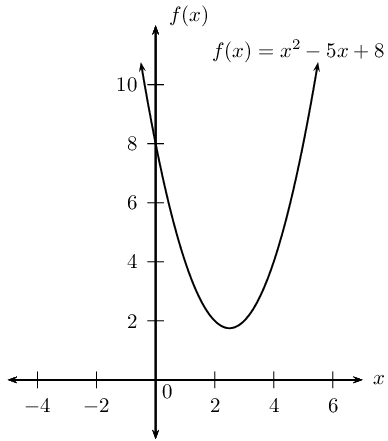

## 2.3 Quadratic formula (EMBFK)

It is not always possible to solve a quadratic equation by factorisation and it can take a long time to complete
      the square. The method of completing the square provides a way to derive a formula that can be used to solve any
      quadratic equation. The quadratic formula provides an easy and fast way to solve quadratic equations.

Consider the standard form of the quadratic equation \(ax^2 + bx + c = 0\). Divide both sides by \(a\) \((a \ne
      0)\) to get

    \[x^2 + \frac{bx}{a} + \frac{c}{a} = 0\]

Now using the method of completing the square, we must halve the coefficient of \(x\) and square it. We then add
      and subtract \(\left( \dfrac{b}{2a} \right)^2\) so that the equation remains true.

\begin{align*}
      x^2 + \frac{bx}{a} + \frac{b^2}{4a^2} -\frac{b^2}{4a^2} + \frac{c}{a} &= 0 \\
      \left( x^2 + \frac{bx}{a} + \frac{b^2}{4a^2} \right) -\frac{b^2}{4a^2} + \frac{c}{a} &= 0 \\
      \left( x + \frac{b}{2a} \right)^2 -\frac{b^2-4ac}{4a^2} &= 0
      \end{align*}

We add the constant to both sides and take the square root of both sides of the equation, being careful to
      include a positive and negative answer.

\begin{align*}
      \left( x + \frac{b}{2a} \right)^2 &= \frac{b^2-4ac}{4a^2} \\
      \sqrt{\left( x + \frac{b}{2a} \right)^2} &= \pm \sqrt{\frac{b^2-4ac}{4a^2}} \\
      x + \frac{b}{2a} &= \pm \dfrac{\sqrt{b^2-4ac}}{2a} \\
      x &= - \dfrac{b}{2a} \pm \frac{\sqrt{b^2-4ac}}{2a} \\
      x &= \dfrac{-b \pm \sqrt{b^2-4ac}}{2a}
      \end{align*}

Therefore, for any quadratic equation \(ax^2+bx+c = 0\) we can determine two roots
      \[x = \dfrac{-b + \sqrt{b^2-4ac}}{2a} \text{ or } x = \dfrac{-b - \sqrt{b^2-4ac}}{2a}\]

It is important to notice that the expression \({b}^{2}-4ac\) must be greater than or equal to zero for the roots
      of the quadratic to be real. If the expression under the square root sign is less than zero, then the roots are
      non-real (imaginary).

<Callout type="note" title="Note">
<VideoPlayer src="http://www.khanacademy.org/embed_video?v=r3SEkdtpobo" title="Video: 2287" />
</Callout>

<Callout type="tip" title="Worked example 8: Using the quadratic formula">
**Question:**
Solve for \(x\) and leave your answer in simplest surd form: \(2x^2+3x=7\)

**Check whether the expression can be factorised:**
The expression cannot be factorised, so the general quadratic formula must be used.

**Write the equation in the standard form \(a{x}^{2}+bx+c=0\):**
\[2x^2+3x-7=0\]

**Identify the coefficients to substitute into the formula:**
\[a = 2; \qquad b = 3; \qquad c = -7\]

**Apply the quadratic formula:**
Always write down the formula first and then substitute the values of \(a\), \(b\) and \(c\).

        \begin{align*}
        x &= \frac{-b±\sqrt{{b}^{2}-4ac}}{2a} \\
        &= \frac{-\left(3\right)±\sqrt{{\left(3\right)}^{2}-4\left(2\right)\left(-7\right)}}{2\left(2\right)}
        \\
        &= \frac{-3±\sqrt{65}}{4}
        \end{align*}

**Write the final answer:**
The two roots are \(x=\dfrac{-3+\sqrt{65}}{4}\) or \(x=\dfrac{-3-\sqrt{65}}{4}\).
</Callout>

<QuizCard id="m11-02-03a" title="Interactive Exercise 2.6" question="Adapted from DBE Nov 2016 Grade 11, P1, Q1 Maths formulas Solve for \(x\) in the following equation: \[                 \begin{aligned}                     5 x^{2} - 7 x - 5 = 0                 \end{aligned}             \] INSTRUCTION: Round your answers to two decimal places." options=[] answer="1.92, -0.52" hint="You should enter a number here. If you want to, you can use a space to separate thousands.                Example: 12 800,25 For scientific notation you need to use the multiply symbol                ( ∗ ) and the exponent symbol ( ^ ). For example 6,673 × 10 −11 should be written as: 6,673 ∗ 10^−11" explanation="Use the quadratic formula to solve the equation \[                     \begin{aligned}                         x & = \dfrac{-b \pm \sqrt{b^{2} - 4ac}}{2a} \\                         & = \dfrac{-(-7) \pm \sqrt{(-7)^{2} - 4(5)(-5)}}{2(5)} \\                         & = \dfrac{7 \pm \sqrt{149}}{10}                     \end{aligned}                 \] \[                     \begin{array}{c}                         x = \text{1,92065...} \\                         \text{or} \\                         x = -\text{0,52065...}                     \end{array}                 \] \[                     \begin{aligned}                         \therefore x = \text{1,92} \text{ or } x = -\text{0,52}                     \end{aligned}                 \] Submit your answer as: and" />

<Callout type="tip" title="Worked example 9: Using the quadratic formula">
**Question:**
Find the roots of the function \(f(x)= x^2-5x+8\).

**Finding the roots:**
To determine the roots of \(f(x)\), we let \(x^2-5x+8 = 0\).

**Check whether the expression can be factorised:**
The expression cannot be factorised, so the general quadratic formula must be used.

**Identify the coefficients to substitute into the formula:**
\[a = 1; \qquad b = -5; \qquad c = 8\]

**Apply the quadratic formula:**
\begin{align*}
        x &= \frac{-b±\sqrt{{b}^{2}-4ac}}{2a} \\
        &= \frac{-\left(-5\right)±\sqrt{{\left(-5\right)}^{2}-4\left(1\right)\left(8\right)}}{2\left(1\right)}
        \\
        &= \frac{5±\sqrt{-7}}{2}
        \end{align*}

**Write the final answer:**
There are no real roots for \(f(x)= x^2-5x+8\) since the expression under the square root is negative
          (\(\sqrt{-7}\) is not a real number). This means that the graph of the quadratic function has no
          \(x\)-intercepts; the entire graph lies above the \(x\)-axis.

</Callout>

<Callout type="note" title="Note">
<VideoPlayer src="http://www.khanacademy.org/embed_video?v=iulx0z1lz8M" title="Video: 2288" />
</Callout>

## Solution by the quadratic formula

### Textbook Exercise 2.3

Solve the following using the quadratic formula.

**Problem:**
\(3{t}^{2}+t-4=0\)

**Solution:**
\begin{align*}
              3t^2 + t - 4 &= 0\\
              t &= \dfrac{-(1) \pm \sqrt{1^2 - 4(3)(-4)}}{2(3)}\\
              & = \dfrac{-1 \pm \sqrt{1+48}}{6}\\
              &=\dfrac{-1 \pm \sqrt{49}}{6}\\
              &=\dfrac{-1 \pm 7}{6}\\
              t = \dfrac{-1+7}{6}= \frac{6}{6}=1 &\text{ or } t = \dfrac{-1-7}{6}=\frac{-8}{6} = \frac{-4}{3}
              \end{align*}

**Problem:**
\({x}^{2}-5x-3=0\)

**Solution:**
\begin{align*}
              x^2 - 5x - 3 &= 0\\
              x &= \dfrac{-(-5) \pm \sqrt{(-5)^2 - 4(1)(-3)}}{2(1)}\\
              &= \dfrac{5 \pm \sqrt{25 + 12}}{2}\\
              &=\dfrac{5 \pm \sqrt{37}}{2}\\
              \text{therefore } x =\dfrac{5 + \sqrt{37}}{2} &\text{ or } x =\dfrac{5 - \sqrt{37}}{2}
              \end{align*}

**Problem:**
\(2{t}^{2}+6t+5=0\)

**Solution:**
\begin{align*}
              2t^2 + 6t + 5 &= 0\\
              t&=\dfrac{-6 \pm \sqrt{(6)^2 - 4(2)(5)}}{2(2)}\\
              &= \dfrac{-6 \pm \sqrt{36 - 40}}{4}\\
              &=\dfrac{-6 \pm \sqrt{-4}}{4}\\
              \text{No real solution}
              \end{align*}

**Problem:**
\(2p(2p+1)=2\)

**Solution:**
\begin{align*}
              4p^2 + 2p - 2 &= 0\\
              2p^2 + p - 1 &= 0\\
              p &= \dfrac{-1 \pm \sqrt{1^2 - 4(2)(-1)}}{2(2)}\\
              &= \dfrac{-1 \pm \sqrt{1+8}}{4}\\
              &= \dfrac{-1 \pm \sqrt{9}}{4} \\
              &= \dfrac{-1 \pm 3}{4} \\
              \text{therefore } p =\dfrac{-1 + 3}{4} = \frac{1}{2} &\text{ or } p =\dfrac{-1 - 3}{4} = -1
              \end{align*}

**Problem:**
\(-3{t}^{2}+5t-8=0\)

**Solution:**
\begin{align*}
              -3t^2 + 5t -8 &= 0\\
              t&= \dfrac{-5 \pm \sqrt{5^2 -4(-3)(-8)}}{2(-3)}\\
              &= \dfrac{-5 \pm \sqrt{25-96}}{-6}\\
              &=\dfrac{-5 \pm \sqrt{-71}}{-6}\\
              \text{No real solution}
              \end{align*}

**Problem:**
\(5{t}^{2}+3t-3=0\)

**Solution:**
\begin{align*}
              5t^2 + 3t - 3 &= 0\\
              t &= \dfrac{-3 \pm \sqrt{3^2 - 4(5)(-3)}}{2(5)}\\
              &= \dfrac{-3 \pm \sqrt{9+60}}{10}\\
              &=\dfrac{-3 \pm \sqrt{69}}{10}\\
              \text{therefore } t =\dfrac{-3 + \sqrt{69}}{10} &\text{ or } t =\dfrac{-3 - \sqrt{69}}{10}
              \end{align*}

**Problem:**
\({t}^{2}-4t+2=0\)

**Solution:**
\begin{align*}
            t^2 - 4t + 2 &= 0\\
            t &= \dfrac{-(-4) \pm \sqrt{(-4)^2 - 4(1)(2)}}{2(1)}\\
            &= \dfrac{4 \pm \sqrt{16-8}}{2}\\
            &=\dfrac{4 \pm \sqrt{8}}{2}\\
            &= 2 \pm \sqrt{2}
            \end{align*}

**Problem:**
\(9(k^2 - 1) = 7k\)

**Solution:**
\begin{align*}
              9k^2 - 7k - 9 &= 0\\
              k &= \dfrac{-(-7) \pm \sqrt{(-7)^2 - 4(9)(-9)}}{2(9)}\\
              &= \dfrac{7 \pm \sqrt{49 + 324}}{18}\\
              &=\dfrac{7 \pm \sqrt{373}}{18}\\
              k = \dfrac{7 + \sqrt{373}}{18} &\text{ or } k =\dfrac{7 - \sqrt{373}}{18}
              \end{align*}

**Problem:**
\(3f -2 = -2f^2\)

**Solution:**
\begin{align*}
              2f^2 + 3f - 2 &= 0\\
              f &= \dfrac{-3 \pm \sqrt{3^2-4(2)(-2)}}{2(2)}\\
              &= \dfrac{-3 \pm \sqrt{9+16}}{4}\\
              &= \dfrac{-3 \pm \sqrt{25}}{4}\\
              &= \dfrac{-3 \pm 5}{4}\\
              \text{therefore } f =\dfrac{-3 + 5}{4} = \frac{1}{2}&\text{ or } f =\dfrac{-3 - 5}{4} = -2
              \end{align*}

**Problem:**
\({t}^{2}+t+1=0\)

**Solution:**
\begin{align*}
              t^2 + t +1 &= 0\\
              t&= \dfrac{-1 \pm \sqrt{1-4(1)(1)}}{2(1)}\\
              &= \dfrac{-1 \pm \sqrt{-3}}{2}\\
              \text{No real solution}
              \end{align*}
