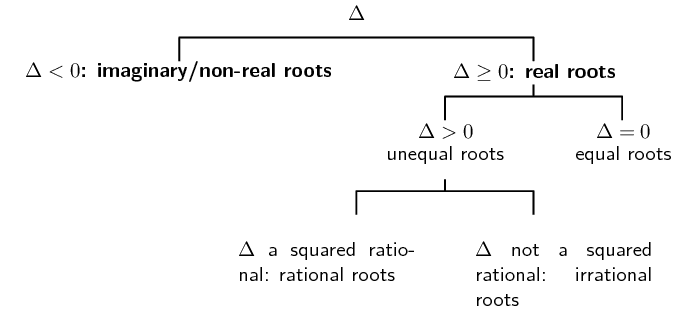
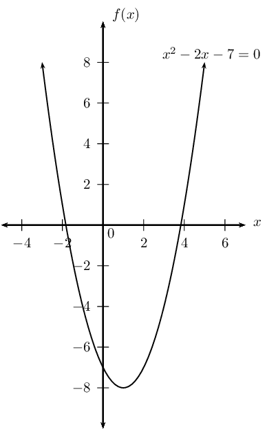

## 2.6 Nature of roots (EMBFP)

## Investigating the nature of roots

2. Use the quadratic formula to determine the roots of the quadratic equations
                                                   given below and take special note of:
   - the expression under the square root sign and
   - the type of number for the final answer
                                                             (rational/irrational/real/imaginary)
   2. \(x^2 - 6x + 9 = 0\)
   4. \(x^2 - 4x + 3 = 0\)
   6. \(x^2 - 4x - 3 = 0\)
   8. \(x^2 - 4x + 7 = 0\)
4. Choose the appropriate words from the table to describe the roots obtained for the
                                           equations above.
   | rational | unequal | real |
   | --- | --- | --- |
   | imaginary | not perfect square | equal |
   | perfect square | irrational | undefined |
6. The expression under the square root, \(b^2 - 4ac\), is called the discriminant. Can
                                           you make a conjecture about the relationship between the discriminant and the
                                           roots of quadratic equations?

### The discriminant (EMBFQ)

The discriminant is defined as \(\Delta ={b}^{2}-4ac\).

This is the expression under the square root in the quadratic formula. The discriminant
                                determines the nature of the roots of a quadratic equation. The word
                                ‘nature’ refers to the types of numbers the roots can be — namely
                                real, rational, irrational or imaginary. \(Δ\) is the Greek symbol for the letter
                                D.

For a quadratic function \(f\left(x\right)=a{x}^{2}+bx+c\), the solutions to the equation
                                \(f\left(x\right)=0\) are given by the formula

                        \(x=\dfrac{-b±\sqrt{{b}^{2}-4ac}}{2a}=\dfrac{-b±\sqrt{\Delta }}{2a}\)

- If \(Δ < 0\), then roots are imaginary (non-real) and beyond the
                                                  scope of this book.
- If \(Δ \geq 0\), the expression under the square root is non-negative
                                                  and therefore roots are real. For real roots, we have the following
                                                  further possibilities.
- If \(Δ = 0\), the roots are equal and we can say that there is only one
                                                  root.
- If \(Δ > 0\), the roots are unequal and there are two further
                                                  possibilities.
- \(Δ\) is the square of a rational number: the roots are rational.
- \(Δ\) is not the square of a rational number: the roots are irrational
                                                  and can be expressed in decimal or surd form.

| Nature of roots | Discriminant | \(a>0\) | \(a<0\) |
| --- | --- | --- | --- |
| Roots are non-real | \(\Delta <0\) |  |  |
| Roots are real and equal | \(\Delta=0\) |  |  |
| Roots are real and unequal: rational roots irrational roots | \(Δ > 0\) \(Δ =\) squared rational \(Δ =\) not squared rational |  |  |

 

                                
<a
                                                href="http://www.khanacademy.org/embed_video?v=JBSDQLZtjFo">Video:
                                                229P</a>

                        

<Callout type="tip" title="Worked example 13: Nature of roots">
**Question:**
Show that the roots of \(x^2-2x-7=0\) are irrational.

**Interpret the question:**
For roots to be real and irrational, we need to calculate \(Δ\) and show
                                                that it is greater than zero and not a perfect square.

**Check that the equation is in standard form \(ax^2+bx+c=0\):**
\[x^2-2x-7=0\]

**Identify the coefficients to substitute into the formula for
                                                the discriminant:**
\[a = 1; \qquad b = -2; \qquad c = -7\]

**Write down the formula and substitute values:**
\begin{align*}
                                                Δ &= b^2-4ac \\
                                                &= (-2)^2-4(1)(-7) \\
                                                &= 4+28 \\
                                                &= 32
                                                \end{align*}

We know that \(32 > 0\) and is not a perfect square.

The graph below shows the roots of the equation \(x^2 - 2x - 7 = 0\). Note
                                                that the graph does not form part of the answer and is included for
                                                illustration purposes only.

**Write the final answer:**
We have calculated that \(Δ > 0\) and is not a perfect square,
                                                therefore we can conclude that the roots are **real,
                                                        unequal** and **irrational**.
</Callout>

<QuizCard id="m11-02-06a" title="Interactive Exercise 2.14" question="What is the nature of the roots for this parabola?" options=["non-real roots", "1 real root", "2 real roots", "none of the above", "The discriminant is negative", "The discriminant is equal to zero", "The discriminant is a positive number", "It is impossible to know about the discriminant"] answer="1 real root" hint="" explanation="Begin by looking at the roots of the parabola: where does the parabola cross the x-axis?  In this case, there is only one intersection with the x-axis, so the parabola has one real root .  You can see this root marked on the graph with a red dot. Submit your answer as: 1 real root" />

<Callout type="tip" title="Worked example 14: Nature of roots">
**Question:**
For which value(s) of \(k\) will the roots of \(6x^2 + 6 = 4kx\) be real and
                                                equal?

**Interpret the question:**
For roots to be real and equal, we need to solve for the value(s) of \(k\)
                                                such that \(\Delta =0\).

**Check that the equation is in standard form \(ax^2+bx+c=0\):**
\[6x^2-4kx+6=0\]

**Identify the coefficients to substitute into the formula for
                                                the discriminant:**
\[a = 6; \qquad b = -4k; \qquad c = 6\]

**Write down the formula and substitute values:**
\begin{align*}
                                                Δ &= b^2-4ac \\
                                                &= (-4k)^2-4(6)(6) \\
                                                &= 16k^2-144
                                                \end{align*}

For roots to be real and equal, \(\Delta =0\).

\begin{align*}
                                                Δ &= 0 \\
                                                16k^2 - 144 &= 0 \\
                                                16(k^2-9)&= 0 \\
                                                (k-3)(k+3)&= 0
                                                \end{align*}

Therefore \(k = 3\) or \(k = -3\).

**Check both answers by substituting back into the original
                                                equation:**
For \(k = 3\):
                                                \begin{align*}
                                                6x^2-4(3)x + 6 &= 0 \\
                                                6x^2-12x + 6 &= 0 \\
                                                x^2-2x + 1 &= 0 \\
                                                (x-1)(x-1)&= 0 \\
                                                (x-1)^2&= 0 \\
                                                \text{Therefore } x &= 1
                                                \end{align*}

We see that for \(k = 3\) the quadratic equation has real, equal roots \(x =
                                                1\).

For \(k = - 3\):
                                                \begin{align*}
                                                6x^2-4(-3)x + 6 &= 0 \\
                                                6x^2+12x + 6 &= 0 \\
                                                x^2+2x + 1 &= 0 \\
                                                (x+1)(x+1)&= 0 \\
                                                (x+1)^2&= 0 \\
                                                \text{Therefore } x &= -1
                                                \end{align*}

We see that for \(k = -3\) the quadratic equation has real, equal roots \(x =
                                                -1\).

**Write the final answer:**
For the roots of the quadratic equation to be **real** and
                                                **equal**, \(k = 3\) or \(k = -3\). \(\)
</Callout>

<QuizCard id="m11-02-06b" title="Interactive Exercise 2.15" question="Adapted from DBE Nov 2015 Grade 12, P1, Q1.3 Maths formulas For which value(s) of \(k\) will \[                     \begin{aligned}                         - 3 x^{2} + 3 x & = k                     \end{aligned}                 \] have one or more real roots? INSTRUCTIONS: Choose the correct equality symbol from the drop-down list. Type the value as a whole number or a simplified fraction as appropriate." options=[">", "\u2265", "=", "\u2264", "<"] answer="3, 3/4" hint="" explanation="Calculate the discriminant The discriminant of a quadratic function is what tells us whether or not the roots of the function are real. For the general quadratic \[                         \begin{aligned}                             ax^{2} + bx + c                         \end{aligned}                     \] the discriminant is \[                         \begin{aligned}                             \Delta = b^{2} - 4ac                         \end{aligned}                     \] Rewriting the given equation in standard form: \[                         \begin{aligned}                             - 3 x^{2} + 3 x & = k \\                             - 3 x^{2} + 3 x - k & = 0                          \end{aligned}                     \] We can then calculate the discriminant: \[                         \begin{aligned}                             \Delta & = (3)^{2} - 4(-3)(-k)  \\                             & = 9-12 k                         \end{aligned}                     \] Solve for \(k\) when \(\Delta \geq 0\) We want one or more real roots, which happens when the discriminant is greater than or equal to zero. So we need to solve for \(k\) if \(\Delta \geq 0 \) . \[                         \begin{aligned}                             \Delta & \geq 0 \\                             9-12 k & \geq 0 \\                             - 12 k & \geq -9 \\                             k & \leq\dfrac{9}{12} \\ k &  \leq \frac{3}{4}                          \end{aligned}                     \] Submit your answer as: ≤ and" />

<Callout type="tip" title="Worked example 15: Nature of roots">
**Question:**
Show that the roots of \((x+h)(x+k)=4d^2\) are real for all real values of
                                                \(h, k\) and \(d\).

**Interpret the question:**
For roots to be real, we need to calculate \(Δ\) and show that \(Δ
                                                \ge 0\) for all real values of \(h\), \(k\) and \(d\).

**Check that the equation is in standard form \(ax^2+bx+c=0\):**
Expand the brackets and gather like terms

\begin{align*}
                                                (x+h)(x+k) &= 4d^2 \\
                                                x^2 + hx +kx +hk -4d^2 &= 0 \\
                                                x^2 + (h+k)x + (hk -4d^2) &= 0
                                                \end{align*}

**Identify the coefficients to substitute into the formula for
                                                the discriminant:**
\[a = 1; \qquad b = h+k; \qquad c = hk-4d^2\]

**Write down the formula and substitute values:**
\begin{align*}
                                        \Delta &= b^2-4ac \\
                                        &= (h+k)^2-4(1)(hk-4d^2) \\
                                        &= h^2+2hk+k^2-4hk+16d^2 \\
                                        &= h^2-2hk+k^2+16d^2 \\
                                        &= (h - k)^2+(4d)^2
                                        \end{align*}

For roots to be real, \(\Delta \geq 0\).

                                        \begin{align*}
                                        \text{We know that } (4d)^2 &\geq 0 \\
                                        \text{and } (h - k)^2 &\geq 0 \\
                                        \text{so then } (h - k)^2+ (4d)^2 &\geq 0 \\
                                        \text{therefore } \Delta &\geq 0
                                        \end{align*}

**Write the final answer:**
We have shown that \(\Delta \geq 0\), therefore the roots are
                                                **real** for all real values of \(h, k\) and \(d\).
</Callout>

<QuizCard id="m11-02-06c" title="Interactive Exercise 2.16" question="Adapted from DBE Nov 2016 Grade 11, P1, Q1.3 Maths formulas Given \[                 \begin{aligned}                     3 x^{2} +  \left(k + 1\right)x& =- k + 2                 \end{aligned}             \] Show that the roots are real and rational for all \(k \in \mathbb{Z}\) ." options=["\u2207", "k", "y", "\u0394", "x"] answer="3, (k - 5)^2" hint="" explanation="Rearrange the equation into standard form \[                     \begin{aligned}                         3 x^{2} +  \left(k + 1\right)x& =- k + 2 \\                         3 x^{2} +  \left(k + 1\right)x + k - 2& = 0                     \end{aligned}                 \] Now that the equation is in standard form, we can see that \(a = 3\) , \(b = k + 1\) , and \(c = k - 2\) . Calculate the discriminant \[                     \begin{aligned}                         \Delta & = b^{2} -4ac \\                         & = (k + 1)^{2} - 4(3)(k - 2) \\                         & = k^{2} + 2 k + 1- 12 k + 24 \\                         & = k^{2} - 10 k + 25 \\                         & = \left(k - 5\right)^{2}                     \end{aligned}                 \] This shows that \(\Delta = b^{2} - 4ac\) is a perfect square, which means that the roots are real and rational for all \(k \in \mathbb{Z}\) . Submit your answer as: Δ and" />

## From past papers

### Textbook Exercise 2.7

Determine the nature of the roots for each of the following
                                                        equations:

**Problem:**
\(x^2 + 3x = -2\)

**Solution:**
We write the equation in standard form \(ax^2+bx+c=0\):

\[x^2 + 3x + 2 = 0\]

Identify the coefficients to substitute into the formula for
                                                                the discriminant

\[a = 1; \qquad b = 3; \qquad c = 2\]

Write down the formula and substitute values

\begin{align*}
                                                                Δ &= b^2-4ac \\
                                                                &= (3)^2 - 4(1)(2) \\
                                                                &= 9 - 8 \\
                                                                &= 1
                                                                \end{align*}

We know that \(1 > 0\) and is a perfect square.

We have calculated that \(Δ > 0\) and is a perfect
                                                                square, therefore we can conclude that the roots are
                                                                **real, unequal** and
                                                                **rational**.

**Problem:**
\(x^2 + 9 = 6x\)

**Solution:**
We write the equation in standard form \(ax^2+bx+c=0\):

\[x^2 - 6x + 9 = 0\]

Identify the coefficients to substitute into the formula for
                                                                the discriminant

\[a = 1; \qquad b = -6; \qquad c = 9\]

Write down the formula and substitute values

\begin{align*}
                                                                Δ &= b^2-4ac \\
                                                                &= (-6)^2 - 4(1)(9) \\
                                                                &= 36 - 36 \\
                                                                &= 0
                                                                \end{align*}

We have calculated that \(Δ = 0\) therefore we can
                                                                conclude that the roots are **real** and
                                                                **equal**.

**Problem:**
\(6y^2 - 6y - 1 = 0\)

**Solution:**
We write the equation in standard form \(ax^2+bx+c=0\):

\[6y^2 - 6y - 1 = 0\]

Identify the coefficients to substitute into the formula for
                                                                the discriminant

\[a = 6; \qquad b = -6; \qquad c = -1\]

Write down the formula and substitute values

\begin{align*}
                                                                Δ &= b^2-4ac \\
                                                                &= (-6)^2 - 4(6)(-1) \\
                                                                &= 36 + 36 \\
                                                                &= 72
                                                                \end{align*}

We know that \(72 > 0\) and is not a perfect square.

We have calculated that \(Δ > 0\) and is not a
                                                                perfect square, therefore we can conclude that the roots
                                                                are **real, unequal** and
                                                                **irrational**.

**Problem:**
\(4t^2 - 19t - 5 = 0\)

**Solution:**
We write the equation in standard form \(ax^2+bx+c=0\):

\[4t^2 - 19t - 5 = 0\]

Identify the coefficients to substitute into the formula for
                                                                the discriminant

\[a = 4; \qquad b = -19; \qquad c = -5\]

Write down the formula and substitute values

\begin{align*}
                                                                Δ &= b^2-4ac \\
                                                                &= (-19)^2 - 4(4)(-5) \\
                                                                &= 361 + 80 \\
                                                                &= 441
                                                                \end{align*}

We know that \(441 > 0\) and is a perfect square.

We have calculated that \(Δ > 0\) and is a perfect
                                                                square, therefore we can conclude that the roots are
                                                                **real, unequal** and
                                                                **rational**.

**Problem:**
\(z^2 = 3\)

**Solution:**
We write the equation in standard form \(ax^2+bx+c=0\):

\[z^2 - 3 = 0\]

Identify the coefficients to substitute into the formula for
                                                                the discriminant

\[a = 1; \qquad b = 0; \qquad c = -3\]

Write down the formula and substitute values

\begin{align*}
                                                                Δ &= b^2-4ac \\
                                                                &= (0)^2 - 4(1)(-3) \\
                                                                &= 0 + 12 \\
                                                                &= 12
                                                                \end{align*}

We know that \(12 > 0\) and is not a perfect square.

We have calculated that \(Δ > 0\) and is not a
                                                                perfect square, therefore we can conclude that the roots
                                                                are **real, unequal** and
                                                                **irrational**.

**Problem:**
\(0 = p^2 + 5p + 8\)

**Solution:**
We write the equation in standard form \(ax^2+bx+c=0\):

\[p^2 + 5p + 8 = 0\]

Identify the coefficients to substitute into the formula for
                                                                the discriminant

\[a = 1; \qquad b = 5; \qquad c = 8\]

Write down the formula and substitute values

\begin{align*}
                                                                Δ &= b^2-4ac \\
                                                                &= (5)^2 - 4(1)(8) \\
                                                                &= 25 - 32 \\
                                                                &= -7
                                                                \end{align*}

We know that \(-7 < 0\).

We have calculated that \(Δ < 0\), therefore we can
                                                                conclude that the roots are **non-real**.

**Problem:**
\(x^2 = 36\)

**Solution:**
We write the equation in standard form \(ax^2+bx+c=0\):

\[x^2 - 36 = 0\]

Identify the coefficients to substitute into the formula for
                                                                the discriminant

\[a = 1; \qquad b = 0; \qquad c = -36\]

Write down the formula and substitute values

\begin{align*}
                                                                Δ &= b^2-4ac \\
                                                                &= (0)^2 - 4(1)(-36) \\
                                                                &= 0 + 144 \\
                                                                &= 144
                                                                \end{align*}

We know that \(144 > 0\) and is a perfect square.

We have calculated that \(Δ > 0\) and is a perfect
                                                                square, therefore we can conclude that the roots are
                                                                **real, unequal** and
                                                                **rational**.

**Problem:**
\(4m + m^2 = 1\)

**Solution:**
We write the equation in standard form \(ax^2+bx+c=0\):

\[m^2 + 4m - 1 = 0\]

Identify the coefficients to substitute into the formula for
                                                                the discriminant

\[a = 1; \qquad b = 4; \qquad c = -1\]

Write down the formula and substitute values

\begin{align*}
                                                                Δ &= b^2-4ac \\
                                                                &= (4)^2 - 4(1)(-1) \\
                                                                &= 16 + 4 \\
                                                                &= 20
                                                                \end{align*}

We know that \(20 > 0\) and is not a perfect square.

We have calculated that \(Δ > 0\) and is not a
                                                                perfect square, therefore we can conclude that the roots
                                                                are **real, unequal** and
                                                                **irrational**.

**Problem:**
\(11 - 3x + x^2 = 0\)

**Solution:**
We write the equation in standard form \(ax^2+bx+c=0\):

\[x^2 - 3x + 11 = 0\]

Identify the coefficients to substitute into the formula for
                                                                the discriminant

\[a = 1; \qquad b = -3; \qquad c = 11\]

Write down the formula and substitute values

\begin{align*}
                                                                Δ &= b^2-4ac \\
                                                                &= (-3)^2 - 4(1)(11) \\
                                                                &= 9 - 44 \\
                                                                &= -35
                                                                \end{align*}

We know that \(-35 < 0\).

We have calculated that \(Δ < 0\), therefore we can
                                                                conclude that the roots are **non-real**.

**Problem:**
\(y^2 + \dfrac{1}{4} = y\)

**Solution:**
We write the equation in standard form \(ax^2+bx+c=0\):

\[4y^2 - 4y + 1 = 0\]

Identify the coefficients to substitute into the formula for
                                                                the discriminant

\[a = 4; \qquad b = -4; \qquad c = 1\]

Write down the formula and substitute values.

\begin{align*}
                                                                Δ &= b^2-4ac \\
                                                                &= (-4)^2 - 4(4)(1) \\
                                                                &= 16 - 16 \\
                                                                &= 0
                                                                \end{align*}

We have calculated that \(Δ = 0\), therefore we can
                                                                conclude that the roots are **real** and
                                                                **equal**.

Given: \({x}^{2}+bx-2+k\left({x}^{2}+3x+2\right)=0\), \(\left(k\ne
                                                        -1\right)\)

**Problem:**
Show that the discriminant is given by: \(\Delta
                                                                ={k}^{2}+6bk+{b}^{2}+8\)

**Solution:**
We write the equation in standard form \(ax^2+bx+c=0\):

\[(k + 1)x^2 + (b + 3k)x - 2 + 2k = 0\]

Identify the coefficients to substitute into the formula for
                                                                the discriminant

\[a = k + 1; \qquad b = b + 3k; \qquad c = -2 + 2k\]

Write down the formula and substitute values

\begin{align*}
                                                                Δ &= b^2-4ac \\
                                                                &= (b + 3k)^2 - 4(k + 1)(2k - 2) \\
                                                                &= b^{2} + 6bk + 9k^{2} -4(2k^{2} - 2) \\
                                                                &= b^{2} + 6bk + 9k^{2} -8k^{2} + 8 \\
                                                                &= k^{2} + 6bk + b^{2} + 8
                                                                \end{align*}

**Problem:**
If \(b=0\), discuss the nature of the roots of the equation.

**Solution:**
When \(b=0\) the discriminant is:

                                                        \[Δ = k^{2} + 8\]

This is positive for all values of \(k\) and greater than
                                                                \(\text{0}\) for all values of \(k\).

For example if \(k = 0\) then \(Δ = 8\), if \(k = -1\)
                                                                then \(Δ = 9\) and if \(k = 1\) then \(Δ =
                                                                9\).

So the roots are real and unequal. We cannot say if the roots
                                                                are rational or irrational since this depends on the
                                                                exact value of \(k\).

**Problem:**
If \(b=2\), find the value(s) of \(k\) for which the roots
                                                                are equal.

**Solution:**
When \(b=2\) the discriminant is:

                                                        \begin{align*}
                                                        Δ & = k^{2} + 6(2)k + (2)^{2} + 8 \\
                                                        & = k^{2} + 12k + 12
                                                        \end{align*}

We set this equal to \(\text{0}\) since we want to find the
                                                                values of \(k\) that will make the roots equal.

                                                        \begin{align*}
                                                        0 & = k^{2} + 12k + 12 \\
                                                        k & = \dfrac{-12 \pm \sqrt{(12)^{2} - 4(1)(12)}}{2(1)} \\
                                                        & = \dfrac{-12 \pm \sqrt{144 - 48}}{2} \\
                                                        & = \dfrac{-12 \pm \sqrt{96}}{2} \\
                                                        & = \dfrac{-12 \pm 4\sqrt{6}}{2} \\
                                                        k = -6 + 2\sqrt{6} & \text{ or } k = -6 - 2\sqrt{6}
                                                        \end{align*}

The roots will be equal if \(k = -6 \pm 2\sqrt{6}\).

**Problem:**
Show that \({k}^{2}{x}^{2}+2=kx-{x}^{2}\) has non-real roots for all
                                                        real values for \(k\).

[IEB, Nov. 2002, HG]

**Solution:**
\begin{align*}
                                                        k^2 x^2 + x^2 - kx +2 &= 0\\
                                                        a &= (k^2+1)\\
                                                        b&= -k\\
                                                        c&=2\\
                                                        \Delta &= b^2-4ac\\
                                                        &= (-k)^2 - 4(k^2+1)(2)\\
                                                        &=k^2-8k^2-8\\
                                                        &=-7k^2 - 8\\
                                                        &=-(7k^2 + 8)\\
                                                        \Delta & < 0
                                                        \end{align*}Therefore the roots are non-real.

The equation \({x}^{2}+12x=3k{x}^{2}+2\) has real roots.

**Problem:**
Find the greatest value of value \(k\) such that \(k \in
                                                                \mathbb{Z}\).

**Solution:**
\begin{align*}
                                                        x^2 +12x &= 3kx^2 +2\\
                                                        3kx^2 -x^2 - 12x+2&=0\\
                                                        x^2(3k-1)-12x+2&=0\\
                                                        a&=3k-1\\
                                                        b&=-12\\
                                                        c&=2\\
                                                        \text{Given } \Delta &\geq 0\\
                                                        \therefore b^2-4ac &\geq 0\\
                                                        \therefore (-12)^2 - 4(3k-1)(2) &\geq 0\\
                                                        144 -24k + 8 &\geq 0 \\
                                                        152 - 24k &\geq 0 \\
                                                        152 &\geq 24k \\
                                                        \frac{19}{3} &\geq k \\
                                                        \therefore k &\leq \frac{19}{3} \\
                                                        \therefore k &\leq 6\frac{1}{3}
                                                        \end{align*}

Since \(k\) needs to be an integer, the greatest value of
                                                                \(k\) is \(\text{6}\).

**Problem:**
Find one rational value of \(k\) for which the above equation
                                                                has rational roots.

**Solution:**
For rational roots we need \(\Delta\) to be a perfect square.

                                                        \begin{align*}
                                                        \Delta &= b^2-4ac \\
                                                        &=152-24k\\
                                                        \text{if } k&=\frac{1}{3}\\
                                                        \Delta &= 152 - 24\left(\frac{1}{3}\right)\\
                                                        &=152-8\\
                                                        &=144\\
                                                        &=12^2
                                                        \end{align*}

This is a perfect square. Therefore if \(k=\frac{1}{3}\), the
                                                                roots will be rational.

Consider the equation: \[k = \frac{x^2-4}{2x-5}\]
                                                        where \(x \ne \frac{5}{2}\).

**Problem:**
Find a value of \(k\) for which the roots are equal.

**Solution:**
We first need to write the equation in standard form:

                                                        \begin{align*}
                                                        k(2x - 5) & = x^2-4 \\
                                                        2kx - 5k & = x^2-4 \\
                                                        0 & = x^{2} - 4 - 2kx + 5k \\
                                                        0 & = x^{2} - 2kx + 5k - 4
                                                        \end{align*}

Next we note that \(a = 1; \qquad b = -2k; \qquad c = 5k -
                                                                4\).

Now we can find the discriminant:

                                                        \begin{align*}
                                                        Δ &= b^2-4ac \\
                                                        &= (-2k)^2 - 4(1)(5k - 4) \\
                                                        &= 4k^{2} - 20k + 16
                                                        \end{align*}

To find the values of \(k\) that make the roots equal, we set
                                                                this equal to \(\text{0}\) and solve for \(k\):

                                                        \begin{align*}
                                                        0 &= 4k^{2} - 20k + 16 \\
                                                        &= k^{2} - 5k + 4 \\
                                                        &= (k - 4)(k - 1) \\
                                                        k = 4 & \text{ or } k = 1
                                                        \end{align*}

**Problem:**
Find an integer \(k\) for which the roots of the equation
                                                                will be rational and unequal.

**Solution:**
The discriminant is:

                                                        \[\Delta = 4k^{2} - 20k + 16\]

To find a value of \(k\) that makes the roots rational and
                                                                unequal the discriminant must be greater than
                                                                \(\text{0}\) and a perfect square.

We try setting the discriminant equal to \(\text{1}\):

                                                        \begin{align*}
                                                        \Delta & = 4k^{2} - 20k + 16 \\
                                                        1 & = 4k^{2} - 20k + 16 \\
                                                        0 & = 4k^{2} - 20k + 15
                                                        \end{align*}

This does not give an integer value of \(k\) so we try
                                                                \(\text{4}\):

                                                        \begin{align*}
                                                        4 & = 4k^{2} - 20k + 16 \\
                                                        0 & = 4k^{2} - 20k + 12 \\
                                                        & = k^{2} - 5k + 3
                                                        \end{align*}

This does not give an integer value of \(k\) so we try
                                                                \(\text{9}\):

                                                        \begin{align*}
                                                        9 & = 4k^{2} - 20k + 16 \\
                                                        0 & = 4k^{2} - 20k + 5
                                                        \end{align*}

This does not give an integer value of \(k\) so we try
                                                                \(\text{16}\):

                                                        \begin{align*}
                                                        16 & = 4k^{2} - 20k + 16 \\
                                                        0 & = 4k^{2} - 20k \\
                                                        & = k^{2} - 5k \\
                                                        k = 0 & \text{ or } k = 5
                                                        \end{align*}

So if \(k=0\) or \(k=5\) the roots will be rational and
                                                                unequal.

**Problem:**
Prove that the roots of the equation
                                                                \({x}^{2}-\left(a+b\right)x+ab-{p}^{2}=0\) are real for
                                                                all real values of \(a\), \(b\) and \(p\).

**Solution:**
We need to prove that \(\Delta \geq 0\).

                                                        \begin{align*}
                                                        \Delta
                                                        &=(-a-b)^2 - 4(ab-p^2)\\
                                                        &=a^2 + 2ab + b^2 - 4ab + 4p^2\\
                                                        &=a^2 - 2ab + b^2 + 4p^2\\
                                                        &=(a-b)^2 + 4p^2
                                                        \end{align*}

\(\Delta \geq 0\) for all real values of \(a\), \(b\) and
                                                                \(p\). Therefore the roots are real for all real values
                                                                of \(a\), \(b\) and \(p\).

**Problem:**
When will the roots of the equation be equal?

**Solution:**
The roots are equal when \(\Delta = 0\), that is when \(a=b\)
                                                                and \(p=0\).

**Problem:**
If \(b\) and \(c\) can take on only the values \(\text{1}\),
                                                        \(\text{2}\) or \(\text{3}\), determine all pairs (\(b; c\))
                                                        such that \({x}^{2}+bx+c=0\) has real roots.

[IEB, Nov. 2005, HG]

**Solution:**
We need to find the values of \(a\), \(b\) and \(c\) for which
                                                        \(\Delta \geq 0\).

                                                \begin{align*}
                                                a&=1\\
                                                b&=\text{1,2} \text{ or }3\\
                                                c&=\text{1,2} \text{ or }3\\
                                                \\
                                                \Delta &= b^2-4ac\\
                                                &= b^2 - 4(1)c
                                                \end{align*}

Possible pair values of \((b;c)\):
                                                        \((1;1),~(1;2),~(1;3),~(2;1),~(2;2),~(2;3),~(3;1),~(3;2),~(3;3)\).
                                                        Corresponding values of \(\Delta\): \((\Delta < 0),~(\Delta
                                                        < 0),~(\Delta < 0),~(\Delta = 0),~(\Delta < 0),~(\Delta
                                                        < 0),~(\Delta >0),~(\Delta > 0),~(\Delta < 0)\)

\(\Delta ≥ 0\) (and therefore the roots are real) for \((b;c) =
                                                        (2;1),~(3;1),~(3;2)\)
