## 2.7 Quadratic inequalities (EMBFR)

Quadratic inequalities can be of the following forms:

                \begin{align*}
                ax^2 + bx + c > 0 \\
                ax^2 + bx + c \ge 0 \\
                ax^2 + bx + c < 0 \\
                ax^2 + bx + c \le 0
                \end{align*}

To solve a quadratic inequality we must determine which part of the graph of a quadratic function
                        lies above or below the \(x\)-axis. An inequality can therefore be solved graphically using a
                        graph or algebraically using a table of signs to determine where the function is positive and
                        negative.

<Callout type="tip" title="Worked example 16: Solving quadratic inequalities">
**Question:**
Solve for \(x\): \({x}^{2}-5x+6\ge 0\)

**Factorise the quadratic:**
\[(x-3)(x-2) \geq 0\]

**Determine the critical values of \(x\):**
From the factorised quadratic we see that the values for which the inequality is
                                        equal to zero are \(x=3\) and \(x=2\). These are called the critical values of
                                        the inequality and they are used to complete a table of signs.

**Complete a table of signs:**
We must determine where each factor of the inequality is positive and negative on the
                                        number line:

- to the left (in the negative direction) of the critical value
- equal to the critical value
- to the right (in the positive direction) of the critical value

In the final row of the table we determine where the inequality is positive and
                                        negative by finding the product of the factors and their respective signs.

| Critical values |  | \(x=2\) |  | \(x=3\) |  |
| --- | --- | --- | --- | --- | --- |
| \(x-3\) | \(-\) | \(-\) | \(-\) | \(\text{0}\) | \(+\) |
| \(x-2\) | \(-\) | \(\text{0}\) | \(+\) | \(+\) | \(+\) |
| \(f(x)=(x-3)(x-2)\) | \(+\) | \(\text{0}\) | \(-\) | \(\text{0}\) | \(+\) |

From the table we see that \(f(x)\) is greater than or equal to zero for \(x\le 2\)
                                        or \(x\ge 3\).

**A rough sketch of the graph:**
The graph below does not form part of the answer and is included for illustration
                                        purposes only. A graph of the quadratic helps us determine the answer to the
                                        inequality. We can find the answer graphically by seeing where the graph lies
                                        above or below the \(x\)-axis.

- From the standard form, \(x^2 - 5x + 6\), \(a>0\) and therefore the graph
                                                  is a “smile” and has a minimum turning point.
- From the factorised form, \((x-3)(x-2)\), we know the \(x\)-intercepts are
                                                  \((2;0)\) and \((3;0)\).

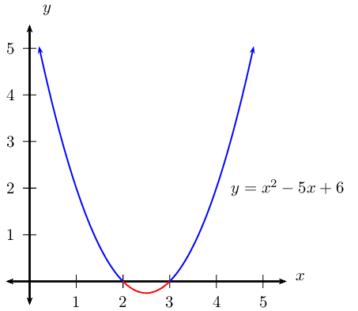

The graph is above or on the \(x\)-axis for \(x \le 2\) or \(x \ge 3\).

**Write the final answer and represent on a number line:**
\[x^2 - 5x + 6 \geq 0 \text{ for } x \leq 2 \text{ or } x \geq 3\]

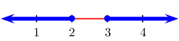
</Callout>

<QuizCard id="m11-02-07a" title="Interactive Exercise 2.18" question="Adapted from DBE Nov 2015 P1, Q1 Maths formulas Solve for \(y\) in the following inequality: \[\begin{array}{c}y^{2} - 4 y - 5 \geq 0\end{array}\] Which of the options below shows the correct solution?" options=[] answer="0" hint="" explanation="Sketch a parabola and label the roots Determine the roots of the quadratic expression: \[                     \begin{aligned}                         y^{2} - 4 y - 5 &\geq 0 \\                         \left(y - 5\right) \left(y + 1\right)& \geq 0                     \end{aligned}                 \] So the roots of the quadratic expression are \(y = -1\) and \(y = 5\) . Identify where the quadratic expression is greater than or equal to zero Now that we have the roots of the equation, we need to determine the values of \(y\) that make the inequality true. To do this we look at the coefficient of \(y^{2}\) . Since it is positive, the graph opens upwards. We can now identify the sections where the parabola is greater than or equal to zero by drawing a sketch. So the correct answer is \(y \leq -1 \text{ or } y \geq 5\) . Submit your answer as: \(y \leq -1 \text{ or } y \geq 5\)" />

<Callout type="tip" title="Worked example 17: Solving quadratic inequalities">
**Question:**
Solve for \(x\): \(4{x}^{2}-4x+1\le 0\)

**Factorise the quadratic:**
\begin{align*}
                                        (2x-1)(2x-1) & \leq 0 \\
                                        (2x-1)^2 & \leq 0
                                        \end{align*}

**Determine the critical values of \(x\):**
From the factorised quadratic we see that the value for which the inequality is equal
                                        to zero is \(x=\frac{1}{2}\). We know that \(a^2 > 0\) for any real number
                                        \(a, a \ne 0\), so then \((2x-1)^2\) will never be negative.

**A rough sketch of the graph:**
The graph below does not form part of the answer and is included for illustration
                                        purposes only.

- From the standard form, \(4x^2 - 4x + 1\), \(a > 0\) and therefore the
                                                  graph is a “smile” and has a minimum turning point.
- From the factorised form, \((2x-1)(2x-1)\), we know there is only one
                                                  \(x\)-intercept at \(\left(\frac{1}{2};0\right)\).

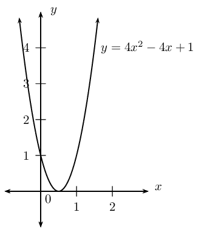

Notice that no part of the graph lies below the \(x\)-axis.

**Write the final answer and represent on a number line:**
\[4x^2 - 4x + 1 \leq 0 \text{ for } x = \frac{1}{2}\]

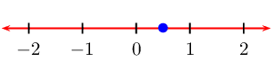
</Callout>

<QuizCard id="m11-02-07b" title="Interactive Exercise 2.19" question="Adapted from DBE Nov 2015 P1, Q1 Maths formulas Solve for \(y\) in the following inequality: \[\begin{array}{c}y^{2} + 5 y + 6 < 0\end{array}\] Which of the options below shows the correct solution?" options=[] answer="3" hint="" explanation="Sketch a parabola and label the roots Determine the roots of the quadratic expression: \[                     \begin{aligned}                         y^{2} + 5 y + 6 &< 0 \\                         \left(y + 2\right) \left(y + 3\right)& < 0                     \end{aligned}                 \] So the roots of the quadratic expression are \(y = -3\) and \(y = -2\) . Identify where the quadratic expression is less than zero Now that we have the roots of the equation, we need to determine the values of \(y\) that make the inequality true. To do this we look at the coefficient of \(y^{2}\) . Since it is positive, the graph opens upwards. We can now identify the sections where the parabola is less than zero by drawing a sketch. So the correct answer is \(-3 < y < -2\) . Submit your answer as: \(-3 < y < -2\)" />

<Callout type="tip" title="Worked example 18: Solving quadratic inequalities">
**Question:**
Solve for \(x\): \(-{x}^{2}-3x+5>0\)

**Examine the form of the inequality:**
Notice that the coefficient of the \(x^2\) term is \(-\text{1}\).
                                        **Remember** that if we multiply or divide an inequality by a
                                        negative number, then the inequality sign changes direction. So we can write the
                                        same inequality in different ways and still get the same answer, as shown below.

\[-x^2-3x+5 > 0\]

Multiply by \(-\text{1}\) and change direction of the inequality sign
                                        \[x^2+3x-5 < 0\]

From this rough sketch, we can see that both inequalities give the same solution; the
                                        values of \(x\) that lie between the two \(x\)-intercepts.

**Factorise the quadratic:**
We notice that \(-{x}^{2}-3x+5>0\) cannot be easily factorised. So we let
                                        \(-x^2-3x+5=0\) and use the quadratic formula to determine the roots of the
                                        equation.

                                \begin{align*}
                                -x^2 - 3x + 5 &= 0 \\
                                x^2 + 3x - 5 &= 0
                                \end{align*}\begin{align*}
                                \therefore x &=
                                \frac{-3±\sqrt{{\left(3\right)}^{2}-4\left(1\right)\left(-5\right)}}{2\left(1\right)}
                                \\
                                &= \frac{-3±\sqrt{29}}{2} \\
                                x_1 &= \frac{-3-\sqrt{29}}{2} \approx -\text{4,2} \\
                                x_2 &= \frac{-3+\sqrt{29}}{2} \approx \text{1,2}
                                \end{align*}

Therefore we can write, correct to one decimal place,
                                        \begin{align*}
                                        x^2+3x-5 &< 0 \\
                                        \text{as } (x-\text{1,2})(x+\text{4,2}) &< 0
                                        \end{align*}

**Determine the critical values of \(x\):**
From the factorised quadratic we see that the critical values are \(x=\text{1,2}\)
                                        and \(x=-\text{4,2}\).

**Complete a table of signs:**
| Critical values |  | \(x=-\text{4,2}\) |  | \(x=\text{1,2}\) |  |
| --- | --- | --- | --- | --- | --- |
| \(x+\text{4,2}\) | \(-\) | \(\text{0}\) | \(+\) | \(+\) | \(+\) |
| \(x-\text{1,2}\) | \(-\) | \(-\) | \(-\) | \(\text{0}\) | \(+\) |
| \(f(x)=(x+\text{4,2})(x-\text{1,2})\) | \(+\) | \(\text{0}\) | \(-\) | \(\text{0}\) | \(+\) |

From the table we see that the function is negative for \(-\text{4,2} < x <
                                        \text{1,2}\).

**A sketch of the graph:**
- From the standard form, \(x^2+3x-5\), \(a > 0\) and therefore the graph
                                                  is a “smile” and has a minimum turning point.
- From the factorised form, \((x-\text{1,2})(x+\text{4,2})\), we know the
                                                  \(x\)-intercepts are \((-\text{4,2};0)\) and \((\text{1,2};0)\).

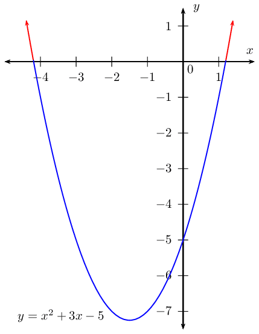

From the graph we see that the function lies below the \(x\)-axis between
                                        \(-\text{4,2}\) and \(\text{1,2}\).

**Write the final answer and represent on a number line:**
\[x^2 + 3x - 5 < 0 \text{ for } -\text{4,2} < x < \text{1,2}\]

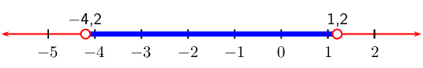
</Callout>

**Important:** When working with an inequality in which the variable is in the
                        denominator, a different approach is needed. Always remember to check for restrictions.

<Callout type="tip" title="Worked example 19: Solving quadratic inequalities with fractions">
**Question:**
Solve for \(x\):

2. \(\dfrac{2}{x+3} = \dfrac{1}{x-3}\), \(x \ne \pm 3\)
4. \(\dfrac{2}{x+3} \le \dfrac{1}{x-3}\), \(x \ne \pm 3\)

**Solving the equation:**
To solve this equation we multiply both sides of the equation by \((x+3)(x-3)\) and
                                        simplfy:
                                        \begin{align*}
                                        \frac{2}{x+3} \times (x+3)(x-3) &= \frac{1}{x-3} \times (x+3)(x-3)\\
                                        2(x-3) &= x+3\\
                                        2x-6 &= x+3\\
                                        x &= 9
                                        \end{align*}

**Solving the inequality:**
It is very important to recognise that we cannot use the same method as above to
                                        solve the inequality. If we multiply or divide an inequality by a negative
                                        number, then the inequality sign changes direction. We must rather simplify the
                                        inequality to have a lowest common denominator and use a table of signs to
                                        determine the values that satisfy the inequality.

**Subtract \(\dfrac{1}{x-3}\) from both sides of the inequality:**
\[\frac{2}{x+3} - \frac{1}{x-3} \le 0\]

**Determine the lowest common denominator and simplify the fraction:**
\begin{align*}
                                \frac{2(x-3) - (x+3)}{(x+3)(x-3)} &\le 0 \\
                                \frac{x-9}{(x+3)(x-3)} &\le 0
                                \end{align*}

**Keep the denominator because it affects the final answer.**

**Determine the critical values of \(x\):**
From the factorised inequality we see that the critical values are \(x=-3\), \(x=3\)
                                        and \(x=9\).

**Complete a table of signs:**
| Critical values |  | \(x=-3\) |  | \(x=3\) |  | \(x=9\) |  |
| --- | --- | --- | --- | --- | --- | --- | --- |
| \(x+3\) | \(-\) | undef | \(+\) | \(+\) | \(+\) | \(+\) | \(+\) |
| \(x-3\) | \(-\) | \(-\) | \(-\) | undef | \(+\) | \(+\) | \(+\) |
| \(x-9\) | \(-\) | \(-\) | \(-\) | \(-\) | \(-\) | \(\text{0}\) | \(+\) |
| \(f(x)=\dfrac{x-9}{(x+3)(x-3)}\) | \(-\) | undef | \(+\) | undef | \(-\) | \(\text{0}\) | \(+\) |

From the table we see that the function is less than or equal to zero for \(x <
                                        -3\) or \(3 < x \leq 9\). We do not include \(x = -3\) or \(x = 3\) in the
                                        solution because of the restrictions on the denominator.

**Write the final answer and represent on a number line:**
\[x < -3 \quad\text{or}\quad 3 < x \le 9\]

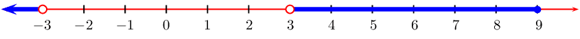
</Callout>

## Solving quadratic inequalities

### Textbook Exercise 2.8

Solve the following inequalities and show each answer on a number
                                                        line:

**Problem:**
\({x}^{2}-x<12\)

**Solution:**
\begin{align*}
                                                        x^{2} - x - 12 & < 0 \\
                                                        (x - 4)(x + 3) & < 0
                                                        \end{align*}

| Critical values |  | \(x=-3\) |  | \(x=4\) |  |
| --- | --- | --- | --- | --- | --- |
| \(x - 4\) | \(-\) | \(-\) | \(-\) | \(\text{0}\) | \(+\) |
| \(x + 3\) | \(-\) | \(\text{0}\) | \(+\) | \(+\) | \(+\) |
| \(f(x)= (x - 4)(x + 3)\) | \(+\) | \(\text{0}\) | \(-\) | \(\text{0}\) | \(+\) |

From the table we see that \(f(x)\) is less than \(\text{0}\)
                                                                when \(-3 < x < 4\)

We represent this on a number line:

**Problem:**
\(3{x}^{2}>-x+4\)

**Solution:**
\begin{align*}
                                                        3x^{2} + x - 4 & > 0 \\
                                                        (3x + 4)(x - 1) & > 0
                                                        \end{align*}

| Critical values |  | \(x=-\frac{4}{3}\) |  | \(x=1\) |  |
| --- | --- | --- | --- | --- | --- |
| \(x - 1\) | \(-\) | \(-\) | \(-\) | \(\text{0}\) | \(+\) |
| \(3x + 4\) | \(-\) | \(\text{0}\) | \(+\) | \(+\) | \(+\) |
| \(f(x)= (3x + 4)(x - 1)\) | \(+\) | \(\text{0}\) | \(-\) | \(\text{0}\) | \(+\) |

From the table we see that \(f(x)\) is greater than
                                                                \(\text{0}\) when \(x < -\frac{4}{3}\) or when \(x
                                                                > 1\)

We represent this on a number line:

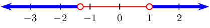

**Problem:**
\({y}^{2}<-y-2\)

**Solution:**
\[y^{2} + y + 2 < 0\]

There are no real solutions.

The graph lies above the \(x\)-axis and does not cut the
                                                                \(x\)-axis so the function is never negative. There are
                                                                no values of \(y\) that will solve this inequality.

**Problem:**
\((3-t)(1+t) > 0\)

**Solution:**
\[(3 - t)(1 + t) > 0\]

| Critical values |  | \(t = -1\) |  | \(t = 3\) |  |
| --- | --- | --- | --- | --- | --- |
| \(3 - t\) | \(+\) | \(+\) | \(+\) | \(\text{0}\) | \(-\) |
| \(1 + t\) | \(-\) | \(\text{0}\) | \(+\) | \(+\) | \(+\) |
| \(f(x)= (3 - t)(1 + t)\) | \(-\) | \(\text{0}\) | \(+\) | \(\text{0}\) | \(-\) |

From the table we see that \(f(x)\) is greater than
                                                                \(\text{0}\) when \(-1 < t < 3\)

We represent this on a number line:

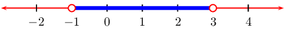

**Problem:**
\({s}^{2}-4s>-6\)

**Solution:**
\[s^{2} - 4s + 6 > 0 \\\]

Use the quadratic formula to find critical values:

                                                        \begin{align*}
                                                        s & = \frac{-(-4) \pm \sqrt{(-4)^2 - 4(1)(6)}}{2(1)} \\
                                                        & = \frac{4 \pm \sqrt{16- 24}}{2 } \\
                                                        & = \frac{4 \pm \sqrt{-8}}{2}
                                                        \end{align*}

Therefore there are no real roots and the graph does not cut
                                                                the \(x\)-axis. The graph lies above the \(x\)-axis and
                                                                so this inequality is true for all real values of \(s\).

**Problem:**
\(0 \ge 7{x}^{2}-x+8\)

**Solution:**
Use the quadratic formula to find critical values:

                                                        \begin{align*}
                                                        x & = \frac{-(-1) \pm \sqrt{(-1)^2 - 4(7)(8)}}{2(7)} \\
                                                        & = \frac{1 \pm \sqrt{1- 224}}{14} \\
                                                        & = \frac{1 \pm \sqrt{-223}}{14}
                                                        \end{align*}

Therefore there are no real roots and the graph does not cut
                                                                the \(x\)-axis. The graph lies above the \(x\)-axis and
                                                                so this inequality is true for all real values of \(x\).

**Problem:**
\(x \geq -4x^2\)

**Solution:**
\begin{align*}
                                                        x & \geq -4x^2 \\
                                                        4x^2 + x & \geq 0 \\
                                                        x(4x + 1) & \geq 0
                                                        \end{align*}

| Critical values |  | \(x = -\frac{1}{4}\) |  | \(x = 0\) |  |
| --- | --- | --- | --- | --- | --- |
| \(x\) | \(-\) | \(-\) | \(-\) | \(\text{0}\) | \(+\) |
| \(4x + 1\) | \(-\) | \(\text{0}\) | \(+\) | \(+\) | \(+\) |
| \(f(x)= x(4x + 1)\) | \(+\) | \(\text{0}\) | \(-\) | \(\text{0}\) | \(+\) |

From the table we see that \(f(x)\) is greater than
                                                                \(\text{0}\) when \(x \leq -\frac{1}{4}\) or \(x \geq
                                                                0\).

We can represent this on a number line:

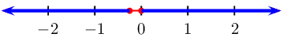

**Problem:**
\(2{x}^{2}+x+6\le 0\)

**Solution:**
\[2x^{2} + x + 6 \le 0\]

There are no real roots and the graph does not cut the
                                                                \(x\)-axis. The graph lies above the \(x\)-axis and so
                                                                this inequality is never true.

**Problem:**
\(\dfrac{x}{x-3}<2\), \(x\ne 3\)

**Solution:**
We first solve the equation:

                                                        \begin{align*}
                                                        \dfrac{x}{x-3} & < 2 \\
                                                        \dfrac{x}{x-3} - 2 & < 0 \\
                                                        \dfrac{x - 2(x-3)}{x-3}& < 0 \\
                                                        \dfrac{x - 2x + 6}{x-3}& < 0 \\
                                                        \dfrac{-x + 6}{x-3}& < 0 \\
                                                        \dfrac{-(x - 6)}{x-3}& < 0 \\
                                                        \dfrac{x - 6}{x-3}& > 0 \\
                                                        x & = 6
                                                        \end{align*}

| Critical values |  | \(x = 3\) |  | \(x = 6\) |  |
| --- | --- | --- | --- | --- | --- |
| \(x - 3\) | \(-\) | undef | \(+\) | \(+\) | \(+\) |
| \(x - 6\) | \(-\) | \(-\) | \(-\) | \(\text{0}\) | \(+\) |
| \(f(x)= x - 6\) | \(+\) | undef | \(-\) | \(\text{0}\) | \(+\) |

From the table we see that \(f(x) > 0\) when \(x < 3
                                                                \text{ or } x > 6\) with \(x \ne 3\).

We can represent this on a number line:

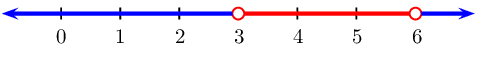

**Problem:**
\(\dfrac{x^2 + 4}{x - 7} \geq 0\), \(x \ne 7\)

**Solution:**
We first simplify the fraction:

                                                        \[\dfrac{(x + 2)(x - 2)}{x - 7} \geq 0\]

| Critical values |  | \(x = -2\) |  | \(x = 2\) |  | \(x = 7\) |  |
| --- | --- | --- | --- | --- | --- | --- | --- |
| \(x + 2\) | \(-\) | \(\text{0}\) | \(+\) | \(+\) | \(+\) | \(+\) | \(+\) |
| \(x - 2\) | \(-\) | \(-\) | \(-\) | \(\text{0}\) | \(+\) | \(+\) | \(+\) |
| \(x - 7\) | \(-\) | \(-\) | \(-\) | \(-\) | \(-\) | undef | \(+\) |
| \(f(x)= \dfrac{(x + 2)(x - 2)}{x - 7}\) | \(-\) | \(\text{0}\) | \(+\) | \(\text{0}\) | \(-\) | undef | \(+\) |

From the table we see that \(f(x)\) is greater than
                                                                \(\text{0}\) when \(-2 \leq x \leq 2\) and \(x > 7\)
                                                                with \(x \ne 7\).

We can represent this on a number line:

**Problem:**
\(\dfrac{x + 2}{x} - 1 \geq 0\), \(x \ne 0\)

**Solution:**
We first simplify the equation:

                                                        \begin{align*}
                                                        \frac{x + 2}{x} - 1 & \ge 0 \\
                                                        \frac{x + 2 - x}{x}& \ge 0 \\
                                                        \frac{2}{x} & \ge 0 \\
                                                        \text{Therefore } x & > 0
                                                        \end{align*}

The solution is \(x > 0\) with \(x \ne 0\).

We can represent this on a number line:

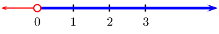

Draw a sketch of the following inequalities and solve for \(x\):

**Problem:**
\(2x^2-18 > 0\)

**Solution:**
We draw the parabola:

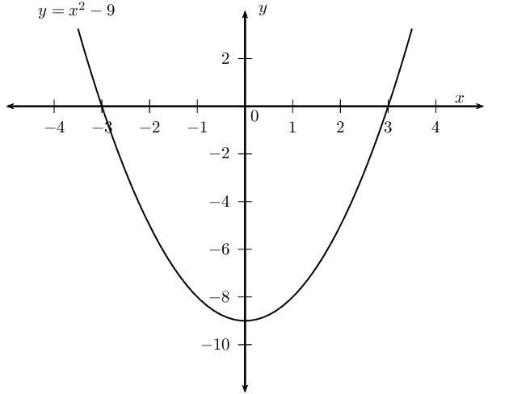

And now we note that we are looking for the parts of the
                                                                parabola that are greater than \(\text{0}\). These parts
                                                                are marked in red below:

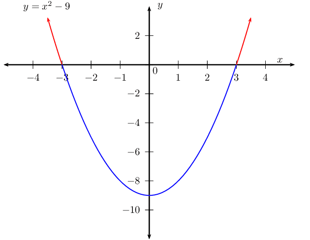

This gives a final answer of \(x < -3\) or \(x > 3\).

**Problem:**
\(5 - x^2 \leq 0\)

**Solution:**
We first simplify the equation:

                                                        \begin{align*}
                                                        5 - x^2 & \leq 0 \\
                                                        - (x^2 - 5) & \leq 0 \\
                                                        x^2 - 5 & \geq 0 \\
                                                        \text{Therefore } x & > 0
                                                        \end{align*}

We draw the parabola:

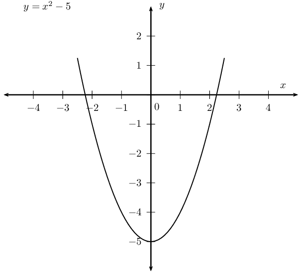

And now we note that we are looking for the parts of the
                                                                parabola that are less than or equal to \(\text{0}\).
                                                                These parts are marked in red below:

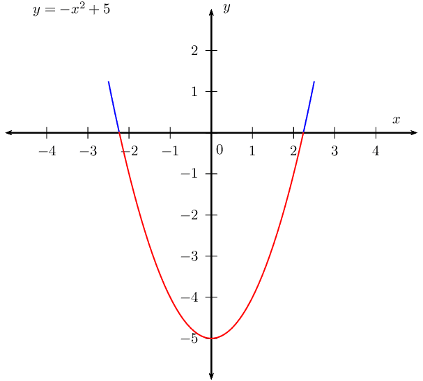

This gives a final answer of \(-\sqrt{5} \leq x \leq
                                                                \sqrt{5}\).

**Problem:**
\(x^2 < 0\)

**Solution:**
We draw the parabola:

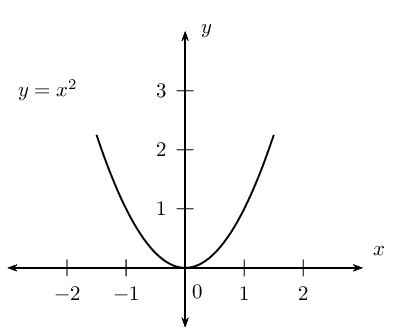

We are looking for the parts of the parabola that are less
                                                                than \(\text{0}\). The parabola does not go below the
                                                                \(x\)-axis and so is therefore never negative. There is
                                                                no solution to this inequality.

**Problem:**
\(0 \ge 6x^2\)

**Solution:**
We draw the parabola:

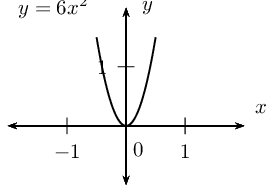

We see that the parabola never touches the \(x\)-axis and is
                                                                always positive. Therefore the inequality is true for
                                                                all real values of \(x\).
