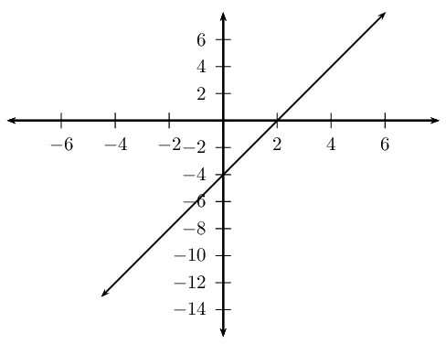
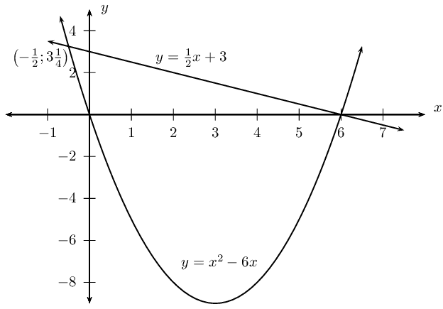
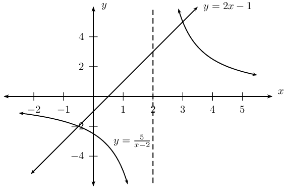
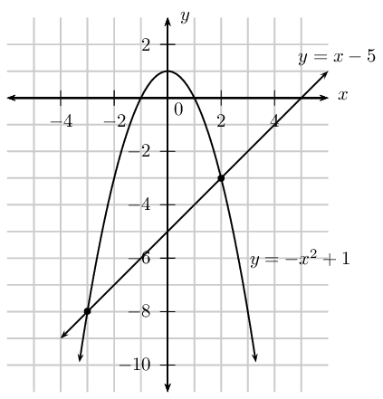
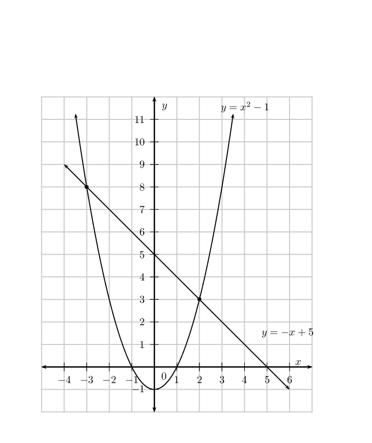

## 2.8 Simultaneous equations (EMBFS)

Simultaneous linear equations can be solved using three different methods: substitution, elimination or using a
      graph to determine where the two lines intersect.
      For solving systems of simultaneous equations with linear and non-linear equations, we mostly use the substitution
      method.
      Graphical solution is useful for showing where the two equations intersect.

In general, to solve for the values of \(n\) unknown variables requires a system of \(n\) independent equations.

An example of a system of simultaneous equations with one linear equation and one quadratic equation is
      \begin{align*}
      y - 2x &= -4\\
      x^2 + y &= 4
      \end{align*}

### Solving by substitution (EMBFT)

- Use the simplest of the two given equations to express one of the variables in terms of the other.
- Substitute into the second equation. By doing this we reduce the number of equations and the number of
              variables by one.
- We now have one equation with one unknown variable which can be solved.
- Use the solution to substitute back into the first equation to find the value of the other unknown
              variable.

<Callout type="tip" title="Worked example 20: Simultaneous equations">
**Question:**
Solve for \(x\) and \(y\):
            \begin{align*}
            y-2x &= -4 \qquad \ldots (1) \\
            x^2 + y &= 4 \qquad \ldots (2)
            \end{align*}

**Make \(y\) the subject of the first equation:**
\[y = 2x - 4\]

**Substitute into the second equation and simplify:**
\begin{align*}
          x^2 + \left(2x-4\right) &= 4 \\
          x^2 + 2x - 8 &= 0
          \end{align*}

**Factorise the equation:**
\begin{align*}
          \left(x+4\right)\left(x-2\right) &= 0 \\
          \therefore x = -4 &\text{ or } x = 2
          \end{align*}

**Substitute the values of \(x\) back into the first equation to determine the corresponding
            \(y\)-values:**
If \(x = -4\):
            \begin{align*}
            y &= 2(-4)-4 \\
            &= -12
            \end{align*}

If \(x = 2\):
            \begin{align*}
            y &= 2(2) - 4 \\
            &= 0
            \end{align*}

**Check that the two points satisfy both original equations:**

**Write the final answer:**
The solution is \(x = -4 \text{ and } y = -12\) or \(x = 2 \text{ and } y = 0\). These are the coordinate
            pairs for the points of intersection as shown below.

</Callout>

<QuizCard id="m11-02-08a" title="Interactive Exercise 2.21" question="Solve for \(x\) and \(y\) : \[                 \begin{aligned}                     y & = x^{2} + 2 x - 1 \\                     y & = - 2 x - 4                 \end{aligned}             \] INSTRUCTIONS: You should get two coordinate pairs in the form \(\left(x_1\, ; y_1\right)\) and \(\left(x_2\, ; y_2\right)\) . You must enter each pair of coordinates in one of the input boxes provided. It does not matter which coordinate pair you type first." options=[] answer="(-1; -2), (-3; 2)" hint="You are expected to write a coordinate here. A coordinate is a list of numbers, separated by semi-colons ( ; ).                Coordinates are surrounded by brackets. Example: (1,5 ; 3) The spaces are optional." explanation="Substitute the linear equation into the quadratic equation We must solve the two equations simultaneously.                     In this case, we have a quadratic equation and a linear                     equation. The equations are: \[                     \begin{aligned}                     	& y = x^{2} + 2 x - 1 \\                         &  y = - 2 x - 4                     \end{aligned}                 \] This means we want two pairs of \(x\) and \(y\) values which                     solve both equations. We will substitute the value of \(y\) from the linear equation into the quadratic equation.                     Then we will simplify. \[                     \begin{aligned}                     - 2 x - 4 &= x^{2} + 2 x - 1  \\                         0 &= x^{2} + 2 x - 1+2 x+4 \\                         0 &= x^{2}+2 x+2 x-1+4\\                         0 &= x^{2}+4 x+3                     \end{aligned}                 \] Solve the equation \(x^{2}+4 x+3 = 0\) Now that we have substituted the linear equation into                   the quadratic one, it's time to solve the new quadratic                   equation. We will now solve the new quadratic equation by factorisation.                   In this case, we will use the grouping method. For this method,                   we need two numbers that add to give \(\text{4}\) .                   This is the coefficient of the middle term. The product of the two numbers must be \(\text{3}\) . This is the                   product of the coefficient of the first term \(\text{1}\) and                   the value of the last term \(\text{3}\) . The two numbers are \(\text{1}\) and \(\text{3}\) . We will re-write the middle term,                  forming two terms, using these two numbers. NOTE: We could use the quadratic formula as well. In this case,                   it is not necessary to do so because we can factorise the equation. \[                 \begin{aligned}                      0 &= x^{2}+4 x+3 \\                     0 &= x^{2}+x+3 x+3             \end{aligned}           \] We now group the first two terms together and group the last terms              together and factorise. \[             \begin{aligned}              0 &= \color{red}{x^{2}+x}\color{blue}{+3 x+3}\\                      0 &= \color{red}{x(x+1)}\color{blue}{+3(x+1)}              \end{aligned}            \] The last thing now is to factor the highest common factor. \[              \begin{aligned}                     0 &=    (x+3)(x+1)                 \end{aligned}               \] That's it! If we equate each binomial to zero we get the roots of the                   quadratic equation. These roots are the \(x\) -values                   of our solutions. The \(x\) -values are \(-\text{1}\) and \(-\text{3}\) . Calculate the corresponding values of \(y\) We will substitute each \(x\) -value into the                    linear equation. This will give us the corresponding                    values of \(y\) . For \(x = -1\) : \[                    \begin{aligned}                        y &=                        - 2 x - 4 \\                         &= -2                    \end{aligned}                \] For \(x = -3\) : \[                    \begin{aligned}                        y &=                        - 2 x - 4 \\                         &= 2                    \end{aligned}                \] The solutions are \( x = -1\) together with \( y = -2\) , and \( x = -3\) with \( y = 2\) . In coordinates pairs, the                    solutions are \(\left(-1\, ;                    -2\right)\) and \(\left(-3\, ;                    2\right)\) . We can plot the two equations on the same graph to check if                   our solutions are correct. The points where the two graphs                   intersect are the solutions of the equations. The two graphs intersect at the points \(\left(-1\, ;                   -2\right)\) and \(\left(-3\, ;                   2\right)\) . These are                   the same solutions we have calculated. This means we are \(\text{100}\%\) correct. Submit your answer as: and" />

### Solving by elimination (EMBFV)

- Make one of the variables the subject of both equations.
- Equate the two equations; by doing this we reduce the number of equations and the number of variables by
              one.
- We now have one equation with one unknown variable which can be solved.
- Use the solution to substitute back into either original equation, to find the corresponding value of the
              other unknown variable.

<Callout type="tip" title="Worked example 21: Simultaneous equations">
**Question:**
Solve for \(x\) and \(y\):
            \begin{align*}
            y &= x^2 - 6x \qquad \ldots (1) \\
            y + \frac{1}{2}x - 3 &= 0 \qquad \ldots (2)
            \end{align*}

**Make \(y\) the subject of the second equation:**
\begin{align*}
            y + \frac{1}{2}x - 3 &= 0 \\
            y &= -\frac{1}{2}x + 3
            \end{align*}

**Equate the two equations and solve for \(x\):**
\begin{align*}
            x^2 - 6x &= -\frac{1}{2}x + 3 \\
            x^2 - 6x + \frac{1}{2}x - 3 &= 0\\
            2x^2 - 12x + x - 6 &= 0\\
            2x^2 -11x - 6 &= 0\\
            (2x +1)(x-6) &= 0\\
            \text{Therefore } x = -\frac{1}{2}&\text{ or } x = 6
            \end{align*}

**Substitute the values for \(x\) back into the second equation to calculate the corresponding
            \(y\)-values:**
If \(x = -\dfrac{1}{2}\):
            \begin{align*}
            y &= -\frac{1}{2} \left( -\frac{1}{2} \right) + 3 \\
            \therefore y &= 3\frac{1}{4}
            \end{align*}
            This gives the point \(\left(-\dfrac{1}{2};3\dfrac{1}{4}\right)\).

If \(x = 6\):
            \begin{align*}
            y &= -\frac{1}{2}(6) + 3 \\
            &= -3 + 3 \\
            \therefore y &= 0
            \end{align*}
            This gives the point \((6;0)\).

**Check that the two points satisfy both original equations:**

**Write the final answer:**
The solution is \(x = -\dfrac{1}{2} \text{ and } y = 3\dfrac{1}{4}\) or \(x = 6 \text{ and } y = 0\). These
            are the coordinate pairs for the points of intersection as shown below.

</Callout>

<Callout type="tip" title="Worked example 22: Simultaneous equations">
**Question:**
Solve for \(x\) and \(y\):

            \begin{align*}
            y &= \dfrac{5}{x - 2} \qquad \ldots (1)\\
            y + 1 &= 2x \qquad \ldots (2)
            \end{align*}

**Make \(y\) the subject of the second equation:**
\begin{align*}
            y + 1 &= 2x \\
            y &= 2x - 1
            \end{align*}

**Equate the two equations and solve for \(x\):**
\begin{align*}
            2x - 1 &= \frac{5}{x - 2} \\
            (2x - 1)(x - 2) &= 5 \\
            2x^2 - 5x + 2 &= 5 \\
            2x^2 - 5x - 3 &= 0 \\
            (2x + 1)(x - 3) &= 0 \\
            \text{Therefore } x = -\frac{1}{2}&\text{ or } x = 3
            \end{align*}

**Substitute the values for \(x\) back into the second equation to calculate the corresponding
            \(y\)-values:**
If \(x -\dfrac{1}{2}\):
            \begin{align*}
            y &= 2(-\frac{1}{2}) - 1 \\
            \therefore y &= -2
            \end{align*}
            This gives the point \((-\dfrac{1}{2};-2)\).

If \(x = 3\):
            \begin{align*}
            y &= 2(3) -1 \\
            &= 5
            \end{align*}
            This gives the point \((3;5)\).

**Check that the two points satisfy both original equations:**

**Write the final answer:**
The solution is \(x = -\dfrac{1}{2} \text{ and } y = -2\) or \(x = 3 \text{ and } y = 5\). These are the
            coordinate pairs for the points of intersection as shown below.

</Callout>

<QuizCard id="m11-02-08b" title="Interactive Exercise 2.22" question="Adapted from DBE Nov 2015 Grade 11 P1, Q1 Maths formulas Solve for \(x\) and \(y\) simultaneously: \[                 \begin{array}{c}                     x + 3y = 21                 \end{array}             \] and \[                 \begin{array}{c}                     x y = 30                 \end{array}             \]" options=[] answer="2, 5, 15, 6" hint="You should enter a number here. If you want to, you can use a space to separate thousands.                Example: 12 800,25 For scientific notation you need to use the multiply symbol                ( ∗ ) and the exponent symbol ( ^ ). For example 6,673 × 10 −11 should be written as: 6,673 ∗ 10^−11" explanation="Make \(x\) the subject of the first equation \[                 \begin{aligned}                     x + 3y &= 21  \\                     x &= 21 - 3y                 \end{aligned}             \] Substitute \(x = 21 - 3y\) into the second equation and solve for \(y\) First, we can substitute \(x = 21 - 3y\) in place of \(x\) in the second equation: \[                     \begin{aligned}                         x y &= 30 \\                         \left( 21 - 3y \right) y &= 30                     \end{aligned}                 \] We can simplify this equation to solve for \(y\) : \[                     \begin{aligned}                         21y - 3y^{2} &= 30 \\                         0 &= 3 y^{2} - 21 y + 30                     \end{aligned}                 \] \[                     \begin{aligned}                         3 y^{2} - 21 y + 30 &= 0  \\                         \left(3 y - 6\right)\left(y - 5\right) &= 0  \\                         y=2\; \text{or} \;y&=5                     \end{aligned}                 \] Therefore the \(y\) -values are \(y=2\; \text{or} \;y=5\) . NOTE: You could also have solved for \(y\) by using the quadratic formula. Use the \(y\) -values to find the \(x\) -values by substitution Each of the \(y\) -values that we have found will have a corresponding \(x\) -value. We can find these \(x\) -values by substituting our \(y\) -values into either of the original equations. Since we have already isolated \(x\) in the first equation, we will use \(x = 21 - 3y\) : For \(y = 2\) : \[                     \begin{aligned}                         x&=21-3y \\                         x&=21-3\left(2\right) \\                         x &= 21 -6 \\                         x &= 15                     \end{aligned}                 \] For \(y = 5\) : \[                     \begin{aligned}                         x&=21-3y \\                         x&=21-3\left(5\right) \\                         x &= 21 -15 \\                         x &= 6                     \end{aligned}                 \] Therefore the \(x\) -values are \(x=15\; \text{or} \;x=6\) . NOTE: Substituting the \(y\) -values into either of the original equations would have given you the same answers for \(x\) . Submit your answer as: and and and" />

### Solving graphically (EMBFW)

- Make \(y\) the subject of each equation.
- Draw the graph of each equation on the same system of axes.
- The final solutions to the system of equations are the coordinates of the points where the two graphs
              intersect.

<Callout type="tip" title="Worked example 23: Simultaneous equations">
**Question:**
Solve graphically for \(x\) and \(y\):

            \begin{align*}
            y + x^2 &= 1 \qquad \ldots (1) \\
            y - x + 5 &= 0 \qquad \ldots (2)
            \end{align*}

**Make \(y\) the subject of both equations:**
For the first equation we have

\begin{align*}
            y + x^2 &= 1 \\
            y &= - x^2 + 1
            \end{align*}

and for the second equation

\begin{align*}
            y - x + 5 &= 0 \\
            y &= x - 5
            \end{align*}

**Draw the straight line graph and parabola on the same system of axes:**

**Determine where the two graphs intersect:**
From the diagram we see that the graphs intersect at \((-3;-8)\) and \((2;-3)\).

**Check that the two points satisfy both original equations:**

**Write the final answer:**
The solutions to the system of simultaneous equations are \((-3;-8)\) and \((2;-3)\).
</Callout>

<QuizCard id="m11-02-08c" title="Interactive Exercise 2.23" question="Draw the graphs of  the following                 equations on the same Cartesian plane. Use the graphs to find the points of                 intersection of the two lines. \[                 \begin{aligned}                     y & = x^{2} + 5 x + 4 \\                     y & = - 2 x - 6                 \end{aligned}             \] INSTRUCTIONS: You should get two coordinate pairs in the form \(\left(x_1\, ; y_1\right)\) and \(\left(x_2\, ; y_2\right)\) . You must enter each pair of coordinates in one of the input boxes provided. It does not matter which coordinate pair you type first." options=[] answer="(-2; -2), (-5; 4)" hint="You are expected to write a coordinate here. A coordinate is a list of numbers, separated by semi-colons ( ; ).                Coordinates are surrounded by brackets. Example: (1,5 ; 3) The spaces are optional." explanation="Plot the graph of \(y = x^{2} + 5 x + 4\) on a Cartesian plane We must plot the graphs of the two equations on the same                     Cartesian plane. We will then need to find the points where the two graphs                     intersect. We will begin by plotting graph of the quadratic equation: \(y = x^{2} + 5 x + 4\) . To plot this graph, we need to find the coordinates of the                     points where the graph will cross the \(x\) - and \(y\) -axes. These points are the \(x\) - and \(y\) -intercepts, respectively. We will then use these points                     to plot the graph. The \(y\) -intercept is the quantity in the                     equation which is not multiplied by \(x\) . For this equation, the \(y\) -intercept is \(\text{4}\) .                     The coordinates of this point are \(\left(0\, ; 4\right)\) . The \(x\) -intercepts are the roots of the                     equation \(x^{2} + 5 x + 4 = 0\) . We will calculate the roots of the equation                     through factorisation. In this case, we will use the grouping method.                     For this method, we need two numbers that add to give \(\text{5}\) .                     This is the coefficient of the middle term.                     The product of the two numbers must be \(\text{4}\) . This is the product of                   the coefficient of the first term \(\text{1}\) and                   the value of the last term \(\text{4}\) . The two numbers are \(\text{1}\) and \(\text{4}\) . We will re-write the middle term,                  forming two terms, using these two numbers. NOTE: We could use the quadratic formula as well. In this case,                     it is not necessary to do so because we can factorise the equation. \[                   \begin{aligned}                       0 &=x^{2} + 5 x + 4 \\                        0 &= x^{2}+x+4 x+4                \end{aligned}            \] We now group the first two terms together and group the last terms               together and factorise. After that, we will factor the highest common factor. \[                \begin{aligned}                       0 &= x(x+1)+4(x+1)\\                        0 &= (x+4)(x+1)                   \end{aligned}               \] If we equate each binomial to zero we get the roots of the                   quadratic equation. The roots are \(x = -1\) and \(x = -4\) . The coordinates of these                    roots are \(\left(-1\, ; 0 \right)\) and \(\left(-4\, ; 0 \right)\) . Using these \(x\) - and \(y\) -intercepts we will draw the graph: Plot the graph of \(y = - 2 x - 6\) on the                    same Cartesian plane As we did for the quadratic equation, we will first                    find the \(y\) -intercept. After that we will                    calculate root for the linear equation. We remember                    that the \(y\) -intercept is the quantity in the                    equation which is not multiplied by \(x\) . The \(y\) -intercept is \(-\text{6}\) . Its coordinates are: \(\left(0\, ; -6\right)\) . We will work out the root of the equation \(0 = - 2 x - 6\) . \[                    \begin{aligned}                        0 & = - 2 x - 6 &= 0\\                        - 2 x &= 6\\x &= -3                    \end{aligned}                \] The root is: \( x =                    -3\) . Its coordinates are: \(\left( -3\, ; 0 \right)\) . We will now plot the equation \(y = - 2 x - 6\) on the same Cartesian plane we have used                    for the graph of the quadratic equation. Read off the coordinates of the points of intersection As we can see from the second graph, there are two points of                     intersection. We have marked each of these points with a black                     dot. The coordinates of these points are: \((-2\, ; -2)\) and \((-5\, ; 4)\) . We have used a graphical method to determine the solutions of                     the simultaneous equations: \(y = x^{2} + 5 x + 4\) and \(y = - 2 x - 6\) . The solutions are                     the points where their graphs intersect. NOTE: It is possible to solve the simultaneous equations using                     either the substitution or elimination methods. The points of intersection are \((-2\, ; -2)\) and \((-5\, ; 4)\) . Submit your answer as: and" />

## Solving simultaneous equations

### Textbook Exercise 2.9

Solve the following systems of equations algebraically. Leave your answer in surd form, where
              appropriate.

**Problem:**
\(y+x=5\)

\(y-{x}^{2}+3x-5=0\)

**Solution:**
We make \(y\) the subject of each equation:

              \begin{align*}
              y + x &= 5 \\
              y &= 5 - x
              \end{align*}
              \begin{align*}
              y - x^{2} + 3x - 5 &= 0 \\
              y &= x^{2} - 3x + 5
              \end{align*}

Next equate the two equations and solve for \(x\):

\begin{align*}
                5 - x &= x^{2} - 3x + 5 \\
                0 &= x^{2} - 2x \\
                0 &= x(x - 2) \\
                \text{Therefore } x = 0 &\text{ or } x = 2
                \end{align*}

Now we substitute the values for \(x\) back into the first equation to calculate the corresponding
                \(y\)-values

If \(x = 0\):
                \begin{align*}
                y &= 5 - 0 \\
                \therefore y &= 5
                \end{align*}
                This gives the point \((0;5)\).

If \(x = 2\):
                \begin{align*}
                y &= 5 - 2 \\
                &= 3
                \end{align*}
                This gives the point \((2;3)\).

The solution is \(x = 0 \text{ and } y = 5\) or \(x = 2 \text{ and } y = 3\). These are the coordinate
                pairs for the points of intersection.

**Problem:**
\(y = 6 - 5x + x^2\)

\(y-x+1=0\)

**Solution:**
We make \(y\) the subject of each equation:

              \[y = 6 - 5x + x^2\]

              \begin{align*}
              y - x + 1 &= 0 \\
              y &= x - 1
              \end{align*}

Next equate the two equations and solve for \(x\):

\begin{align*}
                6 - 5x + x^2 &= x - 1 \\
                x^{2} - 6x + 7 &= 0 \\
                x &= \dfrac{-(-6) \pm \sqrt{(-6)^{2} - 4(1)(7)}}{2(1)} \\
                x &= \dfrac{6 \pm \sqrt{36 - 28}}{2} \\
                x &= \dfrac{6 \pm \sqrt{8}}{2} \\
                x &= \dfrac{6 \pm 2\sqrt{2}}{2} \\
                x &= 3 \pm \sqrt{2}
                \end{align*}

Now we substitute the values for \(x\) back into the second equation to calculate the corresponding
                \(y\)-values

If \(x = 3 - \sqrt{2}\):
                \begin{align*}
                y &= 3 - \sqrt{2} - 1 \\
                \therefore y &= 2 - \sqrt{2}
                \end{align*}

If \(x = 3 + \sqrt{2}\):
                \begin{align*}
                y &= 3 + \sqrt{2} - 1 \\
                &= 2 + \sqrt{2}
                \end{align*}

The solution is \(x = 3 \pm \sqrt{2} \text{ and } y = 2 \pm \sqrt{2}\)

**Problem:**
\(y=\dfrac{2x+2}{4}\)

\(y-2{x}^{2}+3x+5=0\)

**Solution:**
We make \(y\) the subject of each equation:

              \[y = \dfrac{2x+2}{4}\]

              \begin{align*}
              y - 2{x}^{2} + 3x + 5 &= 0 \\
              y &= 2x^{2} - 3x - 5
              \end{align*}

Next equate the two equations and solve for \(x\):

\begin{align*}
                \dfrac{2x+2}{4} &= 2x^{2} - 3x - 5 \\
                2x + 2 &= 8x^{2} - 12x - 20 \\
                0 &= 8x^{2} - 14x - 22 \\
                0 &= 4x^{2} - 7x - 11 \\
                0 &= (4x - 11)(x + 1) \\
                \text{Therefore } x = -1 &\text{ or } x = \frac{11}{4}
                \end{align*}

Now we substitute the values for \(x\) back into the first equation to calculate the corresponding
                \(y\)-values

If \(x = -1\):
                \begin{align*}
                y &= \dfrac{2(-1) + 2}{4} \\
                y &= 0
                \end{align*}
                This gives the point \((-1;0)\).

If \(x = \frac{1}{4}\):
                \begin{align*}
                y &= \dfrac{2(\frac{1}{4}) + 2}{4} \\
                y &= \dfrac{\frac{5}{2}}{4} \\
                &= \frac{5}{8}
                \end{align*}
                This gives the point \((\frac{1}{4};\frac{5}{8})\).

The solution is \(x = -1 \text{ and } y = 0\) or \(x = \frac{1}{4} \text{ and } y = \frac{5}{8}\).
                These are the coordinate pairs for the points of intersection.

**Problem:**
\(a - 2b - 3 = 0\); \(a-3{b}^{2}+4=0\)

**Solution:**
We make \(a\) the subject of each equation:

              \[a = 2b + 3\]

              \begin{align*}
              a - 3{b}^{2} + 4 &= 0 \\
              a &= 3b^{2} - 4
              \end{align*}

Next equate the two equations and solve for \(b\):

\begin{align*}
                2b + 3 &= 3b^{2} - 4 \\
                0 &= 3b^{2} - 2b - 7 \\
                0 &= \dfrac{-(-2) \pm \sqrt{(-2)^{2} - 4(3)(-7)}}{2(3)} \\
                b &= \dfrac{2 \pm \sqrt{4 + 84}}{6} \\
                b &= \dfrac{2 \pm \sqrt{88}}{6}
                \end{align*}

Now we substitute the values for \(b\) back into the first equation to calculate the corresponding
                \(a\)-values

If \(b = \dfrac{2 + \sqrt{88}}{6}\):
                \begin{align*}
                a &= 2\left(\dfrac{2 + \sqrt{88}}{6}\right) + 3 \\
                &= \dfrac{2 + \sqrt{88}}{3} + 3 \\
                &= \dfrac{11 + \sqrt{88}}{3}
                \end{align*}

If \(b = \dfrac{2 - \sqrt{88}}{6}\):
                \begin{align*}
                a &= 2\left(\dfrac{2 - \sqrt{88}}{6}\right) + 3 \\
                &= \dfrac{2 - \sqrt{88}}{3} + 3 \\
                &= \dfrac{11 - \sqrt{88}}{3}
                \end{align*}

The solution is \(b = \dfrac{2 \pm \sqrt{88}}{6} \text{ and } a = \dfrac{11 \pm \sqrt{88}}{6}\)

**Problem:**
\(x^2 - y + 2 = 3x\)

\(4x = 8 + y\)

**Solution:**
We make \(y\) the subject of each equation:

              \begin{align*}
              x^{2} + y + 2 &= 3x \\
              y &= -x^{2} + 3x - 2
              \end{align*}
              \[y = 4x - 8\]

Next equate the two equations and solve for \(x\):

\begin{align*}
                4x - 8 &= -x^{2} + 3x - 2 \\
                x^{2} + x - 6 &= 0 \\
                (x + 3)(x - 2) & = 0 \\
                \text{Therefore } x = -3 &\text{ or } x = 2
                \end{align*}

Now we substitute the values for \(x\) back into the second equation to calculate the corresponding
                \(y\)-values

If \(x = -3\):
                \begin{align*}
                y &= 4(-3) - 8 \\
                y &= -20
                \end{align*}
                This gives the point \((-3;-20)\).

If \(x = 2\):
                \begin{align*}
                y &= 4(2) - 8 \\
                &= 0
                \end{align*}
                This gives the point \((2;0)\).

The solution is \(x = -3 \text{ and } y = -20\) or \(x = 2 \text{ and } y = 0\). These are the
                coordinate pairs for the points of intersection.

**Problem:**
\(2y + x^2 + 25 = 7x\)

\(3x = 6y + 96\)

**Solution:**
We make \(y\) the subject of each equation:

              \begin{align*}
              2y + x^2 + 25 &= 7x \\
              2y + x^2 + 25 &= 7x - x^{2} + 25 \\
              y &= \frac{-x^{2} + 7x + 25}{2}
              \end{align*}
              \begin{align*}
              2y & = x - 32 \\
              y & = \frac{x - 32}{2}
              \end{align*}

Next equate the two equations and solve for \(x\):

\begin{align*}
                \frac{x - 32}{2} &= \frac{-x^{2} + 7x + 25}{2} \\
                x - 32 &= -x^{2} + 7x + 25 \\
                x^{2} - 6x - 57 & = 0 \\
                x & = \dfrac{-(-6) \pm \sqrt{(-6)^{2} - 4(1)(-57)}}{2(1)} \\
                & = \dfrac{6 \pm \sqrt{36 + 228}}{2} \\
                & = \dfrac{6 \pm \sqrt{264}}{2}
                \end{align*}

Now we substitute the values for \(x\) back into the second equation to calculate the corresponding
                \(y\)-values

If \(x = \dfrac{6 + \sqrt{264}}{2}\):
                \begin{align*}
                2y &= \dfrac{6 + \sqrt{264}}{2} - 32 \\
                y &= \dfrac{70 + \sqrt{264}}{4} \\
                &= \dfrac{70 + \sqrt{264}}{4}
                \end{align*}

If \(x = \dfrac{6 - \sqrt{264}}{2}\):
                \begin{align*}
                2y &= \dfrac{6 - \sqrt{264}}{2} - 32 \\
                y &= \dfrac{70 - \sqrt{264}}{4} \\
                &= \dfrac{70 - \sqrt{264}}{4}
                \end{align*}

The solution is \(x = \dfrac{6 \pm \sqrt{264}}{2} \text{ and } y = \dfrac{70 \pm \sqrt{264}}{2}\)

Solve the following systems of equations graphically. Check your solutions by also solving algebraically.

**Problem:**
\({x}^{2}-1-y=0\)

\(y+x-5=0\)

**Solution:**
Make \(y\) the subject of both equations

For the first equation we have:

\begin{align*}
                x^{2} - 1 - y &= 0 \\
                y &= x^2 - 1
                \end{align*}

and for the second equation:

\begin{align*}
                y + x - 5 &= 0 \\
                y &= -x + 5
                \end{align*}

Draw the straight line graph and parabola on the same system of axes:

From the diagram we see that the graphs intersect at \((-3;8)\) and \((2;3)\).

We can solve algebraically to check. Doing this we find the same solution.

The solutions to the system of simultaneous equations are \((-3;8)\) and \((2;3)\).

**Problem:**
\(x+y-10=0\)

\({x}^{2}-2-y=0\)

**Solution:**
Make \(y\) the subject of both equations

For the first equation we have:

\begin{align*}
                x + y - 10 &= 0 \\
                y &= -x + 10
                \end{align*}

and for the second equation:

\begin{align*}
                x^{2} - 2 - y &= 0 \\
                y &= x^{2} - 2
                \end{align*}

Draw the straight line graph and parabola on the same system of axes:

From the diagram we see that the graphs intersect at \((-4;14)\) and \((3;7)\).

We can solve algebraically to check. Doing this we find the same solution.

The solutions to the system of simultaneous equations are \((-4;14)\) and \((3;7)\).

**Problem:**
\(xy = 12\)

\(7 = x+y\)

**Solution:**
Make \(y\) the subject of both equations

For the first equation we have:

\begin{align*}
                xy &= 12 \\
                y &= \frac{12}{x}
                \end{align*}

and for the second equation:

\begin{align*}
                7 &= x + y \\
                y &= 7 - x
                \end{align*}

Draw the two graphs on the same system of axes:

We also note that this sytem of equations has the followig restrictions: \(x \ne 0\) and \(y \ne 0\)

From the diagram we see that the graphs intersect at \((3;4)\) and \((4;3)\).

We can solve algebraically to check. Doing this we find the same solution.

The solutions to the system of simultaneous equations are \((3;4)\) and \((4;3)\).

**Problem:**
\(6-4x-y=0\)

\(12-2{x}^{2}-y=0\)

**Solution:**
Make \(y\) the subject of both equations

For the first equation we have:

\begin{align*}
                6 - 4x - y &= 0 \\
                y &= -4x + 6
                \end{align*}

and for the second equation:

\begin{align*}
                12 - 2x^{2} - y &= 0 \\
                y &= -2x^{2} + 12
                \end{align*}

Draw the two graphs on the same system of axes:

From the diagram we see that the graphs intersect at approximately \((4;-10)\) and \((-2;14)\).

We can solve algebraically to check (and to get a more accurate answer). Doing this gives:

              \begin{align*}
              -4x + 6 &= -2x^{2} + 12 \\
              2x - 3 &= x^{2} - 6 \\
              x^{2} - 2x - 9 & = 0 \\
              x & = \dfrac{-(-2) \pm \sqrt{(-2)^{2} - 4(1)(-9)}}{2(1)} \\
              x & = \dfrac{2 \pm \sqrt{(4 + 36}}{2} \\
              x & = \dfrac{2 \pm \sqrt{40}}{2}
              \end{align*}

Solving for \(y\) gives:

              \begin{align*}
              y & = -4\left(\dfrac{2 \pm \sqrt{40}}{2} \right) + 6 \\
              &= -2(2 \pm \sqrt{40}) + 6 \\
              & = -4 \pm 2\sqrt{40} + 6 \\
              & = 2 \pm 2\sqrt{40}
              \end{align*}
