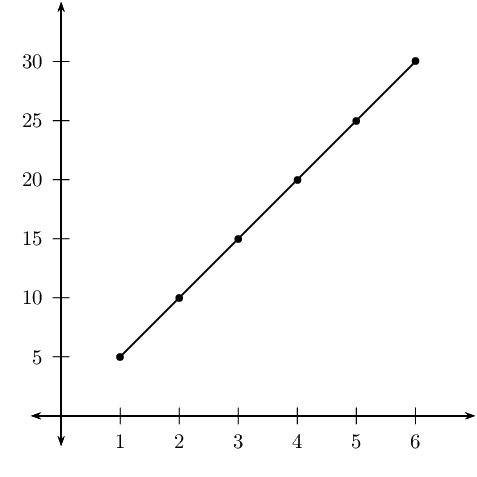
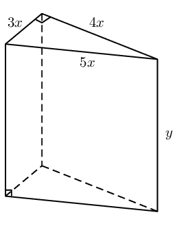

## 2.9 Word problems (EMBFX)

Solving word problems requires using mathematical language to describe real-life contexts. Problem-solving
            strategies are often used in the natural sciences and engineering disciplines (such as physics, biology, and
            electrical engineering) but also in the social sciences (such as economics, sociology and political
            science). To solve word problems we need to write a set of equations that describes the problem
            mathematically.

Examples of real-world problem solving applications are:

- modelling population growth;
- modelling effects of air pollution;
- modelling effects of global warming;
- computer games;
- in the sciences, to understand how the natural world works;
- simulators that are used to train people in certain jobs, such as pilots, doctors and soldiers;
- in medicine, to track the progress of a disease.

### Problem solving strategy (EMBFY)

2. Read the problem carefully.
4. What is the question and what do we need to solve for?
6. Assign variables to the unknown quantities, for example, \(x\) and \(y\).
8. Translate the words into algebraic expressions by rewriting the given information in terms of the
                           variables.
10. Set up a system of equations.
12. Solve for the variables using substitution.
14. Check the solution.
16. Write the final answer.

## Simple word problems

Write an equation that describes the following real-world situations mathematically:

2. Mohato and Lindiwe both have colds. Mohato sneezes twice for each sneeze of Lindiwe's. If Lindiwe
                           sneezes \(x\) times, write an equation describing how many times they both sneezed.
4. The difference of two numbers is \(\text{10}\) and the sum of their squares is \(\text{50}\).
                           Find the two numbers.
6. Liboko builds a rectangular storeroom. If the diagonal of the room is \(\sqrt{
                           \text{1 312}}\) \(\text{m}\) and the perimeter is \(\text{80}\) \(\text{m}\),
                           determine the dimensions of the room.
8. It rains half as much in July as it does in December. If it rains \(y\) mm in July, write an
                           expression relating the rainfall in July and December.
10. Zane can paint a room in \(\text{4}\) hours. Tlali can paint a room in \(\text{2}\) hours. How
                           long will it take both of them to paint a room together?
12. \(\text{25}\) years ago, Arthur was \(\text{5}\) years more than a third of Bongani's age. Today,
                           Bongani is \(\text{26}\) years less than twice Arthur's age. How old is Bongani?
14. The product of two integers is \(\text{95}\). Find the integers if their total is \(\text{24}\).

<Callout type="tip" title="Worked example 24: Gym membership">
**Question:**
The annual gym subscription for a single member is \(\text{R}\,\text{1 000}\), while an annual family
                    membership is \(\text{R}\,\text{1 500}\). The gym is considering increasing all membership fees by
                    the same amount. If this is done then a single membership would cost \(\dfrac{5}{7}\) of a family
                    membership. Determine the amount of the proposed increase.

**Identify the unknown quantity and assign a variable:**
Let the amount of the proposed increase be \(x\).

**Use the given information to complete a table:**
|  | now | after increase |
| --- | --- | --- |
| single | \(\text{1 000}\) | \(\text{1 000} + x\) |
| family | \(\text{1 500}\) | \(\text{1 500} + x\) |

**Set up an equation:**
\[\text{1 000} + x = \frac{5}{7}(\text{1 500} + x)\]

**Solve for \(x\):**
\begin{align*}
                \text{7 000} + 7x &= \text{7 500} + 5x \\
                2x &= 500 \\
                x &= 250
                \end{align*}

**Write the final answer:**
The proposed increase is \(\text{R}\,\text{250}\).
</Callout>

<Callout type="tip" title="Worked example 25: Corner coffee house">
**Question:**
Erica has decided to treat her friends to coffee at the Corner Coffee House. Erica paid
                    \(\text{R}\,\text{54,00}\) for four cups of cappuccino and three cups of filter coffee. If a cup of
                    cappuccino costs \(\text{R}\,\text{3,00}\) more than a cup of filter coffee, calculate how much a
                    cup of each type of coffee costs?

**Method 1: identify the unknown quantities and assign two variables:**
Let the cost of a cappuccino be \(x\) and the cost of a filter coffee be \(y\).

**Use the given information to set up a system of equations:**
\begin{align*}
                4x + 3y &= 54 \qquad \ldots (1) \\
                x &= y + 3 \qquad \ldots (2)
                \end{align*}

**Solve the equations by substituting the second equation into the first equation:**
\begin{align*}
                    4(y+3) + 3y &= 54 \\
                    4y+12 + 3y &= 54 \\
                    7y &= 42 \\
                    y &= 6
                    \end{align*}

If \(y=6\), then using the second equation we have
                    \begin{align*}

                    x &= y + 3 \\
                    &= 6 + 3 \\
                    &= 9
                    \end{align*}

**Check that the solution satisfies both original equations:**

**Write the final answer:**
A cup of cappuccino costs \(\text{R}\,\text{9}\) and a cup of filter coffee costs
                    \(\text{R}\,\text{6}\).

**Method 2: identify the unknown quantities and assign one variable:**
Let the cost of a cappuccino be \(x\) and the cost of a filter coffee be \(x-3\).

**Use the given information to set up an equation:**
\[4x + 3(x-3) = 54\]

**Solve for \(x\):**
\begin{align*}
                    4x + 3(x-3) &= 54 \\
                    4x + 3x-9 &= 54 \\
                    7x &= 63 \\
                    x &= 9
                    \end{align*}

**Write the final answer:**
A cup of cappuccino costs \(\text{R}\,\text{9}\) and a cup of filter coffee costs
                    \(\text{R}\,\text{6}\).
</Callout>

<Callout type="tip" title="Worked example 26: Taps filling a container">
**Question:**
Two taps, one more powerful than the other, are used to fill a container. Working on its own, the
                    less powerful tap takes \(\text{2}\) hours longer than the other tap to fill the container. If both
                    taps are opened, it takes \(\text{1}\) hour, \(\text{52}\) minutes and \(\text{30}\) seconds to fill
                    the container. Determine how long it takes the less powerful tap to fill the container on its own.

**Identify the unknown quantities and assign variables:**
Let the time taken for the less powerful tap to fill the container be \(x\) and let the time taken
                    for the more powerful tap be \(x - 2\).

**Convert all units of time to be the same:**
First we must convert \(\text{1}\) hour, \(\text{52}\) minutes and \(\text{30}\) seconds to hours:
                    \[1 + \frac{52}{60} + \frac{30}{(60)^2} = \text{1,875}\text{ hours}\]

**Use the given information to set up a system of equations:**
Write an equation describing the two taps working together to fill the container:
                    \begin{align*}
                    \frac{1}{x} + \frac{1}{x-2} &= \frac{1}{\text{1,875}}
                    \end{align*}

**Multiply the equation through by the lowest common denominator and simplify:**
\begin{align*}
                    \text{1,875}(x-2) + \text{1,875}x &= x(x-2) \\
                    \text{1,875}x - \text{3,75} + \text{1,875}x &= x^2 - 2x \\
                    0 &= x^2 - \text{5,75}x + \text{3,75}
                    \end{align*}

Multiply the equation through by \(\text{4}\) to make it easier to factorise (or use the quadratic
                    formula)
                    \begin{align*}
                    0 &= 4x^2 - 23x + 15 \\
                    0 &= (4x-3)(x-5)
                    \end{align*}
                    Therefore \(x = \frac{3}{4}\) or \(x = 5\).

We have calculated that the less powerful tap takes \(\frac{3}{4}\) hours or \(\text{5}\) hours to
                    fill the container, but we know that when both taps are opened it takes \(\text{1,875}\) hours. We
                    can therefore discard the first solution \(x = \dfrac{3}{4}\) hours.

So the less powerful tap fills the container in \(\text{5}\) hours and the more powerful tap takes
                    \(\text{3}\) hours.

**Check that the solution satisfies the original equation:**

**Write the final answer:**
The less powerful tap fills the container in \(\text{5}\) hours and the more powerful tap takes
                    \(\text{3}\) hours.
</Callout>

### Textbook Exercise 2.10

**Problem:**
Mr. Tsilatsila builds a fence around his rectangular vegetable garden of \(\text{8}\)
                            \(\text{m$^{2}$}\). If the length is twice the breadth, determine the dimensions of Mr.
                            Tsilatsila's vegetable garden.

**Solution:**
We let the length be \(l\) and the breadth be \(b\). The area of the garden is \(\text{8}\)
                            \(\text{m$^{2}$}\) and is given by \(A = l \times b\).

Since the length is twice the breadth we can express the length in terms of the breadth: \(l
                            = 2b\). We now have the following:

                        \begin{align*}
                        A = 8 & = l \times b \\
                        & = 2b(b) \\
                        & = 2b^{2} \\
                        b^{2} & = 4 \\
                        b & = \pm 2
                        \end{align*}

Therefore the breadth is \(\text{2}\) \(\text{m}\) and the length is twice this, \(\text{4}\)
                            \(\text{m}\). Note that the breadth cannot be a negative number and so we do not consider
                            this solution.

**Problem:**
Kevin has played a few games of ten-pin bowling. In the third game, Kevin scored
                            \(\text{80}\) more than in the second game. In the first game Kevin scored \(\text{110}\)
                            less than the third game. His total score for the first two games was \(\text{208}\). If he
                            wants an average score of \(\text{146}\), what must he score on the fourth game?

**Solution:**
We let the score for the first game be \(a\), the score for the second game be \(b\), the
                            score for the third game be \(c\) and the score for the fourth game be \(d\).

Now we note the following:

                        \begin{align*}
                        c & = 80 + b \\
                        a & = c - 110 \\
                        a + b & = 208 \\
                        \frac{a + b + c + d}{4} & = 146
                        \end{align*}

We make the \(c\) the subject of the first two equations:

                        \begin{align*}
                        c & = 80 + b \\
                        c & = a + 110
                        \end{align*}

And then we use \(a = 208 - b\) to solve for \(b\):

                        \begin{align*}
                        80 + b & = 208 - b + 110 \\
                        2b & = 208 + 110 - 80 \\
                        2b & = 238 \\
                        b & = 119
                        \end{align*}

Now we can find \(a\):

                        \begin{align*}
                        a + b & = 208 \\
                        a + 119 & = 208 \\
                        a & = 89
                        \end{align*}

And we can find \(c\):

                        \begin{align*}
                        c & = 80 + b \\
                        c & = 80 + 208 \\
                        c & = 288
                        \end{align*}

Finally we can find \(d\):

                        \begin{align*}
                        \frac{a + b + c + d}{4} & = 164 \\
                        496 + d & = 656 \\
                        d & = 187
                        \end{align*}

Kevin must score \(\text{187}\) in the fourth game.

**Problem:**
When an object is dropped or thrown downward, the distance, \(d\), that it falls in time,
                            \(t\), is described by the following equation:

                        \(s=5{t}^{2}+{v}_{0}t\)

In this equation, \({v}_{0}\) is the initial velocity, in \(\text{m·s$^{-1}$}\).
                            Distance is measured in meters and time is measured in seconds. Use the equation to find how
                            long it takes a tennis ball to reach the ground if it is thrown downward from a hot-air
                            balloon that is \(\text{500}\) \(\text{m}\) high. The tennis ball is thrown at an initial
                            velocity of \(\text{5}\) \(\text{m·s$^{-1}$}\).

**Solution:**
We are given the distance that the ball falls and the initial velocity so we can solve for
                            \(t\):

                        \begin{align*}
                        s & = 5{t}^{2} + {v}_{0}t \\
                        500 & = 5t^{2} + 5t \\
                        0 &= 5t^{2} + 5t - 500 \\
                        0 &= t^{2} + t - 100
                        \end{align*}
                        \begin{align*}
                        t &= \dfrac{-b \pm \sqrt{b^{2} - 4ac}}{2a} \\
                        \therefore t & = \dfrac{-(1) \pm \sqrt{(1)^{2} - 4(1)(-100)}}{2(1)} \\
                        & = \dfrac{-1 \pm \sqrt{1 + 400}}{2} \\
                        & = \dfrac{-1 \pm \sqrt{401}}{2}
                        \end{align*}

Since time cannot be negative the only solution is \(t = \dfrac{-1 + \sqrt{401}}{2} \approx
                            \text{9,5}\text{ s}\).

**Problem:**
The table below lists the times that Sheila takes to walk the given distances.

| time (minutes) | \(\text{5}\) | \(\text{10}\) | \(\text{15}\) | \(\text{20}\) | \(\text{25}\) | \(\text{30}\) |
| --- | --- | --- | --- | --- | --- | --- |
| distance (km) | \(\text{1}\) | \(\text{2}\) | \(\text{3}\) | \(\text{4}\) | \(\text{5}\) | \(\text{6}\) |

Plot the points.

Find the equation that describes the relationship between time and distance. Then use the
                            equation to answer the following questions:

2. How long will it take Sheila to walk \(\text{21}\) \(\text{km}\)?
4. How far will Sheila walk in \(\text{7}\) minutes?

If Sheila were to walk half as fast as she is currently walking, what would the graph of her
                            distances and times look like?

**Solution:**

The equation is \(t = 5d\).

It will take Sheila \(t = 5(21) = 105\) minutes to walk \(\text{21}\) \(\text{km}\).

Sheila will walk \(d = \frac{7}{5} = \text{1,4}\) kilometres in \(\text{7}\) minutes.

The gradient of the graph will be twice the gradient of the first graph. The graph will be
                            steeper and lie closer to the \(y\)-axis.

**Problem:**
The power \(P\) (in watts) supplied to a circuit by a \(\text{12}\) volt battery is given by
                            the formula \(P = 12I - \text{0,5}I^2\) where \(I\) is the current in amperes.

2. Since both power and current must be greater than \(\text{0}\), find the limits of
                                       the current that can be drawn by the circuit.
4. Draw a graph of \(P = 12I - \text{0,5}I^2\) and use your answer to the first question
                                       to define the extent of the graph.
6. What is the maximum current that can be drawn?
8. From your graph, read off how much power is supplied to the circuit when the current
                                       is \(\text{10}\) A. Use the equation to confirm your answer.
10. At what value of current will the power supplied be a maximum?

**Solution:**
2. We set the equation equal to \(\text{0}\) to find the limits:
                                   \begin{align*}
                                   0 & = 12I - \text{0,5}I^{2} \\
                                   \text{0,5}I^{2} - 12I & = 0 \\
                                   I(\text{0,5}I - 12) & = 0 \\
                                   I = 0 & \text{ or } I = 24
                                   \end{align*}
4.
6. The maximum current that can be drawn is \(\text{24}\) \(\text{A}\).
8. The power is \(\text{70}\) \(\text{W}\).
                                   \begin{align*}
                                   P & = 12(10) - \frac{1}{2}(10)^{2} \\
                                   & = 120 - 50 \\
                                   & = 70
                                   \end{align*}
10. \(\text{12}\) \(\text{A}\). This is the turning point of the parabola.

**Problem:**
A wooden block is made as shown in the diagram. The ends are right-angled triangles having
                            sides \(3x\), \(4x\) and \(5x\). The length of the block is \(y\). The total surface area of
                            the block is \(\text{3 600}\) \(\text{cm$^{2}$}\).

Show that

                        \(y=\frac{300-{x}^{2}}{x}\)

**Solution:**
\begin{align*}
                        \text{3 600} & = 3xy + 5xy + 4xy + 2 \left( \frac{1}{2}(3x)(4x) \right) \\
                        \text{3 600} & = 12xy + 12x^2 \\
                        \text{3 600} - 12x^2 & = 12xy \\
                        \frac{\text{3 600} - 12x^2}{12x} & = y \\
                        \therefore y & = \frac{\text{300} - x^2}{x}
                        \end{align*}
