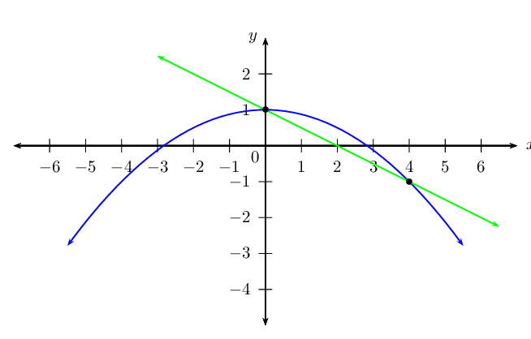
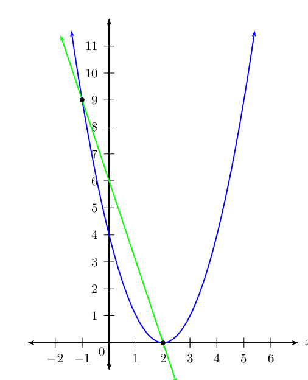

## End of chapter exercises

### Textbook Exercise 2.11

**Problem:**
Solve: \({x}^{2}-x-1=0\). Give your answer correct to two decimal places.

**Solution:**
\begin{align*}
                        x &= \dfrac{-b \pm \sqrt{b^2-4ac}}{2a}\\
                        &= \dfrac{-(-1)\pm \sqrt{(-1)^2 - 4(1)(-1)}}{2(1)}\\
                        &=\dfrac{1\pm \sqrt{1+4}}{2}\\
                        &=\dfrac{1 \pm \sqrt{5}}{2}\\
                        x = \text{1,62} &\text{ or } x = -\text{0,62}
                        \end{align*}

**Problem:**
Solve: \(16\left(x+1\right)={x}^{2}\left(x+1\right)\)

**Solution:**
\begin{align*}
                        16(x+1) &=x^2(x+1)\\
                        16(x+1) - x^2(x+1) &= 0\\
                        (16-x^2)(x+1)&=0\\
                        x^2= 16& \text{ or } x=-1\\
                        x = \pm 4& \text{ or } x=-1
                        \end{align*}

**Problem:**
Solve: \({y}^{2}+3+\dfrac{12}{{y}^{2}+3}=7\)

**Solution:**
\begin{align*}
                        \text{Let } y^2+3&=k\\
                        \text{Restriction: } y^2+3&\ne 0 \\
                        \text{Therefore } k &\ne 0 \\
                        \therefore k + \frac{12}{k} &= 7\\
                        k^2 + 12 &= 7k\\
                        k^2 - 7k + 12 &= 0\\
                        (k-3)(k-4) &= 0\\
                        k=3 &\text{ or } k=4\\
                        \therefore y^2 + 3 =3 &\text{ or } y^2 + 3 = 4\\
                        \therefore y^2 =0 &\text{ or } y^2 = 1\\
                        \therefore y=0 &\text{ or } y= \pm 1
                        \end{align*}

**Problem:**
Solve for \(x\): \(2{x}^{4}-5{x}^{2}-12=0\)

**Solution:**
\begin{align*}
                        2x^4 - 5x^2 - 12 &= 0\\
                        (x^2-4)(2x^2+3)&=0\\
                        x^2 = 4 & \text{ or } x^2 = -\frac{3}{2} \quad \text{(no real solution)}\\
                        \therefore x &= \pm 2
                        \end{align*}

Solve for \(x\):

**Problem:**
\(x\left(x-9\right)+14=0\)

**Solution:**
\begin{align*}
                        x(x-9) + 14 &= 0\\
                        x^2 - 9x + 14 &= 0\\
                        (x-7)(x-2)&=0\\
                        x = 7 &\text{ or } x=2
                        \end{align*}

**Problem:**
\(x^2 - x = 3\) (Show your answer correct to **one** decimal place.)

**Solution:**
\begin{align*}
                        x^2-x&=3\\
                        x^2-x-3&=0\\
                        x&=\dfrac{-(-1) \pm \sqrt{(-1)^2 - 4(1)(-3)}}{2(1)} \\
                        &= \dfrac{1 \pm \sqrt{1 +12}}{2}\\
                        &= \dfrac{1 \pm \sqrt{13}}{2}\\
                        x = \text{2,3} & \text{ or } x = -\text{1,3}
                        \end{align*}

**Problem:**
\(x + 2 = \frac{6}{x}\) (Show your answer correct to **two** decimal places.)

**Solution:**
\begin{align*}
                        x + 2 &= \frac{6}{x}\\
                        x^2 + 2x - 6 &= 0\\
                        x &= \dfrac{-2 \pm \sqrt{2^2 - 4(1)(-6)}}{2(1)}\\
                        &= \dfrac{-2 \pm \sqrt{4+24}}{2}\\
                        &=\dfrac{-2 \pm \sqrt{28}}{2}\\
                        &= \dfrac{-2 \pm 2\sqrt{7}}{2}\\
                        &= -1 \pm \sqrt{7}\\
                        x = \text{1,65} & \text{ or } x = -\text{3,65}
                        \end{align*}

**Problem:**
\(\dfrac{1}{x+1}+\dfrac{2x}{x-1}=1\)

**Solution:**
\begin{align*}
                        \dfrac{1}{x+1} + \dfrac{2x}{x-1} &= 1\\
                        (x-1) + 2x(x+1) &= (x+1)(x-1)\\
                        x-1 + 2x^2 + 2x &= x^2 - 1\\
                        x^2 + 3x &= 0\\
                        x(x+3)&=0\\
                        x=0& \text{ or } x=-3
                        \end{align*}

**Problem:**
Solve for \(x\) in terms of \(p\) by completing the square: \({x}^{2}-px-4=0\)

**Solution:**
\begin{align*}
                    x^{2} - px - 4 & = 0 \\
                    x^{2} - px + \frac{p^{2}}{4} & = 4 + \frac{p^{2}}{4} \\
                    \left(x - \frac{p}{2} \right)^{2} & = \frac{16 + p^{2}}{4} \\
                    x - \frac{p}{2} & = \sqrt{\frac{16 + p^{2}}{4}} \\
                    x & = \frac{\sqrt{16+p^{2}}}{2} - \frac{p}{2} \\
                    & = \frac{\sqrt{16 + p^{2}} - 2}{2}
                    \end{align*}

**Problem:**
The equation \(a{x}^{2}+bx+c=0\) has roots \(x=\dfrac{2}{3}\) and \(x=-4\). Find one set of
                        possible values for \(a\), \(b\) and \(c\).

**Solution:**
\begin{align*}
                        (3x- 2)(x+4)&=0\\
                        3x^2 + 12x - 2x - 8 &= 0\\
                        3x^2 + 10x - 8 &= 0\\
                        \therefore a &= 3\\
                        b &= 10\\
                        c&= -8
                        \end{align*}

**Problem:**
The two roots of the equation \(4{x}^{2}+px-9=0\) differ by \(\text{5}\). Calculate the value of
                        \(p\).

**Solution:**
\[4x^2 + px - 9 = 0\]

Using the quadratic formula:
                        \begin{align*}
                        x &= \frac{-p \pm \sqrt{p^2 - 4(4)(-9)}}{8} \\
                        &= \pm \dfrac{\sqrt{144 + p^2}}{8}
                        \end{align*}
                        \begin{align*}
                        \therefore x_1 = \dfrac{-p + \sqrt{144 + p^2}}{8} & \text{ and }
                        x_2 = \dfrac{-p - \sqrt{144 + p^2}}{8}\\
                        x_1 - x_2 &= 5\\
                        \therefore \dfrac{-p + \sqrt{144 + p^2}}{8} - \dfrac{-p - \sqrt{144 + p^2}}{8} &= 5\\
                        -p + \sqrt{144 + p^2} + p + \sqrt{144 + p^2} &= 40\\
                        \sqrt{p^2 + 144} &= 20\\
                        p^2 + 144 &= 400\\
                        p^2 &= 256\\
                        \therefore p &= \pm 16
                        \end{align*}

**Problem:**
An equation of the form \({x}^{2}+bx+c=0\) is written
                        on the board. Saskia and Sven copy it down incorrectly. Saskia has
                        a mistake in the constant term and obtains the solutions \(-\text{4}\) and \(\text{2}\).
                        Sven has a mistake in the coefficient of \(x\) and obtains the solutions
                        \(\text{1}\) and \(-\text{15}\). Determine the correct equation that was on the
                        board.

**Solution:**
\begin{align*}
                        \text{Saskia:}\\
                        (x+4)(x-2)&=0\\
                        x^2 + 2x - 8 &= 0\\
                        \therefore a = 1 & \text{ and } b = 2\\
                        \\
                        \text{Sven:}\\
                        (x-1)(x+15) &= 0\\
                        x^2 + 14x -15 &= 0\\
                        \therefore c &= -15\\
                        \\
                        \text{Correct equation:}\\
                        x^2 + 2x-15 &=0\\
                        (x+5)(x-3) &= 0\\
                        \therefore \text{correct roots are } x = -5& \text{ and } x=3
                        \end{align*}

**Problem:**
For which values of \(b\) will the expression \(\dfrac{b^2 - 5b + 6}{b + 2}\) be:

2. undefined?
4. equal to zero?

**Solution:**
2. For the expression to be undefined the denominator must be equal to \(\text{0}\). This
                                   means that \(b + 2 = 0\) and therefore \(b = -2\)
4. We simplify the fraction:
                               \begin{align*}
                               \dfrac{b^2 - 5b + 6}{b + 2} & = 0 \\
                               \dfrac{(b - 2)(b - 3)}{b + 2} & = 0
                               \end{align*}
   Therefore \(b = 2\) or \(b = 3\) will make the expression equal to \(\text{0}\).
   Note that we cannot have \(b=-2\) as that will make the denominator \(\text{0}\) and the
                                   whole expression will be undefined.

**Problem:**
Given \(\dfrac{(x^2 - 6)(2x + 1)}{x + 2} = 0\) solve for \(x\) if:

2. \(x\) is a real number.
4. \(x\) is a rational number.
6. \(x\) is an irrational number.
8. \(x\) is an integer.

**Solution:**
We first note that the restriction is: \(x \ne -2\).

Next we note that for the fraction to equal \(\text{0}\) the numerator must equal to
                        \(\text{0}\). This gives:

                    \begin{align*}
                    (x^2 - 6)(2x + 1) & = 0 \\
                    x = \frac{-1}{2} & \text{ or } x = \pm \sqrt{6}
                    \end{align*}

Now we need to decide which of these answers meet the criteria given:

2. All three solutions are real.
4. \(x = \frac{-1}{2}\)
6. \(x = \pm \sqrt{6}\)
8. There are no integer solutions.

**Problem:**
Given \(\dfrac{(x-6)^{\frac{1}{2}}}{x^2+3}\), for which value(s) of \(x\) will the expression be:

2. equal to zero?
4. defined?

**Solution:**
2. The expression will be equal to \(\text{0}\) when the numerator is equal to \(\text{0}\).
                                   This gives \(x = 6\).
4. The expression is undefined when the denominator is equal to \(\text{0}\). So the expression
                               will be defined for all values of \(x\) except where \(x = \pm \sqrt{3}\).

**Problem:**
Solve for \(a\) if \(\dfrac{\sqrt{8-2a}}{a-3} \geq 0\).

**Solution:**
We first note that the restriction is: \(a \ne 3\).

Next we note that for the fraction to equal \(\text{0}\) the numerator must equal to
                        \(\text{0}\). This gives:

                    \begin{align*}
                    \sqrt{8 - 2a} & = 0 \\
                    8 - 2a & = 0 \\
                    a & = 4
                    \end{align*}

Now we draw up a table of signs to find where the function is positive:

| Critical values |  | \(a=3\) |  | \(a=4\) |  |
| --- | --- | --- | --- | --- | --- |
| \(a-3\) | \(-\) | undef | \(+\) | \(+\) | \(+\) |
| \(a-4\) | \(-\) | \(-\) | \(-\) | \(\text{0}\) | \(+\) |
|  | \(-\) | undef | \(-\) | \(\text{0}\) | \(+\) |

From this we see that \(a \geq 4\) is the solution.

**Problem:**
Abdoul stumbled across the following formula to solve the quadratic equation \(a{x}^{2}+bx+c=0\)
                        in a foreign textbook.

                    \[x = \frac{2c}{-b \pm \sqrt{b^2 - 4ac}}\]

2. Use this formula to solve the equation: \(2x^2 + x - 3 = 0\).
4. Solve the equation again, using factorisation, to see if the formula works for this
                                   equation.
6. Trying to derive this formula to prove that it always works, Abdoul got stuck along the
                                   way. His attempt is shown below:
                               \[\begin{array}{rll}
                               ax^2 + bx + c &= 0 & \\
                               a + \dfrac{b}{x} + \dfrac{c}{x^2} &= 0 & \text{Divided by } x^2 \text{ where } x\ne
                               0 \\
                               \dfrac{c}{x^2} + \dfrac{b}{x} + a &= 0 & \text{Rearranged} \\
                               \dfrac{1}{x^2} + \dfrac{b}{cx} + \dfrac{a}{c} &= 0 & \text{Divided by } c \text{
                               where } c \ne 0 \\
                               \dfrac{1}{x^2} + \dfrac{b}{cx} &= -\dfrac{a}{c} & \text{Subtracted } \frac{a}{c}
                               \text{ from both sides} \\
                               \therefore \dfrac{1}{x^2} + \dfrac{b}{cx} + \dots & & \text{Got stuck}
                               \end{array}\]
   Complete his derivation.

**Solution:**
2. \begin{align*}
                                   x =& \dfrac{2c}{-b \pm \sqrt{b^2 - 4ac}}\\
                                   &= \dfrac{2(-3)}{-(1) \pm \sqrt{1^2 - 4(2)(-3)}}\\
                                   &=\dfrac{-6}{-1 \pm \sqrt{25}}\\
                                   &= \dfrac{-6}{-1 \pm 5}\\
                                   x = \frac{-6}{4} = -\frac{3}{2} & \text{ or } x = \frac{-6}{-6} = 1
                                   \end{align*}
4. \begin{align*}
                                   2x^2 + x -3 &= 0\\
                                   (2x+3)(x-1)&=0\\
                                   x = -\frac{3}{2}& \text{ or } x=1
                                   \end{align*}
6. \begin{align*}
                                   ax^2 + bx + c &= 0 \\
                                   a + \dfrac{b}{x} + \dfrac{c}{x^2} &= 0 \\
                                   \dfrac{c}{x^2} + \dfrac{b}{x} + a &= 0 \\
                                   \dfrac{1}{x^2} + \dfrac{b}{cx} + \dfrac{a}{c} &= 0 \\
                                   \dfrac{1}{x^2} + \dfrac{b}{cx} &= -\dfrac{a}{c} \\
                                   \dfrac{1}{x^2} + \dfrac{b}{cx} + \dfrac{b^2}{4c^2} &= -\dfrac{a}{c}
                                   +\dfrac{b^2}{4c^2}\\
                                   \left(\dfrac{1}{x} + \dfrac{b}{2c}\right)^2 &= \dfrac{-4ac +b^2}{4c^2} =
                                   \dfrac{b^2-4ac}{4c^2}\\
                                   \dfrac{1}{x} + \dfrac{b}{2c} &= \pm \sqrt{\dfrac{b^2-4ac}{4c^2}}\\
                                   \dfrac{1}{x} &= - \dfrac{b}{2c} \pm \sqrt{\dfrac{b^2-4ac}{4c^2}}\\
                                   \dfrac{1}{x} &= \dfrac{-b \pm \sqrt{b^2-4ac}}{2c}\\
                                   \therefore x &= \dfrac{2c}{-b \pm \sqrt{b^2 - 4ac}}
                                   \end{align*}

Solve for \(x\):

**Problem:**
\(\dfrac{4}{x-3} \le 1\)

**Solution:**
No solution available at present

**Problem:**
\(\dfrac{4}{{\left(x-3\right)}^{2}}<1\)

**Solution:**
No solution available at present

**Problem:**
\(\dfrac{2x-2}{x-3}>3\)

**Solution:**
No solution available at present

**Problem:**
\(\dfrac{-3}{\left(x-3\right)\left(x+1\right)}<0\)

**Solution:**
\(x < -1\) or \(x > 3\)

**Problem:**
\({\left(2x-3\right)}^{2}<4\)

**Solution:**
\(\text{0,5} < x < \text{2,5}\)

**Problem:**
\(2x\le \dfrac{15-x}{x}\)

**Solution:**
\(x \leq -3 \text{ or } 0 < x \leq \frac{5}{2}\)

**Problem:**
\(\dfrac{{x}^{2}+3}{3x-2}\le 0\)

**Solution:**
\(x < \frac{2}{3}\)

**Problem:**
\(x-2\ge \dfrac{3}{x}\)

**Solution:**
\(-1 \leq x < 0\) or \(x \geq 3\)

**Problem:**
\(\dfrac{{x}^{2}+3x-4}{5+{x}^{4}}\le 0\)

**Solution:**
\(-4 \le x \le 1\)

**Problem:**
\(\dfrac{x-2}{3-x}\ge 1\)

**Solution:**
\(2\frac{1}{2} \le x < 3\)

Solve the following systems of equations algebraically. Leave your answer in surd form, where
                        appropriate.

**Problem:**
\(y-2x=0\)

\(y-{x}^{2}-2x+3=0\)

**Solution:**
We make \(y\) the subject of each equation:

                        \begin{align*}
                        y - 2x &= 0 \\
                        y &= 2x
                        \end{align*}
                        \begin{align*}
                        y - x^{2} - 2x + 3 &= 0 \\
                        y &= x^{2} + 2x - 3
                        \end{align*}

Next equate the two equations and solve for \(x\):

\begin{align*}
                            2x &= x^{2} + 2x - 3 \\
                            0 &= x^{2} -3 \\
                            x^{2} & = 3 \\
                            x &= \pm \sqrt{3}
                            \end{align*}

Now we substitute the values for \(x\) back into the first equation to calculate the
                            corresponding \(y\)-values

If \(x = \sqrt{3}\):
                            \[y = 2\sqrt{3}\]

                            This gives the point \((\sqrt{3};2\sqrt{3})\).

If \(x = -\sqrt{3}\):
                            \[y = -2(\sqrt{3})\]

                            This gives the point \((-\sqrt{3};-2\sqrt{3})\).

The solution is \(x = \pm \sqrt{3} \text{ and } y = \pm 2\sqrt{3}\). These are the coordinate
                            pairs for the points of intersection.

**Problem:**
\(a-3b=0\)

\(a-{b}^{2}+4=0\)

**Solution:**
We make \(a\) the subject of each equation:

                        \begin{align*}
                        a - 3b &= 0 \\
                        a &= 3b
                        \end{align*}
                        \begin{align*}
                        a - b^{2} + 4 &= 0 \\
                        a &= b^{2} - 4
                        \end{align*}

Next equate the two equations and solve for \(b\):

\begin{align*}
                            3b &= b^{2} - 4 \\
                            0 &= b^{2} - 3b - 4 \\
                            (b - 4)(b + 1) & = 0 \\
                            b = 4 & \text{ or } b = -1
                            \end{align*}

Now we substitute the values for \(b\) back into the first equation to calculate the
                            corresponding \(a\)-values

If \(b = 4\):
                            \[a = 12\]

If \(b = -1\):
                            \[a = -3\]

The solution is \(a = -3 \text{ and } b = -1\) or \(a = 12 \text{ and } b = 4\). These are
                            the coordinate pairs for the points of intersection.

**Problem:**
\(y-{x}^{2}-5x=0\)

\(10 = y - 2x\)

**Solution:**
We make \(y\) the subject of each equation:

                        \begin{align*}
                        y - x^{2} - 5x &= 0 \\
                        y &= x^{2} + 5x
                        \end{align*}
                        \begin{align*}
                        10 &= y - 2x \\
                        y &= 2x + 10
                        \end{align*}

Next equate the two equations and solve for \(x\):

\begin{align*}
                            x^{2} + 5x &= 2x + 10 \\
                            x^{2} + 3x - 10 &= 0 \\
                            (x + 5)(x - 2) & = 0 \\
                            x = -5 & \text{ or } x = 2
                            \end{align*}

Now we substitute the values for \(x\) back into the second equation to calculate the
                            corresponding \(y\)-values

If \(x = -5\):
                            \begin{align*}
                            y & = 2(-5) + 10 \\
                            & = 0
                            \end{align*}

If \(x = 2\):
                            \begin{align*}
                            y & = 2(2) + 10 \\
                            & = 14
                            \end{align*}

The solution is \(x = -5 \text{ and } y = 0\) or \(x = 2 \text{ and } y = 14\). These are the
                            coordinate pairs for the points of intersection.

**Problem:**
\(p = 2p^2 + q - 3\)

\(p - 3q = 1\)

**Solution:**
We make \(q\) the subject of each equation:

                        \begin{align*}
                        p &= 2p^{2} + q - 3 \\
                        q &= -2p^{2} + p + 3
                        \end{align*}
                        \begin{align*}
                        p - 3q &= 1 \\
                        q &= \frac{p - 1}{3}
                        \end{align*}

Next equate the two equations and solve for \(p\):

\begin{align*}
                            -2p^{2} + p + 3 &= \frac{p - 1}{3} \\
                            -6p^{2} + 3p + 9 &= p - 1 \\
                            6p^{2} - 4p - 10 &= 0 \\
                            3p^{2} - 2p - 5 &= 0 \\
                            (3p - 5)(p + 1) & = 0 \\
                            p = \frac{5}{3} & \text{ or } p = -1
                            \end{align*}

Now we substitute the values for \(p\) back into the second equation to calculate the
                            corresponding \(q\)-values

If \(p = \frac{5}{3}\):
                            \begin{align*}
                            q & = \frac{\frac{5}{3} - 1}{3} \\
                            & = \frac{2}{9}
                            \end{align*}

If \(p = -1\):
                            \begin{align*}
                            q & = \frac{(-1) - 1}{3} \\
                            & = \frac{-2}{3}
                            \end{align*}

The solution is \(p = \frac{5}{3} \text{ and } q = \frac{2}{9}\) or \(p = -1 \text{ and } q =
                            \frac{-2}{3}\). These are the coordinate pairs for the points of intersection.

**Problem:**
\(a-{b}^{2}=0\)

\(a-3b+1=0\)

**Solution:**
We make \(a\) the subject of each equation:

                        \begin{align*}
                        a - b^{2} &= 0 \\
                        a &= b^{2}
                        \end{align*}
                        \begin{align*}
                        a - 3b + 1 &= 0 \\
                        a &= 3b - 1
                        \end{align*}

Next equate the two equations and solve for \(b\):

\begin{align*}
                            b^{2} &= 3b - 1 \\
                            b^{2} - 3b + 1 &= 0 \\
                            b & = \frac{-(-3) \pm \sqrt{(-3)^{2} - 4(1)(1)}}{2(1)} \\
                            & = \frac{3 \pm \sqrt{5}}{2}
                            \end{align*}

Now we substitute the values for \(b\) back into the second equation to calculate the
                            corresponding \(a\)-values

If \(b = \frac{3 + \sqrt{5}}{2}\):
                            \begin{align*}
                            a & = 3\left(\frac{3 + \sqrt{5}}{2} \right) - 1 \\
                            & = \frac{7 + 3\sqrt{5}}{2}
                            \end{align*}

If \(b = \frac{3 - \sqrt{5}}{2}\):
                            \begin{align*}
                            a & = 3\left(\frac{3 - \sqrt{5}}{2} \right) - 1 \\
                            & = \frac{7 - 3\sqrt{5}}{2}
                            \end{align*}

The solution is \(b = \frac{3 \pm \sqrt{5}}{2} \text{ and } a = \frac{7 \pm 3\sqrt{5}}{2}\).
                            These are the coordinate pairs for the points of intersection.

**Problem:**
\(a-2b+1=0\)

\(a-2{b}^{2}-12b+4=0\)

**Solution:**
We make \(a\) the subject of each equation:

                        \begin{align*}
                        a - 2b + 1 &= 0 \\
                        a &= 2b - 1
                        \end{align*}
                        \begin{align*}
                        a - 2{b}^{2} - 12b + 4 &= 0 \\
                        a &= 2{b}^{2} + 12b - 4
                        \end{align*}

Next equate the two equations and solve for \(b\):

\begin{align*}
                            2b - 1 &= 2{b}^{2} + 12b - 4 \\
                            2b^{2} + 10b - 5 &= 0 \\
                            b & = \frac{-(10) \pm \sqrt{(10)^{2} - 4(2)(-5)}}{2(2)} \\
                            & = \frac{-10 \pm \sqrt{140}}{4}
                            \end{align*}

Now we substitute the values for \(b\) back into the first equation to calculate the
                            corresponding \(a\)-values

If \(b = \frac{-10 + \sqrt{140}}{4}\):
                            \begin{align*}
                            a & = 2\left(\frac{-10 + \sqrt{140}}{4} \right) - 1 \\
                            & = \frac{-24 + 2\sqrt{140}}{4} \\
                            & = \frac{-12 + \sqrt{140}}{2}
                            \end{align*}

If \(b = \frac{-10 - \sqrt{140}}{4}\):
                            \begin{align*}
                            a & = 2\left(\frac{-10 - \sqrt{140}}{4} \right) - 1 \\
                            & = \frac{-24 - 2\sqrt{140}}{4} \\
                            & = \frac{-12 - \sqrt{140}}{2}
                            \end{align*}

The solution is \(b = \frac{-10 \pm \sqrt{140}}{4} \text{ and } a = \frac{-12 \pm
                            \sqrt{140}}{2}\). These are the coordinate pairs for the points of intersection.

**Problem:**
\(y+4x-19=0\)

\(8y+5{x}^{2}-101=0\)

**Solution:**
We make \(y\) the subject of each equation:

                        \begin{align*}
                        y + 4x - 19 &= 0 \\
                        y &= -4x + 19
                        \end{align*}
                        \begin{align*}
                        8y + 5{x}^{2} - 101 &= 0 \\
                        8y &= -5{x}^{2} + 101 \\
                        y &= \frac{-5{x}^{2} + 101}{8}
                        \end{align*}

Next equate the two equations and solve for \(x\):

\begin{align*}
                            -4x + 19 &= \frac{-5{x}^{2} + 101}{8} \\
                            -32x + 152 &= -5{x}^{2} + 101 \\
                            5x^{2} - 32x + 51 &= 0 \\
                            x & = \frac{-(-32) \pm \sqrt{(-32)^{2} - 4(5)(51)}}{2(5)} \\
                            & = \frac{32 \pm \sqrt{1024 - 1020}}{10} \\
                            & = \frac{32 \pm \sqrt{4}}{10} \\
                            x = \text{3,4} & \text{ or } x = \text{3}
                            \end{align*}

Now we substitute the values for \(x\) back into the first equation to calculate the
                            corresponding \(y\)-values

If \(x = \text{3,4}\):
                            \begin{align*}
                            y & = -4(\text{3,4}) + 19 \\
                            & = \text{5,4}
                            \end{align*}

If \(x = 3\):
                            \begin{align*}
                            y & = -4(3) + 19 \\
                            & = 5
                            \end{align*}

The solution is \(x = \text{3,4} \text{ and } y = \text{5,4}\) or \(x = 3 \text{ and } y =
                            5\). These are the coordinate pairs for the points of intersection.

**Problem:**
\(a+4b-18=0\)

\(2a+5{b}^{2}-57=0\)

**Solution:**
We make \(a\) the subject of each equation:

                        \begin{align*}
                        a + 4b - 18 &= 0 \\
                        a &= -4b + 18
                        \end{align*}
                        \begin{align*}
                        2a + 5{b}^{2} - 57 &= 0 \\
                        2a &= -5b^{2} + 57 \\
                        a &= \frac{-5b^{2} + 57}{2}
                        \end{align*}

Next equate the two equations and solve for \(a\):

\begin{align*}
                            -4b + 18 &= \frac{-5b^{2} + 57}{2} \\
                            -8x + 36 &= -5b^{2} + 57 \\
                            5b^{2} - 8x - 21 &= 0 \\
                            b & = \frac{-(-8) \pm \sqrt{(-8)^{2} - 4(5)(-21)}}{2(5)} \\
                            & = \frac{8 \pm \sqrt{64 + 420}}{10} \\
                            & = \frac{8 \pm \sqrt{484}}{10} \\
                            b = \text{3} & \text{ or } b = -\text{1,4}
                            \end{align*}

Now we substitute the values for \(b\) back into the first equation to calculate the
                            corresponding \(a\)-values

If \(b = \text{3}\):
                            \begin{align*}
                            a & = -4(\text{3}) + 18 \\
                            & = \text{6}
                            \end{align*}

If \(b = -\text{1,4}\):
                            \begin{align*}
                            y & = -4(-\text{1,4}) + 18 \\
                            & = \text{23,6}
                            \end{align*}

The solution is \(b = -\text{1,4} \text{ and } a = \text{23,6}\) or \(b = 3 \text{ and } a =
                            6\). These are the coordinate pairs for the points of intersection.

Solve the following systems of equations graphically:

**Problem:**
\(2y+x-2=0\)

\(8y+{x}^{2}-8=0\)

**Solution:**

**Problem:**
\(y+3x-6=0\)

\(y={x}^{2}+4-4x\)

**Solution:**

**Problem:**
A stone is thrown vertically upwards and its height (in metres) above the ground at time \(t\)
                        (in seconds) is given by:

                    \(h\left(t\right)=35-5{t}^{2}+30t\)

Find its initial height above the ground.

**Solution:**
The initial height occurs when \(t=0\). Substituting this in we get:

                    \begin{align*}
                    h(t) & = 35 - 5t^{2} + 30t \\
                    h(0) & = 35 - 5(0)^{2} + 30(0) \\
                    & = \text{35}\text{ m}
                    \end{align*}

**Problem:**
After doing some research, a transport company has determined that the rate at which petrol is
                        consumed by one of its large carriers, travelling at an average speed of \(x\) km per hour, is
                        given by:

                    \[P(x) = \frac{55}{2x} + \frac{x}{200} \quad \text{litres per kilometre}\]

Assume that the petrol costs \(\text{R}\,\text{4,00}\) per litre and the driver earns
                        \(\text{R}\,\text{18,00}\) per hour of travel time. Now deduce that the total cost, \(C\), in
                        Rands, for a \(\text{2 000}\) \(\text{km}\) trip is given by:

                    \[C(x) = \frac{\text{256 000}}{x} + 40x\]

**Solution:**
\begin{align*}
                    C(x) & = 4 \times \text{2 000} \times \left( \frac{55}{2x} + \frac{x}{200} \right) + 18
                    \times \frac{2000}{x} \\
                    & = \frac{\text{220 000}}{x} + 40x + \frac{\text{36 000}}{x}\\
                    & = \frac{\text{256 000}}{x} + 40x
                    \end{align*}

Solve the following quadratic equations by either factorisation, completing the square or by
                        using the quadratic formula:

- Always try to factorise first, then use the formula if the trinomial cannot be
                                  factorised.
- Solve some of the equations by completing the square.

**Problem:**
\(-4{y}^{2}-41y-45=0\)

**Solution:**
\begin{align*}
                            -4y^2 - 41y - 45 &= 0\\
                            4y^2 +41y +45 &= 0\\
                            (4y+5)(y+9) &= 0\\
                            y = -\frac{5}{4} &\text{ or } y= -9
                            \end{align*}

**Problem:**
\(16{x}^{2}+20x=36\)

**Solution:**
\begin{align*}
                            16x^2 + 20x - 36 &= 0\\
                            4x^2 +5x-9 &= 0\\
                            (4x+9)(x-1)&=0\\
                            x = -\frac{9}{4} &\text{ or } x=1
                            \end{align*}

**Problem:**
\(42{p}^{2}+104p+64=0\)

**Solution:**
\begin{align*}
                            42p^2 + 104p + 64 &= 0\\
                            21p^2 + 52p+32&=0\\
                            (7p+8)(3p+4)&=0\\
                            p = -\frac{8}{7} &\text{ or } p = -\frac{4}{3}
                            \end{align*}

**Problem:**
\(21y+3=54{y}^{2}\)

**Solution:**
\begin{align*}
                            -54y^2 + 21y + 3 &= 0\\
                            18y^2 - 7y-1 &= 0\\
                            (9y+1)(2y-1) &= 0\\
                            y= -\frac{1}{9} &\text{ or } y=\frac{1}{2}
                            \end{align*}

**Problem:**
\(36{y}^{2}+44y+8=0\)

**Solution:**
\begin{align*}
                            36y^2 + 44y + 8 &= 0\\
                            9y^2 + 11y+2&=0\\
                            (9y+2)(y+1)&=0\\
                            y=-\frac{2}{9} &\text{ or } y=-1
                            \end{align*}

**Problem:**
\(12{y}^{2}-14=22y\)

**Solution:**
\begin{align*}
                            12y^2 - 22y - 14 &= 0\\
                            6y^2 - 11y - 7 &= 0\\
                            (3y-7)(2y+1)&=0\\
                            y= \frac{7}{3} &\text{ or } y=-\frac{1}{2}
                            \end{align*}

**Problem:**
\(16{y}^{2}+0y-81=0\)

**Solution:**
\begin{align*}
                            16y^2 + 0y - 81 &= 0\\
                            (4y-9)(4y+9)&=0\\
                            y=\frac{9}{4} &\text{ or } y=-\frac{9}{4}
                            \end{align*}

**Problem:**
\(3{y}^{2}+10y-48=0\)

**Solution:**
\begin{align*}
                            3y^2 + 10y - 48 &= 0\\
                            (3y-8)(y+6)&=0\\
                            y = \frac{8}{3} &\text{ or } y=-6
                            \end{align*}

**Problem:**
\(63-5{y}^{2}=26y\)

**Solution:**
\begin{align*}
                            -5y^2 - 26y + 63 &= 0\\
                            5y^2+26y-63&=0\\
                            (5y-9)(y+7) &= 0\\
                            y = \frac{9}{5} &\text{ or } y=-7
                            \end{align*}

**Problem:**
\(2{x}^{2}-30=2\)

**Solution:**
\begin{align*}
                            2x^2-30&=2\\
                            2x^2-32 &= 0\\
                            x^2-16&=0\\
                            (x-4)(x+4)&=0\\
                            x&= \pm 4
                            \end{align*}

**Problem:**
\(2{y}^{2}=98\)

**Solution:**
\begin{align*}
                            2y^2-98&=0\\
                            y^2-49&=0\\
                            (y-7)(y+7)&=0\\
                            y&=\pm 7
                            \end{align*}

**Problem:**
One root of the equation \(9y^2 + 32 = ky\) is \(\text{8}\). Determine the value of \(k\) and the
                        other root.

**Solution:**
We first write the equation in standard form: \(9y^2 - ky + 32 = 0\). Now we can solve for \(k\)
                        and the other root.

                    \begin{align*}
                    9(8)^{2} - 8k + 32 & = 0 \\
                    576 - 8k + 32 & = 0 \\
                    8k & = 608 \\
                    k & = 76
                    \end{align*}

The roots are:

                    \begin{align*}
                    9y^{2} - 76y + 32 & = 0 \\
                    (9y - 4)(y - 8) & = 0 \\
                    y = \frac{4}{9} & \text{ or } y = 8
                    \end{align*}

**Problem:**
2. Solve for \(x\) in \(x^2 - x = 6\).
4. Hence, solve for \(y\) in \((y^2 - y)^2 - (y^2 - y) - 6 = 0\).

**Solution:**
2. \begin{align*}
                               x^{2} - x - 6 & = 0 \\
                               (x- 3)(x + 2) & = 0 \\
                               x = 3 & \text{ or } x = -2
                               \end{align*}
4. We note that \(y^{2} - y\) is a common part and so we let \(x = y^{2} - y\). Now we note
                                   that this gives the same equation as above (\(x^2 - x = 6\)). We have solved this and so
                                   we can use the solution to solve for \(y\).
                               \begin{align*}
                               y^{2} - y & = 3 \\
                               y^{2} - y - 3 & = 0 \\
                               y & = \frac{-(-1) \pm \sqrt{(-1)^{2} - 4(1)(-3)}}{2(1)} \\
                               & = \frac{1 \pm \sqrt{13}}{2}
                               \end{align*}
                               \begin{align*}
                               y^{2} - y & = -2 \\
                               y^{2} - y + 2 & = 0 \\
                               y & = \frac{-(-1) \pm \sqrt{(-1)^{2} - 4(1)(2)}}{2(1)} \\
                               & = \frac{1 \pm \sqrt{-7}}{2}
                               \end{align*}
   The second value of \(x\) leads to no real solution for \(y\).

**Problem:**
Solve for \(x\): \(x = \sqrt{8-x} + 2\)

**Solution:**
\begin{align*}
                        x & = \sqrt{ 8 - x} + 2 \\
                        x - 2 & = \sqrt{ 8 - x} \\
                        (x - 2)^{2} & = 8 - x \\
                        x^{2} - 4x + 4 & = 8 - x \\
                        x^{2} - 3x - 4 & = 8 - x \\
                        (x - 4)(x + 1) & = 0 \\
                        x = 4 & \text{ or } x = -1
                        \end{align*}

**Problem:**
2. Solve for \(y\) in \(-4y^2 + 8y - 3 = 0\).
4. Hence, solve for \(p\) in \(4(p-3)^2 - 8(p - 3) + 3 = 0\).

**Solution:**
2. \begin{align*}
                               4y^2 - 8y + 3 & = 0 \\
                               (2y - 3)(2y - 1) & = 0 \\
                               y = \frac{3}{2} & \text{ or } y = \frac{1}{2}
                               \end{align*}
4. We note that \((p - 3)\) is a common part and so we let \(y = p - 3\). Now we note that
                                   this gives the same equation as above (\(4y^{2} - 8y - 3 = 0\)). We have solved this and
                                   so we can use the solution to solve for \(p\).
                               \begin{align*}
                               p - 3 & = \frac{3}{2} \\
                               p & = \frac{3}{2} + 3 \\
                               p & = \frac{9}{2}
                               \end{align*}
                               \begin{align*}
                               p - 3 & = \frac{1}{2} \\
                               p & = \frac{1}{2} + 3 \\
                               p & = \frac{7}{2}
                               \end{align*}

**Problem:**
Solve for \(x\): \(2(x + 3)^{\frac{1}{2}} = 9\)

**Solution:**
\begin{align*}
                    2(x + 3)^{\frac{1}{2}} & = 9 \\
                    (x + 3)^{\frac{1}{2}} & = \frac{9}{2} \\
                    (x + 3) & = \frac{81}{4} \\
                    x & = \frac{81}{4} - 3 \\
                    & = \frac{69}{4}
                    \end{align*}

**Problem:**
2. Without solving the equation \(x + \dfrac{1}{x} = 3\), determine the value of \(x^2 +
                               \dfrac{1}{x^2}\).
4. Now solve \(x + \dfrac{1}{x} = 3\) and use the result to assess the answer obtained in the
                               question above.

**Solution:**
No solution available at present

**Problem:**
Solve for \(y\): \(5(y-1)^2 - 5 = 19 - (y-1)^2\)

**Solution:**
This has a common part of \((y-1)^{2}\) so we replace that with \(k\):

                    \begin{align*}
                    5k - 5 & = 19 - k \\
                    6k & = 24 \\
                    k & = 4
                    \end{align*}

Now we can use this result to solve for \(y\):

                    \begin{align*}
                    (y-1)^{2} & = 4 \\
                    y^{2} - 2y + 2 & = 4 \\
                    y^{2} - 2y - 2 & = 0 \\
                    y & = \frac{-(-2) \pm \sqrt{(-2)^{2} - 4(1)(-2)}}{2(1)} \\
                    & = \frac{2 \pm \sqrt{12}}{2}
                    \end{align*}

**Problem:**
Solve for \(t\): \(2t(t - \dfrac{3}{2}) = \dfrac{3}{2t^2 - 3t} + 2\)

**Solution:**
\(t = \frac{1}{2}, t = 1 \text{ or } t = \frac{3 \pm \sqrt{33}}{4}\)
