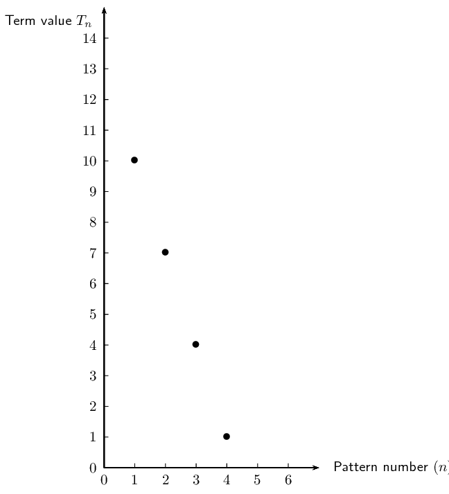

# Chapter 3: Number patterns

- Discuss terminology.
- Emphasize the relationship between linear functions (general term) and linear sequences.
- Do not use the formula for arithmetic sequences.
- Emphasize the relationship between quadratic functions (general term) and quadratic sequences.
- Key activity in mathematical description of a pattern: finding the relationship between the number of
                  the term and the value of the term.

In earlier grades we learned about linear sequences, where the difference between consecutive terms is constant.
        In this chapter, we will learn about quadratic sequences, where the difference between consecutive terms is not
        constant, but follows its own pattern.

## 3.1 Revision (EMBG2)

| Terminology: |  |
| --- | --- |
| Sequence/pattern | A sequence or pattern is an ordered set of numbers or variables. |
| Successive/consecutive | Successive or consecutive terms are terms that directly follow one after another in a sequence. |
| Common difference | The common or constant difference \((d)\) is the difference between any two consecutive terms in a
                    linear sequence. |
| General term | A mathematical expression that describes the sequence and that generates any term in the pattern by
                    substituting different values for \(n\). |
| Conjecture | A statement, consistent with known data, that has not been proved true nor shown to be false. |

**Important:** a series is not the same as a sequence or pattern. Different types of series are
            studied in Grade 12. In Grade 11 we study sequences only.

<Callout type="note" title="Note">
<VideoPlayer src="https://www.youtube.com/embed/zIcxrhyJs6M" title="Video: 22FJ" />
</Callout>

### Describing patterns (EMBG3)

To describe terms in a pattern we use the following notation:

- \(T_1\) is the first term of a sequence.
- \(T_4\) is the fourth term of a sequence.
- \(T_n\) is the general term and is often expressed as the \(n^{\text{th}}\) term of a sequence.

A sequence does not have to follow a pattern but when it does, we can write an equation for the general
                term. The general term can be used to calculate any term in the sequence. For example, consider the
                following linear sequence: \(1; 4; 7; 10; 13; \ldots\) The \(n^{\text{th}}\) term is given by the
                equation \(T_n = 3n-2\).

You can check this by substituting values for \(n\):

            \begin{align*}
            T_1 &= 3(1) - 2 = 1 \\
            T_2 &= 3(2) - 2 = 4 \\
            T_3 &= 3(3) - 2 = 7 \\
            T_4 &= 3(4) - 2 = 10 \\
            T_5 &= 3(5) - 2 = 13
            \end{align*}

If we find the relationship between the position of a term and its value, we can describe the pattern and
                find any term in the sequence.

 

                
<a href="http://www.khanacademy.org/embed_video?v=JtsyP0tnVRY">Video:
                        22FK</a>

            

### Linear sequences (EMBG4)

Linear sequence

A sequence of numbers in which there is a common difference (\(d\)) between any term and the term
                        before it is called a linear sequence.

**Important: **\(d={T}_{2}-{T}_{1}\),  not \({T}_{1}-{T}_{2}\).

<Callout type="tip" title="Worked example 1: Linear sequence">
**Question:**
Determine the common difference (\(d\)) and the general term for the following sequence:
                        \[10; 7; 4; 1; \ldots\]

**Determine the common difference:**
To calculate the common difference, we find the difference between any term and the previous
                        term:

                    \[d = T_n - T_{n-1}\]
                    \begin{align*}
                    \text{Therefore } d &= T_2 - T_1 \\
                    &= 7-10 \\
                    &= -3 \\
                    \text{or } d &= T_3 - T_2 \\
                    &= 4-7 \\
                    &= -3 \\
                    \text{or } d &= T_4 - T_3 \\
                    &= 1-4 \\
                    &= -3
                    \end{align*}

**Determine the general term:**
To find the general term \(T_n\), we must identify the relationship between:

- the **value** of a number in the pattern and
- the **position** of a number in the pattern

| position | \(\text{1}\) | \(\text{2}\) | \(\text{3}\) | \(\text{4}\) |
| --- | --- | --- | --- | --- |
| value | \(\text{10}\) | \(\text{7}\) | \(\text{4}\) | \(\text{1}\) |

We start with the value of the first term in the sequence. We need to write an expression that
                        includes the value of the common difference (\(d = -3\)) and the position of the term (\(n =
                        1\)).
                        \begin{align*}
                        T_1 &= 10 \\
                        &= 10 + (0)(-3) \\
                        &= 10 + (1-1)(-3)
                        \end{align*}

Now we write a similar expression for the second term.
                        \begin{align*}
                        T_2 &= 7 \\
                        &= 10 + (1)(-3) \\
                        &= 10 + (2-1)(-3)
                        \end{align*}

We notice a pattern forming that links the position of a number in the sequence to its value.
                        \begin{align*}
                        T_n &= 10 + (n-1)(-3) \\
                        &= 10 -3n + 3\\
                        &= -3n + 13
                        \end{align*}

**Drawing a graph of the pattern:**
We can also represent this pattern graphically, as shown below.

Notice that the position numbers (\(n\)) can be positive integers only.

This pattern can also be expressed in words: “each term in the sequence can be calculated
                        by multiplying negative three and the position number, and then adding thirteen.”
</Callout>

<Callout type="note" title="Note">
<VideoPlayer src="http://www.khanacademy.org/embed_video?v=_3BnyEr5fG4" title="Video:
                        22FM" />
</Callout>

## Linear sequences

### Textbook Exercise 3.1

**Problem:**
Write down the next three terms in each of the following sequences: \(45; 29; 13; -3;
                                \ldots\)

**Solution:**
\(-19;-35;-51\)

The general term is given for each sequence below. Calculate the missing terms.

**Problem:**
\(-4; -9; -14; \ldots; -24\)

\(T_n = 1-5n\)

**Solution:**
\begin{align*}
                                T_{4} &= 1 - 5(4) \\
                                &= 1 - 20 \\
                                &= -19
                                \end{align*}

**Problem:**
\(6; \ldots; 24; \ldots; 42\)

\(T_n = 9n-3\)

**Solution:**
\begin{align*}
                                T_{2} &= 9(2) - 3 \\
                                &= 18 - 3 \\
                                &= 15
                                \end{align*}
                                \begin{align*}
                                T_{4} &= 9(4) - 3 \\
                                &= 36 - 3 \\
                                &= 33
                                \end{align*}

Find the general formula for the following sequences and then find \(T_{10}\), \(T_{15}\)
                                and \(T_{30}\):

**Problem:**
\(13; 16; 19; 22; \ldots\)

**Solution:**
\begin{align*}
                                d &= T_2 - T_1 \\
                                &= 16 - 13 \\
                                &= 3 \\
                                \therefore T_n &= 10 + 3n
                                \end{align*}
                                \begin{align*}
                                T_n &= 10 + 3n \\
                                \therefore T_{10} &= 10 + 3(10) \\
                                &= 40 \\
                                \therefore T_{15} &= 10 + 3(15) \\
                                &= 55 \\
                                \therefore T_{30} &= 10 + 3(30) \\
                                &= 100
                                \end{align*}

**Problem:**
\(18; 24; 30; 36; \ldots\)

**Solution:**
\begin{align*}
                                d &= T_2 - T_1 \\
                                &= 24 - 18 \\
                                &= 6 \\
                                \therefore T_n &= 12 + 6n
                                \end{align*}
                                \begin{align*}
                                T_n &= 12 + 6n \\
                                \therefore T_{10} &= 12 + 6(10) \\
                                &= 72 \\
                                \therefore T_{15} &= 12 + 6(15) \\
                                &= 102 \\
                                \therefore T_{30} &= 12 + 6(30) \\
                                &= 192
                                \end{align*}

**Problem:**
\(-10; -15; -20; -25; \ldots\)

**Solution:**
\begin{align*}
                                d &= T_2 - T_1 \\
                                &= -15 -(-10) \\
                                &= -5 \\
                                \therefore T_n &= -5 -5n
                                \end{align*}
                                \begin{align*}
                                T_n &= -5 -5n \\
                                \therefore T_{10} &= -5 -5(10) \\
                                &= -55 \\
                                \therefore T_{15} &= -5 -5(15) \\
                                &= -80 \\
                                \therefore T_{30} &= -5 -5(30) \\
                                &= -155
                                \end{align*}

**Problem:**
The seating in a classroom is arranged so that the first row has \(\text{20}\) desks, the
                                second row has \(\text{22}\) desks, the third row has \(\text{24}\) desks and so on.
                                Calculate how many desks are in the ninth row.

**Solution:**
\begin{align*}
                            d &= T_2 - T_1 \\
                            &= 22-20 \\
                            &= 2\\
                            \therefore T_n &= 18 + 2n
                            \end{align*}
                            \begin{align*}
                            T_n &= 18 + 2n\\
                            \therefore T_{9} &= 18 + 2(9) \\
                            &= 18 + 18 \\
                            &= 36
                            \end{align*}

**Problem:**
Complete the following:

                                \begin{align*}
                                13 + 31 &= \ldots \\
                                24 + 42 &= \ldots \\
                                38 + 83 &= \ldots
                                \end{align*}

**Solution:**
\begin{align*}
                                13 + 31 &= 44 \\
                                24 + 42 &= 66 \\
                                38 + 83 &= 121
                                \end{align*}

**Problem:**
Look at the numbers on the left-hand side, what do you notice about the unit digit
                                    and the tens-digit?

**Solution:**
The unit digit and tens-digit have swapped position.

**Problem:**
Investigate the pattern by trying other examples of \(\text{2}\)-digit numbers.

**Solution:**
\begin{align*}
                                45 + 54 &= 99 \\
                                71 + 17 &= 88
                                \end{align*}

**Problem:**
Make a conjecture about the pattern that you notice.

**Solution:**
The sum of the two numbers will always be \(\text{11}\) times the sum of the two
                                    digits.

**Problem:**
Prove this conjecture.

**Solution:**
Let the first number be \(a + 10b\) and let the second number be \(b + 10a\):

                                \begin{align*}
                                \text{Number } 1: &= a + 10b \\
                                \text{Number } 2: &= b + 10a \\
                                \text{Number } 1 + 2: &= a +b +10a +10b \\
                                &= 11a +11b \\
                                &= 11(a + b)
                                \end{align*}
