## 3.2 Quadratic sequences (EMBG5)

## Quadratic sequences

2. Study the dotted-tile pattern shown and answer the following questions.
   2. Complete the fourth pattern in the diagram.
   4. Complete the table below:
      | pattern number | \(\text{1}\) | \(\text{2}\) | \(\text{3}\) | \(\text{4}\) | \(\text{5}\) | \(\text{20}\) | \(n\) |
      | --- | --- | --- | --- | --- | --- | --- | --- |
      | dotted tiles | \(\text{1}\) | \(\text{3}\) | \(\text{5}\) |  |  |  |  |
      | difference (\(d\)) | \(-\) | \(\text{2}\) |  |  |  |  |  |
   6. What do you notice about the change in number of dotted tiles?
   8. Describe the pattern in words: “The number of dotted tiles...”.
   10. Write the general term: \(T_n = \ldots\)
   12. Give the mathematical name for this kind of pattern.
   14. A pattern has \(\text{819}\) dotted tiles. Determine the value of \(n\).
4. Now study the number of blank tiles (tiles without dots) and answer the following questions:
   2. Complete the table below:
      | pattern number | \(\text{1}\) | \(\text{2}\) | \(\text{3}\) | \(\text{4}\) | \(\text{5}\) | \(\text{10}\) |
      | --- | --- | --- | --- | --- | --- | --- |
      | blank tiles | \(\text{3}\) | \(\text{6}\) | \(\text{11}\) |  |  |  |
      | first difference | \(-\) | \(\text{3}\) |  |  |  |  |
      | second difference | \(-\) | \(-\) |  |  |  |  |
   4. What do you notice about the change in the number of blank tiles?
   6. Describe the pattern in words: “The number of blank tiles...”.
   8. Write the general term: \(T_n = \ldots\)
   10. Give the mathematical name for this kind of pattern.
   12. A pattern has \(\text{227}\) blank tiles. Determine the value of \(n\).
   14. A pattern has \(\text{79}\) dotted tiles. Determine the number of blank tiles.

Quadratic sequence

A quadratic sequence is a sequence of numbers in which the second difference between any two
                    consecutive terms is constant.

Consider the following example: \(1; 2; 4; 7; 11; \ldots\)

The first difference is calculated by finding the difference between consecutive terms:

The second difference is obtained by taking the difference between consecutive first differences:

We notice that the second differences are all equal to \(\text{1}\). Any sequence that has a common second
            difference is a **quadratic sequence**.

It is important to note that the first differences of a quadratic sequence form a sequence. This sequence has
            a constant difference between consecutive terms. In other words, a linear sequence results from taking the
            first differences of a quadratic sequence.

<QuizCard id="m11-03-02a" title="Interactive Exercise 3.2" question="Find the common second difference for the following sequence: \[\begin{array}{c}-7 \, ; -15 \, ; -25 \, ; -37 \, ; \ldots\end{array}\] INSTRUCTION: If the second difference is not the same for all of the terms, write none in the answer box." options=["quadratic", "not quadratic"] answer="-2" hint="You should enter a number here. If you want to, you can use a space to separate thousands.                Example: 12 800,25 For scientific notation you need to use the multiply symbol                ( ∗ ) and the exponent symbol ( ^ ). For example 6,673 × 10 −11 should be written as: 6,673 ∗ 10^−11" explanation="Start by finding the first differences of the terms: \[ 	      \begin{aligned} 		\textrm{For } T_{1} \textrm{ and } T_{2}: & \quad -15 - (-7) = -8	\\ 		\textrm{For } T_{2} \textrm{ and } T_{3}: & \quad -25 - (-15) = -10	\\ 		\textrm{For } T_{3} \textrm{ and } T_{4}: & \quad -37 - (-25) = -12	 	      \end{aligned} 	    \] Now calculate the second differences: \[ 	      \begin{aligned} 		\textrm{first two differences: } & \quad -10 - (-8) = -2 \\ 		\textrm{next two differences: } & \quad -12 - (-10) = -2 	      \end{aligned} 	    \] The book shows this arranged as follows: In this case, the second differences are equal to each other, with a value of \(\text{−2}\) . Submit your answer as:" />

<QuizCard id="m11-03-02a" title="Interactive Exercise 3.2" question="Find the common second difference for the following sequence: \[\begin{array}{c}-13 \, ; -25 \, ; -43 \, ; -67 \, ; \ldots\end{array}\] INSTRUCTION: If the second difference is not the same for all of the terms, write none in the answer box." options=["quadratic", "not quadratic"] answer="-6" hint="You should enter a number here. If you want to, you can use a space to separate thousands.                Example: 12 800,25 For scientific notation you need to use the multiply symbol                ( ∗ ) and the exponent symbol ( ^ ). For example 6,673 × 10 −11 should be written as: 6,673 ∗ 10^−11" explanation="Start by finding the first differences of the terms: \[ 	      \begin{aligned} 		\textrm{For } T_{1} \textrm{ and } T_{2}: & \quad -25 - (-13) = -12	\\ 		\textrm{For } T_{2} \textrm{ and } T_{3}: & \quad -43 - (-25) = -18	\\ 		\textrm{For } T_{3} \textrm{ and } T_{4}: & \quad -67 - (-43) = -24	 	      \end{aligned} 	    \] Now calculate the second differences: \[ 	      \begin{aligned} 		\textrm{first two differences: } & \quad -18 - (-12) = -6 \\ 		\textrm{next two differences: } & \quad -24 - (-18) = -6 	      \end{aligned} 	    \] The book shows this arranged as follows: In this case, the second differences are equal to each other, with a value of \(\text{−6}\) . Submit your answer as:" />

<QuizCard id="m11-03-02a" title="Interactive Exercise 3.2" question="Find the constant second difference for the following sequence: \[\begin{array}{c}7 \, ; 4 \, ; -3 \, ; -14 \, ; \ldots\end{array}\] INSTRUCTION: If the second difference is not the same for all of the terms, write none in the answer box." options=["quadratic", "not quadratic"] answer="-4" hint="You should enter a number here. If you want to, you can use a space to separate thousands.                Example: 12 800,25 For scientific notation you need to use the multiply symbol                ( ∗ ) and the exponent symbol ( ^ ). For example 6,673 × 10 −11 should be written as: 6,673 ∗ 10^−11" explanation="Start by finding the first differences of the terms: \[ 	      \begin{aligned} 		\textrm{For } T_{1} \textrm{ and } T_{2}: & \quad 4 - (7) = -3	\\ 		\textrm{For } T_{2} \textrm{ and } T_{3}: & \quad -3 - (4) = -7	\\ 		\textrm{For } T_{3} \textrm{ and } T_{4}: & \quad -14 - (-3) = -11	 	      \end{aligned} 	    \] Now calculate the second differences: \[ 	      \begin{aligned} 		\textrm{first two differences: } & \quad -7 - (-3) = -4 \\ 		\textrm{next two differences: } & \quad -11 - (-7) = -4 	      \end{aligned} 	    \] The book shows this arranged as follows: In this case, the second differences are equal to each other, with a value of \(\text{−4}\) . Submit your answer as:" />

**General case**

If the sequence is quadratic, the \(n^{\text{th}}\) term is of the form \({T}_{n}=a{n}^{2}+bn+c\).

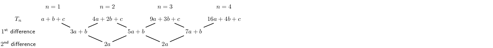

In each case, the common second difference is a \(2a\).

## Quadratic sequences

### Textbook Exercise 3.2

Determine the second difference between the terms for the following sequences:

**Problem:**
\(5; 20; 45; 80; \ldots\)

**Solution:**
\begin{align*}
                            \text{First differences: } &= 15; 25; 35 \\
                            \text{Second difference: } &= 10
                            \end{align*}

**Problem:**
\(6; 11; 18; 27; \ldots\)

**Solution:**
\begin{align*}
                            \text{First differences: } &= 5; 7; 9 \\
                            \text{Second difference: } &= 2
                            \end{align*}

**Problem:**
\(1; 4; 9; 16; \ldots\)

**Solution:**
\begin{align*}
                            \text{First differences: } &= 3; 5; 7 \\
                            \text{Second difference: } &= 2
                            \end{align*}

**Problem:**
\(3; 0; -5; -12; \ldots\)

**Solution:**
\begin{align*}
                            \text{First differences: } &= -3; -5; -7 \\
                            \text{Second difference: } &= -2
                            \end{align*}

**Problem:**
\(1; 3; 7; 13; \ldots\)

**Solution:**
\begin{align*}
                            \text{First differences: } &= 2; 4; 6 \\
                            \text{Second difference: } &= 2
                            \end{align*}

**Problem:**
\(0; -6; -16; -30; \ldots\)

**Solution:**
\begin{align*}
                            \text{First differences: } &=-6; -10; -14 \\
                            \text{Second difference: } &= -4
                            \end{align*}

**Problem:**
\(-1; 2; 9; 20; \ldots\)

**Solution:**
\begin{align*}
                            \text{First differences: } &= 3; 7; 11 \\
                            \text{Second difference: } &= 4
                            \end{align*}

**Problem:**
\(1; -3; -9; -17; \ldots\)

**Solution:**
\begin{align*}
                            \text{First differences: } &= -4; -6; -8 \\
                            \text{Second difference: } &= -2
                            \end{align*}

**Problem:**
\(3a+1; 12a+1; 27a+1; 48a+1 \ldots\)

**Solution:**
\begin{align*}
                            \text{First differences: } &= 9a; 15a; 21a \\
                            \text{Second difference: } &= 6a
                            \end{align*}

**Problem:**
\(2; 10; 24; 44; \ldots\)

**Solution:**
\begin{align*}
                            \text{First differences: } &= 8; 14; 20 \\
                            \text{Second difference: } &= 6
                            \end{align*}

**Problem:**
\(t-2; 4t-1; 9t; 16t+1; \ldots\)

**Solution:**
\begin{align*}
                            \text{First differences: } &= 3t + 1; 5t +1; 7t + 1 \\
                            \text{Second difference: } &= 2t
                            \end{align*}

Complete the sequence by filling in the missing term:

**Problem:**
\(11; 21; 35; \ldots; 75\)

**Solution:**
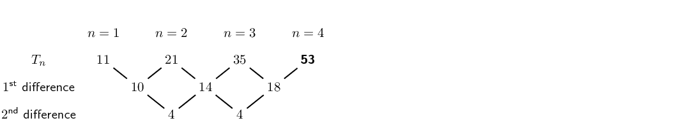

**Problem:**
\(20; \ldots; 42; 56; 72\)

**Solution:**
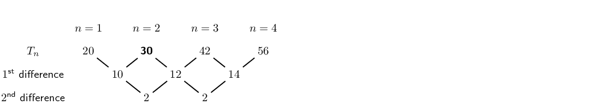

**Problem:**
\(\ldots; 37; 65; 101\)

**Solution:**
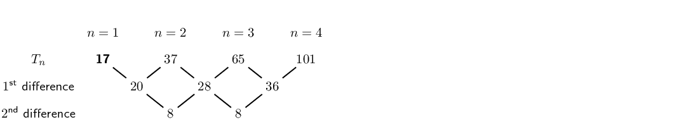

**Problem:**
\(3; \ldots; -13; -27; -45\)

**Solution:**
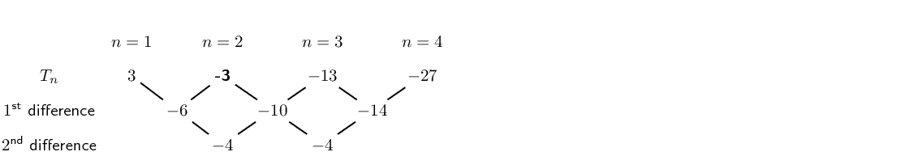

**Problem:**
\(24; 35; 48; \ldots; 80\)

**Solution:**
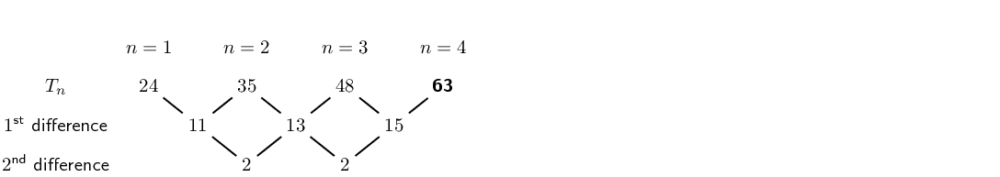

**Problem:**
\(\ldots; 11; 26; 47\)

**Solution:**
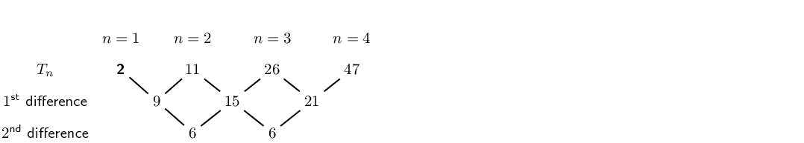

Use the general term to generate the first four terms in each sequence:

**Problem:**
\(T_n = n^2+3n-1\)

**Solution:**
\(3;9;17;27\)

**Problem:**
\(T_n = -n^2-5\)

**Solution:**
\(-6;-9;-14;-21\)

**Problem:**
\(T_n = 3n^2-2n\)

**Solution:**
\(1;8;21;40\)

**Problem:**
\(T_n = -2n^2+n+1\)

**Solution:**
\(0;-5;-14;-27\)

<Callout type="tip" title="Worked example 2: Quadratic sequences">
**Question:**
Write down the next two terms and determine an equation for the \(n^{\text{th}}\) term of the
                    sequence \(\text{5}\); \(\text{12}\); \(\text{23}\); \(\text{38}\); \(\ldots\)

**Find the first differences between the terms:**

**Find the second differences between the terms:**

So there is a common second difference of \(\text{4}\). We can therefore conclude that this is a
                    quadratic sequence of the form \(T_n = an^2 + bn + c\).

Continuing the sequence, the next first differences will be:

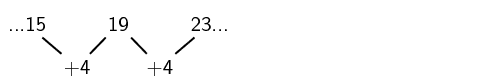

**Finding the next two terms in the sequence:**
The next two terms will be:

So the sequence will be: \(\text{5}\); \(\text{12}\); \(\text{23}\); \(\text{38}\); \(\text{57}\);
                    \(\text{80}\); \(\ldots\)

**Determine the general term for the sequence:**
To find the values of \(a\), \(b\) and \(c\) for \(T_n = an^2 + bn + c\) we look at the first
                    \(\text{3}\) terms in the sequence:

                \begin{align*}
                n=1: T_1 &= a + b + c \\
                n=2: T_2 &= 4a + 2b + c \\
                n=3: T_3 &= 9a + 3b + c
                \end{align*}

We solve a set of simultaneous equations to determine the values of \(a\), \(b\) and \(c\)

We know that \(T_1 = 5\), \(T_2 = 12\) and \(T_3 = 23\)

                \begin{align*}
                a + b + c &= 5 \\
                4a + 2b + c &= 12 \\
                9a + 3b + c &= 23
                \end{align*}\begin{align*}
                T_2 - T_1 &= 4a + 2b + c - (a + b + c) \\
                12 - 5 &= 4a + 2b + c - a - b - c \\
                7 &= 3a + b \qquad \ldots (1)
                \end{align*}\begin{align*}
                T_3 - T_2 &= 9a + 3b + c - (4a + 2b + c) \\
                23 - 12 &= 9a + 3b + c - 4a - 2b - c \\
                11 &= 5a + b \qquad \ldots (2)
                \end{align*}\begin{align*}
                (2)-(1) &= 5a + b - (3a + b) \\
                11 - 7 &= 5a + b - 3a - b \\
                4 &= 2a \\
                \therefore a &= 2
                \end{align*}\begin{align*}
                \text{Using equation } (1): \quad 3(2) + b &= 7 \\
                \therefore b &= 1 \\
                \text{And using } \quad a + b + c &= 5 \\
                2 + 1 + c &= 5 \\
                \therefore c &= 1
                \end{align*}

**Write the general term for the sequence:**
\[T_n = 2n^2 + n + 2\]
</Callout>

<QuizCard id="m11-03-02c" title="Interactive Exercise 3.4" question="A certain quadratic pattern is given by \( \; T_{n} = an^{2}  +  4 n - 5 \) . Determine the value of \( a \) if the sequence starts with these terms: \[\begin{array}{c}0 \; \, ; \; 7 \; \, ; \; 16 \; \, ; \; 27 \; \, ; \; \ldots\end{array}\]" options=[] answer="1" hint="You should enter a number here. If you want to, you can use a space to separate thousands.                Example: 12 800,25 For scientific notation you need to use the multiply symbol                ( ∗ ) and the exponent symbol ( ^ ). For example 6,673 × 10 −11 should be written as: 6,673 ∗ 10^−11" explanation="Determine the constant second difference The value of \(a\) is related to the constant second difference by the equation \( d_{second}  = 2a \) . (You can revise quadratic sequences in the Everything Maths textbook.)  Start by finding the constant second difference: Great, now we know the constant second difference: \( d_{second}  = 2 \) . Solve for \(a\) Use the equation \( d_{second}  = 2a\) . \[ 				\begin{aligned} 				d_{second} & = 2a	\\ 				2 & = 2a	\\ 				1 & = a 				\end{aligned} 			\] That's it!  The value of \( a \) is \(\text{1}\) . NOTE: This question can also be solved by substitution as follows: \[ 				\begin{aligned} 				T_{n} & = an^{2}  +  4 n - 5	\\ 				T_{1} & = a(1)^{2}  +  4 (1) - 5	\\ 				(0) & = a -1	\\ 				1 & = a 				\end{aligned} 			\] The method which uses the constant second difference is important for questions in which substitution is NOT an option. Submit your answer as:" />

<QuizCard id="m11-03-02c" title="Interactive Exercise 3.4" question="A certain quadratic pattern is given by \( \; T_{n} = an^{2}  +  4 n + 2 \) . Determine the value of \( a \) if the sequence starts with these terms: \[\begin{array}{c}7 \; \, ; \; 14 \; \, ; \; 23 \; \, ; \; 34 \; \, ; \; \ldots\end{array}\]" options=[] answer="1" hint="You should enter a number here. If you want to, you can use a space to separate thousands.                Example: 12 800,25 For scientific notation you need to use the multiply symbol                ( ∗ ) and the exponent symbol ( ^ ). For example 6,673 × 10 −11 should be written as: 6,673 ∗ 10^−11" explanation="Determine the constant second difference The value of \(a\) is related to the constant second difference by the equation \( d_{second}  = 2a \) . (You can revise quadratic sequences in the Everything Maths textbook.)  Start by finding the constant second difference: Great, now we know the constant second difference: \( d_{second}  = 2 \) . Solve for \(a\) Use the equation \( d_{second}  = 2a\) . \[ 				\begin{aligned} 				d_{second} & = 2a	\\ 				2 & = 2a	\\ 				1 & = a 				\end{aligned} 			\] That's it!  The value of \( a \) is \(\text{1}\) . NOTE: This question can also be solved by substitution as follows: \[ 				\begin{aligned} 				T_{n} & = an^{2}  +  4 n + 2	\\ 				T_{1} & = a(1)^{2}  +  4 (1) + 2	\\ 				(7) & = a +6	\\ 				1 & = a 				\end{aligned} 			\] The method which uses the constant second difference is important for questions in which substitution is NOT an option. Submit your answer as:" />

<QuizCard id="m11-03-02c" title="Interactive Exercise 3.4" question="A certain quadratic pattern is given by \( \; T_{n} =  - n^{2} + bn + c \) . Find the values of \( b \) and \( c \) if the sequence starts with these terms: \[\begin{array}{c}2 \; \, ; \; -1 \; \, ; \; -6 \; \, ; \; -13 \; \, ; \; \ldots\end{array}\]" options=[] answer="0, 3" hint="You should enter a number here. If you want to, you can use a space to separate thousands.                Example: 12 800,25 For scientific notation you need to use the multiply symbol                ( ∗ ) and the exponent symbol ( ^ ). For example 6,673 × 10 −11 should be written as: 6,673 ∗ 10^−11" explanation="We need to use the values of the terms in the sequence in order to make a pair of equations with the values of \( b \) and \( c \) . We can use any of the terms we like, so we will choose the first two terms (so that the numbers stay as small as possible!).  Starting with the first term, we have \( n = 1 \) and \( T_{1} = 2 \) : \[ 	      \begin{aligned} 		T_{1} & =  - (1)^{2} + b(1) + c	\\ 		(2) & = -1 + b + c	\\ 		3  & = b + c 	      \end{aligned} 	    \] For the second term, we use \( n = 2 \) and \( T_{2} = -1 \) : \[ 	      \begin{aligned} 		T_{2} & =  - (2)^{2} + b(2) + c	\\ 		(-1) & = -4 + 2 b + c	\\ 		3 & = 2 b + c 	      \end{aligned} 	    \] Now we must solve these equations simultaneously.  You can do this by substitution, but here we will show the solution using the 'elmination' method (which means subtracting one equation from the other to cancel the \( c \) 's). \[ 	      \begin{aligned} 		3 & = 2 b + c	\\ 		- ( 3 & = \; b + c )  	\\ 		\hline 		0 & = \; b 	      \end{aligned} 	    \] Finally, calculate the value of \( c \) . As usualy for simultaneous equations, this means that we must substitute the \( b = 0 \) into either of the equations we used above.  Let's use the equation \( 3 = b + c \) . \[ 	      \begin{aligned} 		b = 0 \; \longrightarrow \quad 3 & = b + c	\\ 		3 & = ( 0 ) + c	\\ 		3 & = \; c 	      \end{aligned} 	    \] The final answers are \( b = 0 \) and \( c = 3 \) . NOTE: Now we know that the general term of the sequence is \( \; T_{n} = - n^{2} + 3 \; \) . We can use this to check our answers!  We know that \( T_{3} = -6 \) . Substitute \( n = 3 \) into the general formula to check: \[ 		\begin{aligned} 		  T_{n} & = - n^{2} + 3	\\ 		  T_{3} & = - (3)^{2} + 3	\\ 		  & =  - (9) +0 +3	\\               & = -6 		\end{aligned} 	      \] Bingo!  Now we know that the answers are correct! Submit your answer as: and" />

<QuizCard id="m11-03-02c" title="Interactive Exercise 3.4" question="A certain quadratic pattern is given by \( \; T_{n} = -2n^{2} + bn + c \) . Find the values of \( b \) and \( c \) if the sequence starts with these terms: \[\begin{array}{c}-6 \; \, ; \; -15 \; \, ; \; -28 \; \, ; \; -45 \; \, ; \; \ldots\end{array}\]" options=[] answer="-3, -1" hint="You should enter a number here. If you want to, you can use a space to separate thousands.                Example: 12 800,25 For scientific notation you need to use the multiply symbol                ( ∗ ) and the exponent symbol ( ^ ). For example 6,673 × 10 −11 should be written as: 6,673 ∗ 10^−11" explanation="We need to use the values of the terms in the sequence in order to make a pair of equations with the values of \( b \) and \( c \) . We can use any of the terms we like, so we will choose the first two terms (so that the numbers stay as small as possible!).  Starting with the first term, we have \( n = 1 \) and \( T_{1} = -6 \) : \[ 	      \begin{aligned} 		T_{1} & = -2(1)^{2} + b(1) + c	\\ 		(-6) & = -2 + b + c	\\ 		-4  & = b + c 	      \end{aligned} 	    \] For the second term, we use \( n = 2 \) and \( T_{2} = -15 \) : \[ 	      \begin{aligned} 		T_{2} & = -2(2)^{2} + b(2) + c	\\ 		(-15) & = -8 + 2 b + c	\\ 		-7 & = 2 b + c 	      \end{aligned} 	    \] Now we must solve these equations simultaneously.  You can do this by substitution, but here we will show the solution using the 'elmination' method (which means subtracting one equation from the other to cancel the \( c \) 's). \[ 	      \begin{aligned} 		-7 & = 2 b + c	\\ 		- ( -4 & = \; b + c )  	\\ 		\hline 		-3 & = \; b 	      \end{aligned} 	    \] Finally, calculate the value of \( c \) . As usualy for simultaneous equations, this means that we must substitute the \( b = -3 \) into either of the equations we used above.  Let's use the equation \( -4 = b + c \) . \[ 	      \begin{aligned} 		b = -3 \; \longrightarrow \quad -4 & = b + c	\\ 		-4 & = ( -3 ) + c	\\ 		-1 & = \; c 	      \end{aligned} 	    \] The final answers are \( b = -3 \) and \( c = -1 \) . NOTE: Now we know that the general term of the sequence is \( \; T_{n} = - 2 n^{2} - 3 n - 1 \; \) . We can use this to check our answers!  We know that \( T_{3} = -28 \) . Substitute \( n = 3 \) into the general formula to check: \[ 		\begin{aligned} 		  T_{n} & = - 2 n^{2} - 3 n - 1	\\ 		  T_{3} & = - 2 (3)^{2} - 3 (3) - 1	\\ 		  & = -2(9) -9 -1	\\               & = -28 		\end{aligned} 	      \] Bingo!  Now we know that the answers are correct! Submit your answer as: and" />

<QuizCard id="m11-03-02c" title="Interactive Exercise 3.4" question="A quadratic sequence has the general formula \(T_{n} = n^{2} + bn + c\) . Determine the values of \(b\) and \(c\) , given the following terms of the sequence: \[\begin{array}{c}0 \, ; 4 \, ; 10 \, ; 18 \, ; \ldots\end{array}\]" options=[] answer="1, -2" hint="You should enter a number here. If you want to, you can use a space to separate thousands.                Example: 12 800,25 For scientific notation you need to use the multiply symbol                ( ∗ ) and the exponent symbol ( ^ ). For example 6,673 × 10 −11 should be written as: 6,673 ∗ 10^−11" explanation="We use the terms in the sequence to set up a system of simultaneous equations in terms of \( b \) and \( c \) . We can use any of the terms in the given sequence, so we will choose the first two terms: Starting with the first term, \(n = 1\) and \(T_{1} = 0\) : \[ 	     \begin{aligned} 		T_{1} & = (1)^{2} + b(1) + c \\ 		0 & = 1 + b + c \\ 		-1  & = b + c \ldots \ldots (1)  	     \end{aligned} 	   \] For the second term in the sequence, \(n = 2\) and \(T_{2} =4\) : \[ 	     \begin{aligned} 		T_{2} & = (2)^{2} + b(2) + c \\ 		4 & = 4 + 2 b + c \\ 		0 & = 2 b + c\ldots \ldots (2)  	     \end{aligned} 	   \] We solve these two equations simultaneously, either by substitution or using  the 'elimination' method (which means subtracting one equation from the other so that the remaining equation contains only one variable). \[ 	      \begin{aligned} 		0 & = 2 b + c \\ 		- ( -1 & = \; b + c ) \\ 		\hline 		1 & = \; b 	      \end{aligned} 	     \] To calculate the value of \( c \) , we substitute \( b = 1 \) into either of the two equations. \[ 	    \begin{aligned} 		b = 1\; \longrightarrow \quad-1 & = b + c \\ 		-1 & = ( 1 ) + c \\ 		-2 & = \; c 	    \end{aligned} 	  \] Therefore, \(b = 1\) and \(c =-2\) and the general formula is: \[\begin{array}{c}T_{n} = n^{2} + n - 2\end{array}\] CHECK: It is always a good idea to check answers where possible. From the sequence given above, we know that \(T_{3} =10 \) . We can check that our values for \(b\) and \(c\) are correct by substituting \(n = 3\) into the general formula: \[             \begin{aligned} 	      T_{n} & = n^{2} + n - 2 \\ 	      T_{3} & = (3)^{2} + (3) - 2 \\ 	      & = (9) +3 -2 \\ 	      & = 10  	    \end{aligned} 	  \] Great! We know that our answers are correct! Submit your answer as: and" />

<QuizCard id="m11-03-02c" title="Interactive Exercise 3.4" question="A quadratic sequence has the general formula \(T_{n} =  - n^{2} + bn + c\) . Determine the values of \(b\) and \(c\) , given the following terms of the sequence: \[\begin{array}{c}0 \, ; -4 \, ; -10 \, ; -18 \, ; \ldots\end{array}\]" options=[] answer="-1, 2" hint="You should enter a number here. If you want to, you can use a space to separate thousands.                Example: 12 800,25 For scientific notation you need to use the multiply symbol                ( ∗ ) and the exponent symbol ( ^ ). For example 6,673 × 10 −11 should be written as: 6,673 ∗ 10^−11" explanation="We use the terms in the sequence to set up a system of simultaneous equations in terms of \( b \) and \( c \) . We can use any of the terms in the given sequence, so we will choose the first two terms: Starting with the first term, \(n = 1\) and \(T_{1} = 0\) : \[ 	     \begin{aligned} 		T_{1} & =  - (1)^{2} + b(1) + c \\ 		0 & = -1 + b + c \\ 		1  & = b + c \ldots \ldots (1)  	     \end{aligned} 	   \] For the second term in the sequence, \(n = 2\) and \(T_{2} =-4\) : \[ 	     \begin{aligned} 		T_{2} & =  - (2)^{2} + b(2) + c \\ 		-4 & = -4 + 2 b + c \\ 		0 & = 2 b + c\ldots \ldots (2)  	     \end{aligned} 	   \] We solve these two equations simultaneously, either by substitution or using  the 'elimination' method (which means subtracting one equation from the other so that the remaining equation contains only one variable). \[ 	      \begin{aligned} 		0 & = 2 b + c \\ 		- ( 1 & = \; b + c ) \\ 		\hline 		-1 & = \; b 	      \end{aligned} 	     \] To calculate the value of \( c \) , we substitute \( b = -1 \) into either of the two equations. \[ 	    \begin{aligned} 		b = -1\; \longrightarrow \quad1 & = b + c \\ 		1 & = ( -1 ) + c \\ 		2 & = \; c 	    \end{aligned} 	  \] Therefore, \(b = -1\) and \(c =2\) and the general formula is: \[\begin{array}{c}T_{n} = - n^{2} - n + 2\end{array}\] CHECK: It is always a good idea to check answers where possible. From the sequence given above, we know that \(T_{3} =-10 \) . We can check that our values for \(b\) and \(c\) are correct by substituting \(n = 3\) into the general formula: \[             \begin{aligned} 	      T_{n} & = - n^{2} - n + 2 \\ 	      T_{3} & = - (3)^{2} - (3) + 2 \\ 	      & =  - (9) -3 +2 \\ 	      & = -10  	    \end{aligned} 	  \] Great! We know that our answers are correct! Submit your answer as: and" />

<Callout type="tip" title="Worked example 3: Plotting a graph of terms in a sequence">
**Question:**
Consider the following sequence:

\[3; 6; 10; 15; 21; \ldots\]

2. Determine the general term (\(T_n\)) for the sequence.
4. Is this a linear or a quadratic sequence?
6. Plot a graph of \(T_n\) *vs* \(n\).

**Determine the first and second differences:**
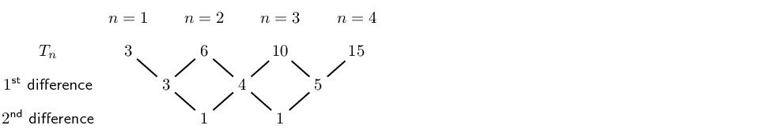

We see that the first differences are not constant and form the sequence \({3; 4; 5; \ldots}\) and
                    that there is a common second difference of \(\text{1}\). Therefore the sequence is quadratic and
                    has a general term of the form \(T_n = an^2 + bn + c\).

**Determine the general term \(T_n\):**
To find the values of \(a\), \(b\) and \(c\) for \(T_n = an^2 + bn + c\) we look at the first
                    \(\text{3}\) terms in the sequence:

                \begin{align*}
                n=1: T_1 &= a + b + c \\
                n=2: T_2 &= 4a + 2b + c \\
                n=3: T_3 &= 9a + 3b + c
                \end{align*}

We solve this set of simultaneous equations to determine the values of \(a\), \(b\) and \(c\). We
                    know that \(T_1 = 3\), \(T_2 = 6\) and \(T_3 = 10\).

                \begin{align*}
                a + b + c &= 3 \\
                4a + 2b + c &= 6 \\
                9a + 3b + c &= 10
                \end{align*}\begin{align*}
                T_2 - T_1 &= 4a + 2b + c - (a + b + c) \\
                6 - 3 &= 4a + 2b + c - a - b - c \\
                3 &= 3a + b \qquad \ldots (1)
                \end{align*}\begin{align*}
                T_3 - T_2 &= 9a + 3b + c - (4a + 2b + c) \\
                10 - 6 &= 9a + 3b + c - 4a - 2b - c \\
                4 &= 5a + b \qquad \ldots (2)
                \end{align*}\begin{align*}
                (2)-(1) &= 5a + b - (3a + b) \\
                4 - 3 &= 5a + b - 3a - b \\
                1 &= 2a \\
                \therefore a &= \frac{1}{2}
                \end{align*}\begin{align*}
                \text{Using equation }(1): \quad 3\left(\frac{1}{2}\right) + b &= 3 \\
                \therefore b &= \frac{3}{2} \\
                \text{And using } \quad a + b + c &= 3 \\
                \frac{1}{2} + \frac{3}{2} + c &= 3 \\
                \therefore c &= 1
                \end{align*}

Therefore the general term for the sequence is \(T_n = \frac{1}{2}n^2 + \frac{3}{2}n + 1\).

**Plot a graph of \(T_n\) vs \(n\):**
Use the general term for the sequence, \(T_n = \frac{1}{2}n^2 + \frac{3}{2}n + 1\), to complete the
                    table.

| \(n\) | \(\text{1}\) | \(\text{2}\) | \(\text{3}\) | \(\text{4}\) | \(\text{5}\) | \(\text{6}\) | \(\text{7}\) | \(\text{8}\) | \(\text{9}\) | \(\text{10}\) |
| --- | --- | --- | --- | --- | --- | --- | --- | --- | --- | --- |
| \(T_n\) | \(\text{3}\) | \(\text{6}\) | \(\text{10}\) | \(\text{15}\) | \(\text{21}\) | \(\text{28}\) | \(\text{36}\) | \(\text{45}\) | \(\text{55}\) | \(\text{66}\) |

Use the table to plot the graph:

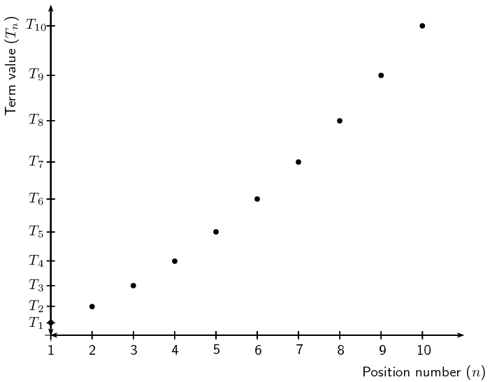

In this case it would not be accurate to join these points, since \(n\) indicates the position of a
                    term in a sequence and can therefore only be a positive integer. We can, however, see that the plot
                    of the points lies in the shape of a parabola.
</Callout>

<QuizCard id="m11-03-02d" title="Interactive Exercise 3.5" question="A certain quadratic pattern is given by \( \; T_{n} = an^{2}  +  2 n - 1 \) . Determine the value of \( a \) if the sequence starts with these terms: \[\begin{array}{c}3 \; \, ; \; 11 \; \, ; \; 23 \; \, ; \; 39 \; \, ; \; \ldots\end{array}\]" options=[] answer="2" hint="You should enter a number here. If you want to, you can use a space to separate thousands.                Example: 12 800,25 For scientific notation you need to use the multiply symbol                ( ∗ ) and the exponent symbol ( ^ ). For example 6,673 × 10 −11 should be written as: 6,673 ∗ 10^−11" explanation="Determine the constant second difference The value of \(a\) is related to the constant second difference by the equation \( d_{second}  = 2a \) . (You can revise quadratic sequences in the Everything Maths textbook.)  Start by finding the constant second difference: Great, now we know the constant second difference: \( d_{second}  = 4 \) . Solve for \(a\) Use the equation \( d_{second}  = 2a\) . \[ 				\begin{aligned} 				d_{second} & = 2a	\\ 				4 & = 2a	\\ 				2 & = a 				\end{aligned} 			\] That's it!  The value of \( a \) is \(\text{2}\) . NOTE: This question can also be solved by substitution as follows: \[ 				\begin{aligned} 				T_{n} & = an^{2}  +  2 n - 1	\\ 				T_{1} & = a(1)^{2}  +  2 (1) - 1	\\ 				(3) & = a +1	\\ 				2 & = a 				\end{aligned} 			\] The method which uses the constant second difference is important for questions in which substitution is NOT an option. Submit your answer as:" />

<QuizCard id="m11-03-02d" title="Interactive Exercise 3.5" question="A certain quadratic pattern is given by \( \; T_{n} = 3n^{2} + bn + c \) . Find the values of \( b \) and \( c \) if the sequence starts with these terms: \[\begin{array}{c}8 \; \, ; \; 18 \; \, ; \; 34 \; \, ; \; 56 \; \, ; \; \ldots\end{array}\]" options=[] answer="1, 4" hint="You should enter a number here. If you want to, you can use a space to separate thousands.                Example: 12 800,25 For scientific notation you need to use the multiply symbol                ( ∗ ) and the exponent symbol ( ^ ). For example 6,673 × 10 −11 should be written as: 6,673 ∗ 10^−11" explanation="We need to use the values of the terms in the sequence in order to make a pair of equations with the values of \( b \) and \( c \) . We can use any of the terms we like, so we will choose the first two terms (so that the numbers stay as small as possible!).  Starting with the first term, we have \( n = 1 \) and \( T_{1} = 8 \) : \[ 	      \begin{aligned} 		T_{1} & = 3(1)^{2} + b(1) + c	\\ 		(8) & = 3 + b + c	\\ 		5  & = b + c 	      \end{aligned} 	    \] For the second term, we use \( n = 2 \) and \( T_{2} = 18 \) : \[ 	      \begin{aligned} 		T_{2} & = 3(2)^{2} + b(2) + c	\\ 		(18) & = 12 + 2 b + c	\\ 		6 & = 2 b + c 	      \end{aligned} 	    \] Now we must solve these equations simultaneously.  You can do this by substitution, but here we will show the solution using the 'elmination' method (which means subtracting one equation from the other to cancel the \( c \) 's). \[ 	      \begin{aligned} 		6 & = 2 b + c	\\ 		- ( 5 & = \; b + c )  	\\ 		\hline 		1 & = \; b 	      \end{aligned} 	    \] Finally, calculate the value of \( c \) . As usualy for simultaneous equations, this means that we must substitute the \( b = 1 \) into either of the equations we used above.  Let's use the equation \( 5 = b + c \) . \[ 	      \begin{aligned} 		b = 1 \; \longrightarrow \quad 5 & = b + c	\\ 		5 & = ( 1 ) + c	\\ 		4 & = \; c 	      \end{aligned} 	    \] The final answers are \( b = 1 \) and \( c = 4 \) . NOTE: Now we know that the general term of the sequence is \( \; T_{n} = 3 n^{2} + n + 4 \; \) . We can use this to check our answers!  We know that \( T_{3} = 34 \) . Substitute \( n = 3 \) into the general formula to check: \[ 		\begin{aligned} 		  T_{n} & = 3 n^{2} + n + 4	\\ 		  T_{3} & = 3 (3)^{2} + (3) + 4	\\ 		  & = 3(9) +3 +4	\\               & = 34 		\end{aligned} 	      \] Bingo!  Now we know that the answers are correct! Submit your answer as: and" />

<QuizCard id="m11-03-02d" title="Interactive Exercise 3.5" question="A quadratic sequence has the general formula \(T_{n} =  - n^{2} + bn + c\) . Determine the values of \(b\) and \(c\) , given the following terms of the sequence: \[\begin{array}{c}-2 \, ; -2 \, ; -4 \, ; -8 \, ; \ldots\end{array}\]" options=[] answer="3, -4" hint="You should enter a number here. If you want to, you can use a space to separate thousands.                Example: 12 800,25 For scientific notation you need to use the multiply symbol                ( ∗ ) and the exponent symbol ( ^ ). For example 6,673 × 10 −11 should be written as: 6,673 ∗ 10^−11" explanation="We use the terms in the sequence to set up a system of simultaneous equations in terms of \( b \) and \( c \) . We can use any of the terms in the given sequence, so we will choose the first two terms: Starting with the first term, \(n = 1\) and \(T_{1} = -2\) : \[ 	     \begin{aligned} 		T_{1} & =  - (1)^{2} + b(1) + c \\ 		-2 & = -1 + b + c \\ 		-1  & = b + c \ldots \ldots (1)  	     \end{aligned} 	   \] For the second term in the sequence, \(n = 2\) and \(T_{2} =-2\) : \[ 	     \begin{aligned} 		T_{2} & =  - (2)^{2} + b(2) + c \\ 		-2 & = -4 + 2 b + c \\ 		2 & = 2 b + c\ldots \ldots (2)  	     \end{aligned} 	   \] We solve these two equations simultaneously, either by substitution or using  the 'elimination' method (which means subtracting one equation from the other so that the remaining equation contains only one variable). \[ 	      \begin{aligned} 		2 & = 2 b + c \\ 		- ( -1 & = \; b + c ) \\ 		\hline 		3 & = \; b 	      \end{aligned} 	     \] To calculate the value of \( c \) , we substitute \( b = 3 \) into either of the two equations. \[ 	    \begin{aligned} 		b = 3\; \longrightarrow \quad-1 & = b + c \\ 		-1 & = ( 3 ) + c \\ 		-4 & = \; c 	    \end{aligned} 	  \] Therefore, \(b = 3\) and \(c =-4\) and the general formula is: \[\begin{array}{c}T_{n} = - n^{2} + 3 n - 4\end{array}\] CHECK: It is always a good idea to check answers where possible. From the sequence given above, we know that \(T_{3} =-4 \) . We can check that our values for \(b\) and \(c\) are correct by substituting \(n = 3\) into the general formula: \[             \begin{aligned} 	      T_{n} & = - n^{2} + 3 n - 4 \\ 	      T_{3} & = - (3)^{2} + 3 (3) - 4 \\ 	      & =  - (9) +9 -4 \\ 	      & = -4  	    \end{aligned} 	  \] Great! We know that our answers are correct! Submit your answer as: and" />

<QuizCard id="m11-03-02d" title="Interactive Exercise 3.5" question="A certain quadratic pattern is given by \( \; T_{n} = an^{2} + bn + c \) . Find the values of \( a, b, \) and \( c \) if the sequence starts with these terms: \[\begin{array}{c}-2 \; \, ; \; 4 \; \, ; \; 16 \; \, ; \; 34 \; \, ; \; 58 \; \, ; \; \ldots\end{array}\]" options=[] answer="3, -3, -2" hint="You should enter a number here. If you want to, you can use a space to separate thousands.                Example: 12 800,25 For scientific notation you need to use the multiply symbol                ( ∗ ) and the exponent symbol ( ^ ). For example 6,673 × 10 −11 should be written as: 6,673 ∗ 10^−11" explanation="Determine the value of \(a\) . Start by finding the constant second difference, which is related to the value of \( a \) by the equation \( d_{second}  = 2a \) . \[ 			    \begin{aligned} 						d_{second} & = 2a	\\ 						\therefore 6 & = 2a	\\ 						\therefore a & = 3 				  \end{aligned} 			  \] Create two simultaneous equations in terms of \(b\) and \(c\) From the work so far you know that the general term of the sequence is \( \; T_{n} = 3 n^{2} + bn + c \) . To continue, substitute in values for \(n \) and the terms from the question (use the first two terms so that the numbers stay as small as possible!). Starting with the first term, have \( n = 1 \) and \( T_{1} = -2 \) : \[ 			    \begin{aligned} 						T_{1} & = 3(1)^{2} + b(1) + c	\\ 						(-2) & = 3 + b + c	\\ 						-5  & = b + c 				  \end{aligned} 			  \] For the second term, use \( n = 2 \) and \( T_{2} = 4 \) : \[ 		      \begin{aligned} 						T_{2} & = 3(2)^{2} + b(2) + c	\\ 						(4) & = 12 + 2 b + c	\\ 						-8 & = 2 b + c 		      \end{aligned} 			  \] Determine the values of \(b\) and \(c\) Now solve these equations simultaneously.  You can do this by substitution, but here we will show the solution using the 'elimination' method (which means subtracting one equation from the other to cancel the \( c \) 's). \[ 		      \begin{aligned} 						-8 & = 2 b + c	\\ 						- ( -5 & = \; b + c )  	\\ 						\hline 						-3 & = b 		      \end{aligned} 			  \] Finally, use \( b = -3 \) to find \( c \) . Use the simplest equation available to keep things friendly. \[ 		      \begin{aligned} 						-5 & = b + c	\\ 						-5 & = ( -3 ) + c	\\ 						-2 & = \; c 		      \end{aligned} 		    \] The three required values are: \( a = 3\) \( b = -3 \) \( c = -2 \) NOTE: You now know that the general term of the sequence is \( \; T_{n} = 3 n^{2} - 3 n - 2 \; \) , so you can check your answers!  If \( n = 3 \) , you should get \( T_{3} = 16 \) . \[ 						\begin{aligned} 						  T_{n} & = 3 n^{2} - 3 n - 2	\\ 						  T_{3} & = 3 (3)^{2} - 3 (3) - 2	\\ 						  & = 3(9) -9 -2	\\ 						  & = 16 						\end{aligned} 			    \] It works out exactly as it should.  Bravo! Submit your answer as: and and" />

<QuizCard id="m11-03-02d" title="Interactive Exercise 3.5" question="Determine the value of \(g\) ." options=[] answer="19" hint="You should enter a number here. If you want to, you can use a space to separate thousands.                Example: 12 800,25 For scientific notation you need to use the multiply symbol                ( ∗ ) and the exponent symbol ( ^ ). For example 6,673 × 10 −11 should be written as: 6,673 ∗ 10^−11" explanation="Use the constant second difference to determine \(g\) \[                         \begin{aligned}                             g & = 8 + (11) \\                             \therefore g & = 19                         \end{aligned}                     \] Submit your answer as:" />

<Callout type="tip" title="Worked example 4: Olympic Games soccer event">
**Question:**
In the first stage of the soccer event at the Olympic Games, there are teams from four different
                    countries in each group. Each country in a group must play every other country in the group once.

2. How many matches will be played in each group in the first stage of the event?
4. How many matches would be played if there are \(\text{5}\) teams in each group?
6. How many matches would be played if there are \(\text{6}\) teams in each group?
8. Determine the general formula of the sequence.

**Determine the number of matches played if there are \(\text{4}\) teams in a group:**
Let the teams from four different countries be \(A\), \(B\), \(C\) and \(D\).

| teams in a group | matches played |
| --- | --- |
| \(A\) | \(AB, AC, AD\) |
| \(B\) | \(BC, BD\) |
| \(C\) | \(CD\) |
| \(D\) |  |
| \(\text{4}\) | \(3+2+1=6\) |

\(AB\) means that team \(A\) plays team \(B\) and \(BA\) would be the same match as \(AB\). So if
                    there are four different teams in a group, each group plays \(\text{6}\) matches.

**Determine the number of matches played if there are \(\text{5}\) teams in a group:**
Let the teams from five different countries be \(A, B, C, D\) and \(E\).

| teams in a group | matches played |
| --- | --- |
| \(A\) | \(AB, AC, AD, AE\) |
| \(B\) | \(BC, BD, BE\) |
| \(C\) | \(CD, CE\) |
| \(D\) | \(DE\) |
| \(E\) |  |
| \(\text{5}\) | \(4+3+2+1=10\) |

So if there are five different teams in a group, each group plays \(\text{10}\) matches.

**Determine the number of matches played if there are \(\text{6}\) teams in a group:**
Let the teams from six different countries be \(A, B, C, D, E\) and \(F\).

| teams in a group | matches to be played |
| --- | --- |
| \(A\) | \(AB, AC, AD, AE, AF\) |
| \(B\) | \(BC, BD, BE, BF\) |
| \(C\) | \(CD, CE, CF\) |
| \(D\) | \(DE, DF\) |
| \(E\) | \(EF\) |
| \(F\) |  |
| \(\text{5}\) | \(5+4+3+2+1=15\) |

So if there are six different teams in a group, each group plays \(\text{15}\) matches.

We continue to increase the number of teams in a group and find that a group of \(\text{7}\) teams
                    plays \(\text{21}\) matches and a group of \(\text{8}\) teams plays \(\text{28}\) matches.

**Consider the sequence:**
We examine the sequence to determine if it is linear or quadratic:

We see that the first differences are not constant and that there is a common second difference of
                    \(\text{1}\). Therefore the sequence is quadratic and has a general term of the form \(T_n = an^2 +
                    bn + c\).

**Determine the general term \(T_n\):**
To find the values of \(a\), \(b\) and \(c\) for \(T_n = an^2 + bn + c\) we look at the first
                    \(\text{3}\) terms in the sequence:

                \begin{align*}
                n=1: T_1 &= a + b + c \\
                n=2: T_2 &= 4a + 2b + c \\
                n=3: T_3 &= 9a + 3b + c
                \end{align*}

We solve a set of simultaneous equations to determine the values of \(a\), \(b\) and \(c\). We know
                    that \(T_1 = 6\), \(T_2 = 10\) and \(T_3 = 15\)

                \begin{align*}
                a + b + c &= 6 \\
                4a + 2b + c &= 10 \\
                9a + 3b + c &= 15
                \end{align*}\begin{align*}
                T_2 - T_1 &= 4a + 2b + c - (a + b + c) \\
                10 - 6 &= 4a + 2b + c - a - b - c \\
                4 &= 3a + b \qquad \ldots (1)
                \end{align*}\begin{align*}
                T_3 - T_2 &= 9a + 3b + c - (4a + 2b + c) \\
                15- 10 &= 9a + 3b + c - 4a - 2b - c \\
                5 &= 5a + b \qquad \ldots (2)
                \end{align*}\begin{align*}
                (2)-(1) &= 5a + b - (3a + b) \\
                5-4 &= 5a + b - 3a - b \\
                1 &= 2a \\
                \therefore a &= \frac{1}{2}
                \end{align*}\begin{align*}
                \text{Using equation } (1): \quad 3\left(\frac{1}{2}\right) + b &= 4 \\
                \therefore b &= \frac{5}{2} \\
                \text{And using } a + b + c &= 6 \\
                \frac{1}{2} + \frac{5}{2} + c &= 6 \\
                \therefore c &= 3
                \end{align*}

Therefore the general term for the sequence is \(T_n = \frac{1}{2}n^2 + \frac{5}{2}n + 3\).
</Callout>

<QuizCard id="m11-03-02e" title="Interactive Exercise 3.6" question="Junior started his homework in class earlier today. He has his homework paper now at home but forgot his textbook at school.  The question involves a quadratic function, but Junior did not write down the function on the homework page; all he has is this table of values he wrote in class. \(x\) \( 1 \) \( 2 \) \( 3 \) \( 4 \) \(y(x)\) \( 0 \) \( -8 \) \( -20 \) \( -36 \) To finish the question, he needs the equation.  Help Junior figure out the equation of the function." options=[] answer="-2*x**2 - 2*x + 4" hint="Your answer should be a mathematical expression. You can use the following symbols to write mathematical expressions: add: + subtract: − multiply: ∗ divide: / exponent: ^ The following special symbols are also recognised: pi (π): pi infinity (∞): oo It is also possible to write certain functions: √: sqrt( ) log: log( ) sin: sin( ) cosec: cosec( ) cos: cos( ) sec: sec( ) tan: tan( ) cot: cot( ) To write a logarithm with a specific base, use the underscore _ symbol.                For example, log of x base 3 can be written as: log_3 x" explanation="A quadratic function has the form \( y(x) = ax^{2} + bx + c \) . The goal for this question is to find \( a, b \) and \( c \) . This question can be treated like a quadratic pattern: \( \; T_{1} = 0 \; \, ; \; T_{2} = -8 \; \, ; \; T_{3} = -20 \; \, ; \; T_{4} = -36 \) . (The values of \( x \) represent the \(n\) -values.) Then you are looking for \( a, b \) and \( c \) in the formula \( T_{n} = an^{2} + bn + c \; \) OR the formula \( \; y(x)  = ax^{2} + bx + c \) . As usual for a quadratic sequence, find \( a \) by using the second difference. The second difference for this pattern comes out to be \( -4 \) . Remember that the second difference of a quadratic pattern is equal to \( 2a: \; 2a = -4 \) , so \( a = -2 \) . Now you have \( \; y(x) = -2 x^{2} + bx + c \) . Continue by using the values for \( x \) and the terms from the question. \[ 	      \begin{aligned} 		\textrm{For } x = 1, y = 0: \qquad & 	\\ 		y(1) & = -2(1)^{2} + b(1) + c	\\ 		\left(0\right) & = -2 + b + c	\\ 		2  & = b + c 	      \end{aligned} 	    \] \[ 	      \begin{aligned} 		\textrm{For } x = 2, y = -8: \qquad & 	\\ 		y(2) & = -2(2)^{2} + b(2) + c	\\ 		\left(-8\right) & = -8 + 2 b + c	\\ 		0 & = 2 b + c 	      \end{aligned} 	    \] Great!  Now we have a pair of equations which include the variables \( b \) and \( c \) . Use elimination to solve the equations simultaneously. \[ 	      \begin{aligned} 		0 & = 2 b + c	\\ 		- ( 2 & = \; b + c )  	\\ 		\hline 		-2 & = b 	      \end{aligned} 	    \] Finally, use \( b = -2 \) to find \( c \) . Choose the simplest equation available. \[ 	      \begin{aligned} 		b = -2 \; \longrightarrow \quad 2 & = b + c	\\ 		2 & = \left( -2 \right) + c	\\ 		4 & = \; c 	      \end{aligned} 	    \] With the values for \( a, b \) , and \( c \) , we get the general term: \( y(x) = - 2 x^{2} - 2 x + 4 \) Remember that you can check your answers by using one of the terms given in the question! Submit your answer as:" />

<QuizCard id="m11-03-02e" title="Interactive Exercise 3.6" question="Werner started his homework in class earlier today. He has his homework paper now at home but forgot his textbook at school.  The question involves a quadratic function, but Werner did not write down the function on the homework page; all he has is this table of values he wrote in class. \(x\) \( 1 \) \( 2 \) \( 3 \) \( 4 \) \(y(x)\) \( -7 \) \( -6 \) \( -1 \) \( 8 \) To finish the question, he needs the equation.  Help Werner figure out the equation of the function." options=[] answer="2*x**2 - 5*x - 4" hint="Your answer should be a mathematical expression. You can use the following symbols to write mathematical expressions: add: + subtract: − multiply: ∗ divide: / exponent: ^ The following special symbols are also recognised: pi (π): pi infinity (∞): oo It is also possible to write certain functions: √: sqrt( ) log: log( ) sin: sin( ) cosec: cosec( ) cos: cos( ) sec: sec( ) tan: tan( ) cot: cot( ) To write a logarithm with a specific base, use the underscore _ symbol.                For example, log of x base 3 can be written as: log_3 x" explanation="A quadratic function has the form \( y(x) = ax^{2} + bx + c \) . The goal for this question is to find \( a, b \) and \( c \) . This question can be treated like a quadratic pattern: \( \; T_{1} = -7 \; \, ; \; T_{2} = -6 \; \, ; \; T_{3} = -1 \; \, ; \; T_{4} = 8 \) . (The values of \( x \) represent the \(n\) -values.) Then you are looking for \( a, b \) and \( c \) in the formula \( T_{n} = an^{2} + bn + c \; \) OR the formula \( \; y(x)  = ax^{2} + bx + c \) . As usual for a quadratic sequence, find \( a \) by using the second difference. The second difference for this pattern comes out to be \( 4 \) . Remember that the second difference of a quadratic pattern is equal to \( 2a: \; 2a = 4 \) , so \( a = 2 \) . Now you have \( \; y(x) = 2 x^{2} + bx + c \) . Continue by using the values for \( x \) and the terms from the question. \[ 	      \begin{aligned} 		\textrm{For } x = 1, y = -7: \qquad & 	\\ 		y(1) & = 2(1)^{2} + b(1) + c	\\ 		\left(-7\right) & = 2 + b + c	\\ 		-9  & = b + c 	      \end{aligned} 	    \] \[ 	      \begin{aligned} 		\textrm{For } x = 2, y = -6: \qquad & 	\\ 		y(2) & = 2(2)^{2} + b(2) + c	\\ 		\left(-6\right) & = 8 + 2 b + c	\\ 		-14 & = 2 b + c 	      \end{aligned} 	    \] Great!  Now we have a pair of equations which include the variables \( b \) and \( c \) . Use elimination to solve the equations simultaneously. \[ 	      \begin{aligned} 		-14 & = 2 b + c	\\ 		- ( -9 & = \; b + c )  	\\ 		\hline 		-5 & = b 	      \end{aligned} 	    \] Finally, use \( b = -5 \) to find \( c \) . Choose the simplest equation available. \[ 	      \begin{aligned} 		b = -5 \; \longrightarrow \quad -9 & = b + c	\\ 		-9 & = \left( -5 \right) + c	\\ 		-4 & = \; c 	      \end{aligned} 	    \] With the values for \( a, b \) , and \( c \) , we get the general term: \( y(x) = 2 x^{2} - 5 x - 4 \) Remember that you can check your answers by using one of the terms given in the question! Submit your answer as:" />

<QuizCard id="m11-03-02e" title="Interactive Exercise 3.6" question="Luke started his homework in class earlier today. He has his homework paper now at home but forgot his textbook at school.  The question involves a quadratic function, but Luke did not write down the function on the homework page; all he has is this table of values he wrote in class. \(x\) \( 1 \) \( 2 \) \( 3 \) \( 4 \) \(y(x)\) \( 4 \) \( 1 \) \( -6 \) \( -17 \) To finish the question, he needs the equation.  Help Luke figure out the equation of the function." options=[] answer="-2*x**2 + 3*x + 3" hint="Your answer should be a mathematical expression. You can use the following symbols to write mathematical expressions: add: + subtract: − multiply: ∗ divide: / exponent: ^ The following special symbols are also recognised: pi (π): pi infinity (∞): oo It is also possible to write certain functions: √: sqrt( ) log: log( ) sin: sin( ) cosec: cosec( ) cos: cos( ) sec: sec( ) tan: tan( ) cot: cot( ) To write a logarithm with a specific base, use the underscore _ symbol.                For example, log of x base 3 can be written as: log_3 x" explanation="A quadratic function has the form \( y(x) = ax^{2} + bx + c \) . The goal for this question is to find \( a, b \) and \( c \) . This question can be treated like a quadratic pattern: \( \; T_{1} = 4 \; \, ; \; T_{2} = 1 \; \, ; \; T_{3} = -6 \; \, ; \; T_{4} = -17 \) . (The values of \( x \) represent the \(n\) -values.) Then you are looking for \( a, b \) and \( c \) in the formula \( T_{n} = an^{2} + bn + c \; \) OR the formula \( \; y(x)  = ax^{2} + bx + c \) . As usual for a quadratic sequence, find \( a \) by using the second difference. The second difference for this pattern comes out to be \( -4 \) . Remember that the second difference of a quadratic pattern is equal to \( 2a: \; 2a = -4 \) , so \( a = -2 \) . Now you have \( \; y(x) = -2 x^{2} + bx + c \) . Continue by using the values for \( x \) and the terms from the question. \[ 	      \begin{aligned} 		\textrm{For } x = 1, y = 4: \qquad & 	\\ 		y(1) & = -2(1)^{2} + b(1) + c	\\ 		\left(4\right) & = -2 + b + c	\\ 		6  & = b + c 	      \end{aligned} 	    \] \[ 	      \begin{aligned} 		\textrm{For } x = 2, y = 1: \qquad & 	\\ 		y(2) & = -2(2)^{2} + b(2) + c	\\ 		\left(1\right) & = -8 + 2 b + c	\\ 		9 & = 2 b + c 	      \end{aligned} 	    \] Great!  Now we have a pair of equations which include the variables \( b \) and \( c \) . Use elimination to solve the equations simultaneously. \[ 	      \begin{aligned} 		9 & = 2 b + c	\\ 		- ( 6 & = \; b + c )  	\\ 		\hline 		3 & = b 	      \end{aligned} 	    \] Finally, use \( b = 3 \) to find \( c \) . Choose the simplest equation available. \[ 	      \begin{aligned} 		b = 3 \; \longrightarrow \quad 6 & = b + c	\\ 		6 & = \left( 3 \right) + c	\\ 		3 & = \; c 	      \end{aligned} 	    \] With the values for \( a, b \) , and \( c \) , we get the general term: \( y(x) = - 2 x^{2} + 3 x + 3 \) Remember that you can check your answers by using one of the terms given in the question! Submit your answer as:" />

## Quadratic sequences

### Textbook Exercise 3.3

Calculate the common second difference for each of the following quadratic sequences:

**Problem:**
\(3; \; 6; \; 10; \; 21; \; ...\)

**Solution:**
\begin{align*}
                            \text{First differences: } &= 3;4;5;6 \\
                            \text{Second difference: } &= 1
                            \end{align*}

**Problem:**
\(4; \; 9; \; 16; \; 25; \; ...\)

**Solution:**
\begin{align*}
                            \text{First differences: } &= 5;7;9;11 \\
                            \text{Second difference: } &= 2
                            \end{align*}

**Problem:**
\(7; \; 17; \; 31; \; 49; \; ...\)

**Solution:**
\begin{align*}
                            \text{First differences: } &= 10;14;18;22 \\
                            \text{Second difference: } &= 4
                            \end{align*}

**Problem:**
\(2; \; 10; \; 26; \; 50; \; 82 ...\)

**Solution:**
\begin{align*}
                            \text{First differences: } &= 8;16;24;32 \\
                            \text{Second difference: } &= 8
                            \end{align*}

**Problem:**
\(31; \; 30; \; 27; \; 22; \; 15; \; ...\)

**Solution:**
\begin{align*}
                            \text{First differences: } &= -1;-3;-5;-7 \\
                            \text{Second difference: } &= -2
                            \end{align*}

**Problem:**
Find the first five terms of the quadratic sequence defined by: \(T_n = 5n^2 + 3n + 4\).

**Solution:**
\begin{align*}
                        T_n &= 5n^2 + 3n + 4 \\
                        T_1 &= 5(1)^2 + 3(1) + 4 \\
                        &= 12 \\
                        T_2 &= 5(2)^2 + 3(2) + 4 \\
                        &= 30 \\
                        T_3 &= 5(3)^2 + 3(3) + 4 \\
                        &= 58 \\
                        T_4 &= 5(4)^2 + 3(4) + 4 \\
                        &= 96 \\
                        T_5 &= 5(5)^2 + 3(5) + 4 \\
                        &= 144
                        \end{align*}
                        \(12;30;58;96;144\)

**Problem:**
Given \(T_n = 4n^2 + 5n + 10\), find \(T_9\).

**Solution:**
\begin{align*}
                        T_n &= 4n^2 + 5n + 10 \\
                        T_9 &= 4(9)^2 + 5(9) + 10 \\
                        &= 379
                        \end{align*}

**Problem:**
Given \(T_n = 2n^2\), for which value of \(n\) does \(T_n = 32\)?

**Solution:**
\begin{align*}
                        T_n &= 2n^2 \\
                        32 &= 2n^2 \\
                        16 &= n^2 \\
                        4 &= n
                        \end{align*}

**Problem:**
Write down the next two terms of the quadratic sequence: \(16; 27; 42; 61; \ldots\)

**Solution:**
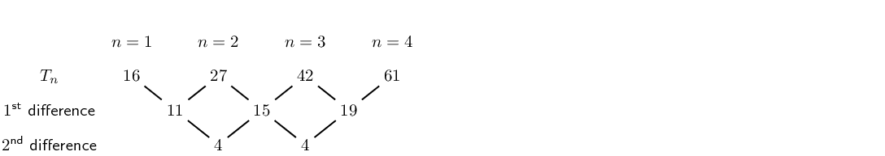

**Problem:**
Find the general formula for the quadratic sequence above.

**Solution:**
\begin{align*}
                            T_n &= an^2 +bn +c \\
                            T_1 &= a +b +c \\
                            T_2 &= 4n^2 +2n +c \\
                            T_3 &= 9n^2 +3n +c
                            \end{align*}
                            \begin{align*}
                            \therefore a + b+ c &= 16 \\
                            \therefore c &= 16 - a - b \\
                            4a + 2b + c &= 27 \\
                            4a + 2b + (16 - a - b) &= 27 \\
                            3a + b &= 11 \\
                            \text{And } 9a + 3b + c &= 42 \\
                            \therefore 9a + 3b + (16 - a - b) &= 42 \\
                            8a + 2b = 26 \\
                            4a + b = 13 \\
                            \therefore b &= 13 -4a
                            \end{align*}
                            \begin{align*}
                            \therefore 3a + b &= 11 \\
                            3a + (13 - 4a) &= 11 \\
                            -a &= -2 \\
                            \therefore a &= 2 \\
                            b &= 13 -4(2) \\
                            \therefore b &= 5 \\
                            \text{And } c &= 16 - a - b \\
                            \therefore c &= 16 - 2 -5 \\
                            &= 9 \\
                            \therefore T_n &= 2n^2 + 5n + 9
                            \end{align*}
