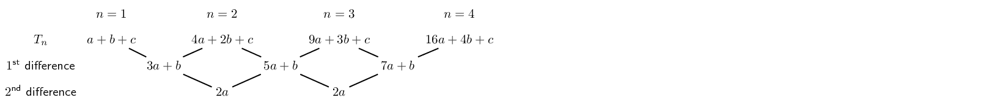

## 3.3 Summary (EMBG6)

- \(T_n\) is the general term of a sequence.
- **Successive** or **consecutive** terms are terms that follow one after
                      another in a sequence.
- A **linear** sequence has a common difference (\(d\)) between any two successive terms.
  \[d = T_n - T_{n-1}\]
- A **quadratic** sequence has a common second difference between any two successive
                      terms.
- The general term for a quadratic sequence is \[T_n = an^2 + bn + c\]
- A general quadratic sequence:
  

<QuizCard id="m11-03-03a" title="Interactive Exercise 3.8" question="For each definition shown below, select the correct word or phrase:" options=["Rank", "Sequence", "Successive", "T\u2099", "Rank", "Sequence", "Successive", "T\u2099", "Rank", "Sequence", "Successive", "T\u2099", "Rank", "Sequence", "Successive", "T\u2099"] answer="0, 1, 2, 3" hint="" explanation="Use what you know about the words in the question Here are the most important words and phrases for describing and understanding patterns, with some examples to help if you need them! Common difference: The difference between any two consecutive terms in a linear pattern.  For example, for the sequence \(1 \, ; 4 \, ; 7 \, ; 10\, ; \ldots\) the common difference is \(3\) . The common difference is represented by the symbol \(d\) and can be calculated by \(d = T_{2} - T_{1}\) or \(d = T_{3} - T_{2}\) or \(d = T_{n+1} - T_{n}\) , etc. Consecutive (synonym for 'successive'): Two or more things which follow each other with nothing in between.  For example, the numbers \(\text{3}\) , \(\text{4}\) , and \(\text{5}\) are consecutive integers; the letters \(x\) , \(y\) , \(z\) are consecutive letters. General formula: A formula which shows how to calculate the \(n^{\text{th}}\) term of a sequence.  For example, \(T_{n} = 3n -2\) is the general formula for the sequence \(1 \, ; 4 \, ; 7 \, ; 10\, ; \ldots\) \(n\) : The number which tells us the position (rank) of a term in a sequence.  For example, in the sequence \(1 \, ; 4 \, ; 7 \, ; 10\, ; \ldots\) the number \( 7 \) is the third term, so for the \( 7, n = 3 \) (That is why \(T_{3} = 7\) ). Rank: The position of something in a sequence.  For example, in the sequence \(1 \, ; 4 \, ; 7 \, ; 10\, ; \ldots\) the rank of the \(4\) is \(\text{2}\) because it is the second term in the sequence.  The rank is represented by the symbol \(n\) . Sequence: A list of things like numbers or letters which have a pattern. Successive (synonym for 'consecutive'): Two or more things which follow each other with nothing in between.  For example, the numbers \(\text{3}\) , \(\text{4}\) , and \(\text{5}\) are successive integers; the letters \(x\) , \(y\) , \(z\) are successive letters. \(T_{n}\) : Represents the general term of a sequence, which means any term at all; the \(n^{\text{th}}\) term. The correct answers for this question are: Rank: The value of \(n\) for a term. Sequence: A list of things like numbers or letters which have a pattern. Successive: Same meaning as 'consecutive'. Tₙ: Represents the general term, or any term at all. Submit your answer as: Rank and Sequence and Successive and Tₙ" />

<QuizCard id="m11-03-03a" title="Interactive Exercise 3.8" question="For each definition shown below, select the correct word or phrase:" options=["Common difference", "General formula", "Rank", "Sequence", "Common difference", "General formula", "Rank", "Sequence", "Common difference", "General formula", "Rank", "Sequence", "Common difference", "General formula", "Rank", "Sequence"] answer="0, 1, 2, 3" hint="" explanation="Use what you know about the words in the question Here are the most important words and phrases for describing and understanding patterns, with some examples to help if you need them! Common difference: The difference between any two consecutive terms in a linear pattern.  For example, for the sequence \(1 \, ; 4 \, ; 7 \, ; 10\, ; \ldots\) the common difference is \(3\) . The common difference is represented by the symbol \(d\) and can be calculated by \(d = T_{2} - T_{1}\) or \(d = T_{3} - T_{2}\) or \(d = T_{n+1} - T_{n}\) , etc. Consecutive (synonym for 'successive'): Two or more things which follow each other with nothing in between.  For example, the numbers \(\text{3}\) , \(\text{4}\) , and \(\text{5}\) are consecutive integers; the letters \(x\) , \(y\) , \(z\) are consecutive letters. General formula: A formula which shows how to calculate the \(n^{\text{th}}\) term of a sequence.  For example, \(T_{n} = 3n -2\) is the general formula for the sequence \(1 \, ; 4 \, ; 7 \, ; 10\, ; \ldots\) \(n\) : The number which tells us the position (rank) of a term in a sequence.  For example, in the sequence \(1 \, ; 4 \, ; 7 \, ; 10\, ; \ldots\) the number \( 7 \) is the third term, so for the \( 7, n = 3 \) (That is why \(T_{3} = 7\) ). Rank: The position of something in a sequence.  For example, in the sequence \(1 \, ; 4 \, ; 7 \, ; 10\, ; \ldots\) the rank of the \(4\) is \(\text{2}\) because it is the second term in the sequence.  The rank is represented by the symbol \(n\) . Sequence: A list of things like numbers or letters which have a pattern. Successive (synonym for 'consecutive'): Two or more things which follow each other with nothing in between.  For example, the numbers \(\text{3}\) , \(\text{4}\) , and \(\text{5}\) are successive integers; the letters \(x\) , \(y\) , \(z\) are successive letters. \(T_{n}\) : Represents the general term of a sequence, which means any term at all; the \(n^{\text{th}}\) term. The correct answers for this question are: Common difference: The difference between consecutive terms for a linear pattern. General formula: The formula for the \(n^{\text{th}}\) term of a sequence. Rank: The value of \(n\) for a term. Sequence: A pattern of numbers, letters, or anything else. Submit your answer as: Common difference and General formula and Rank and Sequence" />

<QuizCard id="m11-03-03a" title="Interactive Exercise 3.8" question="Find the constant second difference for the following sequence: \[\begin{array}{c}4 \, ; 10 \, ; 22 \, ; 40 \, ; \ldots\end{array}\] INSTRUCTION: If the second difference is not the same for all of the terms, write none in the answer box." options=["quadratic", "not quadratic"] answer="6" hint="You should enter a number here. If you want to, you can use a space to separate thousands.                Example: 12 800,25 For scientific notation you need to use the multiply symbol                ( ∗ ) and the exponent symbol ( ^ ). For example 6,673 × 10 −11 should be written as: 6,673 ∗ 10^−11" explanation="Start by finding the first differences of the terms: \[ 	      \begin{aligned} 		\textrm{For } T_{1} \textrm{ and } T_{2}: & \quad 10 - (4) = 6	\\ 		\textrm{For } T_{2} \textrm{ and } T_{3}: & \quad 22 - (10) = 12	\\ 		\textrm{For } T_{3} \textrm{ and } T_{4}: & \quad 40 - (22) = 18	 	      \end{aligned} 	    \] Now calculate the second differences: \[ 	      \begin{aligned} 		\textrm{first two differences: } & \quad 12 - (6) = 6 \\ 		\textrm{next two differences: } & \quad 18 - (12) = 6 	      \end{aligned} 	    \] The book shows this arranged as follows: In this case, the second differences are equal to each other, with a value of \(\text{6}\) . Submit your answer as:" />

<QuizCard id="m11-03-03a" title="Interactive Exercise 3.8" question="Find the constant second difference for the following sequence: \[\begin{array}{c}-4 \, ; -11 \, ; -22 \, ; -37 \, ; \ldots\end{array}\] INSTRUCTION: If the second difference is not the same for all of the terms, write none in the answer box." options=["quadratic", "not quadratic"] answer="-4" hint="You should enter a number here. If you want to, you can use a space to separate thousands.                Example: 12 800,25 For scientific notation you need to use the multiply symbol                ( ∗ ) and the exponent symbol ( ^ ). For example 6,673 × 10 −11 should be written as: 6,673 ∗ 10^−11" explanation="Start by finding the first differences of the terms: \[ 	      \begin{aligned} 		\textrm{For } T_{1} \textrm{ and } T_{2}: & \quad -11 - (-4) = -7	\\ 		\textrm{For } T_{2} \textrm{ and } T_{3}: & \quad -22 - (-11) = -11	\\ 		\textrm{For } T_{3} \textrm{ and } T_{4}: & \quad -37 - (-22) = -15	 	      \end{aligned} 	    \] Now calculate the second differences: \[ 	      \begin{aligned} 		\textrm{first two differences: } & \quad -11 - (-7) = -4 \\ 		\textrm{next two differences: } & \quad -15 - (-11) = -4 	      \end{aligned} 	    \] The book shows this arranged as follows: In this case, the second differences are equal to each other, with a value of \(\text{−4}\) . Submit your answer as:" />
