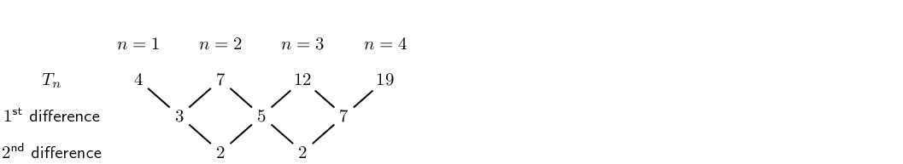
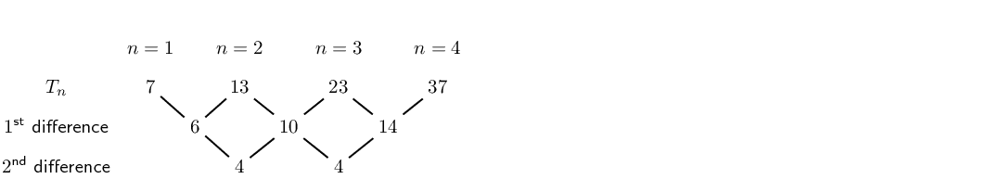
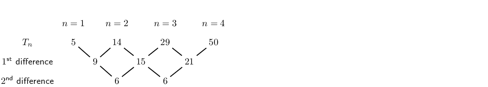
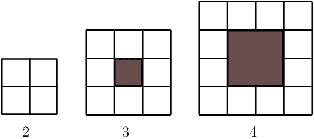
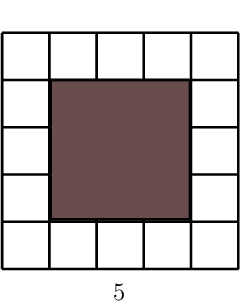
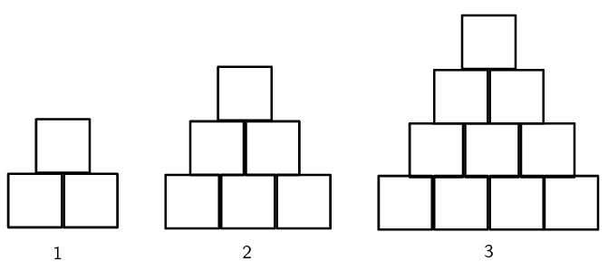

## End of chapter exercises

### Textbook Exercise 3.4

**Problem:**
Find the first five terms of the quadratic sequence defined by:

                    \({T}_{n}={n}^{2}+2n+1\)

**Solution:**
\(-4; 9; 16; 25; 36\)

Determine whether each of the following sequences is:

- a linear sequence,
- a quadratic sequence,
- or neither.

**Problem:**
\(6;9;14;21;30;...\)

**Solution:**
\begin{align*}
                        \text{First differences: } &= 3; 5; 7; 9; \\
                        \text{Second difference: } &= 2
                        \end{align*}

Quadratic sequence

**Problem:**
\(1;7;17;31;49;...\)

**Solution:**
\begin{align*}
                        \text{First differences: } &= 6; 10; 14; 18 \\
                        \text{Second difference: } &= 4
                        \end{align*}

Quadratic sequence

**Problem:**
\(8;17;32;53;80;...\)

**Solution:**
\begin{align*}
                        \text{First differences: } &= 9; 15; 21; 27 \\
                        \text{Second difference: } &= 6
                        \end{align*}

Quadratic sequence

**Problem:**
\(9;26;51;84;125;...\)

**Solution:**
\begin{align*}
                        \text{First differences: } &= 17; 25; 33; 41 \\
                        \text{Second difference: } &= 8
                        \end{align*}

Quadratic sequence

**Problem:**
\(2;20;50;92;146;...\)

**Solution:**
\begin{align*}
                        \text{First differences: } &= 18; 30; 42; 54 \\
                        \text{Second difference: } &= 12
                        \end{align*}

Quadratic sequence

**Problem:**
\(5;19;41;71;109;...\)

**Solution:**
\begin{align*}
                        \text{First differences: } &= 14; 22; 30; 38 \\
                        \text{Second difference: } &= 8
                        \end{align*}

Quadratic sequence

**Problem:**
\(2;6;10;14;18;...\)

**Solution:**
\[\text{First difference: } = 4\]

Linear sequence

**Problem:**
\(3;9;15;21;27;...\)

**Solution:**
\[\text{First difference: } = 6\]

Linear sequence

**Problem:**
\(1;\text{2,5};5;\text{8,5};13;...\)

**Solution:**
\begin{align*}
                        \text{First differences: } &= \text{1,5};~ \text{2,5};~ \text{3,5};~ \text{4,5} \\
                        \text{Second difference: } &= 1
                        \end{align*}

Quadratic sequence

**Problem:**
\(10;24;44;70;102;...\)

**Solution:**
\begin{align*}
                        \text{First differences: } &= 14; 20; 26; 32 \\
                        \text{Second difference: } &= 16
                        \end{align*}

Quadratic sequence

**Problem:**
\(2\frac{1}{2}; 6; 10\frac{1}{2}; 16; 22\frac{1}{2}; \ldots\)

**Solution:**
\begin{align*}
                        \text{First differences: } &= \text{3,5};~ \text{4,5};~ \text{5,5};~ \text{6,5} \\
                        \text{Second difference: } &= 1
                        \end{align*}

Quadratic sequence

**Problem:**
\(3p^2; 6p^2; 9p^2; 12p^2; 15p^2; \ldots\)

**Solution:**
\[\text{First difference: } = 3p^2\]

Linear sequence

**Problem:**
\(2k; 8k; 18k; 32k; 50k; \ldots\)

**Solution:**
\begin{align*}
                        \text{First differences: } &= 6k; 10k; 14k; 18k \\
                        \text{Second difference: } &= 4k
                        \end{align*}

Quadratic sequence

**Problem:**
Given the pattern: \(16; x; 46; \ldots\), determine the value of \(x\) if the pattern is linear.

**Solution:**
\begin{align*}
                    x - 16 &= 46 - x \\
                    2x &= 62 \\
                    \therefore x &= 31
                    \end{align*}

**Problem:**
Given \(T_n = 2n^2\), for which value of \(n\) does \(T_n = 242\)?

**Solution:**
\begin{align*}
                    2n^2 &= 242 \\
                    n^2 &= 121 \\
                    \therefore n &= 11
                    \end{align*}

**Problem:**
Given \({T}_{n}=3{n}^{2}\), find \({T}_{11}\).

**Solution:**
\begin{align*}
                    T_n &= 3n^2 \\
                    \therefore T_11 &= 3(11)^2 \\
                    &= 363
                    \end{align*}

**Problem:**
Given \(T_n = n^2+4\), for which value of \(n\) does \(T_n = 85\)?

**Solution:**
\begin{align*}
                    n^2 + 4 &= 85 \\
                    n^2 &= 81 \\
                    \therefore n &= 9
                    \end{align*}

**Problem:**
Given \({T}_{n}=4{n}^{2}+3n-1\), find \({T}_{5}\).

**Solution:**
\begin{align*}
                    T_n &= 4n^2 + 3n - 1 \\
                    \therefore T_5 &= 4(5)^2 + 3(5) - 1\\
                    &= 100 + 15 - 1 \\
                    &= 114
                    \end{align*}

**Problem:**
Given \(T_n = \dfrac{3}{2}n^2\), for which value of \(n\) does \(T_n = 96\)?

**Solution:**
\begin{align*}
                    \dfrac{3}{2}n^2 &= 96 \\
                    n^2 &= 96 \times \frac{2}{3} \\
                    &= 64 \\
                    \therefore n &= 8
                    \end{align*}

For each of the following patterns, determine:

- the next term in the pattern,
- and the general term,
- the tenth term in the pattern.

**Problem:**
\(3; 7; 11; 15; \ldots\)

**Solution:**
\begin{align*}
                        d &= 7 - 3 \\
                        &= 4 \\
                        T_5 &= 15 + 4 \\
                        &= 19 \\
                        T_n &= 4n - 1 \\
                        T_{10} &= 4(10) - 1 \\
                        &= 39
                        \end{align*}

**Problem:**
\(17; 12; 7; 2; \ldots\)

**Solution:**
\begin{align*}
                        d &= 12 - 17 \\
                        &= -5 \\
                        T_5 &= 2 - 5 \\
                        &= -3 \\
                        T_n &= 22 - 5n \\
                        T_{10} &= 22 - 5(10) \\
                        &= -28
                        \end{align*}

**Problem:**
\(\frac{1}{2}; 1; 1\frac{1}{2}; 2; \ldots\)

**Solution:**
\begin{align*}
                        d &= 1 - \frac{1}{2} \\
                        &= \frac{1}{2} \\
                        T_5 &= 2 + \frac{1}{2} \\
                        &= 2 \frac{1}{2} \\
                        T_n &= \frac{1}{2}n \\
                        T_{10} &= \frac{1}{2}(10) \\
                        &= 5
                        \end{align*}

**Problem:**
\(a; a+b; a+2b; a+3b; \ldots\)

**Solution:**
\begin{align*}
                        d &= a + b - a \\
                        &= b \\
                        T_5 &= a + 3b + b \\
                        &= a + 4b \\
                        T_n &= a - b + bn \\
                        T_{10} &= a - b + b(10) \\
                        &= a + 9b
                        \end{align*}

**Problem:**
\(1; -1; -3; -5; \ldots\)

**Solution:**
\begin{align*}
                        d &= -1 - 1 \\
                        &= -2 \\
                        T_5 &= -5 -2 \\
                        &= -7 \\
                        T_n &= 3 - 2n \\
                        T_{10} &= 3 - 2(10) \\
                        &= -17
                        \end{align*}

For each of the following sequences, find the equation for the general term and then use the
                        equation to find \({T}_{100}\).

**Problem:**
\(4;7;12;19;28;...\)

**Solution:**

**Problem:**
\(2;8;14;20;26;...\)

**Solution:**
\begin{align*}
                        d &= 8 - 2 \\
                        &= 6 \\
                        \therefore T_n &= 6n - 4
                        \end{align*}
                        \begin{align*}
                        T_n &= 6n - 4 \\
                        \therefore T_{100} &= 6(100) - 4 \\
                        &= 596
                        \end{align*}

**Problem:**
\(7;13;23;37;55;...\)

**Solution:**

**Problem:**
\(5;14;29;50;77;...\)

**Solution:**

Given: \(T_n = 3n-1\)

**Problem:**
Write down the first five terms of the sequence.

**Solution:**
\(2; 5; 8; 11; 14\)

**Problem:**
What do you notice about the difference between any two consecutive terms?

**Solution:**
Constant difference, \(d=3\)

**Problem:**
Will this always be the case for a linear sequence?

**Solution:**
Yes

Given the following sequence: \(-15; -11; -7; \ldots ; 173\)

**Problem:**
Determine the equation for the general term.

**Solution:**
\begin{align*}
                        d &= -11 - (-15) \\
                        &= 4 \\
                        T_n &= 4n - 19
                        \end{align*}

**Problem:**
Calculate how many terms there are in the sequence.

**Solution:**
\begin{align*}
                        T_n &= 4n - 19 \\
                        173 &= 4n - 19 \\
                        192 &= 4n \\
                        \therefore 48 &= n
                        \end{align*}

Given \(3; 7; 13; 21; 31; \ldots\)

**Problem:**
Thabang determines that the general term is \(T_n = 4n - 1\). Is he correct? Explain.

**Solution:**
\begin{align*}
                        \text{First differences: } &= 4; 6; 8; 10 \\
                        \text{Second difference: } &= 2
                        \end{align*}

Thabang's general term \(T_n = 4n - 1\) describes a linear sequence and this is a quadratic
                            sequence.

**Problem:**
Cristina determines that the general term is \(T_n = n^2 + n + 1\). Is she correct? Explain.

**Solution:**
\begin{align*}
                        T_n &= an^2 + bn + c \\
                        \text{Second difference: } 2a &= 2 \\
                        \therefore a &= 1 \\
                        3a + b &= 4 \\
                        b &= 4 - 3(1) \\
                        \therefore b &= 1 \\
                        a + b + c &= 3 \\
                        \therefore c &= 3 - a - b \\
                        &= 3 - 1 - 1 \\
                        \therefore c &= 1 \\
                        \therefore T_n &= n^2 + n + 1
                        \end{align*}

Given the following pattern of blocks:

**Problem:**
Draw pattern \(\text{5}\).

**Solution:**

**Problem:**
Complete the table below:

| pattern number \((n)\) | \(\text{2}\) | \(\text{3}\) | \(\text{4}\) | \(\text{5}\) | \(\text{10}\) | \(\text{250}\) | \(n\) |
| --- | --- | --- | --- | --- | --- | --- | --- |
| number of white blocks \((w)\) | \(\text{4}\) | \(\text{8}\) |  |  |  |  |  |

**Solution:**
| pattern number \((n)\) | \(\text{2}\) | \(\text{3}\) | \(\text{4}\) | \(\text{5}\) | \(\text{10}\) | \(\text{250}\) | \(n\) |
| --- | --- | --- | --- | --- | --- | --- | --- |
| number of white blocks \((w)\) | \(\text{4}\) | \(\text{8}\) | \(\text{12}\) | \(\text{16}\) | \(\text{36}\) | \(\text{996}\) | \(4n - 4\) |

**Problem:**
Is this a linear or a quadratic sequence?

**Solution:**
Linear

Cubes of volume \(\text{1}\) \(\text{cm$^{3}$}\) are stacked on top of each other to form a
                        tower:

**Problem:**
Complete the table for the height of the tower:

| tower number \((n)\) | \(\text{1}\) | \(\text{2}\) | \(\text{3}\) | \(\text{4}\) | \(\text{10}\) | \(n\) |
| --- | --- | --- | --- | --- | --- | --- |
| height of tower \((h)\) | \(\text{2}\) |  |  |  |  |  |

**Solution:**
| tower number \((n)\) | \(\text{1}\) | \(\text{2}\) | \(\text{3}\) | \(\text{4}\) | \(\text{10}\) | \(n\) |
| --- | --- | --- | --- | --- | --- | --- |
| height of tower \((h)\) | \(\text{2}\) | \(\text{3}\) | \(\text{4}\) | \(\text{5}\) | \(\text{11}\) | \(n+1\) |

**Problem:**
What type of sequence is this?

**Solution:**
Linear

**Problem:**
Now consider the number of cubes in each tower and complete the table below:

| tower number \((n)\) | \(\text{1}\) | \(\text{2}\) | \(\text{3}\) | \(\text{4}\) |
| --- | --- | --- | --- | --- |
| number of cubes \((c)\) | \(\text{3}\) |  |  |  |

**Solution:**
| tower number \((n)\) | \(\text{1}\) | \(\text{2}\) | \(\text{3}\) | \(\text{4}\) |
| --- | --- | --- | --- | --- |
| number of cubes \((c)\) | \(\text{3}\) | \(\text{6}\) | \(\text{10}\) | \(\text{15}\) |

**Problem:**
What type of sequence is this?

**Solution:**
Quadratic

**Problem:**
Determine the general term for this sequence.

**Solution:**
\begin{align*}
                        T_n &= an^2 + bn + c \\
                        \text{Second difference: } 2a &= 1 \\
                        \therefore a &= \frac{1}{2} \\
                        3a + b &= 3 \\
                        b &= 3 - 3(\frac{1}{2}) \\
                        \therefore b &= \frac{3}{2} \\
                        a + b + c &= 3 \\
                        \therefore c &= 3 - a - b \\
                        &= 3 - \frac{1}{2} - \frac{3}{2} \\
                        \therefore c &= 1 \\
                        \therefore T_n &= \frac{1}{2}n^2 + \frac{3}{2}n + 1
                        \end{align*}

**Problem:**
How many cubes are needed for tower number \(\text{21}\)?

**Solution:**
\begin{align*}
                        T_n &= \frac{1}{2}n^2 + \frac{3}{2}n + 1 \\ \therefore T_{21} &= \frac{1}{2}(21)^{2}+
                        \frac{3}{2}(21) + 1 \\
                        &= \frac{441}{2} + \frac{63}{2} + \frac{2}{2} \\
                        &= 253
                        \end{align*}

**Problem:**
How high will a tower of \(\text{496}\) cubes be?

**Solution:**
\begin{align*}
                        T_n &= \frac{1}{2}n^2 + \frac{3}{2}n + 1\\ 496 &= \frac{1}{2}n^2 + \frac{3}{2}n + 1 \\
                        0 &= \frac{1}{2}n^2 + \frac{3}{2}n - 495 \\
                        &= n^2 + 3n - 990 \\
                        &= (n - 30)(n + 33) \\
                        \therefore n = 30 &\text{ or } n = -33 \\
                        \therefore n &= 30 \\
                        \text{And } h &= n + 1 \\
                        &= 30 + 1 \\
                        &= \text{31}\text{ cm}
                        \end{align*}

A quadratic sequence has a second term equal to \(\text{1}\), a third term equal to \(-\text{6}\)
                        and a fourth term equal to \(-\text{14}\).

**Problem:**
Determine the second difference for this sequence.

**Solution:**
\begin{align*}
                        T_3 - T_2 &= -6 -(1) \\
                        &= -7 \\
                        T_4 - T_3 &= -14 - (-6) \\
                        &= -8 \\
                        \therefore \text{Second difference} &= -1
                        \end{align*}

**Problem:**
Hence, or otherwise, calculate the first term of the pattern.

**Solution:**
\begin{align*}
                        T_{1} &= 1 + 6 \\
                        &= 7
                        \end{align*}

There are \(\text{15}\) schools competing in the U16 girls hockey championship and every team
                        must play two matches — one home match and one away match.

**Problem:**
Use the given information to complete the table:

| no. of schools | no. of matches |
| --- | --- |
| \(\text{1}\) | \(\text{0}\) |
| \(\text{2}\) |  |
| \(\text{3}\) |  |
| \(\text{4}\) |  |
| \(\text{5}\) |  |

**Solution:**
| no. of schools | no. of matches |
| --- | --- |
| \(\text{1}\) | \(\text{0}\) |
| \(\text{2}\) | \(\text{2}\) |
| \(\text{3}\) | \(\text{6}\) |
| \(\text{4}\) | \(\text{12}\) |
| \(\text{5}\) | \(\text{20}\) |

**Problem:**
Calculate the second difference.

**Solution:**
\begin{align*}
                        T_2 - T_1 &= 2 - 0 \\
                        &= 2 \\
                        T_3 - T_2 &= 6 - 2 \\
                        &= 4 \\
                        T_4 - T_3 &= 12 -6 \\
                        &= 6 \\
                        T_5 - T_4 &= 20 - 12 \\
                        &= 8 \\
                        \therefore \text{Second difference} &= 2
                        \end{align*}

**Problem:**
Determine a general term for the sequence.

**Solution:**
\begin{align*}
                        T_n &= an^2 + bn + c \\
                        \text{Second difference: } 2a &= 2 \\
                        \therefore a &= 1 \\
                        3a + b &= 2 \\
                        b &= 2 - 3(1) \\
                        \therefore b &= -1 \\
                        a + b + c &= 0 \\
                        \therefore c &= - a - b \\
                        &= -1 - (-1) \\
                        \therefore c &= 0 \\
                        \therefore T_n &= n^2 -n
                        \end{align*}

**Problem:**
How many matches will be played if there are \(\text{15}\) schools competing in the
                            championship?

**Solution:**
\begin{align*}
                        T_n &= n^2 -n \\
                        T_{15} &= (15)^2 - 15 \\
                        &= 225 - 15 \\
                        &= 210
                        \end{align*}

**Problem:**
If \(\text{600}\) matches must be played, how many schools are competing in the championship?

**Solution:**
\begin{align*}
                        T_n &= n^2 -n \\
                        600 &= n^2 -n \\
                        0 &= n^2 -n - 600\\
                        &= (n - 25)(n + 24)\\
                        \therefore n = 25 &\text{ or } n = -24 \\
                        \therefore n &= 25
                        \end{align*}

**Problem:**
The first term of a quadratic sequence is \(\text{4}\), the third term is \(\text{34}\) and the
                        common second difference is \(\text{10}\). Determine the first six terms in the sequence.

**Solution:**
\begin{align*}
                    \text{Let } T_2 &= x \\
                    \therefore T_2 - T_1 &= x - 4 \\
                    \text{And } T_3 - T_2 &= 34 - x \\
                    \text{Second difference } &= (T_3 - T_2) - (T_2 - T_1) \\
                    &= (34 - x) - (x - 4)\\
                    \therefore 10 &= 38 - 2x \\
                    2x &= 28 \\
                    \therefore x &= 14
                    \end{align*}

\(4; 14; 34; 64; 104; 154\)

Challenge question:

Given that the general term for a quadratic sequences is \(T_n = an^2 + bn + c\), let \(d\) be
                        the first difference and \(D\) be the second common difference.

**Problem:**
Show that \(a = \dfrac{D}{2}\).

**Solution:**
\begin{align*}
                        T_n &= an^2 + bn +c \\
                        T_1 &= a(1)^2 + b(1) +c \\
                        &= a + b + c \\
                        T_2 &= a(2)^2 + b(2) +c \\
                        &= 4a + 2b + c\\
                        T_3 &= a(3)^2 + b(3) +c \\
                        &= 9a + 6b + c\\
                        \text{First difference } d &= T_2 - T_1 \\
                        \therefore d &= (4a + 2b + c) - (a + b + c ) \\
                        &= 3a + b \\
                        \therefore b &= d - 3a \\
                        \text{Second difference } D &= (T_3 - T_2) - (T_2 - T_1)\\
                        \therefore D &= (5a + b) - (3a + b) \\
                        &= 2a \\
                        \therefore a &= \dfrac{D}{2}
                        \end{align*}

**Problem:**
Show that \(b = d - \dfrac{3}{2}D\).

**Solution:**
\begin{align*}
                        a &= \dfrac{D}{2} \\
                        b &= d - 3a \\
                        \therefore b &= d - 3 \left( \dfrac{D}{2} \right) \\
                        &= d - \dfrac{3}{2} D
                        \end{align*}

**Problem:**
Show that \(c = T_1 - d + D\).

**Solution:**
\begin{align*}
                        T_1 &= a + b + c \\
                        \therefore c &= T_1 - a - b \\
                        &= T_1 - \left( \dfrac{D}{2} \right) - \left( d - \dfrac{3}{2}D \right) \\
                        &= T_1 - \dfrac{D}{2} - d + \dfrac{3}{2}D \\
                        &= T_1 - d + D
                        \end{align*}

**Problem:**
Hence, show that \(T_n = \dfrac{D}{2}n^2 + \left(d - \dfrac{3}{2}D\right)n + \left(T_1 -d +
                            D\right)\).

**Solution:**
\begin{align*}
                        T_n &= an^2 + bn +c \\
                        \therefore T_n &= \dfrac{D}{2}n^2 + \left( d - \dfrac{3}{2}D \right)n + \left( T_1 - d + D
                        \right)
                        \end{align*}
