# Chapter 4: Analytical geometry

Analytical geometry, also referred to as coordinate or Cartesian geometry, is the study of geometric properties and
    relationships between points, lines and angles in the Cartesian plane. Geometrical shapes are defined using a
    coordinate system and algebraic principles. In this chapter we deal with the equation of a straight line, parallel
    and perpendicular lines and inclination of a line.

## 4.1 Revision (EMBG7)

- Integrate Euclidean Geometry knowledge with Analytical Geometry.
- Emphasize the value and importance of making sketches.
- Emphasize the importance of writing coordinates consistently for the distance formula and gradient.
- Discuss and explain:
- that parallel lines have equal gradients and equal angles of inclination.
- that the product of the gradients of perpendicular lines is equal to \(-\text{1}\).
- that horizontal lines have a zero gradient.
- that vertical lines have an undefined gradient.
- Revise the properties of the different quadrilaterals as this knowledge is needed in many of the exercises.
- Explain that the angle of inclination is never greater than \(\text{180}\)\(\text{°}\).

Points \(A(x_1;y_1), B(x_2;y_2)\) and \(C(x_2;y_1)\) are shown in the diagram below:

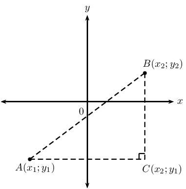

**Theorem of Pythagoras**

\[AB^2 = AC^2 + BC^2\]

**Distance formula**

Distance between two points: \[AB = \sqrt{(x_2 - x_1)^2 + (y_2 - y_1)^2}\]

Notice that \({\left({x}_{1}-{x}_{2}\right)}^{2}={\left({x}_{2}-{x}_{1}\right)}^{2}\).

<Callout type="note" title="Note">
<VideoPlayer src="http://www.khanacademy.org/embed_video?v=nyZuite17Pc" title="Video: 22JD" />
</Callout>

**Gradient**

Gradient \((m)\) describes the slope or steepness of the line joining two points. The gradient of a line is
      determined by the ratio of vertical change to horizontal change.

    \[m_{AB} = \frac{y_2 - y_1}{x_2 - x_1} \quad \text{ or } \quad m_{AB} = \frac{y_1 - y_2}{x_1 - x_2}\]

Remember to be consistent: \(m \ne \dfrac{y_1-y_2}{x_2-x_1}\).

| Horizontal lines |  | \(m = 0\) |
| --- | --- | --- |
| Vertical lines |  | \(m\) is undefined |
| Parallel lines |  | \(m_1 = m_2\) |
| Perpendicular lines |  | \(m_1 \times m_2 = -1\) |

**Mid-point of a line segment**

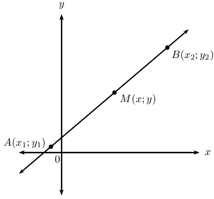

The coordinates of the mid-point \(M(x;y)\) of a line between any two points \(A(x_1;y_1)\) and \(B(x_2;y_2)\):

\[M(x;y) = \left( \frac{x_1 + x_2}{2}; \frac{y_1 + y_2}{2} \right)\]

<Callout type="note" title="Note">
<VideoPlayer src="http://www.khanacademy.org/embed_video?v=Ez_-RwV9WVo" title="Video: 22JF" />
</Callout>

**Points on a straight line**

The diagram shows points \(P(x_1;y_1)\), \(Q(x_2;y_2)\) and \(R(x;y)\) on a straight line.

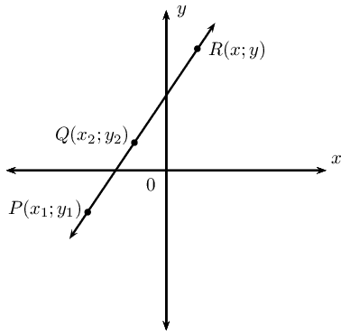

We know that \[m_{PR} = m_{QR} = m_{PQ}\]

Using \(m_{PR} = m_{PQ}\), we obtain the following for any point \((x;y)\) on a straight line

\[\frac{y - y_1}{x - x_1} = \frac{y_2 - y_1}{x_2 - x_1}\]

<Callout type="tip" title="Worked example 1: Revision">
**Question:**
Given the points \(P(-5;-4)\) and \(Q(0;6)\):

2. Determine the length of the line segment \(PQ\).
4. Determine the mid-point \(T(x;y)\) of the line segment \(PQ\).
6. Show that the line passing through \(R(1;-\frac{3}{4})\) and \(T(x;y)\) is perpendicular to the line
               \(PQ\).

**Draw a sketch:**
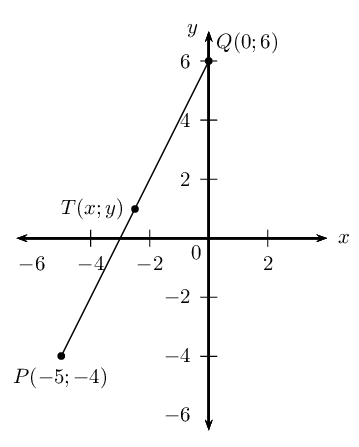

**Assign variables to the coordinates of the given points:**
Let the coordinates of \(P\) be \(\left({x}_{1};{y}_{1}\right)\) and \(Q\left({x}_{2};{y}_{2}\right)\)

\[x_1 = -5; \qquad y_1 = -4; \qquad x_2 = 0; \qquad y_2 = 6\]

Write down the distance formula

\begin{align*}
          PQ &= \sqrt{(x_2 - x_1)^2 + (y_2 - y_1)^2} \\
          &= \sqrt{(0 - (-5))^2 + (6-(-4))^2} \\
          &= \sqrt{25 + 100} \\
          &= \sqrt{125} \\
          &= 5\sqrt{5}
          \end{align*}

The length of the line segment \(PQ\) is \(5\sqrt{5}\) units.

**Write down the mid-point formula and substitute the values:**
\[T(x;y) = \left( \frac{x_1 + x_2}{2}; \frac{y_1 + y_2}{2} \right)\]

\begin{align*}
          x &= \frac{x_1 + x_2}{2} \\
          &= \frac{-5+0}{2} \\
          &= -\frac{5}{2} \\
          y &= \frac{y_1 + y_2}{2} \\
          &= \frac{-4+6}{2}\\
          &= \frac{2}{2} \\
          &= 1
          \end{align*}

The mid-point of \(PQ\) is \(T(-\frac{5}{2};1)\).

**Determine the gradients of \(PQ\) and \(RT\):**
\[m = \frac{y_2 - y_1}{x_2 - x_1}\]

\begin{align*}
          m_{PQ} &= \frac{6-(-4)}{0-(-5)} \\
          &= \frac{10}{5} \\
          &= 2 \\
          m_{RT} &= \dfrac{-\frac{3}{4} - 1}{1-(-\frac{5}{2})} \\
          &= \dfrac{-\frac{7}{4}}{\frac{7}{2}}\\
          &= -\frac{7}{4} \times \frac{2}{7} \\
          &= -\frac{1}{2}
          \end{align*}

Calculate the product of the two gradients:
          \begin{align*}
          m_{RT} \times m_{PQ} &= -\frac{1}{2} \times 2 \\
          &= -1
          \end{align*}

Therefore \(PQ\) is perpendicular to \(RT\).
</Callout>

**Quadrilaterals**

- A quadrilateral is a closed shape consisting of four straight line segments.
- A parallelogram is a quadrilateral with both pairs of opposite sides parallel.
  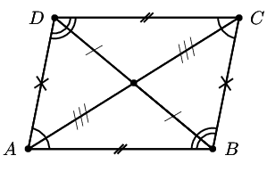
  - Both pairs of opposite sides are equal in length.
  - Both pairs of opposite angles are equal.
  - The diagonals bisect each other.
- A rectangle is a parallelogram that has all four angles equal to \(\text{90}\)\(\text{°}\).
  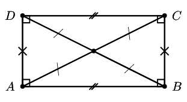
  - Both pairs of opposite sides are equal and parallel.
  - The diagonals bisect each other.
  - The diagonals are equal in length.
- A rhombus is a parallelogram that has all four sides equal in length.
  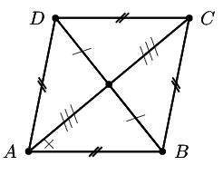
  - Both pairs of opposite sides are equal and parallel.
  - The diagonals bisect each other at \(\text{90}\)\(\text{°}\).
  - The diagonals of a rhombus bisect both pairs of opposite angles.
- A square is a rhombus that has all four interior angles equal to \(\text{90}\)\(\text{°}\).
  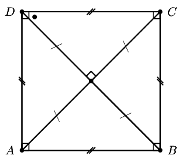
  - Both pairs of opposite sides are equal and parallel.
  - The diagonals bisect each other at \(\text{90}\)\(\text{°}\).
  - The diagonals are equal in length.
  - The diagonals bisect both pairs of interior opposite angles (that is, all angles are
                  \(\text{45}\)\(\text{°}\)).
- A trapezium is a quadrilateral with one pair of opposite sides parallel.
  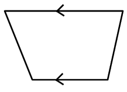
- A kite is a quadrilateral with two pairs of adjacent sides equal.
  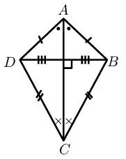
  - One pair of opposite angles are equal (the angles are between unequal sides).
  - The diagonal between equal sides bisects the other diagonal.
  - The diagonal between equal sides bisects the interior angles.
  - The diagonals intersect at \(\text{90}\)\(\text{°}\).

<Callout type="tip" title="Worked example 2: Quadrilaterals">
**Question:**
Points \(A\left(-1;0\right)\), \(B\left(0;3\right)\), \(C\left(8;11\right)\) and \(D\left(x;y\right)\) are
          points on the Cartesian plane. Determine \(D\left(x;y\right)\) if \(ABCD\) is a parallelogram.

**Draw a sketch:**
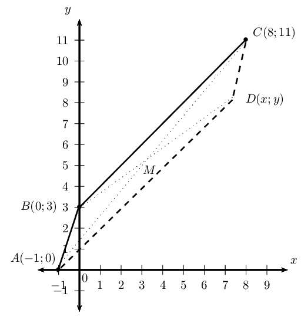

The mid-point of \(AC\) will be the same as the mid-point of \(BD\). We first find the mid-point of \(AC\)
          and then use it to determine the coordinates of point \(D\).

**Assign values to \(\left({x}_{1};{y}_{1}\right)\) and \(\left({x}_{2};{y}_{2}\right)\):**
Let the mid-point of \(AC\) be \(M(x;y)\)

\[x_1 = -1; \qquad y_1 = 0; \qquad x_2 = 8; \qquad y_2 = 11\]

**Write down the mid-point formula:**
\[M(x;y) = \left( \frac{x_1 + x_2}{2}; \frac{y_1 + y_2}{2} \right)\]

**Substitute the values and calculate the coordinates of \(M\):**
\begin{align*}
          M(x;y) &= \left( \frac{-1 + 8}{2}; \frac{0 + 11}{2} \right) \\
          &= \left( \frac{7}{2}; \frac{11}{2} \right)
          \end{align*}

**Use the coordinates of \(M\) to determine \(D\):**
\(M\) is also the mid-point of \(BD\) so we use \(M\left(\frac{7}{2};\frac{11}{2}\right)\) and
          \(B\left(0;3\right)\) to find \(D\left(x;y\right)\)

**Substitute values and determine \(x\) and \(y\):**
\begin{align*}
        M &= \left( \frac{x_1 + x_2}{2}; \frac{y_1 + y_2}{2} \right) \\
        \therefore \left( \frac{7}{2}; \frac{11}{2} \right) &= \left( \frac{0 + x}{2}; \frac{3 + y}{2} \right)
        \end{align*}\begin{align*}
        \frac{7}{2} &= \frac{0 + x}{2} \\
        7 &= 0 + x \\
        \therefore x &= 7
        \end{align*}\begin{align*}
        \frac{11}{2} &= \frac{3 + y}{2} \\
        11 &= 3 + y \\
        \therefore y &= 8
        \end{align*}

**Alternative method: inspection:**
Since we are given that \(ABCD\) is a parallelogram, we can use the properties of a parallelogram and the
          given points to determine the coordinates of \(D\).

From the sketch we expect that point \(D\) will lie below \(C\).

Consider the given points \(A, B\) and \(C\):

- Opposite sides of a parallelogram are parallel, therefore \(BC\) must be parallel to \(AD\) and their
              gradients must be equal.
- The vertical change from \(B\) to \(C\) is \(\text{8}\) units up.
- Therefore the vertical change from \(A\) to \(D\) is also \(\text{8}\) units up (\(y = 0 + 8 = 8\)).
- The horizontal change from \(B\) to \(C\) is \(\text{8}\) units to the right.
- Therefore the horizontal change from \(A\) to \(D\) is also \(\text{8}\) units to the right (\(x = -1 + 8
              = 7\)).

or

- Opposite sides of a parallelogram are parallel, therefore \(AB\) must be parallel to \(DC\) and their
              gradients must be equal.
- The vertical change from \(A\) to \(B\) is \(\text{3}\) units up.
- Therefore the vertical change from \(C\) to \(D\) is \(\text{3}\) units down (\(y = 11 - 3 = 8\)).
- The horizontal change from \(A\) to \(B\) is \(\text{1}\) unit to the right.
- Therefore the horizontal change from \(C\) to \(D\) is \(\text{1}\) unit to the left (\(x = 8 - 1 = 7\)).

**Write the final answer:**
The coordinates of \(D\) are \(\left(7;8\right)\).
</Callout>

## Revision

### Textbook Exercise 4.1

Determine the length of the line segment between the following points:

**Problem:**
\(P(-3;5)\) and \(Q(-1;-5)\)

**Solution:**
\begin{align*}
              PQ &= \sqrt{ \left( x_2 - x_1 \right)^2 + \left( y_2 - y_1 \right)^2} \\
              &= \sqrt{ \left( -1 + 3 \right)^2 + \left( -5-5 \right)^2} \\
              &= \sqrt{ \left( 2 \right)^2 + \left( -10 \right)^2} \\
              &= \sqrt{ 4 + 100} \\
              &= \sqrt{104} \\
              &= 2\sqrt{26} \text{ units}
              \end{align*}

**Problem:**
\(R(\text{0,75};3)\) and \(S(\text{0,75};-4)\)

**Solution:**
\begin{align*}
              RS &= \sqrt{ \left( x_2 - x_1 \right)^2 + \left( y_2 - y_1 \right)^2} \\
              &= \sqrt{ \left( \text{0,75}-\text{0,75} \right)^2 + \left( -4-3 \right)^2} \\
              &= \sqrt{ \left( 0 \right)^2 + \left( -7 \right)^2} \\
              &= \sqrt{49} \\
              &= \text{7}\text{ units}
              \end{align*}

**Problem:**
\(T(2x;y-2)\) and \(U(3x+1;y-2)\)

**Solution:**
\begin{align*}
              TU &= \sqrt{ \left( x_2 - x_1 \right)^2 + \left( y_2 - y_1 \right)^2} \\
              &= \sqrt{ \left( 3x + 1 - 2x \right)^2 + \left( y - 2 - y + 2\right)^2} \\
              &= \sqrt{ \left( x + 1 \right)^2 + \left( 0 \right)^2} \\
              &= \sqrt{ \left( x + 1 \right)^2} \\
              &= x+1 \text{ units}
              \end{align*}

**Problem:**
Given \(Q(4;1), T(p;3)\) and length \(QT = \sqrt{8}\) units, determine the value of \(p\).

**Solution:**
\begin{align*}
            QT &= \sqrt{ \left( x_2 - x_1 \right)^2 + \left( y_2 - y_1 \right)^2} \\
            \sqrt{8} &= \sqrt{ \left( p-4 \right)^2 + \left( 3-1\right)^2} \\
            \left( \sqrt{8} \right)^2 &= \left( p-4 \right)^2 + \left( 2 \right)^2 \\
            8 &= p^2 - 8p + 16 + 4 \\
            0 &= p^2 - 8p + 16 + 4 - 8\\
            &= p^2 - 8p + 12 \\
            &= \left( p - 6 \right) \left( p - 2 \right) \\
            \therefore p = 6 &\text{ or } p = 2
            \end{align*}

Determine the gradient of the line \(AB\) if:

**Problem:**
\(A(-5;3)\) and \(B(-7;4)\)

**Solution:**
\begin{align*}
              m_{AB} &= \frac{y_2 - y_1}{x_2 - x_1} \\
              &= \frac{4 - 3 }{-7+5 } \\
              &= \frac{1 }{-2 } \\
              &= -\frac{1}{2}
              \end{align*}

**Problem:**
\(A(3;-2)\) and \(B(1;-8)\)

**Solution:**
\begin{align*}
              m_{AB} &= \frac{y_2 - y_1}{x_2 - x_1} \\
              &= \frac{-8+2 }{1-3 } \\
              &= \frac{-6 }{-2 } \\
              &= 3
              \end{align*}

**Problem:**
Prove that the line \(PQ\), with \(P(0;3)\) and \(Q(5;5)\), is parallel to the line \(5y + 5 = 2x\).

**Solution:**
\begin{align*}
            5y + 5 &= 2x \\
            5y &= 2x - 5 \\
            y &= \frac{2}{5}x - 1 \\
            \therefore m &= \frac{2}{5}
            \end{align*}
            \begin{align*}
            m_{PQ} &= \frac{y_2 - y_1}{x_2 - x_1} \\
            &= \frac{5-3 }{5-0 } \\
            &= \frac{2}{5}
            \end{align*}

**Problem:**
Given the points \(A(-1;-1)\), \(B(2;5)\), \(C(-1;-\frac{5}{2})\) and \(D(x;-4)\) and \(AB \perp CD\),
              determine the value of \(x\).

**Solution:**
\begin{align*}
            m_{AB} &= \frac{y_2 - y_1}{x_2 - x_1} \\
            &= \frac{5+1}{2+1} \\
            &= \frac{6}{3} \\
            &= 2 \\
            m_{CD} &= \frac{y_2 - y_1}{x_2 - x_1} \\
            &= \frac{-4 + \frac{5}{2}}{x + 1 } \\
            &= \frac{-\frac{3}{2}}{x + 1} \\
            &= -\frac{3}{2(x + 1)} \\
            \text{And if } AB &\perp CD \\
            \text{then } m_{AB} \times m_{CD} &= -1 \\
            -\frac{3}{2(x + 1)} \times 2 &= -1 \\
            \frac{3}{x + 1} &= 1 \\
            3 &= x + 1 \\
            \therefore x &= 2
            \end{align*}

Calculate the coordinates of the mid-point \(P(x;y)\) of the line segment between the points:

**Problem:**
\(M(3;5)\) and \(N(-1;-1)\)

**Solution:**
\begin{align*}
              M(x;y) &= \left( \frac{x_1 + x_2}{2}; \frac{y_1 + y_2}{2} \right) \\
              &= \left( \frac{3 - 1}{2}; \frac{5 - 1}{2} \right) \\
              &= \left( \frac{2}{2}; \frac{4}{2} \right) \\
              &= \left( 1; 2 \right)
              \end{align*}

**Problem:**
\(A(-3;-4)\) and \(B(2;3)\)

**Solution:**
\begin{align*}
              M(x;y) &= \left( \frac{x_1 + x_2}{2}; \frac{y_1 + y_2}{2} \right) \\
              &= \left( \frac{-3 + 2}{2}; \frac{-4 + 3}{2} \right) \\
              &= \left( \frac{-1}{2}; \frac{-1}{2} \right)
              \end{align*}

**Problem:**
The line joining \(A(-2;4)\) and \(B(x;y)\) has the mid-point \(C(1;3)\). Determine the values of \(x\)
              and \(y\).

**Solution:**
\begin{align*}
            M(x;y) &= \left( \frac{x_1 + x_2}{2}; \frac{y_1 + y_2}{2} \right) \\
            C(1;3) &= \left( \frac{-2 + x}{2}; \frac{4 + y}{2} \right) \\
            \therefore 1 &= \frac{-2 + x}{2} \\
            2 &= -2 + x \\
            \therefore 4 &= x \\
            \text{And } 3 &= \frac{4 + y}{2} \\
            6 &= 4 + y \\
            \therefore 2 &= y
            \end{align*}

Given quadrilateral \(ABCD\) with vertices \(A(0;3), B(4;3), C(5;-1)\) and \(D(1;-1)\).

**Problem:**
Determine the equation of the line \(AD\) and the line \(BC\).

**Solution:**
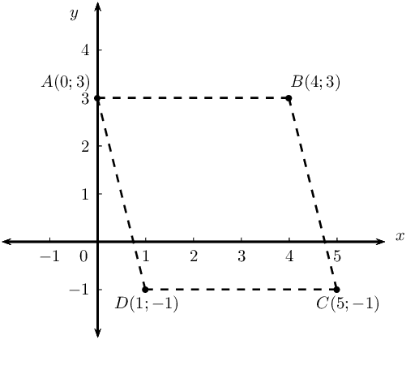

**Problem:**
Show that \(AD \parallel BC\).

**Solution:**
\begin{align*}
              m_{AD} &= -4 \\
              m_{BC} &= -4 \\
              \therefore m_{AD} &= m_{BC} \\
              \therefore AD &\parallel BC
              \end{align*}

**Problem:**
Calculate the lengths of \(AD\) and \(BC\).

**Solution:**
\begin{align*}
              AD &= \sqrt{ \left( x_2 - x_1 \right)^2 + \left( y_2 - y_1 \right)^2} \\
              &= \sqrt{ \left(1-0 \right)^2 + \left( -1-3 \right)^2} \\
              &= \sqrt{ 1 + \left( -4 \right)^2} \\
              &= \sqrt{17} \text{ units}
              \end{align*}
              \begin{align*}
              BC &= \sqrt{ \left( x_2 - x_1 \right)^2 + \left( y_2 - y_1 \right)^2} \\
              &= \sqrt{ \left( 5-4 \right)^2 + \left( -1-3 \right)^2} \\
              &= \sqrt{ 1 + \left( -4 \right)^2} \\
              &= \sqrt{17} \text{ units}
              \end{align*}

**Problem:**
Determine the equation of the diagonal \(BD\).

**Solution:**
\begin{align*}
              m_{BD} &= \frac{y_2 - y_1}{x_2 - x_1} \\
              &= \frac{-1 -3}{1-4} \\
              &= \frac{-4}{-3} \\
              &= \frac{4}{3}\\
              y &= mx + c \\
              y &= \frac{4}{3}x + c \\
              \text{Subst. } (4;3) \quad 3 &= \frac{4}{3}(4) + c \\
              &= 3 - \frac{16}{3} \\
              \therefore c &= - \frac{7}{3} \\
              y &= \frac{4}{3}x - \frac{7}{3}
              \end{align*}

**Problem:**
What type of quadrilateral is \(ABCD\)?

**Solution:**
Parallelogram (one opposite side equal and parallel)

**Problem:**
\(MPQN\) is a parallelogram with points \(M(-5;3)\), \(P(-1;5)\) and \(Q(4;5)\). Draw a sketch and
              determine the coordinates of \(N(x;y)\).

**Solution:**
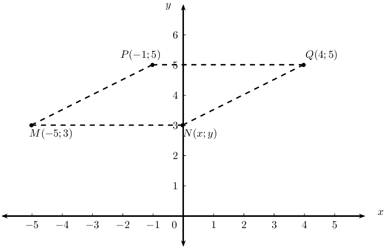

\(MPQN\) is a parallelogram, therefore \(PQ = MN\) and \(PQ \parallel MN\):

            \begin{align*}
            m_{PQ} &= \frac{y_2 - y_1}{x_2 - x_1} \\
            &= \frac{5 - 5}{4 + 1} \\
            &= 0 \\
            \therefore m_{MN} &= 0\\
            \therefore y &= 3 \\
            PQ &= \sqrt{ \left( x_2 - x_1 \right)^2 + \left( y_2 - y_1 \right)^2} \\
            &= \sqrt{ \left( 4+1 \right)^2 + \left( 5 - 5 \right)^2} \\
            &= \sqrt{ \left( 5 \right)^2} \\
            &= 5 \\
            \text{Therefore } x &= -5 + 5 \\
            \therefore x &= 0 \\
            \therefore N(x;y) &= (0;3)
            \end{align*}

\(PQRS\) is a quadrilateral with points \(P(-3;1)\), \(Q(1;3)\), \(R(6;1)\) and \(S(2;-1)\) in the
              Cartesian plane.

**Problem:**
Determine the lengths of \(PQ\) and \(SR\).

**Solution:**
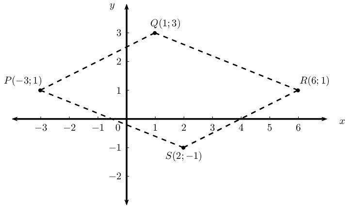

**Problem:**
Determine the mid-point of \(PR\).

**Solution:**
Let the mid-point of \(PR\) be \(M(x;y)\).

              \begin{align*}
              M(x;y) &= \left( \frac{x_1 + x_2}{2}; \frac{y_1 + y_2}{2} \right) \\
              &= \left( \frac{-3 + 6}{2}; \frac{1 + 1 }{2} \right) \\
              &= \left( \frac{3}{2}; 1 \right)
              \end{align*}

**Problem:**
Show that \(PQ \parallel SR\).

**Solution:**
\begin{align*}
              m_{PQ} &= \frac{y_2 - y_1}{x_2 - x_1} \\
              &= \frac{3 - 1}{1 + 3} \\
              &= \frac{2}{4} \\
              &= \frac{1}{2} \\
              m_{SR} &= \frac{y_2 - y_1}{x_2 - x_1} \\
              &= \frac{-1-1}{2-6} \\
              &= \frac{-2}{-4} \\
              &= \frac{1}{2} \\
              \text{Therefore } m_{PQ} &= m_{SR}\\
              \therefore PQ &\parallel SR
              \end{align*}

**Problem:**
Determine the equations of the line \(PS\) and the line \(SR\).

**Solution:**
\begin{align*}
              m_{PS} &= \frac{y_2 - y_1}{x_2 - x_1} \\
              &= \frac{-1-1}{2+3} \\
              &= \frac{-2}{5} \\
              y &= mx + c \\
              y &= -\frac{2}{5}x + c \\
              \text{Subst. } (-3;1) \quad 1 &= -\frac{2}{5}(-3) + c \\
              1 &= \frac{6}{5} + c \\
              \therefore -\frac{1}{5} &= c \\
              y &= -\frac{2}{5}x - \frac{1}{5}
              \end{align*}
              \begin{align*}
              m_{SR} &= \frac{1}{2} \\
              y &= mx + c \\
              y &= \frac{1}{2}x + c \\
              \text{Subst. } (6;1) \quad 1 &= \frac{1}{2}(6) + c \\
              1 &= 3 + c \\
              \therefore -2 &= c \\
              y &= \frac{1}{2}x - 2
              \end{align*}

**Problem:**
Is \(PS \perp SR\)? Explain your answer.

**Solution:**
No; \(m_{PS} \times m_{SR} \ne -1\).

**Problem:**
What type of quadrilateral is \(PQRS\)?

**Solution:**
Parallelogram
