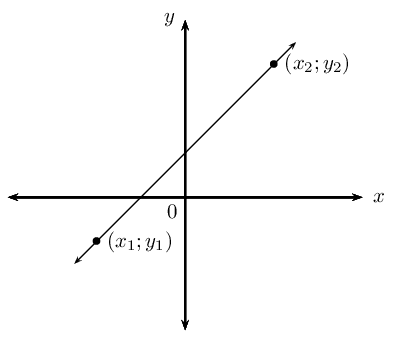
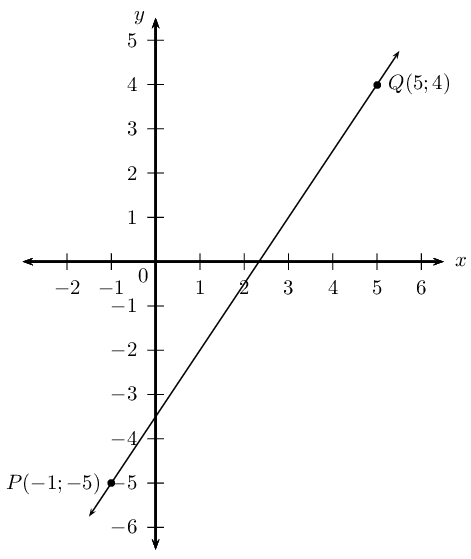
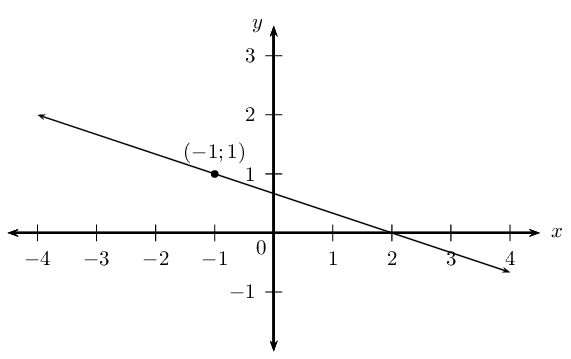
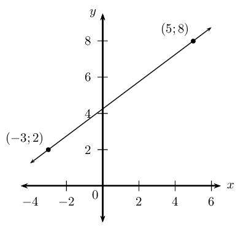
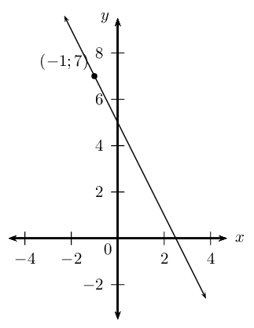
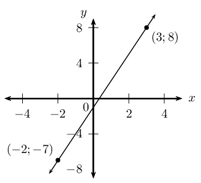
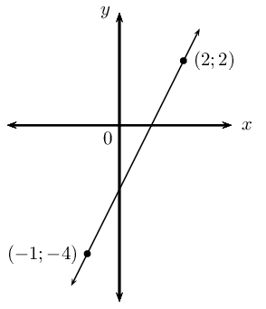
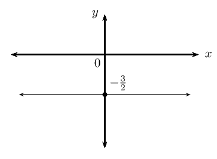
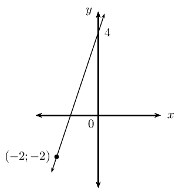
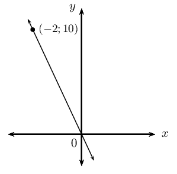

## 4.2 Equation of a line (EMBG8)

We can derive different forms of the straight line equation. The different forms are used depending on the
      information provided in the problem:

- The two-point form of the straight line equation: \(\dfrac{y-y_1}{x-x_1} = \dfrac{y_2-y_1}{x_2-x_1}\)
- The gradient–point form of the straight line equation: \(y-y_1 = m(x-x_1)\)
- The gradient–intercept form of the straight line equation: \(y = mx + c\)

### The two-point form of the straight line equation (EMBG9)

Given any two points \(\left({x}_{1};{y}_{1}\right)\) and \(\left({x}_{2};{y}_{2}\right)\), we can determine
        the equation of the line passing through the two points using the equation:

\[\frac{y-y_1}{x-x_1} = \frac{y_2-y_1}{x_2-x_1}\]

<Callout type="tip" title="Worked example 3: The two-point form of the straight line equation">
**Question:**
Find the equation of the straight line passing through \(P\left(-1;-5\right)\) and \(Q\left(5;4\right)\).

**Draw a sketch:**

**Assign variables to the coordinates of the given points:**
Let the coordinates of \(P\) be \((x_1;y_1)\) and \(Q(x_2;y_2)\)

\[x_1 = -1; \qquad y_1 = -5; \qquad x_2 = 5; \qquad y_2 = 4\]

**Write down the two-point form of the straight line equation:**
\[\frac{y-y_1}{x-x_1} = \frac{y_2-y_1}{x_2-x_1}\]

**Substitute the values and make \(y\) the subject of the equation:**
\begin{align*}
            \frac{y-(-5)}{x-(-1)} &= \frac{4-(-5)}{5-(-1)} \\
            \frac{y+5}{x+1} &= \frac{9}{6} \\
            y+5 &= \frac{3}{2}(x+1) \\
            y+5 &= \frac{3}{2}x + \frac{3}{2} \\
            y &= \frac{3}{2}x - \frac{7}{2}
            \end{align*}

**Write the final answer:**
\[y = \frac{3}{2}x - 3\frac{1}{2}\]
</Callout>

## The two-point form of the straight line equation

### Textbook Exercise 4.2

Determine the equation of the straight line passing through the points:

**Problem:**
\((3;7)\) and \((-6;1)\)

**Solution:**
\begin{align*}
              \frac{y-y_1}{x-x_1} &= \frac{y_2-y_1}{x_2-x_1} \\
              \frac{y-7}{x-3} &= \frac{1-7}{-6-3} \\
              \frac{y-7}{x-3} &= \frac{-6}{-9} \\
              \frac{y-7}{x-3} &= \frac{2}{3} \\
              y - 7 &= \frac{2}{3} \left( x - 3 \right) \\
              y &= \frac{2}{3}x - 2 + 7 \\
              \therefore y &= \frac{2}{3}x + 5
              \end{align*}

**Problem:**
\((1;-\frac{11}{4})\) and \((\frac{2}{3}; -\frac{7}{4})\)

**Solution:**
\begin{align*}
              \frac{y-y_1}{x-x_1} &= \frac{y_2-y_1}{x_2-x_1} \\
              \frac{y + \frac{11}{4}}{x-1} &= \frac{-\frac{7}{4} + \frac{11}{4}}{\frac{2}{3} - 1} \\
              \frac{y + \frac{11}{4}}{x-1} &= \frac{1}{-\frac{1}{3}} \\
              \frac{y + \frac{11}{4}}{x-1} &= -3 \\
              y + \frac{11}{4} &= -3 (x - 1) \\
              y &= -3x + 3 - \frac{11}{4} \\
              \therefore y &= -3x + \frac{1}{4}
              \end{align*}

**Problem:**
\((-2;1)\) and \((3;6)\)

**Solution:**
\begin{align*}
              \frac{y-y_1}{x-x_1} &= \frac{y_2-y_1}{x_2-x_1} \\
              \frac{y-1}{x+2} &= \frac{6-1}{3+2} \\
              \frac{y-1}{x+2} &= \frac{5}{5} \\
              y - 1 &= x + 2 \\
              \therefore y &= x + 3
              \end{align*}

**Problem:**
\((2;3)\) and \((3;5)\)

**Solution:**
\begin{align*}
              \frac{y-y_1}{x-x_1} &= \frac{y_2-y_1}{x_2-x_1} \\
              \frac{y-3}{x-2} &= \frac{5-3}{3-2} \\
              \frac{y-3}{x-2} &= 2 \\
              y - 3 &= 2(x - 2) \\
              y &= 2x - 4 + 3\\
              \therefore y &= 2x - 1
              \end{align*}

**Problem:**
\((1;-5)\) and \((-7;-5)\)

**Solution:**
\begin{align*}
              \frac{y-y_1}{x-x_1} &= \frac{y_2-y_1}{x_2-x_1} \\
              \frac{y+5}{x-1} &= \frac{-5+5}{-7-1} \\
              \frac{y+5}{x-1} &= 0 \\
              y + 5 &= 0\\
              \therefore y &= -5
              \end{align*}

**Problem:**
\((-4;0)\) and \((1;\frac{15}{4})\)

**Solution:**
\begin{align*}
              \frac{y-y_1}{x-x_1} &= \frac{y_2-y_1}{x_2-x_1} \\
              \frac{y-0}{x+4} &= \frac{\frac{15}{4}-0}{1+4} \\
              \frac{y}{x+4} &= \frac{\frac{15}{4}}{5} \\
              \frac{y}{x+4} &= \frac{15}{20} \\
              y &= \frac{3}{4} \left( x+4 \right) \\
              \therefore y &= \frac{3}{4}x + 3
              \end{align*}

**Problem:**
\((s;t)\) and \((t;s)\)

**Solution:**
\begin{align*}
              \frac{y-y_1}{x-x_1} &= \frac{y_2-y_1}{x_2-x_1} \\
              \frac{y-t}{x-s} &= \frac{s - t}{t - s}\\
              \frac{y-t}{x-s} &= \frac{-(t - s)}{t - s}\\
              \frac{y-t}{x-s} &= -1\\
              y - t &= -(x - s)\\
              y &= -x + s + t
              \end{align*}

**Problem:**
\((-2;-8)\) and \((1;7)\)

**Solution:**
\begin{align*}
              \frac{y-y_1}{x-x_1} &= \frac{y_2-y_1}{x_2-x_1} \\
              \frac{y+8}{x+2} &= \frac{7+8}{1+2} \\
              \frac{y+8}{x+2} &= \frac{15}{3} \\
              \frac{y+8}{x+2} &= 5 \\
              y + 8 &= 5(x + 2)\\
              y + 8 &= 5x + 10\\
              y &= 5x + 2
              \end{align*}

**Problem:**
\((2p;q)\) and \((0;-q)\)

**Solution:**
\begin{align*}
              \frac{y-y_1}{x-x_1} &= \frac{y_2-y_1}{x_2-x_1} \\
              \frac{y-q}{x-2p} &= \frac{-q-q}{0 - 2p} \\
              \frac{y-q}{x-2p} &= \frac{-2q}{-2p} \\
              \frac{y-q}{x-2p} &= \frac{q}{p} \\
              y - q &= \frac{q}{p} \left( x - 2p \right) \\
              y - q &= \frac{q}{p}x - 2q \\
              \therefore y &= \frac{q}{p}x - q
              \end{align*}

### The gradient–point form of the straight line equation (EMBGB)

We derive the gradient–point form of the straight line equation using the definition of gradient and the
        two-point form of a straight line equation
        \[\frac{y-y_1}{x-x_1} = \frac{y_2-y_1}{x_2-x_1}\]

Substitute \(m = \dfrac{y_2-y_1}{x_2-x_1}\) on the right-hand side of the equation
        \[\frac{y-y_1}{x-x_1} = m\]

Multiply both sides of the equation by \((x-x_1)\)
        \[y-y_1 = m(x-x_1)\]

To use this equation, we need to know the gradient of the line and the coordinates of one point on the line.

<Callout type="note" title="Note">
<VideoPlayer src="http://www.khanacademy.org/embed_video?v=AqFwKecNaTk" title="Video: 22K9" />
</Callout>

<Callout type="tip" title="Worked example 4: The gradient–point form of the straight line equation">
**Question:**
Determine the equation of the straight line with gradient \(m = -\frac{1}{3}\) and passing through the
            point \((-1;1)\).

**Draw a sketch:**
We notice that \(m < 0\), therefore the graph decreases as \(x\) increases.

**Write down the gradient–point form of the straight line equation:**
\[y - y_1= m(x - x_1)\]

Substitute the value of the gradient

\[y - y_1= -\frac{1}{3}(x - x_1)\]

Substitute the coordinates of the given point

\begin{align*}
            y - 1 &= -\frac{1}{3}(x - (-1)) \\
            y - 1 &= -\frac{1}{3}(x + 1) \\
            y &= -\frac{1}{3}x - \frac{1}{3} + 1\\
            &= -\frac{1}{3}x + \frac{2}{3}
            \end{align*}

**Write the final answer:**
The equation of the straight line is \(y = -\frac{1}{3}x +\frac{2}{3}\).
</Callout>

If we are given two points on a straight line, we can also use the gradient–point form to determine the
        equation of a straight line. We first calculate the gradient using the two given points and then substitute
        either of the two points into the gradient–point form of the equation.

<Callout type="tip" title="Worked example 5: The gradient–point form of the straight line equation">
**Question:**
Determine the equation of the straight line passing through \(\left(-3;2\right)\) and \(\left(5;8\right)\).

**Draw a sketch:**

**Assign variables to the coordinates of the given points:**
\[x_1 = -3; \qquad y_1 = 2; \qquad x_2 = 5; \qquad y_2 = 8\]

**Calculate the gradient using the two given points:**
\begin{align*}
            m &= \frac{y_2 - y_1}{x_2 - x_1} \\
            &= \frac{8 - 2}{5 - (- 3)} \\
            &= \frac{6}{8} \\
            &= \frac{3}{4}
            \end{align*}

**Write down the gradient–point form of the straight line equation:**
\[y - y_1= m(x - x_1)\]

Substitute the value of the gradient

\[y - y_1= \frac{3}{4}(x - x_1)\]

Substitute the coordinates of a given point

\begin{align*}
            y - y_1 &= \frac{3}{4}(x - x_1) \\
            y - 2 &= \frac{3}{4}(x - (-3)) \\
            y - 2 &= \frac{3}{4}(x + 3) \\
            y &= \frac{3}{4}x + \frac{9}{4} + 2\\
            &= \frac{3}{4}x + \frac{17}{4}
            \end{align*}

**Write the final answer:**
The equation of the straight line is \(y = \frac{3}{4}x +4\frac{1}{4}\).
</Callout>

<Callout type="note" title="Note">
<VideoPlayer src="http://www.youtube.com/embed/zqCokP2vDGo" title="Video: 22KB" />
</Callout>

## Gradient–point form of a straight line equation

### Textbook Exercise 4.3

Determine the equation of the straight line:

**Problem:**
passing through the point \((-1;\frac{10}{3})\) and with \(m=\frac{2}{3}\).

**Solution:**
\begin{align*}
              y - y_1 &= m(x - x_1)\\
              y - \frac{10}{3} &= \frac{2}{3}(x + 1)\\
              y - \frac{10}{3} &= \frac{2}{3}x + \frac{2}{3} \\
              y &= \frac{2}{3}x + \frac{2}{3} + \frac{10}{3} \\
              \therefore y &= \frac{2}{3}x + 4
              \end{align*}

**Problem:**
with \(m= -1\) and passing through the point \((-2;0)\).

**Solution:**
\begin{align*}
              y - y_1 &= m(x - x_1) \\
              y - 0 &= -(x + 2) \\
              \therefore y &= -x - 2
              \end{align*}

**Problem:**
passing through the point \((3;-1)\) and with \(m=-\frac{1}{3}\).

**Solution:**
\begin{align*}
              y - y_1 &= m(x - x_1) \\
              y + 1 &= -\frac{1}{3}(x - 3) \\
              y + 1 &= -\frac{1}{3}x + 1 \\
              \therefore y &= -\frac{1}{3}x
              \end{align*}

**Problem:**
parallel to the \(x\)-axis and passing through the point \((0;11)\).

**Solution:**
\begin{align*}
              y - y_1 &= m(x - x_1) \\
              y - 11 &= 0(x - 0) \\
              \therefore y &= 11
              \end{align*}

**Problem:**
passing through the point \((1;5)\) and with \(m=-2\).

**Solution:**
\begin{align*}
              y - y_1 &= m(x - x_1) \\
              y - 5 &= -2(x - 1) \\
              y - 5 &=-2x + 2 \\
              \therefore y &= -2x + 7
              \end{align*}

**Problem:**
perpendicular to the \(x\)-axis and passing through the point \((-\frac{3}{2};0)\).

**Solution:**
\(x = -\frac{3}{2}\)

**Problem:**
with \(m = -\text{0,8}\) and passing through the point \((10;-7)\).

**Solution:**
\begin{align*}
              y - y_1 &= m(x - x_1) \\
              y + 7 &= -\frac{4}{5}(x - 10) \\
              y + 7 &= -\frac{4}{5}x + 8 \\
              \therefore y &= -\frac{4}{5}x + 1
              \end{align*}

**Problem:**
with undefined gradient and passing through the point \((4;0)\).

**Solution:**
\(x = 4\)

**Problem:**
with \(m= 3a\) and passing through the point \((-2;-6a+b)\).

**Solution:**
\begin{align*}
              y - y_1 &= m(x - x_1) \\
              y - (-6a + b) &= 3a(x + 2) \\
              y + 6a - b &= 3ax + 6a \\
              \therefore y &= 3ax + b
              \end{align*}

### The gradient–intercept form of a straight line equation (EMBGC)

Using the gradient–point form, we can also derive the gradient–intercept form of the straight line
        equation.

Starting with the equation

\[y - y_1 = m(x - x_1)\]

Expand the brackets and make \(y\) the subject of the formula

      \begin{align*}
      y - y_1 &= mx - mx_1 \\
      y &= mx - mx_1 + y_1 \\
      y &= mx + (y_1 - mx_1)
      \end{align*}

We define constant \(c\) such that \(c={y}_{1}-m{x}_{1}\) so that we get the equation

\[y = mx + c\]

This is also called the **standard form** of the straight line equation.

Notice that when \(x=0\), we have

      \begin{align*}
      y &= m(0) + c \\
      &= c
      \end{align*}

Therefore \(c\) is the \(y\)-intercept of the straight line.

<Callout type="tip" title="Worked example 6: The gradient–intercept form of straight line equation">
**Question:**
Determine the equation of the straight line with gradient \(m=-2\) and passing through the point
            \((-1;7)\).

**Slope of the line:**
We notice that \(m < 0\), therefore the graph decreases as \(x\) increases.

**Write down the gradient–intercept form of straight line equation:**
\[y =mx + c\]

Substitute the value of the gradient

\[y = -2x + c\]

Substitute the coordinates of the given point and find \(c\)

          \begin{align*}
          y &= -2x + c \\
          7 &= -2(-1) + c \\
          7 - 2 &= c \\
          \therefore c &= 5
          \end{align*}

This gives the \(y\)-intercept \((0;5)\).

**Write the final answer:**
The equation of the straight line is \(y = -2x + 5\).
</Callout>

If we are given two points on a straight line, we can also use the gradient–intercept form to determine
        the equation of a straight line. We solve for the two unknowns \(m\) and \(c\) using simultaneous equations
        — using the methods of substitution or elimination.

<Callout type="tip" title="Worked example 7: The gradient–intercept form of straight line equation">
**Question:**
Determine the equation of the straight line passing through the points \((-2;-7)\) and \((3;8)\).

**Draw a sketch:**

**Write down the gradient–intercept form of straight line equation:**
\[y =mx + c\]

**Substitute the coordinates of the given points:**
\[\begin{array}{rll}
          -7 & = m(-2) + c & \\
          -7 & = -2m + c & \ldots (1) \\
          \\
          8 & = m(3) + c & \\
          8 & = 3m + c & \ldots (2)
          \end{array}\]

We have two equations with two unknowns; we can therefore solve using simultaneous equations.

**Make the coefficient of one of the variables the same in both equations:**
We notice that the coefficient of \(c\) in both equations is \(\text{1}\), therefore we can subtract one
            equation from the other to eliminate \(c\):

          \begin{align*}
          -7 &= -2m + c \\
          -( 8 &= 3m + c ) \\
          -15 &= -5m \\
          \therefore 3 &= m
          \end{align*}

Substitute \(m=3\) into either of the two equations and determine \(c\):
            \begin{align*}
            -7 &= -2m + c \\
            -7 &= -2(3) + c \\
            \therefore c &= -1
            \end{align*}
            or
            \begin{align*}
            8 &= 3m + c \\
            8 &= 3(3) + c \\
            \therefore c &= -1
            \end{align*}

**Write the final answer:**
The equation of the straight line is \(y = 3x - 1\).
</Callout>

## The gradient–intercept form of a straight line equation

### Textbook Exercise 4.4

Determine the equation of the straight line:

**Problem:**
passing through the point \((\frac{1}{2};4)\) and with \(m=2\).

**Solution:**
\begin{align*}
              y &= mx + c \\
              y &= 2x + c \\
              4 &= 2\left( \frac{1}{2} \right) + c \\
              4 &= 1 + c \\
              \therefore c &= 3 \\
              \therefore y &= 2x + 3
              \end{align*}

**Problem:**
passing through the points \((\frac{1}{2};-2)\) and \((2;4)\).

**Solution:**
\begin{align*}
              y &= mx + c \\
              -2 &= m\left( \frac{1}{2} \right) + c \\
              \text{Multiply by } 2: \quad -4 &= m + 2c \ldots (1)\\
              4 &= 2m + c \\
              \text{Multiply by } 2: \quad 8 &= 4m + 2c \ldots (2)\\
              (2) - (1): \quad 8 + 4 &= 4m - m \\
              12 &= 3m \\
              \therefore 4 &= m \\
              \therefore c &= 4 - 2(4) \\
              &= -4 \\
              \therefore y &= 4x - 4
              \end{align*}

**Problem:**
passing through the points \((2;-3)\) and \((-1;0)\).

**Solution:**
\begin{align*}
              y &= mx + c \\
              -3 &= 2m + c \ldots (1) \\
              0 &= -m + c \ldots (2) \\
              (1) - (2): \quad -3 &= 2m + m \\
              -3 &= 3m \\
              \therefore -1 &= m \\
              \therefore c &= -1 \\
              \therefore y &= -x - 1
              \end{align*}

**Problem:**
passing through the point \((2;-\frac{6}{7})\) and with \(m=-\frac{3}{7}\).

**Solution:**
\begin{align*}
              y &= mx + c \\
              y &= -\frac{3}{7}x + c \\
              -\frac{6}{7} &= -\frac{3}{7}(2) + c \\
              -\frac{6}{7} + \frac{6}{7} &= + c \\
              \therefore c &= 0 \\
              \therefore y &= -\frac{3}{7}x
              \end{align*}

**Problem:**
which cuts the \(y\)-axis at \(y=-\frac{1}{5}\) and with \(m=\frac{1}{2}\).

**Solution:**
\begin{align*}
              y &= mx + c \\
              y &= mx - \frac{1}{5} \\
              \therefore y &= \frac{1}{2}x -\frac{1}{5}
              \end{align*}

**Problem:**

**Solution:**
\begin{align*}
              y &= mx + c \\
              2 &= 2m + c \ldots (1) \\
              -4 &= -m + c \ldots (2) \\
              (1)-(2) \quad 2 + 4 &= 2m + m \\
              6 &= 3m \\
              \therefore m &= 2 \\
              \therefore c &= -4 +2 \\
              &= -2\\
              \therefore y &= 2x -2
              \end{align*}

**Problem:**

**Solution:**
\(y = -\frac{3}{2}\)

**Problem:**

**Solution:**
\begin{align*}
              c &= 4 \\
              y &= mx + c \\
              y &= mx + 4 \\
              \text{Subst. } (-2;-2) \quad -2 &= -2m + 4 \\
              -2m &= -6 \\
              m &= 3 \\
              \therefore y &= 3x + 4
              \end{align*}

**Problem:**

**Solution:**
\begin{align*}
              c &= 0 \\
              y &= mx + c \\
              y &= mx + 0\\
              \text{Subst. } (-2;10) \quad 10 &= -2m \\
              -2m &= 10 \\
              \therefore m &= -5 \\
              \therefore y &= -5x
              \end{align*}
