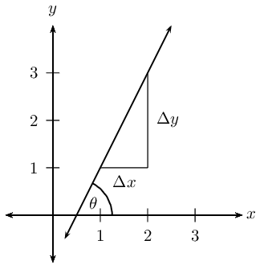
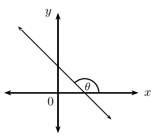
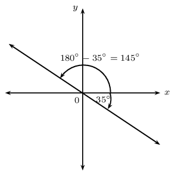
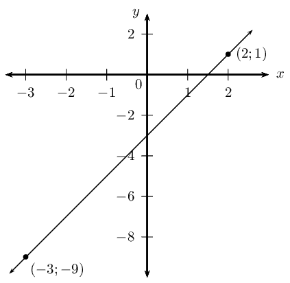
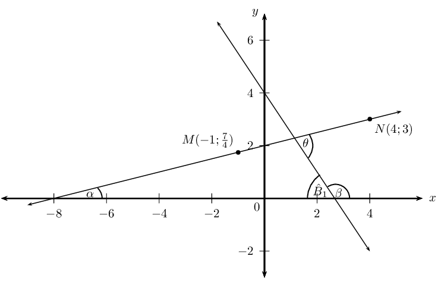
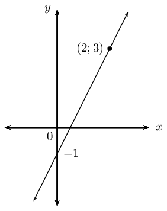
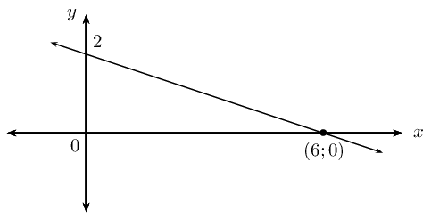
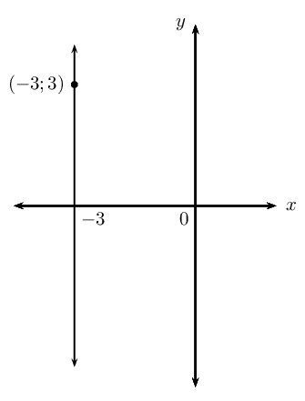

## 4.3 Inclination of a line (EMBGD)

The diagram shows that a straight line makes an angle \(\theta\) with the positive \(x\)-axis. This is called
            the **angle of inclination** of a straight line.

We notice that if the gradient changes, then the value of \(\theta\) also changes, therefore the angle of
            inclination of a line is related to its gradient. We know that gradient is the ratio of a change in the
            \(y\)-direction to a change in the \(x\)-direction:

        \[m=\frac{\Delta y}{\Delta x}\]

From trigonometry we know that the tangent function is defined as the ratio:

\[\tan \theta = \frac{\text{opposite side}}{\text{adjacent side}}\]

And from the diagram we see that

\begin{align*}
            \tan \theta &= \dfrac{\Delta y}{\Delta x} \\
            \therefore m &= \tan \theta \qquad \text{ for } \text{0}\text{°} \leq \theta <
            \text{180}\text{°}
            \end{align*}

Therefore the gradient of a straight line is equal to the tangent of the angle formed between the line and
            the positive direction of the \(x\)-axis.

**Vertical lines**

- \(\theta = \text{90}\text{°}\)
- Gradient is undefined since there is no change in the \(x\)-values (\(\Delta x = 0\)).
- Therefore \(\tan \theta\) is also undefined (the graph of \(\tan \theta\) has an asymptote at \(\theta =
                  \text{90}\text{°}\)).

**Horizontal lines**

- \(\theta = \text{0}\text{°}\)
- Gradient is equal to \(\text{0}\) since there is no change in the \(y\)-values (\(\Delta y = 0\)).
- Therefore \(\tan \theta\) is also equal to \(\text{0}\) (the graph of \(\tan \theta\) passes through the
                  origin \((\text{0}\text{°};0))\).

**Lines with negative gradients**

If a straight line has a negative gradient (\(m < 0\), \(\tan \theta < 0\)), then the angle formed
            between the line and the positive direction of the \(x\)-axis is obtuse.

From the CAST diagram in trigonometry, we know that the tangent function is negative in the second and fourth
            quadrant. If we are calculating the angle of inclination for a line with a negative gradient, we must add
            \(\text{180}\text{°}\) to change the negative angle in the fourth quadrant to an obtuse angle in the
            second quadrant:

If we are given a straight line with gradient \(m = -\text{0,7}\), then we can determine the angle of
            inclination using a calculator:

\begin{align*}
            \tan \theta &= m \\
            &= -\text{0,7} \\
            \therefore \theta &= \tan^{-1}(-\text{0,7}) \\
            &= -\text{35,0}\text{°}
            \end{align*}

This negative angle lies in the fourth quadrant. We must add \(\text{180}\)\(\text{°}\) to get an obtuse
            angle in the second quadrant:

\begin{align*}
            \theta &= -\text{35,0}\text{°} + \text{180}\text{°} \\
            &= \text{145}\text{°}
            \end{align*}

And we can always use our calculator to check that the obtuse angle \(\theta = \text{145}\text{°}\)
            gives a gradient of \(m = -\text{0,7}\).

## Angle of inclination

### Textbook Exercise 4.5

Determine the gradient (correct to \(\text{1}\) decimal place) of each of the following
                            straight lines, given that the angle of inclination is equal to:

**Problem:**
\(\text{60}\text{°}\)

**Solution:**
\begin{align*}
                            m &= \tan \theta \\
                            &= \tan \text{60}\text{°} \\
                            \therefore m &= \text{1,7}
                            \end{align*}

**Problem:**
\(\text{135}\text{°}\)

**Solution:**
\begin{align*}
                            m &= \tan \theta \\
                            &= \tan \text{135}\text{°} \\
                            \therefore m &= -\text{1}
                            \end{align*}

**Problem:**
\(\text{0}\text{°}\)

**Solution:**
\begin{align*}
                            m &= \tan \theta \\
                            &= \tan \text{0}\text{°} \\
                            \therefore m &= \text{0}
                            \end{align*}

**Problem:**
\(\text{54}\text{°}\)

**Solution:**
\begin{align*}
                            m &= \tan \theta \\
                            &= \tan \text{54}\text{°} \\
                            \therefore m &= \text{1,4}
                            \end{align*}

**Problem:**
\(\text{90}\text{°}\)

**Solution:**
\begin{align*}
                            m &= \tan \theta \\
                            &= \tan \text{90}\text{°} \\
                            \therefore m & \text{ is undefined}
                            \end{align*}

**Problem:**
\(\text{45}\text{°}\)

**Solution:**
\begin{align*}
                            m &= \tan \theta \\
                            &= \tan \text{45}\text{°} \\
                            \therefore m &= \text{1}
                            \end{align*}

**Problem:**
\(\text{140}\text{°}\)

**Solution:**
\begin{align*}
                            m &= \tan \theta \\
                            &= \tan \text{140}\text{°} \\
                            \therefore m &= -\text{0,8}
                            \end{align*}

**Problem:**
\(\text{180}\text{°}\)

**Solution:**
\begin{align*}
                            m &= \tan \theta \\
                            &= \tan \text{180}\text{°} \\
                            \therefore m &= \text{0}
                            \end{align*}

**Problem:**
\(\text{75}\text{°}\)

**Solution:**
\begin{align*}
                            m &= \tan \theta \\
                            &= \tan \text{75}\text{°} \\
                            \therefore m &= \text{3,7}
                            \end{align*}

Determine the angle of inclination (correct to \(\text{1}\) decimal place) for each of the
                            following:

**Problem:**
a line with \(m = \dfrac{3}{4}\)

**Solution:**
\begin{align*}
                            \tan \theta &= m \\
                            &= \frac{3}{4} \\
                            \theta &= \tan^{-1} \left( \text{0,75} \right) \\
                            \therefore \theta &= \text{36,8}\text{°}
                            \end{align*}

**Problem:**
\(2y - x = 6\)

**Solution:**
\begin{align*}
                            2y - x &= 6 \\
                            2y &= x + 6 \\
                            y &= \frac{1}{2}x + 3 \\
                            \tan \theta &= m \\
                            &= \frac{1}{2} \\
                            \theta &= \tan^{-1} \left( \text{0,5} \right) \\
                            \therefore \theta &= \text{26,6}\text{°}
                            \end{align*}

**Problem:**
the line passes through the points \((-4;-1)\) and \((2;5)\)

**Solution:**
\begin{align*}
                            m &= \frac{y_2 - y_1}{x_2 - x_1} \\
                            &= \frac{5 + 1}{2 + 4} \\
                            &= \frac{6}{6} \\
                            \therefore m &= 1 \\
                            \tan \theta &= 1 \\
                            \theta &= \tan^{-1} \left( \text{1} \right) \\
                            \therefore \theta &= \text{45}\text{°}
                            \end{align*}

**Problem:**
\(y=4\)

**Solution:**
Horizontal line

**Problem:**
\(x = 3y + \frac{1}{2}\)

**Solution:**
\begin{align*}
                            x &= 3y + \frac{1}{2} \\
                            x - \frac{1}{2} &= 3y \\
                            \frac{1}{3}x - \frac{1}{6} &= y \\
                            \therefore m &= \frac{1}{3} \\
                            \theta &= \tan^{-1} \left( \frac{1}{3} \right) \\
                            \therefore \theta &= \text{18,4}\text{°}
                            \end{align*}

**Problem:**
\(x=-\text{0,25}\)

**Solution:**
Vertical line

**Problem:**
the line passes through the points \((2;5)\) and \((\frac{2}{3};1)\)

**Solution:**
\begin{align*}
                            m &= \frac{y_2 - y_1}{x_2 - x_1} \\
                            &= \frac{1 - 5}{\frac{2}{3} -2} \\
                            &= \frac{-4}{-\frac{4}{3}} \\
                            \therefore m &= 3 \\
                            \theta &= \tan^{-1} \left( \text{3} \right) \\
                            \therefore \theta &= \text{71,6}\text{°}
                            \end{align*}

**Problem:**
a line with gradient equal to \(\text{0,577}\)

**Solution:**
\begin{align*}
                            m &= \text{0,577} \\
                            \theta &= \tan^{-1} \left( \text{0,577} \right) \\
                            \therefore \theta &= \text{30}\text{°}
                            \end{align*}

<Callout type="tip" title="Worked example 8: Inclination of a straight line">
**Question:**
Determine the angle of inclination (correct to \(\text{1}\) decimal place) of the straight line
                    passing through the points \((2;1)\) and \((-3;-9)\).

**Draw a sketch:**

**Assign variables to the coordinates of the given points:**
\[x_1 = 2; \qquad y_1 = 1; \qquad x_2 = -3; \qquad y_2 = -9\]

**Determine the gradient of the line:**
\begin{align*}
                    m &= \frac{y_2 - y_1}{x_2 - x_1} \\
                    &= \frac{-9-1}{-3-2} \\
                    &= \frac{-10}{-5} \\
                    \therefore m &= 2
                    \end{align*}

**Use the gradient to determine the angle of inclination of the line:**
\begin{align*}
                    \tan \theta &= m \\
                    &= 2\\
                    \therefore \theta &= \tan^{-1}2\\
                    &= \text{63,4}\text{°}
                    \end{align*}

**Important:** make sure your calculator is in DEG (degrees) mode.

**Write the final answer:**
The angle of inclination of the straight line is \(\text{63,4}\)\(\text{°}\).
</Callout>

<QuizCard id="m11-04-03b" title="Interactive Exercise 4.6" question="Consider the diagram below, which shows a line through the points: \( A \left( 3 \, ; \dfrac{7}{2} \right) \) and \( B \left( -8 \, ; -2 \right) \) . Calculate the inclination of the line, which is the angle \(\theta\) . INSTRUCTION: Round your answer to two decimal places if appropriate." options=[] answer=" 26.57 " hint="You should enter a number here. If you want to, you can use a space to separate thousands.                Example: 12 800,25 For scientific notation you need to use the multiply symbol                ( ∗ ) and the exponent symbol ( ^ ). For example 6,673 × 10 −11 should be written as: 6,673 ∗ 10^−11" explanation="Find the gradient of the line We need to find the inclination of the line. The inclination is the angle between the line and the positive \(x\) -axis. This is shown by the angle \( \theta \) in the diagram. The inclination of a line is directly related to the line's gradient: both represent the steepness of the line. (For an explanation about the connection between the gradient and the inclination, you can read here .) So to find the inclination, we need the gradient of the line. \[                     \begin{aligned}                     m & = \frac{y_2 - y_1}{x_2 - x_1} \\                     & = \frac{\left( -2 \right) - \left( \frac{7}{2} \right)}{\left( -8 \right) - \left( 3 \right)}  \\                      & = \frac{1}{2}                     \end{aligned}                 \] Calculate the inclination using the inclination formula Now we can calculate the inclination of the line. We do this using the following equation: \[                     \begin{aligned}                     m & = \tan\theta \\                     \therefore \theta & = \tan^{-1}(m) \\                     & = \tan^{-1} \left( \frac{1}{2} \right) \\ & = \text{26,56505...}\text{°} \\ &  \approx                     \text{26,57}\text{°}                     \end{aligned}                 \] Adjust the answer if necessary If the gradient is negative we must add \(\text{180}\text{°}\) to the above value to get an obtuse angle. In this case, the gradient, and the angle we got above, is positive . \[                     \begin{aligned}                      \theta & \approx \text{26,57}\text{°}                     \end{aligned}                 \] The inclination of the line is \(\text{26,57}\) \(\text{°}\) . Submit your answer as:" />

<Callout type="tip" title="Worked example 9: Inclination of a straight line">
**Question:**
Determine the equation of the straight line passing through the point \((3;1)\) and with an angle of
                    inclination of \(\text{135}\text{°}\).

**Use the angle of inclination to determine the gradient of the line:**
\begin{align*}
                    m &= \tan \theta \\
                    &= \tan \text{135}\text{°} \\
                    \therefore m &= -1
                    \end{align*}

**Write down the gradient–point form of the straight line equation:**
\[y - y_1 = m(x - x_1)\]

Substitute \(m = -1\)

\[y - y_1 = -(x - x_1)\]

Substitute the given point \((3;1)\)

\begin{align*}
                    y - 1 & = -(x - 3) \\
                    y & = -x + 3 +1 \\
                    &= -x + 4
                    \end{align*}

**Write the final answer:**
The equation of the straight line is \(y = -x + 4\).
</Callout>

<QuizCard id="m11-04-03c" title="Interactive Exercise 4.7" question="The diagram below shows a line on the Cartesian plane. The line passes through the point \(A(5\, ;-7)\) . The line has an angle of inclination \(\theta = \text{123,69}\text{°}\) . Determine the equation of the line. INSTRUCTIONS: Give only the right side of the equation, following \(y = ...\) Round the values in the equation to two decimal places if necessary." options=[] answer=" ['-1.5*x + 0.5', '-3*x/2 + 1/2', '-3*x/2 + 0.5', '-1.5*x + 0.5'] " hint="Your answer should be a mathematical expression. You can use the following symbols to write mathematical expressions: add: + subtract: − multiply: ∗ divide: / exponent: ^ The following special symbols are also recognised: pi (π): pi infinity (∞): oo It is also possible to write certain functions: √: sqrt( ) log: log( ) sin: sin( ) cosec: cosec( ) cos: cos( ) sec: sec( ) tan: tan( ) cot: cot( ) To write a logarithm with a specific base, use the underscore _ symbol.                For example, log of x base 3 can be written as: log_3 x" explanation="Use the inclination to find the gradient of the line This question is about finding the equation of a straight line. We know one point on the line and                     the line's inclination. The equation of the line will have the form \(y = mx + c\) . So we need to find the gradient, \(m\) , and the \(y\) -intercept, \(c\) . The inclination of a line tells us about the steepness of the line so it is similar to the gradient.                     In fact, inclination and gradient are directly related to each other. We can use the following                     equation to calculate the gradient from the inclination. \[                     \begin{aligned}                     m & = \tan \theta \\                     & = \tan \left( \text{123,69}\text{°} \right) \\                     & = -\text{1,50000...} \\ & \approx -\text{1,5}                     \end{aligned}                 \] The gradient is approximately \(-\text{1,5}\) (remember that the instructions state that we should round the values to 2 decimal places). Note that the gradient is negative, which agrees with the slope of the graph. Put the gradient into the equation Now we recall the general form of the equation of a straight line. Since we know the gradient \(m\) of the line, we can substitute that into the equation of the line: \[\begin{array}{c}y = \left( -\text{1,5} \right)x + c\end{array}\] Use the point to find the \(y\) -intercept Now we can calculate the value of the \(y\) -intercept of the line (the value of \(c\) ). We do this by substituting the coordinates of any point on the line into the                     general form for the line from above. Since we know the coordinates of point \(A\) , we will use those coordinates, which are \((5\, ;-7)\) . \[                     \begin{aligned}                     y & = -\text{1,5} x + c \\                     \left( -7 \right) & = -\text{1,5}                     \left( 5 \right) + c \\                     \text{0,5} & = c                     \end{aligned}                 \] Remember that this number should be the \(y\) -intercept of the graph.                     As with the gradient, we can compare this answer to the graph to check if they agree:                     does the graph up above have a \(y\) -intercept close to \(\text{0,5}\) \(?\) Yes! Write the complete equation We now have the gradient and the \(y\) -intercept of the line.                     The equation of the line is: \[\begin{array}{c}y = -\text{1,5}x +                     \text{0,5}\end{array}\] Submit your answer as:" />

<Callout type="tip" title="Worked example 10: Inclination of a straight line">
**Question:**
Determine the acute angle (correct to \(\text{1}\) decimal place) between the line passing through
                    the points \(M(-1;1\frac{3}{4})\) and \(N(4;3)\) and the straight line \(y = - \frac{3}{2}x + 4\).

**Draw a sketch:**
Draw the line through points \(M(-1;1\frac{3}{4})\) and \(N(4;3)\) and the line \(y = - \frac{3}{2}x
                    + 4\) on a suitable system of axes. Label \(\alpha\) and \(\beta\), the angles of inclination of the
                    two lines. Label \(\theta\), the acute angle between the two straight lines.

Notice that \(\alpha\) and \(\theta\) are acute angles and \(\beta\) is an obtuse angle.

                \[\begin{array}{rll}
                \hat{B}_1 &= \text{180}\text{°} - \beta & (\angle \text{ on str. line}) \\
                \text{and } \theta &= \alpha + \hat{B}_1 \quad & (\text{ext. } \angle \text{ of } \triangle =
                \text{ sum int. opp}) \\
                \therefore \theta &= \alpha + (\text{180}\text{°} - \beta) \\
                &= \text{180}\text{°} + \alpha - \beta
                \end{array}\]

**Use the gradient to determine the angle of inclination \(\beta\):**
From the equation \(y = -\frac{3}{2}x + 4\) we see that \(m < 0\), therefore \(\beta\) is an
                    obtuse angle such that \(\text{90}\text{°} < \beta < \text{180}\text{°}\).

                \begin{align*}
                \tan \beta &= m\\
                &= -\frac{3}{2} \\
                \tan^{-1} \left(-\frac{3}{2}\right) &= -\text{56,3}\text{°}
                \end{align*}

This negative angle lies in the fourth quadrant. We know that the angle of inclination \(\beta\) is
                    an obtuse angle that lies in the second quadrant, therefore

                \begin{align*}
                \beta &= -\text{56,3}\text{°} + \text{180}\text{°}\\
                &= \text{123,7}\text{°}
                \end{align*}

**Determine the gradient and angle of inclination of the line through \(M\) and \(N\):**
Determine the gradient
                    \begin{align*}
                    m & = \frac{y_2 - y_1}{x_2 - x_1} \\
                    & = \dfrac{3 - \frac{7}{4}}{4-(-1)} \\
                    & = \dfrac{\frac{5}{4}}{5} \\
                    &= \frac{1}{4}
                    \end{align*}

Determine the angle of inclination
                    \begin{align*}
                    \tan \alpha & = m\\
                    & = \frac{1}{4} \\
                    \therefore \alpha & = \tan^{-1} \left( \frac{1}{4} \right) \\
                    &= \text{14,0}\text{°}
                    \end{align*}

**Write the final answer:**
\begin{align*}
                    \theta & = \text{180}\text{°} + \alpha - \beta \\
                    & = \text{180}\text{°} + \text{14,0}\text{°} - \text{123,7}\text{°} \\
                    & = \text{70,3}\text{°}
                    \end{align*}

The acute angle between the two straight lines is \(\text{70,3}\)\(\text{°}\).
</Callout>

<QuizCard id="m11-04-03d" title="Interactive Exercise 4.8" question="Given that \(E\) , \(G\) , and \(F\) are collinear points, calculate the value of \(n\) ." options=[] answer="3" hint="You should enter a number here. If you want to, you can use a space to separate thousands.                Example: 12 800,25 For scientific notation you need to use the multiply symbol                ( ∗ ) and the exponent symbol ( ^ ). For example 6,673 × 10 −11 should be written as: 6,673 ∗ 10^−11" explanation="Equate the gradients of \(EF\) and \(FG\) \[                     \begin{aligned}                         m_{EF} &= m_{FG} \\[0.2cm]                         \frac{\text{0}-\text{5}}{n-\text{0}} &= \frac{(-\text{5})-\text{5}}{\text{6}-\text{0}} \\[0.2cm]                         \frac{-\text{5}}{n} &= \frac{-\text{10}}{\text{6}} \\[0.2cm]                         n &= \text{3}                      \end{aligned}                 \] Submit your answer as:" />

## Inclination of a straight line

### Textbook Exercise 4.6

Determine the angle of inclination for each of the following:

**Problem:**
a line with \(m = \dfrac{4}{5}\)

**Solution:**
\begin{align*}
                            m &= \frac{4}{5} \\
                            \theta &= \tan^{-1} \left( \frac{4}{5} \right) \\
                            \therefore \theta &= \text{38,7}\text{°}
                            \end{align*}

**Problem:**
\(x + y + 1 = 0\)

**Solution:**
\begin{align*}
                            x + y + 1 &= 0 \\
                            y &= -x - 1\\
                            m &= -1 \\
                            \theta &= \tan^{-1} \left( -1 \right) \\
                            &= -\text{45}\text{°} \\
                            \therefore \theta &= \text{180}\text{°} - \text{45}\text{°} \\
                            \therefore \theta &= \text{135}\text{°}
                            \end{align*}

**Problem:**
a line with \(m = \text{5,69}\)

**Solution:**
\begin{align*}
                            m &= \text{5,69} \\
                            \theta &= \tan^{-1} \left( \text{5,69} \right) \\
                            \therefore \theta &= \text{80}\text{°}
                            \end{align*}

**Problem:**
the line that passes through \((1;1)\) and \((-2;7)\)

**Solution:**
\begin{align*}
                            m &= \frac{y_2 -y_1}{x_2 - x_1} \\
                            &= \frac{7-1}{-2-1} \\
                            &= \frac{6}{-3} \\
                            \therefore m &= -\text{2} \\
                            \theta &= \tan^{-1} \left( -\text{2} \right) \\
                            &= -\text{63,4}\text{°} \\
                            \therefore \theta &= \text{180}\text{°} - \text{63,4}\text{°} \\
                            \therefore \theta &= \text{80}\text{°}
                            \end{align*}

**Problem:**
\(3 - 2y = 9x\)

**Solution:**
\begin{align*}
                            3 - 2y &= 9x \\
                            3 - 9x &= 2y \\
                            \frac{3}{2} - \frac{9}{2}x &= y \\
                            \therefore m &= - \frac{9}{2} \\
                            \theta &= \tan^{-1} \left( - \frac{9}{2} \right) \\
                            &= -\text{77,5}\text{°} \\
                            \therefore \theta &= \text{180}\text{°} - \text{77,5}\text{°} \\
                            \therefore \theta &= \text{102,5}\text{°}
                            \end{align*}

**Problem:**
the line that passes through \((-1;-6)\) and \((-\frac{1}{2};-\frac{11}{2})\)

**Solution:**
\begin{align*}
                            m &= \frac{y_2 -y_1}{x_2 - x_1} \\
                            &= \frac{-\frac{11}{2}+ 6}{-\frac{1}{2}+1} \\
                            &= \frac{\frac{1}{2}}{\frac{1}{2}} \\
                            \therefore m &= 1 \\
                            \theta &= \tan^{-1} \left( 1 \right) \\
                            \therefore \theta &= \text{45}\text{°}
                            \end{align*}

**Problem:**
\(5 = 10y - 15x\)

**Solution:**
\begin{align*}
                            5 &= 10y - 15x \\
                            5 + 15x &= 10y \\
                            \frac{1}{2} + \frac{3}{2}x &= y \\
                            \therefore m &= \frac{3}{2} \\
                            \theta &= \tan^{-1} \left( \frac{3}{2} \right) \\
                            \therefore \theta &= \text{56,3}\text{°}
                            \end{align*}

**Problem:**

**Solution:**
\begin{align*}
                            m &= \frac{y_2 -y_1}{x_2 - x_1} \\
                            &= \frac{3 + 1}{2 - 0} \\
                            &= \frac{4}{2} \\
                            \therefore m &= 2 \\
                            \theta &= \tan^{-1} \left( 2 \right) \\
                            \therefore \theta &= \text{63,4}\text{°}
                            \end{align*}

**Problem:**

**Solution:**
\begin{align*}
                            m &= \frac{y_2 -y_1}{x_2 - x_1} \\
                            &= \frac{2 - 0}{0 - 6} \\
                            &= \frac{2}{-6} \\
                            \therefore m &= -\frac{1}{3} \\
                            \theta &= \tan^{-1} \left( -\frac{1}{3} \right) \\
                            \therefore \theta &= -\text{18,4}\text{°} \\
                            \therefore \theta &= \text{180}\text{°} - \text{18,4}\text{°} \\
                            \therefore \theta &= \text{161,6}\text{°}
                            \end{align*}

**Problem:**

**Solution:**
Gradient undefined

**Problem:**
Determine the acute angle between the line passing through the points \(A(-2;\frac{1}{5})\)
                            and \(B(0;1)\) and the line passing through the points \(C(1;0)\) and \(D(-2;6)\).

**Solution:**
Let the angle of inclination for the line \(AB\) be \(\beta\) and let the angle of
                            inclination for the line \(CD\) be \(\alpha\). Let the angle between the two lines be
                            \(\theta\):

                        \begin{align*}
                        m_{AB} &= \frac{y_2 -y_1}{x_2 - x_1} \\
                        &= \frac{1 - \frac{1}{5}}{0 + 2} \\
                        &= \frac{\frac{4}{5}}{2} \\
                        \therefore m &= \frac{4}{10} \\
                        &= \frac{2}{5} \\
                        \beta &= \tan^{-1} \left( \frac{2}{5} \right) \\
                        \therefore \beta &= \text{21,8}\text{°} \\
                        m_{CD} &= \frac{y_2 -y_1}{x_2 - x_1} \\
                        &= \frac{6 - 0}{-2-1} \\
                        &= \frac{6}{-3} \\
                        \therefore m &= -2 \\
                        \alpha &= \tan^{-1} \left( -2 \right) \\
                        \therefore \alpha &= -\text{63,4}\text{°} \\
                        \therefore \alpha &= \text{180}\text{°} - \text{63,4}\text{°} \\
                        \therefore \alpha &= \text{116,6}\text{°} \\
                        \text{And } \theta &= \beta + (\text{180}\text{°} - \alpha) \quad (\text{ext. } \angle
                        \triangle) \\
                        \therefore \theta &= \text{21,8}\text{°} + (\text{180}\text{°} -
                        \text{116,6}\text{°} ) \\
                        &= \text{85,2}\text{°}
                        \end{align*}

**Problem:**
Determine the angle between the line \(y + x = 3\) and the line \(x = y + \frac{1}{2}\).

**Solution:**
Let the angle of inclination for the line \(y + x = 3\) be \(\alpha\) and let the angle of
                            inclination for the line \(x = y + \frac{1}{2}\) be \(\beta\). Let the angle between the two
                            lines be \(\theta\):

                        \begin{align*}
                        y &= - x + 3 \\
                        \therefore m &= - 1 \\
                        \alpha &= \tan^{-1} \left( -1\right) \\
                        \therefore \alpha &= -\text{45}\text{°} \\
                        \therefore \alpha &= \text{180}\text{°} - \text{45}\text{°} \\
                        \therefore \alpha &= \text{135}\text{°} \\
                        x &= y + \frac{1}{2} \\
                        x - \frac{1}{2} &= y \\
                        \therefore m &= 1 \\
                        \beta &= \tan^{-1} \left(1 \right) \\
                        \therefore \beta &= \text{45}\text{°} \\
                        \text{And } \theta &= \beta + (\text{180}\text{°} - \alpha) \quad (\text{ext. } \angle
                        \triangle) \\
                        \therefore \theta &= \text{45}\text{°} + (\text{180}\text{°} -
                        \text{135}\text{°} ) \\
                        &= \text{90}\text{°}
                        \end{align*}

**Problem:**
Find the angle between the line \(y = 2x\) and the line passing through the points
                            \((-1;\frac{7}{3})\) and \((0;2)\).

**Solution:**
Let the angle of inclination for the line \(y = 2x\) be \(\beta\) and let the angle of
                            inclination for the other line be \(\alpha\). Let the angle between the two lines be
                            \(\theta\):

                        \begin{align*}
                        y &= 2x \\
                        \therefore m &= 2 \\
                        \beta &= \tan^{-1} \left( 2 \right) \\
                        \therefore \beta &= \text{63,4}\text{°} \\
                        m &= \frac{y_2 -y_1}{x_2 - x_1} \\
                        &= \frac{2 - \frac{7}{3}}{0 + 1} \\
                        &= \frac{-\frac{1}{3}}{1} \\
                        \therefore m &= -\frac{1}{3} \\
                        \therefore \alpha &= -\text{18,4}\text{°} \\
                        \therefore \alpha &= \text{180}\text{°} - \text{18,4}\text{°} \\
                        \therefore \alpha &= \text{161,6}\text{°} \\
                        \text{And } \theta &= \beta + (\text{180}\text{°} - \alpha) \quad (\text{ext. } \angle
                        \triangle) \\
                        \therefore \theta &= \text{63,4}\text{°} + (\text{180}\text{°} -
                        \text{161,6}\text{°} ) \\
                        &= \text{81,8}\text{°}
                        \end{align*}
