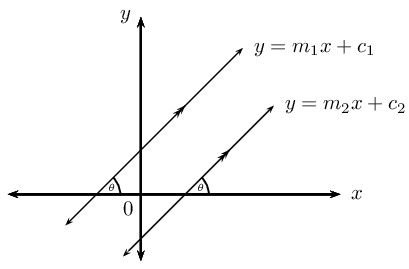
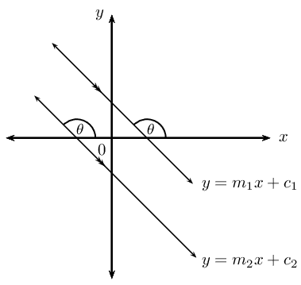
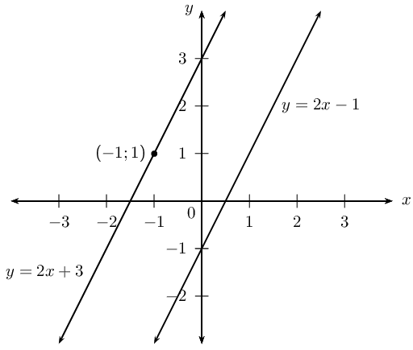
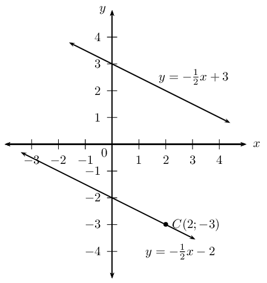

## 4.4 Parallel lines (EMBGF)

## Parallel lines

2. Draw a sketch of the line passing through the points \(P(-1;0)\) and \(Q(1;4)\) and the line passing through
             the points \(R(1;2)\) and \(S(2;4)\).
4. Label and measure \(\alpha\) and \(\beta\), the angles of inclination of straight lines \(PQ\) and \(RS\)
             respectively.
6. Describe the relationship between \(\alpha\) and \(\beta\).
8. “\(\alpha\) and \(\beta\) are alternate angles, therefore \(PQ \parallel RS\).” Is this a true
             statement? If not, provide a correct statement.
10. Use your calculator to determine \(\tan \alpha\) and \(\tan \beta\).
12. Complete the sentence: \(\ldots \ldots\) lines have \(\ldots \ldots\) angles of inclination.
14. Determine the equations of the straight lines \(PQ\) and \(RS\).
16. What do you notice about \(m_{PQ}\) and \(m_{RS}\)?
18. Complete the sentence: \(\ldots \ldots\) lines have \(\ldots \ldots\) gradients.

Another method of determining the equation of a straight line is to be given a point on the unknown line,
      \(\left({x}_{1};{y}_{1}\right)\), and the equation of a line which is parallel to the unknown line.

Let the equation of the unknown line be \(y = m_1x + c_1\) and the equation of the given line be \(y = m_2x +
      c_2\).

If the two lines are parallel then

\[m_1 = m_2\]

**Important:** when determining the gradient of a line using the coefficient of \(x\), make sure the
      given equation is written in the gradient–intercept (standard) form.

    \[y=mx+c\]

Substitute the value of \(m_2\) and the given point \(\left({x}_{1};{y}_{1}\right)\), into the
      gradient–intercept form of a straight line equation

\[y - y_1 = m(x - x_1)\]

and determine the equation of the unknown line.

<Callout type="tip" title="Worked example 11: Parallel lines">
**Question:**
Determine the equation of the line that passes through the point \((-1;1)\) and is parallel to the line \(y -
          2x + 1 = 0\).

**Write the equation in gradient–intercept form:**
We write the given equation in gradient–intercept form and determine the value of \(m\).

\[y = 2x - 1\]

We know that the two lines are parallel, therefore \(m_1 = m_2 = 2\).

**Write down the gradient–point form of the straight line equation:**
\[y - y_1 = m(x - x_1)\]

Substitute \(m = 2\)

\[y - y_1 = 2(x - x_1)\]

Substitute the given point \((-1;1)\)

\begin{align*}
          y - 1 & = 2(x - (-1)) \\
          y - 1& = 2x + 2\\
          y & = 2x + 2 + 1\\
          &= 2x + 3
          \end{align*}

A sketch was not required, but it is always helpful and can be used to check answers.

**Write the final answer:**
The equation of the straight line is \(y = 2x + 3\).
</Callout>

<QuizCard id="m11-04-04a" title="Interactive Exercise 4.10" question="What is the equation of a line which is parallel to \( y = \dfrac{3 x}{2} + 5 \) and passes through the point \( A \left( -4 \, ; 2 \right) \) ? INSTRUCTION: Type the entire equation in standard form into the answer box. This will look like y = mx + c or, if the line is vertical, x = c." options=[] answer=" y = 3*x/2 + 8 " hint="Your answer should be a mathematical equation. Here is an example of a famous                equation: E = mc^2 You can use the following symbols to write equations: add: + subtract: − multiply: ∗ divide: / exponent: ^ The following special symbols are also recognised: pi (π): pi infinity (∞): oo It is also possible to write certain functions: √: sqrt( ) log: log( ) sin: sin( ) cosec: cosec( ) cos: cos( ) sec: sec( ) tan: tan( ) cot: cot( ) To write a logarithm with a specific base, use the underscore _ symbol.                For example, log of x base 3 can be written as: log_3 x" explanation="Find the gradient of the line We have the equation \( y = \frac{3 x}{2} + 5 \) and we need to find the equation of another line which is parallel to it.                      And the line we want passes through the point \( A \left( -4 \, ; 2 \right) \) . We can start by finding the gradient of the line, because the two lines are parallel. That means they have equal gradients. We can take the gradient of the first line directly from the equation: the gradient for this line is \( m = \frac{3}{2} \) . The gradient of the line we want is also \( m = \frac{3}{2} \) . Find the \(y\) -intercept of the equation Now use the given point \( \left(-4 \, ; 2\right) \) together with the gradient to get the equation of the line we want. Substitute the \(x\) and \(y\) values into the equation and work out the value of the \(y\) -intercept, \(c\) . \[                     \begin{aligned}                     y & = \left(\frac{3}{2}\right)x + c \quad \leftarrow \quad ^{\text{Use the gradient}}_{\text{value from above}}	\\                  (2) & = \frac{3}{2} (-4) + c 	\\                  2 & = -6 + c 	\\                  8 & =  c                      \end{aligned}                 \] Write the equation of the line Now we can write the equation. Put the gradient and the \(y\) -intercept into the standard form equation to get: \[\begin{array}{c}y = \frac{3 x}{2} + 8\end{array}\] The graph below shows the two equations from this question. The blue line is the equation given in the question, and the red line is the answer.                      The point \( A \left( -4 \, ; 2 \right) \) is shown with a black dot.                      Notice that the red line passes through the point just like it is supposed to! It is also clear that  the two lines are parallel. The equation of the line is: \( y = \dfrac{3 x}{2} + 8 \) . Submit your answer as:" />

<Callout type="tip" title="Worked example 12: Parallel lines">
**Question:**
Line \(AB\) passes through the point \(A(0;3)\) and has an angle of inclination of
          \(\text{153,4}\)\(\text{°}\). Determine the equation of the line \(CD\) which passes through the point
          \(C(2;-3)\) and is parallel to \(AB\).

**Use the given angle of inclination to determine the gradient:**
\begin{align*}
        m_{AB} & = \tan \theta \\
        & = \tan \text{153,4}\text{°} \\
        & = -\text{0,5}
        \end{align*}

**Parallel lines have equal gradients:**
Since we are given \(AB \parallel CD\),

\[m_{CD} = m_{AB} = -\text{0,5}\]

**Write down the gradient–point form of a straight line equation:**
\[y - y_1 = m(x - x_1)\]

Substitute the gradient \(m_{CD} = -\text{0,5}\).

\[y - y_1 = -\frac{1}{2}(x - x_1)\]

Substitute the given point \((2;-3)\).

\begin{align*}
          y - (-3) & = -\frac{1}{2}(x - 2) \\
          y + 3 & = -\frac{1}{2}x + 1\\
          y & = -\frac{1}{2}x - 2
          \end{align*}

A sketch was not required, but it is always useful.

**Write the final answer:**
The equation of the straight line is \(y = -\frac{1}{2}x - 2\).
</Callout>

<Callout type="note" title="Note">
<VideoPlayer src="http://www.khanacademy.org/embed_video?v=T-aCweuimis" title="Video: 22N3" />
</Callout>

## Parallel lines

### Textbook Exercise 4.7

Determine whether or not the following two lines are parallel:

**Problem:**
\(y + 2 x = 1\) and \(-2x + 3 = y\)

**Solution:**
\begin{align*}
              y + 2 x &= 1 \\
              y &= -2x + 1 \\
              \therefore m_1 &= -2 \\
              -2x + 3 &= y \\
              \therefore m_2 &= -2 \\
              \therefore m_1 &= m_2
              \end{align*}

\(\therefore\)Parallel lines.

**Problem:**
\(\frac{y}{3} + x + 5 = 0\) and \(2y + 6x = 1\)

**Solution:**
\begin{align*}
              \frac{y}{3} + x + 5 &= 0\\
              \frac{y}{3} &= -x - 5 \\
              y &= -3x - 15 \\
              \therefore m_1 &= -3 \\
              2y + 6x &= 1 \\
              2y &= -6x + 1 \\
              y &= -3x + \frac{1}{3} \\
              \therefore m_2 &= -3 \\
              \therefore m_1 &= m_2
              \end{align*}

\(\therefore\)Parallel lines.

**Problem:**
\(y = 2x - 7\) and the line passing through \((1;-2)\) and \((\frac{1}{2};-1)\)

**Solution:**
\begin{align*}
              y &= 2x - 7 \\
              \therefore m_1 &= 2 \\
              m_2 &= \frac{y_2 - y_1}{x_2 - x_1} \\
              &= \frac{-1 + 2}{\frac{1}{2} - 1} \\
              &= \frac{1}{\frac{1}{2}} \\
              \therefore m_2 &= 2 \\
              \therefore m_1 &= m_2
              \end{align*}

\(\therefore\)Parallel lines.

**Problem:**
\(y + 1 = x\) and \(x + y = 3\)

**Solution:**
\begin{align*}
              y + 1 &= x\\
              y &= x - 1 \\
              \therefore m_1 &= 1\\
              x + y &= 3 \\
              y &= -x + 3\\
              \therefore m_2 &= - \\
              \therefore m_1 & \ne m_2
              \end{align*}

\(\therefore\)Not parallel lines.

**Problem:**
The line passing through points \((-2;-1)\) and \((-4;-3)\) and the line \(-y + x - 4 = 0\)

**Solution:**
\begin{align*}
              - y + x - 4 &= 0 \\
              y &= x - 4 \\
              \therefore m_1 &= 1 \\
              m_2 &= \frac{y_2 - y_1}{x_2 - x_1} \\
              &= \frac{-3 + 1}{-4 + 2} \\
              &= \frac{-2}{-2} \\
              \therefore m_2 &= 1 \\
              \therefore m_1 &= m_2
              \end{align*}

\(\therefore\)Parallel lines.

**Problem:**
\(y - 1 = \frac{1}{3}x\) and the line passing through points \((-2;4)\) and \((1;5)\)

**Solution:**
\begin{align*}
              y - 1 &= \frac{1}{3}x \\
              y &= \frac{1}{3}x + 1 \\
              \therefore m_1 &= \frac{1}{3} \\
              m_2 &= \frac{y_2 - y_1}{x_2 - x_1} \\
              &= \frac{5 - 4}{1 + 2} \\
              &= \frac{1}{3} \\
              \therefore m_1 &= m_2
              \end{align*}

\(\therefore\)Parallel lines.

**Problem:**
Determine the equation of the straight line that passes through the point \((1;-5)\) and is parallel to
              the line \(y + 2x - 1 = 0\).

**Solution:**
\begin{align*}
            y + 2x - 1 &= 0 \\
            y &= -2x + 1 \\
            \therefore m &= -2 \\
            y - y_1&= m(x - x_1) \\
            y + 5 &= -2(x - 1) \\
            y &= -2x + 2 - 5 \\
            \therefore y &= -2x - 3
            \end{align*}

**Problem:**
Determine the equation of the straight line that passes through the point \((-2;-6)\) and is parallel to
              the line \(2y + 1 = 6x\).

**Solution:**
\begin{align*}
            2y + 1 &= 6x \\
            2y &= 6x - 1 \\
            y &= 3x - \frac{1}{2} \\
            \therefore m &= 3 \\
            y - y_1&= m(x - x_1) \\
            y + 6 &= 3(x + 2) \\
            y &= 3x + 6 - 6 \\
            \therefore y &= 3x
            \end{align*}

**Problem:**
Determine the equation of the straight line that passes through the point \((-2;-2)\) and is parallel to
              the line with angle of inclination \(\theta = \text{56,31}\text{°}\).

**Solution:**
\begin{align*}
            \theta &= \text{56,31}\text{°} \\
            \therefore m &= \tan \theta \\
            &= \tan \text{56,31}\text{°} \\
            \therefore m &= \text{1,5} \\
            y - y_1&= m(x - x_1) \\
            y + 2 &= \frac{3}{2}(x + 2) \\
            y &= \frac{3}{2}x + 3 - 2 \\
            \therefore y &= \frac{3}{2}x + 1
            \end{align*}

**Problem:**
Determine the equation of the straight line that passes through the point \((-2;\frac{2}{5})\) and is
              parallel to the line with angle of inclination \(\theta = \text{145}\text{°}\).

**Solution:**
\begin{align*}
            \theta &= \text{145}\text{°} \\
            \therefore m &= \tan \theta \\
            &= \tan \text{145}\text{°} \\
            \therefore m &= -\text{0,7} \\
            y - y_1&= m(x - x_1) \\
            y - \frac{2}{5} &= -\frac{7}{10}(x + 2) \\
            y &= -\frac{7}{10}x - \frac{7}{5} + \frac{2}{5} \\
            \therefore y &= -\frac{7}{10}x -1
            \end{align*}
