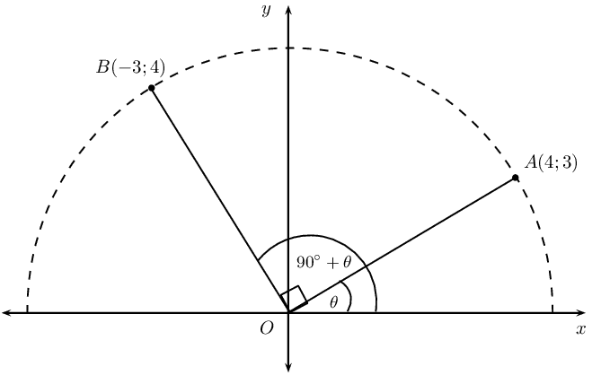
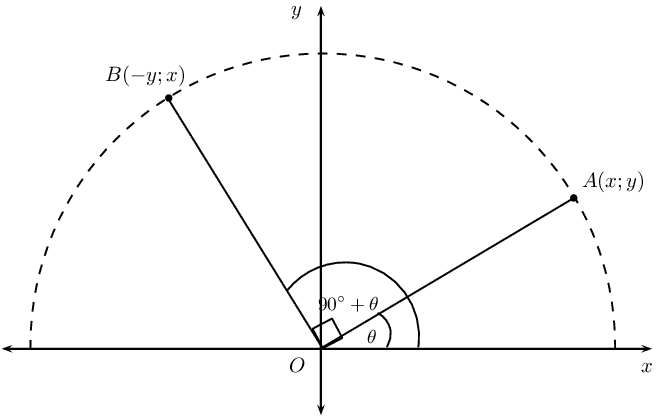
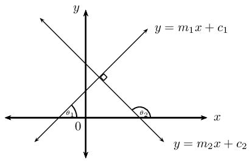
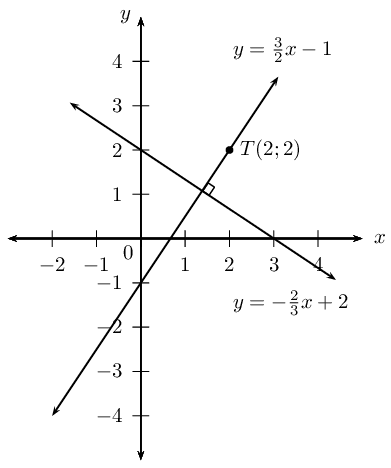

## 4.5 Perpendicular lines (EMBGG)

## Perpendicular lines

2. Draw a sketch of the line passing through the points \(A(-2;-3)\) and \(B(2;5)\) and the line passing
             through the points \(C(-1;\frac{1}{2})\) and \(D(4;-2)\).
4. Label and measure \(\alpha\) and \(\beta\), the angles of inclination of straight lines \(AB\) and \(CD\)
             respectively.
6. Label and measure \(\theta\), the angle between the lines \(AB\) and \(CD\).
8. Describe the relationship between the lines \(AB\) and \(CD\).
10. “\(\theta\) is a reflex angle, therefore \(AB \perp CD\).” Is this a true statement? If not,
             provide a correct statement.
12. Determine the equation of the straight line \(AB\) and the line \(CD\).
14. Use your calculator to determine \(\tan \alpha \times \tan \beta\).
16. Determine \(m_{AB} \times m_{CD}\).
18. What do you notice about these products?
20. Complete the sentence: if two lines are \(\ldots \ldots\) to each other, then the product of their \(\ldots
             \ldots\) is equal \(\ldots \ldots\)
22. Complete the sentence: if the gradient of a straight line is equal to the negative \(\ldots \ldots\) of the
             gradient of another straight line, then the two lines are \(\ldots \ldots\)

**Deriving the formula: \(m_1 \times m_2 = -1\)**

Consider the point \(A(4;3)\) on the Cartesian plane with an angle of inclination \(A\hat{O}X = \theta\). Rotate
      through an angle of \(\text{90}\text{°}\) and place point \(B\) at \((-3;4)\) so that we have the angle of
      inclination \(B\hat{O}X = \text{90}\text{°}+ \theta\).

We determine the gradient of \(OA\):
      \begin{align*}
      m_{OA} &= \frac{y_2 - y_1}{x_2 - x_1} \\
      &= \frac{3 - 0}{4 - 0} \\
      &= \frac{3}{4}
      \end{align*}

And determine the gradient of \(OB\):
      \begin{align*}
      m_{OB} &= \frac{y_2 - y_1}{x_2 - x_1} \\
      &= \frac{4 - 0}{-3 - 0} \\
      &= \frac{4}{-3}
      \end{align*}

By rotating through an angle of \(\text{90}\text{°}\) we know that \(OB \perp OA\):
      \begin{align*}
      m_{OA} \times m_{OB} &= \frac{3}{4} \times \frac{4}{-3} \\
      &= -1
      \end{align*}

We can also write that

    \[m_{OA} = -\frac{1}{m_{OB}}\]

If we have the general point \(A(x;y)\) with an angle of inclination \(A\hat{O}X = \theta\) and point \(B(-y;x)\)
      such that \(B\hat{O}X = \text{90}\text{°}+ \theta\), then we know that

    \begin{align*}
    m_{OA} &= \frac{y}{x} \\
    m_{OB} &= -\frac{x}{y} \\
    \therefore m_{OA} \times m_{OB}&= \frac{y}{x} \times -\frac{x}{y} \\
    &= -1
    \end{align*}

Another method of determining the equation of a straight line is to be given a point on the line,
      \(\left({x}_{1};{y}_{1}\right)\), and the equation of a line which is perpendicular to the unknown line. Let the
      equation of the unknown line be \(y = m_1x + c_1\) and the equation of the given line be \(y = m_2x + c_2\).

If the two lines are perpendicular then

\[m_1 \times m_2 = -1\]

**Note: ** this rule does not apply to vertical or horizontal lines.

When determining the gradient of a line using the coefficient of \(x\), make sure the given equation is written
      in the gradient–intercept (standard) form \(y = mx + c\). Then we know that \[m_1 = -\frac{1}{m_2}\]

Substitute the value of \(m_1\) and the given point \(\left({x}_{1};{y}_{1}\right)\), into the
      gradient–intercept form of the straight line equation \(y-y_1 = m(x-x_1)\) and determine the equation of the
      unknown line.

<Callout type="tip" title="Worked example 13: Perpendicular lines">
**Question:**
Determine the equation of the straight line passing through the point \(T(2;2)\) and perpendicular to the
          line \(3y + 2x - 6 = 0\).

**Write the equation in standard form:**
Let the gradient of the unknown line be \(m_1\) and the given gradient be \(m_2\). We write the given
          equation in gradient–intercept form and determine the value of \(m_2\).

        \begin{align*}
        3y + 2x - 6 &= 0 \\
        3y & = -2x + 6 \\
        y & = -\frac{2}{3}x + 2\\
        \therefore m_2 & = -\frac{2}{3}
        \end{align*}

We know that the two lines are perpendicular, therefore \(m_1 \times m_2 = -1\). Therefore \(m_1 =
          \frac{3}{2}\).

**Write down the gradient–point form of the straight line equation:**
\[y - y_1 = m(x - x_1)\]

Substitute \(m_1 = \frac{3}{2}\).

        \[y - y_1 = \frac{3}{2}(x - x_1)\]

Substitute the given point \(T(2;2)\).

        \begin{align*}
        y - 2 & = \frac{3}{2}(x - 2) \\
        y - 2& = \frac{3}{2}x - 3\\
        y & = \frac{3}{2}x - 1
        \end{align*}

A sketch was not required, but it is useful for checking the answer.

**Write the final answer:**
The equation of the straight line is \(y = \frac{3}{2}x - 1\).
</Callout>

<QuizCard id="m11-04-05a" title="Interactive Exercise 4.12" question="The figure below shows two perpendicular lines. The equation of the dashed red line is: \[\begin{array}{c}y = \frac{3 x}{2} - 3\end{array}\] The solid blue line passes through points \( A \) and \(B \) . The coordinates of point \( A \) are \( \left( -6\, ; 6 \right) \) and                  the coordinates of \( B \) are unknown. Find the equation of line \(AB\) . INSTRUCTION: Type only the right side of the equation into the answer box (following the \" \(y =\) ...\")." options=[] answer=" -2*x/3 + 2 " hint="Your answer should be a mathematical expression. You can use the following symbols to write mathematical expressions: add: + subtract: − multiply: ∗ divide: / exponent: ^ The following special symbols are also recognised: pi (π): pi infinity (∞): oo It is also possible to write certain functions: √: sqrt( ) log: log( ) sin: sin( ) cosec: cosec( ) cos: cos( ) sec: sec( ) tan: tan( ) cot: cot( ) To write a logarithm with a specific base, use the underscore _ symbol.                For example, log of x base 3 can be written as: log_3 x" explanation="Find the gradient of the line The equation of a straight line requires the gradient and the \(y\) -intercept for the line. We can find the gradient in this case because line \(AB\) is perpendicular to the dashed red line: if we know a gradient, we can always find the gradient which is perpendicular to it. The equation of the dashed red line is \[\begin{array}{c}y = \frac{3 x}{2} - 3\end{array}\] which means that the gradient of the dashed line is \( \frac{3}{2} \) . Perpendicular lines have gradients which are negative reciprocals of each other. So the gradient of line \(AB\) is the negative reciprocal of \( \frac{3}{2} \) . \[                     \begin{aligned}                     m_{AB} & = \text{negative reciprocal of } m_{\text{dashed line}} \\                     & = -\text{reciprocal of } \frac{3}{2} \\                     & = - \left( \frac{2}{3} \right) \\                     & = - \frac{2}{3}                     \end{aligned}                 \] This means that the equation of line \(AB\) is: \[\begin{array}{c}y = - \frac{2 x}{3} + c\end{array}\] Find the value of \(c\) Now we can find the value of \(c\) for the line (which is the \(y\) -intercept).                      We do this by substituting any point on the line into the equation from above.                      We only know the coordinates of point \( A \) , which are \( \left( -6\, ; 6 \right) \) . Substitute these                      coordinates into the equation and solve for \(c\) . \[                     \begin{aligned}                     y & = - \frac{2 x}{3} + c \\                     \left( 6 \right) & = - \frac{2 \left( -6 \right)}{3} + c \quad \leftarrow \quad ^{\text{Substitute in the}}_{\text{coordinates of point } A} \\                     2 & =  c                     \end{aligned}                 \] Write the equation We now have both numbers we need for the equation of line \(AB\) : we just need to put them together. The correct answer is: \[\begin{array}{c}y = - \frac{2 x}{3} + 2\end{array}\] Submit your answer as:" />

<Callout type="tip" title="Worked example 14: Perpendicular lines">
**Question:**
Determine the equation of the straight line passing through the point \((2;\frac{1}{3})\) and perpendicular
          to the line with an angle of inclination of \(\text{71,57}\)\(\text{°}\).

**Use the given angle of inclination to determine gradient:**
Let the gradient of the unknown line be \(m_1\) and let the given gradient be \(m_2\).

        \begin{align*}
        m_{2} & = \tan \theta \\
        & = \tan \text{71,57}\text{°} \\
        & = \text{3,0}
        \end{align*}

**Determine the unknown gradient:**
Since we are given that the two lines are perpendicular,

        \begin{align*}
        m_{1} \times m_{2} &= -1 \\
        \therefore m_{1} &= - \frac{1}{3}
        \end{align*}

**Write down the gradient–point form of the straight line equation:**
\[y - y_1 = m(x - x_1)\]

Substitute the gradient \(m_{1} = -\frac{1}{3}\).

\[y - y_1 = -\frac{1}{3}(x - x_1)\]

Substitute the given point \((2;\frac{1}{3})\).

        \begin{align*}
        y - \left(\frac{1}{3}\right) & = -\frac{1}{3}(x - 2) \\
        y -\frac{1}{3} & = -\frac{1}{3}x + \frac{2}{3}\\
        y & = -\frac{1}{3}x + 1
        \end{align*}

**Write the final answer:**
The equation of the straight line is \(y = -\frac{1}{3}x + 1\).
</Callout>

<Callout type="note" title="Note">
<VideoPlayer src="http://www.khanacademy.org/embed_video?v=0671cRNjeKI" title="Video: 22NG" />
</Callout>

## Perpendicular lines

### Textbook Exercise 4.8

Calculate whether or not the following two lines are perpendicular:

**Problem:**
\(y - 1 = 4x\) and \(4y + x + 2 = 0\)

**Solution:**
\begin{align*}
              y - 1 &= 4x \\
              y &= 4x + 1 \\
              \therefore m_1 &= 4\\
              4y + x + 2 &= 0 \\
              4y &= - x - 2 \\
              y &= - \frac{1}{4}x - \frac{1}{2} \\
              \therefore m_2 &= -\frac{1}{4} \\
              \therefore m_1 \times m_2&= -\frac{1}{4} \times 4 \\
              &= -1
              \end{align*}

\(\therefore\)Perpendicular lines.

**Problem:**
\(10x = 5y - 1\) and \(5y - x - 10 = 0\)

**Solution:**
\begin{align*}
              10x &= 5y - 1 \\
              10x + 1 &= 5y \\
              2x + \frac{1}{5} &= y \\
              \therefore m_1 &= 2 \\
              5y - x - 10 &= 0 \\
              5y &= - x + 10 \\
              y &= - \frac{1}{5}x + 2 \\
              \therefore m_2 &= -\frac{1}{5} \\
              \therefore m_1 \times m_2&= -\frac{1}{5} \times 2 \\
              &\ne -1
              \end{align*}

\(\therefore\)Not perpendicular lines.

**Problem:**
\(x = y - 5\) and the line passing through \((-1;\frac{5}{4})\) and \((3;-\frac{11}{4})\)

**Solution:**
\begin{align*}
              x &= y - 5 \\
              x + 5 &= y \\
              \therefore m_1 &= 1 \\
              m_2 &= \frac{y_2 - y_1}{x_2 - x_1} \\
              &= \frac{-\frac{11}{4} -\frac{5}{4}}{3 + 1} \\
              &= \frac{-4}{4} \\
              \therefore m_2 &= -1 \\
              \therefore m_1 \times m_2&= -1 \times 1 \\
              &= -1
              \end{align*}

\(\therefore\)Perpendicular lines.

**Problem:**
\(y = 2\) and \(x = 1\)

**Solution:**
Perpendicular: horizontal and vertical lines.

**Problem:**
\(\frac{y}{3} = x\) and \(3y + x = 9\)

**Solution:**
\begin{align*}
              \frac{y}{3} &= x \\
              y &= 3x \\
              \therefore m_1 &= 3 \\
              3y + x &= 9 \\
              3y &= -x + 9 \\
              y &= -\frac{1}{3}x + 3 \\
              \therefore m_2 &= -\frac{1}{3} \\
              \therefore m_1 \times m_2&= -\frac{1}{3} \times 3 \\
              &= -1
              \end{align*}

\(\therefore\)Perpendicular lines.

**Problem:**
\(1 - 2x = y\) and the line passing through \((2;-1)\) and \((-1;5)\)

**Solution:**
\begin{align*}
              1 -2x &= y \\
              \therefore m_1 &= -2 \\
              m_2 &= \frac{y_2 - y_1}{x_2 - x_1} \\
              &= \frac{5 + 1}{-1-2} \\
              &= \frac{6}{-3} \\
              \therefore m_2 &= -2 \\
              \therefore m_1 \times m_2&= -2 \times -2 \\
              &\ne -1
              \end{align*}

\(\therefore\)Not perpendicular lines.

**Problem:**
\(y = x + 2\) and \(2y + 1 = 2x\)

**Solution:**
\begin{align*}
              y &= x + 2 \\
              \therefore m_1 &= 1 \\
              2y + 1 &= 2x \\
              2y &= 2x - 1 \\
              y &= x - \frac{1}{2} \\
              \therefore m_2 &= 1 \\
              \therefore m_1 \times m_2&= 1 \times 1 \\
              &\ne -1
              \end{align*}

\(\therefore\)Not perpendicular lines.

**Problem:**
Determine the equation of the straight line that passes through the point \((-2;-4)\) and is
              perpendicular to the line \(y + 2x = 1\).

**Solution:**
\begin{align*}
            y &= -2x + 1 \\
            \therefore m_1 &= -2 \\
            \text{For } \perp: m_1 \times m_2 &= -1 \\
            -2 \times m_2 &= -1 \\
            \therefore m_2 &= \frac{1}{2} \\
            y &= mx + c \\
            y &= \frac{1}{2}x + c \\
            \text{Subst. } (-2;-4): \quad - 4 &= \frac{1}{2}(-2) + c \\
            -4 &= -1 + c \\
            \therefore c &= -3 \\
            \therefore y &= \frac{1}{2}x - 3
            \end{align*}

**Problem:**
Determine the equation of the straight line that passes through the point \((2;-7)\) and is perpendicular
              to the line \(5y - x = 0\).

**Solution:**
\begin{align*}
            5y - x &= 0 \\
            5y &= x \\
            y &= \frac{1}{5}x \\
            \therefore m_1 &= \frac{1}{5} \\
            \text{For } \perp: m_1 \times m_2 &= -1 \\
            \frac{1}{5} \times m_2 &= -1 \\
            \therefore m_2 &= -5 \\
            y &= mx + c \\
            y &= -5x + c \\
            \text{Subst. } (2;7): \quad -7 &= -5(2) + c \\
            -7 &= -10 + c \\
            \therefore c &= 3 \\
            \therefore y &= -5x + 3
            \end{align*}

**Problem:**
Determine the equation of the straight line that passes through the point \((3;-1)\) and is perpendicular
              to the line with angle of inclination \(\theta = \text{135}\text{°}\).

**Solution:**
\begin{align*}
            \theta &= \text{135}\text{°} \\
            \therefore m &= \tan \theta \\
            &= \tan \text{135}\text{°} \\
            \therefore m_{1} &= -1 \\
            \text{For } \perp: m_{1} \times m_{2} &= -1 \\
            -1 \times m_{2} &= -1 \\
            \therefore m_{2} &= 1 \\
            y &= mx + c \\
            y &= x + c \\
            \text{Subst. } (3;-1): \quad -1 &= (3) + c \\
            \therefore c &= -4 \\
            \therefore y &= x - 4
            \end{align*}

**Problem:**
Determine the equation of the straight line that passes through the point \((-2;\frac{2}{5})\) and is
              perpendicular to the line \(y = \frac{4}{3}\).

**Solution:**
\(x = -2\)
