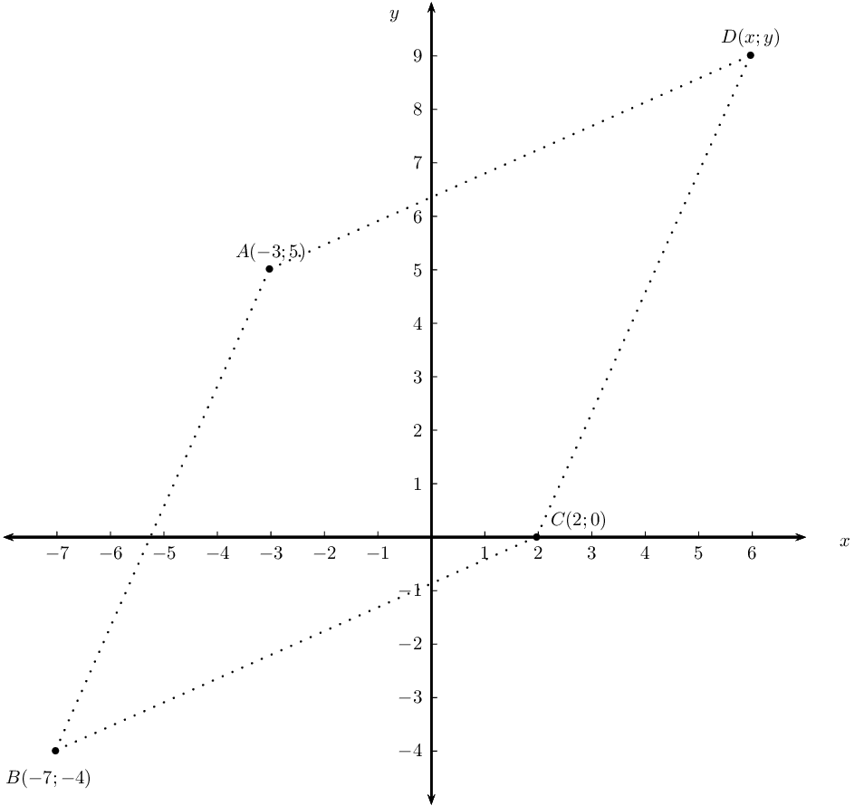
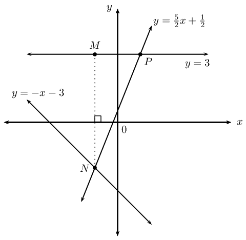
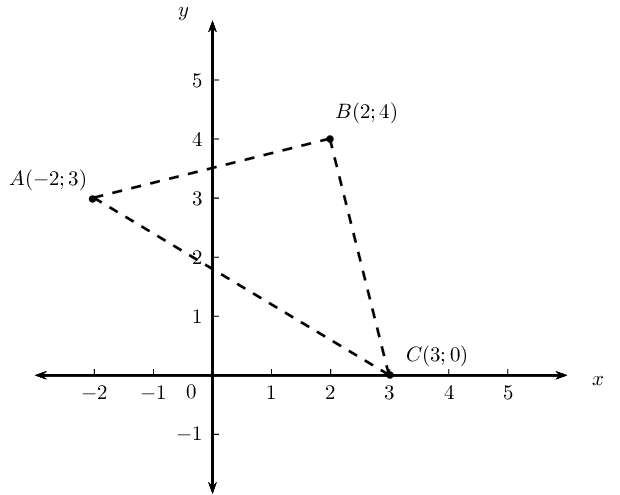
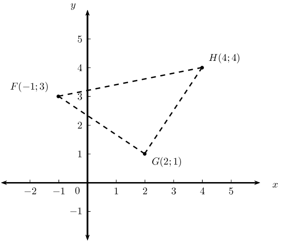
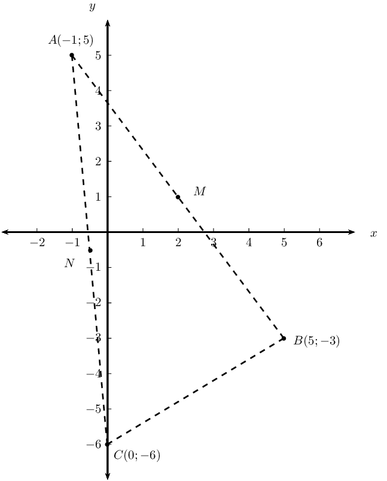

## End of chapter exercises

### Textbook Exercise 4.9

Determine the equation of the line:

**Problem:**
through points \(\left(-1;3\right)\) and \(\left(1;4\right)\)

**Solution:**
\begin{align*}
            m &= \frac{y_2 - y_1}{x_2 - x_1}\\
            &= \frac{4-3}{1 +1}\\
            \therefore m &= \frac{1}{2} \\
            y &= mx + c \\
            \therefore y &= \frac{1}{2}x + c \\
            \text{Subst. } (1;4): \quad 4 &= \frac{1}{2}(1) + c \\
            \therefore c &= 3\frac{1}{2} \\
            \therefore y &= \frac{1}{2}x + \frac{7}{2}
            \end{align*}

**Problem:**
through points \(\left(7;-3\right)\) and \(\left(0;4\right)\)

**Solution:**
\begin{align*}
            m &= \frac{y_2 - y_1}{x_2 - x_1}\\
            &= \frac{4+3}{0-7} \\
            &= \frac{7}{-7} \\
            \therefore m &= -1 \\
            y &= mx + c \\
            \therefore y &= -x + c \\
            \text{Subst. } (0;4): \quad 4 &= -1(0) + c \\
            \therefore c &= 4 \\
            \therefore y &= -x + 4
            \end{align*}

**Problem:**
parallel to \(y=\frac{1}{2}x+3\) and passing through \(\left(-2;3\right)\)

**Solution:**
\begin{align*}
            \therefore m &= \frac{1}{2} \\
            y &= mx + c \\
            \therefore y &= \frac{1}{2}x + c \\
            \text{Subst. } (-2;3): \quad 3 &= \frac{1}{2}(-2) + c \\
            \therefore c &= 4 \\
            \therefore y &= \frac{1}{2}x + 4
            \end{align*}

**Problem:**
perpendicular to \(y=-\frac{1}{2}x+3\) and passing through \(\left(-1;2 \right)\)

**Solution:**
\begin{align*}
            \therefore m &= 2 \\
            y &= mx + c \\
            \therefore y &= 2x + c \\
            \text{Subst. } (-1;2): \quad 2 &= 2(-1) + c \\
            \therefore c &= 4 \\
            \therefore y &= 2x + 4
            \end{align*}

**Problem:**
perpendicular to \(3y+x=6\) and passing through the origin

**Solution:**
\begin{align*}
            3y + x &= 6 \\
            y &= -\frac{1}{3}x + 2 \\
            \therefore m &= 3 \\
            y &= mx + c \\
            \therefore y &= 3x + c \\
            \text{Subst. } (0;0): \quad 0 &= 3(0) + c \\
            \therefore c &= 0 \\
            \therefore y &= 3x
            \end{align*}

Determine the angle of inclination of the following lines:

**Problem:**
\(y=2x-3\)

**Solution:**
\begin{align*}
            \therefore m &= 2 \\
            \tan \theta &= m \\
            \tan \theta &= 2 \\
            \therefore \theta &= \tan^{-1}2 \\
            \theta &= \text{63,4}\text{°}
            \end{align*}

**Problem:**
\(y=\frac{1}{3}x-7\)

**Solution:**
\begin{align*}
            \therefore m &= \frac{1}{3} \\
            \tan \theta &= m \\
            \tan \theta &= \frac{1}{3} \\
            \therefore \theta &= \tan^{-1} \left( \frac{1}{3} \right) \\
            \theta &= \text{18,4}\text{°}
            \end{align*}

**Problem:**
\(4y=3x+8\)

**Solution:**
\begin{align*}
            4y&=3x+8 \\
            y&=\frac{3}{4}x+2 \\
            \therefore m &= \frac{3}{4} \\
            \tan \theta &= m \\
            \tan \theta &= \frac{3}{4} \\
            \therefore \theta &= \tan^{-1} \left( \frac{3}{4} \right) \\
            \theta &= \text{36,9}\text{°}
            \end{align*}

**Problem:**
\(y=-\frac{2}{3}x+3\)

**Solution:**
\begin{align*}
            \therefore m &= -\frac{2}{3} \\
            \tan \theta &= m \\
            \tan \theta &= -\frac{2}{3} \\
            \therefore \theta &= \tan^{-1} \left( -\frac{2}{3}\right) \\
            \theta &= -\text{33}\text{°} + \text{180}\text{°} \\
            \therefore \theta &= \text{146,3}\text{°}
            \end{align*}

**Problem:**
\(3y+x-3=0\)

**Solution:**
\begin{align*}
            3y+x-3&=0 \\
            y &= -\frac{1}{3} + 1 \\
            \therefore m &= -\frac{1}{3} \\
            \tan \theta &= m \\
            \tan \theta &= -\frac{1}{3} \\
            \therefore \theta &= \tan^{-1} \left( -\frac{1}{3}\right) \\
            \theta &= -\text{18,4}\text{°} + \text{180}\text{°} \\
            \therefore \theta &= \text{161,6}\text{°}
            \end{align*}

\(P(2;3)\), \(Q(-4;0)\) and \(R(5;-3)\) are the vertices of \(\triangle PQR\) in the Cartesian plane.
            \(PR\) intersects the \(x\)-axis at \(S\). Determine the following:

**Problem:**
the equation of the line \(PR\)

**Solution:**
\begin{align*}
            m &= \frac{y_2 - y_1}{x_2 - x_1}\\
            &= \frac{-3-3}{5-2} \\
            &= \frac{-6}{3} \\
            \therefore m &= -2 \\
            y &= mx + c \\
            \therefore y &= -2x + c \\
            \text{Subst. } (2;3): \quad 3 &= -2(2) + c \\
            \therefore c &= 7 \\
            \therefore y &= -2x + 7
            \end{align*}

**Problem:**
the coordinates of point \(S\)

**Solution:**
\begin{align*}
            y &= -2x + 7 \\
            0 &= -2x + 7 \\
            \therefore x &= \frac{7}{2} \\
            \therefore &S\left( \frac{7}{2}; 0 \right)
            \end{align*}

**Problem:**
the angle of inclination of \(PR\) (correct to two decimal places)

**Solution:**
\begin{align*}
            \therefore m &= -2 \\
            \tan \theta &= m \\
            \tan \theta &= -2 \\
            \therefore \theta &= \tan^{-1} \left( -2 \right) \\
            \theta &= -\text{63,4}\text{°} + \text{180}\text{°} \\
            \therefore \theta &= \text{116,6}\text{°}
            \end{align*}

**Problem:**
the gradient of line \(PQ\)

**Solution:**
\begin{align*}
            m &= \frac{y_2 - y_1}{x_2 - x_1}\\
            &= \frac{3-0}{2+4} \\
            &= \frac{3}{6} \\
            \therefore m &= \frac{1}{2}
            \end{align*}

**Problem:**
\(Q\hat{P}R\)

**Solution:**
\(Q\hat{P}R = \text{90}\text{°}\)

**Problem:**
the equation of the line perpendicular to \(PQ\) and passing through the origin

**Solution:**
\begin{align*}
            m_{PQ} &= \frac{1}{2}\\
            \therefore m_{\perp}&= -2 \\
            y &= -2x + c \\
            c &= 0 \\
            \therefore y &= -2x
            \end{align*}

**Problem:**
the mid-point \(M\) of \(QR\)

**Solution:**
\begin{align*}
            M(x;y) &= \left( \frac{x_1 + x_2}{2}; \frac{y_1 + y_2}{2} \right) \\
            &= \left( \frac{-4+5}{2}; \frac{0-3}{2} \right) \\
            &= \left( \frac{1}{2}; -\frac{3}{2} \right)
            \end{align*}

**Problem:**
the equation of the line parallel to \(PR\) and passing through point \(M\)

**Solution:**
\begin{align*}
            m &= -2 \\
            y &= mx + c \\
            y &= -2x + c \\
            \text{Subst. } \left( \frac{1}{2}; -\frac{3}{2} \right): \quad -\frac{3}{2} &= -2\left( \frac{1}{2}
            \right) + c \\
            c &= -\frac{1}{2} \\
            y &= - 2x -\frac{1}{2}
            \end{align*}

Points \(A(-3;5)\), \(B(-7;-4)\) and \(C(2;0)\) are given.

**Problem:**
Plot the points on the Cartesian plane.

**Solution:**

**Problem:**
Determine the coordinates of \(D\) if \(ABCD\) is a parallelogram.

**Solution:**
\begin{align*}
            m_{BC} &= \frac{-4-0}{-7-2} \\
            &= \frac{4}{9} \\
            \therefore m_{AD} &= \frac{4}{9} \\
            \therefore \text{ from } A(-3;5): &\quad 9 \text{ units to the right and } 4 \text{ units up}
            \end{align*}

**Problem:**
Prove that \(ABCD\) is a rhombus.

**Solution:**
\begin{align*}
            AB &= \sqrt{(x_2 - x_1)^2 + (y_2 - y_1)^2} \\
            &= \sqrt{(-7-(-3))^2 + (-4-5)^2} \\
            &= \sqrt{(-4)^2 + (-9)^2} \\
            &= \sqrt{16 + 81} \\
            &= \sqrt{97} \\
            AD &= \sqrt{(x_2 - x_1)^2 + (y_2 - y_1)^2} \\
            &= \sqrt{(-3-6)^2 + (5-9)^2} \\
            &= \sqrt{(-9)^2 + (-4)^2} \\
            &= \sqrt{81 + 16} \\
            &= \sqrt{97} \\
            \therefore AB &= AD \\
            \therefore \text{ parallelogram } ABCD &\text{ is a rhombus (adj. sides equal ) }
            \end{align*}

Consider the sketch above, with the following lines shown:

\(y = -x -3\)

\(y = 3\)

\(y = \frac{5}{2}x + \frac{1}{2}\)

**Problem:**
Determine the coordinates of the point \(N\).

**Solution:**
\begin{align*}
            \frac{5}{2}x + \frac{1}{2} &= -x - 3 \\
            \frac{5}{2}x + x &= - 3 - \frac{1}{2} \\
            \frac{7}{2}x &= -\frac{7}{2} \\
            \therefore x &= -1 \\
            \therefore y &= -(-1) - 3 \\
            &= -2 \\
            \therefore &N\left( -1;-2 \right)
            \end{align*}

**Problem:**
Determine the coordinates of the point \(P\).

**Solution:**
\begin{align*}
            y &= \frac{5}{2}x + \frac{1}{2} \\
            y &= \frac{5}{2}(3) + \frac{1}{2} \\
            &= 8 \\
            \therefore &P\left( 8;3 \right)
            \end{align*}

**Problem:**
Determine the equation of the vertical line \(MN\).

**Solution:**
\(x = -1\)

**Problem:**
Determine the length of the vertical line \(MN\).

**Solution:**
\begin{align*}
            MN &= 2 + 3 \\
            &= \text{5}\text{ units}
            \end{align*}

**Problem:**
Find \(M\hat{N}P\).

**Solution:**
\begin{align*}
            \text{Let } M\hat{P}N &= \theta \\
            y &= \frac{5}{2}x + \frac{1}{2}\\
            \tan \theta &= m \\
            \tan \theta &= \frac{5}{2} \\
            \therefore \theta &= \text{68,2}\text{°} \\
            \text{In } \triangle MNP \quad M\hat{N}P &= \text{180}\text{°} - \text{90}\text{°} -
            \text{68,2}\text{°} \\
            \therefore M\hat{N}P &= \text{21,8}\text{°}
            \end{align*}

**Problem:**
Determine the equation of the line parallel to \(NP\) and passing through the point \(M\).

**Solution:**
\begin{align*}
            m &= \frac{5}{2} \\
            y &=mx +c \\
            y &=\frac{5}{2}x +c \\
            \text{Subst. } M(-1;3): \quad 3 &= \frac{5}{2}(-1) + c \\
            \therefore c &= 3 + \frac{5}{2} \\
            &= \frac{11}{2} \\
            \therefore y &=\frac{5}{2}x + \frac{11}{2}
            \end{align*}

The following points are given: \(A(-2;3)\), \(B(2;4)\), \(C(3;0)\).

**Problem:**
Plot the points on the Cartesian plane.

**Solution:**

**Problem:**
Prove that \(\triangle ABC\) is a right-angled isosceles triangle.

**Solution:**
\begin{align*}
            BC &= \sqrt{(x_2 - x_1)^2 + (y_2 - y_1)^2} \\
            &= \sqrt{(3-2)^2 + (0-4)^2} \\
            &= \sqrt{(1)^2 + (4)^2} \\
            &= \sqrt{1 + 16} \\
            &= \sqrt{17} \\
            AB &= \sqrt{(x_2 - x_1)^2 + (y_2 - y_1)^2} \\
            &= \sqrt{(2+2)^2 + (4-3)^2} \\
            &= \sqrt{(4)^2 + (1)^2} \\
            &= \sqrt{16 + 1} \\
            &= \sqrt{17} \\
            \therefore BC &= AB \\
            \therefore \triangle ABC &\text{ is isosceles triangle } \\
            AC &= \sqrt{(x_2 - x_1)^2 + (y_2 - y_1)^2} \\
            &= \sqrt{(3+2)^2 + (0-3)^2} \\
            &= \sqrt{(5)^2 + (-3)^2} \\
            &= \sqrt{25+9} \\
            &= \sqrt{34} \\
            \text{And } BC^2 + AB^2 &= 17 + 17 \\
            &= 34 \\
            &= AC^2 \\
            \therefore \triangle ABC &\text{ is right-angled triangle}
            \end{align*}

**Problem:**
Determine the equation of the line \(AB\).

**Solution:**
\begin{align*}
            m &= \frac{y_2-y_1}{x_2-x_1} \\
            &= \frac{4-3}{2+2} \\
            &= \frac{1}{4} \\
            y &=mx +c \\
            y &=\frac{1}{4}x +c \\
            \text{Subst. } M(-2;3): \quad 3 &= \frac{1}{4}(-2) + c \\
            \therefore c &= \frac{7}{2} \\
            \therefore y &=\frac{1}{4}x + \frac{7}{2}
            \end{align*}

**Problem:**
Determine the coordinates of \(D\) if \(ABCD\) is a square.

**Solution:**
\(D(-1;-1)\)

**Problem:**
Determine the coordinates of \(E\), the mid-point of \(BC\).

**Solution:**
\begin{align*}
            E(x;y) &= \left( \frac{x_1 + x_2}{2}; \frac{y_1 + y_2}{2} \right) \\
            &= \left( \frac{2+3}{2}; \frac{4+0}{2} \right) \\
            &= \left( \frac{5}{2}; 2 \right)
            \end{align*}

Given points \(S(2;5)\), \(T(-3;-4)\) and \(V(4;-2)\).

**Problem:**
Determine the equation of the line \(ST\).

**Solution:**
\begin{align*}
            m &= \frac{y_2-y_1}{x_2-x_1} \\
            &= \frac{-4-5}{-3-2} \\
            &= \frac{-9}{-6} \\
            &= \frac{3}{2} \\
            y &=mx +c \\
            y &=\frac{3}{2}x +c \\
            \text{Subst. } M(2;5): \quad 5 &= \frac{3}{2}(2) + c \\
            \therefore c &= 2\\
            \therefore y &=\frac{3}{2}x + 2
            \end{align*}

**Problem:**
Determine the size of \(T\hat{S}V\).

**Solution:**
\begin{align*}
            m_{ST} &= \frac{3}{2} \\
            \tan \beta &= \frac{3}{2} \\
            \therefore \beta &= \tan^{-1} \left( \frac{3}{2} \right) \\
            &= \text{49,6}\text{°} \\
            m_{SV} &= \frac{5+2}{2-4} \\
            &= \frac{7}{-2} \\
            \tan \theta &= -\frac{7}{2} \\
            \therefore \theta &= \tan^{-1} \left( -\frac{7}{2} \right) \\
            &= -\text{74,1}\text{°} + \text{180}\text{°} \\
            &= \text{105,9}\text{°} \\
            \therefore T\hat{S}V &= \text{105,9}\text{°} - \text{56,3}\text{°} \\
            &= \text{49,6}\text{°}
            \end{align*}

Consider triangle \(FGH\) with vertices \(F(-1;3)\), \(G(2;1)\) and \(H(4;4)\).

**Problem:**
Sketch \(\triangle FGH\) on the Cartesian plane.

**Solution:**

**Problem:**
Show that \(\triangle FGH\) is an isosceles triangle.

**Solution:**
\begin{align*}
            FG &= \sqrt{(x_2 - x_1)^2 + (y_2 - y_1)^2} \\
            &= \sqrt{(-1-2)^2 + (3-1)^2} \\
            &= \sqrt{(-3)^2 + (2)^2} \\
            &= \sqrt{9 + 4} \\
            &= \sqrt{13} \\
            GH &= \sqrt{(x_2 - x_1)^2 + (y_2 - y_1)^2} \\
            &= \sqrt{(4-2)^2 + (4-1)^2} \\
            &= \sqrt{(2)^2 + (3)^2} \\
            &= \sqrt{4 + 9} \\
            &= \sqrt{13} \\
            \therefore FG &= GH \\
            \therefore \triangle FGH &\text{ is isosceles triangle }
            \end{align*}

**Problem:**
Determine the equation of the line \(PQ\), perpendicular bisector of \(FH\).

**Solution:**
\begin{align*}
            Q(x;y) &= \left( \frac{x_1 + x_2}{2}; \frac{y_1 + y_2}{2} \right) \\
            &= \left( \frac{4-1}{2}; \frac{4+3}{2} \right) \\
            &= \left( \frac{3}{2}; \frac{7}{2} \right) \\
            m &= \frac{y_2-y_1}{x_2-x_1} \\
            &= \frac{4-3}{4+1} \\
            &= \frac{1}{5} \\
            \therefore m_{\perp} &= -5 \\
            y &=mx +c \\
            y &=-5x +c \\
            \text{Subst. } Q\left( \frac{3}{2}; \frac{7}{2} \right): \quad \frac{7}{2} &= -5 \left( \frac{3}{2}
            \right) + c \\
            \therefore c &= 11 \\
            \therefore y &= -5x + 11
            \end{align*}

**Problem:**
Does \(G\) lie on the line \(PQ\)?

**Solution:**
\begin{align*}
            y &=-5x + 11 \\
            G(2;1) \therefore \text{subst. } x=2: \quad y &= -5 \left( 2 \right) + 11 \\
            &= -10 + 11 \\
            &= 1 \\
            \text{Yes, } G & \text{ lies on PQ }
            \end{align*}

**Problem:**
Determine the equation of the line parallel to \(GH\) and passing through point \(F\).

**Solution:**
\begin{align*}
            m_{GH} &= \frac{y_2-y_1}{x_2-x_1} \\
            &= \frac{4-1}{4-2} \\
            &= \frac{3}{2} \\
            y &=mx +c \\
            y &=\frac{3}{2}x +c \\
            \text{Subst. } F\left( -1;3 \right): \quad 3 &= \frac{3}{2}(-1) + c \\
            \therefore c &= \frac{9}{2} \\
            \therefore y &= \frac{3}{2}x + \frac{9}{2}
            \end{align*}

Given the points \(A(-1;5)\), \(B(5;-3)\) and \(C(0;-6)\). \(M\) is the mid-point of \(AB\) and \(N\) is
            the mid-point of \(AC\).

**Problem:**
Draw a sketch on the Cartesian plane.

**Solution:**

**Problem:**
Show that the coordinates of \(M\) and \(N\) are \((2;1)\) and \((-\frac{1}{2};-\frac{1}{2})\)
              respectively.

**Solution:**
\begin{align*}
            M(x;y) &= \left( \frac{x_1 + x_2}{2}; \frac{y_1 + y_2}{2} \right) \\
            &= \left( \frac{-1+5}{2}; \frac{5-3}{2} \right) \\
            &= \left( \frac{4}{2}; \frac{2}{2} \right) \\
            &= \left( 2; 1 \right) \\
            N(x;y) &= \left( \frac{x_1 + x_2}{2}; \frac{y_1 + y_2}{2} \right) \\
            &= \left( \frac{-1+0}{2}; \frac{5-6}{2} \right) \\
            &= \left( -\frac{1}{2}; -\frac{1}{2} \right)
            \end{align*}

**Problem:**
Use analytical geometry methods to prove the mid-point theorem. (Prove that \(NM \parallel CB\) and \(NM
              = \frac{1}{2}CB\).)

**Solution:**
\begin{align*}
            m_{NM} &= \frac{y_2-y_1}{x_2-x_1} \\
            &= \dfrac{1+\frac{1}{2}}{2+\frac{1}{2}} \\
            &= \dfrac{\frac{3}{2}}{\frac{5}{2}} \\
            &= \frac{3}{5} \\
            m_{CB} &= \frac{y_2-y_1}{x_2-x_1} \\
            &= \frac{-3+6}{5-0} \\
            &= \frac{3}{5} \\
            m_{NM} &= m_{CB} \\
            \therefore NM &\parallel CB \\
            NM &= \sqrt{(x_2 - x_1)^2 + (y_2 - y_1)^2} \\
            &= \sqrt{(2+\frac{1}{2})^2 + (1+\frac{1}{2})^2} \\
            &= \sqrt{(\frac{5}{2})^2 + (\frac{3}{2})^2} \\
            &= \sqrt{\frac{25}{4} + \frac{9}{4}} \\
            &= \sqrt{\frac{34}{4}} \\
            &= \frac{1}{2}\sqrt{34} \\
            CB &= \sqrt{(x_2 - x_1)^2 + (y_2 - y_1)^2} \\
            &= \sqrt{(5-0)^2 + (-3+6)^2} \\
            &= \sqrt{(5)^2 + (3)^2} \\
            &= \sqrt{25 + 9} \\
            &= \sqrt{34} \\
            \therefore NM &= \frac{1}{2}CB
            \end{align*}
