# Chapter 5: Functions

- Learners must be able to determine the equation of a function from a given graph.
- Discuss and explain the characteristics of functions: domain, range, intercepts with the
                                  axes, maximum and minimum values, symmetry, etc.
- Emphasize to learners the importance of examining the equation of a function and
                                  anticipating the shape of the graph.
- Discuss the different functions and the effects of the parameters in general terms.

A function describes a specific relationship between two variables; where an independent (input) variable has
                exactly one dependent (output) variable. Every element in the domain maps to only one element in the
                range. Functions can be one-to-one relations or many-to-one relations. A many-to-one relation associates
                two or more values of the independent variable with a single value of the dependent variable. Functions
                allow us to visualise relationships in the form of graphs, which are much easier to read and interpret
                than lists of numbers.

## 5.1 Quadratic functions (EMBGJ)

### Revision (EMBGK)

#### Functions of the form \(y = a x^2 + q\)

Functions of the general form \(y=a{x}^{2}+q\) are called parabolic functions, where
                                        \(a\) and \(q\) are constants.

**The effects of \(a\) and \(q\) on \(f(x) = ax^2 + q\):**

- **The effect of \(q\) on vertical shift**
  - For \(q>0\), \(f(x)\) is shifted vertically
                                                                            upwards by \(q\) units.
    The turning point of \(f(x)\) is above the
                                                                            \(x\)-axis.
  - For \(q<0\), \(f(x)\) is shifted vertically
                                                                            downwards by \(q\) units.
    The turning point of \(f(x)\) is below the
                                                                            \(x\)-axis.
  - \(q\) is also the \(y\)-intercept of the parabola.
- **The effect of \(a\) on shape**
  - For \(a>0\); the graph of \(f(x)\) is a
                                                                            “smile” and has a minimum turning
                                                                            point \((0;q)\). As the value of \(a\) becomes
                                                                            larger, the graph becomes narrower.
    As \(a\) gets closer to \(\text{0}\), \(f(x)\)
                                                                            becomes wider.
  - For \(a<0\); the graph of \(f(x)\) is a
                                                                            “frown” and has a maximum turning
                                                                            point \((0;q)\). As the value of \(a\) becomes
                                                                            smaller, the graph becomes narrower.
    As \(a\) gets closer to \(\text{0}\), \(f(x)\)
                                                                            becomes wider.

|  | \(a<0\) | \(a>0\) |
| --- | --- | --- |
| \(q>0\) |  |  |
| \(q=0\) |  |  |
| \(q<0\) |  |  |

## Revision

### Textbook Exercise
                                                        5.1

On separate axes, accurately draw each of the
                                                                        following functions.

- Use tables of values if necessary.
- Use graph paper if available.

**Problem:**
\(y_1 = x^2\)

**Solution:**
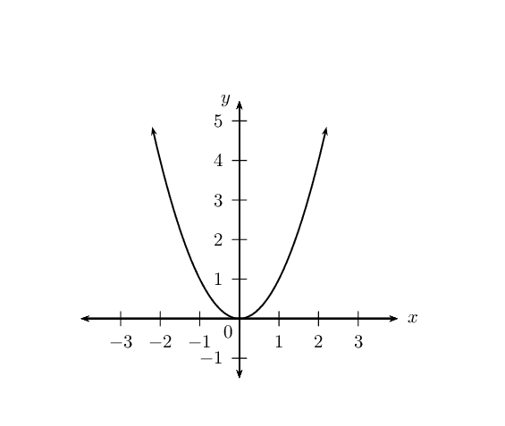

**Problem:**
\(y_2 = \frac{1}{2}x^2\)

**Solution:**
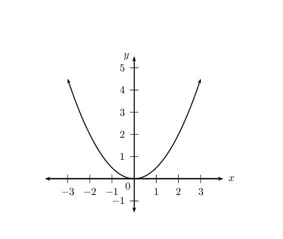

**Problem:**
\(y_3 = -x^2 - 1\)

**Solution:**
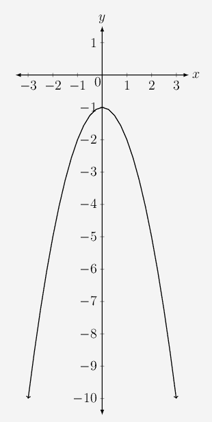

**Problem:**
\(y_4 = -2x^2 + 4\)

**Solution:**
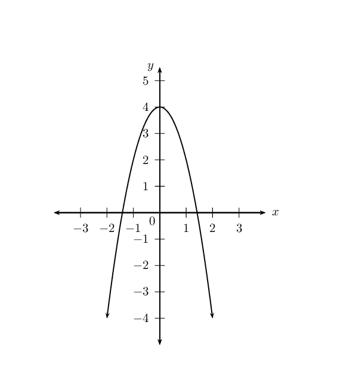

**Problem:**
Use your sketches of the functions given above to
                                                                        complete the following table (the first column
                                                                        has been completed as an example):

|  | \(y_1\) | \(y_2\) | \(y_3\) | \(y_4\) |
| --- | --- | --- | --- | --- |
| value of \(q\) | \(q = 0\) |  |  |  |
| effect of \(q\) | \(y_{\text{int}} = 0\) |  |  |  |
| value of \(a\) | \(a = 1\) |  |  |  |
| effect of \(a\) | standard parabola |  |  |  |
| turning point | \((0;0)\) |  |  |  |
| axis of symmetry | \(x = 0\) (\(y\)-axis) |  |  |  |
| domain | \(\{x: x \in \mathbb{R} \}\) |  |  |  |
| range | \(\{y: y \geq 0\}\) |  |  |  |

**Solution:**
|  | \(y_1\) | \(y_2\) | \(y_3\) | \(y_4\) |
| --- | --- | --- | --- | --- |
| value of \(q\) | \(q = \text{0}\) | \(q = \text{0}\) | \(q = -\text{1}\) | \(q = \text{4}\) |
| effect of \(q\) | \(y_{\text{int}} = 0\) | \(y_{\text{int}} = 0\) | \(y_{\text{int}} = -1\), shifts
                                                                                        \(\text{1}\) unit down | \(y_{\text{int}} = 4\), shifts
                                                                                        \(\text{4}\) unit up |
| value of \(a\) | \(a = 1\) | \(a = \frac{1}{2}\) | \(a = -1\) | \(a = -2\) |
| effect of \(a\) | standard parabola | smile, min. TP | frown, max. TP | frown, max. TP |
| turning point | \((0;0)\) | \((0;0)\) | \((0;-1)\) | \((0;4)\) |
| axis of symmetry | \(x = 0\) (\(y\)-axis) | \(x = 0\) (\(y\)-axis) | \(x = 0\) (\(y\)-axis) | \(x = 0\) (\(y\)-axis) |
| domain | \(\{x: x \in \mathbb{R} \}\) | \(\{x: x \in \mathbb{R} \}\) | \(\{x: x \in \mathbb{R} \}\) | \(\{x: x \in \mathbb{R} \}\) |
| range | \(\{y: y \geq 0\}\) | \(\{y: y \geq 0\}\) | \(\{y: y \leq -1\}\) | \(\{y: y \leq 4\}\) |

### Functions of the form \(y=a{\left(x+p\right)}^{2}+q\) (EMBGM)

We now consider parabolic functions of the form \(y=a{\left(x+p\right)}^{2}+q\) and the
                                effects of parameter \(p\).

## The effects of \(a\), \(p\) and \(q\) on a parabolic graph

2. On the same system of axes, plot the following graphs:
   2. \(y_1 = x^2\)
   4. \(y_2 = (x - 2)^2\)
   6. \(y_3 = (x - 1)^2\)
   8. \(y_4 = (x + 1)^2\)
   10. \(y_5 = (x + 2)^2\)
   Use your sketches of the functions above to complete the following
                                                           table:
   |  | \(y_1\) | \(y_2\) | \(y_3\) | \(y_4\) | \(y_5\) |
   | --- | --- | --- | --- | --- | --- |
   | \(x\)-intercept(s) |  |  |  |  |  |
   | \(y\)-intercept |  |  |  |  |  |
   | turning point |  |  |  |  |  |
   | axis of symmetry |  |  |  |  |  |
   | domain |  |  |  |  |  |
   | range |  |  |  |  |  |
   | effect of \(p\) |  |  |  |  |  |
4. On the same system of axes, plot the following graphs:
   2. \(y_1 = x^2 + 2\)
   4. \(y_2 = (x - 2)^2 - 1\)
   6. \(y_3 = (x - 1)^2 + 1\)
   8. \(y_4 = (x + 1)^2 + 1\)
   10. \(y_5 = (x + 2)^2 - 1\)
   Use your sketches of the functions above to complete the following
                                                           table:
   |  | \(y_1\) | \(y_2\) | \(y_3\) | \(y_4\) | \(y_5\) |
   | --- | --- | --- | --- | --- | --- |
   | \(x\)-intercept(s) |  |  |  |  |  |
   | \(y\)-intercept |  |  |  |  |  |
   | turning point |  |  |  |  |  |
   | axis of symmetry |  |  |  |  |  |
   | domain |  |  |  |  |  |
   | range |  |  |  |  |  |
   | effect of \(q\) |  |  |  |  |  |
6. Consider the three functions given below and answer the questions
                                                           that follow:
   - \(y_1 = (x - 2)^2 + 1\)
   - \(y_2 = 2(x - 2)^2 + 1\)
   - \(y_3 = -\frac{1}{2}(x - 2)^2 + 1\)
   2. What is the value of \(a\) for \(y_2\)?
   4. Does \(y_1\) have a minimum or maximum turning point?
   6. What are the coordinates of the turning point of
                                                                              \(y_2\)?
   8. Compare the graphs of \(y_1\) and \(y_2\). Discuss
                                                                              the similarities and differences.
   10. What is the value of \(a\) for \(y_3\)?
   12. Will the graph of \(y_3\) be narrower or wider than
                                                                              the graph of \(y_1\)?
   14. Determine the coordinates of the turning point of
                                                                              \(y_3\).
   16. Compare the graphs of \(y_1\) and \(y_3\). Describe
                                                                              any differences.

**The effect of the parameters on \(y = a(x + p)^2 + q\) **

The effect of \(p\) is a horizontal shift because all points are moved the same distance in
                                the same direction (the entire graph slides to the left or to the right).

- For \(p>0\), the graph is shifted to the left by \(p\) units.
- For \(p<0\), the graph is shifted to the right by \(p\) units.

The value of \(p\) also affects whether the turning point is to the left of the \(y\)-axis
                                \(\left(p>0\right)\) or to the right of the \(y\)-axis \(\left(p<0\right)\). The
                                axis of symmetry is the line \(x = -p\).

The effect of \(q\) is a vertical shift. The value of \(q\) affects whether the turning point
                                of the graph is above the \(x\)-axis \(\left(q>0\right)\) or below the \(x\)-axis
                                \(\left(q<0\right)\).

The value of \(a\) affects the shape of the graph. If \(a<0\), the graph is a
                                “frown” and has a maximum turning point. If \(a>0\) then the graph is a
                                “smile” and has a minimum turning point. When \(a = 0\), the graph is a
                                horizontal line \(y = q\).

|  | \(p>0\) | \(p<0\) |
| --- | --- | --- |
|  | \(a<0\) | \(a>0\) | \(a<0\) | \(a>0\) |
| \(q>0\) |  |  |  |  |
| \(q<0\) |  |  |  |  |

#### Discovering the characteristics

For functions of the general form \(f(x) = y = a(x + p)^2 + q\):

**Domain and range**

The domain is \(\left\{x:x\in ℝ\right\}\) because there is no value of \(x\)
                                        for which \(f(x)\) is undefined.

The range of \(f(x)\) depends on whether the value for \(a\) is positive or negative.
                                        If \(a>0\) we have:
                                        \[\begin{array}{r@{\;}c@{\;}l@{\quad}l}
                                        (x + p)^2 & \geq & 0 & (\text{perfect square is always positive}) \\
                                        \therefore a(x + p)^2 & \geq & 0 & (a \text{ is positive}) \\
                                        \therefore a(x + p)^2 + q & \geq & q & \\
                                        \therefore f(x) & \geq & q &
                                        \end{array}\]

The range is therefore \(\{ y: y \geq q, y \in \mathbb{R} \}\) if \(a > 0\).
                                        Similarly, if \(a < 0\), the range is \(\{ y: y \leq q, y \in \mathbb{R}
                                        \}\).

<Callout type="tip" title="Worked example 1: Domain and range">
**Question:**
State the domain and range for \(g(x) = -2(x - 1)^2 + 3\).

**Determine the domain:**
The domain is \(\{x: x \in \mathbb{R} \}\) because there is no value
                                                        of \(x\) for which \(g(x)\) is undefined.

**Determine the range:**
The range of \(g(x)\) can be calculated from:
                                                        \begin{align*}
                                                        (x - 1)^2& \geq 0 \\
                                                        -2(x - 1)^2& \leq 0 \\
                                                        -2(x - 1)^2 + 3 & \leq 3 \\
                                                        g(x) & \leq 3
                                                        \end{align*}
                                                        Therefore the range is \(\{g(x): g(x) \leq 3 \}\) or in interval
                                                        notation \((-\infty; 3]\).
</Callout>

Notice in the example above that it helps to have the function in the form \(y = a(x
                                        + p)^2 + q\).

We use the method of **completing the square** to write a quadratic
                                        function of the general form \(y = ax^2 + bx +c\) in the form \(y = a(x + p)^2 +
                                        q\) (see Chapter \(\text{2}\)).

## Domain and range

### Textbook Exercise 5.2

Give the domain and range for each of the following
                                                                functions:

**Problem:**
\(f(x) = (x-4)^2 - 1\)

**Solution:**
\begin{align*}
                                                                \text{Domain: } & \left \{ x: x \in \mathbb{R}
                                                                \right \} \\
                                                                \text{Range: } & \left \{ y: y \geq -1, y\in
                                                                \mathbb{R} \right \}
                                                                \end{align*}

**Problem:**
\(g(x) = -(x-5)^2 + 4\)

**Solution:**
\begin{align*}
                                                                \text{Domain: } & \left \{ x: x \in \mathbb{R}
                                                                \right \} \\
                                                                \text{Range: } & \left \{ y: y \leq 4, y\in
                                                                \mathbb{R} \right \}
                                                                \end{align*}

**Problem:**
\(h(x) = x^2 -6x +9\)

**Solution:**
\begin{align*}
                                                                h(x) &= x^2 -6x +9 \\
                                                                &= (x - 3)^2 \\
                                                                \text{Domain: } & \left \{ x: x \in \mathbb{R}
                                                                \right \} \\
                                                                \text{Range: } & \left \{ y: y \geq 0, y\in
                                                                \mathbb{R} \right \}
                                                                \end{align*}

**Problem:**
\(j(x) = -2(x+1)^2\)

**Solution:**
\begin{align*}
                                                                \text{Domain: } & \left \{ x: x \in \mathbb{R}
                                                                \right \} \\
                                                                \text{Range: } & \left \{ y: y \leq 0, y\in
                                                                \mathbb{R} \right \}
                                                                \end{align*}

**Problem:**
\(k(x) = -x^2 + 2x - 3\)

**Solution:**
\begin{align*}
                                                                k(x) &= -x^2 + 2x - 3 \\
                                                                &= -(x - 1)^2 - 2 \\
                                                                \text{Domain: } & \left \{ x: x \in \mathbb{R}
                                                                \right \} \\
                                                                \text{Range: } & \left \{ y: y \leq 2, y\in
                                                                \mathbb{R} \right \}
                                                                \end{align*}

**Intercepts**

**The \(y\)-intercept:**

Every point on the \(y\)-axis has an \(x\)-coordinate of \(\text{0}\), therefore to
                                        calculate the \(y\)-intercept we let \(x=0\).

For example, the \(y\)-intercept of \(g(x) = (x - 1)^2 + 5\) is determined by setting
                                        \(x=0\):
                                        \begin{align*}
                                        g(x) &= (x - 1)^2 + 5 \\
                                        g(0) &= (0 - 1)^2 + 5 \\
                                        &= 6
                                        \end{align*}
                                        This gives the point \((0;6)\).

**The \(x\)-intercept:**

Every point on the \(x\)-axis has a \(y\)-coordinate of \(\text{0}\), therefore to
                                        calculate the \(x\)-intercept we let \(y=0\).

For example, the \(x\)-intercept of \(g(x) = (x - 1)^2 + 5\) is determined by setting
                                        \(y=0\):
                                        \begin{align*}
                                        g(x) &= (x - 1)^2 + 5 \\
                                        0 &= (x - 1)^2 + 5 \\
                                        -5 &= (x - 1)^2
                                        \end{align*}
                                        which has no real solutions. Therefore, the graph of \(g(x)\) lies above the
                                        \(x\)-axis and does not have any \(x\)-intercepts.

## Intercepts

### Textbook Exercise 5.3

Determine the \(x\)- and \(y\)-intercepts for each of the
                                                                following functions:

**Problem:**
\(f(x) = (x+4)^2 - 1\)

**Solution:**
\begin{align*}
                                                                \text{For } x=0 \quad y &= (0+4)^2 - 1 \\
                                                                &= 16 - 1 \\
                                                                \therefore & (0;15) \\
                                                                \text{For } y=0 \quad 0 &= (x+4)^2 - 1 \\
                                                                &= x^2 + 8x + 16 - 1 \\
                                                                &= x^2 + 8x + 15 \\
                                                                &= (x + 5)(x + 3) \\
                                                                x=-5 &\text{ or } x=-3 \\
                                                                \therefore (-5;0) &\text{ and } (-3;0)
                                                                \end{align*}

**Problem:**
\(g(x) = \text{16} - 8x + x^2\)

**Solution:**
\begin{align*}
                                                                \text{For } x=0 \quad y &=16 \\
                                                                \therefore & (0;16) \\
                                                                \text{For } y=0 \quad 0 &= 16 - 8x + x^2 \\
                                                                &= x^2 - 8x + 16 \\
                                                                &= (x -4)^2 \\
                                                                \therefore x &=4 \\
                                                                \therefore & (4;0)
                                                                \end{align*}

**Problem:**
\(h(x) = -x^2 +4x-3\)

**Solution:**
\begin{align*}
                                                                \text{For } x=0 \quad y &=-3 \\
                                                                \therefore & (0;-3) \\
                                                                \text{For } y=0 \quad 0 &= -x^2 +4x-3 \\
                                                                &= - (x^2 -4x+3) \\
                                                                &= -(x - 3)(x - 1) \\
                                                                x=3 &\text{ or } x=1 \\
                                                                \therefore (1;0) &\text{ and } (3;0)
                                                                \end{align*}

**Problem:**
\(j(x) = 4(x-3)^2 -1\)

**Solution:**
\begin{align*}
                                                                \text{For } x=0 \quad y &= 4(0-3)^2 -1 \\
                                                                &= 36 - 1 \\
                                                                \therefore & (0;35) \\
                                                                \text{For } y=0 \quad 0 &= 4(x-3)^2 -1 \\
                                                                &= 4(x^2 - 6x + 9) -1 \\
                                                                &= 4x^2 -24x + 36 - 1 \\
                                                                &= 4x^2 -36x + 35 \\
                                                                &= (2x + 5)(2x + 7) \\
                                                                x=-\frac{5}{2} &\text{ or } x=-\frac{7}{2} \\
                                                                \therefore (-\frac{5}{2};0) &\text{ and }
                                                                (-\frac{7}{2};0)
                                                                \end{align*}

**Problem:**
\(k(x) = 4(x-3)^2 +1\)

**Solution:**
\begin{align*}
                                                                \text{For } x=0 \quad y &= 4(0-3)^2 +1 \\
                                                                &= 36 +1 \\
                                                                \therefore & (0;37) \\
                                                                \text{For } y=0 \quad 0 &= 4(x-3)^2 +1 \\
                                                                &= 4(x^2 - 6x + 9) +1 \\
                                                                &= 4x^2 -24x + 36 + 1 \\
                                                                &= 4x^2 -36x + 37 \\
                                                                \therefore x & = \frac{-b \pm \sqrt{b^2 - 4ac}}{2a}
                                                                \\
                                                                & = \frac{24 \pm \sqrt{(-24)^2 - 4(4)(37)}}{2(4)} \\
                                                                & = \frac{576 \pm \sqrt{576 - 592}}{8} \\
                                                                & = \frac{576 \pm \sqrt{-16}}{8} \\
                                                                \therefore &\text{ no real solution }
                                                                \end{align*}

**Problem:**
\(l(x) = 2x^2 - 3x -4\)

**Solution:**
\begin{align*}
                                                                \text{For } x=0 \quad y &=-4 \\
                                                                \therefore & (0;-4) \\
                                                                \text{For } y=0 \quad 0 &= 2x^2 - 3x -4 \\
                                                                &= 2x^2 - 3x -4 \\
                                                                \therefore x & = \frac{-b \pm \sqrt{b^2 - 4ac}}{2a}
                                                                \\
                                                                & = \frac{3 \pm \sqrt{(-3)^2 - 4(2)(-4)}}{2(2)} \\
                                                                & = \frac{3 \pm \sqrt{ 9 + 32}}{4} \\
                                                                & = \frac{3 \pm \sqrt{41}}{4} \\
                                                                x=\frac{3 - \sqrt{41}}{4} &\text{ or } x=\frac{3 +
                                                                \sqrt{41}}{4} \\
                                                                \therefore (-\text{0,85};0) &\text{ and }
                                                                (\text{2,35};0)
                                                                \end{align*}

**Turning point**

The turning point of the function \(f(x) = a(x+p)^2 + q\) is determined by examining
                                        the range of the function:

- If \(a > 0\), \(f(x)\) has a minimum turning point and the range
                                                          is \([q;\infty)\):
  The minimum value of \(f(x)\) is \(q\).
  If \(f(x) = q\), then \(a(x+p)^2 = 0\), and therefore \(x = -p\).
  This gives the turning point \((-p;q)\).
- If \(a < 0\), \(f(x)\) has a maximum turning point and the range
                                                          is \((-\infty;q]\):
  The maximum value of \(f(x)\) is \(q\).
  If \(f(x) = q\), then \(a(x+p)^2 = 0\), and therefore \(x = -p\).
  This gives the turning point \((-p;q)\).

Therefore the turning point of the quadratic function \(f(x) = a(x+p)^2 + q\) is
                                        \((-p;q)\).

**Alternative form for quadratic equations:**

We can also write the quadratic equation in the form

                                \[y = a(x - p)^2 +q\]

The effect of \(p\) is still a horizontal shift, however notice that:

- For \(p>0\), the graph is shifted to the **right** by
                                                          \(p\) units.
- For \(p<0\), the graph is shifted to the **left** by
                                                          \(p\) units.

The turning point is \((p;q)\) and the axis of symmetry is the line \(x = p\).

<Callout type="tip" title="Worked example 2: Turning point">
**Question:**
Determine the turning point of \(g(x) = 3x^2 - 6x - 1\).

**Write the equation in the form \(y = a(x+p)^2 + q\):**
We use the method of completing the square:
                                                        \begin{align*}
                                                        g(x )&= 3x^2 - 6x - 1 \\
                                                        &= 3(x^2 - 2x) - 1 \\
                                                        &= 3 \left( (x-1)^2 - 1 \right) -1 \\
                                                        &= 3(x-1)^2 - 3 -1 \\
                                                        &= 3(x-1)^2 - 4
                                                        \end{align*}

**Determine turning point \((-p;q)\):**
From the equation \(g(x) = 3(x-1)^2 - 4\) we know that the turning
                                                        point for \(g(x)\) is \((1;-4)\).
</Callout>

<Callout type="tip" title="Worked example 3: Turning point">
**Question:**
2. Show that the \(x\)-value for the turning point of \(h(x) =
                                                                   ax^2 + bx + c\) is given by \(x = -\frac{b}{2a}\).
4. Hence, determine the turning point of \(k(x) = 2 - 10x +
                                                                   5x^2\).

**Write the equation in the form \(y = a(x+p)^2 + q\)
                                                        and show that \(p = \frac{b}{2a}\):**
We use the method of completing the square:
                                                        \begin{align*}
                                                        h(x)&= ax^2 + bx + c \\
                                                        &= a \left( x^2 + \frac{b}{a}x + \frac{c}{a} \right)
                                                        \end{align*}

Take half the coefficient of the \(x\) term and square it; then add
                                                        and subtract it from the expression.
                                                        \begin{align*}
                                                        h(x) &= a \left( x^2 + \frac{b}{a}x + \left( \frac{b}{2a}
                                                        \right)^2 - \left( \frac{b}{2a} \right)^2 + \frac{c}{a} \right)
                                                        \\
                                                        &= a \left( \left(x + \frac{b}{2a} \right)^2 -
                                                        \frac{b^2}{4a^2} + \frac{c}{a} \right) \\
                                                        &= a \left( \left(x + \frac{b}{2a} \right)^2 - \frac{b^2
                                                        -4ac}{4a^2} \right) \\
                                                        &= a \left(x + \frac{b}{2a} \right)^2 - \frac{b^2 -4ac}{4a}
                                                        \end{align*}
                                                        From the above we have that the turning point is at \(x = -p = -
                                                        \frac{b}{2a}\) and \(y = q = - \frac{b^2 -4ac}{4a}\).

**Determine the turning point of \(k(x)\):**
Write the equation in the general form \(y = ax^2 + bx + c\).
                                                        \[k(x) = 5x^2 -10x + 2\]

                                                        Therefore \(a = 5\); \(b = -10\); \(c = 2\).

Use the results obtained above to determine \(x = - \frac{b}{2a}\):
                                                        \begin{align*}
                                                        x &= -\left(\frac{-10}{2(5)}\right) \\
                                                        &= 1
                                                        \end{align*}

Substitute \(x = 1\) to obtain the corresponding \(y\)-value:
                                                        \begin{align*}
                                                        y &= 5x^2 -10x + 2 \\
                                                        &= 5(1)^2 -10(1) + 2\\
                                                        &= 5 - \text{10} + 2\\
                                                        &= -3
                                                        \end{align*}
                                                        The turning point of \(k(x)\) is \((1;-3)\).
</Callout>

## Turning points

### Textbook Exercise 5.4

Determine the turning point of each of the following:

**Problem:**
\(y = x^2 - 6x + 8\)

**Solution:**
\begin{align*}
                                                                y &= x^2 - 6x + 8 \\
                                                                &= (x-3)^{2} - \left( \frac{6}{2} \right)^2 + 8 \\
                                                                &= (x-3)^{2}-1 \\
                                                                \therefore \text{turning point }&= (3;-1)
                                                                \end{align*}

**Problem:**
\(y = -x^2 + 4x - 3\)

**Solution:**
\begin{align*}
                                                                y &= -x^2 + 4x - 3 \\
                                                                &= -(x^2 - 4x + 3 \\
                                                                &= - \left( (x-2)^{2} - \left( \frac{4}{2} \right)^2
                                                                + 3 \right) \\
                                                                &= -(x-2)^{2}+1 \\
                                                                \therefore \text{turning point } &= (2;1)
                                                                \end{align*}

**Problem:**
\(y = \frac{1}{2}(x + 2)^2 - 1\)

**Solution:**
\begin{align*}
                                                                y &= \frac{1}{2}(x + 2)^2 - 1 \\
                                                                \therefore \text{turning point }&= (-2;-1)
                                                                \end{align*}

**Problem:**
\(y = 2x^2 + 2x + 1\)

**Solution:**
\begin{align*}
                                                                y &= 2x^2 + 2x + 1 \\
                                                                &= 2 \left( x^2 + x + \frac{1}{2} \right) \\
                                                                &= 2 \left( x+ \frac{1}{2} \right )^2+\frac{1}{2} \\
                                                                \therefore \text{turning point }&=
                                                                \left(-\frac{1}{2};\frac{1}{2}\right)
                                                                \end{align*}

**Problem:**
\(y = \text{18} + 6x - 3x^2\)

**Solution:**
\begin{align*}
                                                                y &= -3x^2 + 6x + 18 \\
                                                                &= -3(x^2 - 2x - 6) \\
                                                                &= -3 \left((x - 1)^2 - 7 \right) \\
                                                                &= -3(x-1)^2+21 \\
                                                                \therefore \text{turning point }&= (1;21)
                                                                \end{align*}

**Problem:**
\(y = -2[(x + 1)^2 + 3]\)

**Solution:**
\begin{align*}
                                                                y &= -2[(x + 1)^2 + 3] \\
                                                                y &= -2(x + 1)^2 - 6 \\
                                                                \therefore \text{turning point }&= (-1;-6)
                                                                \end{align*}

**Axis of symmetry**

The axis of symmetry for \(f(x)=a{\left(x+p\right)}^{2}+q\) is the vertical line
                                        \(x=-p\). The axis of symmetry passes through the turning point \((-p;q)\) and
                                        is parallel to the \(y\)-axis.

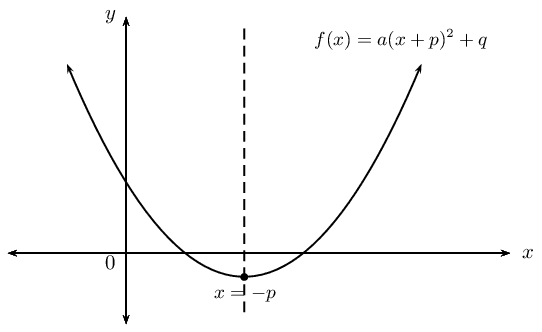

## Axis of symmetry

### Textbook Exercise 5.5

Determine the axis of symmetry of each of the
                                                                        following:

**Problem:**
\(y = 2x^2 - 5x - \text{18}\)

**Solution:**
\begin{align*}
                                                                        y &= 2x^2 - 5x - 18 \\
                                                                        &= 2(x^2 - \frac{5}{2}x - 9) \\
                                                                        &= 2\left( \left( x - \frac{5}{2} \right)^2
                                                                        - \frac{25}{16} - 9 \right) \\
                                                                        &= 2\left( \left( x - \frac{5}{2} \right)^2
                                                                        - \frac{169}{16}\right) \\
                                                                        &= 2\left( x - \frac{5}{4} \right)^2 -
                                                                        \frac{169}{8} \\
                                                                        \text{Axis of symmetry: }x & =\frac{5}{4}
                                                                        \end{align*}

**Problem:**
\(y = 3(x - 2)^2 + 1\)

**Solution:**
\begin{align*}
                                                                        y &= 3(x - 2)^2 + 1 \\
                                                                        \text{Axis of symmetry: } x & = 2
                                                                        \end{align*}

**Problem:**
\(y = 4x - x^2\)

**Solution:**
\begin{align*}
                                                                        y &= 4x - x^2 \\
                                                                        &= -(x^2 - 4x) \\
                                                                        &= -(x - 2)^2 + 4 \\
                                                                        \text{Axis of symmetry: } x & = 2
                                                                        \end{align*}

**Problem:**
Write down the equation of a parabola where the
                                                                        \(y\)-axis is the axis of symmetry.

**Solution:**
\(y = ax^2 + q\)

#### Sketching graphs of the form \(f(x)=a{\left(x+p\right)}^{2}+q\)

In order to sketch graphs of the form \(f(x)=a{\left(x+p\right)}^{2}+q\), we need to
                                        determine five characteristics:

- sign of \(a\)
- turning point
- \(y\)-intercept
- \(x\)-intercept(s) (if they exist)
- domain and range

<Callout type="note" title="Note">
<VideoPlayer src="http://www.khanacademy.org/embed_video?v=uA6mcx4FMN8" title="Video:
                                                        22QK" />
</Callout>

<Callout type="tip" title="Worked example 4: Sketching a parabola">
**Question:**
Sketch the graph of \(y = -\frac{1}{2}(x + 1)^2 - 3\).

Mark the intercepts, turning point and the axis of symmetry. State
                                                        the domain and range of the function.

**Examine the equation of the form \(y = a(x + p)^2 +
                                                        q\):**
We notice that \(a < 0\), therefore the graph is a
                                                        “frown” and has a maximum turning point.

**Determine the turning point \((-p;q)\):**
From the equation we know that the turning point is \((-1; -3)\).

**Determine the axis of symmetry \(x = -p\):**
From the equation we know that the axis of symmetry is \(x = -1\).

**Determine the \(y\)-intercept:**
The \(y\)-intercept is obtained by letting \(x = 0\):
                                                        \begin{align*}
                                                        y &= -\frac{1}{2} \left((0) + 1 \right)^2 - 3\\
                                                        &= -\frac{1}{2} - 3\\
                                                        &= -3\frac{1}{2}
                                                        \end{align*}
                                                        This gives the point \((0;-3\frac{1}{2})\).

**Determine the \(x\)-intercepts:**
The \(x\)-intercepts are obtained by letting \(y = 0\):
                                                        \begin{align*}
                                                        0 &= -\frac{1}{2} \left(x + 1 \right)^2 - 3\\
                                                        3 &= -\frac{1}{2} \left(x + 1 \right)^2 \\
                                                        -6 &= \left(x + 1 \right)^2
                                                        \end{align*}
                                                        which has no real solutions. Therefore, there are no
                                                        \(x\)-intercepts and the graph lies below the \(x\)-axis.

**Plot the points and sketch the graph:**
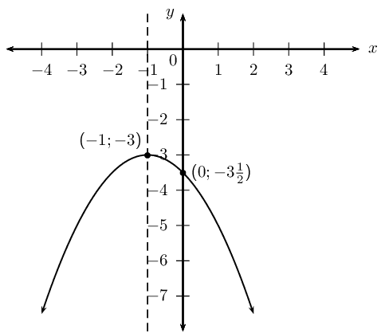

**State the domain and range:**
Domain: \(\{ x: x \in \mathbb{R} \}\)

Range: \(\{ y: y \leq -3, y \in \mathbb{R} \}\)
</Callout>

<Callout type="note" title="Note">
<VideoPlayer src="http://www.khanacademy.org/embed_video?v=dfoXtodyiIA" title="Video:
                                                        22QM" />
</Callout>

<Callout type="tip" title="Worked example 5: Sketching a parabola">
**Question:**
Sketch the graph of \(y = \frac{1}{2}x^2 - 4x + \frac{7}{2}\).

Determine the intercepts, turning point and the axis of symmetry.
                                                        Give the domain and range of the function.

**Examine the equation of the form \(y = ax^2 + bx +c\):**
We notice that \(a > 0\), therefore the graph is a
                                                        “smile” and has a minimum turning point.

**Determine the turning point and the axis of symmetry:**
Check that the equation is in standard form and identify the
                                                        coefficients.

                                                \[a = \frac{1}{2}; \qquad b = -4; \qquad c = \frac{7}{2}\]

Calculate the \(x\)-value of the turning point using
                                                        \begin{align*}
                                                        x &= -\frac{b}{2a} \\
                                                        &= -\left(\frac{-4}{2\left( \frac{1}{2} \right)}\right) \\
                                                        &= 4
                                                        \end{align*}
                                                        Therefore the axis of symmetry is \(x = 4\).

Substitute \(x = 4\) into the original equation to obtain the
                                                        corresponding \(y\)-value.
                                                        \begin{align*}
                                                        y &= \frac{1}{2}x^2 - 4x + \frac{7}{2} \\
                                                        &= \frac{1}{2}(4)^2 - 4(4) + \frac{7}{2} \\
                                                        &= 8 -16 +\frac{7}{2} \\
                                                        &= -4\frac{1}{2}
                                                        \end{align*}
                                                        This gives the point \(\left( 4; -4\frac{1}{2} \right)\).

**Determine the \(y\)-intercept:**
The \(y\)-intercept is obtained by letting \(x = 0\):
                                                        \begin{align*}
                                                        y &= \frac{1}{2}(0)^2 - 4(0) + \frac{7}{2}\\
                                                        &= \frac{7}{2}
                                                        \end{align*}
                                                        This gives the point \(\left(0;\frac{7}{2}\right)\).

**Determine the \(x\)-intercepts:**
The \(x\)-intercepts are obtained by letting \(y = 0\):
                                                        \begin{align*}
                                                        0 &= \frac{1}{2}x^2 - 4x + \frac{7}{2} \\
                                                        &= x^2 - 8x + 7 \\
                                                        &= (x - 1)(x - 7)
                                                        \end{align*}
                                                        Therefore \(x = 1\) or \(x = 7\).
                                                        This gives the points \((1;0)\) and \((7;0)\).

**Plot the points and sketch the graph:**
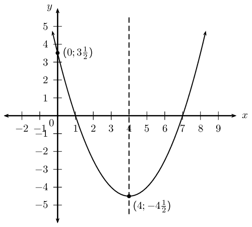

**State the domain and range:**
Domain: \(\{ x: x \in \mathbb{R} \}\)

Range: \(\{ y: y \geq -4\frac{1}{2}, y \in \mathbb{R} \}\)
</Callout>

## Shifting the equation of a parabola

Carl and Eric are doing their Mathematics homework and decide to check each
                                                others answers.

**Homework question:**

If the parabola \(y = 3x^2 + 1\) is shifted \(\text{2}\) units to the right,
                                                determine the equation of the new parabola.

- Carl's answer:
  A shift to the right means moving in the positive \(x\)
                                                                  direction, therefore \(x\) is replaced with \(x + 2\)
                                                                  and the new equation is \(y = 3(x + 2)^2 + 1\).
- Eric's answer:
  We replace \(x\) with \(x - 2\), therefore the new equation
                                                                  is \(y = 3(x - 2)^2 + 1\).

Work together in pairs. Discuss the two different answers and decide which
                                                one is correct. Use calculations and sketches to help explain your
                                                reasoning.

**Writing an equation of a shifted parabola**

The parabola is shifted horizontally:

- If the parabola is shifted \(m\) units to the right, \(x\) is
                                                          replaced by \((x-m)\).
- If the parabola is shifted \(m\) units to the left, \(x\) is replaced
                                                          by \((x+m)\).

The parabola is shifted vertically:

- If the parabola is shifted \(n\) units down, \(y\) is replaced by
                                                          \((y+n)\).
- If the parabola is shifted \(n\) units up, \(y\) is replaced by
                                                          \((y-n)\).

<Callout type="tip" title="Worked example 6: Shifting a parabola">
**Question:**
Given \(y = x^2 - 2x -3\).

2. If the parabola is shifted \(\text{1}\) unit to the
                                                                           right, determine the new equation of the
                                                                           parabola.
4. If the parabola is shifted \(\text{3}\) units down,
                                                                           determine the new equation of the parabola.

**Determine the new equation of the shifted parabola:**
2. The parabola is shifted \(\text{1}\) unit to the
                                                                           right, so \(x\) must be replaced by \((x-1)\).
                                                                           \begin{align*}
                                                                           y &= x^2 - 2x -3\\
                                                                           &= (x-1)^2 - 2(x-1) -3 \\
                                                                           &= x^2 - 2x + 1 -2x + 2 - 3\\
                                                                           &= x^2 - 4x
                                                                           \end{align*}
                                                                           Be careful not to make a common error: replacing
                                                                           \(x\) with \(x+1\) for a shift to the right.
4. The parabola is shifted \(\text{3}\) units down, so
                                                                           \(y\) must be replaced by \((y+3)\).
                                                                           \begin{align*}
                                                                           y + 3&= x^2 - 2x -3\\
                                                                           y &= x^2 - 2x -3 - 3 \\
                                                                           &= x^2 - 2x -6
                                                                           \end{align*}
</Callout>

## Sketching parabolas

### Textbook Exercise 5.6

Sketch graphs of the following functions and
                                                                        determine:

- intercepts
- turning point
- axes of symmetry
- domain and range

**Problem:**
\(y = -x^2 + 4x + 5\)

**Solution:**
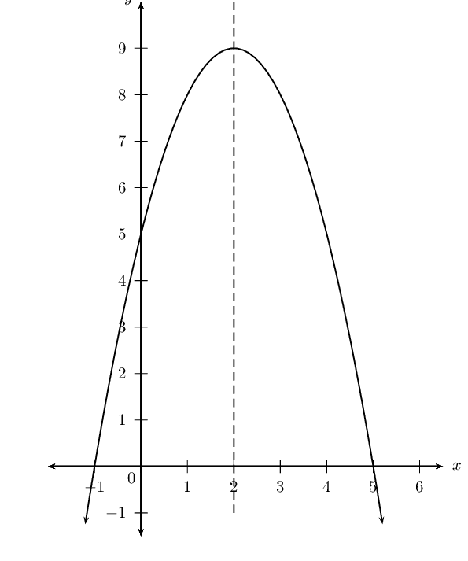

**Problem:**
\(y = 2(x + 1)^2\)

**Solution:**
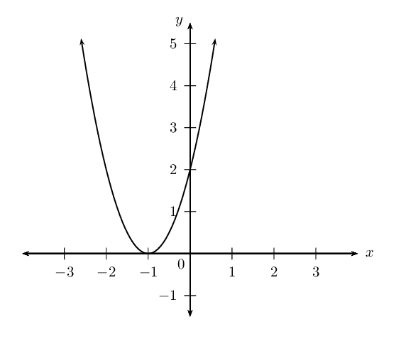

**Problem:**
\(y = 3x^2 - 2(x+2)\)

**Solution:**
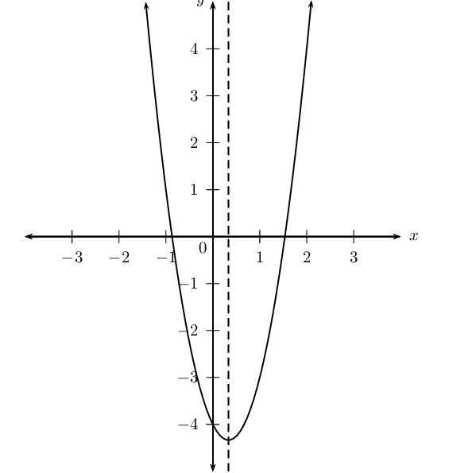

**Problem:**
\(y = 3(x -2)^2 + 1\)

**Solution:**
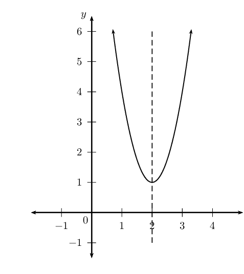

**Problem:**
Draw the following graphs on the same system of axes:

\(f(x) = -x^2 + 7\)

\(g(x) = -(x - 2)^2 + 7\)

\(h(x) = (x - 2)^2 - 7\)

**Solution:**
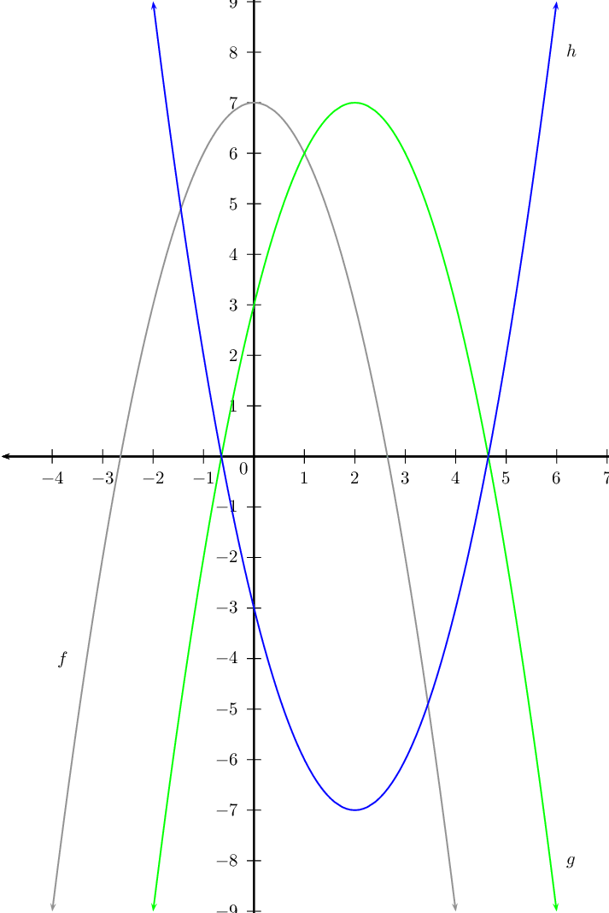

Draw a sketch of each of the following graphs:

**Problem:**
\(y = ax^2 + bx + c\) if \(a > 0\), \(b
                                                                                > 0\), \(c < 0\).

**Solution:**
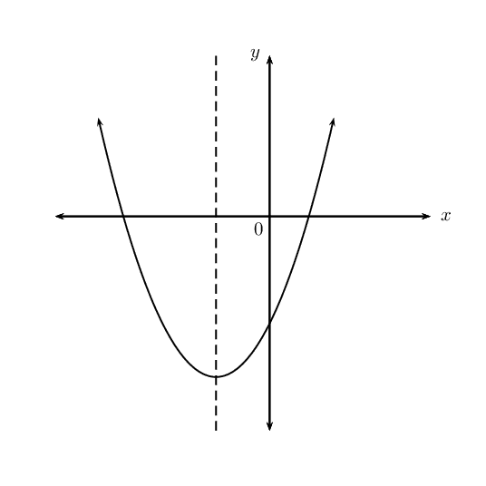

**Problem:**
\(y = ax^2 + bx + c\) if \(a < 0\), \(b =
                                                                                0\), \(c > 0\).

**Solution:**
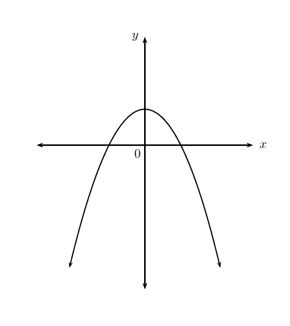

**Problem:**
\(y = ax^2 + bx + c\) if \(a < 0\), \(b
                                                                                < 0\), \(b^2 - 4ac < 0\).

**Solution:**
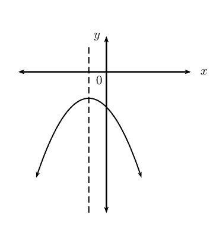

**Problem:**
\(y = (x+p)^2 + q\) if \(p < 0\), \(q <
                                                                                0\) and the \(x\)-intercepts have
                                                                                different signs.

**Solution:**
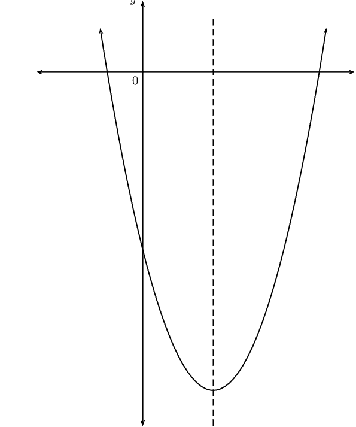

**Problem:**
\(y = a(x+p)^2 + q\) if \(a < 0\), \(p
                                                                                < 0\), \(q > 0\) and one root is
                                                                                zero.

**Solution:**
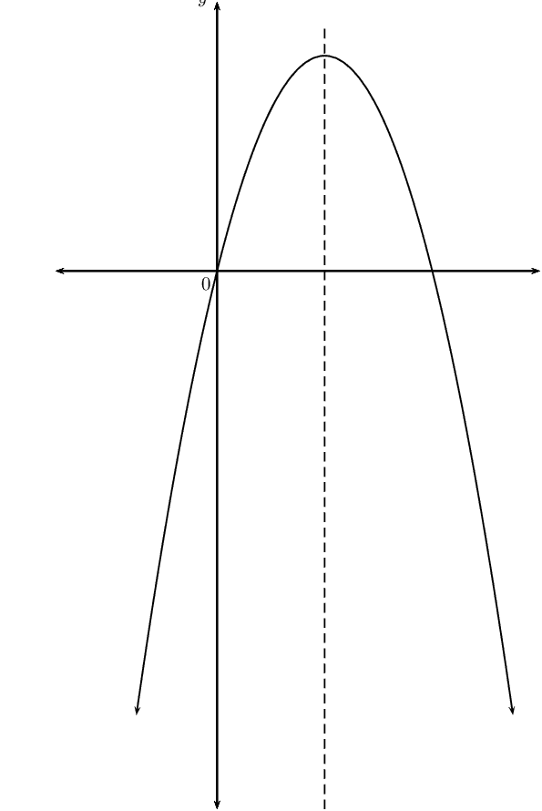

**Problem:**
\(y = a(x+p)^2 + q\) if \(a > 0\), \(p =
                                                                                0\), \(b^2 - 4ac > 0\).

**Solution:**
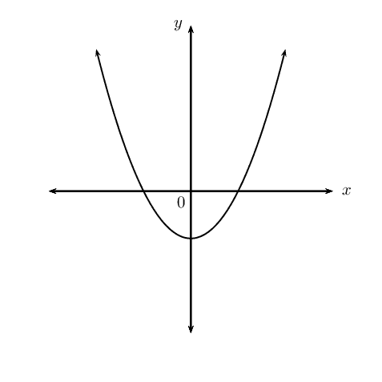

Determine the new equation (in the form \(y = ax^2 +
                                                                        bx + c\)) if:

**Problem:**
\(y = 2x^2 + 4x + 2\) is shifted \(\text{3}\)
                                                                                units to the left.

**Solution:**
\begin{align*}
                                                                        y &=2x^2 + 4x + 2 \\
                                                                        x &\Rightarrow x+3 \\
                                                                        y_{\text{shifted}} &=2(x+3)^2 + 4(x+3) + 2
                                                                        \\
                                                                        &= 2(x^2 + 6x + 9) + 4x+12 + 2 \\
                                                                        &= 2x^2 + 12x + 18 + 4x+12 + 2 \\
                                                                        &= 2x^2 + 16x + 32
                                                                        \end{align*}

**Problem:**
\(y = -(x+1)^2\) is shifted \(\text{1}\) unit
                                                                                up.

**Solution:**
\begin{align*}
                                                                        y &=2x^2 + 4x + 2 \\
                                                                        y &\Rightarrow y-1 \\
                                                                        y_{\text{shifted}} &= -(x+1)^2 + 1 \\
                                                                        &= -(x^2 + 2x + 1) + 1 \\
                                                                        &= -x^2 - 2x - 1 + 1 \\
                                                                        &= -x^2 - 2x
                                                                        \end{align*}

**Problem:**
\(y = 3(x-1)^2 +
                                                                                2\left(x-\frac{1}{2}\right)\) is shifted
                                                                                \(\text{2}\) units to the right.

**Solution:**
\begin{align*}
                                                                        y &= 3(x-1)^2 + 2\left(x-\frac{1}{2}\right)
                                                                        \\
                                                                        x &\Rightarrow x-2 \\
                                                                        y_{\text{shifted}} &= 3(x - 2-1)^2 +
                                                                        2\left(x - 2 -\frac{1}{2}\right) \\
                                                                        &= 3(x - 3)^2 + 2 \left(x -
                                                                        \frac{5}{2}\right) \\
                                                                        &= 3(x^2 - 6x + 9) + 2x - 5 \\
                                                                        &= 3x^2 - 18x + 27 + 2x - 5 \\
                                                                        &= 3x^2 - 16x + 22
                                                                        \end{align*}

**Finding the equation of a parabola from the graph**

If the intercepts are given, use \(y = a(x - x_1)(x - x_2)\).

| Example: | \(x\)-intercepts: \((-1;0)\) and \((4;0)\) \(\begin{aligned}
                                                        y &= a(x -x_1)(x - x_2) \\
                                                        &= a(x + 1)(x - 4) \\
                                                        &= ax^2 - 3ax - 4a
                                                        \end{aligned}\) \(y\)-intercept: \((0;2)\) \(\begin{aligned}
                                                        -4a &= 2 \\
                                                        a &= -\frac{1}{2}
                                                        \end{aligned}\) Equation of the parabola: \(\begin{aligned}
                                                        y &= ax^2 - 3ax - 4a \\
                                                        &= -\frac{1}{2}x^2 - 3\left(-\frac{1}{2}\right)x -
                                                        4\left(-\frac{1}{2}\right) \\
                                                        &= -\frac{1}{2}x^2 + \frac{3}{2}x + 2
                                                        \end{aligned}\) |
| --- | --- |

If the \(x\)-intercepts and another point are given, use \(y = a(x -x_1)(x - x_2)\).

| Example: | \(x\)-intercepts: \((1;0)\) and \((5;0)\) \(\begin{aligned}
                                                        y &= a(x -x_1)(x - x_2) \\
                                                        &= a(x - 1)(x - 5) \\
                                                        &= ax^2 - 6ax + 5a
                                                        \end{aligned}\) Substitute the point: \((-1;\text{12})\) \(\begin{aligned}
                                                        \text{12} &= a(-1)^2 - 6a(-1) + 5a \\
                                                        \text{12} &= a + 6a + 5a \\
                                                        \text{12} &= 12a \\
                                                        1 &= a
                                                        \end{aligned}\) Equation of the parabola: \(\begin{aligned}
                                                        y &= ax^2 - 6ax + 5a \\
                                                        &= x^2 - 6x + 5
                                                        \end{aligned}\) |
| --- | --- |

If the turning point and another point are given, use \(y = a(x + p)^2 + q\).

| Example: | Turning point: \((-3;1)\) \(\begin{aligned}
                                                        y &= a(x + p)^2 + q \\
                                                        &= a(x + 3)^2 + 1 \\
                                                        &= ax^2 + 6ax + 9a + 1
                                                        \end{aligned}\) Substitute the point: \((1;5)\) \(\begin{aligned}
                                                        5 &= a(1)^2 + 6a(1) + 9a + 1 \\
                                                        4 &= 16a \\
                                                        \frac{1}{4} &= a
                                                        \end{aligned}\) Equation of the parabola: \(y = \frac{1}{4}(x + 3)^2 + 1\) |
| --- | --- |

## Finding the equation

### Textbook Exercise 5.7

Determine the equations of the following graphs. Write your
                                                                answers in the form \(y = a(x + p)^2 + q\).

**Problem:**
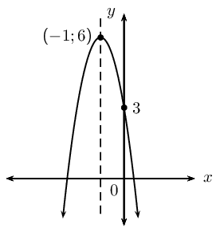

**Solution:**
\begin{align*}
                                                                y &= a(x + p)^2 + q \\
                                                                \text{Subst. } & (-1;6) \\
                                                                y &=a(x+1)^2+6 \\
                                                                &=ax^2+2ax+a+6 \\
                                                                y-\text{int: } &= (0;3) \\
                                                                3 &=0 +0 +a+6 \\
                                                                \therefore 3 &= a + 6 \\
                                                                a &= -3 \\
                                                                y=-3(x+1)^2+6 &\text{ or } y =-3x^2-6x+3
                                                                \end{align*}

**Problem:**
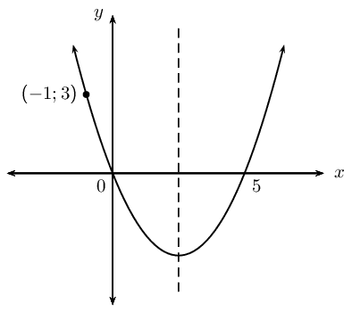

**Solution:**
\begin{align*}
                                                                y &= a(x + p)^2 + q \\
                                                                y&=a(x-0)(x-5) \\
                                                                &=ax^2-5ax \\
                                                                \text{Subst. } & (-1;3) \\
                                                                y &=ax^2-5ax \\
                                                                3 &=a(-1)^2-5a(-1) \\
                                                                3 &= a+5a \\
                                                                3 &= 6a \\
                                                                \therefore a &= \frac{1}{2} \\
                                                                \therefore y&=\frac{1}{2}x^2-\frac{5}{2}x
                                                                \end{align*}

**Problem:**
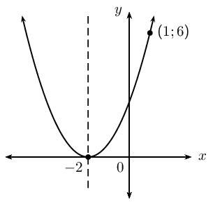

**Solution:**
\begin{align*}
                                                                y &= a(x + p)^2 + q \\
                                                                \text{Subst. } &= (-2;0) \\
                                                                y &= a(x + 2)^2 \\
                                                                &=ax^2+4ax+4a \\
                                                                \text{Subst. } & (1;6) \\
                                                                6 &= a +4a +4a \\
                                                                6 &=9a \\
                                                                \therefore a &=\frac{2}{3} \\
                                                                \therefore y &= \frac{2}{3}(x+2)^2
                                                                \end{align*}

**Problem:**
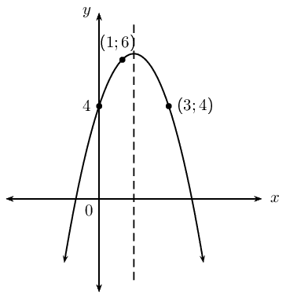

**Solution:**
\begin{align*}
                                                                y &= ax^2+bx+c \\
                                                                y &=ax^2+bx+4 \\
                                                                \text{Subst. }(1;6): \qquad 6&=a+b+4 \ldots (1) \\
                                                                \text{Eqn. }(1) \times 5: \qquad 30 &=5a+5b+20
                                                                \ldots (3) \\
                                                                \text{Subst. }(1;6): \qquad -6&=25a+5b+4 \ldots (2)
                                                                \\
                                                                (2) - (3) \quad -36&=20a-16 \\
                                                                20a&=-20 \\
                                                                a &= -1 \\
                                                                b&=3 \\
                                                                c&= 4 \\
                                                                \therefore y&=-x^2+3x+4
                                                                \end{align*}

<QuizCard id="m11-05-01f" title="Interactive Exercise 5.6" question="The following graph shows a quadratic function. The function has roots ( \(x\) -intercepts) at \((\text{3}\, ; 0)\) and \((\text{2} \, ; 0)\) . The quadratic coefficient is \(a = 1\) . What is the equation for this function? Give your answer in standard form, \(f(x) = x^2 + bx + c\) . INSTRUCTION: Type in only the right side of the equation. Do not type 'f(x) ='." options=[] answer="x^2 - 5x + 6" hint="Your answer should be a polynomial. You can use the following symbols to write mathematical expressions: add: + subtract: − multiply: ∗ divide: / exponent: ^ Example of a factorised polynomial: (x−1)(x+2) Example of an expanded polynomial: x^2 − x/4 + 1" explanation="Write down the root form for a quadratic function A quadratic function typically has \(\text{2}\) roots. The function is related to these roots by this equation: \[                     \begin{aligned}                         f(x) = a(x - \text{root}_{1})(x - \text{root}_{2})                     \end{aligned}                 \] This is often called the root form of a quadratic function. As always, the \(a\) -value determines if the parabola opens up or down, and how wide the parabola is. The binomials with the roots determine everything else about the parabola. Substitute in the roots Now substitute all the values we know into the equation. The question states that \(a = 1\) . The roots are the \(x\) -values at the \(x\) -intercepts. In this case the roots are \(x = \text{3}\) and \(x = \text{2}\) . \[                     \begin{aligned}                         f(x) &= a(x - \text{root}_1)(x - \text{root}_2)\\                         &= (1)(x - (3))(x - (2))\\                         &= (x - 3)(x - 2)                     \end{aligned}                 \] NOTE: It does not matter which root you substitute in first. This is because of the commutative property of multiplication, which says that: \((x - 3)(x - 2) = (x - 2)(x - 3) \) . Expand the expression to get standard form The only thing to do now is multiply the binomials to get the expanded equation. We need to do this because the question states that the answer should be in 'standard form'. Standard form for a quadratic function should look like \(y = ax^2 + bx + c\) . \[                     \begin{aligned}                         f(x) &= (x - 3)(x - 2)\\                         &= x^2 - 5x + 6                     \end{aligned}                 \] The function is \( f(x) = x^2 - 5x + 6\) . Comparing to standard form, we can see that \(a = 1\) , \(b = -\text{5}\) and \(c = \text{6}\) . NOTE: The process we used to answer this question is the opposite of finding the roots of a quadratic function. To find the roots, we would factorise the equation and get the roots from the factors. But in this case, we use the roots to write the factors and then we multiply the factors to get the equation. These are the same steps but in the opposite order! The right hand side of the equation is \(x^2 - 5x + 6\) . Submit your answer as:" />

<QuizCard id="m11-05-01f" title="Interactive Exercise 5.6" question="Find the values of \(p\) and \(q\) in the function \(f(x) = a(x + p)^{2} + q\) ." options=[] answer="1, -5" hint="You should enter a number here. If you want to, you can use a space to separate thousands.                Example: 12 800,25 For scientific notation you need to use the multiply symbol                ( ∗ ) and the exponent symbol ( ^ ). For example 6,673 × 10 −11 should be written as: 6,673 ∗ 10^−11" explanation="Read the value of \(q\) from the turning point We need to determine the values of \(p\) and \(q\) for the parabola in the question. Both of these values come directly from the turning point of the parabola. The function \(f(x) = a(x + p)^{2} + q\) is a parabola. And the \(q\) -term shifts the parabola in the vertical direction. This is because the \(q\) -term adds to (or subtracts from) all the output values of the function. The vertical shift of the parabola comes from this term adding to or subtracting from the output values. The turning point of \(y = x^{2}\) is at \((0\, ; 0)\) . If the function changes to \(y = x^{2} + 4\) the turning point will move up \(\text{4}\) spaces to \((0\, ; 4)\) . If the function changes to \(y = x^{2} - 2\) the turning point will instead move down \(\text{2}\) spaces to \((0\, ; -2)\) . So the \(y\) -coordinate of the turning point is directly related to the value of \(q\) . In this case, the turning point is at \((5\, ; 1)\) , so \(q = 1\) . Read the value of \(p\) from the turning point Similarly to the \(q\) -term, the \(p\) -term shifts the parabola. But the \(p\) -term moves the graph in the horizontal direction. This is because the \(p\) -term affects all the input values of the function. The horizontal shift of the parabola happens because this term adds to or subtracts from the input values inside the brackets, \((x + p)\) . But the direction of the shift is opposite to the sign of \(p\) . If \(p\) is positive, the graph shifts left . If \(p\) is negative, the graph shifts right . Just like in the step above, we can read the value of \(p\) directly from the turning point. The turning point is at \((5\, ; 1)\) , so \(p = -5\) . The correct answers are \(q = 1\) and \(p = -5\) . Submit your answer as: and" />

<QuizCard id="m11-05-01f" title="Interactive Exercise 5.6" question="The graph below shows three quadratic functions. They are labelled A, B and C. Which of the graphs corresponds to the function \(f(x) = (x - 4)^2 - 5\) ?" options=["A", "B", "C", "None of the above"] answer="C" hint="" explanation="Read off the values of \(a\) , \(p\) , and \(q\) The question gives us the function \(f(x) = (x - 4)^2 - 5\) . We need to identify which of the graphs in the question corresponds to this function. We can answer this question based on the function itself. The function in this question has the form \(f(x) = a(x + p)^{2} + q\) . The values \(a\) , \(p\) , and \(q\) have specific effects on the parabola: The \(a\) -value determines if the parabola opens up or down. The \(p\) -value shifts the parabola left or right. The \(q\) -value shifts the parabola up or down. The \(a\) -value for our function is \(a = 1\) . It is positive so the parabola we want must open up. Any parabola in the graph which opens down cannot be the correct choice. The \(p\) - and \(q\) -values together tell us where the turning point of the graph is. This is because they shift the graph, which moves the turning point. In this case, \(p = -4\) and \(q = -5\) , so the turning point must be at \((4\, ; -5)\) . Note that \(p\) moves the graph in the opposite direction to its sign! The correct graph should be shifted to the right because in the function \(p\) is negative. The other two graphs do not agree with parts of the function: Graph A cannot be correct because it opens down which disagrees with the \(a\) -value in the function. Graph B cannot be correct because the turning point is in the wrong location: it disagrees with both the \(q\) -value and the \(p\) -value in the function. The correct graph is C . Submit your answer as: C" />

<QuizCard id="m11-05-01f" title="Interactive Exercise 5.6" question="The equation of \(h\) is of the form \(h(x) = ax^{2} + bx + c\) . Determine the values of \(a\) , \(b\) , and \(c\) ." options=[] answer="-1, 8, -7" hint="You should enter a number here. If you want to, you can use a space to separate thousands.                Example: 12 800,25 For scientific notation you need to use the multiply symbol                ( ∗ ) and the exponent symbol ( ^ ). For example 6,673 × 10 −11 should be written as: 6,673 ∗ 10^−11" explanation="Substitute into the turning point form of a parabola There are three useful forms of the equation of a parabola: Standard form: \(y = ax^{2} + bx + c\) \(x\) -intercept form: \(y = a(x - x_{1})(x - x_{2})\) Turning point form: \(y = a(x - p)^{2} + q\) We have been given the turning point of \(h\) , so we will use the turning point form. In this equation, \((p\, ; q)\) are the coordinates of the turning point. \[     	            	\begin{aligned}     	            		y & = a(x - ({\color{orange}{4}}))^{2} + ({\color{purple}{9}}) \\                             & = a(x - 4)^{2} + 9      	            	\end{aligned}     	            \] Substitute in the coordinates of the \(y\) -intercept and solve for \(a\) Now we need to substitute in any other point. We have \(({\color{ForestGreen}{0}}\, ; {\color{MediumVioletRed}{-7}})\) : \[     	            	\begin{aligned}     	            		{\color{MediumVioletRed}{-7}} & = a(({\color{ForestGreen}{0}}) - 4)^{2} + 9  \\     	            		-7 & = 16 a + 9 \\     	            		-16 & = 16 a \\     	            		a & = -1      	            	\end{aligned}     	            \] Substitute the value of \(a\) into the turning point form of the equation and simplify \[     	            	\begin{aligned}     	            		y &= (-1)(x - 4)^{2} + 9 \\                             & = -(x^{2} - 8 x + 16)+9\\& = - x^{2} + 8 x - 16+9\\& = - x^{2} + 8 x - 7      	            	\end{aligned}     	            \] Therefore \(a = -1\) , \(b = 8\) , and \(c = -7\) . Submit your answer as: and and" />

<QuizCard id="m11-05-01f" title="Interactive Exercise 5.6" question="Function \(g\) is the parabola shown below with a turning point at \((2\, ; -1)\) and another solution to \(g\) at Point \(A \; (1\, ; 2)\) . Find the values of \(a\) , \(p\) , and \(q\) if the function is \(g(x) = a(x + p)^{2} + q\) ." options=[] answer="3, -2, -1" hint="You should enter a number here. If you want to, you can use a space to separate thousands.                Example: 12 800,25 For scientific notation you need to use the multiply symbol                ( ∗ ) and the exponent symbol ( ^ ). For example 6,673 × 10 −11 should be written as: 6,673 ∗ 10^−11" explanation="Find \(p\) and \(q\) from the turning point We need to determine the values of \(q\) and \(p\) for the parabola in the question. Both of these values come from the turning point of the parabola. The \(q\) -term shifts the parabola in the vertical direction. The \(p\) -term moves the graph in the horizontal direction. These shifts happen because of how \(p\) and \(q\) affect the input and output values of the function respectively. These shifts determine the location of the turning point. And the coordinates of the turning point tell us the values of \(p\) and \(q\) . The \(p\) -term shifts the graph in the opposite direction of its sign . The turning point is at \((2\, ; -1)\) , so \(p = -2\) and \(q = -1\) . Calculate the value of \(a\) Now we can use the results of the previous step and the coordinates of Point \(A\) to find \(a\) . First, let's substitute the values of \(p\) and \(q\) into the function: \[                     \begin{aligned}                         g(x) & = a(x + p)^{2} + q \\                         g(x) & = a(x + (-2))^{2} + (-1) \\                         g(x) & = a(x - 2)^2 - 1                     \end{aligned}                 \] Point \(A\) is a solution to the function so we can substitute the coordinates of \(A\) into the function. This forces the equation to show us the value of \(a\) which agrees with Point \(A\) . Point \(A\) is at \((1\, ; 2)\) , so: \[                     \begin{aligned}                         g(x) & = a(x - 2)^2 - 1 \\                         (2) & = a((1) - 2)^2 - 1 \\                         2 & = a(-1)^2 -1 \\ 2 & = a - 1                     \end{aligned}                 \] The original function, \(g(x) = a(x + p)^{2}\) , included \(\text{5}\) unknown values. These values are the function variables \(x\) and \(g\) , and the three parameters \(a\) , \(p\) , and \(q\) . But now the only unknown value is \(a\) ! So we can solve the equation. \[                     \begin{aligned}                         2 & = a - 1  \\                         3 & = a                     \end{aligned}                 \] TIP: Compare the answer to the graph to see if it agrees. In this case, we can compare the answer to the direction of the parabola. The parabola opens up so the \(a\) -value should be positive. If the answer here does not agree with the graph, it means there is a mistake! The value of \(a\) is \(3\) . NOTE: It is important to realise that we had to find the values of \(p\) and \(q\) first, because only then can we calculate the value of \(a\) . The answers are: \(a = 3\) \(p = -2\) \(q = -1\) Submit your answer as: and and" />

<QuizCard id="m11-05-01f" title="Interactive Exercise 5.6" question="Adapted from DBE Nov 2016 Grade 11, P1, Q10 Maths formulas Tlotliso wants to start a small flower bed at her house. She wants to use an existing wall and \(\text{19}\ \text{m}\) of fencing to enclose a rectangular area for the flower bed. Calculate the area of the largest rectangle she can enclose. INSTRUCTION: Give your answer as a fraction or rounded to two decimal places." options=[] answer="['45.13', '4.51e+1']" hint="You should enter a number here. If you want to, you can use a space to separate thousands.                Example: 12 800,25 For scientific notation you need to use the multiply symbol                ( ∗ ) and the exponent symbol ( ^ ). For example 6,673 × 10 −11 should be written as: 6,673 ∗ 10^−11" explanation="Set up an algebraic expression for the area Let Length 1 be \(x\) . Then: \[                 \begin{aligned}                     \text{Area} &= (\text{19}-2x)x \\                     &= -2x^{2} + \text{19}x                  \end{aligned}             \] Determine the value of \(x\) The area is a quadratic expression, which could be represented by a parabola. The \(x\) -value at the turning point gives the maximum value of the expression. \[                 \begin{aligned}                     x &= \frac{-b}{2a} \\                       &= \frac{-\text{19}}{2(-2)} \\ &=\frac{19}{4} \\                     x &= \text{4,75}\ \text{m} \\                     \therefore \text{Length 1} &= \text{4,75}\ \text{m}                 \end{aligned}             \] Calculate the maximum area \[                 \begin{aligned}                     \text{Area} &= (19 - 2x)x \\ &= (19-2(\text{4,75}))\cdot(\text{4,75}) \\ \text{Area} &= \text{45,125} \\ & \approx \text{45,13}\ \text{m$^{2}$}                 \end{aligned}             \] Submit your answer as:" />

<QuizCard id="m11-05-01f" title="Interactive Exercise 5.6" question="The graph here shows the function \(f(x) = - \frac{1}{2}(x - 1)^2 + 2\) . For which values of \(x\) is \(f(x) < 0\) ? Select your answer from the choices below." options=["x = -4", "x \u2265 -4", "x < -1 and x > 3", "-1 < x < 3", "x can be any real number", "no values of x satisfy this inequality"] answer="x < -1 and x > 3" hint="" explanation="Find the part of the function for which \(f(x) < 0\) We need to determine the \(x\) -values for which \(f(x) < 0\) . The inequality \(f(x) < 0\) refers to output values which are smaller than zero. This is easiest to see on the graph. The \(x\) -axis divides the output values into positives and negatives. Anything above the \(x\) -axis has a positive output value, and anything below the \(x\) -axis has a negative output value. And any point on the \(x\) -axis has an output of zero. The inequality \(f(x) < 0\) means that we want to find any part of the parabola below the \(x\) -axis . So we want to find the part of the parabola that sits in the shaded region below. There are two sections of the graph which have the output values we are looking for. Notice that the highlighted sections are below the \(x\) -axis. That is how we know that they have negative output values. Also, the circles on the \(x\) -axis are open. This is because the inequality \(f(x) < 0\) tells us that points on the parabola with output values equal to zero should not be included! The values of \(x\) for which \(f(x) < 0\) are \(x < -1 \; \text{and} \; x > 3\) . Submit your answer as: x < -1 and x > 3" />

<QuizCard id="m11-05-01f" title="Interactive Exercise 5.6" question="On the graph here you see a function of the form: \[\begin{array}{c}f\left(x\right) = j \left(x - \dfrac{1}{2}\right)^{2} + k\end{array}\] Two points on the function are known: Point A is at \( \left( -1\, ; - \dfrac{3}{4} \right) \) and Point B is at \( \left( \dfrac{3}{2}\, ; -2 \right) \) . Calculate the values of \(j\) and \(k\) in the function. Your answers should be exact (do not round off)." options=[] answer=" 1 ,  -3 " hint="You should enter a number here. If you want to, you can use a space to separate thousands.                Example: 12 800,25 For scientific notation you need to use the multiply symbol                ( ∗ ) and the exponent symbol ( ^ ). For example 6,673 × 10 −11 should be written as: 6,673 ∗ 10^−11" explanation="Use Point \(A\) to set up an equation We need to find the values of the parameters \(j\) and \(k\) for the function in the equation. If we knew the coordinates of the turning point, we could read the \(k\) -value straight from that. But unfortunately we do not have that information. So we need a different strategy. To find the values of \(j\) and \(k\) in a situation like this, we can use simultaneous equations. If we substitute the coordinates of both Points \(A\) and \(B\) we will get two different equations which we can solve simultaneously. (We can substitute any point on the curve into the equation, because the points on the curve agree with the equation. In other words, they make the equation true.) First, we will substitute the coordinates of Point \(A \left( -1\, ; - \dfrac{3}{4} \right) \) into the equation. Then simplify the equation as much as possible. \[                     \begin{aligned}                     f & = j \left(x - \frac{1}{2} \right)^2 + k \\                     \left( - \dfrac{3}{4} \right) & = j \left(\left( -1 \right) - \frac{1}{2} \right)^2 + k \\                     - \dfrac{3}{4} & = j \left( - \frac{3}{2} \right)^2 + k \\                     - \dfrac{3}{4} & = j \left( \frac{9}{4} \right) + k \\                     - \frac{9 j}{4} - \frac{3}{4} & = k                     \end{aligned}                 \] Use Point \(B\) to set up another equation Second, we can substitute the value of Point \(B \left( \dfrac{3}{2}\, ; -2 \right) \) into the equation. \[                 \begin{aligned}                     f & = j \left(x - \frac{1}{2} \right)^2 + k \\                     \left( -2 \right) & = j \left(\left( \dfrac{3}{2} \right) - \frac{1}{2} \right)^2 + k \\                     -2 & = j \left( 1 \right)^2 + k \\                     -2 & = j \left( 1 \right) + k \\                     - j - 2 & = k                 \end{aligned}                 \] Solve the equations simultaneously for \(j\) We now have two equations from the work above. Both equations include the variables \(j\) and \(k\) . This is a pair of simultaneous equations, and we can solve them by substitution. The right sides of both equations are equal to \(k\) , so we can write this equation: \[\begin{array}{c}^{\text{Set up an equation}}_{\text{based on } k \;=\; k} \quad \rightarrow \quad - \frac{9 j}{4} - \frac{3}{4} = - j - 2\end{array}\] In this case, there are fractions in the equation, so start by cancelling the denominators. In this case, the lowest common denominator (LCD) of the fractions is \(\text{4}\) . Multiply both sides of the equation by \(\text{4}\) to remove the denominators. But there is another opportunity to simplify this equation: note that there are \(\text{4}\) negative terms in the equation. We can cancel the negatives as well as the denominators if we multiply by \(-\text{4}\) . \[                     \begin{aligned}                     - \frac{9 j}{4} - \frac{3}{4} &= - j - 2 \\ -4 \left(- \frac{9 j}{4} - \frac{3}{4} \right) & = \left( - j - 2 \right) \left( -4 \right)\\ 9 j + 3 & = 4 j + 8\\ 5 j & = 5\\ j & = 1                     \end{aligned}                 \] The value of \(j\) is \( 1 \) . TIP: Compare the answer here to the graph. The parabola in the question opens up. If the answer for \(j\) is not positive there must be a mistake in the working. Substitute \(j\) into one of the equations to find \(k\) From the work above, we have \(\text{2}\) equations which connect \(k\) to \(j\) : \[\begin{array}{c}- \frac{9 j}{4} - \frac{3}{4} = k \qquad \text{and} \qquad - j - 2 = k\end{array}\] To find \(k\) , we substitute the value of \(j\) into either of the equations. It is best to pick the simpler equation (to avoid fractions and negatives if possible). The second equation has fewer fractions than the first one, so we will use the second option. \[                     \begin{aligned}                     k & = - j - 2 \\                     ^{\text{Substitute}}_{j\; = \;1} \quad \rightarrow \quad & = -\left( 1 \right) - 2 \\                     & = -\text{3}                     \end{aligned}                 \] TIP: As above, compare this answer to the graph. The turning point of the parabola is below the \(x\) -axis. So the value of \( k \) must be negative. If it is not, there is a mistake somewhere. The correct value of \( j \) is \( 1 \) . The correct value of \( k \) is \( -3 \) . Submit your answer as: and" />

<QuizCard id="m11-05-01f" title="Interactive Exercise 5.6" question="For which values of \(x\) will \(g(x) \leq 0\) ? Choose your answer from the choices below." options=["x \u2264 2", "x \u2264 -3 and x \u2265 1", "-3 \u2264 x \u2264 1", "x > 2", "x can be any real number", "no values of x satisfy this inequality", "0 < x < 1", "-3 < x < 0 and x > 1", "0 < x < 1 and x > 2", "x < -3 and 0 < x < 1", "none of the above"] answer="-3 ≤ x ≤ 1" hint="" explanation="Find the parts of the parabola below the \(x\) -axis The inequality \(g(x) \leq 0\) refers to the output values which are less than or equal to zero. On the Cartesian plane, negative output values are all below the \(x\) -axis. And any point on the \(x\) -axis has an output of zero. The inequality \(g(x) \leq 0\) tells us that we need to find the parts of the parabola which are below or touching the \(x\) -axis. So we want to find the parts of the parabola that sit in the shaded region below: There is one part of the parabola with the required output values. This section consists of all points below the \(x\) -axis, including the turning point. Notice that the highlighted section is below the \(x\) -axis: that is how we know that they have negative output values. The values of \(x\) for which \(g(x) \leq 0\) are \(-3 \leq x \leq 1\) . Submit your answer as: -3 ≤ x ≤ 1" />

<QuizCard id="m11-05-01f" title="Interactive Exercise 5.6" question="What are the coordinates of Point \(B\) ? INSTRUCTION: Type the coordinates with brackets and a semicolon between the numbers. For example: (4 ; -2)." options=[] answer="( 0 ; 0 )" hint="You are expected to write a coordinate here. A coordinate is a list of numbers, separated by semi-colons ( ; ).                Coordinates are surrounded by brackets. Example: (1,5 ; 3) The spaces are optional." explanation="Use the parabola's symmetry to find Point \(B\) The question asks us to find the coordinates of Point \(B\) . This is one of the roots of the function. We can find the answer using the symmetry of the parabola. The axis of symmetry is a mirror line for the parabola, and the roots are reflections of each other through this mirror. The axis of symmetry is at \(x = \text{1}\) . Point \(C\) is at \((2\, ; 0)\) , so it is \(\text{1}\) space from the axis of symmetry. So Point \(B\) must also be \(\text{1}\) space from the axis of symmetry, but in the opposite direction. If we count \(\text{1}\) space to the left from the symmetry line we arrive at \(x = 0\) . Therefore the coordinates of Point \(B\) are \((0\, ; \text{0})\) . Submit your answer as:" />

<QuizCard id="m11-05-01f" title="Interactive Exercise 5.6" question="Give the equation of the quadratic function \(f\) if it is given that: The range of \(f\) is \( y \leq 3\) Domain: \(x \in R\) The roots of \(f\) are at \((\text{0}\, ; \text{0})\) and \((\text{2}\, ; \text{0})\) INSTRUCTION: Type the entire equation into the answer box, starting with 'f = ...'." options=[] answer="['f = -3*x**2 + 6*x + 0', 'f(x) = -3*x**2 + 6*x + 0', 'y = -3*x**2 + 6*x + 0']" hint="Your answer should be a mathematical equation. Here is an example of a famous                equation: E = mc^2 You can use the following symbols to write equations: add: + subtract: − multiply: ∗ divide: / exponent: ^ The following special symbols are also recognised: pi (π): pi infinity (∞): oo It is also possible to write certain functions: √: sqrt( ) log: log( ) sin: sin( ) cosec: cosec( ) cos: cos( ) sec: sec( ) tan: tan( ) cot: cot( ) To write a logarithm with a specific base, use the underscore _ symbol.                For example, log of x base 3 can be written as: log_3 x" explanation="Use the roots given There are a number of ways to solve this question. We could use the turning point version of the quadratic equation. Or we could use the standard form. A good choice in this case is the root form, because the information given includes the two roots \((\text{0}\, ; 0)\) and \((\text{2}\, ; 0)\) . Start by writing down the root form and substituting in the root values. \[                     \begin{aligned}                         f &= a(x - \text{root}_1)(x - \text{root}_2)\\                         &= a(x - (0))(x - (2)) \\                         &= a(x)(x - 2)                     \end{aligned}                 \] Find the coordinates of a point on the graph Now we need to find the value of \(a\) . To do that, we need to use another point on the graph. But we cannot use either of the roots because we have already used both. And we do not know any other points on the graph. What point can we use? The question tells us that the range of the function is \( y \leq 3\) . That means the turning point of the parabola is at \(y = 3\) ! If we can find the \(x\) -coordinate of the turning point we will have what we need. The symmetry of the parabola requires that the turning point is between the roots. Since the roots are at \(x = \text{0}\) and \(x = \text{2}\) , the axis of symmetry of the parabola must be at \(x = \text{1}\) . Therefore the turning point of the parabola must be at \((\text{1}\, ; 3)\) . Calculate the value of \(a\) Now we know that the turning point of the parabola is at \((\text{1}\, ; 3)\) . We can use these coordinates to find \(a\) in the function. When we substitute in these coordinates, we are telling the function to show us the value of \(a\) which agrees with this point. \[                     \begin{aligned}                         f &= a(x)(x - 2)\\                         3 &= a(1)((1) - 2)\\                          3 &= a(1)(-1)\\                         3  &= a \left(-1 \right)\\                          -3 &= a                     \end{aligned}                 \] Determine the full equation Finally we have the information necessary to find the complete equation. Substitute \(a = -\text{3}\) into the equation and expand. \[                     \begin{aligned}                      f &=  a(x)(x - 2)\\                      &=  (-\text{3})(x)(x - 2)\\                      &= -3(x^{2} - 2 x + 0) \\ & = - 3 x^{2} + 6 x + 0                     \end{aligned}                 \] The correct equation for the function is: \(f = - 3 x^{2} + 6 x + 0\) Submit your answer as:" />

<QuizCard id="m11-05-01f" title="Interactive Exercise 5.6" question="Determine a simplified expression for the length of \(DC\) in terms of \(x\) and \(k\) ." options=[] answer="2*x**2 - 8*x - 2 + k" hint="Your answer should be a mathematical expression. You can use the following symbols to write mathematical expressions: add: + subtract: − multiply: ∗ divide: / exponent: ^ The following special symbols are also recognised: pi (π): pi infinity (∞): oo It is also possible to write certain functions: √: sqrt( ) log: log( ) sin: sin( ) cosec: cosec( ) cos: cos( ) sec: sec( ) tan: tan( ) cot: cot( ) To write a logarithm with a specific base, use the underscore _ symbol.                For example, log of x base 3 can be written as: log_3 x" explanation="Subtract the equation of \(g\) from \(f\) To determine the length of a vertical line segment, subtract the smaller \(y\) -coordinate from the larger \(y\) -coordinate. We don't know the exact values of the \(y\) -coordinates, but we can get expressions for them from the equations of \(g\) and \(f\) . \[     	            	\begin{aligned}                             DC& = {\color{red}{f(x)}} - {\color{blue}{g(x)}}\\& = {\color{red}{2 x^{2} - 12 x + k}} - ({\color{blue}{- 4 x + 2}}) \\& = 2 x^{2} - 12 x + k + 4 x - 2\\& = 2 x^{2} - 8 x - 2  + k     	            	\end{aligned}     	            \] Submit your answer as:" />

<QuizCard id="m11-05-01f" title="Interactive Exercise 5.6" question="Calculate the length of \(US\) ." options=[] answer="9" hint="You should enter a number here. If you want to, you can use a space to separate thousands.                Example: 12 800,25 For scientific notation you need to use the multiply symbol                ( ∗ ) and the exponent symbol ( ^ ). For example 6,673 × 10 −11 should be written as: 6,673 ∗ 10^−11" explanation="Determine the coordinates of \(S\) To determine \(US\) , we need to know the coordinates of \(S\) and \(U\) . \(S\) is the largest \(x\) -intercept of \(g(x) = \dfrac{1}{4}x^{2} - 4\) . To find \(x\) -intercepts, let \(y = 0\) . \[     	            	\begin{aligned}     	            		\frac{1}{4}x^{2} - 4 & = 0  \\     	            		x^{2} - 16& = 0 \\(x + 4)(x - 4) & = 0 \\     	            		\therefore x = -4 & \text { or } x = 4     	            	\end{aligned}     	            \] \(S\) is the largest \(x\) -intercept of \(g\) , so \(S(4\, ; 0)\) . Determine the coordinates of \(U\) \(U\) is the smallest \(x\) -intercept of \(h(x) = - x^{2} - 6 x - 5\) . Let \(y = 0\) : \[     	            	\begin{aligned}     	            		- x^{2} - 6 x - 5 & = 0  \\     	            		x^{2} + 6 x + 5& = 0 \\(x + 5)(x + 1) & = 0 \\     	            		\therefore x = -5 & \text{ or } x = -1     	            	\end{aligned}     	            \] \(U\) is the smallest \(x\) -intercept of \(h\) , so \(U(-5\, ; 0)\) . Calculate the length of \(US\) TIP: Length is always positive! \[     	            	\begin{aligned}     	            		US & = 4 - (-5) \\     	            		& = 9      	            	\end{aligned}     	            \] Submit your answer as:" />

<QuizCard id="m11-05-01f" title="Interactive Exercise 5.6" question="Determine the value of \(m\) such that \(f(x) = m\) has equal roots. INSTRUCTION: Give your answer as an integer or a simplified fraction." options=[] answer="25/8" hint="You are expected to write a fraction here. You can write pure fractions using the division symbol: / For example, to write the fraction \(-\frac{2}{3}\) the correct input would be: -2/3 You can also write mixed numbers by first writing the integer part, then a space and                then the fraction part. For example, to write \(2 \frac{1}{8}\) the correct input                would be: 2 1/8" explanation="Use the coordinates of the turning point and the graph to determine \(m\) \(f(x)=m\) will have equal roots when the horizontal line \(y=m\) cuts the graph of \(y\) exactly once. This only happens for the function \(y = \dfrac{25}{8}\) . Therefore \(m=\dfrac{25}{8}\) . Submit your answer as:" />
