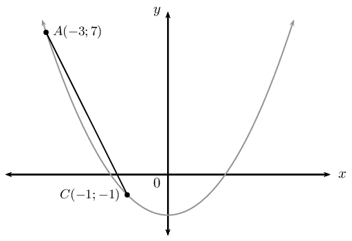
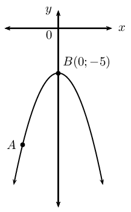
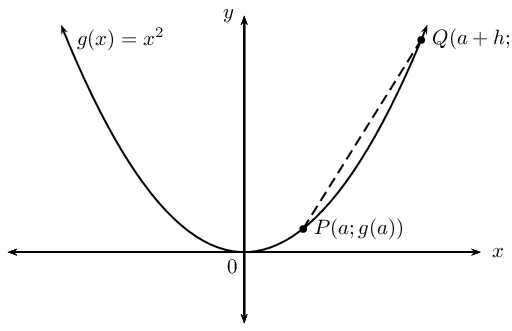
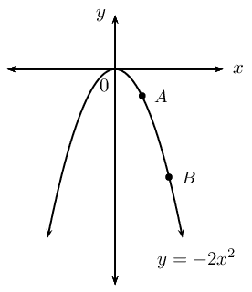
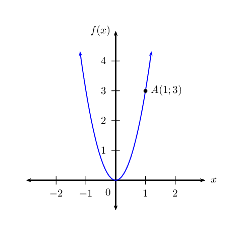
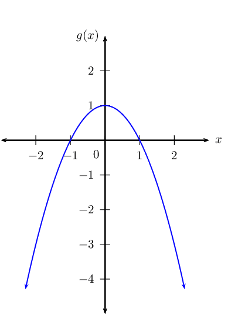

## 5.2 Average gradient (EMBGN)

We notice that the gradient of a curve changes at every point on the curve, therefore we need to work with the
      average gradient. The average gradient between any two points on a curve is the gradient of the straight line
      passing through the two points.

For the diagram above, the gradient of the line \(AC\) is
      \begin{align*}
      \text{Gradient }&= \frac{y_A - y_C}{x_A - x_C} \\
      &= \frac{7-(-1)}{-3-(-1)} \\
      &= \frac{8}{-2} \\
      &= -4
      \end{align*}
      This is the average gradient of the curve between the points \(A\) and \(C\).

What happens to the gradient if we fix the position of one point and move the second point closer to the fixed
      point?

## Gradient at a single point on a curve

The curve shown here is defined by \(y=-2{x}^{2}-5\). Point \(B\) is fixed at \(\left(0;-5\right)\) and the
        position of point \(A\) varies.

Complete the table below by calculating the \(y\)-coordinates of point \(A\) for the given \(x\)-coordinates
        and then calculating
        the average gradient between points \(A\) and \(B\).

| \(x_A\) | \(y_A\) | Average gradient |
| --- | --- | --- |
| \(-\text{2}\) |  |  |
| \(-\text{1,5}\) |  |  |
| \(-\text{1}\) |  |  |
| \(-\text{0,5}\) |  |  |
| \(\text{0}\) |  |  |
| \(\text{0,5}\) |  |  |
| \(\text{1}\) |  |  |
| \(\text{1,5}\) |  |  |
| \(\text{2}\) |  |  |

2. What happens to the average gradient as \(A\) moves towards \(B\)?
4. What happens to the average gradient as \(A\) moves away from \(B\)?
6. What is the average gradient when \(A\) overlaps with \(B\)?

In the example above, the gradient of the straight line that passes through points \(A\) and \(C\) changes as
      \(A\) moves closer to \(C\). At the point where \(A\) and \(C\) overlap, the straight line only passes through one
      point on the curve. This line is known as a tangent to the curve.

We therefore introduce the idea of the gradient at a single point on a curve. The gradient at a point on a curve
      is the gradient of the tangent to the curve at the given point.

<Callout type="tip" title="Worked example 7: Average gradient">
**Question:**

2. Find the average gradient between two points \(P\left(a;g(a)\right)\) and \(Q\left(a+h;g(a+h)\right)\) on
               a curve \(g(x)={x}^{2}\).
4. Determine the average gradient between \(P\left(2;g(2)\right)\) and \(Q\left(5;g(5)\right)\).
6. Explain what happens to the average gradient if \(Q\) moves closer to \(P\).

**Assign labels to the \(x\)-values for the given points:**
\begin{align*}
        x_1 &= a \\
        x_2 &= a + h
        \end{align*}

**Determine the corresponding \(y\)-coordinates:**
Using the function \(g(x) = x^2\), we can determine:
          \[y_1 = g(a) = a^2\]

          \begin{align*}
          y_2 &= g(a + h) \\
          &= (a + h)^2 \\
          &= a^2 + 2ah + h^2
          \end{align*}

**Calculate the average gradient:**
\begin{align*}
          \frac{{y}_{2}-{y}_{1}}{{x}_{2}-{x}_{1}}
          &= \frac{\left({a}^{2}+2ah+{h}^{2}\right)-\left({a}^{2}\right)}{\left(a+h\right)-\left(a\right)} \\
          &= \frac{{a}^{2}+2ah+{h}^{2}-{a}^{2}}{a+h-a} \\
          &= \frac{2ah+{h}^{2}}{h} \\
          &= \frac{h(2a+h)}{h} \\
          &= 2a+h
          \end{align*}
          The average gradient between \(P\left(a;g(a)\right)\) and \(Q\left(a+h;g(a+h)\right)\) on the curve
          \(g(x)={x}^{2}\) is \(2a+h\).

**Calculate the average gradient between \(P\left(2;g(2)\right)\) and \(Q\left(5;g(5)\right)\):**
The \(x\)-coordinate of \(P\) is \(a\) and the \(x\)-coordinate of \(Q\) is \(a+h\) therefore if we know that
          \(a=2\) and \(a+h=5\), then \(h=3\).

The average gradient is therefore

        \(2a+h=2\left(2\right)+\left(3\right)=7\)

**When \(Q\) moves closer to \(P\):**
When point \(Q\) moves closer to point \(P\), \(h\) gets smaller.

When the point \(Q\) overlaps with the point \(P\), \(h=0\) and the gradient is given by \(2a\).
</Callout>

We can write the equation for average gradient in another form. Given a curve \(f(x)\) with two points \(P\) and
      \(Q\) with \(P\left(a;f(a)\right)\) and \(Q\left(a+h;f(a+h)\right)\). The average gradient between \(P\) and \(Q\)
      is:
      \begin{align*}
      \text{Average gradient }&= \frac{{y}_{Q}-{y}_{P}}{{x}_{Q}-{x}_{P}} \\
      &= \frac{f(a+h)-f(a)}{\left(a+h\right)-\left(a\right)} \\
      &= \frac{f(a+h)-f(a)}{h}
      \end{align*}
      This result is important for calculating the gradient at a point on a curve and will be explored in greater detail
      in Grade \(\text{12}\).

<Callout type="tip" title="Worked example 8: Average gradient">
**Question:**
Given \(f(x) = -2x^2\).

2. Draw a sketch of the function and determine the average gradient between the points \(A\), where \(x =
                 1\), and \(B\), where \(x = 3\).
4. Determine the gradient of the curve at point \(A\).

**Examine the form of the equation:**
From the equation we see that \(a < 0\), therefore the graph is a “frown” and has a maximum
          turning point. We also see that when \(x = 0\), \(y = 0\), therefore the graph passes through the origin.

**Draw a rough sketch:**

**Calculate the average gradient between \(A\) and \(B\):**
\begin{align*}
        \text{Average gradient} &= \frac{f(3) - f(1)}{3 - 1} \\
        &= \frac{-2(3)^2 - (-2(1)^2)}{2} \\
        &= \frac{-18 + 2}{2} \\
        &= \frac{-16}{2} \\
        &= -8
        \end{align*}

**Calculate the average gradient for \(f(x)\):**
\begin{align*}
          \text{Average gradient} &= \frac{f(a + h) - f(a)}{(a + h) - a} \\
          &= \frac{-2(a + h)^2 - (-2a^2)}{h} \\
          &= \frac{-2a^2 - 4ah - 2h^2 + 2a^2}{h} \\
          &= \frac{-4ah - 2h^2}{h} \\
          &= \frac{h(-4a - 2h)}{h} \\
          &= -4a - 2h
          \end{align*}
          At point \(A\), \(h = 0\) and \(a = 1\).

Therefore
          \begin{align*}
          \text{Average gradient} &= -4a - 2h \\
          &= -4(1) - 2(0) \\
          &= -4
          \end{align*}
</Callout>

### Textbook Exercise 5.8

**Problem:**
Determine the average gradient of the curve \(f(x)=x\left(x+3\right)\) between \(x=5\) and \(x=3\).

**Solution:**
\(\text{11}\)

**Problem:**
Hence, state what you can deduce about the function \(f\) between \(x=5\) and \(x=3\).

**Solution:**
Solution not available at present

\(A\left(1;3\right)\) is a point on \(f(x)=3{x}^{2}\).

**Problem:**
Draw a sketch of \(f(x)\) and label point \(A\).

**Solution:**

**Problem:**
Determine the gradient of the curve at point \(A\).

**Solution:**
\(\text{6}\)

**Problem:**
Determine the equation of the tangent line at \(A\).

**Solution:**
\(y = 6x - 3\)

Given: \(g(x) = -x^2 + 1\).

**Problem:**
Draw a sketch of \(g(x)\).

**Solution:**

**Problem:**
Determine the average gradient of the curve between \(x=-2\) and \(x=1\).

**Solution:**
\(\text{1}\)

**Problem:**
Determine the gradient of \(g\) at \(x=2\).

**Solution:**
\(\text{4}\)

**Problem:**
Determine the gradient of \(g\) at \(x=0\).

**Solution:**
\(\text{0}\)
