## 5.3 Hyperbolic functions (EMBGP)

### Revision (EMBGQ)

#### Functions of the form \(y=\frac{a}{x}+q\)

Functions of the general form \(y = \frac{a}{x} + q\) are called hyperbolic
                                        functions, where \(a\) and \(q\) are constants.

**The effects of \(a\) and \(q\) on \(f(x) = \frac{a}{x} + q\):**

- **The effect of \(q\) on vertical shift**
  - For \(q>0\), \(f(x)\) is shifted vertically
                                                                            upwards by \(q\) units.
  - For \(q<0\), \(f(x)\) is shifted vertically
                                                                            downwards by \(q\) units.
  - The horizontal asymptote is the line \(y = q\).
  - The vertical asymptote is the \(y\)-axis, the line
                                                                            \(x = 0\).
- **The effect of \(a\) on shape and quadrants**
  - For \(a>0\), \(f(x)\) lies in the first and third
                                                                            quadrants.
  - For \(a > 1\), \(f(x)\) will be further away from
                                                                            both axes than \(y = \frac{1}{x}\).
  - For \(0<a<1\), as \(a\) tends to \(\text{0}\),
                                                                            \(f(x)\) moves closer to the axes than \(y =
                                                                            \frac{1}{x}\).
  - For \(a<0\), \(f(x)\) lies in the second and
                                                                            fourth quadrants.
  - For \(a < -1\), \(f(x)\) will be further away from
                                                                            both axes than \(y = - \frac{1}{x}\).
  - For \(-1<a<0\), as \(a\) tends to \(\text{0}\),
                                                                            \(f(x)\) moves closer to the axes than \(y =
                                                                            -\frac{1}{x}\).

|  | \(a<0\) | \(a>0\) |
| --- | --- | --- |
| \(q>0\) |  |  |
| \(q=0\) |  |  |
| \(q<0\) |  |  |

## Revision

### Textbook Exercise 5.9

**Problem:**
Consider the following hyperbolic functions:

- \(y_1 = \frac{1}{x}\)
- \(y_2 = -\frac{4}{x}\)
- \(y_3 = \frac{4}{x} - 2\)
- \(y_4 = -\frac{4}{x} + 1\)

Complete the table to summarise the properties of the
                                                                        hyperbolic function:

|  | \(y_1\) | \(y_2\) | \(y_3\) | \(y_4\) |
| --- | --- | --- | --- | --- |
| value of \(q\) | \(q = 0\) |  |  |  |
| effect of \(q\) | no vertical shift |  |  |  |
| value of \(a\) | \(a = 1\) |  |  |  |
| effect of \(a\) | lies in I and III quad |  |  |  |
| asymptotes | \(y\)-axis, \(x = 0\) \(x\)-axis, \(y = 0\) |  |  |  |
| axes of symmetry | \(y = x\) \(y = -x\) |  |  |  |
| domain | \(\{x: x \in \mathbb{R}, x \ne 0
                                                                                        \}\) |  |  |  |
| range | \(\{y: y \in \mathbb{R}, y \ne 0
                                                                                        \}\) |  |  |  |

**Solution:**
|  | \(y_1\) | \(y_2\) | \(y_3\) | \(y_4\) |
| --- | --- | --- | --- | --- |
| value of \(q\) | \(q = 0\) | \(q = 0\) | \(q = -2\) | \(q = 1\) |
| effect of \(q\) | no vertical shift | no vertical shift | shift \(\text{2}\) units down | shift \(\text{1}\) unit up |
| value of \(a\) | \(a = 1\) | \(a = -1\) | \(a = 4\) | \(a = -4\) |
| effect of \(a\) | lies in I and III quad | lies in II and IV quad | lies in I and III quad | lies in II and IV quad |
| asymptotes | \(y\)-axis, \(x = 0\) \(x\)-axis, \(y = 0\) | \(y\)-axis, \(x = 0\) \(x\)-axis, \(y = 0\) | \(y\)-axis, \(x = 0\) \(y = -2\) | \(y\)-axis, \(x = 0\) \(y = 1\) |
| axes of symmetry | \(y = x\) \(y = -x\) | \(y = x\) \(y = -x\) | \(y = x - 2\) \(y = -x - 2\) | \(y = x + 1\) \(y = -x + 1\) |
| domain | \(\{x: x \in \mathbb{R}, x \ne 0
                                                                                        \}\) | \(\{x: x \in \mathbb{R}, x \ne 0
                                                                                        \}\) | \(\{x: x \in \mathbb{R}, x \ne 0
                                                                                        \}\) | \(\{x: x \in \mathbb{R}, x \ne 0
                                                                                        \}\) |
| range | \(\{y: y \in \mathbb{R}, y \ne 0
                                                                                        \}\) | \(\{y: y \in \mathbb{R}, y \ne 0
                                                                                        \}\) | \(\{y: y \in \mathbb{R}, y \ne -2
                                                                                        \}\) | \(\{y: y \in \mathbb{R}, y \ne 1
                                                                                        \}\) |

### Functions of the form \(y=\frac{a}{x+p}+q\) (EMBGR)

We now consider hyperbolic functions of the form \(y=\frac{a}{x+p}+q\) and the effects of
                                parameter \(p\).

## The effects of \(a\), \(p\) and \(q\) on a hyperbolic graph

2. On the same system of axes, plot the following graphs:
   2. \(y_1 = \frac{1}{x}\)
   4. \(y_2 = \frac{1}{x-2}\)
   6. \(y_3 = \frac{1}{x-1}\)
   8. \(y_4 = \frac{1}{x+1}\)
   Use your sketches of the functions above to complete the following
                                                           table:
   |  | \(y_1\) | \(y_2\) | \(y_3\) | \(y_4\) |
   | --- | --- | --- | --- | --- |
   | intercept(s) |  |  |  |  |
   | asymptotes |  |  |  |  |
   | axes of symmetry |  |  |  |  |
   | domain |  |  |  |  |
   | range |  |  |  |  |
   | effect of \(p\) |  |  |  |  |
4. Complete the following sentences for functions of the form \(y =
                                                           \frac{a}{x + p} + q\):
   2. A change in \(p\) causes a \(\ldots \ldots\) shift.
   4. If the value of \(p\) increases, the graph and the vertical
                                                                      asymptote \(\ldots \ldots\)
   6. If the value of \(q\) changes, then the \(\ldots \ldots\)
                                                                      asymptote of the hyperbola will shift.
   8. If the value of \(p\) decreases, the graph and the vertical
                                                                      asymptote \(\ldots \ldots\)

**The effect of the parameters on \(y = \frac{a}{x+p} + q\)**

The effect of \(p\) is a horizontal shift because all points are moved the same distance in
                                the same direction (the entire graph slides to the left or to the right).

- For \(p>0\), the graph is shifted to the left by \(p\) units.
- For \(p<0\), the graph is shifted to the right by \(p\) units.

The value of \(p\) also affects the vertical asymptote, the line \(x = -p\).

The effect of \(q\) is a vertical shift. The value of \(q\) also affects the horizontal
                                asymptotes, the line \(y = q\).

The value of \(a\) affects the shape of the graph and its position on the Cartesian plane.

|  | \(p>0\) | \(p<0\) |
| --- | --- | --- |
|  | \(a<0\) | \(a>0\) | \(a<0\) | \(a>0\) |
| \(q>0\) |  |  |  |  |
| \(q<0\) |  |  |  |  |

#### Discovering the characteristics

For functions of the general form: \(f(x) = y = \frac{a}{x+p} + q\):

**Domain and range**

The domain is \(\{ x: x \in \mathbb{R}, x \ne -p \}\). If \(x = -p\), the dominator
                                        is equal to zero and the function is undefined.

We see that
                                        \[y = \frac{a}{x+p} + q\]

                                        can be re-written as:
                                        \[y-q = \frac{a}{x+p}\]

                                        If \(x \ne -p\) then:
                                        \begin{align*}
                                        \left(y-q\right)\left(x+p\right) &= a \\
                                        x + p &= \frac{a}{y-q}
                                        \end{align*}
                                        The range is therefore \(\{ y: y \in \mathbb{R}, y \ne q \}\).

These restrictions on the domain and range determine the vertical asymptote \(x=-p\)
                                        and the horizontal asymptote \(y=q\).

<Callout type="tip" title="Worked example 9: Domain and range">
**Question:**
Determine the domain and range for \(g(x) = \frac{2}{x+1} + 2\).

**Determine the domain:**
The domain is \(\{x: x \in \mathbb{R}, x \ne -1 \}\) since \(g(x)\)
                                                        is undefined for \(x = -1\).

**Determine the range:**
Let \(g(x) = y\):
                                                        \begin{align*}
                                                        y &= \frac{2}{x+1} + 2 \\
                                                        y - 2 &= \frac{2}{x+1} \\
                                                        (y-2)(x+1) &= 2 \\
                                                        x + 1 &= \frac{2}{y-2}
                                                        \end{align*}
                                                        Therefore the range is \(\{g(x): g(x) \in \mathbb{R}, g(x) \ne 2
                                                        \}\).
</Callout>

## Domain and range

### Textbook Exercise
                                                        5.10

Determine the domain and range for each of the following
                                                                functions:

**Problem:**
\(y = \frac{1}{x} + 1\)

**Solution:**
\begin{align*}
                                                                \text{Domain: } & \left \{ x: x \in \mathbb{R},x
                                                                \neq 0 \right \} \\
                                                                \text{Range: } & \left \{ y: y \in \mathbb{R},y \neq
                                                                1 \right \}
                                                                \end{align*}

**Problem:**
\(g(x) = \frac{8}{x - 8} +4\)

**Solution:**
\begin{align*}
                                                                \text{Domain: } & \left \{ x: x \in \mathbb{R},x
                                                                \neq 8 \right \} \\
                                                                \text{Range: } & \left \{ y: y \in \mathbb{R},y \neq
                                                                4 \right \}
                                                                \end{align*}

**Problem:**
\(y = -\frac{4}{x + 1} -3\)

**Solution:**
\begin{align*}
                                                                \text{Domain: } & \left \{ x: x \in \mathbb{R},x
                                                                \neq -1 \right \} \\
                                                                \text{Range: } & \left \{ y: y \in \mathbb{R},y \neq
                                                                -3 \right \}
                                                                \end{align*}

**Problem:**
\(x = \frac{2}{3 - y} + 5\)

**Solution:**
\begin{align*}
                                                                x &= \frac{2}{3 - y} + 5 \\
                                                                x -5 &= \frac{2}{3 - y} \\
                                                                (x -5)(3 - y) &= 2\\
                                                                3 - y &= \frac{2}{3x - 5} \\
                                                                - y &= \frac{2}{x - 5} - 3 \\
                                                                \therefore y &= -\frac{2}{x - 5} + 3 \\
                                                                \text{Domain: } & \left \{ x: x \in \mathbb{R},x
                                                                \neq 5 \right \} \\
                                                                \text{Range: } & \left \{ y: y \in \mathbb{R},y \neq
                                                                3 \right \}
                                                                \end{align*}

**Problem:**
\((y - 2)(x + 2) = 3\)

**Solution:**
\begin{align*}
                                                                (y - 2)(x + 2) &= 3\\
                                                                y - 2 &= \frac{3}{x + 2} \\
                                                                \therefore y &= \frac{3}{x + 2} + 2 \\
                                                                \text{Domain: } & \left \{ x: x \in \mathbb{R},x
                                                                \neq -2 \right \} \\
                                                                \text{Range: } & \left \{ y: y \in \mathbb{R},y \neq
                                                                2 \right \}
                                                                \end{align*}

**Intercepts**

**The \(y\)-intercept:**

To calculate the \(y\)-intercept we let \(x=0\). For example, the \(y\)-intercept of
                                        \(g(x) = \frac{2}{x + 1} + 2\) is determined by setting \(x=0\):
                                        \begin{align*}
                                        g(x) &= \frac{2}{x + 1} + 2 \\
                                        g(0) &= \frac{2}{0 + 1} + 2\\
                                        &= 2 + 2 \\
                                        &= 4
                                        \end{align*}
                                        This gives the point \((0;4)\).

**The \(x\)-intercept:**

To calculate the \(x\)-intercept we let \(y=0\). For example, the \(x\)-intercept of
                                        \(g(x) = \frac{2}{x + 1} + 2\) is determined by setting \(y=0\):
                                        \begin{align*}
                                        g(x) &= \frac{2}{x + 1} + 2 \\
                                        0 &= \frac{2}{x + 1} + 2 \\
                                        -2 &= \frac{2}{x + 1} \\
                                        -2(x + 1) &= 2 \\
                                        -2x - 2 &= 2 \\
                                        -2x &= 4 \\
                                        x &= -2
                                        \end{align*}
                                        This gives the point \((-2;0)\).

<QuizCard id="m11-05-03a" title="Interactive Exercise 5.8" question="Determine the coordinates of the \(y\) -intercept of \(h\) . INSTRUCTION: Your answer should be a coordinate, with the values inside brackets and separated by a semicolon. The values should be integers or simplified fractions." options=[] answer="(0; 6)" hint="You are expected to write a coordinate here. A coordinate is a list of numbers, separated by semi-colons ( ; ).                Coordinates are surrounded by brackets. Example: (1,5 ; 3) The spaces are optional." explanation="Determine the \(y\) -intercept \[     	            	\begin{array}{c}     	            		h(x) = - \dfrac{6}{x - 3}+4     	            	\end{array}     	            \] To find the \(y\) -intercept, let \(x = 0\) \[     	            	\begin{aligned}     	            		h(0) & = - \frac{6}{(0) - 3}+4 \\     	            		& = 6     	            	\end{aligned}     	            \] Therefore the coordinates of the \(y\) -intercept are \((0\, ; 6)\) . Submit your answer as:" />

## Intercepts

### Textbook Exercise
                                                        5.11

Determine the \(x\)- and \(y\)-intercepts for each of the
                                                                following functions:

**Problem:**
\(f(x) = \frac{1}{x + 4} - 2\)

**Solution:**
\begin{align*}
                                                                f(x) &= \frac{1}{x + 4} - 2 \\
                                                                \text{Let } x & = 0 \\
                                                                f(0) &= \frac{1}{4} - 2 \\
                                                                \therefore y_\text{int} &=(0;-1\frac{3}{4}) \\
                                                                \text{Let } y & = 0 \\
                                                                0 &= \frac{1}{x + 4} - 2 \\
                                                                2 &= \frac{1}{x + 4} \\
                                                                2(x + 4) &= 1 \\
                                                                2x + 8 &= 1 \\
                                                                2x &= -7 \\
                                                                \therefore x &= -\frac{7}{2} \\
                                                                \therefore x_\text{int} &= \left( -3\frac{1}{2}; 0
                                                                \right)
                                                                \end{align*}

**Problem:**
\(g(x) = -\frac{5}{x} + 2\)

**Solution:**
\begin{align*}
                                                                g(x) &= -\frac{5}{x} + 2 \\
                                                                \text{Let } x & = 0 \\
                                                                \therefore g(x) & \text{is undefined } \\
                                                                \therefore \text{no } & x-\text{intercepts} \\
                                                                \text{Let } y & = 0 \\
                                                                0 &= -\frac{5}{x} + 2 \\
                                                                -2 &= -\frac{5}{x} \\
                                                                2x &= 5 \\
                                                                \therefore x &= \frac{5}{2} \\
                                                                \therefore x_\text{int} &= \left( \frac{5}{2} ; 0
                                                                \right)
                                                                \end{align*}

**Problem:**
\(j(x) = \frac{2}{x - 1} + 3\)

**Solution:**
\begin{align*}
                                                                j(x) &= \frac{2}{x - 1} + 3 \\
                                                                \text{Let } x & = 0 \\
                                                                j(0) &= \frac{2}{- 1} + 3 \\
                                                                &= 1 \\
                                                                \therefore y_\text{int} &=(0;1) \\
                                                                \text{Let } y & = 0 \\
                                                                0 &= \frac{2}{x - 1} + 3 \\
                                                                -3 &= \frac{2}{x - 1} \\
                                                                -3(x-1) &= 2 \\
                                                                -3x + 3 &= 2 \\
                                                                -3x &= -1 \\
                                                                \therefore x &= \frac{1}{3} \\
                                                                \therefore x_\text{int} &= \left( \frac{1}{3} ; 0
                                                                \right)
                                                                \end{align*}

**Problem:**
\(h(x) = \frac{3}{6 - x} + 1\)

**Solution:**
\begin{align*}
                                                                h(x) &= \frac{3}{6 - x} + 1 \\
                                                                \text{Let } x & = 0 \\
                                                                h(0) &= \frac{3}{6} + 1 \\
                                                                &= \frac{3}{2} \\
                                                                \therefore y_\text{int} &= \left(0;\frac{3}{2}
                                                                \right) \\
                                                                \text{Let } y & = 0 \\
                                                                0 &= \frac{3}{6 - x} + 1 \\
                                                                -1 &= \frac{3}{6 - x} \\
                                                                -(6 - x) &= 3 \\
                                                                -6 + x &= 3 \\
                                                                -3x &= -1 \\
                                                                \therefore x &= \frac{1}{3} \\
                                                                \therefore x_\text{int} &= \left( \frac{1}{3} ; 0
                                                                \right)
                                                                \end{align*}

**Problem:**
\(k(x) = \frac{5}{x + 2} - \frac{1}{2}\)

**Solution:**
\begin{align*}
                                                                k(x) &= \frac{5}{x + 2} - \frac{1}{2} \\
                                                                \text{Let } x & = 0 \\
                                                                k(0) &= \frac{5}{2} - \frac{1}{2} \\
                                                                &= 2 \\
                                                                \therefore y_\text{int} &= \left(0;2 \right) \\
                                                                \text{Let } y & = 0 \\
                                                                0 &= \frac{5}{x + 2} - \frac{1}{2} \\
                                                                \frac{1}{2} &= \frac{5}{x + 2} \\
                                                                x + 2 &= 5(2) \\
                                                                x &= 10 - 2 \\
                                                                \therefore x &= 8 \\
                                                                \therefore x_\text{int} &= \left( 8 ; 0 \right)
                                                                \end{align*}

**Asymptotes**

There are two asymptotes for functions of the form \(y=\frac{a}{x+p}+q\). The
                                        asymptotes indicate the values of \(x\) for which the function does not exist.
                                        In other words, the values that are excluded from the domain and the range. The
                                        horizontal asymptote is the line \(y=q\) and the vertical asymptote is the line
                                        \(x=-p\).

<QuizCard id="m11-05-03b" title="Interactive Exercise 5.9" question="Given \[\begin{array}{c}f(x) = \dfrac{4}{(x + 5)} + 1\end{array}\] Write down the equations of the horizontal and vertical asymptotes of the graph of \(f(x)\) . INSTRUCTION: Make sure to enter the entire equation for each asymptote in the relevant answer box." options=["{x : x \u2208 \u211d}", "{x : x \u2208 \u211d, x \u2260 -5}", "{x : x \u2208 \u211d, x < -5}", "{x : x \u2208 \u211d, x > -5}", "None of the above", "{f(x) : f(x) \u2208 \u211d}", "{f(x) : f(x) \u2208 \u211d, f(x) \u2260 1}", "{f(x) : f(x) \u2208 \u211d, f(x) = 1}", "{f(x) : f(x) \u2208 \u211d, f(x) = 0}", "None of the above"] answer="x = -5, y = 1" hint="Your answer should be a mathematical equation. Here is an example of a famous                equation: E = mc^2 You can use the following symbols to write equations: add: + subtract: − multiply: ∗ divide: / exponent: ^ The following special symbols are also recognised: pi (π): pi infinity (∞): oo It is also possible to write certain functions: √: sqrt( ) log: log( ) sin: sin( ) cosec: cosec( ) cos: cos( ) sec: sec( ) tan: tan( ) cot: cot( ) To write a logarithm with a specific base, use the underscore _ symbol.                For example, log of x base 3 can be written as: log_3 x" explanation="Determine the vertical asymptote To get the vertical asymptote, we look for values of \(x\) where \(f(x)\) is undefined. Since we are dividing \(\text{4}\) by the quantity \((x + 5)\) , \(f(x)\) is undefined only if the quantity \((x + 5)\) is zero. In this case, this is only possible if \(x = -5\) . The vertical asymptote is \(x = -5\) . Determine the horizontal asymptote To get the horizontal asymptote, consider what happens to \(f(x)\) when the values of \(x\) become large. We do this for positive and negative values of \(x\) . As the values of \(x\) become large, the quantity \[\begin{array}{c}\dfrac{4}{(x + 5)}\end{array}\] becomes small. In fact, it gets closer to, but does not equal \(\text{0}\) . This means \(f(x)\) will get closer to, but does not equal, \(\text{1}\) . The horizontal asymptote is \(y = 1\) . NOTE: In general, the horizontal asymptote for the graph of the function \[\begin{array}{c}f(x) = \dfrac{a}{(x + p)} + q\end{array}\] is the line \(y = q\) . For \(f(x)\) , \(q = 1\) . This means the horizontal asymptote is \(y = 1\) . The asymptotes are: \[                         \begin{aligned}                             x & = -5 \\                             y & = 1                         \end{aligned}                     \] Submit your answer as: and" />

## Asymptotes

### Textbook Exercise
                                                        5.12

Determine the asymptotes for each of the following functions:

**Problem:**
\(y = \frac{1}{x + 4} - 2\)

**Solution:**
\begin{align*}
                                                                \text{Vertical asymptote: } y &= -2 \\
                                                                \text{Horizontal asymptote: } x &= -4
                                                                \end{align*}

**Problem:**
\(y = -\frac{5}{x}\)

**Solution:**
\begin{align*}
                                                                \text{Vertical asymptote: } y &= 0 \\
                                                                \text{Horizontal asymptote: } x &= 0
                                                                \end{align*}

**Problem:**
\(y = \frac{3}{2 -x} + 1\)

**Solution:**
\begin{align*}
                                                                y &= \frac{3}{2 -x} + 1 \\
                                                                &= \frac{3}{-(x - 2)} + 1 \\
                                                                &= -\frac{3}{x - 2} + 1 \\
                                                                \text{Vertical asymptote: } y &= 1 \\
                                                                \text{Horizontal asymptote: } x &= 2
                                                                \end{align*}

**Problem:**
\(y = \frac{1}{x} -8\)

**Solution:**
\begin{align*}
                                                                \text{Vertical asymptote: } y &= -8 \\
                                                                \text{Horizontal asymptote: } x &= 0
                                                                \end{align*}

**Problem:**
\(y = -\frac{2}{x - 2}\)

**Solution:**
\begin{align*}
                                                                \text{Vertical asymptote: } y &= 0 \\
                                                                \text{Horizontal asymptote: } x &= 2
                                                                \end{align*}

**Axes of symmetry**

There are two lines about which a hyperbola is symmetrical.

For the standard hyperbola \(y =\frac{1}{x}\), we see that if we replace \(x
                                        \Rightarrow y\) and \(y \Rightarrow x\), we get \(y =\frac{1}{x}\). Similarly,
                                        if we replace \(x \Rightarrow -y\) and \(y \Rightarrow -x\), the function
                                        remains the same. Therefore the function is symmetrical about the lines \(y =
                                        x\) and \(y = -x\).

For the shifted hyperbola \(y =\frac{a}{x + p} + q\), the axes of symmetry intersect
                                        at the point \((-p;q)\).

To determine the axes of symmetry we define the two straight lines \(y_1 = m_1x +
                                        c_1\) and \(y_2 = m_2x + c_2\). For the standard and shifted hyperbolic
                                        function, the gradient of one of the lines of symmetry is \(\text{1}\) and the
                                        gradient of the other line of symmetry is \(-\text{1}\). The axes of symmetry
                                        are perpendicular to each other and the product of their gradients equals
                                        \(-\text{1}\). Therefore we let \(y_1 = x + c_1\) and \(y_2 = -x + c_2\). We
                                        then substitute \((-p;q)\), the point of intersection of the axes of symmetry,
                                        into both equations to determine the values of \(c_1\) and \(c_2\).

<Callout type="tip" title="Worked example 10: Axes of symmetry">
**Question:**
Determine the axes of symmetry for \(y = \frac{2}{x + 1} - 2\).

**Determine the point of intersection \((-p;q)\):**
From the equation we see that \(p = 1\) and \(q = -2\). So the axes
                                                        of symmetry will intersect at \((-1;-2)\).

**Define two straight line equations:**
\begin{align*}
                                                        y_1 &= x + c_1 \\
                                                        y_2 &= -x + c_2
                                                        \end{align*}

**Solve for \(c_1\) and \(c_2\):**
Use \((-1;-2)\) to solve for \(c_1\):

                                                \begin{align*}
                                                y_1 &= x + c_1 \\
                                                -2 &= -1 + c_1 \\
                                                -1 &= c_1
                                                \end{align*}

Use \((-1;-2)\) to solve for \(c_2\):

                                                \begin{align*}
                                                y_2 &= -x + c_2 \\
                                                -2 &= -(-1) + c_2 \\
                                                -3 &= c_2
                                                \end{align*}

**Write the final answer:**
The axes of symmetry for \(y = \frac{2}{x + 1} - 2\) are the lines
                                                        \begin{align*}
                                                        y_1 &= x - 1 \\
                                                        y_2 &= -x - 3
                                                        \end{align*}

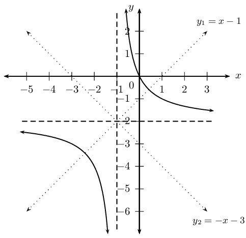
</Callout>

<QuizCard id="m11-05-03c" title="Interactive Exercise 5.10" question="What are the equations of the axes of symmetry of the graph of \[\begin{array}{c}f(x) = -\dfrac{10}{(x + 4)} + 4\end{array}\]" options=["y = -x + 0 and y = x + 8", "y = x and y = -x", "y = x + 4 and y = -x + 4", "None of the above"] answer="y = -x + 0 and y = x + 8" hint="" explanation="Determine the lines of symmetry Let's start by reviewing two important results for the equations of the lines of symmetry of hyperbolas: The equations of the lines of symmetry for a standard hyperbola \(g(x) = \dfrac{a}{x}\) are \(y = x\) and \(y = -x\) . These lines intersect at the point \((0\, ; 0)\) . The equations of the lines of symmetry for a hyperbola with an equation \(h(x) = \dfrac{a}{x} + q\) are \(y = x + q\) and \(y = -x + q\) . These lines intersect at the point \((0\, ; q)\) . From the two results above, we can see that the gradients of the lines of symmetry are either \(\text{1}\) or \(-\text{1}\) . Depending on the function, what may change is the \(y\) -intercept. The \(y\) -intercept for the lines of symmetry of \(g(x)\) is \(\text{0}\) . The \(y\) -intercept for the lines of symmetry of \(h(x)\) is the value \(q\) . The lines of symmetry of \(f(x)\) are \(y = x + c_{1}\) and \(y = -x + c_{2}\) , where \(c_{1}\) and \(c_{2}\) are the \(y\) -intercepts. To find the values of \(c_{1}\) and \(c_{2}\) , we need to get a point through which the lines of symmetry pass. We will then substitute its coordinates into each equation and then simplify. The function presented in this question has the form \[\begin{array}{c}f(x) = \frac{a}{(x + p)} + q\end{array}\] The \(p\) and \(q\) values are connected to the vertical and horizontal asymptotes. The asymptotes of \(f(x)\) are \(x = -p\) and \(y = q\) . The asymptotes of any hyperbola intersect at the point \((-p\, ; q)\) . This is also the point of intersection of the lines of symmetry. So using this point, we will find the values of \(c_{1}\) and \(c_{2}\) . For \(f(x)\) the point \((-p\, ; q)\) is \((-4\, ; 4)\) . We will substitute this point into each equation of symmetry and solve for \(c_{1}\) and \(c_{2}\) . For the line \(y = x + c_{1}\) : \[                     \begin{aligned}                         4 & = -4 + c_{1} \\                         8 & = c_{1}                     \end{aligned}                 \] For the line \(y = -x + c_{2}\) : \[                     \begin{aligned}                         4 & = 4 + c_{2} \\                         0 & = c_{2}                     \end{aligned}                 \] The lines of symmetry are thus: \[                     \begin{aligned}                         y & = x + 8 \\                         y & = -x + 0                     \end{aligned}                 \] We can verify our answers by plotting the graph of \(f(x)\) . By doing so, we can see if each of the lines of symmetry we found would divide the graph into two mirror images. We will make two separate plots of the graph of \(f(x)\) for each line of symmetry. In both cases, we can see that the lines of symmetry divide the graph into two mirror images. The equations of the lines of symmetry are: \[                     \begin{aligned}                         y & = x + 8 \\                         y & = -x + 0                     \end{aligned}                 \] Submit your answer as: y = -x + 0 and y = x + 8" />

## Axes of symmetry

### Textbook Exercise
                                                        5.13

Complete the following for \(f(x)\) and \(g(x)\):

- Sketch the graph.
- Determine \((-p;q)\).
- Find the axes of symmetry.

Compare \(f(x)\) and \(g(x)\) and also their axes of
                                                                        symmetry. What do you notice?

**Problem:**
\(f(x) = \frac{2}{x}\)

\(g(x) = \frac{2}{x} + 1\)

**Solution:**
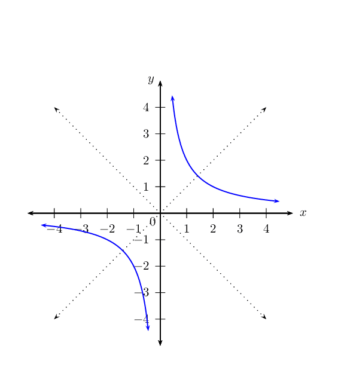

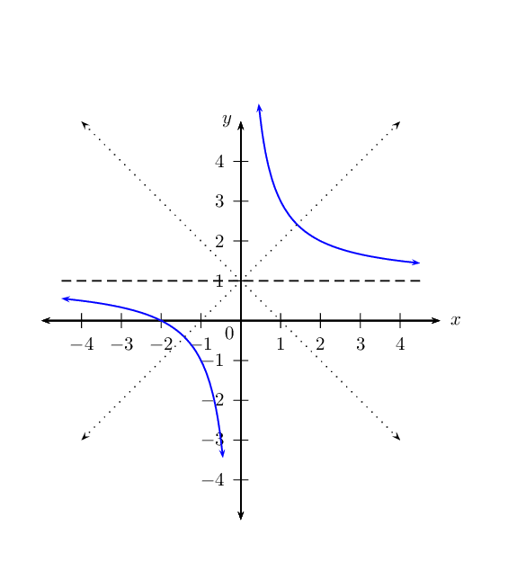

**Problem:**
\(f(x) = -\frac{3}{x}\)

\(g(x) = -\frac{3}{x + 1}\)

**Solution:**
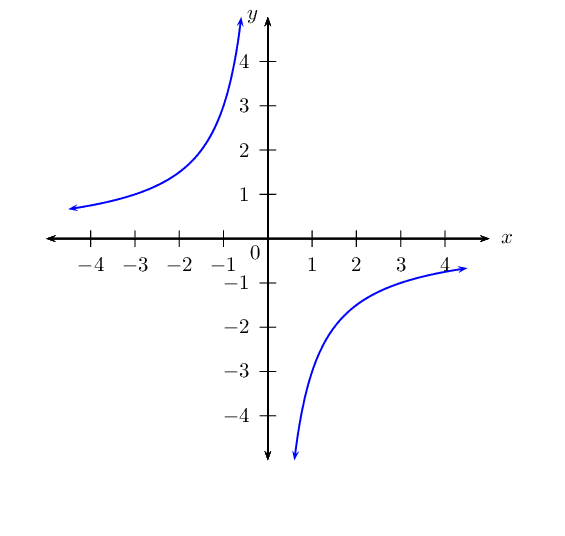

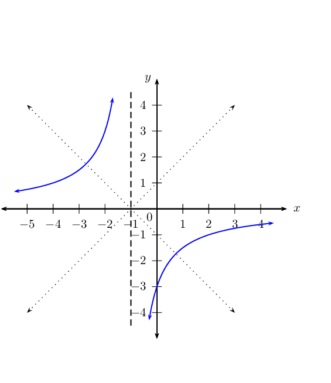

**Problem:**
\(f(x) = \frac{5}{x}\)

\(g(x) = \frac{5}{x - 1} - 1\)

**Solution:**
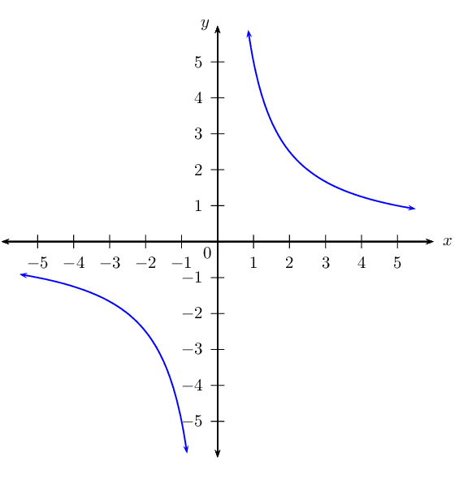

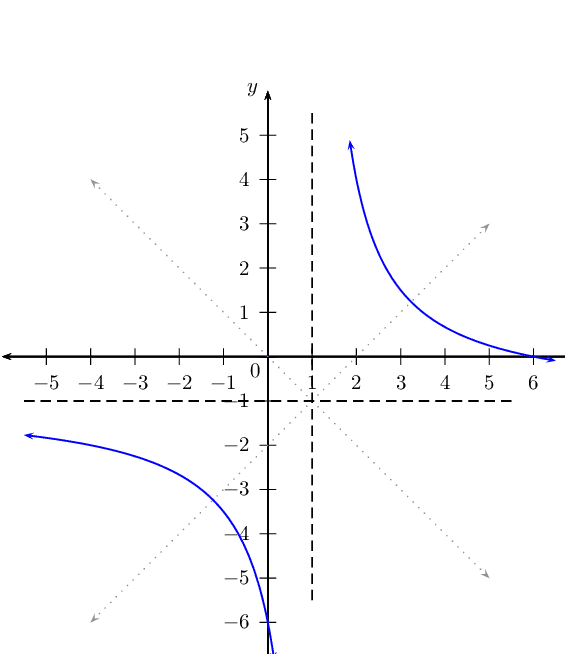

**Problem:**
A hyperbola of the form \(k(x) = \frac{a}{x +p} + q\)
                                                                        passes through the point \((4;3)\). If the axes
                                                                        of symmetry intersect at \((-1;2)\), determine
                                                                        the equation of \(k(x)\).

**Solution:**
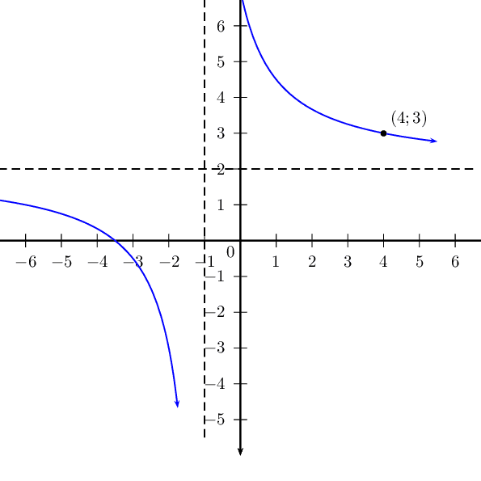

#### Sketching graphs of the form \(f(x)=\frac{a}{x+p}+q\)

In order to sketch graphs of functions of the form, \(f(x)=\frac{a}{x+p}+q\), we need
                                        to calculate five characteristics:

- quadrants
- asymptotes
- \(y\)-intercept
- \(x\)-intercept
- domain and range

<Callout type="tip" title="Worked example 11: Sketching a hyperbola">
**Question:**
Sketch the graph of \(y = \frac{2}{x + 1} + 2\). Determine the
                                                        intercepts, asymptotes and axes of symmetry. State the domain
                                                        and range of the function.

**Examine the equation of the form \(y = \frac{a}{x + p}
                                                        + q\):**
We notice that \(a > 0\), therefore the graph will lie in the
                                                        first and third quadrants.

**Determine the asymptotes:**
From the equation we know that \(p = 1\) and \(q = 2\).

Therefore the horizontal asymptote is the line \(y = 2\) and the
                                                        vertical asymptote is the line \(x = -1\).

**Determine the \(y\)-intercept:**
The \(y\)-intercept is obtained by letting \(x = 0\):
                                                        \begin{align*}
                                                        y &= \frac{2}{0 + 1} + 2 \\
                                                        &= 4
                                                        \end{align*}
                                                        This gives the point \((0;4)\).

**Determine the \(x\)-intercept:**
The \(x\)-intercept is obtained by letting \(y = 0\):
                                                        \begin{align*}
                                                        0 &= \frac{2}{x + 1} + 2\\
                                                        -2 &= \frac{2}{x + 1} \\
                                                        -2(x +1) &= 2 \\
                                                        -2x -2 &= 2 \\
                                                        -2x &= 4 \\
                                                        x &= -2
                                                        \end{align*}
                                                        This gives the point \((-2;0)\).

**Determine the axes of symmetry:**
Using \((-1;2)\) to solve for \(c_1\):
                                                        \begin{align*}
                                                        y_1 &= x + c_1 \\
                                                        2 &= -1 + c_1 \\
                                                        3 &= c_1
                                                        \end{align*}
                                                        \begin{align*}
                                                        y_2 &= -x + c_2 \\
                                                        2 &= -(-1) + c_2 \\
                                                        1 &= c_2
                                                        \end{align*}
                                                        Therefore the axes of symmetry are \(y = x + 3\) and \(y = -x +
                                                        1\).

**Plot the points and sketch the graph:**
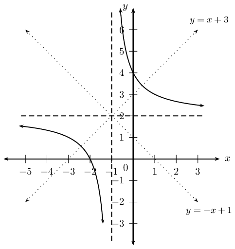

**State the domain and range:**
Domain: \(\{ x: x \in \mathbb{R}, x \ne -1 \}\)

Range: \(\{ y: y \in \mathbb{R}, y \ne 2 \}\)
</Callout>

<Callout type="tip" title="Worked example 12: Sketching a hyperbola">
**Question:**
Use horizontal and vertical shifts to sketch the graph of \(f(x) =
                                                        \frac{1}{x - 2} + 3\).

**Examine the equation of the form \(y = \frac{a}{x + p}
                                                        + q\):**
We notice that \(a > 0\), therefore the graph will lie in the
                                                        first and third quadrants.

**Sketch the standard hyperbola \(y = \frac{1}{x}\):**
Start with a sketch of the standard hyperbola \(g(x) = \frac{1}{x}\).

The vertical asymptote is \(x = 0\) and the horizontal asymptote is
                                                        \(y = 0\).

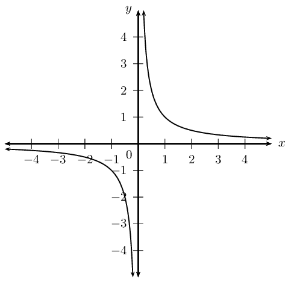

**Determine the vertical shift:**
From the equation we see that \(q = 3\), which means \(g(x)\) must
                                                        shifted \(\text{3}\) units up.

The horizontal asymptote is also shifted \(\text{3}\) units up to \(y
                                                        = 3\) .

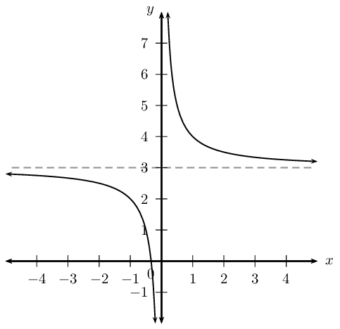

**Determine the horizontal shift:**
From the equation we see that \(p = -2\), which means \(g(x)\) must
                                                        shifted \(\text{2}\) units to the right.

The vertical asymptote is also shifted \(\text{2}\) units to the
                                                        right.

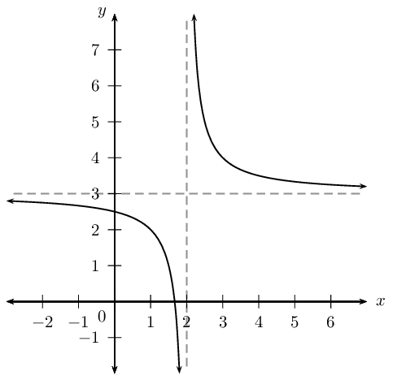

**Determine the \(y\)-intercept:**
The \(y\)-intercept is obtained by letting \(x = 0\):
                                                        \begin{align*}
                                                        y &= \frac{1}{0 - 2} + 3 \\
                                                        &= 2\frac{1}{2}
                                                        \end{align*}
                                                        This gives the point \((0;2\frac{1}{2})\).

**Determine the \(x\)-intercept:**
The \(x\)-intercept is obtained by letting \(y = 0\):
                                                        \begin{align*}
                                                        0 &= \frac{1}{x - 2} + 3\\
                                                        -3 &= \frac{1}{x -2} \\
                                                        -3(x - 2) &= 1 \\
                                                        -3x + 6 &= 1 \\
                                                        -3x &= -5 \\
                                                        x &= \frac{5}{3}
                                                        \end{align*}
                                                        This gives the point \((\frac{5}{3};0)\).

**Determine the domain and range:**
Domain: \(\{ x: x \in \mathbb{R}, x \ne 2 \}\)

Range: \(\{ y: y \in \mathbb{R}, y \ne 3 \}\)
</Callout>

<Callout type="tip" title="Worked example 13: Finding the equation of a hyperbola from
                                                the graph">
**Question:**
Use the graph below to determine the values of \(a\), \(p\) and \(q\)
                                                        for \(y = \frac{a}{x + p} + q\).

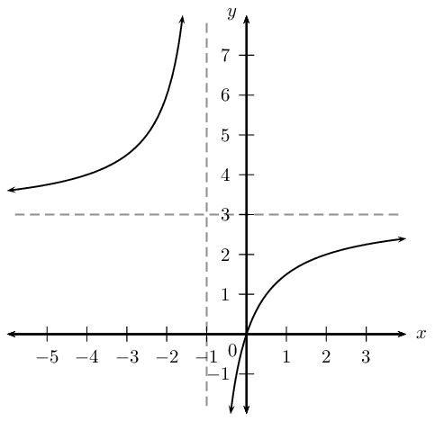

**Examine the graph and deduce the sign of \(a\):**
We notice that the graph lies in the second and fourth quadrants,
                                                        therefore \(a < 0\).

**Determine the asymptotes:**
From the graph we see that the vertical asymptote is \(x = -1\),
                                                        therefore \(p = 1\). The horizontal asymptote is \(y = 3\), and
                                                        therefore \(q = 3\).
                                                        \[y = \frac{a}{x + 1} + 3\]

**Determine the value of \(a\):**
To determine the value of \(a\) we substitute a point on the graph,
                                                        namely \((0;0)\):
                                                        \begin{align*}
                                                        y &= \frac{a}{x + 1} + 3 \\
                                                        0 &= \frac{a}{0 + 1} + 3 \\
                                                        \therefore -3 &= a
                                                        \end{align*}

**Write the final answer:**
\[y = -\frac{3}{x + 1} + 3\]
</Callout>

<QuizCard id="m11-05-03d" title="Interactive Exercise 5.11" question="Calculate the values of \(a\) , \(p\) , and \(q\) if the coordinates of Point B are \((-5\, ; -6)\) ." options=[] answer="8, 4, 2" hint="You should enter a number here. If you want to, you can use a space to separate thousands.                Example: 12 800,25 For scientific notation you need to use the multiply symbol                ( ∗ ) and the exponent symbol ( ^ ). For example 6,673 × 10 −11 should be written as: 6,673 ∗ 10^−11" explanation="Determine the value of \(q\) We need to find the values of \(a\) , \(p\) , and \(q\) . These are the unknown values in \[\begin{array}{c}f(x) = \dfrac{a}{(x + p)} + q\end{array}\] We get the values of \(p\) and \(q\) from the asymptotes. \(p\) is determined from the vertical asymptote, \(x = -4\) . \(q\) is found from the horizontal asymptote, \(y = 2\) . Once we do that, we will then use the coordinates of Point B to find the value of \(a\) . We will start with determining the value of \(q\) . The quantity \(q\) is a measure of the vertical shift of the graph \[\begin{array}{c}f(x) = \dfrac{a}{(x + p)} + q\end{array}\] when compared with the graph of \[\begin{array}{c}g(x) = \dfrac{1}{(x + p)}\end{array}\] Whenever a hyperbola is shifted along the \(y\) -axis, its horizontal asymptote gets shifted as well. Thus, we get the value of \(q\) from the horizontal asymptote. The value of \(q\) is \(\text{2}\) . Determine the value of \(p\) The quantity \(p\) is a measure of the horizontal shift of the graph of \[\begin{array}{c}f(x) = \dfrac{a}{(x + p)} + q\end{array}\] when compared with the graph of \[\begin{array}{c}h(x) = \dfrac{1}{x} + q\end{array}\] Whenever a hyperbola is shifted along the \(x\) -axis, its vertical asymptote gets shifted as well. Thus, we get the value of \(p\) from the vertical asymptote. For \(p\) , things get a bit more interesting. Remember, the vertical asymptote is the value of \(x\) which causes the function to be undefined. If we add this value of \(x\) to the value of \(p\) , we should get zero : \[                         \begin{aligned}                             x_{\text{asymptote}} + p = 0                         \end{aligned}                     \] The value of \(x_{\text{asymptote}}\) is \(-\text{4}\) . We now substitute this value into the above equation and then solve for \(p\) . \[                         \begin{aligned}                             (-4) + p & = 0 \\                             p & = 4                         \end{aligned}                     \] The value of \(p\) is \(\text{4}\) . Determine the value of \(a\) If we substitute the values of \(p\) and \(q\) that we have already calculated, our equation becomes \[\begin{array}{c}f(x) = \dfrac{a}{(x + 4)} + 2\end{array}\] . To get \(a\) , we will use the coordinates of Point B. The \(x\) - and \(y\) -values of Point B are \(x = -5\) and \(y = -6\) . We will substitute these values into the equation and then simplify. \[                         \begin{aligned}                             f(x) & = \dfrac{a}{(x + 4)} + 2 \\                             (-6) & = \frac{a}{((-5) + 4)} + 2 \\                             -6 & = \frac{a}{(-1)} + 2 \\                             -6 (-1) & = \frac{a}{(-1)} (-1) + 2 (-1) \\                             8 & = a                         \end{aligned}                     \] The values of \(a\) , \(p\) , and \(q\) are as follows: \[                         \begin{aligned}                             a &= 8 \\                             p &= 4 \\                             q &= 2                         \end{aligned}                     \] Submit your answer as: and and" />

## Sketching graphs

### Textbook Exercise
                                                        5.14

Draw the graphs of the following functions and
                                                                        indicate:

- asymptotes
- intercepts, where applicable
- axes of symmetry
- domain and range

**Problem:**
\(y = \frac{1}{x} + 2\)

**Solution:**
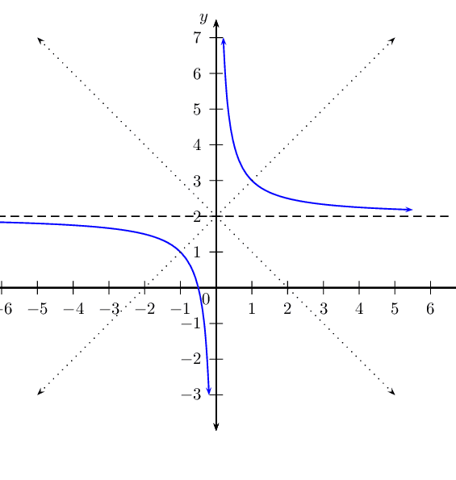

**Problem:**
\(y = \frac{1}{x + 4} - 2\)

**Solution:**
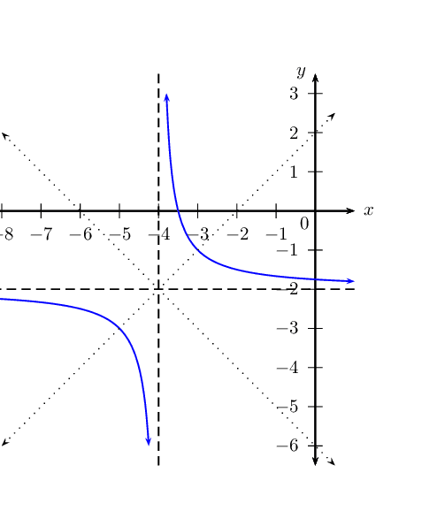

**Problem:**
\(y = -\frac{1}{x + 1} + 3\)

**Solution:**
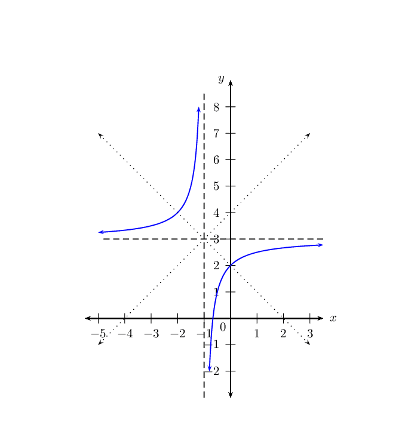

**Problem:**
\(y = -\frac{5}{x - 2\frac{1}{2}} - 2\)

**Solution:**
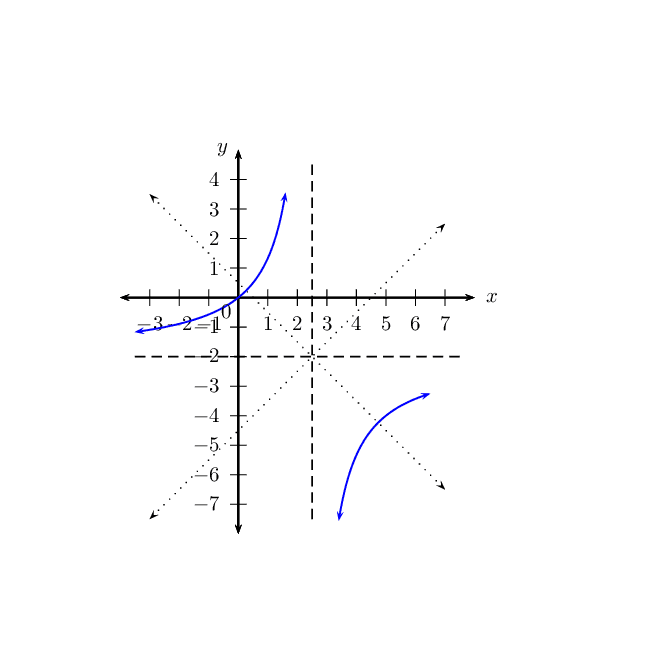

**Problem:**
\(y = \frac{8}{x - 8} + 4\)

**Solution:**
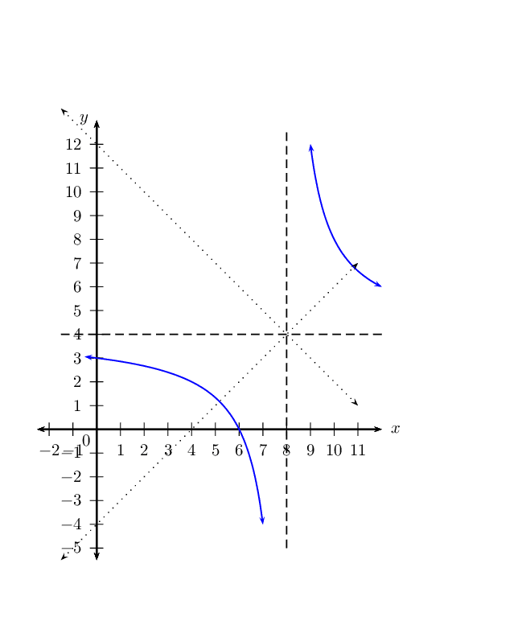

**Problem:**
Given the graph of the hyperbola of the form \(y =
                                                                        \frac{1}{x + p} + q\), determine the values of
                                                                        \(p\) and \(q\).

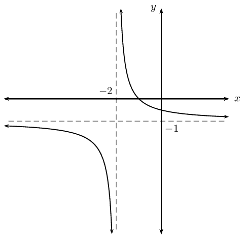

**Solution:**
\begin{align*}
                                                                y &= \frac{1}{x + p} + q \\
                                                                \text{From graph } \quad p &= 2 \\
                                                                q &= -1 \\
                                                                \therefore y &= \frac{1}{x + 2} - 1
                                                                \end{align*}

**Problem:**
Given a sketch of the function of the form \(y =
                                                                        \frac{a}{x + p} + q\), determine the values of
                                                                        \(a\), \(p\) and \(q\).

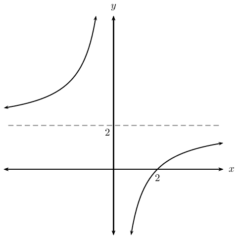

**Solution:**
\begin{align*}
                                                                y &= \frac{a}{x + p} + q \\
                                                                \text{From graph } \quad p &= 0 \\
                                                                q &= 2 \\
                                                                \therefore y &= \frac{a}{x} + 2 \\
                                                                \text{Subst. } (2;0) \quad 0 &= \frac{a}{2} + 2 \\
                                                                -2 &= \frac{a}{2} \\
                                                                -2(2) &= a \\
                                                                \therefore a &= -4 \\
                                                                y &= -\frac{4}{x} + 2
                                                                \end{align*}

**Problem:**
Draw the graph of \(f(x) = -\frac{3}{x}\),
                                                                                \(x > 0\).

**Solution:**
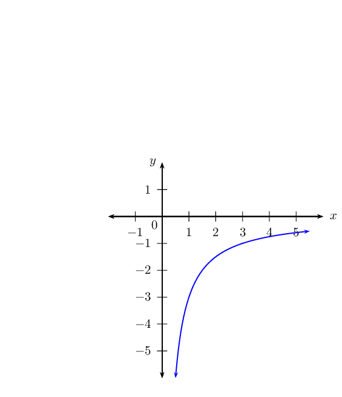

**Problem:**
Determine the average gradient of the graph
                                                                                between \(x=1\) and \(x=3\).

**Solution:**
\begin{align*}
                                                                        \text{Average gradient } &= \frac{f(3) -
                                                                        f(1)}{3 - 1} \\
                                                                        &= \dfrac{-\frac{3}{3} - \left( -\frac{3}{1}
                                                                        \right)}{3-1} \\
                                                                        &= \dfrac{-1 +3}{2} \\
                                                                        &= \dfrac{2}{2} \\
                                                                        &= 1
                                                                        \end{align*}

Average gradient between \(x=1\) and \(x=3\)
                                                                                is \(1\).

**Problem:**
Is the gradient at \((\frac{1}{2};-6)\) less
                                                                                than or greater than the average
                                                                                gradient between \(x=1\) and \(x=3\)?
                                                                                Illustrate this on your graph.

**Solution:**
\begin{align*}
                                                                        \text{Average gradient } &= \frac{f(a+h) -
                                                                        f(a)}{(a+h) - a} \\
                                                                        &= \dfrac{-\frac{3}{a+h} - \left(
                                                                        -\frac{3}{a} \right)}{(a+h)-a} \\
                                                                        &= \dfrac{-\frac{3}{a+h} + \frac{3}{a}}{h}
                                                                        \\
                                                                        &= \dfrac{\frac{-3(a) + 3(a+h)}{a(a+h)}}{h}
                                                                        \\
                                                                        &= \dfrac{\frac{-3a + 3a+3h}{a^2+ah}}{h} \\
                                                                        &= \dfrac{\frac{3h}{a^2+ah}}{h} \\
                                                                        &= \frac{3h}{a^2+ah} \times \frac{1}{h} \\
                                                                        &= \frac{3}{a^2+ah} \\
                                                                        \therefore \text{At } (\frac{1}{2}; -6) \qquad a
                                                                        &= \frac{1}{2} \\
                                                                        \therefore \text{And } \qquad h &= 0 \\
                                                                        \therefore \text{Average gradient } &=
                                                                        \frac{3}{\left( \frac{1}{2}
                                                                        \right)^2+\frac{1}{2}(0)} \\
                                                                        &= 3 \times \frac{4}{1} \\
                                                                        &= 12
                                                                        \end{align*}

Average gradient at \((\frac{1}{2};-6)\) is
                                                                                greater than the average gradient
                                                                                between \(x=1\) and \(x=3\).
