## 5.4 Exponential functions (EMBGS)

### Revision (EMBGT)

#### Functions of the form \(y=a{b}^{x}+q\)

Functions of the general form \(y=a{b}^{x}+q\), for \(b>0\), are called
                                        exponential functions, where \(a\), \(b\) and \(q\) are constants.

**The effects of \(a\), \(b\) and \(q\) on \(f(x) = ab^x + q\):**

- **The effect of \(q\) on vertical shift**
  - For \(q>0\), \(f(x)\) is shifted vertically
                                                                            upwards by \(q\) units.
  - For \(q<0\), \(f(x)\) is shifted vertically
                                                                            downwards by \(q\) units.
  - The horizontal asymptote is the line \(y = q\).
- **The effect of \(a\) on shape**
  - For \(a>0\), \(f(x)\) is increasing.
  - For \(a<0\), \(f(x)\) is decreasing. The graph is
                                                                            reflected about the horizontal asymptote.
- **The effect of \(b\) on direction**
  Assuming \(a > 0\):
  - If \(b > 1\), \(f(x)\) is an increasing function.
  - If \(0 < b < 1\), \(f(x)\) is a decreasing function.
  - If \(b \leq 0\), \(f(x)\) is not defined.

| \(b>1\) | \(a<0\) | \(a>0\) |
| --- | --- | --- |
| \(q>0\) |  |  |
| \(q<0\) |  |  |

| \(0<b<1\) | \(a<0\) | \(a>0\) |
| --- | --- | --- |
| \(q>0\) |  |  |
| \(q<0\) |  |  |

## Revision

### Textbook Exercise
                                                        5.15

On separate axes, accurately draw each of the
                                                                        following functions:

- Use tables of values if necessary.
- Use graph paper if available.

**Problem:**
\(y_1 = 3^x\)

**Solution:**
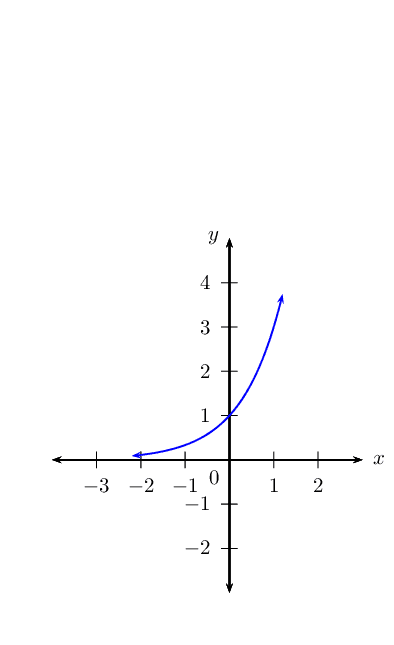

**Problem:**
\(y_2 = -2 \times 3^x\)

**Solution:**
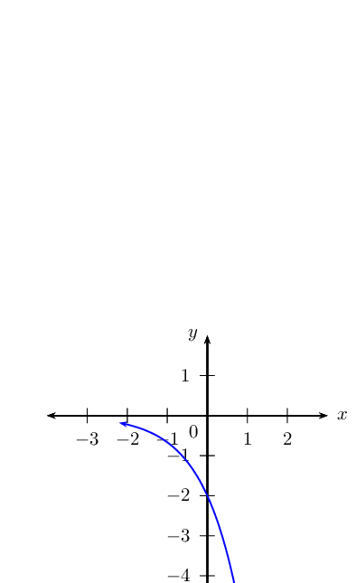

**Problem:**
\(y_3 = 2 \times 3^x + 1\)

**Solution:**
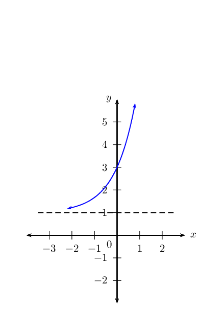

**Problem:**
\(y_4 = 3^x - 2\)

**Solution:**
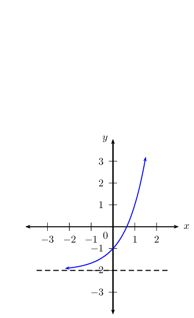

**Problem:**
Use your sketches of the functions given above to
                                                                        complete the following table (the first column
                                                                        has been completed as an example):

|  | \(y_1\) | \(y_2\) | \(y_3\) | \(y_4\) |
| --- | --- | --- | --- | --- |
| value of \(q\) | \(q = 0\) |  |  |  |
| effect of \(q\) | no vertical shift |  |  |  |
| value of \(a\) | \(a = 1\) |  |  |  |
| effect of \(a\) | increasing |  |  |  |
| asymptote | \(x\)-axis, \(y = 0\) |  |  |  |
| domain | \(\{x: x \in \mathbb{R} \}\) |  |  |  |
| range | \(\{y: y \in \mathbb{R}, y > 0
                                                                                        \}\) |  |  |  |

**Solution:**
|  | \(y_1\) | \(y_2\) | \(y_3\) | \(y_4\) |
| --- | --- | --- | --- | --- |
| value of \(q\) | \(q = 0\) | \(q = 0\) | \(q = 1\) | \(q = 2\) |
| effect of \(q\) | no vertical shift | no vertical shift | shift \(1\) unit up | shift \(2\) units down |
| value of \(a\) | \(a = 1\) | \(a = -2\) | \(a = 2\) | \(a = 1\) |
| effect of \(a\) | increasing | decreasing | increasing | increasing |
| asymptote | \(x\)-axis, \(y = 0\) | \(x\)-axis, \(y = 0\) | \(y = 1\) | \(y = -2\) |
| domain | \(\{x: x \in \mathbb{R} \}\) | \(\{x: x \in \mathbb{R} \}\) | \(\{x: x \in \mathbb{R} \}\) | \(\{x: x \in \mathbb{R} \}\) |
| range | \(\{y: y \in \mathbb{R}, y > 0
                                                                                        \}\) | \(\{y: y \in \mathbb{R}, y < 0
                                                                                        \}\) | \(\{y: y \in \mathbb{R}, y > 1
                                                                                        \}\) | \(\{y: y \in \mathbb{R}, y > -2
                                                                                        \}\) |

### Functions of the form \(y=a{b}^{\left(x+p\right)}+q\) (EMBGV)

We now consider exponential functions of the form \(y=a{b}^{\left(x+p\right)}+q\) and the
                                effects of parameter \(p\).

## The effects of \(a\), \(p\) and \(q\) on an exponential graph

2. On the same system of axes, plot the following graphs:
   2. \(y_1 = 2^x\)
   4. \(y_2 = 2^{(x - 2)}\)
   6. \(y_3 = 2^{(x - 1)}\)
   8. \(y_4 = 2^{(x + 1)}\)
   10. \(y_5 = 2^{(x + 2)}\)
   Use your sketches of the functions above to complete the following
                                                           table:
   |  | \(y_1\) | \(y_2\) | \(y_3\) | \(y_4\) | \(y_5\) |
   | --- | --- | --- | --- | --- | --- |
   | intercept(s) |  |  |  |  |  |
   | asymptote |  |  |  |  |  |
   | domain |  |  |  |  |  |
   | range |  |  |  |  |  |
   | effect of \(p\) |  |  |  |  |  |
4. On the same system of axes, plot the following graphs:
   2. \(y_1 = 2^{(x - 1)} + 2\)
   4. \(y_2 = 3 \times 2^{(x - 1)} + 2\)
   6. \(y_3 = \frac{1}{2} \times 2^{(x - 1)} + 2\)
   8. \(y_4 = 0 \times 2^{(x - 1)} + 2\)
   10. \(y_5 = -3 \times 2^{(x - 1)} + 2\)
   Use your sketches of the functions above to complete the following
                                                           table:
   |  | \(y_1\) | \(y_2\) | \(y_3\) | \(y_4\) | \(y_5\) |
   | --- | --- | --- | --- | --- | --- |
   | intercept(s) |  |  |  |  |  |
   | asymptotes |  |  |  |  |  |
   | domain |  |  |  |  |  |
   | range |  |  |  |  |  |
   | effect of \(a\) |  |  |  |  |  |

**The effect of the parameters on \(y = ab^{x + p} + q\)**

The effect of \(p\) is a horizontal shift because all points are moved the same distance in
                                the same direction (the entire graph slides to the left or to the right).

- For \(p>0\), the graph is shifted to the left by \(p\) units.
- For \(p<0\), the graph is shifted to the right by \(p\) units.

The effect of \(q\) is a vertical shift. The value of \(q\) also affects the horizontal
                                asymptotes, the line \(y = q\).

The value of \(a\) affects the shape of the graph and its position relative to the horizontal
                                asymptote.

- For \(a>0\), the graph lies above the horizontal asymptote, \(y = q\).
- For \(a<0\), the graph lies below the horizontal asymptote, \(y = q\).

|  | \(p>0\) | \(p<0\) |
| --- | --- | --- |
|  | \(a<0\) | \(a>0\) | \(a<0\) | \(a>0\) |
| \(q>0\) |  |  |  |  |
| \(q<0\) |  |  |  |  |

#### Discovering the characteristics

For functions of the general form: \(f(x) = y = ab^{(x+p)} + q\):

**Domain and range**

The domain is \(\left\{x:x\in ℝ\right\}\) because there is no value of \(x\)
                                        for which \(f(x)\) is undefined.

The range of \(f(x)\) depends on whether the value for \(a\) is positive or negative.

If \(a>0\) we have:
                                        \begin{align*}
                                        {b}^{\left(x+p\right)} & > 0 \\
                                        a {b}^{\left(x+p\right)} & > 0 \\
                                        a {b}^{\left(x+p\right)} + q & > q \\
                                        f(x) & > q
                                        \end{align*}
                                        The range is therefore \(\{ y: y > q, y \in \mathbb{R} \}\).

Similarly, if \(a < 0\), the range is \(\{ y: y < q, y \in \mathbb{R} \}\).

<Callout type="tip" title="Worked example 14: Domain and range">
**Question:**
State the domain and range for \(g(x) = 5 \times 3^{(x+1)} - 1\).

**Determine the domain:**
The domain is \(\{x: x \in \mathbb{R} \}\) because there is no value
                                                        of \(x\) for which \(g(x)\) is undefined.

**Determine the range:**
The range of \(g(x)\) can be calculated from:
                                                        \begin{align*}
                                                        3^{(x+1)} & > 0\\
                                                        5 \times 3^{(x+1)} & > 0\\
                                                        5 \times 3^{(x+1)} - 1 & > -1\\
                                                        \therefore g(x) & > -1
                                                        \end{align*}
                                                        Therefore the range is \(\{g(x): g(x) > -1 \}\) or in
                                                        interval notation \((-1; \infty)\).
</Callout>

## Domain and range

### Textbook Exercise
                                                        5.16

Give the domain and range for each of the following
                                                                functions:

**Problem:**
\(y = \left( \frac{3}{2} \right)^{(x + 3)}\)

**Solution:**
\begin{align*}
                                                                \text{Domain: } & \left \{ x: x \in \mathbb{R}
                                                                \right \} \\
                                                                \text{Range: } & \left \{ y: y > 0, y\in
                                                                \mathbb{R} \right \}
                                                                \end{align*}

**Problem:**
\(f(x) = -5^{(x - 2)} + 1\)

**Solution:**
\begin{align*}
                                                                \text{Domain: } & \left \{ x: x \in \mathbb{R}
                                                                \right \} \\
                                                                \text{Range: } & \left \{ y: y < 1, y\in
                                                                \mathbb{R} \right \}
                                                                \end{align*}

**Problem:**
\(y + 3 = 2^{(x + 1)}\)

**Solution:**
\begin{align*}
                                                                y + 3 &= 2^{(x + 1)} \\
                                                                y &= 2^{(x + 1)} - 3 \\
                                                                \text{Domain: } & \left \{ x: x \in \mathbb{R}
                                                                \right \} \\
                                                                \text{Range: } & \left \{ y: y > -3, y\in
                                                                \mathbb{R} \right \}
                                                                \end{align*}

**Problem:**
\(y = n + 3^{(x - m)}\)

**Solution:**
\begin{align*}
                                                                y &= n + 3^{(x - m)} \\
                                                                y &= 3^{(x - m)} + n \\
                                                                \text{Domain: } & \left \{ x: x \in \mathbb{R}
                                                                \right \} \\
                                                                \text{Range: } & \left \{ y: y > n, y\in
                                                                \mathbb{R} \right \}
                                                                \end{align*}

**Problem:**
\(\frac{y}{2} = 3^{(x - 1)} - 1\)

**Solution:**
\begin{align*}
                                                                \frac{y}{2} &= 3^{(x - 1)} - 1 \\
                                                                y &= 2 \times 3^{(x - 1)} - 2 \\
                                                                \text{Domain: } & \left \{ x: x \in \mathbb{R}
                                                                \right \} \\
                                                                \text{Range: } & \left \{ y: y > 2, y\in
                                                                \mathbb{R} \right \}
                                                                \end{align*}

**Intercepts**

**The \(y\)-intercept:**

To calculate the \(y\)-intercept we let \(x=0\). For example, the \(y\)-intercept of
                                        \(g(x) = 3 \times 2^{(x + 1)} + 2\) is determined by setting \(x=0\):
                                        \begin{align*}
                                        g(0) &= 3 \times 2^{(0 + 1)} + 2 \\
                                        &= 3 \times 2 + 2\\
                                        &= 8
                                        \end{align*}
                                        This gives the point \((0;8)\).

**The \(x\)-intercept:**

To calculate the \(x\)-intercept we let \(y=0\). For example, the \(x\)-intercept of
                                        \(g(x) = 3 \times 2^{(x + 1)} + 2\) is determined by setting \(y=0\):
                                        \begin{align*}
                                        0 &= 3 \times 2^{(x + 1)} + 2 \\
                                        -2 &= 3 \times 2^{(x + 1)} \\
                                        -\frac{2}{3} &= 2^{(x + 1)}
                                        \end{align*}
                                        which has no real solutions. Therefore, the graph of \(g(x)\) lies above the
                                        \(x\)-axis and does not have any \(x\)-intercepts.

## Intercepts

### Textbook Exercise
                                                        5.17

Determine the \(x\)- and \(y\)-intercepts for each of the
                                                                following functions:

**Problem:**
\(f(x) = 2^{(x + 1)} - 8\)

**Solution:**
\begin{align*}
                                                                \text{For } x=0 \quad y &= 2^{(0 + 1)} - 8 \\
                                                                &= 2 - 8 \\
                                                                &= -6 \\
                                                                \therefore & (0;-6) \\
                                                                \text{For } y=0 \quad 0 &= 2^{(x + 1)} - 8 \\
                                                                2^3 &= 2^{(x + 1)} \\
                                                                \therefore 3 &= x + 1 \\
                                                                \therefore 2 &= x \\
                                                                \therefore & (2;0)
                                                                \end{align*}

**Problem:**
\(y = 2 \times 3^{(x - 1)} - \text{18}\)

**Solution:**
\begin{align*}
                                                                \text{For } x=0 \quad y &= 2 \times 3^{(0 - 1)} - 18
                                                                \\
                                                                &= \frac{2}{3} -18 \\
                                                                &= -17\frac{1}{3} \\
                                                                \therefore & (0;-17\frac{1}{3}) \\
                                                                \text{For } y=0 \quad 0 &= 2 \times 3^{(x - 1)} - 18
                                                                \\
                                                                18 &= 2 \times 3^{(x - 1)} \\
                                                                9 &= 3^{(x - 1)} \\
                                                                3^2 &= 3^{(x - 1)} \\
                                                                \therefore 2 &= x - 1 \\
                                                                \therefore 3 &= x \\
                                                                \therefore & (3;0)
                                                                \end{align*}

**Problem:**
\(y + 5^{(x + 2)} = 5\)

**Solution:**
\begin{align*}
                                                                y + 5^{(x + 2)} &= 5 \\
                                                                y &= -5^{(x + 2)} + 5 \\
                                                                \text{For } x=0 \quad y &= -5^{(0 + 2)} + 5 \\
                                                                &= -25 + 5 \\
                                                                &= -20 \\
                                                                \therefore & (0;-20) \\
                                                                \text{For } y=0 \quad 0 &= -5^{(x + 2)} + 5 \\
                                                                5^{(x + 2)} &= 5\\
                                                                \therefore x + 2 &= 1 \\
                                                                \therefore x &= -1 \\
                                                                \therefore & (-1;0)
                                                                \end{align*}

**Problem:**
\(y = \frac{1}{2} \left( \frac{3}{2} \right)^{(x +
                                                                        3)} - \text{0,75}\)

**Solution:**
\begin{align*}
                                                                y &= \frac{1}{2} \left( \frac{3}{2} \right)^{(x +
                                                                3)} - \text{0,75} \\
                                                                y &= \frac{1}{2} \left( \frac{3}{2} \right)^{(x +
                                                                3)} - \frac{3}{4} \\
                                                                \text{For } x=0 \quad y &= \frac{1}{2} \left(
                                                                \frac{3}{2} \right)^{(0 + 3)} - \frac{3}{4} \\
                                                                &= \frac{1}{2} \left( \frac{3}{2} \right)^{3} -
                                                                \frac{3}{4} \\
                                                                &= \frac{1}{2} \left( \frac{27}{8} \right)-
                                                                \frac{3}{4} \\
                                                                &= \frac{27}{16} - \frac{3}{4} \\
                                                                &= \frac{15}{16} \\
                                                                \therefore & (0;\frac{15}{16}) \\
                                                                \text{For } y=0 \quad 0 &= \frac{1}{2} \left(
                                                                \frac{3}{2} \right)^{(x + 3)} - \frac{3}{4} \\
                                                                \frac{3}{4} &= \frac{1}{2} \left( \frac{3}{2}
                                                                \right)^{(x + 3)} \\
                                                                \frac{3}{2} &= \left( \frac{3}{2} \right)^{(x + 3)}
                                                                \\
                                                                \therefore 1 &= x + 3 \\
                                                                \therefore -2 &= x \\
                                                                \therefore & (-2;0)
                                                                \end{align*}

**Asymptote**

Exponential functions of the form \(y = ab^{(x+p)} + q\) have a horizontal asymptote,
                                        the line \(y = q\).

<Callout type="tip" title="Worked example 15: Asymptote">
**Question:**
Determine the asymptote for \(y = 5 \times 3^{(x+1)} - 1\).

**Determine the asymptote:**
The asymptote of \(g(x)\) can be calculated as:
                                                        \begin{align*}
                                                        3^{(x+1)} & \ne 0\\
                                                        5 \times 3^{(x+1)} & \ne 0\\
                                                        5 \times 3^{(x+1)} - 1 & \ne -1\\
                                                        \therefore y & \ne -1
                                                        \end{align*}
                                                        Therefore the asymptote is the line \(y = -1\).
</Callout>

## Asymptote

### Textbook Exercise
                                                        5.18

Give the asymptote for each of the following functions:

**Problem:**
\(y = -5^{(x + 1)}\)

**Solution:**
\begin{align*}
                                                                y &= -5^{(x + 1)} \\
                                                                \text{Horizontal asymptote: } \quad y &= 0
                                                                \end{align*}

**Problem:**
\(y = 3^{(x - 2)} + 1\)

**Solution:**
\begin{align*}
                                                                y &= 3^{(x - 2)} + 1 \\
                                                                \text{Horizontal asymptote: } \quad y &= 1
                                                                \end{align*}

**Problem:**
\(\left( \frac{3y}{2} \right) = 5^{(x + 3)} - 1\)

**Solution:**
\begin{align*}
                                                                \left( \frac{3y}{2} \right) &= 5^{(x + 3)} - 1 \\
                                                                3y &= 2 \times 5^{(x + 3)} - 2 \\
                                                                y &= \frac{2}{3} \times 5^{(x + 3)} - \frac{2}{3} \\
                                                                \text{Horizontal asymptote: } \quad y &=
                                                                -\frac{2}{3}
                                                                \end{align*}

**Problem:**
\(y = 7^{(x + 1)} - 2\)

**Solution:**
\begin{align*}
                                                                y &= 7^{(x + 1)} - 2 \\
                                                                \text{Horizontal asymptote: } \quad y &= -2
                                                                \end{align*}

**Problem:**
\(\frac{y}{2} + 1 = 3^{(x + 2)}\)

**Solution:**
\begin{align*}
                                                                \frac{y}{2} + 1 &= 3^{(x + 2)} \\
                                                                \frac{y}{2} &= 3^{(x + 2)} - 1 \\
                                                                y &= 2 \times 3^{(x + 2)} - 2 \\
                                                                \text{Horizontal asymptote: } \quad y &= -2
                                                                \end{align*}

#### Sketching graphs of the form \(f(x)=a{b}^{\left(x+p\right)}+q\)

In order to sketch graphs of functions of the form,
                                        \(f(x)=a{b}^{\left(x+p\right)}+q\), we need to determine five characteristics:

- shape
- \(y\)-intercept
- \(x\)-intercept
- asymptote
- domain and range

<Callout type="tip" title="Worked example 16: Sketching an exponential graph">
**Question:**
Sketch the graph of \(2y = \text{10} \times 2^{(x+1)} - 5\).

Mark the intercept(s) and asymptote. State the domain and range of
                                                        the function.

**Examine the equation of the form \(y = ab^{(x + p)} +
                                                        q\):**
We notice that \(a > 0\) and \(b > 1\), therefore the function
                                                        is increasing.

**Determine the \(y\)-intercept:**
The \(y\)-intercept is obtained by letting \(x = 0\):
                                                        \begin{align*}
                                                        2y &= \text{10} \times 2^{(0+1)} - 5\\
                                                        &= \text{10} \times 2 - 5\\
                                                        &= \text{15}\\
                                                        \therefore y &= 7\frac{1}{2}
                                                        \end{align*}
                                                        This gives the point \((0;7\frac{1}{2})\).

**Determine the \(x\)-intercept:**
The \(x\)-intercept is obtained by letting \(y = 0\):
                                                        \begin{align*}
                                                        0 &= \text{10} \times 2^{(x+1)} - 5\\
                                                        5 &= \text{10} \times 2^{(x+1)} \\
                                                        \frac{1}{2} &= 2^{(x+1)}\\
                                                        2^{-1} &= 2^{(x+1)}\\
                                                        \therefore -1 &= x + 1 \quad \text{(same base)}\\
                                                        -2 &= x
                                                        \end{align*}
                                                        This gives the point \((-2;0)\).

**Determine the asymptote:**
The horizontal asymptote is the line \(y = -\frac{5}{2}\).

**Plot the points and sketch the graph:**
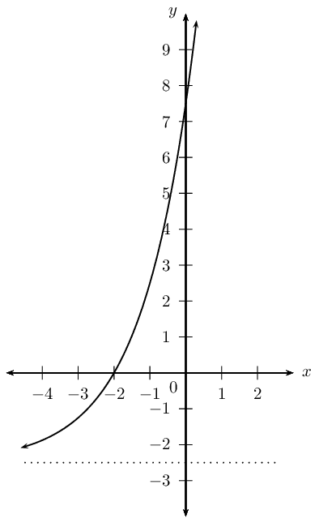

**State the domain and range:**
Domain: \(\{ x: x \in \mathbb{R} \}\)

Range: \(\{ y: y > -\frac{5}{2}, y \in \mathbb{R} \}\)
</Callout>

**Finding the equation of an exponential function from the graph**

<Callout type="tip" title="Worked example 17: Finding the equation of an exponential
                                                function from the graph">
**Question:**
Use the given graph of \(y = -2 \times 3^{(x + p)} + q\) to determine
                                                        the values of \(p\) and \(q\).

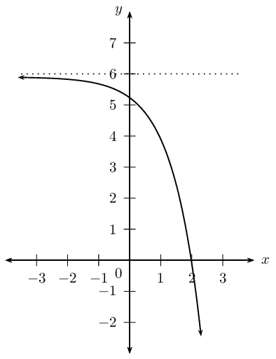

**Examine the equation of the form \(y = ab^{(x + p)} +
                                                        q\):**
From the graph we see that the function is decreasing. We also note
                                                        that \(a = -2\) and \(b = 3\).

We need to solve for \(p\) and \(q\).

**Use the asymptote to determine \(q\):**
The horizontal asymptote \(y = 6\) is given, therefore we know that
                                                        \(q = 6\).
                                                        \[y = -2 \times 3^{(x + p)} + 6\]

**Use the \(x\)-intercept to determine \(p\):**
Substitute \((2;0)\) into the equation and solve for \(p\):
                                                        \begin{align*}
                                                        y &= -2 \times 3^{(x + p)} + 6 \\
                                                        0 &= -2 \times 3^{(2 + p)} + 6 \\
                                                        -6 &= -2 \times 3^{(2 + p)} \\
                                                        3 &= 3^{(2 + p)} \\
                                                        \therefore 1 &= 2 + p \quad \text{(same base)}\\
                                                        \therefore p &= -1
                                                        \end{align*}

**Write the final answer:**
\[y = -2 \times 3^{(x - 1)} + 6\]
</Callout>

## Mixed exercises

### Textbook Exercise
                                                        5.19

Given the graph of the hyperbola of the form \(h(x) =
                                                                        \frac{k}{x}\), \(x < 0\), which passes though
                                                                        the point \(A(-\frac{1}{2}; -6)\).

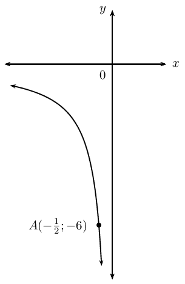

**Problem:**
Show that \(k=3\).

**Solution:**
\begin{align*}
                                                                        y &=\frac{k}{x} \\
                                                                        \text{Subst. } (-\frac{1}{2}; -6) \qquad -6
                                                                        &=\frac{k}{-\frac{1}{2}} \\
                                                                        -6 \times -\frac{1}{2} &= k \\
                                                                        \therefore k &=3 \\
                                                                        \therefore h(x) &= \frac{3}{x}
                                                                        \end{align*}

Write down the equation for the new function
                                                                                formed if \(h(x)\):

**Problem:**
is shifted \(\text{3}\) units
                                                                                        vertically upwards

**Solution:**
\begin{align*}
                                                                                h(x) &= \frac{3}{x} \\
                                                                                \therefore y &\Rightarrow y - 3 \\
                                                                                y - 3 &=\frac{3}{x} \\
                                                                                y &=\frac{3}{x}+3
                                                                                \end{align*}

**Problem:**
is shifted to the right by
                                                                                        \(\text{3}\) units

**Solution:**
\begin{align*}
                                                                                h(x) &= \frac{3}{x} \\
                                                                                \therefore x &\Rightarrow x - 3 \\
                                                                                y &=\frac{3}{x -3}
                                                                                \end{align*}

**Problem:**
is reflected about the \(y\)-axis

**Solution:**
\begin{align*}
                                                                                h(x) &= \frac{3}{x} \\
                                                                                \therefore x &\Rightarrow -x \\
                                                                                y &=\frac{3}{x -3}
                                                                                \end{align*}

**Problem:**
is shifted so that the asymptotes are
                                                                                        \(x = 0\) and \(y =
                                                                                        -\frac{1}{4}\)

**Solution:**
\begin{align*}
                                                                                h(x) &= \frac{3}{x} \\
                                                                                \therefore p=0 &\text{ and } q =
                                                                                -\frac{1}{4} \\
                                                                                y &=\frac{3}{x} -\frac{1}{4}
                                                                                \end{align*}

**Problem:**
is shifted upwards to pass through
                                                                                        the point \((-1;1)\)

**Solution:**
\begin{align*}
                                                                                h(x) &= \frac{3}{x} \\
                                                                                \therefore y &\Rightarrow y + m \\
                                                                                y &=\frac{3}{x} + m \\
                                                                                \text{Subst.} (-1;1) \qquad 1 &=
                                                                                \frac{3}{-1} + m \\
                                                                                1 + 3 &= + m \\
                                                                                \therefore m &= 4 \\
                                                                                \therefore y &=\frac{3}{x} + 4
                                                                                \end{align*}

**Problem:**
is shifted to the left by
                                                                                        \(\text{2}\) units and
                                                                                        \(\text{1}\) unit vertically
                                                                                        downwards (for \(x < 0\))

**Solution:**
\begin{align*}
                                                                                h(x) &= \frac{3}{x} \\
                                                                                \therefore x &\Rightarrow x + 2 \\
                                                                                \therefore y &\Rightarrow y + 1 \\
                                                                                y + 1 &=\frac{3}{x + 2} \\
                                                                                \therefore y &=\frac{3}{x + 2} - 1
                                                                                \end{align*}

Given the graphs of \(f(x) = a(x+p)^2\) and \(g(x) =
                                                                        \frac{a}{x}\).

The axis of symmetry for \(f(x)\) is \(x = -1\) and
                                                                        \(f(x)\) and \(g(x)\) intersect at point \(M\).
                                                                        The line \(y = 2\) also passes through \(M\).

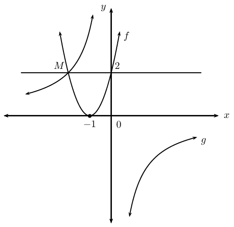

Determine:

**Problem:**
the coordinates of \(M\)

**Solution:**
\(f(x)\) is symmetrical about the line \(x =
                                                                                -1\), therefore \(M(-2;2)\).

**Problem:**
the equation of \(g(x)\)

**Solution:**
\begin{align*}
                                                                        g(x) &= \frac{a}{x} \\
                                                                        \text{Subst. } M(-2;2) \qquad 2 &=
                                                                        \frac{a}{-2} \\
                                                                        \therefore a &= -4 \\
                                                                        \therefore g(x)&=\frac{-4}{x}
                                                                        \end{align*}

**Problem:**
the equation of \(f(x)\)

**Solution:**
\begin{align*}
                                                                        f(x) &= a(x + p)^2 + q \\
                                                                        \text{No vertical shift } \therefore q &= 0
                                                                        \\
                                                                        \text{Axis of symmetry } x = -1 \qquad
                                                                        \therefore f(x) &= a(x + 1)^2 \\
                                                                        \text{Subst. } M(-2;2) \qquad 2 &= a(-2 +
                                                                        1)^2 \\
                                                                        2 &= a(-1)^2 \\
                                                                        \therefore a &= 2 \\
                                                                        \therefore f(x) &= 2(x + 1)^2
                                                                        \end{align*}

**Problem:**
the values for which \(f(x) < g(x)\)

**Solution:**
\(- 2 < x < 0\)

**Problem:**
the range of \(f(x)\)

**Solution:**
\(\text{Range: }\left \{ y: y\in
                                                                        \mathbb{R}, y \geq 0 \right \}\)

On the same system of axes, sketch:

**Problem:**
the graphs of \(k(x) = 2(x + \frac{1}{2})^2 -
                                                                                4\frac{1}{2}\) and \(h(x) = 2^{(x +
                                                                                \frac{1}{2})}\). Determine all
                                                                                intercepts, turning point(s) and
                                                                                asymptotes.

**Solution:**
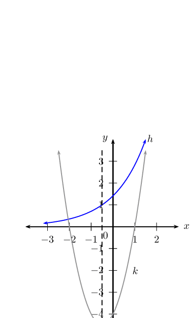

**Problem:**
the reflection of \(h(x)\) about the
                                                                                \(x\)-axis. Label this function as
                                                                                \(j(x)\).

**Solution:**
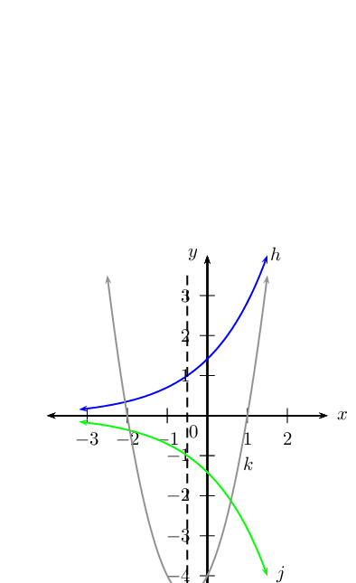

Sketch the graph of \(y = ax^2 + bx + c\) for:

**Problem:**
\(a < 0\), \(b > 0\), \(b^2 < 4ac\)

**Solution:**
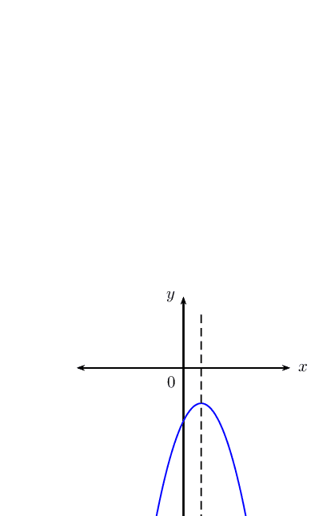

**Problem:**
\(a > 0\), \(b > 0\), one root \(=0\)

**Solution:**
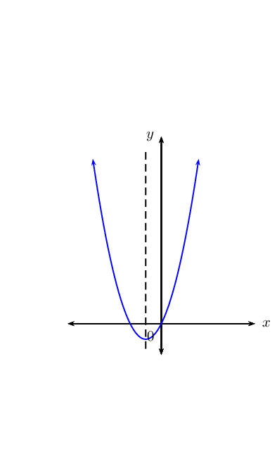

**Problem:**
On separate systems of axes, sketch the graphs:

\(y = \frac{2}{x - 2}\)

\(y = \frac{2}{x} - 2\)

\(y = -2^{(x - 2)}\)

**Solution:**
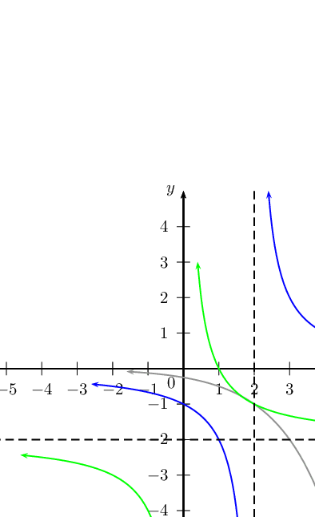

For the diagrams shown below, determine:

- the equations of the functions; \(f(x) = a(x
                                                                                  + p)^2 + q\), \(g(x)=ax^2 + q\), \(h(x)
                                                                                  = \frac{a}{x}, x < 0\) and \(k(x)=b^x
                                                                                  + q\)
- the axes of symmetry of each function
- the domain and range of each function

**Problem:**
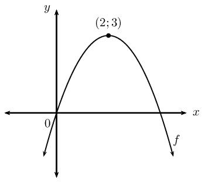

**Solution:**
\begin{align*}
                                                                        f(x) &= a(x + p)^2 + q \\
                                                                        \text{From turning point: } p= -2 &\text{
                                                                        and } q = 3 \\
                                                                        \therefore f(x) &= a(x - 2 )^2 + 3 \\
                                                                        \text{Subst. } (0;0) \qquad 0 &= a(0 - 2)^2
                                                                        + 3 \\
                                                                        -3 &= 4a \\
                                                                        \therefore a &= -\frac{3}{4} \\
                                                                        f(x) &= -\frac{3}{4}(x - 2)^2 + 3 \\
                                                                        \text{Axes of symmetry: } x &= 2 \\
                                                                        \text{Domain: } & \left \{ x:x \in
                                                                        \mathbb{R} \right \} \\
                                                                        \text{Range: } & \left \{ y:y \in
                                                                        \mathbb{R}, y \leq 3 \right \}
                                                                        \end{align*}

**Problem:**
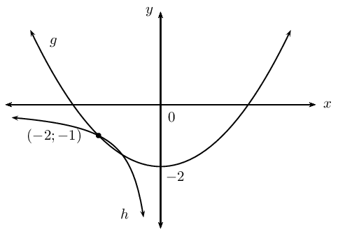

**Solution:**
\begin{align*}
                                                                        g(x) &= ax^2 + q \\
                                                                        \text{From turning point: } p= 0 &\text{ and
                                                                        } q = -2 \\
                                                                        \therefore g(x) &= a(x)^2 - 2 \\
                                                                        \text{Subst. } (-2;-1) \qquad -1 &= a(-2 )^2
                                                                        - 2\\
                                                                        -1 &= 4a - 2\\
                                                                        1 &= 4a - 2\\
                                                                        \therefore a &= \frac{1}{4} \\
                                                                        g(x) &= \frac{1}{4}x^2 -2 \\
                                                                        \text{Axes of symmetry: } x &= 0 \\
                                                                        \text{Domain: } & \left \{ x:x \in
                                                                        \mathbb{R} \right \} \\
                                                                        \text{Range: } & \left \{ y:y \in
                                                                        \mathbb{R}, y \geq -2 \right \} \\
                                                                        h(x) &= \frac{a}{x + p} + q \\
                                                                        \text{From graph: } p= 0 &\text{ and } q = 0
                                                                        \\
                                                                        h(x) &= \frac{a}{x} \\
                                                                        \text{Subst. } (-2;-1) \qquad -1
                                                                        &=\frac{a}{-2} \\
                                                                        2 &= a \\
                                                                        \therefore h(x) &= \frac{2}{x} \\
                                                                        \text{Axes of symmetry: } y &= x \\
                                                                        \text{Domain: } &\left \{ x:x \in
                                                                        \mathbb{R}, x < 0 \right \} \\
                                                                        \text{Range: } & \left \{ y:y \in
                                                                        \mathbb{R}, y < 0 \right \}
                                                                        \end{align*}

**Problem:**
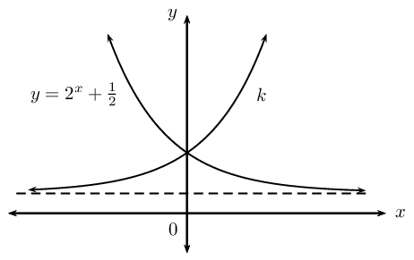

**Solution:**
\begin{align*}
                                                                        y &= 2^{x} + \frac{1}{2} \\
                                                                        \text{Reflect about } x = 0 \qquad \therefore x
                                                                        &\\Rightarrow -x \\
                                                                        \therefore k(x) &= 2^{-x} + \frac{1}{2} \\
                                                                        &= \left( \frac{1}{2} \right)^{x} +
                                                                        \frac{1}{2} \\
                                                                        \text{Domain: } & \left \{ x:x \in
                                                                        \mathbb{R} \right \} \\
                                                                        \text{Range: } & \left \{ y:y \in
                                                                        \mathbb{R}, y > \frac{1}{2} \right \}
                                                                        \end{align*}

Given the graph of the function \(Q(x) = a^x\).

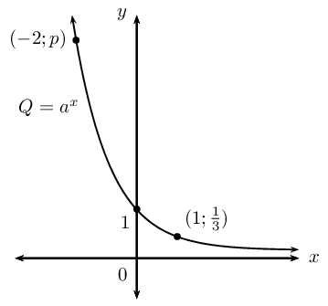

**Problem:**
Show that \(a = \frac{1}{3}\).

**Solution:**
\begin{align*}
                                                                        y&=a^x \\
                                                                        \text{Subst.} \left( 1;\frac{1}{3} \right)
                                                                        \qquad \frac{1}{3} &=a^{1} \\
                                                                        \therefore a &= \frac{1}{3}
                                                                        \end{align*}

**Problem:**
Find the value of \(p\) if the point
                                                                                \((-2;p)\) is on \(Q\).

**Solution:**
\begin{align*}
                                                                        Q(x) &= \left( \frac{1}{3} \right)^x \\
                                                                        \text{Subst.} \left( -2;p \right) p &=
                                                                        \left( \frac{1}{3} \right)^{-2} \\
                                                                        p &= 9
                                                                        \end{align*}

**Problem:**
Calculate the average gradient of the curve
                                                                                between \(x = -2\) and \(x = 1\).

**Solution:**
\begin{align*}
                                                                        \text{Average gradient} &= \frac{\left (
                                                                        \frac{1}{3} \right )^{-2} - \left ( \frac{1}{3}
                                                                        \right )^1}{-2-(1)} \\
                                                                        &= \frac{9-\frac{1}{3}}{-3} \\
                                                                        &=\frac{8\frac{2}{3}}{-3} \\
                                                                        &= \frac{-26}{9} \\
                                                                        &= -2\frac{8}{9}
                                                                        \end{align*}

**Problem:**
Determine the equation of the new function
                                                                                formed if \(Q\) is shifted \(\text{2}\)
                                                                                units vertically downwards and
                                                                                \(\text{2}\) units to the left.

**Solution:**
\begin{align*}
                                                                        Q(x) &= \left( \frac{1}{3} \right)^x \\
                                                                        \therefore x & \Rightarrow x + 2 \\
                                                                        \therefore y & \Rightarrow y + 2 \\
                                                                        y + 2 &= \left( \frac{1}{3} \right)^{x + 2}
                                                                        \\
                                                                        y &= \left( \frac{1}{3} \right)^{x + 2} -2
                                                                        \end{align*}

Find the equation for each of the functions shown
                                                                        below:

**Problem:**
\(f(x) = 2^x + q\)

\(g(x) = mx + c\)

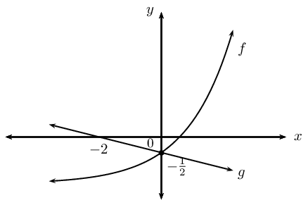

**Solution:**
\begin{align*}
                                                                        f(x) &= 2^x + q \\
                                                                        \text{Subst. } (0; -\frac{1}{2}) \quad
                                                                        -\frac{1}{2} &= 2^{0} + q \\
                                                                        -\frac{1}{2} &= 1 + q \\
                                                                        \therefore q &= -\frac{3}{2} \\
                                                                        \therefore f(x) &=2^x-\frac{3}{2} \\
                                                                        g(x) &= mx +c \\
                                                                        \text{Subst. } (0; -\frac{1}{2}) \quad
                                                                        -\frac{1}{2} &= m(0) + c \\
                                                                        \therefore c &= -\frac{1}{2} \\
                                                                        g(x) &= mx -\frac{1}{2} \\
                                                                        \text{Subst. } (-2;0) \quad 0 &= m(-2)
                                                                        -\frac{1}{2} \\
                                                                        \frac{1}{2} &= -2m \\
                                                                        \therefore m &= -\frac{1}{4} \\
                                                                        \therefore g(x) &= -\frac{1}{4}x-\frac{1}{2}
                                                                        \end{align*}

**Problem:**
\(h(x) = \frac{k}{x + p} + q\)

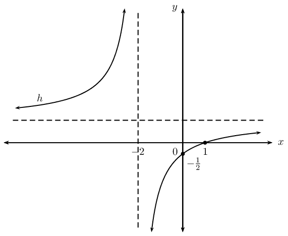

**Solution:**
\begin{align*}
                                                                        h(x) &= \frac{k}{x + p} + q \\
                                                                        \text{From graph: } \quad p = -2 \\
                                                                        h(x) &= \frac{k}{x + 2} + q \\
                                                                        \text{Subst. } (0; -\frac{1}{2}) \quad
                                                                        -\frac{1}{2} &= \frac{k}{2} + q \\
                                                                        -1 &= k + 2q \ldots (1)\\
                                                                        \text{Subst. } (1;0) \quad 0 &= \frac{k}{1 +
                                                                        2} + q \\
                                                                        0 &= k + 3q \ldots (2)\\
                                                                        (2) - (1): \qquad 1 &= 0 + q \\
                                                                        \therefore q &= 1 \\
                                                                        \text{and } k &= -3\\
                                                                        \therefore h(x) &= -\frac{3}{x + 2} + 1
                                                                        \end{align*}

Given: the graph of \(k(x) = -x^2 + 3x + \text{10}\)
                                                                        with turning point at \(D\). The graph of the
                                                                        straight line \(h(x) = mx + c\) passing through
                                                                        points \(B\) and \(C\) is also shown.

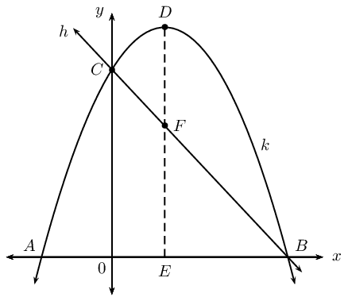

Determine:

**Problem:**
the lengths \(AO\), \(OB\), \(OC\) and \(DE\)

**Solution:**
\begin{align*}
                                                                        y &=-x^2+3x+10 \\
                                                                        \text{Let } y &= 0 \\
                                                                        0 &=-x^2+3x+10 \\
                                                                        &= x^2-3x-10\\
                                                                        &= (x-5)(x+2)\\
                                                                        \therefore x=5 &\text{ or }x =-2 \\
                                                                        \therefore AO &= \text{2}\text{ units} \\
                                                                        \therefore BO &=\text{5}\text{ units} \\
                                                                        CO&=\text{10}\text{ units}\\
                                                                        \text{Axes of symmetry: } x &=-\frac{5 -
                                                                        2}{2} \\
                                                                        &=\frac{3}{2} \\
                                                                        \text{Subst. } x &= \frac{3}{2} \\
                                                                        y &=-\left ( \frac{3}{2} \right
                                                                        )^2+3\frac{3}{2}+10 \\
                                                                        &=12\frac{1}{4} \\
                                                                        \therefore DE &= \text{12,25}\text{ units}
                                                                        \end{align*}

**Problem:**
the equation of \(DE\)

**Solution:**
\(DE = 12\frac{1}{4}\)

**Problem:**
the equation of \(h(x)\)

**Solution:**
\begin{align*}
                                                                        h(x) & = mx + c \\
                                                                        h(x) & = mx + 10 \\
                                                                        \text{Subst. } (5;0) \qquad 0 &= m(5) + 10
                                                                        \\
                                                                        -10 &= 5m \\
                                                                        \therefore m &= -2 \\
                                                                        \therefore h(x) &=-2x+10
                                                                        \end{align*}

**Problem:**
the \(x\)-values for which \(k(x) < 0\)

**Solution:**
\(\left \{ x: x\in \mathbb{R}, x
                                                                        < -2 \text{ and } x > 5 \right \}\)

**Problem:**
the \(x\)-values for which \(k(x) \geq h(x)\)

**Solution:**
\(\left \{ x: x\in \mathbb{R}, 0
                                                                        \leq x \leq 5 \right \}\)

**Problem:**
the length of \(DF\)

**Solution:**
\begin{align*}
                                                                        \text{At } x = \frac{3}{2} k(x) &=
                                                                        12\frac{1}{4} \\
                                                                        \text{At } x = \frac{3}{2} h(x) &= -2 \left(
                                                                        \frac{3}{2} \right) + 10 \\
                                                                        &= -3 + 10 \\
                                                                        &= 7\\
                                                                        \therefore DF &= 12\frac{1}{4} - 7 \\
                                                                        &= 12\frac{1}{4} - 7 \\
                                                                        &= \text{5,25}\text{ units}
                                                                        \end{align*}

Trigonometric functions are examined in PAPER 2.
