## 5.6 The cosine function (EMBH3)

### Revision (EMBH4)

#### Functions of the form \(y = \cos \theta\) for \(\text{0}\text{°}
                                        \leq \theta \leq \text{360}\text{°}\)

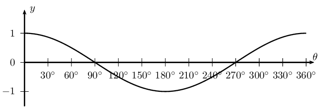

- The period is \(\text{360}\text{°}\) and the amplitude is
                                                          \(\text{1}\).
- Domain: \([\text{0}\text{°};\text{360}\text{°}]\)
  For \(y = \cos \theta\), the domain is \(\{ \theta: \theta \in
                                                          \mathbb{R} \}\), however in this case, the domain has been
                                                          restricted to the interval \(\text{0}\text{°} \leq \theta
                                                          \leq \text{360}\text{°}\).
- Range: \(\left[-1;1\right]\)
- \(x\)-intercepts: \(\left(\text{90}\text{°};0\right)\),
                                                          \(\left(\text{270}\text{°};0\right)\)
- \(y\)-intercept: \(\left(\text{0}\text{°};1\right)\)
- Maximum turning points: \(\left(\text{0}\text{°};1\right)\),
                                                          \(\left(\text{360}\text{°};1\right)\)
- Minimum turning point: \(\left(\text{180}\text{°};-1\right)\)

#### Functions of the form \(y = a \cos \theta + q\)

Cosine functions of the general form \(y = a \cos \theta + q\), where \(a\) and \(q\)
                                        are constants.

**The effects of \(a\) and \(q\) on \(f(\theta) = a \cos \theta + q\):**

- **The effect of \(q\) on vertical shift**
  - For \(q>0\), \(f(\theta)\) is shifted vertically
                                                                            upwards by \(q\) units.
  - For \(q<0\), \(f(\theta)\) is shifted vertically
                                                                            downwards by \(q\) units.
- **The effect of \(a\) on shape **
  - For \(a>1\), the amplitude of \(f(\theta)\)
                                                                            increases.
  - For \(0<a<1\), the amplitude of \(f(\theta)\)
                                                                            decreases.
  - For \(a<0\), there is a reflection about the
                                                                            \(x\)-axis.
  - For \(-1 < a < 0\), there is a reflection about
                                                                            the \(x\)-axis and the amplitude decreases.
  - For \(a < -1\), there is a reflection about the
                                                                            \(x\)-axis and the amplitude increases.

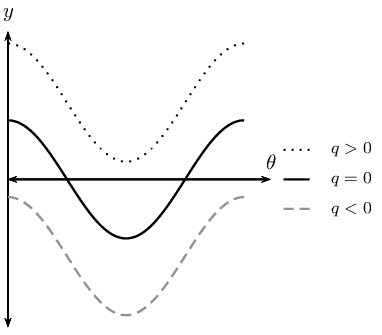

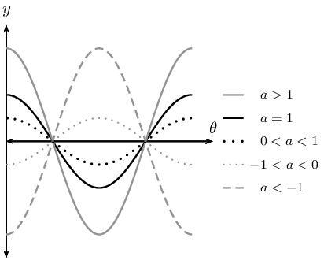

<QuizCard id="m11-05-06a" title="Interactive Exercise 5.18" question="Determine the value of \(a\) ." options=["-2 < h < 2", "-5 \u2264 h \u2264 -1", "-2 \u2264 h \u2264 2", "-5 \u2265 h \u2265 -1"] answer="-2 ≤ h ≤ 2" hint="You should enter a number here. If you want to, you can use a space to separate thousands.                Example: 12 800,25 For scientific notation you need to use the multiply symbol                ( ∗ ) and the exponent symbol ( ^ ). For example 6,673 × 10 −11 should be written as: 6,673 ∗ 10^−11" explanation="Read off the coordinates of the trough of the graph and use them to solve for \(a\) We need to find the value of \(a\) in \(g(x) =                             a \cos x\) for \(                               \text{0}\text{°}                               \leq x \leq                               \text{360}\text{°}                             \) . The value of \(a\) affects the amplitude of the graph, that is, the height of the peaks and the depths of                       the troughs. So we need to read off the coordinates of either a peak or a trough of the                       graph and use them to find the value of \(a\) . NOTE: We could use the coordinates of any point except those that are on the \(x\) -axis. For this graph, it is easier to read off the coordinates of either the peak                       or the trough. Can you think of why we do not use the points on the \(x\) -axis? In this solution, we will use the coordinates of a trough: \((\text{180}\text{°}\, ; -\text{2})\) . We will substitute these coordinates into the equation of \(g(x)\) and solve for \(a\) . \[                         \begin{aligned}                         	g(x) &= a \cos x \\                           (-2)  &= a \cos (\text{180}\text{°}) \\                             -2  &= a (-1) \\                             2 &= a                         \end{aligned}                     \] NOTE: If we look at the graph of \(g(x)\) again, we see that the                       height of the peaks or depth of the troughs is \(\text{2}\) .                       This means that the amplitude of \(g(x)\) is \(\text{2}\) .                       This is the same value that we have calculated for \(a\) . As a general rule, the amplitude of any cosine function of the                       form \(f = a \cos x \) , is the positive value of \(a\) . With this value of \(a\) , we can now write the equation of \(g(x)\) : \(g(x) = 2 \cos x\) . The value of \(a\) is \(\text{2}\) . Submit your answer as:" />

## Revision

### Textbook Exercise
                                                        5.24

On separate axes, accurately draw each of the following
                                                                functions for \(\text{0}\text{°} \leq \theta \leq
                                                                \text{360}\text{°}\):

- Use tables of values if necessary.
- Use graph paper if available.

For each function in the previous problem determine the
                                                                following:

- Period
- Amplitude
- Domain and range
- \(x\)- and \(y\)-intercepts
- Maximum and minimum turning points

**Problem:**
\(y_1 = \cos \theta\)

**Solution:**
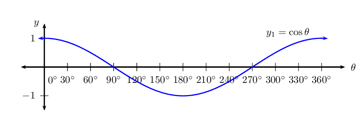

**Problem:**
\(y_2 = - 3 \cos \theta\)

**Solution:**
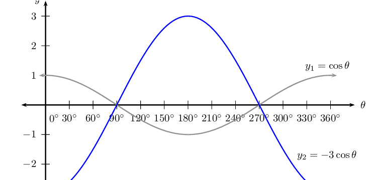

**Problem:**
\(y_3 = \cos \theta + 2\)

**Solution:**
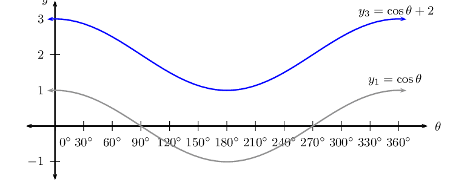

**Problem:**
\(y_4 = \frac{1}{2} \cos \theta - 1\)

**Solution:**
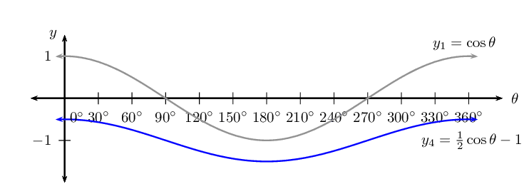

### Functions of the form \(y=\cos (k\theta)\) (EMBH5)

We now consider cosine functions of the form \(y = \cos k\theta\) and the effects of
                                parameter \(k\).

## The effects of \(k\) on a cosine graph

2. Complete the following table for \(y_1 = \cos \theta\) for
                                                   \(-\text{360}\text{°} \leq \theta \leq \text{360}\text{°}\):
   | θ | \(-\text{360}\)\(\text{°}\) | \(-\text{300}\)\(\text{°}\) | \(-\text{240}\)\(\text{°}\) | \(-\text{180}\)\(\text{°}\) | \(-\text{120}\)\(\text{°}\) | \(-\text{60}\)\(\text{°}\) | \(\text{0}\)\(\text{°}\) |
   | --- | --- | --- | --- | --- | --- | --- | --- |
   | \(\cos \theta\) |  |  |  |  |  |  |  |
   | θ | \(\text{60}\)\(\text{°}\) | \(\text{120}\)\(\text{°}\) | \(\text{180}\)\(\text{°}\) | \(\text{240}\)\(\text{°}\) | \(\text{300}\)\(\text{°}\) | \(\text{360}\)\(\text{°}\) |  |
   | \(\cos \theta\) |  |  |  |  |  |  |  |
4. Use the table of values to plot the graph of \(y_1 = \cos \theta\)
                                                           for \(-\text{360}\text{°} \leq \theta \leq
                                                           \text{360}\text{°}\).
6. On the same system of axes, plot the following graphs:
   2. \(y_2 = \cos (-\theta)\)
   4. \(y_3 = \cos 3\theta\)
   6. \(y_4 = \cos \frac{3\theta}{4}\)
8. Use your sketches of the functions above to complete the following
                                                           table:
   |  | \(y_1\) | \(y_2\) | \(y_3\) | \(y_4\) |
   | --- | --- | --- | --- | --- |
   | period |  |  |  |  |
   | amplitude |  |  |  |  |
   | domain |  |  |  |  |
   | range |  |  |  |  |
   | maximum turning points |  |  |  |  |
   | minimum turning points |  |  |  |  |
   | \(y\)-intercept(s) |  |  |  |  |
   | \(x\)-intercept(s) |  |  |  |  |
   | effect of \(k\) |  |  |  |  |
10. What do you notice about \(y_1 = \cos \theta\) and \(y_2 = \cos
                                                           (-\theta)\)?
12. Is \(\cos (-\theta) = -\cos \theta\) a true statement? Explain your
                                                           answer.
14. Can you deduce a formula for determining the period of \(y = \cos k\theta\)?

**The effect of the parameter \(k\) on \(y = \cos k\theta\)**

The value of \(k\) affects the period of the cosine function.

- **For \(k > 0\)**:
  For \(k > 1\), the period of the cosine function decreases.
  For \(0 < k < 1\), the period of the cosine function increases.
- **For \(k < 0\)**:
  For \(-1 < k < 0\), the period increases.
  For \(k < -1\), the period decreases.

**Negative angles**:
                                \[\cos (-\theta) = \cos \theta\]

                                Notice that for negative values of \(\theta\), the graph is **not**
                                reflected about the \(x\)-axis.

**Calculating the period**:

To determine the period of \(y = \cos k\theta\) we use,
                                \[\text{Period } = \frac{\text{360}\text{°}}{|k|}\]

                                where \(|k|\) is the absolute value of \(k\).

| \(0 < k < 1\) | \(-1 < k < 0\) |
| --- | --- |
| \(k > 1\) | \(k < -1\) |

<Callout type="tip" title="Worked example 22: Cosine function">
**Question:**
2. Sketch the following functions on the same set of axes for
                                                           \(-\text{180}\text{°} \leq \theta \leq
                                                           \text{180}\text{°}\).
   2. \(y_1 = \cos \theta\)
   4. \(y_2 = \cos \frac{\theta}{2}\)
4. For each function determine the following:
   2. Period
   4. Amplitude
   6. Domain and range
   8. \(x\)- and \(y\)-intercepts
   10. Maximum and minimum turning points

**Examine the equations of the form \(y = \cos k\theta\):**
Notice that for \(y_2 = \cos \frac{\theta}{2}\), \(k < 1\) therefore the
                                                period of the graph increases.

**Complete a table of values:**
| θ | \(-\text{180}\)\(\text{°}\) | \(-\text{135}\)\(\text{°}\) | \(-\text{90}\)\(\text{°}\) | \(-\text{45}\)\(\text{°}\) | \(\text{0}\)\(\text{°}\) | \(\text{45}\)\(\text{°}\) | \(\text{90}\)\(\text{°}\) | \(\text{135}\)\(\text{°}\) | \(\text{180}\)\(\text{°}\) |
| --- | --- | --- | --- | --- | --- | --- | --- | --- | --- |
| \(\cos \theta\) | \(-\text{1}\) | \(-\text{0,71}\) | \(\text{0}\) | \(\text{0,71}\) | \(\text{1}\) | \(\text{0,71}\) | \(\text{0}\) | \(-\text{0,71}\) | \(-\text{1}\) |
| \(\cos \frac{\theta}{2}\) | \(\text{0}\) | \(\text{0,38}\) | \(\text{0,71}\) | \(\text{0,92}\) | \(\text{1}\) | \(\text{0,92}\) | \(\text{0,71}\) | \(\text{0,38}\) | \(\text{0}\) |

**Sketch the cosine graphs:**
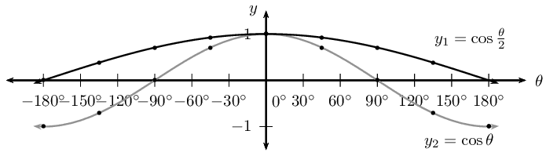

**Complete the table:**
|  | \(y_1 = \cos \theta\) | \(y_2 = \cos \frac{\theta}{2}\) |
| --- | --- | --- |
| period | \(\text{360}\text{°}\) | \(\text{720}\text{°}\) |
| amplitude | \(\text{1}\) | \(\text{1}\) |
| domain | \([-\text{180}\text{°};\text{180}\text{°}]\) | \([-\text{180}\text{°};\text{180}\text{°}]\) |
| range | \([-1;1]\) | \([0;1]\) |
| maximum turning points | \((\text{0}\text{°};1)\) | \((\text{0}\text{°};1)\) |
| minimum turning points | \((-\text{180}\text{°};-1) \text{ and }
                                                                (\text{180}\text{°};-1)\) | none |
| \(y\)-intercept(s) | \((\text{0}\text{°};1)\) | \((\text{0}\text{°};1)\) |
| \(x\)-intercept(s) | \((-\text{90}\text{°};0) \text{ and }
                                                                (\text{90}\text{°};0)\) | \((-\text{180}\text{°};0) \text{ and }
                                                                (\text{180}\text{°};0)\) |
</Callout>

#### Discovering the characteristics

For functions of the general form: \(f(\theta) = y =\cos k\theta\):

**Domain and range**

The domain is \(\{ \theta: \theta \in \mathbb{R} \}\) because there is no value for
                                        \(\theta\) for which \(f(\theta)\) is undefined.

The range is \(\{ f(\theta): -1 \leq f(\theta) \leq 1, f(\theta) \in \mathbb{R} \}\)
                                        or \([-1;1]\).

**Intercepts**

The \(x\)-intercepts are determined by letting \(f(\theta) = 0\) and solving for
                                        \(\theta\).

The \(y\)-intercept is calculated by letting \(\theta = \text{0}\text{°}\) and
                                        solving for \(f(\theta)\).
                                        \begin{align*}
                                        y &= \cos k\theta \\
                                        &= \cos \text{0}\text{°} \\
                                        &= 1
                                        \end{align*}
                                        This gives the point \((\text{0}\text{°};1)\).

<QuizCard id="m11-05-06b" title="Interactive Exercise 5.19" question="Shown the following graph of the following form: \(f(x) = \cos(kx)\) . Calculate the value of \(k\) (positive value). INSTRUCTION: Write your answer as a fraction." options=[] answer="2/3" hint="You are expected to write a fraction here. You can write pure fractions using the division symbol: / For example, to write the fraction \(-\frac{2}{3}\) the correct input would be: -2/3 You can also write mixed numbers by first writing the integer part, then a space and                then the fraction part. For example, to write \(2 \frac{1}{8}\) the correct input                would be: 2 1/8" explanation="Compare the period of \(f(x) = \cos(kx)\) with the period of \(y = \cos(x)\) To understand the effect that \(k\) has on the waveform, we can compare the given graph to the standard form of the graph: \(y = \cos(x)\) We can measure the relative change in the period by measuring the periods of each graph (shown above as \(G\) and \(H\) ). Calculate the horizontal scale factor To calculate the value of \(k\) , we want to calculate \"how much\" has the period of the waveform decreased? So let us calculate the scale factor: \[ 					\begin{aligned} 						H \times \textrm{scale} & = G \\ 						\textrm{scale} & = \frac{G}{H} \\ 						\textrm{scale} & = \frac{360}{\text{540}} \\ 						\textrm{scale} & = \frac{2}{3} 					\end{aligned} 					\] Therefore the horizontal scale factor is \(\frac{2}{3}\) . Determine the value of \(k\) Finally we ask: Is the value of \(k\) positive or negative? Because the \(\cos(x)\) graph is symmetrical about the y-axis the sign of the variable \(k\) has no effect on the shape of the graph. Therefore, the value of \(k\) can be either \(+ \frac{2}{3}\) or \(- \frac{2}{3}\) . NOTE: The final equation of the graph can be written as either: \(f(x) = \cos(\frac{2}{3} \times x)\) or \(f(x) = \cos(-\frac{2}{3} \times x)\) Because this question asks for the positive value, the correct answer is: \(\frac{2}{3}\) . Submit your answer as:" />

## Cosine functions of the form \(y = \cos k\theta\)

### Textbook Exercise 5.25

Sketch the following functions for \(-\text{180}\text{°}
                                                                \leq \theta \leq \text{180}\text{°}\). For each
                                                                graph determine:

- Period
- Amplitude
- Domain and range
- \(x\)- and \(y\)-intercepts
- Maximum and minimum turning points

**Problem:**
\(f(\theta) =\cos 2\theta\)

**Solution:**
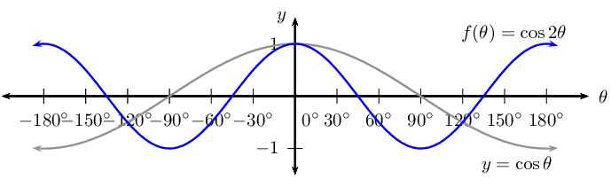

For \(f(\theta) =\cos 2 \theta\):

                                                                \begin{align*}
                                                                \text{Period: } & \text{180}\text{°} \\
                                                                \text{Amplitude: } & 1 \\
                                                                \text{Domain: } &
                                                                [-\text{180}\text{°};\text{180}\text{°}] \\
                                                                \text{Range: } & [-1;1] \\
                                                                x\text{-intercepts: } &
                                                                (-\text{135}\text{°};0);
                                                                (-\text{45}\text{°};0);
                                                                (\text{45}\text{°};0);
                                                                (\text{135}\text{°};0) \\
                                                                y\text{-intercepts: } & (\text{0}\text{°};1) \\
                                                                \text{Max. turning point: } &
                                                                (-\text{180}\text{°};1);
                                                                (\text{0}\text{°};1);
                                                                (\text{180}\text{°};1) \\
                                                                \text{Min. turning point: } &
                                                                (-\text{90}\text{°};-1);
                                                                (\text{90}\text{°};-1)
                                                                \end{align*}

**Problem:**
\(g(\theta) =\cos \frac{\theta}{3}\)

**Solution:**
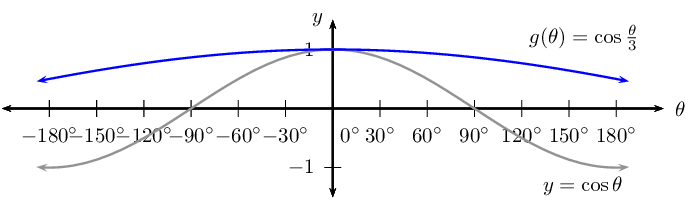

For \(g(\theta) =\cos \frac{\theta}{3}\):

                                                                \begin{align*}
                                                                \text{Period: } & \text{1 080}\text{°} \\
                                                                \text{Amplitude: } & 1 \\
                                                                \text{Domain: } &
                                                                [-\text{180}\text{°};\text{180}\text{°}] \\
                                                                \text{Range: } & [\frac{1}{2};1] \\
                                                                x\text{-intercepts: } & \text{ none } \\
                                                                \text{Max. turning point: } &
                                                                (\text{0}\text{°};1) \\
                                                                \text{Min. turning point: } & \text{ none }
                                                                \end{align*}

**Problem:**
\(h(\theta) =\cos (-2\theta)\)

**Solution:**
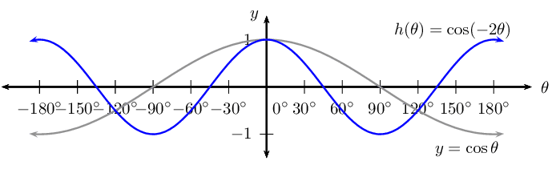

For \(h(\theta) =\cos (-2\theta)\):

                                                                \begin{align*}
                                                                \text{Period: } & \text{180}\text{°} \\
                                                                \text{Amplitude: } & 1 \\
                                                                \text{Domain: } &
                                                                [-\text{180}\text{°};\text{180}\text{°}] \\
                                                                \text{Range: } & [-1;1] \\
                                                                x\text{-intercepts: } &
                                                                (-\text{135}\text{°};0);
                                                                (-\text{45}\text{°};0);
                                                                (\text{45}\text{°};0);
                                                                (\text{135}\text{°};0) \\
                                                                y\text{-intercepts: } & (\text{0}\text{°};1) \\
                                                                \text{Max. turning point: } &
                                                                (-\text{180}\text{°};1);
                                                                (\text{0}\text{°};1);
                                                                (\text{180}\text{°};1) \\
                                                                \text{Min. turning point: } &
                                                                (-\text{90}\text{°};-1);
                                                                (\text{90}\text{°};-1)
                                                                \end{align*}

**Problem:**
\(k(\theta) =\cos \frac{3\theta}{4}\)

**Solution:**
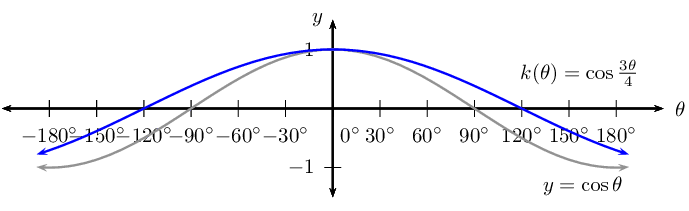

For \(k(\theta) =\cos \frac{3\theta}{4}\):

                                                                \begin{align*}
                                                                \text{Period: } & \text{480}\text{°} \\
                                                                \text{Amplitude: } & 1 \\
                                                                \text{Domain: } &
                                                                [-\text{180}\text{°};\text{180}\text{°}] \\
                                                                \text{Range: } & [-\frac{1}{\sqrt{2}};1] \\
                                                                x\text{-intercepts: } &
                                                                (-\text{120}\text{°};0);
                                                                (\text{120}\text{°};0) \\
                                                                y\text{-intercepts: } & (\text{0}\text{°};1) \\
                                                                \text{Max. turning point: } &
                                                                (\text{0}\text{°};1) \\
                                                                \text{Min. turning point: } & \text{ none }
                                                                \end{align*}

For each graph of the form \(f(\theta) =\cos k\theta\),
                                                                determine the value of \(k\):

**Problem:**
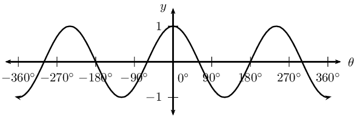

**Solution:**
\begin{align*}
                                                                \text{Period } &= \frac{\text{720}\text{°}}{3
                                                                \text{ complete waves }} \\
                                                                &= \text{240}\text{°} \\
                                                                \therefore \frac{\text{360}\text{°}}{k} &=
                                                                \text{240}\text{°} \\
                                                                \therefore k &=
                                                                \frac{\text{360}\text{°}}{\text{240}\text{°} }
                                                                \\
                                                                &= \frac{3}{2}
                                                                \end{align*}

**Problem:**
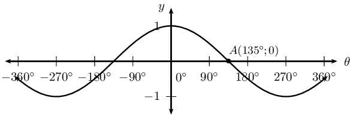

**Solution:**
\begin{align*}
                                                                \text{For } y &= \cos \theta \\
                                                                0 &= \cos \text{90}\text{°}\\
                                                                \text{So for } A(\text{135}\text{°};0) \qquad
                                                                \text{90}\text{°} &= k \times
                                                                \text{135}\text{°}\\
                                                                \therefore k &=
                                                                \frac{\text{90}\text{°}}{\text{135}\text{°} }
                                                                \\
                                                                &= \frac{2}{3}
                                                                \end{align*}

### Functions of the form \(y=\cos\left(\theta +p\right)\) (EMBH6)

We now consider cosine functions of the form \(y = \cos(\theta + p)\) and the effects of
                                parameter \(p\).

## The effects of \(p\) on a cosine graph

2. On the same system of axes, plot the following graphs for
                                                           \(-\text{360}\text{°} \leq \theta \leq
                                                           \text{360}\text{°}\):
   2. \(y_1 = \cos \theta\)
   4. \(y_2 = \cos (\theta - \text{90}\text{°})\)
   6. \(y_3 = \cos (\theta - \text{60}\text{°})\)
   8. \(y_4 = \cos (\theta + \text{90}\text{°})\)
   10. \(y_5 = \cos (\theta + \text{180}\text{°})\)
4. Use your sketches of the functions above to complete the following
                                                           table:
   |  | \(y_1\) | \(y_2\) | \(y_3\) | \(y_4\) | \(y_5\) |
   | --- | --- | --- | --- | --- | --- |
   | period |  |  |  |  |  |
   | amplitude |  |  |  |  |  |
   | domain |  |  |  |  |  |
   | range |  |  |  |  |  |
   | maximum turning points |  |  |  |  |  |
   | minimum turning points |  |  |  |  |  |
   | \(y\)-intercept(s) |  |  |  |  |  |
   | \(x\)-intercept(s) |  |  |  |  |  |
   | effect of \(p\) |  |  |  |  |  |

**The effect of the parameter on \(y = \cos(\theta + p)\)**

The effect of \(p\) on the cosine function is a horizontal shift (or phase shift); the entire
                                graph slides to the left or to the right.

- For \(p > 0\), the graph of the cosine function shifts to the left by
                                                  \(p\) degrees.
- For \(p < 0\), the graph of the cosine function shifts to the right by
                                                  \(p\) degrees.

| \(p>0\) | \(p<0\) |
| --- | --- |

<Callout type="tip" title="Worked example 23: Cosine function">
**Question:**
2. Sketch the following functions on the same set of axes for
                                                           \(-\text{360}\text{°} \leq \theta \leq
                                                           \text{360}\text{°}\).
   2. \(y_1 = \cos \theta\)
   4. \(y_2 = \cos (\theta + \text{30}\text{°})\)
4. For each function determine the following:
   2. Period
   4. Amplitude
   6. Domain and range
   8. \(x\)- and \(y\)-intercepts
   10. Maximum and minimum turning points

**Examine the equations of the form \(y = \cos (\theta + p)\):**
Notice that for \(y_1 = \cos \theta\) we have \(p = 0\) (no phase shift) and
                                                for \(y_2 = \cos (\theta + \text{30}\text{°})\), \(p < 0\)
                                                therefore the graph shifts to the left by \(\text{30}\text{°}\).

**Complete a table of values:**
| θ | \(-\text{360}\)\(\text{°}\) | \(-\text{270}\)\(\text{°}\) | \(-\text{180}\)\(\text{°}\) | \(-\text{90}\)\(\text{°}\) | \(\text{0}\)\(\text{°}\) | \(\text{90}\)\(\text{°}\) | \(\text{180}\)\(\text{°}\) | \(\text{270}\)\(\text{°}\) | \(\text{360}\)\(\text{°}\) |
| --- | --- | --- | --- | --- | --- | --- | --- | --- | --- |
| \(\cos \theta\) | \(\text{1}\) | \(\text{0}\) | \(-\text{1}\) | \(\text{0}\) | \(\text{1}\) | \(\text{0}\) | \(-\text{1}\) | \(\text{0}\) | \(\text{1}\) |
| \(\cos(\theta + \text{30}\text{°})\) | \(\text{0,87}\) | \(-\text{0,5}\) | \(-\text{0,87}\) | \(\text{0,5}\) | \(\text{0,87}\) | \(-\text{0,5}\) | \(-\text{0,87}\) | \(\text{0,5}\) | \(\text{0,87}\) |

**Sketch the cosine graphs:**
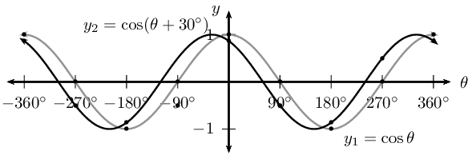

**Complete the table:**
|  | \(y_1\) | \(y_2\) |
| --- | --- | --- |
| period | \(\text{360}\text{°}\) | \(\text{360}\text{°}\) |
| amplitude | \(\text{1}\) | \(\text{1}\) |
| domain | \([-\text{360}\text{°};\text{360}\text{°}]\) | \([-\text{360}\text{°};\text{360}\text{°}]\) |
| range | \([-1;1]\) | \([-1;1]\) |
| maximum turning points | \((-\text{360}\text{°};1)\),
                                                                \((\text{0}\text{°};1)\) and
                                                                \((\text{360}\text{°};1)\) | \((-\text{30}\text{°};1)\) and
                                                                \((\text{330}\text{°};1)\) |
| minimum turning points | \((-\text{180}\text{°};-1)\) and
                                                                \((\text{180}\text{°};-1)\) | \((-\text{210}\text{°};-1)\) and
                                                                \((\text{150}\text{°};-1)\) |
| \(y\)-intercept(s) | \((\text{0}\text{°};0)\) | \((\text{0}\text{°};\text{0,87})\) |
| \(x\)-intercept(s) | \((-\text{270}\text{°};0)\),
                                                                \((-\text{90}\text{°};0)\),
                                                                \((\text{90}\text{°};0)\) and
                                                                \((\text{270}\text{°};0)\) | \((-\text{300}\text{°};0)\),
                                                                \((-\text{120}\text{°};0)\),
                                                                \((\text{60}\text{°};0)\) and
                                                                \((\text{240}\text{°};0)\) |
</Callout>

#### Discovering the characteristics

For functions of the general form: \(f(\theta) = y =\cos (\theta + p)\):

**Domain and range**

The domain is \(\{ \theta: \theta \in \mathbb{R} \}\) because there is no value for
                                        \(\theta\) for which \(f(\theta)\) is undefined.

The range is \(\{ f(\theta): -1 \leq f(\theta) \leq 1, f(\theta) \in \mathbb{R} \}\).

**Intercepts**

The \(x\)-intercepts are determined by letting \(f(\theta) = 0\) and solving for
                                        \(\theta\).

The \(y\)-intercept is calculated by letting \(\theta = \text{0}\text{°}\) and
                                        solving for \(f(\theta)\).
                                        \begin{align*}
                                        y &= \cos (\theta + p) \\
                                        &= \cos (\text{0}\text{°} + p) \\
                                        &= \cos p
                                        \end{align*}
                                        This gives the point \((\text{0}\text{°};\cos p)\).

<QuizCard id="m11-05-06c" title="Interactive Exercise 5.20" question="Shown the following graph of the following form: \(f(x) = \cos(x + p)\) . Calculate the value of \(p\) . INSTRUCTION: Round off your answer to two decimal places." options=[] answer="90" hint="You should enter a number here. If you want to, you can use a space to separate thousands.                Example: 12 800,25 For scientific notation you need to use the multiply symbol                ( ∗ ) and the exponent symbol ( ^ ). For example 6,673 × 10 −11 should be written as: 6,673 ∗ 10^−11" explanation="Compare the graph of \(f(x) = \cos(x + p)\) with the graph of \(y = \cos(x)\) To understand the effect that \(p\) has on the waveform, we can compare the given graph to the standard form of the graph: \(y = \cos(x)\) We can measure the horizontal shift by measuring the distance between the peaks of each graph (shown above as \(G\) ). Measure the horizontal shift \(G\) To calculate the value of \(p\) , we want to calculate how many degrees the graph has been shifted. \[ 					\begin{aligned} 						G & = -\text{90}° 					\end{aligned} 					\] Determine the value of \(p\) Finally we ask: Is the value of \(p\) positive or negative? In this case, the value of \(p\) is positive because the graph has been shifted to the left . The correct answer is \(p = \text{90}\text{°}\) . NOTE: The final equation of the graph is therefore: \(f(x) = \cos(x + \text{90}\text{°})\) Submit your answer as:" />

## Cosine functions of the form \(y = \cos (\theta + p)\)

### Textbook Exercise 5.26

Sketch the following functions for \(-\text{360}\text{°} \leq
                                                        \theta \leq \text{360}\text{°}\).

For each function, determine the following:

- Period
- Amplitude
- Domain and range
- \(x\)- and \(y\)-intercepts
- Maximum and minimum turning points

**Problem:**
\(f(\theta) =\cos (\theta + \text{45}\text{°})\)

**Solution:**
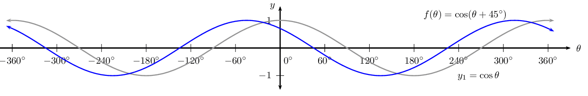

**Problem:**
\(g(\theta) =\cos (\theta - \text{30}\text{°})\)

**Solution:**
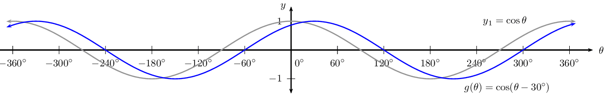

**Problem:**
\(h(\theta) =\cos (\theta + \text{60}\text{°})\)

**Solution:**
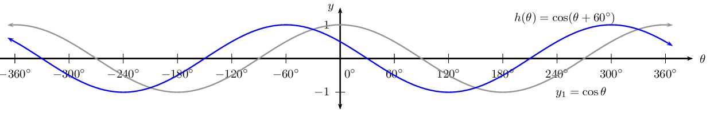

### Sketching cosine graphs (EMBH7)

<Callout type="tip" title="Worked example 24: Sketching a cosine graph">
**Question:**
Sketch the graph of \(f(\theta) = \cos (\text{180}\text{°} - 3\theta)\)
                                                for \(\text{0}\text{°} \leq \theta \leq \text{360}\text{°}\).

**Examine the form of the equation:**
Write the equation in the form \(y = \cos k(\theta + p)\).
                                                \begin{align*}
                                                f(\theta) &= \cos (\text{180}\text{°

To draw a graph of the above function, the standard cosine graph, \(y = \cos
                                                \theta\), must be changed in the following ways:

- decrease the period by a factor of \(\text{3}\)
- shift to the right by \(\text{60}\text{°}\).

**Complete a table of values:**
| θ | \(\text{0}\)\(\text{°}\) | \(\text{45}\)\(\text{°}\) | \(\text{90}\)\(\text{°}\) | \(\text{135}\)\(\text{°}\) | \(\text{180}\)\(\text{°}\) | \(\text{225}\)\(\text{°}\) | \(\text{270}\)\(\text{°}\) | \(\text{315}\)\(\text{°}\) | \(\text{360}\)\(\text{°}\) |
| --- | --- | --- | --- | --- | --- | --- | --- | --- | --- |
| \(f(\theta)\) | \(-\text{1}\) | \(\text{0,71}\) | \(\text{0}\) | \(-\text{0,71}\) | \(\text{1}\) | \(-\text{0,71}\) | \(\text{0}\) | \(\text{0,71}\) | \(-\text{1}\) |

**Plot the points and join with a smooth curve:**
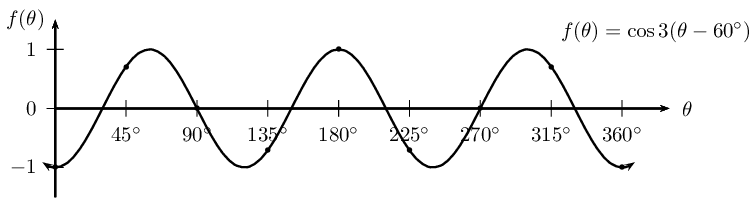

Period: \(\text{120}\)\(\text{°}\)

Amplitude: \(\text{1}\)

Domain: \([\text{0}\text{°};\text{360}\text{°}]\)

Range: \([-1;1]\)

Maximum turning point: \((\text{60}\text{°};1)\),
                                                \((\text{180}\text{°};1)\) and \((\text{300}\text{°};1)\)

Minimum turning point: \((\text{0}\text{°}; -1)\),
                                                \((\text{120}\text{°};-1)\), \((\text{240}\text{°};-1)\) and
                                                \((\text{360}\text{°};-1)\)

\(y\)-intercepts: \((\text{0}\text{°};-1)\)

\(x\)-intercept: \((\text{30}\text{°};0)\),
                                                \((\text{90}\text{°};0)\), \((\text{150}\text{°};0)\),
                                                \((\text{210}\text{°};0)\), \((\text{270}\text{°};0)\) and
                                                \((\text{330}\text{°};0)\)
</Callout>

<Callout type="tip" title="Worked example 25: Finding the equation of a cosine graph">
**Question:**
Given the graph of \(y = a \cos (k\theta + p)\), determine the values of
                                                \(a\), \(k\), \(p\) and the minimum turning point.

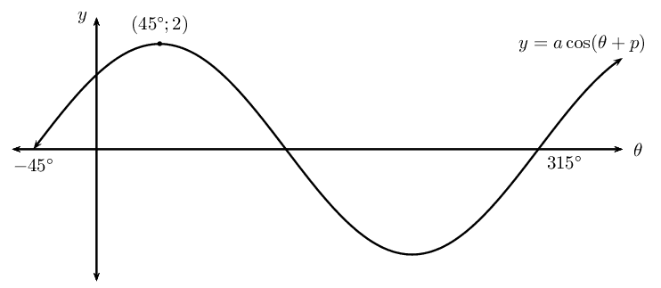

**Determine the value of \(k\):**
From the sketch we see that the period of the graph is
                                                \(\text{360}\text{°}\), therefore \(k = 1\).

\[y = a \cos ( \theta + p)\]

**Determine the value of \(a\):**
From the sketch we see that the maximum turning point is
                                                \((\text{45}\text{°};2)\), so we know that the amplitude of the
                                                graph is \(\text{2}\) and therefore \(a = 2\).

\[y = 2 \cos ( \theta + p)\]

**Determine the value of \(p\):**
Compare the given graph with the standard cosine function \(y = \cos \theta\)
                                                and notice the difference in the maximum turning points. We see that the
                                                given function has been shifted to the right by
                                                \(\text{45}\)\(\text{°}\), therefore \(p =
                                                \text{45}\text{°}\).

\[y = 2 \cos ( \theta - \text{45}\text{°})\]

**Determine the minimum turning point:**
At the minimum turning point, \(y = -2\):

\begin{align*}
                                                y &= 2 \cos ( \theta - \text{45}\text{°}) \\
                                                -2 &= 2 \cos ( \theta - \text{45}\text{°}) \\
                                                -1 &= \cos ( \theta - \text{45}\text{°}) \\
                                                \cos^{-1}(-1) &= \theta - \text{45}\text{°} \\
                                                \text{180}\text{°} &= \theta - \text{45}\text{°} \\
                                                \text{225}\text{°} &= \theta
                                                \end{align*}

This gives the point \((\text{225}\text{°};-2)\).
</Callout>

## The cosine function

### Textbook Exercise 5.27

Sketch the following graphs on separate axes:

**Problem:**
\(y = \cos (\theta + \text{15}\text{°})\) for
                                                                \(-\text{180}\text{°} \leq \theta \leq
                                                                \text{180}\text{°}\)

**Solution:**
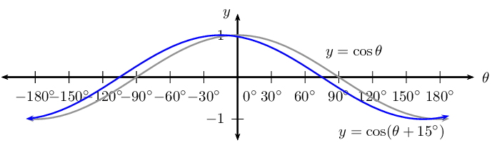

**Problem:**
\(f(\theta) = \frac{1}{3} \cos (\theta -
                                                                \text{60}\text{°})\) for \(-\text{90}\text{°}
                                                                \leq \theta \leq \text{90}\text{°}\)

**Solution:**
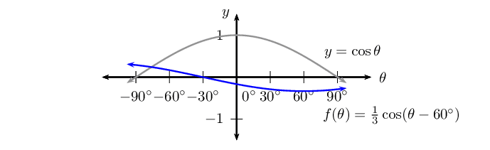

**Problem:**
\(y = -2 \cos \theta\) for \(\text{0}\text{°} \leq
                                                                \theta \leq \text{360}\text{°}\)

**Solution:**
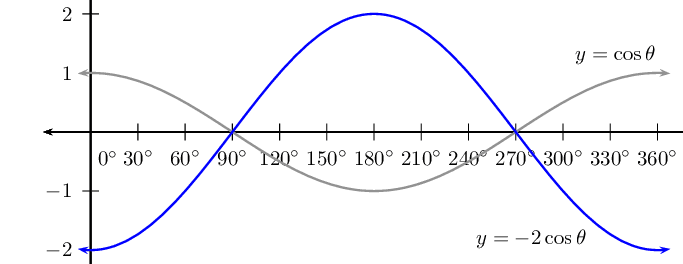

**Problem:**
\(y = \cos (\text{30}\text{°} - \theta)\) for
                                                                \(-\text{360}\text{°} \leq \theta \leq
                                                                \text{360}\text{°}\)

**Solution:**
\begin{align*}
                                                        y &= \cos (\text{30}\text{°} - \theta) \\
                                                        &= \cos \left( -(\theta - \text{30}\text{°}) \right) \\
                                                        &= \cos \left(\theta - \text{30}\text{°} \right)
                                                        \end{align*}

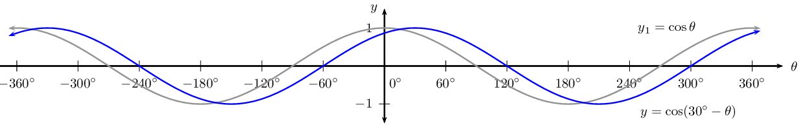

**Problem:**
\(g(\theta) = 1 + \cos (\theta - \text{90}\text{°})\)
                                                                for \(\text{0}\text{°} \leq \theta \leq
                                                                \text{360}\text{°}\)

**Solution:**
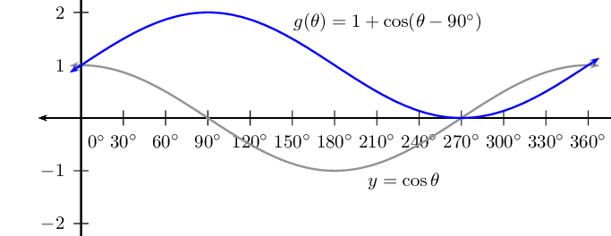

**Problem:**
\(y = \cos (2 \theta + \text{60}\text{°})\) for
                                                                \(-\text{360}\text{°} \leq \theta \leq
                                                                \text{360}\text{°}\)

**Solution:**
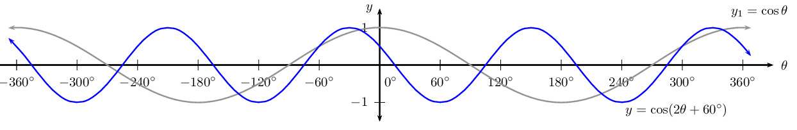

Two girls are given the following graph:

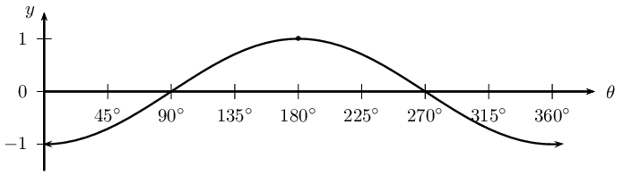

**Problem:**
Audrey decides that the equation for the graph is a cosine
                                                                function of the form \(y = a \cos \theta\). Determine
                                                                the value of \(a\).

**Solution:**
\(a = -1\)

**Problem:**
Megan thinks that the equation for the graph is a cosine
                                                                function of the form \(y = \cos (\theta + p)\).
                                                                Determine the value of \(p\).

**Solution:**
\(p = -\text{180}\text{°}\)

**Problem:**
What can they conclude?

**Solution:**
\(\cos (\theta - \text{180}\text{°}) = -\cos
                                                        \theta\)
