## 5.7 The tangent function (EMBH8)

### Revision (EMBH9)

#### Functions of the form \(y = \tan\theta\) for \(\text{0}\text{°}
                                        \leq \theta \leq \text{360}\text{°}\)

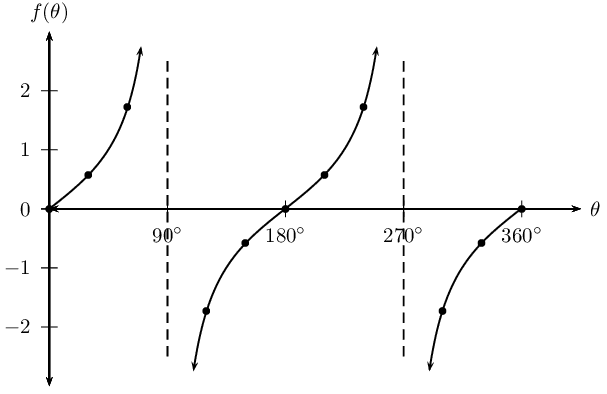

The dashed vertical lines are called the asymptotes. The asymptotes are at the values
                                        of θ where \(\tan\theta\) is not defined.

- Period: \(\text{180}\text{°}\)
- Domain: \(\left\{\theta : \text{0}\text{°} \le \theta \le
                                                          \text{360}\text{°}, \theta \ne \text{90}\text{°};
                                                          \text{270}\text{°}\right\}\)
- Range: \(\left\{f(\theta):f(\theta)\in ℝ\right\}\)
- \(x\)-intercepts: \(\left(\text{0}\text{°};0\right)\),
                                                          \(\left(\text{180}\text{°};0\right)\),
                                                          \(\left(\text{360}\text{°};0\right)\)
- \(y\)-intercept: \(\left(\text{0}\text{°};0\right)\)
- Asymptotes: the lines \(\theta =\text{90}\text{°}\) and \(\theta
                                                          =\text{270}\text{°}\)

#### Functions of the form \(y = a \tan \theta + q\)

Tangent functions of the general form \(y = a \tan \theta + q\), where \(a\) and
                                        \(q\) are constants.

**The effects of \(a\) and \(q\) on \(f(\theta) = a \tan \theta + q\):**

- **The effect of \(q\) on vertical shift**
  - For \(q>0\), \(f(\theta)\) is shifted vertically
                                                                            upwards by \(q\) units.
  - For \(q<0\), \(f(\theta)\) is shifted vertically
                                                                            downwards by \(q\) units.
- **The effect of \(a\) on shape**
  - For \(a>1\), branches of \(f(\theta)\) are
                                                                            steeper.
  - For \(0<a<1\), branches of \(f(\theta)\) are
                                                                            less steep and curve more.
  - For \(a<0\), there is a reflection about the
                                                                            \(x\)-axis.
  - For \(-1 < a < 0\), there is a reflection about
                                                                            the \(x\)-axis and the branches of the graph are
                                                                            less steep.
  - For \(a < -1\), there is a reflection about the
                                                                            \(x\)-axis and the branches of the graph are
                                                                            steeper.

|  | \(a<0\) | \(a>0\) |
| --- | --- | --- |
| \(q>0\) |  |  |
| \(q=0\) |  |  |
| \(q<0\) |  |  |

<QuizCard id="m11-05-07a" title="Interactive Exercise 5.22" question="The graph below shows a tangent curve with an equation of the form \(y = a \tan x + q \) . Two points are labelled on the curve: Point A is at \( \left( 360° \, ; 2 \right) \) , and point B is at \( \left( 135° \, ; 1 \right) \) . Find the values of \(a\) and \(q\) ." options=[] answer="1, 2" hint="You should enter a number here. If you want to, you can use a space to separate thousands.                Example: 12 800,25 For scientific notation you need to use the multiply symbol                ( ∗ ) and the exponent symbol ( ^ ). For example 6,673 × 10 −11 should be written as: 6,673 ∗ 10^−11" explanation="Read off the value of \(q\) from point \(A\) The graph of tangent normally has \(x\) -intercepts at \(x = \text{0}\text{°},                  \text{180}\text{°}\) , and \(\text{360}\text{°}\) . The \( q \) term in the equation has the effect of shifting the graph up or                  down. We can use the position of point \(A\) to figure out how much the graph                  moved up or down: since point \(A\) is at \( \left( \text{360}\text{°} \, ;                  2 \right) \) , the graph moved up by \( 2 \) spaces. So \( c = 2 \) . At this point we know that the equation is \( y = a \tan x + 2 \) . Substitute in the coordinates of a point and solve for \(a\) To work out the value of \( a \) , we will use a method which is very common:                  we will substitute coordinates from a point on the graph into the equation and then solve                  for \( a \) . It is important to understand that this method works because every                  point on the curve for the equation 'agrees' with the equation. If you put the coordinates                  into the equation, it must work!  We will use the coordinates of point \(B\) , \( \left( \text{135}\text{°} \, ;                  1 \right) \) . \[                 \begin{aligned}                     y & = a \tan x + 2  \\                     ^{\text{substitute in the}}_{\text{coordinates of point }B}	  \quad \longrightarrow \quad   \left( 1 \right) & = a  \tan \left( \text{135}\text{°} \right) + 2 \\                     1 & = a \left( -\text{1} \right) + 2 \\ 1  -2  & = - a   \\                     -1 & = - a \\ 1 & = a                 \end{aligned}             \] There we have it: the value of \( a \) is \( 1 \) . Putting it all together, we have the complete equation, which is \( y = \tan x + 2 \) . The answers are \( a =  1 \) and \( q =  2 \) . Submit your answer as: and" />

## Revision

### Textbook Exercise 5.28

On separate axes, accurately draw each of the following functions for
                                                \(\text{0}\text{°} \leq \theta \leq \text{360}\text{°}\):

- Use tables of values if necessary.
- Use graph paper if available.

For each function determine the following:

- Period
- Domain and range
- \(x\)- and \(y\)-intercepts
- Asymptotes

**Problem:**
\(y_1 = \tan \theta - \frac{1}{2}\)

**Solution:**
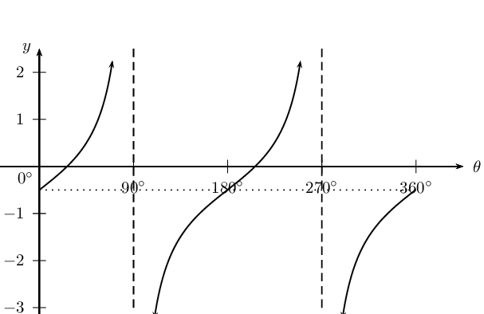

**Problem:**
\(y_2 = - 3 \tan \theta\)

**Solution:**
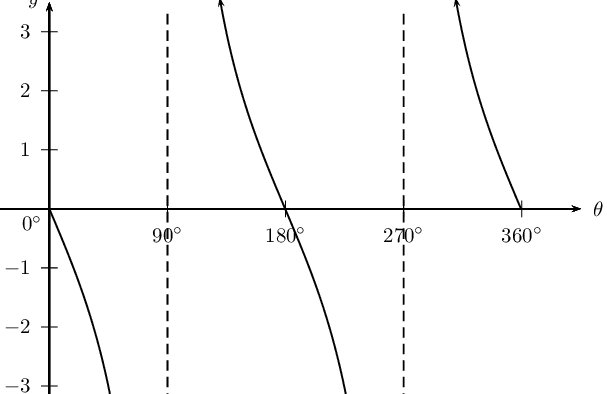

**Problem:**
\(y_3 = \tan \theta + 2\)

**Solution:**
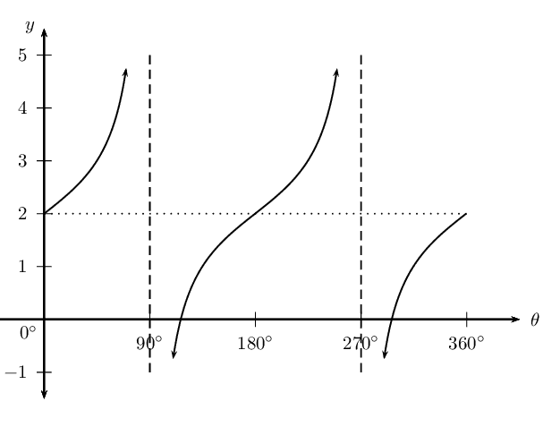

**Problem:**
\(y_4 = 2 \tan \theta - 1\)

**Solution:**
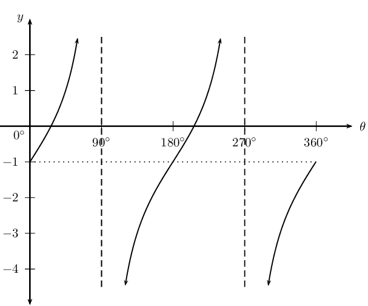

### Functions of the form \(y=\tan (k\theta)\) (EMBHB)

## The effects of \(k\) on a tangent graph

2. Complete the following table for \(y_1 = \tan \theta\) for
                                                   \(-\text{360}\text{°} \leq \theta \leq \text{360}\text{°}\):
   | θ | \(-\text{360}\)\(\text{°}\) | \(-\text{300}\)\(\text{°}\) | \(-\text{240}\)\(\text{°}\) | \(-\text{180}\)\(\text{°}\) | \(-\text{120}\)\(\text{°}\) | \(-\text{60}\)\(\text{°}\) | \(\text{0}\)\(\text{°}\) |
   | --- | --- | --- | --- | --- | --- | --- | --- |
   | \(\tan \theta\) |  |  |  |  |  |  |  |
   | θ | \(\text{60}\)\(\text{°}\) | \(\text{120}\)\(\text{°}\) | \(\text{180}\)\(\text{°}\) | \(\text{240}\)\(\text{°}\) | \(\text{300}\)\(\text{°}\) | \(\text{360}\)\(\text{°}\) |  |
   | \(\tan \theta\) |  |  |  |  |  |  |  |
4. Use the table of values to plot the graph of \(y_1 = \tan \theta\)
                                                           for \(-\text{360}\text{°} \leq \theta \leq
                                                           \text{360}\text{°}\).
6. On the same system of axes, plot the following graphs:
   2. \(y_2 = \tan (-\theta)\)
   4. \(y_3 = \tan 3\theta\)
   6. \(y_4 = \tan \frac{\theta}{2}\)
8. Use your sketches of the functions above to complete the following
                                                           table:
   |  | \(y_1\) | \(y_2\) | \(y_3\) | \(y_4\) |
   | --- | --- | --- | --- | --- |
   | period |  |  |  |  |
   | domain |  |  |  |  |
   | range |  |  |  |  |
   | \(y\)-intercept(s) |  |  |  |  |
   | \(x\)-intercept(s) |  |  |  |  |
   | asymptotes |  |  |  |  |
   | effect of \(k\) |  |  |  |  |
10. What do you notice about \(y_1 = \tan \theta\) and \(y_2 = \tan
                                                           (-\theta)\)?
12. Is \(\tan (-\theta) = -\tan \theta\) a true statement? Explain your
                                                           answer.
14. Can you deduce a formula for determining the period of \(y = \tan k\theta\)?

**The effect of the parameter on \(y = \tan k\theta\)**

The value of \(k\) affects the period of the tangent function. If \(k\) is negative, then the
                                graph is reflected about the \(y\)-axis.

- **For \(k > 0\)**:
  For \(k > 1\), the period of the tangent function decreases.
  For \(0 < k < 1\), the period of the tangent function increases.
- **For \(k < 0\)**:
  For \(-1 < k < 0\), the graph is reflected about the \(y\)-axis and the
                                                  period increases.
  For \(k < -1\), the graph is reflected about the \(y\)-axis and the period
                                                  decreases.

**Negative angles**:
                                \[\tan (-\theta) = -\tan \theta\]

**Calculating the period**:

To determine the period of \(y = \tan k\theta\) we use,
                                \[\text{Period} = \frac{\text{180}\text{°}}{|k|}\]

                                where \(|k|\) is the absolute value of \(k\).

| \(k > 0\) | \(k < 0\) |
| --- | --- |

<Callout type="tip" title="Worked example 26: Tangent function">
**Question:**
2. Sketch the following functions on the same set of axes for
                                                           \(-\text{180}\text{°} \leq \theta \leq
                                                           \text{180}\text{°}\).
   2. \(y_1 = \tan \theta\)
   4. \(y_2 = \tan \frac{3\theta}{2}\)
4. For each function determine the following:
   - Period
   - Domain and range
   - \(x\)- and \(y\)-intercepts
   - Asymptotes

**Examine the equations of the form \(y = \tan k\theta\):**
Notice that \(k > 1\) for \(y_2 = \tan \frac{3\theta}{2}\), therefore the
                                                period of the graph decreases.

**Complete a table of values:**
| θ | \(-\text{180}\)\(\text{°}\) | \(-\text{135}\)\(\text{°}\) | \(-\text{90}\)\(\text{°}\) | \(-\text{45}\)\(\text{°}\) | \(\text{0}\)\(\text{°}\) | \(\text{45}\)\(\text{°}\) | \(\text{90}\)\(\text{°}\) | \(\text{135}\)\(\text{°}\) | \(\text{180}\)\(\text{°}\) |
| --- | --- | --- | --- | --- | --- | --- | --- | --- | --- |
| \(\tan \theta\) | \(\text{0}\) | \(\text{1}\) | undef | \(-\text{1}\) | \(\text{0}\) | \(\text{1}\) | undef | \(-\text{1}\) | \(\text{0}\) |
| \(\tan \frac{3\theta}{2}\) | undef | \(-\text{0,41}\) | \(\text{1}\) | \(-\text{2,41}\) | \(\text{0}\) | \(\text{2,41}\) | \(-\text{1}\) | \(\text{0,41}\) | undef |

**Sketch the tangent graphs:**
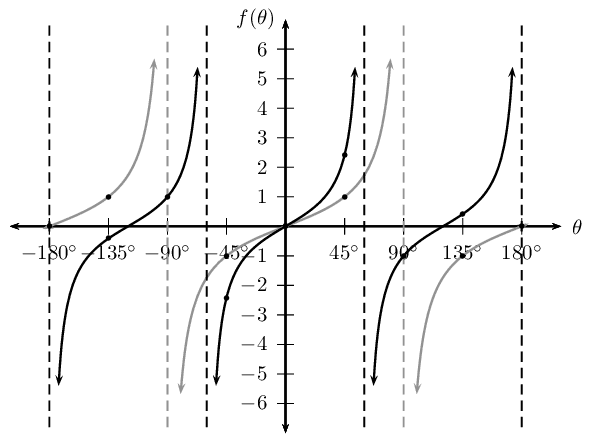

**Complete the table:**
|  | \(y_1 = \tan \theta\) | \(y_2 = \tan \frac{3\theta}{2}\) |
| --- | --- | --- |
| period | \(\text{180}\)\(\text{°}\) | \(\text{120}\)\(\text{°}\) |
| domain | \(\{\theta: -\text{180}\text{°} \leq \theta \leq
                                                                \text{180}\text{°}, \theta \ne
                                                                -\text{90}\text{°}; \text{90}\text{°}\}\) | \(\{\theta: -\text{180}\text{°} < \theta <
                                                                \text{180}\text{°}, \theta \ne
                                                                -\text{60}\text{°}; \text{60}\text{°}\}\) |
| range | \(\{f(\theta): f(\theta) \in \mathbb{R}\}\) | \(\{f(\theta): f(\theta) \in \mathbb{R}\}\) |
| \(y\)-intercept(s) | \((\text{0}\text{°};0)\) | \((\text{0}\text{°};0)\) |
| \(x\)-intercept(s) | \((-\text{180}\text{°};0)\),
                                                                \((\text{0}\text{°};0)\) and
                                                                \((\text{180}\text{°};0)\) | \((-\text{120}\text{°};0)\),
                                                                \((\text{0}\text{°};0)\) and
                                                                \((\text{120}\text{°};0)\) |
| asymptotes | \(\theta = -\text{90}\text{°}\) and \(\theta =
                                                                \text{90}\text{°}\) | \(\theta = -\text{180}\text{°}\);
                                                                \(-\text{60}\text{°}\) and
                                                                \(\text{180}\text{°}\) |
</Callout>

#### Discovering the characteristics

For functions of the general form: \(f(\theta) = y =\tan k\theta\):

**Domain and range**

The domain of one branch is \(\{ \theta: -\frac{\text{90}\text{°}}{k} <
                                        \theta < \frac{\text{90}\text{°}}{k}, \theta \in \mathbb{R}\}\) because
                                        \(f(\theta)\) is undefined for \(\theta = -\frac{\text{90}\text{°}}{k}\)
                                        and \(\theta = \frac{\text{90}\text{°}}{k}\).

The range is \(\{ f(\theta): f(\theta) \in \mathbb{R} \}\) or \((-\infty; \infty)\).

**Intercepts**

The \(x\)-intercepts are determined by letting \(f(\theta) = 0\) and solving for
                                        \(\theta\).

The \(y\)-intercept is calculated by letting \(\theta = 0\) and solving for
                                        \(f(\theta)\).
                                        \begin{align*}
                                        y &= \tan k\theta \\
                                        &= \tan \text{0}\text{°} \\
                                        &= 0
                                        \end{align*}
                                        This gives the point \((\text{0}\text{°};0)\).

**Asymptotes**

These are the values of \(k\theta\) for which \(\tan k\theta\) is undefined.

<QuizCard id="m11-05-07b" title="Interactive Exercise 5.23" question="The graph below shows a tangent function of the following form: \(f(x) = \tan(kx)\) . The asymptotes lie at \(-\text{45}°\) and \(\text{45}°\) . Calculate the value of \(k\) . INSTRUCTION: Your answer must be either an integer or a fraction." options=[] answer="2" hint="You are expected to write a fraction here. You can write pure fractions using the division symbol: / For example, to write the fraction \(-\frac{2}{3}\) the correct input would be: -2/3 You can also write mixed numbers by first writing the integer part, then a space and                then the fraction part. For example, to write \(2 \frac{1}{8}\) the correct input                would be: 2 1/8" explanation="Compare the period of \(f(x) = \tan(kx)\) with the period of \(y = \tan(x)\) First we recall the fact that variable \(k\) affects the period of the waveform. To understand the effect that \(k\) has on the waveform, we can compare the given graph to the standard form of the graph: \(y = \tan(x)\) We can measure the relative change in the period by measuring the periods of each graph (shown above as \(G\) and \(H\) ). Calculate the horizontal scale factor To calculate the value of \(k\) , we want to calculate \"how much\" has the period of the waveform decreased? So let us calculate the scale factor: \[ 					\begin{aligned} 						H \times \textrm{scale} & = G \\ 						\textrm{scale} & = \frac{G}{H} \\ 						\textrm{scale} & = \frac{90}{\text{45}} \\ 						\textrm{scale} & = 2 					\end{aligned} 					\] Therefore the horizontal scale factor is \(2\) . Determine the value of \(k\) Finally we ask: Is the value of \(k\) positive or negative? Because the graph has been scaled but NOT flipped across the y-axes, it must be positive ! The value of \(k\) is \(2\) . NOTE: The final equation of the graph is therefore: \(f(x) = \tan(2 \cdot x)\) Submit your answer as:" />

## Tangent functions of the form \(y = \tan k\theta\)

### Textbook Exercise 5.29

Sketch the following functions for \(-\text{180}\text{°} \leq
                                                        \theta \leq \text{180}\text{°}\). For each graph determine:

- Period
- Domain and range
- \(x\)- and \(y\)-intercepts
- Asymptotes

**Problem:**
\(f(\theta) =\tan 2\theta\)

**Solution:**
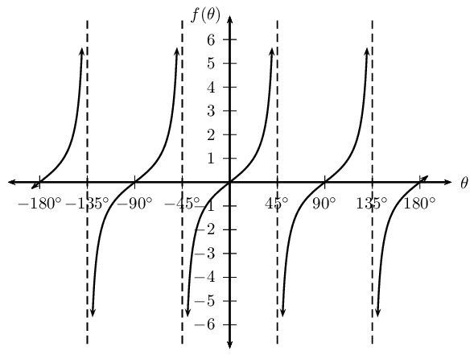

**Problem:**
\(g(\theta) =\tan \frac{3\theta}{4}\)

**Solution:**
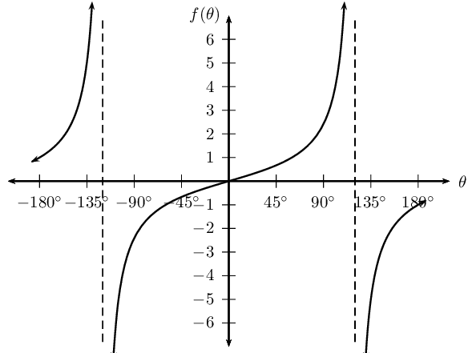

**Problem:**
\(h(\theta) =\tan (-2\theta)\)

**Solution:**
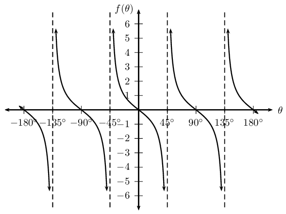

**Problem:**
\(k(\theta) =\tan \frac{2\theta}{3}\)

**Solution:**
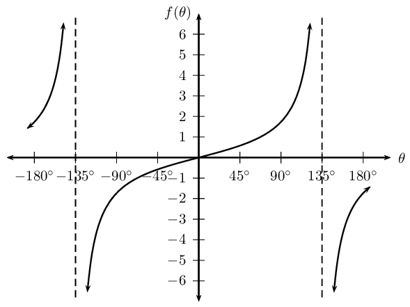

### Functions of the form \(y=\tan\left(\theta +p\right)\) (EMBHC)

We now consider tangent functions of the form \(y = \tan(\theta + p)\) and the effects of
                                parameter \(p\).

## The effects of \(p\) on a tangent graph

2. On the same system of axes, plot the following graphs for
                                                           \(-\text{360}\text{°} \leq \theta \leq
                                                           \text{360}\text{°}\):
   2. \(y_1 = \tan \theta\)
   4. \(y_2 = \tan (\theta - \text{60}\text{°})\)
   6. \(y_3 = \tan (\theta - \text{90}\text{°})\)
   8. \(y_4 = \tan (\theta + \text{60}\text{°})\)
   10. \(y_5 = \tan (\theta + \text{180}\text{°})\)
4. Use your sketches of the functions above to complete the following
                                                           table:
   |  | \(y_1\) | \(y_2\) | \(y_3\) | \(y_4\) | \(y_5\) |
   | --- | --- | --- | --- | --- | --- |
   | period |  |  |  |  |  |
   | domain |  |  |  |  |  |
   | range |  |  |  |  |  |
   | \(y\)-intercept(s) |  |  |  |  |  |
   | \(x\)-intercept(s) |  |  |  |  |  |
   | asymptotes |  |  |  |  |  |
   | effect of \(p\) |  |  |  |  |  |

**The effect of the parameter on \(y = \tan(\theta + p)\)**

The effect of \(p\) on the tangent function is a horizontal shift (or phase shift); the
                                entire graph slides to the left or to the right.

- For \(p > 0\), the graph of the tangent function shifts to the left by
                                                  \(p\).
- For \(p < 0\), the graph of the tangent function shifts to the right by
                                                  \(p\).

| \(p > 0\) | \(p < 0\) |
| --- | --- |

<Callout type="tip" title="Worked example 27: Tangent function">
**Question:**
2. Sketch the following functions on the same set of axes for
                                                           \(-\text{180}\text{°} \leq \theta \leq
                                                           \text{180}\text{°}\).
   2. \(y_1 = \tan \theta\)
   4. \(y_2 = \tan (\theta + \text{30}\text{°})\)
4. For each function determine the following:
   - Period
   - Domain and range
   - \(x\)- and \(y\)-intercepts
   - Asymptotes

**Examine the equations of the form \(y = \tan (\theta + p)\):**
Notice that for \(y_1 = \tan \theta\) we have \(p = \text{0}\text{°}\)
                                                (no phase shift) and for \(y_2 = \tan (\theta +
                                                \text{30}\text{°})\) we have \(p = \text{30}\text{°} > 0\)
                                                and therefore the graph shifts to the left by
                                                \(\text{30}\)\(\text{°}\).

**Complete a table of values:**
| θ | \(-\text{180}\)\(\text{°}\) | \(-\text{135}\)\(\text{°}\) | \(-\text{90}\)\(\text{°}\) | \(-\text{45}\)\(\text{°}\) | \(\text{0}\)\(\text{°}\) | \(\text{45}\)\(\text{°}\) | \(\text{90}\)\(\text{°}\) | \(\text{135}\)\(\text{°}\) | \(\text{180}\)\(\text{°}\) |
| --- | --- | --- | --- | --- | --- | --- | --- | --- | --- |
| \(\tan \theta\) | \(\text{0}\) | \(\text{1}\) | undef | \(-\text{1}\) | \(\text{0}\) | \(\text{1}\) | undef | \(-\text{1}\) | \(\text{0}\) |
| \(\tan (\theta + \text{30}\text{°})\) | \(\text{0,58}\) | \(\text{3,73}\) | \(-\text{1,73}\) | \(-\text{0,27}\) | \(\text{0,58}\) | \(\text{3,73}\) | \(-\text{1,73}\) | \(-\text{0,27}\) | \(\text{0,58}\) |

**Sketch the tangent graphs:**
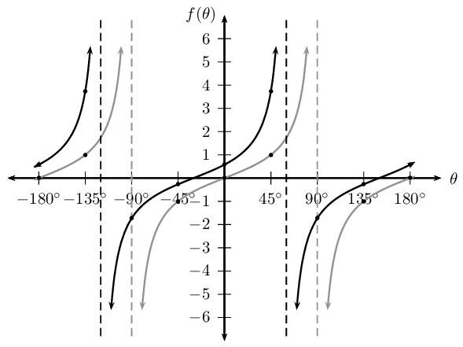

**Complete the table:**
|  | \(y_1 = \tan \theta\) | \(y_2 = \tan (\theta +
                                                                        \text{30}\text{°})\) |
| --- | --- | --- |
| period | \(\text{180}\text{°}\) | \(\text{180}\text{°}\) |
| domain | \(\{ \theta: -\text{180}\text{°} \leq \theta \leq
                                                                \text{180}\text{°}, \theta \ne
                                                                -\text{90}\text{°}; \text{90}\text{°} \}\) | \(\{ \theta: -\text{180}\text{°} \leq \theta \leq
                                                                \text{180}\text{°}, \theta \ne
                                                                -\text{120}\text{°}; \text{60}\text{°} \}\) |
| range | \((-\infty;\infty)\) | \((-\infty;\infty)\) |
| \(y\)-intercept(s) | \((\text{0}\text{°};0)\) | \((\text{0}\text{°};\text{0,58})\) |
| \(x\)-intercept(s) | \((-\text{180}\text{°};0)\),
                                                                \((\text{0}\text{°};0)\) and
                                                                \((\text{180}\text{°};0)\) | \((-\text{30}\text{°};0) \text{ and }
                                                                (\text{150}\text{°};0)\) |
| asymptotes | \(\theta = -\text{90}\text{°} \text{ and } \theta =
                                                                \text{90}\text{°}\) | \(\theta = -\text{120}\text{°} \text{ and } \theta =
                                                                \text{60}\text{°}\) |
</Callout>

#### Discovering the characteristics

For functions of the general form: \(f(\theta) = y =\tan (\theta + p)\):

**Domain and range**

The domain of one branch is \(\{ \theta: \theta \in (-\text{90}\text{°} - p;
                                        \text{90}\text{°} - p) \}\) because the function is undefined for \(\theta
                                        = -\text{90}\text{°} - p\) and \(\theta = \text{90}\text{°} - p\).

The range is \(\{ f(\theta): f(\theta) \in \mathbb{R} \}\).

**Intercepts**

The \(x\)-intercepts are determined by letting \(f(\theta) = 0\) and solving for
                                        \(\theta\).

The \(y\)-intercept is calculated by letting \(\theta = \text{0}\text{°}\) and
                                        solving for \(f(\theta)\).
                                        \begin{align*}
                                        y &= \tan (\theta + p) \\
                                        &= \tan (\text{0}\text{°} + p) \\
                                        &= \tan p
                                        \end{align*}
                                        This gives the point \((\text{0}\text{°};\tan p)\).

<QuizCard id="m11-05-07c" title="Interactive Exercise 5.24" question="Shown the following graph of the following form: \(f(x) = \tan(x + p)\) . Calculate the value of \(p\) . INSTRUCTION: Round off your answer to two decimal places." options=[] answer="-90" hint="You should enter a number here. If you want to, you can use a space to separate thousands.                Example: 12 800,25 For scientific notation you need to use the multiply symbol                ( ∗ ) and the exponent symbol ( ^ ). For example 6,673 × 10 −11 should be written as: 6,673 ∗ 10^−11" explanation="Compare the graph of \(f(x) = \tan(x + p)\) with the graph of \(y = \tan(x)\) To understand the effect that \(p\) has on the waveform, we can compare the given graph to the standard form of the graph: \(y = \tan(x)\) We can measure the horizontal shift by measuring the distance that any given point has been translated. We will focus on the horizontal shift of the \(x\) -intercept (shown above as \(G\) ). Measure the horizontal shift \(G\) To calculate the value of \(p\) , we want to calculate how many degrees the graph has been shifted. \[ 				\begin{aligned} 					G & = \text{90}° 				\end{aligned} 				\] Determine the value of \(p\) Finally we ask: Is the value of \(p\) positive or negative? In this case, the value of \(p\) is negative because the graph has been shifted to the right . The correct answer is \(p = -90°\) . NOTE: The final equation of the graph is: \(f(x) = \tan(x - \text{90}°)\) Submit your answer as:" />

## Tangent functions of the form \(y = \tan (\theta + p)\)

### Textbook Exercise 5.30

Sketch the following functions for \(-\text{360}\text{°} \leq
                                                        \theta \leq \text{360}\text{°}\).

For each function, determine the following:

- Period
- Domain and range
- \(x\)- and \(y\)-intercepts
- Asymptotes

**Problem:**
\(f(\theta) =\tan (\theta + \text{45}\text{°})\)

**Solution:**
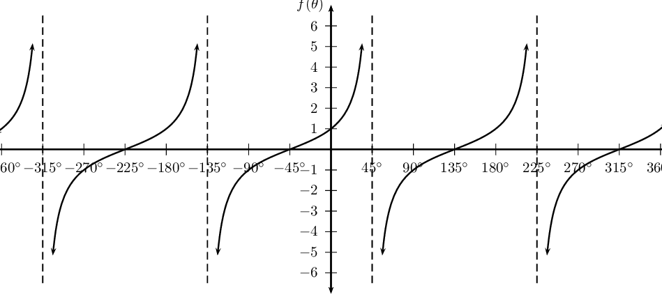

**Problem:**
\(g(\theta) =\tan (\theta - \text{30}\text{°})\)

**Solution:**
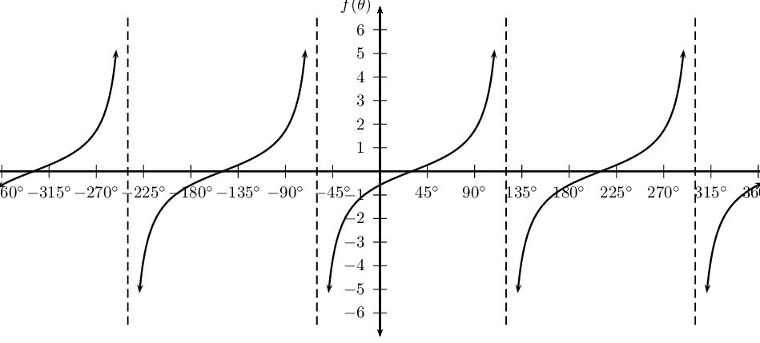

**Problem:**
\(h(\theta) =\tan (\theta + \text{60}\text{°})\)

**Solution:**
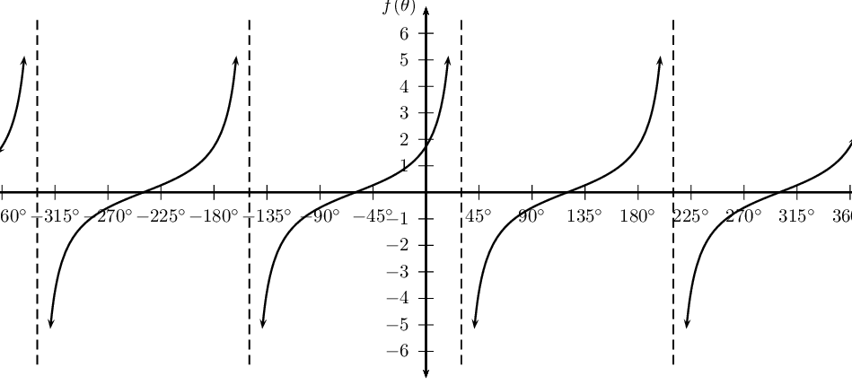

### Sketching tangent graphs (EMBHD)

<Callout type="tip" title="Worked example 28: Sketching a tangent graph">
**Question:**
Sketch the graph of \(f(\theta) = \tan \frac{1}{2}(\theta -
                                                \text{30}\text{°})\) for \(-\text{180}\text{°} \leq \theta
                                                \leq \text{180}\text{°}\).

**Examine the form of the equation:**
From the equation we see that \(0 < k < 1\), therefore the branches of
                                                the graph will be less steep than the standard tangent graph \(y = \tan
                                                \theta\). We also notice that \(p < 0\) so the graph will be shifted
                                                to the right on the \(x\)-axis.

**Determine the period:**
The period for \(f(\theta) = \tan \frac{1}{2}(\theta -
                                                \text{30}\text{°})\) is:

                                        \begin{align*}
                                        \text{Period} &= \frac{\text{180}\text{°}}{|k|} \\
                                        &= \dfrac{\text{180}\text{°}}{\frac{1}{2}} \\
                                        &= \text{360}\text{°}
                                        \end{align*}

**Determine the asymptotes:**
The standard tangent graph, \(y = \tan \theta\), for
                                                \(-\text{180}\text{°} \leq \theta \leq \text{180}\text{°}\) is
                                                undefined at \(\theta = -\text{90}\text{°}\) and \(\theta =
                                                \text{90}\text{°}\). Therefore we can determine the asymptotes of
                                                \(f(\theta) = \tan \frac{1}{2}(\theta - \text{30}\text{°})\):

- \(\frac{-\text{90}\text{°}}{\text{0,5}} +
                                                          \text{30}\text{°} = -\text{150}\text{°}\)
- \(\frac{\text{90}\text{°}}{\text{0,5}} + \text{30}\text{°}
                                                          = \text{210}\text{°}\)

The asymptote at \(\theta = \text{210}\text{°}\) lies outside the
                                                required interval.

**Plot the points and join with a smooth curve:**
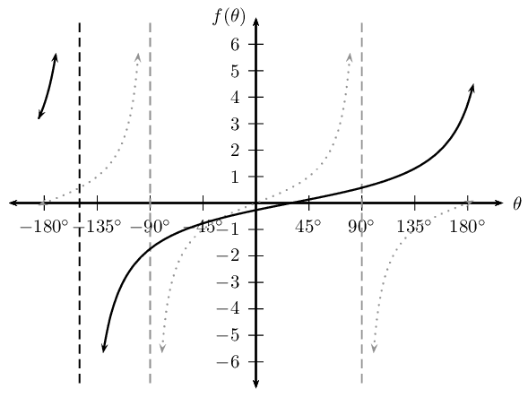

Period: \(\text{360}\text{°}\)

Domain: \(\{ \theta: -\text{180}\text{°} \leq \theta \leq
                                                \text{180}\text{°}, \theta \ne -\text{150}\text{°} \}\)

Range: \((-\infty;\infty)\)

\(y\)-intercepts: \((\text{0}\text{°};-\text{0,27})\)

\(x\)-intercept: \((\text{30}\text{°};0)\)

Asymptotes: \(\theta = -\text{150}\text{°}\)
</Callout>

## The tangent function

### Textbook Exercise 5.31

Sketch the following graphs on separate axes:

**Problem:**
\(y = \tan \theta - 1\) for \(-\text{90}\text{°} \leq
                                                                \theta \leq \text{90}\text{°}\)

**Solution:**
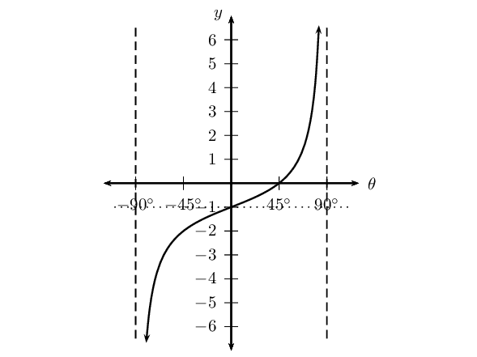

**Problem:**
\(f(\theta) = -\tan 2\theta\) for \(\text{0}\text{°}
                                                                \leq \theta \leq \text{90}\text{°}\)

**Solution:**
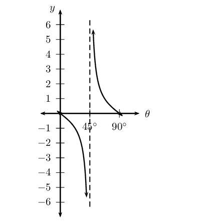

**Problem:**
\(y = \frac{1}{2} \tan (\theta + \text{45}\text{°})\)
                                                                for \(\text{0}\text{°} \leq \theta \leq
                                                                \text{360}\text{°}\)

**Solution:**
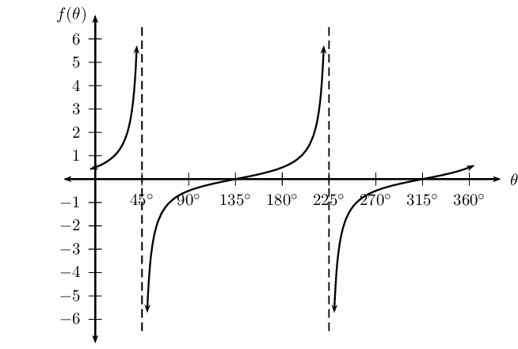

**Problem:**
\(y = \tan (30° - \theta)\) for \(-180° \leq \theta
                                                                \leq 180° \)

**Solution:**
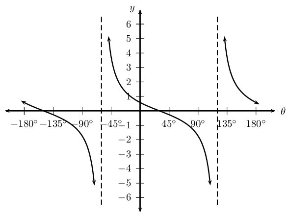

**Problem:**
Given the graph of \(y = a \tan k\theta\), determine the values of
                                                        \(a\) and \(k\).

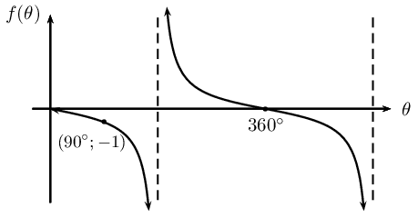

**Solution:**
\(a = -1\); \(k = \frac{1}{2}\)

## Mixed exercises

### Textbook Exercise 5.32

Determine the equation for each of the following:

**Problem:**
\(f(\theta) = a \sin k\theta\) and \(g(\theta) = a \tan
                                                                \theta\)

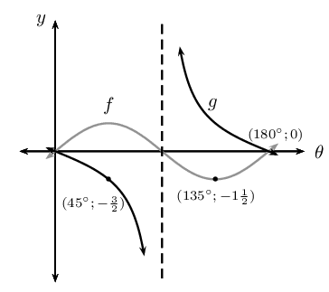

**Solution:**
\(f(\theta) = \frac{3}{2} \sin 2\theta\) and \(g(\theta) =
                                                        -\frac{3}{2} \tan \theta\)

**Problem:**
\(f(\theta) = a \sin k\theta\) and \(g(\theta) = a \cos (
                                                                \theta + p)\)

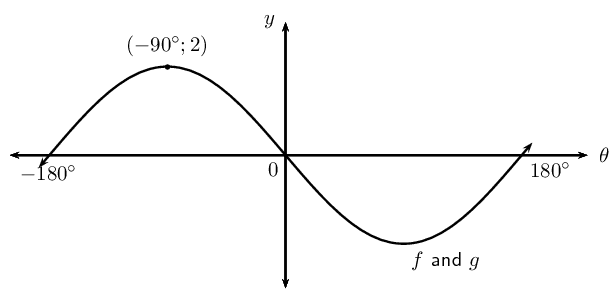

**Solution:**
\(f(\theta) = -2 \sin \theta\) and \(g(\theta) = 2 \cos (\theta
                                                        + \text{360}\text{°})\)

**Problem:**
\(y = a \tan k\theta\)

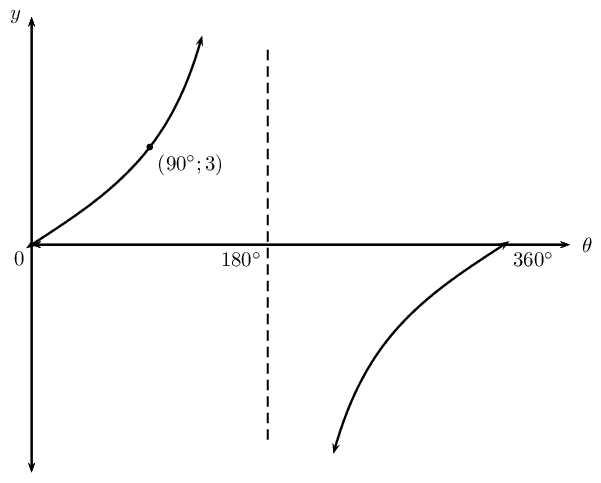

**Solution:**
\(y = 3 \tan \frac{\theta}{2}\)

**Problem:**
\(y = a \cos \theta + q\)

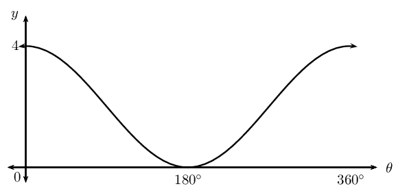

**Solution:**
\(y = y = 2 \cos \theta + 2\)

Given the functions \(f(\theta) = 2 \sin \theta\) and \(g(\theta) =
                                                        \cos \theta + 1\):

**Problem:**
Sketch the graphs of both functions on the same system of
                                                                axes, for \(\text{0}\text{°} \leq \theta \leq
                                                                \text{360}\text{°}\). Indicate the turning points
                                                                and intercepts on the diagram.

**Solution:**
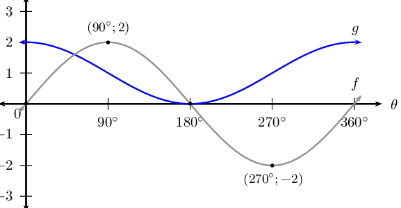

**Problem:**
What is the period of \(f\)?

**Solution:**
\(\text{360}\)\(\text{°}\)

**Problem:**
What is the amplitude of \(g\)?

**Solution:**
\(\text{1}\)

**Problem:**
Use your sketch to determine how many solutions there are for
                                                                the equation \(2 \sin \theta - \cos \theta = 1\). Give
                                                                one of the solutions.

**Solution:**
At \(\theta = \text{180}\text{°}\)

**Problem:**
Indicate on your sketch where on the graph the solution to
                                                                \(2 \sin \theta = -1\) is found.

**Solution:**
todo

The sketch shows the two functions \(f(\theta) = a \cos \theta\) and
                                                        \(g(\theta) = \tan \theta\) for \(\text{0}\text{°} \leq
                                                        \theta \leq \text{360}\text{°}\). Points
                                                        \(P(\text{135}\text{°}; b)\) and \(Q(c; -1)\) lie on
                                                        \(g(\theta)\) and \(f(\theta)\) respectively.

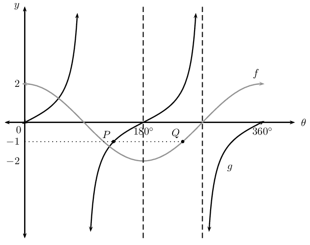

**Problem:**
Determine the values of \(a\), \(b\) and \(c\).

**Solution:**
\(a = 2\), \(b = -1\) and \(c =
                                                        \text{240}\text{°}\)

**Problem:**
What is the period of \(g\)?

**Solution:**
\(\text{180}\text{°}\)

**Problem:**
Solve the equation \(\cos \theta = \frac{1}{2}\) graphically
                                                                and show your answer(s) on the diagram.

**Solution:**
\(\theta = \text{60}\text{°};
                                                        \text{300}\text{°}\)

**Problem:**
Determine the equation of the new graph if \(g\) is reflected
                                                                about the \(x\)-axis and shifted to the right by
                                                                \(\text{45}\text{°}\).

**Solution:**
\(y = - \tan (\theta - \text{45}\text{°})\)

**Problem:**
Sketch the graphs of \(y_1 = -\frac{1}{2} \sin (\theta +
                                                        \text{30}\text{°})\) and \(y_2 = \cos (\theta -
                                                        \text{60}\text{°})\), on the same system of axes for
                                                        \(\text{0}\text{°} \leq \theta \leq
                                                        \text{360}\text{°}\).

**Solution:**
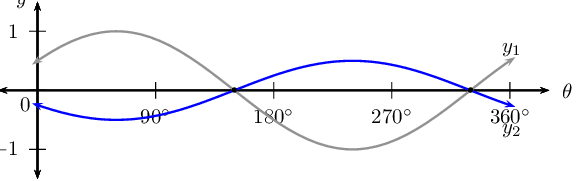
