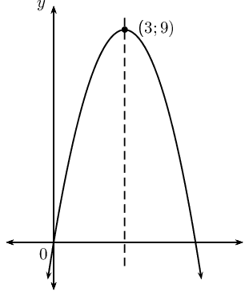
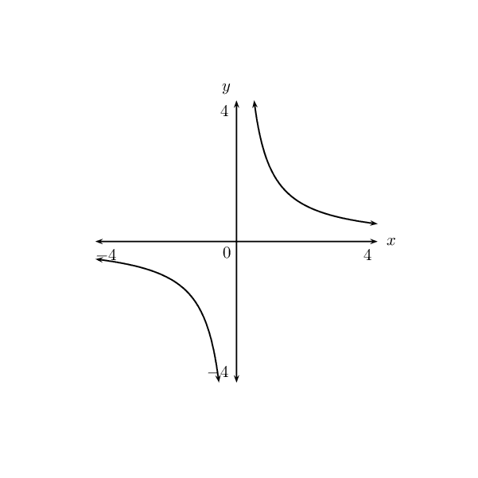
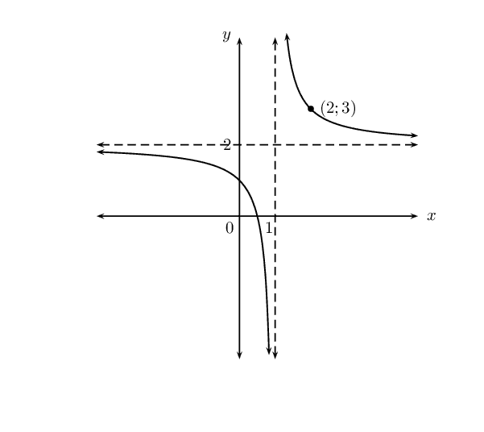
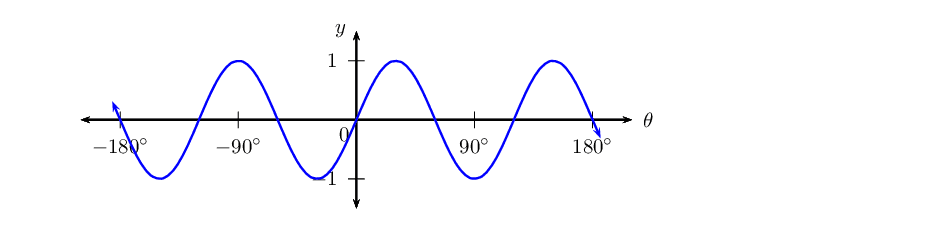
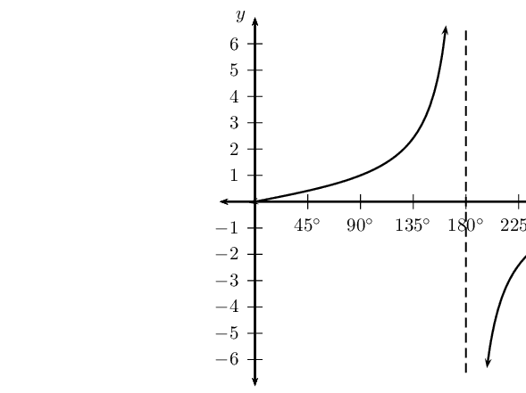
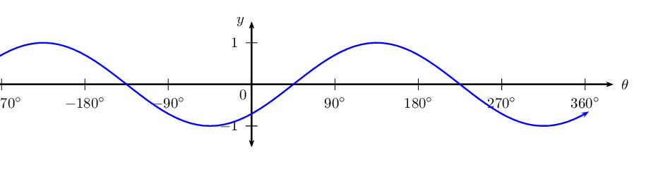
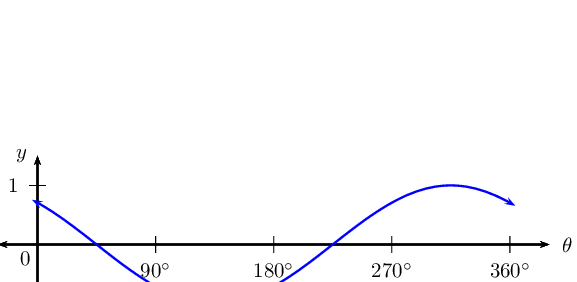
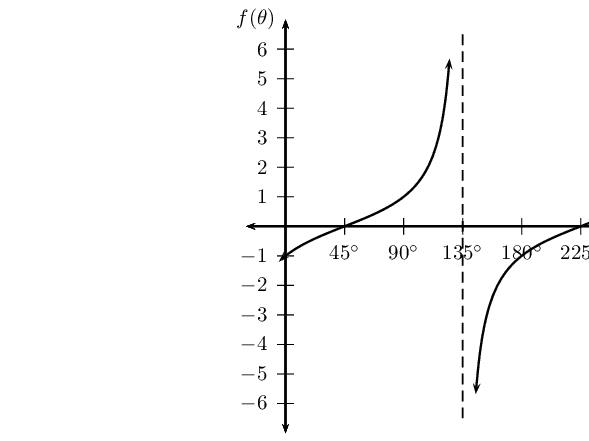
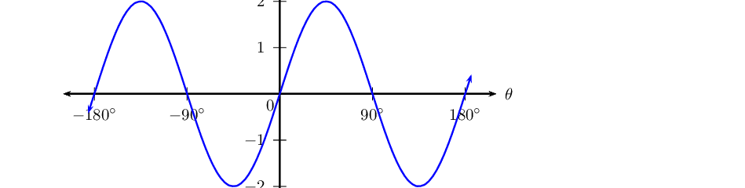
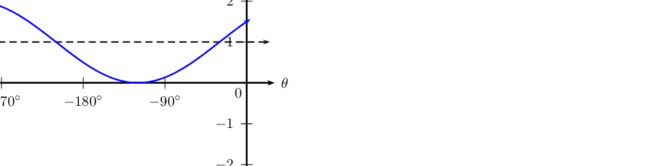

## End of chapter exercises

### Textbook Exercise 5.33

**Problem:**
Show that if \(a<0\), then the range of \(f(x)=a{\left(x+p\right)}^{2}+q\)
                                                is \(\left\{f(x):f(x)\in \left(-\infty ,q\right]\right\}\).

**Solution:**
\begin{align*}
                                        (x + p)^2 \geq 0\\
                                        a(x + p)^2 \leq 0 \\
                                        a(x + p)^2 + q < q \\
                                        \therefore f(x) < q
                                        \end{align*}

**Problem:**
If \(\left(2;7\right)\) is the turning point of \(f(x)=-2{x}^{2}-4ax+k\),
                                                find the values of the constants \(a\) and \(k\).

**Solution:**
\(a = -2; k= -1\)

**Problem:**
The following graph is represented by the equation \(f(x)=a{x}^{2}+bx\). The
                                                coordinates of the turning point are \(\left(3;9\right)\). Show that
                                                \(a=-1\) and \(b=6\).

**Solution:**
\begin{align*}
                                        f(x) & = ax^2 + bx \\
                                        x &= -{b}{2a} \\
                                        \therefore 3 &= -\frac{b}{2a}\\
                                        6a &= -b\\
                                        \text{subst. } (3;9) \quad 9 &= a(3)^2 + b(3) \\
                                        9 &= 9a + 3b \\
                                        9 &= 9a + 3(-6a) \\
                                        9 &= 9a -18a \\
                                        9 &= -9a \\
                                        \therefore -1 &= a \\
                                        \therefore b &= 6
                                        \end{align*}

Given: \(f(x)={x}^{2}-2x+3\). Give the equation of the new graph originating
                                                if:

**Problem:**
the graph of \(f\) is moved three units to the left.

**Solution:**
\(y={x + 2}^{2} + 2\)

**Problem:**
the \(x\)-axis is moved down three units.

**Solution:**
\(y={x - 1}^{2} + 5\)

**Problem:**
A parabola with turning point \(\left(-1;-4\right)\) is shifted vertically by
                                                \(\text{4}\) units upwards. What are the coordinates of the turning
                                                point of the shifted parabola?

**Solution:**
\((-1;0)\)

**Problem:**
Plot the graph of the hyperbola defined by \(y=\frac{2}{x}\) for \(-4\le x\le
                                                4\). Suppose the hyperbola is shifted \(\text{3}\) units to the right
                                                and \(\text{1}\) unit down. What is the new equation then?

**Solution:**

**Problem:**
Based on the graph of \(y=\frac{k}{(x+p)} + q\), determine the equation of
                                                the graph with asymptotes \(y=2\) and \(x=1\) and passing through the
                                                point \(\left(2;3\right)\).

**Solution:**
\(y=\frac{1}{(x-1)} + 2\)

**Problem:**
The columns in the table below give the \(y\)-values for the following
                                                functions: \(y={a}^{x}\), \(y={a}^{x+1}\) and \(y={a}^{x}+1\). Match
                                                each function to the correct column.

| \(x\) | A | B | C |
| --- | --- | --- | --- |
| \(-\text{2}\) | \(\text{7,25}\) | \(\text{6,25}\) | \(\text{2,5}\) |
| \(-\text{1}\) | \(\text{3,5}\) | \(\text{2,5}\) | \(\text{1}\) |
| \(\text{0}\) | \(\text{2}\) | \(\text{1}\) | \(\text{0,4}\) |
| \(\text{1}\) | \(\text{1,4}\) | \(\text{0,4}\) | \(\text{0,16}\) |
| \(\text{2}\) | \(\text{1,16}\) | \(\text{0,16}\) | \(\text{0,064}\) |

**Solution:**
Column A: \(y={a}^{x} + 1\); Column B: \(y={a}^{x}\); Column C: \(y={a}^{x +
                                                1}\)

The graph of \(f(x) = 1 + a \cdot 2^x\) (\(a\) is a constant) passes through
                                                the origin.

**Problem:**
Determine the value of \(a\).

**Solution:**
\begin{align*}
                                                0 &= a \times 2^0 + 1 \\
                                                \therefore -1 &= a
                                                \end{align*}

**Problem:**
Determine the value of \(f(-15)\) correct to five decimal places.

**Solution:**
\begin{align*}
                                                f(-15) &= -2^{-15} + 1 \\
                                                &= \text{0,99997}
                                                \end{align*}

**Problem:**
Determine the value of \(x\), if \(P\left(x;\text{0,5}\right)\) lies
                                                        on the graph of \(f\).

**Solution:**
\begin{align*}
                                                \text{0,5} &= -2^{x} + 1 \\
                                                \text{0,5} &= 2^{x} \\
                                                \therefore x &= -1
                                                \end{align*}

**Problem:**
If the graph of \(f\) is shifted \(\text{2}\) units to the right to
                                                        give the function \(h\), write down the equation of \(h\).

**Solution:**
\(h(x) = -2^{(x -2)} + 1\)

The graph of \(f(x) = a \cdot b^x\) (\(a ≠ 0\)) has the point
                                                \(P\left(2;\text{144}\right)\) on \(f\).

**Problem:**
If \(b = \text{0,75}\), calculate the value of \(a\).

**Solution:**
\(a = 256\)

**Problem:**
Hence write down the equation of \(f\).

**Solution:**
\(f(x) = 256 \left( \frac{3}{4} \right)^x\)

**Problem:**
Determine, correct to two decimal places, the value of \(f(13)\).

**Solution:**
\(f(13) = \text{6,08}\)

**Problem:**
Describe the transformation of the curve of \(f\) to \(h\) if
                                                        \(h(x)=f(-x)\).

**Solution:**
Shifted \(\text{2}\) units to the right

Using your knowledge of the effects of \(p\) and \(k\) draw a rough sketch of
                                                the following graphs without a table of values.

**Problem:**
\(y = \sin 3\theta\) for \(-\text{180}\text{°} \leq \theta \leq
                                                        \text{180}\text{°}\)

**Solution:**

**Problem:**
\(y = -\cos 2\theta\) for \(\text{0}\text{°} \leq \theta \leq
                                                        \text{180}\text{°}\)

**Solution:**

**Problem:**
\(y = \tan \frac{1}{2}\theta\) for \(\text{0}\text{°} \leq
                                                        \theta \leq \text{360}\text{°}\)

**Solution:**

**Problem:**
\(y = \sin (\theta-\text{45}\text{°})\) for
                                                        \(-\text{360}\text{°} \leq \theta \leq
                                                        \text{360}\text{°}\)

**Solution:**

**Problem:**
\(y = \cos (\theta+\text{45}\text{°})\) for
                                                        \(\text{0}\text{°} \leq \theta \leq
                                                        \text{360}\text{°}\)

**Solution:**

**Problem:**
\(y = \tan (\theta-\text{45}\text{°})\) for
                                                        \(\text{0}\text{°} \leq \theta \leq
                                                        \text{360}\text{°}\)

**Solution:**

**Problem:**
\(y = 2\sin 2\theta\) for \(-\text{180}\text{°} \leq \theta \leq
                                                        \text{180}\text{°}\)

**Solution:**

**Problem:**
\(y = \sin (\theta+\text{30}\text{°}) + 1\) for
                                                        \(-\text{360}\text{°} \leq \theta \leq
                                                        \text{0}\text{°}\)

**Solution:**

