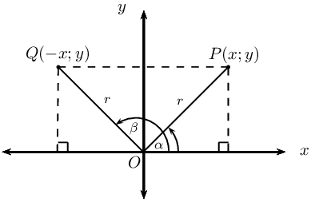
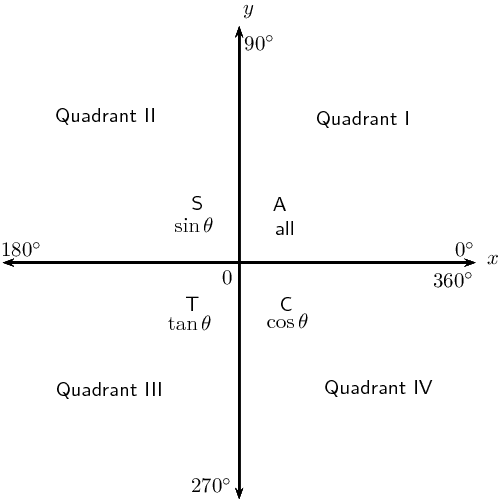
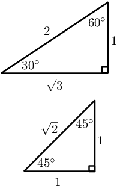
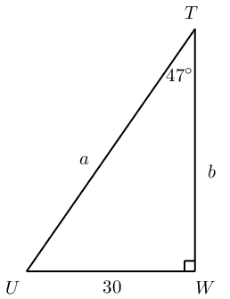
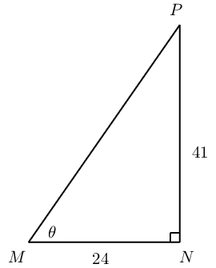
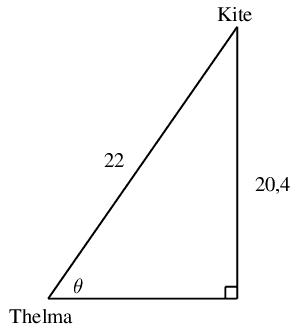
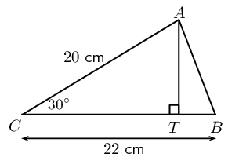
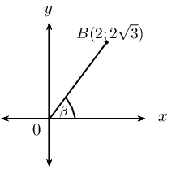

# Chapter 6: Trigonometry

- Emphasize that the area/sine/cosine rule does not require a right-angled triangle.
- Encourage learners to use the appropriate form of the area/sine/cosine rule.
- Remind learners that angles in the Cartesian plane are always measured from the positive x-axis.
- Important to note that:
- \((270 \pm x)\) is not included in the section on reduction formulae.
- co-function for tangent is not included.
- Remind learners to check that their answers are within the required interval.
- For the general solution, determine the solution in the correct quadrants and within the required
                  interval.
- Do not label all triangles as \(ABC\). Learners must be able to apply the formulae with different
                  notations and in different contexts.
- Do not treat identities as equations: do NOT use = sign between the two expressions in an identity. Keep
                  the LHS and RHS separate.
- To prove identities, we usually manipulate the more complicated expression till it looks the same as the
                  more simple expression.

<Callout type="note" title="Note">
<VideoPlayer src="http://www.khanacademy.org/embed_video?v=Jsiy4TxgIME" title="Video: 22XJ" />
</Callout>

## 6.1 Revision (EMBHG)

**Trigonometric ratios**

We plot the points \(P(x;y)\) and \(Q(-x;y)\) in the Cartesian plane and measure the angles from the positive
            \(x\)-axis to the terminal arms \((OP \text{ and } OQ)\).

\(P(x;y)\) lies in the first quadrant with \(P\hat{O}X = \alpha\) and \(Q(-x;y)\) lies in the second quadrant
            with \(Q\hat{O}X = \beta\).

Using the theorem of Pythagoras we have that

        \begin{align*}
        OP^2 &= x^2 + y^2 \\
        \text{And }OQ^2 &= (-x)^2 + y^2 \\
        &= x^2 + y^2 \\
        \therefore OP &= OQ
        \end{align*}

Let \(OP = OQ = r\).

**Trigonometric ratios**

        \begin{align*}
        \sin \alpha &= \frac{y}{r} \\
        \cos \alpha &= \frac{x}{r}\\
        \tan \alpha &= \frac{y}{x}
        \end{align*}

In the second quadrant we notice that \(-x < 0\)

        \begin{align*}
        \sin \beta &= \frac{y}{r} \\
        \cos \beta &= -\frac{x}{r}\\
        \tan \beta &= -\frac{y}{x}
        \end{align*}

Similarily, in the third and fourth quadrants the sign of the trigonometric ratios depends on the signs of
            \(x\) and \(y\):

**Special angles**

| θ | \(\text{0}\)\(\text{°}\) | \(\text{30}\)\(\text{°}\) | \(\text{45}\)\(\text{°}\) | \(\text{60}\)\(\text{°}\) | \(\text{90}\)\(\text{°}\) |
| --- | --- | --- | --- | --- | --- |
| \(\cos θ\) | \(\text{1}\) | \(\frac{\sqrt{3}}{2}\) | \(\frac{1}{\sqrt{2}}\) | \(\frac{1}{2}\) | \(\text{0}\) |
| \(\sin θ\) | \(\text{0}\) | \(\frac{1}{2}\) | \(\frac{1}{\sqrt{2}}\) | \(\frac{\sqrt{3}}{2}\) | \(\text{1}\) |
| \(\tan θ\) | \(\text{0}\) | \(\frac{1}{\sqrt{3}}\) | \(\text{1}\) | \(\sqrt{3}\) | undef |

**Solving equations**

<Callout type="tip" title="Worked example 1: Solving equations">
**Question:**
Determine the values of \(a\) and \(b\) in the right-angled triangle \(TUW\) (correct to one decimal
                    place):

**Identify the opposite and adjacent sides and the hypotenuse:**

**Determine the value of \(a\):**
\begin{align*}
                \sin \theta &= \frac{\text{opposite side}}{\text{hypotenuse}} \\
                \sin \text{47}\text{°} &= \frac{30}{a} \\
                a &= \frac{30}{\sin \text{47}\text{°}} \\
                \therefore a &= \text{41,0}
                \end{align*}

**Determine the value of \(b\):**
Always try to use the information that is given for calculations and not answers that you have worked
                    out in case you have made an error. For example, avoid using \(a = \text{41,0}\) to determine the
                    value of \(b\).

                \begin{align*}
                \tan \theta &= \frac{\text{opposite side}}{\text{adjacent side}} \\
                \tan \text{47}\text{°} &= \frac{30}{b} \\
                b &= \frac{30}{\tan \text{47}\text{°}} \\
                \therefore b &= \text{28,0}
                \end{align*}

**Write the final answer:**
\(a = \text{41,0}\) units and \(b = \text{28,0}\) units.
</Callout>

**Finding an angle**

<Callout type="tip" title="Worked example 2: Finding an angle">
**Question:**
Calculate the value of \(\theta\) in the right-angled triangle \(MNP\) (correct to one decimal
                    place):

**Identify the opposite and adjacent sides and the hypotenuse:**

**Determine the value of \(\theta\):**
\begin{align*}
                \tan \theta &= \frac{\text{opposite side}}{\text{adjacent side}} \\
                \tan \theta &= \frac{41}{24} \\
                \therefore \theta &= \tan^{-1} \left( \frac{41}{24} \right) \\
                \theta &= \text{59,7}\text{°}
                \end{align*}
</Callout>

<Callout type="tip" title="Worked example 3: Finding an angle">
**Question:**
Given \(2 \sin \frac{\theta}{2} = \cos \text{43}\text{°}, \text{ for } \theta \in
                    [\text{0}\text{°};\text{90}\text{°}]\), determine the value of \(\theta\) (correct to one
                    decimal place).

**Simplify the equation:**
Avoiding rounding off in calculations until you have determined the final answer. In the calculation
                    below, the dots indicate that the number has not been rounded so that the answer is as accurate as
                    possible.

                \begin{align*}
                2 \sin \frac{\theta}{2} &= \cos \text{43}\text{°} \\
                \sin \frac{\theta}{2} &= \frac{\cos \text{43}\text{°}}{2} \\
                \frac{\theta}{2} &= \sin^{-1} (\text{0,365} \ldots ) \\
                \theta &= 2 (\text{21,449} \ldots ) \\
                \therefore \theta &= \text{42,9}\text{°}
                \end{align*}
</Callout>

**Two-dimensional problems**

<Callout type="tip" title="Worked example 4: Flying a kite">
**Question:**
Thelma flies a kite on a \(\text{22}\) \(\text{m}\) piece of string and the height of the kite above
                    the ground is \(\text{20,4}\) \(\text{m}\). Determine the angle of inclination of the string
                    (correct to one decimal place).

**Draw a sketch and identify the opposite and adjacent sides and the hypotenuse:**
Let the angle of inclination of the string be \(\theta\).

**Use an appropriate trigonometric ratio to find \(\theta\):**
\begin{align*}
                \sin \theta &= \frac{\text{opposite side}}{\text{hypotenuse}} \\
                &= \frac{\text{20,4}}{22} \\
                \theta &= \sin^{-1} (\text{0,927} \ldots ) \\
                \therefore \theta &= \text{68,0}\text{°}
                \end{align*}
</Callout>

## Revision

### Textbook Exercise 6.1

If \(p = \text{49}\text{°}\) and \(q = \text{32}\text{°}\), use a calculator to
                            determine whether the following statements are true of false:

**Problem:**
\(\sin p + 3 \sin p = 4 \sin p\)

**Solution:**
\begin{align*}
                            \text{LHS } &= \sin p + 3 \sin p \\
                            &= \sin \text{49}\text{°} + 3 \sin \text{49}\text{°} \\
                            &= \text{0,754} \ldots + \text{2,264} \ldots \\
                            &= \text{3,012} \\
                            \text{RHS } &= 4 \sin p \\
                            &= \text{3,012} \\
                            \therefore \text{LHS } &= \text{RHS }
                            \end{align*}

**Problem:**
\(\dfrac{\sin q}{\cos q} = \tan q\)

**Solution:**
\begin{align*}
                            \text{LHS } &= \dfrac{\sin q}{\cos q} \\
                            &= \frac{\sin \text{32}\text{°}}{\cos \text{32}\text{°}} \\
                            &= \frac{\text{0,53} \ldots }{\text{0,84} \ldots } \\
                            &= \text{0,62} \\
                            \text{RHS } &= \tan q \\
                            &= \tan \text{32}\text{°} \\
                            &= \text{0,62} \\
                            \therefore \text{LHS } &= \text{RHS }
                            \end{align*}

**Problem:**
\(\cos (p - q) = \cos p - \cos q\)

**Solution:**
\begin{align*}
                            \text{LHS } &= \cos (p - q)\\
                            &= \cos (\text{49}\text{°} - \text{32}\text{°})\\
                            &= \cos \text{17}\text{°} \\
                            &= \text{0,96} \\
                            \text{RHS } &= \cos p - \cos q \\
                            &= \cos \text{49}\text{°} - \cos \text{32}\text{°} \\
                            &= \text{0,65} \ldots - \text{0,84} \ldots \\
                            &= -\text{0,19} \\
                            \therefore \text{LHS } &\ne \text{RHS }
                            \end{align*}

**Problem:**
\(\sin (2p) = 2\sin p \cos p\)

**Solution:**
\begin{align*}
                            \text{LHS } &= \sin (2p) \\
                            &= \sin 2(\text{49}\text{°})\\
                            &= \sin \text{98}\text{°} \\
                            &= \text{0,99} \\
                            \text{RHS } &= 2 \sin p \cos p \\
                            &= 2 \sin \text{49}\text{°} \cos \text{49}\text{°} \\
                            &= 2 \times \text{0,75} \ldots \times \text{0,65} \ldots \\
                            &= \text{0,99} \\
                            \therefore \text{LHS } &= \text{RHS }
                            \end{align*}

Determine the following angles (correct to one decimal place):

**Problem:**
\(\cos \alpha = \text{0,64}\)

**Solution:**
\begin{align*}
                            \cos \alpha &= \text{0,64} \\
                            \therefore \alpha &= \cos^{-1} \text{0,64}\\
                            &= \text{50,2}\text{°}
                            \end{align*}

**Problem:**
\(\sin \theta + 2 = \text{2,65}\)

**Solution:**
\begin{align*}
                            \sin \theta + 2 &= \text{2,65} \\
                            \sin \theta &= \text{0,65} \\
                            \therefore \theta &= \sin^{-1} \text{0,65}\\
                            &= \text{40,5}\text{°}
                            \end{align*}

**Problem:**
\(\frac{1}{2} \cos 2\beta = \text{0,3}\)

**Solution:**
\begin{align*}
                            \frac{1}{2} \cos 2\beta &= \text{0,3} \\
                            \cos 2\beta &= \text{0,6} \\
                            \therefore 2\beta &= \cos^{-1} \text{0,6}\\
                            &= \text{53,1}\text{°} \ldots \\
                            \therefore \beta &= \frac{1}{2} \times \text{53,1}\text{°} \ldots \\
                            &= \text{26,6}\text{°}
                            \end{align*}

**Problem:**
\(\tan \frac{\theta}{3} = \sin \text{48}\text{°}\)

**Solution:**
\begin{align*}
                            \tan \frac{\theta}{3} &= \sin \text{48}\text{°} \\
                            &= \text{0,74} \ldots \\
                            \therefore \frac{\theta}{3} &= \tan^{-1} \text{0,74} \ldots \\
                            &= \text{36,6}\text{°} \ldots \\
                            \therefore \theta &= 3 \times \text{36,6}\text{°} \ldots \\
                            &= \text{109,8}\text{°}
                            \end{align*}

**Problem:**
\(\cos 3p = \text{1,03}\)

**Solution:**
\begin{align*}
                            \cos 3p &= \text{1,03} \\
                            \therefore 3p &= \cos^{-1} \text{1,03} \\
                            &= \text{No solution}
                            \end{align*}

**Problem:**
\(2 \sin 3\beta + 1 = \text{2,6}\)

**Solution:**
\begin{align*}
                            2 \sin 3\beta + 1 &= \text{2,6} \\
                            2 \sin 3\beta &= \text{1,6} \\
                            \sin 3\beta &= \text{0,8} \\
                            \therefore 3\beta &= \sin^{-1} \text{0,8} \\
                            &= \text{53,1}\text{°} \ldots \\
                            \therefore \beta &= \frac{1}{3} \times \text{53,1}\text{°} \ldots \\
                            &= \text{17,7}\text{°}
                            \end{align*}

**Problem:**
\(\dfrac{\sin \theta}{\cos \theta} = 4\frac{2}{3}\)

**Solution:**
\begin{align*}
                            \dfrac{\sin \theta}{\cos \theta} &= 4\frac{2}{3}\\
                            \therefore \tan \theta &= \text{2,66} \ldots \\
                            \therefore \theta &= \tan^{-1} \text{2,66} \ldots \\
                            &= \text{69,4}\text{°}
                            \end{align*}

In \(\triangle ABC, A\hat{C}B = \text{30}\text{°}, AC = \text{20}\text{ cm} \text{ and }
                            BC = \text{22}\text{ cm}\). The perpendicular line from \(A\) intersects \(BC\) at \(T\).

Determine:

**Problem:**
the length \(TC\)

**Solution:**
\begin{align*}
                            \text{In } \triangle CAT: \quad \cos \text{30}\text{°} &= \frac{TC}{CA}\\
                            &= \frac{TC}{20}\\
                            \therefore TC &= 20 \times \cos \text{30}\text{°} \\
                            &= \text{17,3}\text{ cm}
                            \end{align*}

**Problem:**
the length \(AT\)

**Solution:**
\begin{align*}
                            \text{In } \triangle CAT: \quad \sin \text{30}\text{°} &= \frac{AT}{CA}\\
                            &= \frac{AT}{20}\\
                            \therefore AT &= 20 \times \sin \text{30}\text{°} \\
                            &= \text{10}\text{ cm}
                            \end{align*}

**Problem:**
the angle \(B\hat{A}T\)

**Solution:**
\begin{align*}
                            CB &= CT + TB \\
                            22 &= \text{17,3} + TB \\
                            \therefore TB &= 22 - \text{17,3} \\
                            &= \text{4,7}\text{ cm} \\
                            \text{In } \triangle BAT: \quad \tan \hat{B} &= \frac{AT}{BT}\\
                            &= \frac{10}{\text{4,7}} \\
                            \therefore \hat{B} &= \tan^{-1} \left( \frac{10}{\text{4,7}} \right) \\
                            &= \text{64,8}\text{°}
                            \end{align*}

A rhombus has a perimeter of \(\text{40}\text{ cm}\) and one of the internal angles is
                            \(\text{30}\text{°}\).

**Problem:**
Determine the length of the sides.

**Solution:**
\begin{align*}
                            \text{Length sides } &= \frac{40}{4} \\
                            &= \text{10}\text{ cm}
                            \end{align*}

**Problem:**
Determine the lengths of the diagonals.

**Solution:**
Diagonals of a rhombus bisect each other at right-angles and also bisect interior angles.
                                Let the shorter diagonal be \(2x\):

                            \begin{align*}
                            \sin \text{15}\text{°} &= \frac{x}{10} \\
                            \therefore x &= 10 \sin \text{15}\text{°} \\
                            \therefore \text{Shorter diagonal }&= 2 \times 10 \sin \text{15}\text{°} \\
                            &= \text{5,2}\text{ cm}
                            \end{align*}

Let the longer diagonal be \(2y\):

                            \begin{align*}
                            \cos \text{15}\text{°} &= \frac{y}{10} \\
                            \therefore y &= 10 \cos \text{15}\text{°} \\
                            \therefore \text{Longer diagonal }&= 2 \times 10 \cos \text{15}\text{°} \\
                            &= \text{19,3}\text{ cm}
                            \end{align*}

**Problem:**
Calculate the area of the rhombus.

**Solution:**
\begin{align*}
                            \text{Area } &= b \times h_{\perp} \\
                            &= 10 \times \text{19,3} \times \sin \text{15}\text{°} \\
                            &= \text{50}\text{ cm$^{2}$}
                            \end{align*}

Simplify the following without using a calculator:

**Problem:**
\(2 \sin \text{45}\text{°} \times 2 \cos \text{45}\text{°}\)

**Solution:**
\begin{align*}
                            2 \sin \text{45}\text{°} \times 2 \cos \text{45}\text{°}
                            &= 2 \times \frac{1}{\sqrt{2}} \times 2 \times \frac{1}{\sqrt{2}} \\
                            &= 4 \times \frac{1}{\left( \sqrt{2} \right)} \\
                            &= \frac{4}{2} \\
                            &= \text{2}
                            \end{align*}

**Problem:**
\(\cos^2 \text{30}\text{°} - \sin^2 \text{60}\text{°}\)

**Solution:**
\begin{align*}
                            \cos^2 \text{30}\text{°} - \sin^2 \text{60}\text{°}
                            &= \left( \frac{\sqrt{3}}{2} \right)^2 - \left( \frac{\sqrt{3}}{2} \right)^2 \\
                            &= \text{0}
                            \end{align*}

**Problem:**
\(\sin \text{60}\text{°} \cos \text{30}\text{°} - \cos \text{60}\text{°}
                                \sin \text{30}\text{°} - \tan \text{45}\text{°}\)

**Solution:**
\begin{align*}
                            \sin \text{60}\text{°} \cos \text{30}\text{°} &- \cos \text{60}\text{°}
                            \sin
                            \text{30}\text{°} - \tan \text{45}\text{°} \\
                            &=\frac{\sqrt{3}}{2} \times \frac{\sqrt{3}}{2}-\frac{1}{2} \times \frac{1}{2}-1\\
                            &=\frac{3}{4}-\frac{1}{4}-1\\
                            &=-1\frac{1}{2}
                            \end{align*}

**Problem:**
\(4 \sin \text{60}\text{°} \cos \text{30}\text{°} - 2 \tan
                                \text{45}\text{°} + \tan \text{60}\text{°} - 2 \sin \text{60}\text{°}\)

**Solution:**
\begin{align*}
                            4 \sin \text{60}\text{°} \cos \text{30}\text{°}& - 2 \tan
                            \text{45}\text{°} +
                            \tan \text{60}\text{°} - 2 \sin \text{60}\text{°} \\
                            &=4 \times \frac{\sqrt{3}}{2} \times \frac{\sqrt{3}}{2}- 2 \times 1 + \sqrt{3} - 2
                            \times \frac{\sqrt{3}}{2} \\
                            &= 3 - 2 + \sqrt{3} - \sqrt{3} \\
                            &=\text{1}
                            \end{align*}

**Problem:**
\(\sin \text{60}\text{°} \times \sqrt{2 \tan \text{45}\text{°} + 1 } - \sin
                                \text{30}\text{°}\)

**Solution:**
\begin{align*}
                            \sin \text{60}\text{°}& \times \sqrt{2 \tan \text{45}\text{°} + 1 } - \sin
                            \text{30}\text{°} \\
                            &= \frac{\sqrt{3}}{2} \times \sqrt{2(1) + 1 } - \frac{1}{2} \\
                            &= \frac{\sqrt{3}}{2} \times \sqrt{3} - \frac{1}{2} \\
                            &= \frac{3}{2} - \frac{1}{2} \\
                            &=\text{1}
                            \end{align*}

Given the diagram below.

Determine the following without using a calculator:

**Problem:**
\(\beta\)

**Solution:**
\begin{align*}
                            \tan\beta &=\frac{y}{x} \\
                            \tan\beta &=\frac{2\sqrt{3}}{2} \\
                            &=\sqrt{3}\\
                            \therefore \beta &= \text{60}\text{°}
                            \end{align*}

**Problem:**
\(\cos \beta\)

**Solution:**
\begin{align*}
                            OB^2 &= x^2 + y^2 \quad (\text{ Pythagoras}) \\
                            OB^2=2^2+(2\sqrt{3})^2\\
                            &=4+4(3) \\
                            &=16 \\
                            \therefore OB &= 4 \\
                            \cos\beta &= \frac{x}{OB} \\
                            &= \frac{2}{4} \\
                            &= \frac{1}{2}
                            \end{align*}

**Problem:**
\(\cos^2 \beta + \sin^2 \beta\)

**Solution:**
\begin{align*}
                            \cos^2 \beta + \sin^2 \beta
                            &= \left( \frac{1}{2} \right)^2 + \left( \frac{2\sqrt{3}}{4} \right)^2 \\
                            &= \frac{1}{4} + \frac{3}{4}\\
                            &= \text{1}
                            \end{align*}

**Problem:**
The \(\text{10}\) \(\text{m}\) ladder of a fire truck leans against the wall of a burning
                            building at an angle of \(\text{60}\text{°}\). The height of an open window is
                            \(\text{9}\) \(\text{m}\) from the ground. Will the ladder reach the window?

**Solution:**
\begin{align*}
                        \frac{h}{10}&=\sin \text{60}\text{°} \\
                        &=\frac{\sqrt{3}}{2}\\
                        \therefore h &=\frac{10\sqrt{3}}{2} \\
                        &=5\sqrt{3} \\
                        &= \text{8,66}\text{ m}
                        \therefore \text{No, the ladder is too short.}
                        \end{align*}
