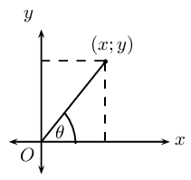
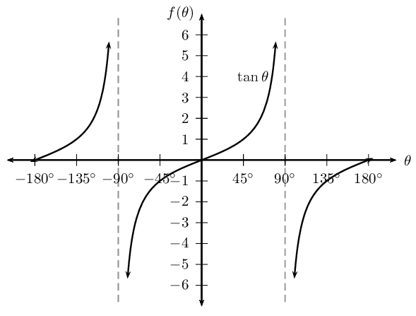
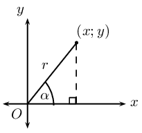

## 6.2 Trigonometric identities (EMBHH)

An identity is a mathematical statement that equates one quantity with another. Trigonometric identities
            allow us to simplify a given expression so that it contains sine and cosine ratios only. This enables us to
            solve equations and also to prove other identities.

**Quotient identity **

## Quotient identity

2. Complete the table without using a calculator, leaving your answer in surd form where applicable:
   |  | \(\theta = \text{45}\text{°}\) |  |  |
   | --- | --- | --- | --- |
   | \(\sin \theta\) |  |  |  |
   | \(\cos \theta\) |  |  |  |
   | \(\dfrac{\sin \theta}{\cos \theta}\) |  |  |  |
   | \(\tan \theta\) |  |  |  |
4. Examine the last two rows of the table and make a conjecture.
6. Are there any values of \(\theta\) for which your conjecture would not be true? Explain your answer.

We know that \(\tan \theta\) is defined as:

\[\tan \theta = \frac{\text{opposite side}}{\text{adjacent side}}\]

Using the diagram below and the theorem of Pythagoras, we can write the tangent function in terms of \(x, y\)
            and \(r\):

This is the quotient identity:

\[\tan \theta = \frac{\sin \theta}{\cos \theta}\]

Notice that \(\tan \theta\) is undefined if \(\cos \theta = 0\), therefore \(\theta \ne k \times
            \text{90}\text{°}\), where \(k\) is an odd integer.

**Square identity **

## Square identity

2. Use a calculator to complete the following table:
   | \(\sin^2 \text{80}\text{°} + \cos^2 \text{80}\text{°} =\) |  |
   | --- | --- |
   | \(\cos^2 \text{23}\text{°} + \sin^2 \text{23}\text{°} =\) |  |
   | \(\sin \text{50}\text{°} + \cos \text{50}\text{°} =\) |  |
   | \(\sin^2 \text{67}\text{°} - \cos^2 \text{67}\text{°} =\) |  |
   | \(\sin^2 \text{67}\text{°} + \cos^2 \text{67}\text{°} =\) |  |
4. What do you notice? Make a conjecture.
6. Draw a sketch and prove your conjecture in general terms, using \(x, y\) and \(r\).

Using the theorem of Pythagoras, we can write the sine and cosine functions in terms of \(x, y\) and \(r\):

        \begin{align*}
        \sin^2 \theta + \cos^2 \theta &= \left( \frac{y}{r} \right)^2 + \left( \frac{x}{r} \right)^2 \\
        &= \frac{y^2}{r^2} + \frac{x^2}{r^2} \\
        &= \frac{y^2 + x^2}{r^2} \\
        &= \frac{r^2}{r^2} \\
        &= 1
        \end{align*}

This is the square identity:

\[\sin^2 \theta + \cos^2 \theta = 1\]

**Other forms of the square identity**

Complete the following:

2. \(\sin^2 \theta = 1 - \ldots\ldots\)
4. \(\cos \theta = \pm \sqrt{\ldots\ldots}\)
6. \(\sin^2 \theta = (1 + \ldots\ldots)(1 - \ldots\ldots)\)
8. \(\cos^2 \theta - 1 = \ldots\ldots\)

Here are some useful tips for proving identities:

- Change all trigonometric ratios to sine and cosine.
- Choose one side of the equation to simplify and show that it is equal to the other side.
- Usually it is better to choose the more complicated side to simplify.
- Sometimes we need to simplify both sides of the equation to show that they are equal.
- A square root sign often indicates that we need to use the square identity.
- We can also add to the expression to make simplifying easier:
  - replace \(\text{1}\) with \(\sin^2 \theta + \cos^2 \theta\).
  - multiply by \(\text{1}\) in the form of a suitable fraction, for example \(\dfrac{1 + \sin
                            \theta}{1 + \sin \theta}\).

<QuizCard id="m11-06-02a" title="Interactive Exercise 6.2" question="Which of the expressions below belongs on the empty side of the equation? \[\begin{array}{c}\tan \beta = ??\end{array}\] Answer Choices: A \( \dfrac{\sin \beta}{\cos \beta} \) B \( \sin^{2} \beta + \cos^{2} \beta \) C \( 1 \)" options=["A", "B", "C", "None of the above", "quotient identity", "square identity", "neither of these"] answer="A" hint="" explanation="Identify the correct expression to complete the equation The correct answer is based on the equation: \[\begin{array}{c}\tan \beta = \dfrac{\sin \beta}{\cos \beta}\end{array}\] This can also be written as: \( \; \dfrac{\sin \beta}{\cos \beta} = \tan \beta \) . The correct choice to complete the equation is option A . Submit your answer as: A" />

<QuizCard id="m11-06-02a" title="Interactive Exercise 6.2" question="Which of the expressions below belongs on the empty side of the equation? \[\begin{array}{c}?? = \sin^{2} \beta + \cos^{2} \beta\end{array}\] Answer Choices: A \( 1 \) B \( \tan \beta \) C \( \dfrac{\sin \beta}{\cos \beta} \)" options=["A", "B", "C", "None of the above", "quotient identity", "square identity", "neither of these"] answer="A" hint="" explanation="Identify the correct expression to complete the equation The correct answer is based on the equation: \[\begin{array}{c}\sin^{2} \beta + \cos^{2} \beta = 1\end{array}\] This can also be written as: \( \; 1 = \sin^{2} \beta + \cos^{2} \beta \) . The correct choice to complete the equation is option A . Submit your answer as: A" />

<QuizCard id="m11-06-02a" title="Interactive Exercise 6.2" question="The quotient identity is: \[                 \begin{aligned}                     \tan A = \dfrac{\sin A}{\cos A}                 \end{aligned}             \] This equation can be arranged in different ways. If it is arranged starting                 as shown, which of the expressions in the list belongs on the right side: \[                 \begin{aligned}                     \cos A = ??                 \end{aligned}             \]" options=[] answer="1" hint="" explanation="Rearrange the equation to get the answer Start with the quotient identity: \[                     \begin{aligned}                         \tan A = \frac{\sin A}{\cos A}                     \end{aligned}                 \] We need to rearrange the equation so that it matches the form in the question: \[                     \begin{aligned}                         \cos A = ??                     \end{aligned}                 \] The quotient identity includes \( \cos A \) in the denominator; but we want \( \cos A = ?? \) so we must find a way to move the \( \cos \) function into the numerator. There are different options for how to start this, but here we will multiply both sides of the identity by \( \cos A \) . Then it will be necessary to do one more step. \[                     \begin{aligned}                      \cos A \left( \tan A \right) & = \left( \frac{\sin A}{\cos A} \right)\cos A    \\                     \cos A \cdot \tan A & = \sin A  \\ \cos A & = \frac{\sin A}{\tan A}                     \end{aligned}                 \] There we have it!  The correct answer is \( \dfrac{\sin A}{\tan A} \) . Submit your answer as: \(\dfrac{\sin A}{\tan A}\)" />

<Callout type="tip" title="Worked example 5: Trigonometric identities">
**Question:**
Simplify the following:

2. \(\tan^2 \theta \times \cos^2 \theta\)
4. \(\dfrac{1}{\cos^2 \theta} - \tan^2 \theta\)

**Write the expression in terms of sine and cosine only:**
We use the square and quotient identities to write the given expression in terms of sine and cosine
                    and then simplify as far as possible.

2. \begin{align*}
                           \tan^2 \theta \times \cos^2 \theta &= \left( \frac{\sin \theta}{\cos \theta} \right)^2
                           \times \cos^2 \theta \\
                           &= \frac{\sin^2 \theta}{\cos^2 \theta} \times \cos^2 \theta \\
                           &= \sin^2 \theta
                           \end{align*}
4. \begin{align*}
                           \frac{1}{\cos^2 \theta} - \tan^2 \theta &= \frac{1}{\cos^2 \theta} - \left( \frac{\sin
                           \theta}{\cos \theta} \right)^2 \\
                           &= \frac{1}{\cos^2 \theta} - \frac{\sin^2 \theta}{\cos^2 \theta} \\
                           &= \frac{1 - \sin^2 \theta}{\cos^2 \theta} \\
                           &= \frac{\cos^2 \theta}{\cos^2 \theta} \\
                           &= 1
                           \end{align*}
</Callout>

<Callout type="tip" title="Worked example 6: Trigonometric identities">
**Question:**
Prove: \(\dfrac{1 - \sin \alpha}{\cos \alpha} = \dfrac{\cos \alpha}{1 + \sin \alpha}\)

**Note restrictions:**
When working with fractions, we must be careful that the denominator does not equal \(\text{0}\).
                    Therefore \(\cos \theta \ne 0\) for the fraction on the left-hand side and \(\sin \theta + 1 \ne 0\)
                    for the fraction on the right-hand side.

**Simplify the left-hand side:**
This is not an equation that needs to be solved. We are required to show that one side of the
                    equation is equal to the other. We can choose either of the two sides to simplify.

                \begin{align*}
                \text{LHS} &= \frac{1 - \sin \alpha}{\cos \alpha} \\
                &= \frac{1 - \sin \alpha}{\cos \alpha} \times \frac{1 + \sin \alpha}{1 + \sin \alpha}
                \end{align*}

Notice that we have not changed the equation — this is the same as multiplying by \(\text{1}\)
                    since the numerator and the denominator are the same.

**Determine the lowest common denominator and simplify:**
\begin{align*}
                \text{LHS} &= \frac{1 - \sin^2 \alpha}{\cos \alpha(1 + \sin \alpha)} \\
                &= \frac{\cos^2 \alpha}{\cos \alpha(1 + \sin \alpha)} \\
                &= \frac{\cos \alpha}{1 + \sin \alpha} \\
                &= \text{RHS}
                \end{align*}
</Callout>

## Trigonometric identities

### Textbook Exercise 6.2

Reduce the following to one trigonometric ratio:

**Problem:**
\(\dfrac{\sin\alpha}{\tan\alpha}\)

**Solution:**
\begin{align*}
                            \dfrac{\sin\alpha}{\tan\alpha} &= \dfrac{\sin\alpha}{\tan\alpha} \\
                            &= \dfrac{\sin\alpha}{\dfrac{\sin\alpha}{\cos\alpha}} \\
                            &= \sin\alpha \times \dfrac{\cos\alpha}{\sin\alpha} \\
                            &= \cos\alpha
                            \end{align*}

**Problem:**
\(\cos^2 \theta \tan^2 \theta + \tan^2 \theta \sin^2 \theta\)

**Solution:**
\begin{align*}
                            \cos^2 \theta \tan^2 \theta + \tan^2 \theta \sin^2 \theta
                            &= \tan^2 \theta \left( \cos^2 \theta + \sin^2 \theta \right) \\
                            &= \tan^2 \theta \left( 1 \right) \\
                            &= \tan^2 \theta
                            \end{align*}

**Problem:**
\(1-\sin \theta \cos \theta \tan \theta\)

**Solution:**
\begin{align*}
                            1-\sin \theta \cos \theta \tan \theta
                            &= 1-\sin \theta \cos \theta \left( \frac{\sin\theta}{\cos\theta} \right) \\
                            &= 1-\sin^2 \theta \\
                            &= \cos^2 \theta
                            \end{align*}

**Problem:**
\(\left( \dfrac{1 - \cos^2\beta}{\cos^2 \beta}\right) - \tan^2 \beta\)

**Solution:**
\begin{align*}
                            \left( \dfrac{1 - \cos^2\beta}{\cos^2 \beta}\right) - \tan^2 \beta
                            &= \left( \dfrac{\sin^2\beta}{\cos^2 \beta}\right) - \tan^2 \beta \\
                            &= \left( \tan^2 \beta \right) - \tan^2 \beta \\
                            &= \text{0}
                            \end{align*}

Prove the following identities and state restrictions where appropriate:

**Problem:**
\(\dfrac{1+\sin\theta}{\cos\theta} = \dfrac{\cos\theta}{1-\sin\theta}\)

**Solution:**
\begin{align*}
                            \text{LHS } &= \dfrac{1+\sin \theta }{\cos\theta }\\
                            &=\dfrac{(1+\sin\theta)}{\cos\theta})\times \dfrac{(1-\sin\theta)}{1-\sin\theta}\\
                            &=\dfrac{1-\sin^2\theta}{\cos\theta(1-\sin\theta)} \\
                            &=\dfrac{\cos^2\theta }{\cos\theta(1-\sin\theta)} \\
                            &=\dfrac{\cos\theta}{(1-\sin\theta)} \\
                            &= \text{RHS}
                            \end{align*}

Restrictions: undefined where \(\cos \theta = \text{0}, \sin \theta = \text{1}\) and
                                where \(\tan \theta\)is undefined.

Therefore \(\theta \ne \text{90}\text{°};\text{270}\text{°}\).

**Problem:**
\({\sin}^{2}\alpha + \left(\cos\alpha - \tan\alpha \right)\left(\cos\alpha +\tan\alpha
                                \right)=1-{\tan}^{2}\alpha\)

**Solution:**
\begin{align*}
                            \text{LHS } &= \sin^2 \alpha + (\cos\alpha-\tan\alpha) (\cos\alpha+\tan\alpha) \\
                            &=\sin^2\alpha+\cos^2\alpha-\tan^2\alpha \\
                            &=1 - \tan^2\alpha \\
                            &= \text{RHS}
                            \end{align*}

Restrictions: undefined where \(\tan \theta\) is undefined.

Therefore \(\theta \ne \text{90}\text{°};\text{270}\text{°}\).

**Problem:**
\(\dfrac{1}{\cos\theta}-\dfrac{\cos\theta {\tan}^{2}\theta }{1}=\cos\theta\)

**Solution:**
\begin{align*}
                            \text{LHS } &= \dfrac{1}{\cos\theta}-\dfrac{\cos\theta \tan^2\theta}{1}\\
                            &=\dfrac{1-\cos^2\theta \times \tan^2\theta}{\cos\theta}\\
                            &=\dfrac{1-\cos^2\theta \times \dfrac{\sin^2\theta}{\cos^2\theta}}{\cos\theta}\\
                            &=\dfrac{1-\sin^2\theta}{\cos\theta}\\
                            &=\dfrac{\cos^2\theta}{\cos\theta}\\
                            &=\cos\theta\\
                            &= \text{RHS}
                            \end{align*}

Restrictions: undefined where \(\cos \theta = \text{0}\) and where \(\tan \theta\)is
                                undefined.

Therefore \(\theta \ne \text{90}\text{°};\text{270}\text{°}\).

**Problem:**
\(\dfrac{2\sin\theta\cos\theta}{\sin\theta +\cos\theta }=\sin\theta +\cos\theta
                                -\dfrac{1}{\sin\theta +\cos\theta }\)

**Solution:**
\begin{align*}
                            \text{RHS } &= \sin\theta+\cos\theta-\dfrac{1}{\sin\theta+\cos\theta} \\
                            &=\dfrac{\sin^2\theta+\sin\theta \cos\theta+\cos\theta
                            \sin\theta+\cos^2\theta-1}{\sin\theta+\cos\theta} \\
                            &=\dfrac{1+2\sin\theta \cos\theta-1}{\sin\theta+\cos\theta} \\
                            &=\dfrac{2\sin\theta \cos\theta}{\sin\theta+\cos\theta} \\
                            &= \text{LHS}
                            \end{align*}

**Problem:**
\(\left(\dfrac{\cos\beta}{\sin\beta }+\tan\beta \right) \cos\beta =\dfrac{1}{\sin\beta
                                }\)

**Solution:**
\begin{align*}
                            \text{ LHS} &= \left ( \dfrac{\cos\beta}{\sin\beta}+\dfrac{\sin\beta}{\cos\beta} \right
                            ) \\
                            &=\left ( \dfrac{\cos^2\beta + \sin^2\beta}{\sin\beta\cos\beta} \right )\cos\beta\\
                            &=\dfrac{1}{\sin\beta}\\
                            &= \text{RHS }
                            \end{align*}

**Problem:**
\(\dfrac{1}{1 + \sin \theta} + \dfrac{1}{1 - \sin \theta} = d\frac{2 \tan \theta}{\sin
                                \theta \cos \theta}\)

**Solution:**
\begin{align*}
                            \text{ LHS} &= \dfrac{1-\sin\theta+1+\sin\theta}{(1+\sin\theta)(1-\sin\theta)} \\
                            &=\dfrac{2}{1-\sin^2\theta} \\
                            &=\dfrac{2}{\cos^2\theta}
                            \end{align*}

                            \begin{align*}
                            \text{ RHS} &= \dfrac{2 \tan \theta}{\sin \theta \cos \theta} \\
                            &=\dfrac{2 \sin \theta}{\sin \theta \cos \theta \cos \theta} \\
                            &=\dfrac{2}{\cos^2\theta} \\
                            \therefore \text{LHS } &= \text{RHS }
                            \end{align*}

**Problem:**
\(\dfrac{(1 + \tan^2 \alpha) \cos \alpha}{(1 - \tan \alpha)} = \dfrac{1}{\cos \alpha -
                                \sin \alpha}\)

**Solution:**
\begin{align*}
                            \text{ LHS} &= \dfrac{(1 + \tan^2 \alpha) \cos \alpha}{(1 - \tan \alpha)} \\
                            &= \dfrac{\left (1+\frac{\sin^2\alpha}{\cos^2\alpha} \right )\cos\alpha}{\left (
                            1-\frac{\sin\alpha}{\cos\alpha} \right )} \\
                            &=\dfrac{\left ( \frac{\cos^2\alpha+\sin^2\alpha}{\cos^2\alpha} \right
                            )\cos\alpha}{\frac{\cos\alpha-\sin\alpha}{\cos\alpha}}\\
                            &=\dfrac{1}{\cos\alpha}\times \frac{\cos\alpha}{\cos\alpha-\sin\alpha} \\
                            &=\dfrac{1}{\cos\alpha-\sin\alpha} \\
                            &= \text{RHS }
                            \end{align*}
