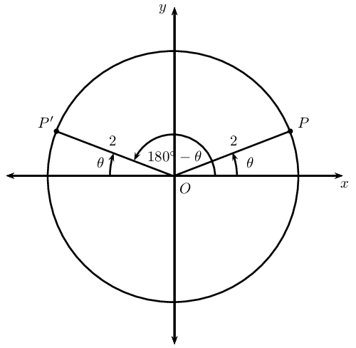
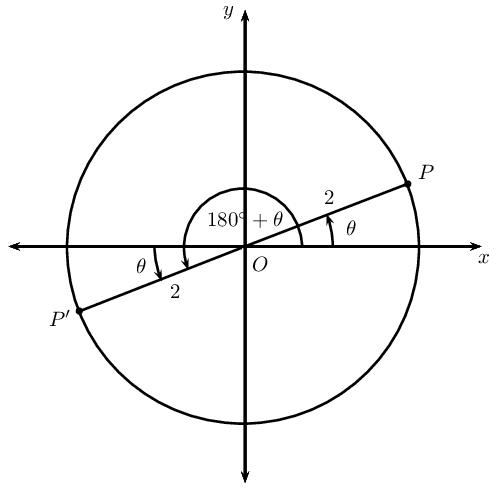
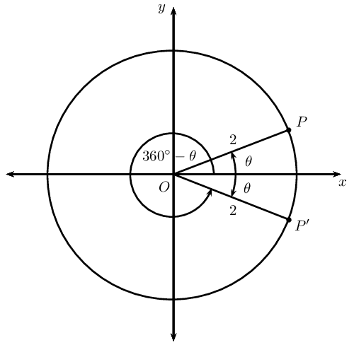
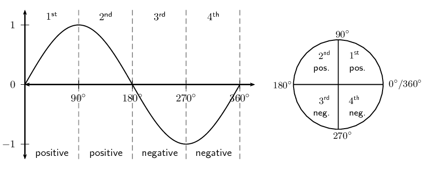
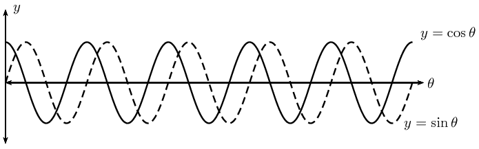
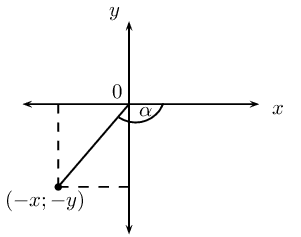
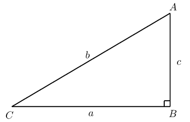
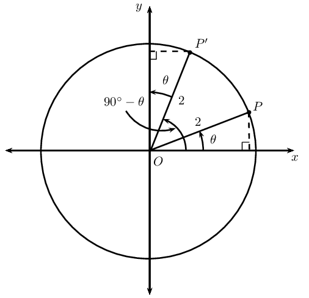
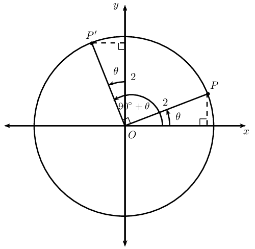
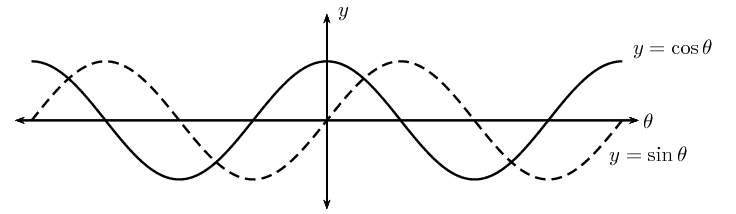

## 6.3 Reduction formula (EMBHJ)

Any trigonometric function whose argument is \(\text{90}\text{°}±\theta\);
            \(\text{180}\text{°}±\theta\) and \(\text{360}\text{°}±\theta\) can be written simply in
            terms of \(\theta\).

### Deriving reduction formulae (EMBHK)

## Reduction formulae for function values of \(\text{180}\text{°}±\theta\)

2. **Function values of \(\text{180}\text{°}-\theta\)**
   In the figure \(P(\sqrt{3};1)\) and \(P'\) lie on the circle with radius \(\text{2}\). \(OP\)
                               makes an angle \(\theta =\text{30}\text{°}\) with the \(x\)-axis.
   
   2. If points \(P\) and \(P'\) are symmetrical about the \(y\)-axis, determine the
                                          coordinates of \(P'\).
   4. Write down values for \(\sin \theta\), \(\cos \theta\) and \(\tan \theta\).
   6. Use the coordinates for \(P'\) to determine \(\sin(\text{180}\text{°}-θ)\),
                                          \(\cos(\text{180}\text{°}-θ)\), \(\tan(\text{180}\text{°}-θ)\).
   8. From your results determine a relationship between the trigonometric function values
                                          of \(\left(\text{180}\text{°}-\theta \right)\) and \(\theta\).
4. **Function values of \(\text{180}\text{°}+\theta\)**
   In the figure \(P(\sqrt{3};1)\) and \(P'\) lie on the circle with radius \(\text{2}\). \(OP\)
                               makes an angle \(\theta =\text{30}\text{°}\) with the \(x\)-axis.
   
   2. If points \(P\) and \(P'\) are symmetrical about the origin (the two points are
                                          symmetrical about both the \(x\)-axis and the \(y\)-axis), determine the coordinates
                                          of \(P'\).
   4. Use the coordinates for \(P'\) to determine \(\sin
                                          (\text{180}\text{°}+θ)\), \(\cos (\text{180}\text{°}+θ)\) and
                                          \(\tan (\text{180}\text{°}+θ)\).
   6. From your results determine a relationship between the trigonometric function values
                                          of \(\left(\text{180}\text{°}+\theta \right)\) and \(\theta\).
6. Complete the following reduction formulae:
   2. \(\sin (\text{180}\text{°} - \theta) = \ldots \ldots\)
   4. \(\cos (\text{180}\text{°} - \theta) = \ldots \ldots\)
   6. \(\tan (\text{180}\text{°} - \theta) = \ldots \ldots\)
   8. \(\sin (\text{180}\text{°} + \theta) = \ldots \ldots\)
   10. \(\cos (\text{180}\text{°} + \theta) = \ldots \ldots\)
   12. \(\tan (\text{180}\text{°} + \theta) = \ldots \ldots\)

<Callout type="tip" title="Worked example 7: Reduction formulae for function values of \(\text{180}\text{°}
                    \pm \theta\)">
**Question:**
Write the following as a single trigonometric ratio:

\[\frac{\sin \text{163}\text{°}}{\cos \text{197}\text{°}} + \tan \text{17}\text{°}
                        + \cos (\text{180}\text{°} - \theta) \times \tan (\text{180}\text{°} + \theta)\]

**Use reduction formulae to write the trigonometric function values in terms of
                        acute angles and \(\theta\):**
\[= \frac{\sin (\text{180}\text{°} - \text{17}\text{°})}{\cos (\text{180}\text{°}
                        + \text{17}\text{°})} + \tan \text{17}\text{°} + (- \cos \theta) \times \tan \theta\]

**Simplify:**
\begin{align*}
                        &= \frac{\sin \text{17}\text{°}}{- \cos \text{17}\text{°}} + \tan
                        \text{17}\text{°} - \cos \theta \times \frac{\sin \theta}{\cos \theta} \\
                        &= - \tan \text{17}\text{°} + \tan \text{17}\text{°} - \sin \theta \\
                        &= -\sin \theta
                        \end{align*}
</Callout>

## Reduction formulae for function values of \(\text{180}\text{°} \pm \theta\)

### Textbook Exercise 6.3

Determine the value of the following expressions without using a calculator:

**Problem:**
\(\tan \text{150}\text{°}\sin \text{30}\text{°} - \cos
                                    \text{210}\text{°}\)

**Solution:**
\begin{align*}
                                &\tan \text{150}\text{°}\sin \text{30}\text{°} - \cos
                                \text{210}\text{°} \\
                                &= \tan (\text{180}\text{°} - \text{30}\text{°})\sin
                                \text{30}\text{°} - \cos (\text{180}\text{°} + \text{30}\text{°}) \\
                                &= - \tan \text{30}\text{°} \sin \text{30}\text{°} + \cos
                                \text{30}\text{°} \\
                                &= - \left( \frac{1}{\sqrt{3}} \right) \left( \frac{1}{2} \right) +
                                \frac{\sqrt{3}}{2} \\
                                &= - \frac{1}{2\sqrt{3}} + \frac{\sqrt{3}}{2} \\
                                &= - \frac{1}{2\sqrt{3}} \times \frac{\sqrt{3}}{\sqrt{3}} + \frac{\sqrt{3}}{2} \\
                                &= - \frac{\sqrt{3}}{6} + \frac{\sqrt{3}}{2} \\
                                &= \frac{-\sqrt{3} + 3\sqrt{3}}{6} \\
                                &= \frac{2\sqrt{3}}{6} \\
                                &= \frac{\sqrt{3}}{3}
                                \end{align*}

**Problem:**
\((1 + \cos \text{120}\text{°})(1 - \sin^2 \text{240}\text{°})\)

**Solution:**
\begin{align*}
                                &(1 + \cos \text{120}\text{°})(1 - \sin^2 \text{240}\text{°}) \\
                                &= \left( 1 + \cos (\text{180}\text{°} - \text{60}\text{°}) \right) \left(
                                1 - \sin^2 (\text{180}\text{°} + \text{60}\text{°}) \right) \\
                                &= \left( 1 - \cos \text{60}\text{°} \right) \left( 1 - \sin^2
                                \text{60}\text{°} \right) \\
                                &= \left( 1 - \frac{1}{2} \right) \left( 1 - \left( \frac{\sqrt{3}}{2} \right)^2
                                \right) \\
                                &= \left( \frac{1}{2} \right) \left( 1 - \frac{3}{4} \right) \\
                                &= \frac{1}{2} \times \frac{1}{4} \\
                                &= \frac{1}{8}
                                \end{align*}

**Problem:**
\(\cos^2 \text{140}\text{°} + \sin^2 \text{220}\text{°}\)

**Solution:**
\begin{align*}
                                &\cos^2 \text{140}\text{°} + \sin^2 \text{220}\text{°} \\
                                &= \cos^2 (\text{180}\text{°} - \text{40}\text{°})+ \sin^2
                                (\text{180}\text{°} + \text{40}\text{°}) \\
                                &= \cos^2 \text{40}\text{°} + \sin^2 \text{40}\text{°} \\
                                &= \text{1}
                                \end{align*}

Write the following in terms of a single trigonometric ratio:

**Problem:**
\(\tan (\text{180}\text{°} - \theta) \times \sin (\text{180}\text{°} +
                                    \theta)\)

**Solution:**
\begin{align*}
                                &\tan (\text{180}\text{°} - \theta) \times \sin (\text{180}\text{°} +
                                \theta) \\
                                &= - \tan \theta \times \left( - \sin \theta \right) \\
                                &= - \frac{\sin \theta}{\cos \theta} \times \left( - \sin \theta \right) \\
                                &= \frac{\sin^2 \theta}{\cos \theta} \\
                                &= \frac{1 - \cos^2 \theta}{\cos \theta}
                                \end{align*}

**Problem:**
\(\dfrac{\tan (\text{180}\text{°} + \theta) \cos (\text{180}\text{°} -
                                    \theta)}{\sin (\text{180}\text{°} - \theta)}\)

**Solution:**
\begin{align*}
                                \dfrac{\tan (\text{180}\text{°} + \theta) \cos (\text{180}\text{°} -
                                \theta)}{\sin (\text{180}\text{°} - \theta)}
                                &= -\dfrac{ \tan \theta \cos \theta }{\sin \theta } \\
                                &= -\dfrac{ \frac{\sin \theta}{\cos \theta} \cos \theta }{\sin \theta } \\
                                &= -\dfrac{ \sin \theta }{\sin \theta } \\
                                &= -\text{1}
                                \end{align*}

If \(t = \tan \text{40}\text{°}\), express the following in terms of \(t\):

**Problem:**
\(\tan \text{140}\text{°} + 3 \tan \text{220}\text{°}\)

**Solution:**
\begin{align*}
                                &\tan \text{140}\text{°} + 3 \tan \text{220}\text{°} \\
                                &= \tan (\text{180}\text{°} - \text{40}\text{°}) + 3 \tan
                                (\text{180}\text{°} + \text{40}\text{°}) \\
                                &= - \tan \text{40}\text{°} + 3 \tan \text{40}\text{°} \\
                                &= 2 \tan \text{40}\text{°} \\
                                &= 2t
                                \end{align*}

**Problem:**
\(\frac{\cos \text{220}\text{°}}{\sin \text{140}\text{°}}\)

**Solution:**
\begin{align*}
                                \dfrac{\cos \text{220}\text{°}}{\sin \text{140}\text{°}}
                                &= \dfrac{\cos (\text{180}\text{°} + \text{40}\text{°})}{\sin
                                (\text{180}\text{°} - \text{40}\text{°})} \\
                                &= \dfrac{ - \cos \text{40}\text{°} }{\sin \text{40}\text{°} } \\
                                &= - \left( \dfrac{ \sin \text{40}\text{°} }{\cos \text{40}\text{°} }
                                \right)^{-1} \\
                                &= - \left( \tan \text{40}\text{°} \right)^{-1} \\
                                &= - \dfrac{ 1 }{\tan \text{40}\text{°} } \\
                                &= - \frac{ 1 }{t}
                                \end{align*}

## Reduction formulae for function values of (\(\text{360}\text{°} \pm \theta\)) and
                    \((- \theta)\)

2. **Function values of (\(\text{360}\text{°} - \theta\)) and \((- \theta)\)**
   In the Cartesian plane we measure angles from the positive \(x\)-axis to the terminal arm,
                               which means that an anti-clockwise rotation gives a positive angle. We can therefore measure
                               negative angles by rotating in a clockwise direction.
   For an acute angle \(\theta\), we know that \(-\theta\) will lie in the fourth quadrant.
   In the figure \(P(\sqrt{3};1)\) and \(P'\) lie on the circle with radius \(\text{2}\). \(OP\)
                               makes an angle \(\theta =\text{30}\text{°}\) with the \(x\)-axis.
   
   2. If points \(P\) and \(P'\) are symmetrical about the \(x\)-axis (\(y = 0\)),
                                          determine the coordinates of \(P'\).
   4. Use the coordinates of \(P'\) to determine \(\sin(\text{360}\text{°}-θ)\),
                                          \(\cos(\text{360}\text{°}-θ)\) and
                                          \(\tan(\text{360}\text{°}-θ)\).
   6. Use the coordinates of \(P'\) to determine \(\sin (-\theta)\), \(\cos (-\theta)\) and
                                          \(\tan (-\theta)\).
   8. From your results determine a relationship between the function values of
                                          \(\left(\text{360}\text{°}-\theta \right)\) and \(- \theta\).
   10. Complete the following reduction formulae:
      2. \(\sin (\text{360}\text{°} - \theta) = \ldots \ldots\)
      4. \(\cos (\text{360}\text{°} - \theta) = \ldots \ldots\)
      6. \(\tan (\text{360}\text{°} - \theta) = \ldots \ldots\)
      8. \(\sin (- \theta) = \ldots \ldots\)
      10. \(\cos (- \theta) = \ldots \ldots\)
      12. \(\tan (- \theta) = \ldots \ldots\)
4. **Function values of \(\text{360}\text{°} + \theta\)**
   We can also have an angle that is larger than \(\text{360}\text{°}\). The angle
                               completes a revolution of \(\text{360}\text{°}\) and then continues to give an angle of
                               \(\theta\).
   Complete the following reduction formulae:
   2. \(\sin (\text{360}\text{°} + \theta) = \ldots \ldots\)
   4. \(\cos (\text{360}\text{°} + \theta) = \ldots \ldots\)
   6. \(\tan (\text{360}\text{°} + \theta) = \ldots \ldots\)

From working with functions, we know that the graph of \(y = \sin \theta\) has a period of
                \(\text{360}\text{°}\). Therefore, one complete wave of a sine graph is the same as one complete
                revolution for \(\sin \theta\) in the Cartesian plane.

We can also have multiple revolutions. The periodicity of the trigonometric graphs shows this clearly. A
                complete sine or cosine curve is completed in \(\text{360}\text{°}\).

If \(k\) is any integer, then

            \begin{align*}
            \sin (k \cdot \text{360}\text{°} + \theta) &= \sin \theta \\
            \cos (k \cdot \text{360}\text{°} + \theta) &= \cos \theta \\
            \tan (k \cdot \text{360}\text{°} + \theta) &= \tan \theta
            \end{align*}

<Callout type="tip" title="Worked example 8: Reduction formulae for function values of \(\text{360}\text{°}
                    \pm \theta\)">
**Question:**
If \(f = \tan \text{67}\text{°}\), express the following in terms of \(f\)

\[\frac{\sin \text{293}\text{°}}{\cos \text{427}\text{°}} +
                        \tan(-\text{67}\text{°}) + \tan \text{1 147}\text{°}\]

**Using reduction formula:**
\begin{align*}
                    \phantom{=} \frac{\sin \text{293}\text{°}}{\cos \text{427}\text{°}} +
                    \tan(-\text{67}\text{°}) + \tan \text{1 147}\text{°}
                    &= \frac{\sin (\text{360}\text{°} - \text{67}\text{°})}{\cos (\text{360}\text{°}
                    + \text{67}\text{°})} - \tan(\text{67}\text{°}) + \tan \left( 3(\text{360}\text{°}) +
                    \text{67}\text{°} \right) \\
                    &= \frac{- \sin \text{67}\text{°}}{\cos \text{67}\text{°}} - \tan
                    \text{67}\text{°} + \tan \text{67}\text{°} \\
                    &= - \tan \text{67}\text{°} \\
                    &= - f
                    \end{align*}
</Callout>

<Callout type="tip" title="Worked example 9: Using reduction formula">
**Question:**
Evaluate without using a calculator:

\[\tan^2 \text{210}\text{°} - (1 + \cos \text{120}\text{°}) \sin^2
                        \text{405}\text{°}\]

**Simplify the expression using reduction formulae and special angles:**
\begin{align*}
                    \tan^2 \text{210}\text{°} - (1 + \cos \text{120}\text{°}) \sin^2 \text{405}\text{°}
                    &= \tan^2 (\text{180}\text{°} + \text{30}\text{°}) - \left( 1 + \cos
                    (\text{180}\text{°} - \text{60}\text{°}) \right) \sin^2 (\text{360}\text{°} +
                    \text{45}\text{°}) \\
                    &= \tan^2 \text{30}\text{°} - \left(1 + ( - \cos\text{60}\text{°}) \right) \sin^2
                    \text{45}\text{°} \\
                    &= \left( \frac{1}{\sqrt{3}} \right)^2 - \left(1 - \frac{1}{2} \right) \left( \frac{1}{\sqrt{2}}
                    \right)^2 \\
                    &= \frac{1}{3} - \left(\frac{1}{2} \right) \left( \frac{1}{2} \right) \\
                    &= \frac{1}{3} - \frac{1}{4} \\
                    &= \frac{1}{12}
                    \end{align*}
</Callout>

## Using reduction formula

### Textbook Exercise 6.4

Simplify the following:

**Problem:**
\(\dfrac{ \tan (\text{180}\text{°} - \theta) \sin (\text{360}\text{°} +
                                \theta)}{\cos (\text{180}\text{°} + \theta) \tan (\text{360}\text{°} -
                                \theta)}\)

**Solution:**
\begin{align*}
                                &\dfrac{ \tan (\text{180}\text{°} - \theta) \sin (\text{360}\text{°} +
                                \theta)}{\cos (\text{180}\text{°} + \theta) \tan (\text{360}\text{°} -
                                \theta)} \\
                                &= \dfrac{ -\tan \theta \sin \theta }{(-\cos \theta )(- \tan \theta )} \\
                                &=-\dfrac{ \sin \theta }{ \cos \theta } \\
                                &= - \tan \theta
                                \end{align*}

**Problem:**
\(\cos^2 (\text{360}\text{°} + \theta) + \cos (\text{180}\text{°} + \theta)
                                \tan (\text{360}\text{°} - \theta) \sin (\text{360}\text{°} + \theta)\)

**Solution:**
\begin{align*}
                                &\cos^2 (\text{360}\text{°} + \theta) + \cos (\text{180}\text{°} + \theta)
                                \tan
                                (\text{360}\text{°} - \theta) \sin (\text{360}\text{°} + \theta) \\
                                &= \cos^2 \theta + (- \cos \theta )(- \tan \theta) (\sin \theta ) \\
                                &= \cos^2 \theta + ( \cos \theta )( \frac{\sin \theta }{\cos \theta }) (\sin \theta
                                ) \\
                                &= \cos^2 \theta + \sin^2 \theta \\
                                &= \text{1}
                                \end{align*}

**Problem:**
\(\dfrac{\sin (\text{360}\text{°} + \alpha) \tan (\text{180}\text{°} +
                                \alpha)}{\cos (\text{360}\text{°} - \alpha) \tan^2 (\text{360}\text{°} +
                                \alpha)}\)

**Solution:**
\begin{align*}
                                &\dfrac{\sin (\text{360}\text{°} + \alpha) \tan (\text{180}\text{°} +
                                \alpha)}{\cos (\text{360}\text{°} - \alpha) \tan^2 (\text{360}\text{°} +
                                \alpha)} \\
                                &= \dfrac{\sin \alpha \tan \alpha }{\cos \alpha \tan^2 \alpha }\\
                                &= \dfrac{\sin \alpha \frac{\sin \alpha}{\cos \alpha} }{\cos \alpha \frac{\sin^2
                                \alpha}{\cos^2 \alpha} }\\
                                &= \dfrac{\frac{\sin^2 \alpha}{\cos \alpha} }{ \frac{\sin^2 \alpha}{\cos \alpha} }\\
                                &= \dfrac{\sin^2 \alpha}{\cos \alpha} \times \frac{\cos \alpha}{\sin^2 \alpha} \\
                                &= \text{1}
                                \end{align*}

**Problem:**
Write the following in terms of \(\cos \beta\):

                            \(\dfrac{\cos (\text{360}\text{°} - \beta) \cos (-\beta) - 1}{\sin
                            (\text{360}\text{°} + \beta) \tan (\text{360}\text{°} - \beta)}\)

**Solution:**
\begin{align*}
                            &\dfrac{\cos (\text{360}\text{°} - \beta) \cos (-\beta) - 1}{\sin
                            (\text{360}\text{°} + \beta) \tan (\text{360}\text{°} - \beta)} \\
                            &= \dfrac{\cos\beta \cos\beta-1}{(-\sin\beta)( -\tan\beta)} \\
                            &= \dfrac{-(1-\cos^2\beta)}{\sin\beta \frac{\sin\beta}{\cos\beta}} \\
                            &=\dfrac{-\sin^2\beta}{\sin^2\beta}\times\frac{\cos\beta}{1} \\
                            &=-\cos\beta
                            \end{align*}

Simplify the following without using a calculator:

**Problem:**
\(\dfrac{\cos \text{300}\text{°} \tan \text{150}\text{°} }{\sin
                                    \text{225}\text{°} \cos (-\text{45}\text{°})}\)

**Solution:**
\begin{align*}
                                &\dfrac{\cos \text{300}\text{°} \tan \text{150}\text{°} }{\sin
                                \text{225}\text{°} \cos (-\text{45}\text{°})} \\
                                &= \dfrac{\cos (\text{360}\text{°}-\text{60}\text{°}) \tan
                                (\text{180}\text{°}-\text{30}\text{°}) }{\sin
                                (\text{180}\text{°}+\text{45}\text{°}) \cos (-\text{45}\text{°})} \\
                                &= \dfrac{\cos \text{60}\text{°}(- \tan \text{30}\text{°}) }{(-\sin
                                \text{45}\text{°}) \cos \text{45}\text{°} } \\
                                &= \dfrac{\frac{1}{2}(\frac{1}{\sqrt{3}}) }{\frac{1}{\sqrt{2}} \left(
                                \frac{1}{\sqrt{2}} \right) } \\
                                &= \dfrac{\frac{1}{2}(\frac{1}{\sqrt{3}}) }{\frac{1}{2} } \\
                                &= \frac{1}{\sqrt{3}}
                                \end{align*}

**Problem:**
\(3 \tan \text{405}\text{°} + 2 \tan \text{330}\text{°} \cos
                                    \text{750}\text{°}\)

**Solution:**
\begin{align*}
                                &3 \tan \text{405}\text{°} + 2 \tan \text{330}\text{°} \cos
                                \text{750}\text{°} \\
                                &=3\tan(\text{360}\text{°}+\text{45}\text{°})+2\tan(\text{360}\text{°}-\text{30}\text{°})\cos
                                \left( 2(\text{360}\text{°})+\text{30}\text{°} \right) \\
                                &=3\tan\text{45}\text{°}+2(-\tan\text{30}\text{°})
                                \cos\text{30}\text{°} \\
                                &=3\tan\text{45}\text{°}-2(\frac{\sin\text{30}\text{°}}{\cos\text{30}\text{°}})
                                \cos\text{30}\text{°} \\
                                &=3\tan\text{45}\text{°}-2\sin\text{30}\text{°} \\
                                &=3(1) - 2 \left( \frac{1}{2} \right) \\
                                &=\text{2}
                                \end{align*}

**Problem:**
\(\dfrac{\cos \text{315}\text{°} \cos \text{405}\text{°} + \sin
                                    \text{45}\text{°} \sin \text{135}\text{°}}{\sin \text{750}\text{°}}\)

**Solution:**
\begin{align*}
                                &\dfrac{\cos \text{315}\text{°} \cos \text{405}\text{°} + \sin
                                \text{45}\text{°} \sin \text{135}\text{°}}{\sin \text{750}\text{°}} \\
                                &=\dfrac{\cos(\text{360}\text{°}-\text{45}\text{°}) \cos
                                (\text{360}\text{°}+\text{45}\text{°}) + \sin \text{45}\text{°} \sin
                                (\text{180}\text{°}-\text{45}\text{°}) }{\sin \left(
                                2(\text{360}\text{°})+\text{30}\text{°} \right) }\\
                                &=\dfrac{\cos\text{45}\text{°} \cos\text{45}\text{°} + \sin
                                \text{45}\text{°} \sin -\text{45}\text{°} }{\sin \text{30}\text{°} }\\
                                &=\dfrac{\cos^2 \text{45}\text{°}+ \sin^2 \text{45}\text{°}}{\sin
                                \text{30}\text{°} }\\
                                &=\dfrac{1}{\frac{1}{2} }\\
                                &=\text{2}
                                \end{align*}

**Problem:**
\(\tan\text{150}\text{°} \cos \text{390}\text{°} - 2 \sin
                                    \text{510}\text{°}\)

**Solution:**
\begin{align*}
                                &\tan\text{150}\text{°} \cos \text{390}\text{°} - 2 \sin
                                \text{510}\text{°} \\
                                &= \tan(\text{180}\text{°}-\text{30}\text{°}) \cos
                                (\text{360}\text{°}+\text{30}\text{°}) - 2 \sin \left(
                                2(\text{360}\text{°})+\text{150}\text{°} \right)\\
                                &= -\tan \text{30}\text{°} \cos \text{30}\text{°} - 2 \sin
                                \text{150}\text{°} \\
                                &= -\frac{\sin \text{30}\text{°}}{\cos \text{30}\text{°}} \cos
                                \text{30}\text{°} - 2 \sin (\text{180}\text{°}-\text{30}\text{°}) \\
                                &= -\sin \text{30}\text{°} - 2 \sin\text{30}\text{°} \\
                                &= -3 \left( \frac{1}{2} \right) \\
                                &=-\frac{3}{2}
                                \end{align*}

**Problem:**
\(\dfrac{2 \sin \text{120}\text{°} + 3 \cos \text{765}\text{°} - 2 \sin
                                    \text{240}\text{°} - 3 \cos \text{45}\text{°}}{5 \sin
                                    \text{300}\text{°} + 3 \tan \text{225}\text{°} - 6 \cos
                                    \text{60}\text{°}}\)

**Solution:**
\begin{align*}
                                &\dfrac{2 \sin \text{120}\text{°} + 3 \cos \text{765}\text{°} - 2 \sin
                                \text{240}\text{°} - 3 \cos \text{45}\text{°}}{5 \sin \text{330}\text{°}
                                + 3 \tan \text{225}\text{°} - 6 \cos \text{60}\text{°}} \\
                                &= \dfrac{2 \sin (\text{180}\text{°}-\text{60}\text{°})+3 \cos
                                (2(\text{360}\text{°})+\text{45}\text{°})-2 \sin
                                (\text{180}\text{°}+\text{60}\text{°})-3 \cos \text{45}\text{°}}{5 \sin
                                (\text{360}\text{°}-\text{30}\text{°}) + 3 \tan
                                (\text{180}\text{°}+\text{45}\text{°}) - 6 \cos \text{60}\text{°}}\\
                                &= \dfrac{2 \sin \text{60}\text{°}+3 \cos\text{45}\text{°}+2 \sin
                                \text{60}\text{°} -3 \cos \text{45}\text{°}}{-5 \sin \text{30}\text{°} +
                                3 \tan \text{45}\text{°} - 6 \cos \text{60}\text{°}}\\
                                &= \dfrac{4 \sin \text{60}\text{°} }{-5 \sin \text{30}\text{°} + 3 \tan
                                \text{45}\text{°} - 6 \cos \text{60}\text{°}}\\
                                &= \dfrac{4\left(\frac{\sqrt{3}}{2}\right) }{-5\left(\frac{1}{2}\right) +
                                3\left(1\right) - 6\left(\frac{1}{2}\right)}\\
                                &= \dfrac{2\sqrt{3}}{- \frac{5}{2} }\\
                                &= - 2\sqrt{3} \times \frac{2}{5} \\
                                &=-\frac{4\sqrt{3}}{5}
                                \end{align*}

Given \(\text{90}\text{°} < \alpha < \text{180}\text{°}\), use a sketch
                                to help explain why:

**Problem:**
\(\sin (-\alpha) = - \sin \alpha\)

**Solution:**

**Problem:**
\(\cos (-\alpha) = -\cos \alpha\)

**Solution:**
\begin{align*}
                                \cos(-\alpha)&=\frac{-x}{r} \qquad \text{(lies in III quad)}\\
                                &=-\cos\alpha
                                \end{align*}

If \(t = \sin \text{43}\text{°}\), express the following in terms of \(t\):

**Problem:**
\(\sin \text{317}\text{°}\)

**Solution:**
\begin{align*}
                                \sin \text{317}\text{°}&=\sin(\text{360}\text{°}-\text{43}\text{°})
                                \\
                                &=-\sin\text{43}\text{°} \\
                                &=-t
                                \end{align*}

**Problem:**
\(\cos^2 \text{403}\text{°}\)

**Solution:**
\begin{align*}
                                \cos^2
                                \text{403}\text{°}&=\cos^2(\text{360}\text{°}+\text{43}\text{°}) \\
                                &=\cos^2 \text{43}\text{°} \\
                                &=1-\sin^2 \text{43}\text{°} \\
                                &= 1-t^2
                                \end{align*}

**Problem:**
\(\tan (-\text{43}\text{°})\)

**Solution:**
\begin{align*}
                                \tan (-\text{43}\text{°}) &= -\tan\text{43}\text{°} \\
                                &=-\frac{\sin\text{43}\text{°}}{\cos\text{43}\text{°}} \\
                                &=\pm\frac{t}{\sqrt{1-t^2}}
                                \end{align*}

## Reduction formulae for function values of \(\text{90}\text{°}±\theta\)

In any right-angled triangle, the two acute angles are complements of each other, \(\hat{A} + \hat{C}
                    = \text{90}\text{°}\)

Complete the following:

In \(\triangle ABC\)

                \begin{align*}
                \sin \hat{C} &= \dfrac{c}{b} = \cos \ldots \\
                \cos \hat{C} &= \dfrac{a}{b} = \sin \ldots
                \end{align*}

Complementary angles are positive acute angles that add up to \(\text{90}\text{°}\). For example
                    \(\text{20}\text{°}\) and \(\text{70}\text{°}\) are complementary angles.

In the figure \(P(\sqrt{3};1)\) and \(P'\) lie on a circle with radius \(\text{2}\). \(OP\) makes an
                    angle of \(\theta =\text{30}\text{°}\) with the \(x\)-axis.

2. **Function values of \(\text{90}\text{°}-\theta\)**
   2. If points \(P\) and \(P'\) are symmetrical about the line \(y = x\), determine the
                                          coordinates of \(P'\).
   4. Use the coordinates for \(P'\) to determine \(\sin (\text{90}\text{°} -
                                          \theta)\) and \(\cos(\text{90}\text{°} - \theta)\).
   6. From your results determine a relationship between the function values of
                                          \(\left(\text{90}\text{°}-\theta \right)\) and \(\theta\).
4. **Function values of \(\text{90}\text{°}+\theta\)**
   In the figure \(P(\sqrt{3};1)\) and \(P'\) lie on the circle with radius \(\text{2}\). \(OP\)
                               makes an angle \(\theta =\text{30}\text{°}\) with the \(x\)-axis.
   
   2. If point \(P\) is rotated through \(\text{90}\text{°}\) to get point \(P'\),
                                          determine the coordinates of \(P'\).
   4. Use the coordinates for \(P'\) to determine \(\sin (\text{90}\text{°} +
                                          \theta)\) and \(\cos(\text{90}\text{°} + \theta)\).
   6. From your results determine a relationship between the function values of
                                          \(\left(\text{90}\text{°}+\theta \right)\) and \(\theta\).
6. Complete the following reduction formulae:
   2. \(\sin (\text{90}\text{°} - \theta) = \ldots \ldots\)
   4. \(\cos (\text{90}\text{°} - \theta) = \ldots \ldots\)
   6. \(\sin (\text{90}\text{°} + \theta) = \ldots \ldots\)
   8. \(\cos (\text{90}\text{°} + \theta) = \ldots \ldots\)

Sine and cosine are known as **co-functions**. Two functions are called co-functions if
                \(f\left(A\right)=g\left(B\right)\) whenever \(A+B=\text{90}\text{°}\) (that is, \(A\) and \(B\)
                are complementary angles).

The function value of an angle is equal to the co-function of its complement.

Thus for sine and cosine we have

            \begin{align*}
            \sin(\text{90}\text{°} - θ) &= \cos θ \\
            \cos(\text{90}\text{°} - θ) &= \sin θ
            \end{align*}

The sine and cosine graphs illustrate this clearly: the two graphs are identical except that they have a
                \(\text{90}\text{°}\) phase difference.

<Callout type="tip" title="Worked example 10: Using the co-function rule">
**Question:**
Write each of the following in terms of \(\sin \text{40}\text{°}\):

2. \(\cos \text{50}\text{°}\)
4. \(\sin \text{320}\text{°}\)
6. \(\cos \text{230}\text{°}\)
8. \(\cos \text{130}\text{°}\)

2. \(\cos \text{50}\text{°} = \sin ( \text{90}\text{°} - \text{50}\text{°}) = \sin
                           \text{40}\text{°}\)
4. \(\sin \text{320}\text{°} = \sin (\text{360}\text{°} - \text{40}\text{°}) = -\sin
                           \text{40}\text{°}\)
6. \(\cos \text{230}\text{°} = \cos (\text{180}\text{°} + \text{50}\text{°}) = -\cos
                           \text{50}\text{°} = -\cos (\text{90}\text{°} - \text{40}\text{°}) = -\sin
                           \text{40}\text{°}\)
8. \(\cos \text{130}\text{°} = \cos ( \text{90}\text{°} + \text{40}\text{°}) = -\sin
                           \text{40}\text{°}\)
</Callout>

**Function values of \(\theta -\text{90}\text{°}\) **

We can write \(\sin (\theta - \text{90}\text{°})\) as

            \begin{align*}
            \sin (\theta - \text{90}\text{°})
            &= \sin \left[-(\text{90}\text{°} - \theta)\right] \\
            &= -\sin (\text{90}\text{°} - \theta) \\
            &= -\cos\theta
            \end{align*}

similarly, we can show that \(\cos\left(\theta-\text{90}\text{°}\right)=\sin\theta\)

Therefore, \(\sin\left(\theta-\text{90}\text{°}\right)=-\cos\theta\) and
                \(\cos\left(\theta-\text{90}\text{°}\right)=\sin\theta\).

<Callout type="tip" title="Worked example 11: Co-functions">
**Question:**
Express the following in terms of \(t\) if \(t = \sin \theta\):

\[\frac{\cos (\theta - \text{90}\text{°})\cos(\text{720}\text{°} + \theta) \tan(\theta
                        - \text{360}\text{°})}{\sin^2(\theta + \text{360}\text{°}) \cos(\theta +
                        \text{90}\text{°})}\]

**Simplify the expression using reduction formulae and co-functions:**
Use the CAST diagram to check in which quadrants the trigonometric ratios are positive and
                        negative.

                    \begin{align*}
                    &\frac{\cos (\theta - \text{90}\text{°})\cos(\text{720}\text{°} + \theta) \tan(\theta
                    - \text{360}\text{°})}{\sin^2(\theta + \text{360}\text{°}) \cos(\theta +
                    \text{90}\text{°})} \\
                    =& \frac{\cos [- (\text{90}\text{°} - \theta)] \cos [2(\text{360}\text{°}) + \theta]
                    \tan [-(\text{360}\text{°} - \theta)]}{\sin^2(\text{360}\text{°} + \theta)
                    \cos(\text{90}\text{°} + \theta)} \\
                    =& \frac{\sin \theta \cos \theta \tan \theta }{\sin^2\theta (-\sin\theta)} \\
                    =& -\frac{\cos \theta \left( \frac{\sin \theta}{\cos \theta} \right)}{\sin^2\theta} \\
                    =& - \frac{1}{\sin \theta} \\
                    =& - \frac{1}{t}
                    \end{align*}
</Callout>

## Co-functions

### Textbook Exercise 6.5

Simplify the following:

**Problem:**
\(\dfrac{\cos(\text{90}\text{°} + \theta) \sin (\theta +
                                    \text{90}\text{°})}{\sin (-\theta)}\)

**Solution:**
\begin{align*}
                                \dfrac{\cos(\text{90}\text{°} + \theta) \sin (\theta +
                                \text{90}\text{°})}{\sin (-\theta)}
                                &= \dfrac{-\sin\theta \cos\theta}{-\sin\theta} \\
                                &= \cos\theta
                                \end{align*}

**Problem:**
\(\dfrac{2\sin(\text{90}\text{°} - x) + \sin (\text{90}\text{°} + x)}{\sin
                                    (\text{90}\text{°} - x) + \cos(\text{180}\text{°} + x)}\)

**Solution:**
\begin{align*}
                                \dfrac{2\sin(\text{90}\text{°} - x) + \sin (\text{90}\text{°} + x)}{\sin
                                (\text{90}\text{°} - x) + \cos(\text{180}\text{°} + x)}
                                &=\dfrac{2\cos x+\cos x}{\cos x+\cos x} \\
                                &=\dfrac{3\cos x}{2\cos x} \\
                                &= \frac{3}{2}
                                \end{align*}

Given \(\cos \text{36}\text{°} = p\), express the following in terms on \(p\):

**Problem:**
\(\sin \text{54}\text{°}\)

**Solution:**
\begin{align*}
                                \sin \text{54}\text{°}
                                &=\sin (\text{90}\text{°}-\text{36}\text{°}) \\
                                &=\cos \text{36}\text{°} \\
                                &=p
                                \end{align*}

**Problem:**
\(\sin \text{36}\text{°}\)

**Solution:**
\begin{align*}
                                \sin \text{36}\text{°}
                                &= \sqrt{1 - \cos^2 \text{36}\text{°}} \\
                                &= \sqrt{1-p^2}
                                \end{align*}

**Problem:**
\(\tan \text{126}\text{°}\)

**Solution:**
\begin{align*}
                                \tan \text{126}\text{°}
                                &=\frac{\sin(\text{90}\text{°}+\text{36}\text{°})}{\cos(\text{90}\text{°}+\text{36}\text{°})}
                                \\
                                &=\frac{\cos\text{36}\text{°}}{-\sin\text{36}\text{°}} \\
                                &=-\frac{p}{\sqrt{1-p^2}}
                                \end{align*}

**Problem:**
\(\cos \text{324}\text{°}\)

**Solution:**
\begin{align*}
                                \cos \text{324}\text{°}
                                &=\cos(\text{360}\text{°}-\text{36}\text{°}) \\
                                &=\cos\text{36}\text{°}\\
                                &=p
                                \end{align*}

**Reduction formulae and co-functions:**

2. The reduction formulae hold for any angle \(\theta\). For convenience, we assume \(\theta\) is an
                           acute angle (\(\text{0}\text{°}<\theta <\text{90}\text{°}\)).
4. When determining function values of (\(\text{180}\text{°}±\theta\)),
                           (\(\text{360}\text{°}±\theta\)) and (\(-\theta\)) the function does not change.
6. When determining function values of (\(\text{90}\text{°}±\theta\)) and (\(\theta
                           ±\text{90}\text{°}\)) the function changes to its co-function.

| second quadrant \((\text{180}\text{°}-\theta)\) or
                            \((\text{90}\text{°}+\theta)\) | first quadrant \((\theta)\) or \((\text{90}\text{°}-\theta)\) |
| --- | --- |
| \(\sin(\text{180}\text{°}-\theta)=+\sin\theta\) | all trig functions are positive |
| \(\cos(\text{180}\text{°}-\theta )=-\cos\theta\) | \(\sin(\text{360}\text{°}+\theta )=\sin\theta\) |
| \(\tan(\text{180}\text{°}-\theta )=-\tan\theta\) | \(\cos(\text{360}\text{°}+\theta )=\cos\theta\) |
| \(\sin(\text{90}\text{°}+\theta )=+\cos\theta\) | \(\tan(\text{360}\text{°}+\theta )=\tan\theta\) |
| \(\cos(\text{90}\text{°}+\theta )=-\sin\theta\) | \(\sin(\text{90}\text{°}-\theta )=\cos\theta\) |
|  | \(\cos(\text{90}\text{°}-\theta )=\sin\theta\) |
| third quadrant \((\text{180}\text{°}+\theta)\) | fourth quadrant \((\text{360}\text{°}-\theta)\) |
| \(\sin(\text{180}\text{°}+\theta )=-\sin\theta\) | \(\sin(\text{360}\text{°}-\theta )=-\sin\theta\) |
| \(\cos(\text{180}\text{°}+\theta )=-\cos\theta\) | \(\cos(\text{360}\text{°}-\theta )=+\cos\theta\) |
| \(\tan(\text{180}\text{°}+\theta )=+\tan\theta\) | \(\tan(\text{360}\text{°}-\theta )=-\tan\theta\) |

## Reduction formulae

### Textbook Exercise 6.6

Write \(A\) and \(B\) as a single trigonometric ratio:

**Problem:**
\(A = \sin(\text{360}\text{°} - \theta) \cos (\text{180}\text{°} - \theta)
                                \tan(\text{360}\text{°} + \theta)\)

**Solution:**
\begin{align*}
                            A &= \sin(\text{360}\text{°} - \theta) \cos (\text{180}\text{°} - \theta)
                            \tan(\text{360}\text{°} + \theta) \\
                            &= ( - \sin \theta )(- \cos \theta )( \tan \theta) \\
                            &= \sin \theta \cos \theta \frac{\sin \theta}{\cos \theta} \\
                            &= \sin^2 \theta
                            \end{align*}

**Problem:**
\(B = \dfrac{\cos (\text{360}\text{°} + \theta) \cos(-\theta) \sin (-\theta)}{\cos
                                (\text{90}\text{°} + \theta)}\)

**Solution:**
\begin{align*}
                            B &= \dfrac{\cos (\text{360}\text{°} + \theta) \cos(-\theta) \sin (-\theta)}{\cos
                            (\text{90}\text{°} + \theta)} \\
                            &= \dfrac{\cos \theta \cos \theta (- \sin \theta)}{- \sin \theta } \\
                            &= \dfrac{\cos^2 \theta \sin \theta}{\sin \theta } \\
                            &= \cos^2 \theta \\
                            &= \cos^2 \theta
                            \end{align*}

Hence, determine:

**Problem:**
\(A + B = \ldots\)

**Solution:**
\begin{align*}
                                A + B &= \cos^2 \theta + \sin^2 \theta \\
                                &= \text{1}
                                \end{align*}

**Problem:**
\(\frac{A}{B} = \ldots\)

**Solution:**
\begin{align*}
                                \frac{A}{B} &= \frac{\sin^2 \theta }{\cos^2 \theta} \\
                                &= \tan^2 \theta
                                \end{align*}

Write the following as a function of an acute angle:

**Problem:**
\(\sin \text{163}\text{°}\)

**Solution:**
\begin{align*}
                            \sin \text{163}\text{°} &= \sin (\text{180}\text{°} -
                            \text{17}\text{°})\\
                            &= \sin \text{17}\text{°}
                            \end{align*}

**Problem:**
\(\cos \text{327}\text{°}\)

**Solution:**
\begin{align*}
                            \cos \text{327}\text{°} &= \cos (\text{360}\text{°} -
                            \text{33}\text{°})\\
                            &= \cos \text{33}\text{°}
                            \end{align*}

**Problem:**
\(\tan \text{248}\text{°}\)

**Solution:**
\begin{align*}
                            \tan \text{248}\text{°}&= \tan (\text{180}\text{°} + \text{68}\text{°})\\
                            &= \tan \text{68}\text{°}
                            \end{align*}

**Problem:**
\(\cos (-\text{213}\text{°})\)

**Solution:**
\begin{align*}
                            \cos (-\text{213}\text{°}) &= \cos \text{213}\text{°} \\
                            &= \cos (\text{180}\text{°} + \text{33}\text{°})\\
                            &= - \cos \text{33}\text{°}
                            \end{align*}

Determine the value of the following, without using a calculator:

**Problem:**
\(\dfrac{\sin(-\text{30}\text{°})}{\tan(\text{150}\text{°})} + \cos
                                \text{330}\text{°}\)

**Solution:**
\begin{align*}
                            \dfrac{\sin(-\text{30}\text{°})}{\tan(\text{150}\text{°})} + \cos
                            \text{330}\text{°}
                            &= \dfrac{- \sin \text{30}\text{°} }{\tan (\text{180}\text{°} -
                            \text{30}\text{°})} + \cos (\text{360}\text{°} - \text{30}\text{°}) \\
                            &= \dfrac{- \sin \text{30}\text{°} }{- \tan \text{30}\text{°} } + \cos
                            \text{30}\text{°} \\
                            &= \dfrac{ \sin \text{30}\text{°} }{ \frac{\sin \text{30}\text{°}}{\cos
                            \text{30}\text{°}}} + \cos \text{30}\text{°} \\
                            &= \cos \text{30}\text{°} + \cos \text{30}\text{°} \\
                            &= 2 \cos \text{30}\text{°}\\
                            &= 2 \left( \frac{\sqrt{3}}{2} \right)\\
                            &= \sqrt{3}
                            \end{align*}

**Problem:**
\(\tan \text{300}\text{°} \cos \text{120}\text{°}\)

**Solution:**
\begin{align*}
                            \tan \text{300}\text{°} \cos \text{120}\text{°}
                            &= \tan (\text{360}\text{°} - \text{60}\text{°}) \cos (\text{180}\text{°}
                            - \text{60}\text{°}) \\
                            &= (-\tan \text{60}\text{°})(- \cos \text{60}\text{°}) \\
                            &= \left( \sqrt{3} \right) \left( \frac{1}{2} \right) \\
                            &= \frac{\sqrt{3}}{2}
                            \end{align*}

**Problem:**
\((1 - \cos \text{30}\text{°})(1 - \cos \text{210}\text{°})\)

**Solution:**
\begin{align*}
                            (1 - \cos \text{30}\text{°})(1 - \cos \text{210}\text{°})
                            &= (1 - \cos \text{30}\text{°})(1 - \cos (\text{180}\text{°} +
                            \text{30}\text{°})) \\
                            &= (1 - \cos \text{30}\text{°})(1 + \cos \text{30}\text{°}) \\
                            &= 1 - \cos^2 \text{30}\text{°} \\
                            &= \sin^2 \text{30}\text{°} \\
                            &= \sin^2 \text{30}\text{°} \\
                            &= \left( \frac{1}{2} \right)^2 \\
                            &= \frac{1}{4}
                            \end{align*}

**Problem:**
\(\cos \text{780}\text{°} - (\sin \text{315}\text{°})(\cos
                                \text{405}\text{°})\)

**Solution:**
\begin{align*}
                            &\cos \text{780}\text{°} - (\sin \text{315}\text{°})(\cos
                            \text{405}\text{°}) \\
                            &= \cos (2(\text{360}\text{°}) + \text{60}\text{°}) - (\sin
                            (\text{360}\text{°} -\text{45}\text{°}))(\cos (\text{360}\text{°} +
                            \text{45}\text{°})) \\
                            &= \cos\text{60}\text{°} + \sin \text{45}\text{°} \cos\text{45}\text{°}
                            \\
                            &= \left( \frac{1}{2} \right) + \left( \frac{1}{\sqrt{2}} \right)\left(
                            \frac{1}{\sqrt{2}} \right) \\
                            &= \left( \frac{1}{2} \right) + \left( \frac{1}{2} \right) \\
                            &= \text{1}
                            \end{align*}

**Problem:**
Prove that the following identity is true and state any restrictions:

\(\dfrac{\sin(\text{180}\text{°} + \alpha) \tan(\text{360}\text{°} + \alpha) \cos
                            \alpha}{\cos(\text{90}\text{°} - \alpha)} = \sin \alpha\)

**Solution:**
\begin{align*}
                        \text{LHS } &= \dfrac{\sin(\text{180}\text{°} + \alpha) \tan(\text{360}\text{°} +
                        \alpha) \cos \alpha}{\cos(\text{90}\text{°} - \alpha)} \\
                        &= \dfrac{(-\sin \alpha) \tan \alpha \cos \alpha}{\sin \alpha } \\
                        &= -\frac{\sin \alpha}{\cos \alpha} \cos \alpha \\
                        &= \sin \alpha \\
                        &= \text{RHS}
                        \end{align*}
