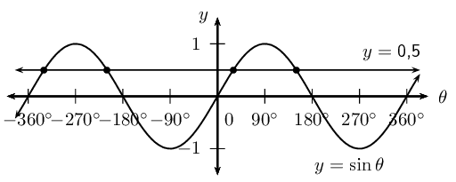

## 6.4 Trigonometric equations (EMBHM)

Solving trigonometric equations requires that we find the value of the angles that satisfy the
                        equation. If a specific interval for the solution is given, then we need only find the value of
                        the angles within the given interval that satisfy the equation. If no interval is given, then we
                        need to find the general solution. The periodic nature of trigonometric functions means that
                        there are many values that satisfy a given equation, as shown in the diagram below.

<Callout type="tip" title="Worked example 12: Solving trigonometric equations">
**Question:**
Solve for \(\theta\) (correct to one decimal place), given \(\tan \theta = 5\) and
                                        \(\theta \in [\text{0}\text{°};\text{360}\text{°}]\).

**Use a calculator to solve for \(\theta\):**
\begin{align*}
                                \tan \theta &= 5 \\
                                \therefore \theta &= \tan^{-1}5 \\
                                &= \text{78,7}\text{°}
                                \end{align*}

This value of \(\theta\) is an acute angle which lies in the first quadrant and is
                                        called the reference angle.

**Use the CAST diagram to determine in which quadrants \(\tan \theta\)
                                        is positive:**
The CAST diagram indicates that \(\tan \theta\) is positive in the first and third
                                        quadrants, therefore we must determine the value of \(\theta\) such that
                                        \(\text{180}\text{°} < \theta < \text{270}\text{°}\).

Using reduction formulae, we know that \(\tan (\text{180}\text{°} + \theta) =
                                        \tan \theta\)

                                \begin{align*}
                                \theta &= \text{180}\text{°} + \text{78,7}\text{°} \\
                                \therefore \theta &= \text{258,7}\text{°}
                                \end{align*}

**Use a calculator to check that the solution satisfies the original
                                        equation:**

**Write the final answer:**
\(\theta = \text{78,7}\text{°}\) or \(\theta = \text{258,7}\text{°}\).
</Callout>

<Callout type="tip" title="Worked example 13: Solving trigonometric equations">
**Question:**
Solve for \(\alpha\) (correct to one decimal place), given \(\cos \alpha =
                                        -\text{0,7}\) and \(\theta \in
                                        [\text{0}\text{°};\text{360}\text{°}]\).

**Use a calculator to find the reference angle:**
To determine the reference angle, we do not include the negative sign. The reference
                                        angle must be an acute angle in the first quadrant, where all the trigonometric
                                        functions are positive.

                                \begin{align*}
                                \text{ref } \angle &= \cos^{-1}\text{0,7} \\
                                &= \text{45,6}\text{°}
                                \end{align*}

**Use the CAST diagram to determine in which quadrants \(\cos \alpha\)
                                        is negative:**
The CAST diagram indicates that \(\cos \alpha\) is negative in the second and third
                                        quadrants, therefore we must determine the value of \(\alpha\) such that
                                        \(\text{90}\text{°} < \alpha < \text{270}\text{°}\).

Using reduction formulae, we know that \(\cos (\text{180}\text{°} - \alpha) =
                                        -\cos \alpha\) and \(\cos (\text{180}\text{°} + \alpha) = -\cos \alpha\)

In the second quadrant:

                                \begin{align*}
                                \alpha &= \text{180}\text{°} - \text{45,6}\text{°} \\
                                &= \text{134,4}\text{°}
                                \end{align*}

In the third quadrant:

                                \begin{align*}
                                \alpha &= \text{180}\text{°} + \text{45,6}\text{°} \\
                                &= \text{225,6}\text{°}
                                \end{align*}

**Note:** the reference angle \((\text{45,6}\text{°})\) does not
                                        form part of the solution.

**Use a calculator to check that the solution satisfies the original
                                        equation:**

**Write the final answer:**
\(\alpha = \text{134,4}\text{°}\) or \(\alpha = \text{225,6}\text{°}\).
</Callout>

<Callout type="tip" title="Worked example 14: Solving trigonometric equations">
**Question:**
Solve for \(\beta\) (correct to one decimal place), given \(\sin \beta =
                                        -\text{0,5}\) and \(\beta \in
                                        [-\text{360}\text{°};\text{360}\text{°}]\).

**Use a calculator to find the reference angle:**
To determine the reference angle, we use a positive value.

                                \begin{align*}
                                \text{ref } \angle &= \sin^{-1}\text{0,5} \\
                                &= \text{30}\text{°}
                                \end{align*}

**Use the CAST diagram to determine in which quadrants \(\sin \beta\) is
                                        negative:**
The CAST diagram indicates that \(\sin \beta\) is negative in the third and fourth
                                        quadrants. We also need to find the values of \(\beta\) such that
                                        \(-\text{360}\text{°} \leq \beta \leq \text{360}\text{°}\).

Using reduction formulae, we know that \(\sin (\text{180}\text{°} + \beta) = -
                                        \sin \beta\) and \(\sin (\text{360}\text{°} - \beta) = - \sin \beta\)

In the third quadrant:

                                \begin{align*}
                                \beta &= \text{180}\text{°} + \text{30}\text{°} \\
                                &= \text{210}\text{°} \\
                                \text{or } \beta &= -\text{180}\text{°} + \text{30}\text{°} \\
                                &= -\text{150}\text{°}
                                \end{align*}

In the fourth quadrant:

                                \begin{align*}
                                \beta &= \text{360}\text{°} - \text{30}\text{°} \\
                                &= \text{330}\text{°} \\
                                \text{or } \beta &= \text{0}\text{°} - \text{30}\text{°} \\
                                &= -\text{30}\text{°}
                                \end{align*}

**Notice:** the reference angle \((\text{30}\text{°})\) does not
                                        form part of the solution.

**Use a calculator to check that the solution satisfies the original
                                        equation:**

**Write the final answer:**
\(\beta = -\text{150}\text{°}\), \(-\text{30}\)\(\text{°}\),
                                        \(\text{210}\)\(\text{°}\) or \(\text{330}\)\(\text{°}\).
</Callout>

## Solving trigonometric equations

### Textbook Exercise
                                        6.7

Determine the values of \(\alpha\) for \(\alpha \in
                                                        [\text{0}\text{°};\text{360}\text{°}]\) if:

**Problem:**
\(4 \cos \alpha = 2\)

**Solution:**
\begin{align*}
                                                        4 \cos \alpha &= 2 \\
                                                        \cos \alpha &= \frac{1}{2} \\
                                                        \text{ref } \angle &= \cos^{-1}\text{0,5} \\
                                                        &= \text{60}\text{°} \\
                                                        \therefore \alpha &= \text{60}\text{°}
                                                        \end{align*}

In the fourth quadrant:

                                                        \begin{align*}
                                                        \alpha &= \text{360}\text{°} - \text{60}\text{°}
                                                        \\
                                                        &= \text{300}\text{°}
                                                        \end{align*}

\(\alpha = \text{60}\text{°}; \text{300}\text{°}\)

**Problem:**
\(\sin \alpha + \text{3,65} = 3\)

**Solution:**
\begin{align*}
                                                        \sin \alpha + \text{3,65} &= 3\\
                                                        \sin \alpha &= -\text{0,65} \\
                                                        \text{ref } \angle &= \sin^{-1}\text{0,65} \\
                                                        &= \text{40,5}\text{°}
                                                        \end{align*}

In the third quadrant:

                                                        \begin{align*}
                                                        \alpha &= \text{180}\text{°} + \text{40,5}\text{°}
                                                        \\
                                                        &= \text{220,5}\text{°}
                                                        \end{align*}

In the fourth quadrant:

                                                        \begin{align*}
                                                        \alpha &= \text{360}\text{°} - \text{40,5}\text{°}
                                                        \\
                                                        &= \text{319,5}\text{°}
                                                        \end{align*}

\(\alpha = \text{220,5}\text{°};
                                                                \text{319,5}\text{°}\)

**Problem:**
\(\tan \alpha = 5\frac{1}{4}\)

**Solution:**
\begin{align*}
                                                        \tan \alpha &= 5\frac{1}{4} \\
                                                        \tan \alpha &= -\text{5,25} \\
                                                        \text{ref } \angle &= \tan^{-1}\text{5,25} \\
                                                        &= \text{79,2}\text{°} \\
                                                        \therefore \alpha &= \text{79,2}\text{°}
                                                        \end{align*}

In the third quadrant:

                                                        \begin{align*}
                                                        \alpha &= \text{180}\text{°} + \text{79,2}\text{°}
                                                        \\
                                                        &= \text{259,2}\text{°}
                                                        \end{align*}

\(\alpha = \text{79,2}\text{°};
                                                                \text{259,2}\text{°}\)

**Problem:**
\(\cos \alpha + \text{0,939} = 0\)

**Solution:**
\begin{align*}
                                                        \cos \alpha + \text{0,939} &= 0\\
                                                        \cos \alpha &= -\text{0,939} \\
                                                        \text{ref } \angle &= \cos^{-1}\text{0,939} \\
                                                        &= \text{20,1}\text{°}
                                                        \end{align*}

In the third quadrant:

                                                        \begin{align*}
                                                        \alpha &= \text{180}\text{°} + \text{20,1}\text{°}
                                                        \\
                                                        &= \text{200,1}\text{°}
                                                        \end{align*}

In the fourth quadrant:

                                                        \begin{align*}
                                                        \alpha &= \text{360}\text{°} - \text{20,1}\text{°}
                                                        \\
                                                        &= \text{339,9}\text{°}
                                                        \end{align*}

\(\alpha = \text{200,1}\text{°};
                                                                \text{339,9}\text{°}\)

**Problem:**
\(5 \sin \alpha = 3\)

**Solution:**
\begin{align*}
                                                        5 \sin \alpha &= 3\\
                                                        \sin \alpha &= \frac{3}{5}\\
                                                        \text{ref } \angle &= \sin^{-1} \left( \frac{3}{5} \right)
                                                        \\
                                                        &= \text{36,9}\text{°} \\
                                                        \therefore \alpha &= \text{36,9}\text{°}
                                                        \end{align*}

In the second quadrant:

                                                        \begin{align*}
                                                        \alpha &= \text{180}\text{°} - \text{20,1}\text{°}
                                                        \\
                                                        &= \text{143,1}\text{°}
                                                        \end{align*}

\(\alpha = \text{36,9}\text{°};
                                                                \text{143,1}\text{°}\)

**Problem:**
\(\frac{1}{2} \tan \alpha = -\text{1,4}\)

**Solution:**
\begin{align*}
                                                        \frac{1}{2} \tan \alpha &= -\text{1,4} \\
                                                        \tan \alpha &= -\text{2,8} \\
                                                        \text{ref } \angle &= \tan^{-1}\text{2,8} \\
                                                        &= \text{70,3}\text{°}
                                                        \end{align*}

In the second quadrant:

                                                        \begin{align*}
                                                        \alpha &= \text{180}\text{°} - \text{70,3}\text{°}
                                                        \\
                                                        &= \text{109,7}\text{°}
                                                        \end{align*}

In the fourth quadrant:

                                                        \begin{align*}
                                                        \alpha &= \text{360}\text{°} - \text{70,3}\text{°}
                                                        \\
                                                        &= \text{289,7}\text{°}
                                                        \end{align*}

\(\alpha = \text{109,7}\text{°};
                                                                \text{289,7}\text{°}\)

Determine the values of \(\theta\) for \(\theta \in
                                                        [-\text{360}\text{°};\text{360}\text{°}]\) if:

**Problem:**
\(\sin \theta = \text{0,6}\)

**Solution:**
\begin{align*}
                                                        \sin \theta &= \text{0,6} \\
                                                        \text{ref } \angle &= \sin^{-1}\text{0,6} \\
                                                        &= \text{36,9}\text{°} \\
                                                        \therefore \theta &= \text{36,9}\text{°}
                                                        \end{align*}

In the second quadrant:

                                                        \begin{align*}
                                                        \theta &= \text{180}\text{°} - \text{36,9}\text{°}
                                                        \\
                                                        &= \text{143,1}\text{°}
                                                        \end{align*}

Negative angles:

                                                        \begin{align*}
                                                        \theta &= \text{36,9}\text{°} - \text{360}\text{°}
                                                        \\
                                                        &= -\text{323,1}\text{°} \\
                                                        \text{And } \theta &= \text{143,1}\text{°} -
                                                        \text{360}\text{°} \\
                                                        &= -\text{216,9}\text{°}
                                                        \end{align*}

\(\theta = -\text{323,1}\text{°};
                                                                -\text{216,9}\text{°}; \text{36,9}\text{°};
                                                                \text{143,1}\text{°}\)

**Problem:**
\(\cos \theta + \frac{3}{4} = 0\)

**Solution:**
\begin{align*}
                                                        \cos \theta + \frac{3}{4} &= 0 \\
                                                        \cos \theta &= - \frac{3}{4} \\
                                                        \text{ref } \angle &= \cos^{-1} \left( \frac{3}{4} \right)
                                                        \\
                                                        &= \text{41,4}\text{°}
                                                        \end{align*}

In the second quadrant:

                                                        \begin{align*}
                                                        \theta &= \text{180}\text{°} - \text{41,4}\text{°}
                                                        \\
                                                        &= \text{138,6}\text{°}
                                                        \end{align*}

In the third quadrant:

                                                        \begin{align*}
                                                        \theta &= \text{180}\text{°} + \text{41,4}\text{°}
                                                        \\
                                                        &= \text{221,4}\text{°}
                                                        \end{align*}

Negative angles:

                                                        \begin{align*}
                                                        \theta &= \text{138,6}\text{°} -
                                                        \text{360}\text{°} \\
                                                        &= -\text{221,4}\text{°} \\
                                                        \text{And } \theta &= \text{221,4}\text{°} -
                                                        \text{360}\text{°} \\
                                                        &= -\text{138,6}\text{°}
                                                        \end{align*}

\(\theta = -\text{221,4}\text{°};
                                                                -\text{138,6}\text{°}; \text{138,6}\text{°};
                                                                \text{221,4}\text{°}\)

**Problem:**
\(3 \tan \theta = 20\)

**Solution:**
\begin{align*}
                                                        3 \tan \theta &= 20 \\
                                                        \tan \theta &= \frac{20}{3} \\
                                                        \text{ref } \angle &= \tan^{-1} \left( \frac{20}{3} \right)
                                                        \\
                                                        &= \text{81,5}\text{°} \\
                                                        \theta &= \text{81,5}\text{°}
                                                        \end{align*}

In the third quadrant:

                                                        \begin{align*}
                                                        \theta &= \text{180}\text{°} + \text{81,5}\text{°}
                                                        \\
                                                        &= \text{261,5}\text{°}
                                                        \end{align*}

Negative angles:

                                                        \begin{align*}
                                                        \theta &= \text{81,5}\text{°} - \text{360}\text{°}
                                                        \\
                                                        &= -\text{278,5}\text{°} \\
                                                        \text{And } \theta &= \text{261,5}\text{°} -
                                                        \text{360}\text{°} \\
                                                        &= -\text{98,5}\text{°}
                                                        \end{align*}

\(\theta = -\text{278,5}\text{°};
                                                                -\text{98,5}\text{°}; \text{81,5}\text{°};
                                                                \text{261,5}\text{°}\)

**Problem:**
\(\sin \theta = \cos \text{180}\text{°}\)

**Solution:**
\begin{align*}
                                                        \sin \theta &= \cos \text{180}\text{°} \\
                                                        \sin \theta &= -1 \\
                                                        \text{ref } \angle &= \sin^{-1} \left( 1 \right) \\
                                                        &= \text{90}\text{°}
                                                        \end{align*}

In the third quadrant:

                                                        \begin{align*}
                                                        \theta &= \text{180}\text{°} + \text{90}\text{°}
                                                        \\
                                                        &= \text{270}\text{°}
                                                        \end{align*}

Negative angles:

                                                        \begin{align*}
                                                        \theta &= \text{270}\text{°} - \text{360}\text{°}
                                                        \\
                                                        &= -\text{90}\text{°}
                                                        \end{align*}

\(\theta = -\text{90}\text{°}; \text{270}\text{°}\)

**Problem:**
\(2 \cos \theta = \frac{4}{5}\)

**Solution:**
\begin{align*}
                                                        2 \cos \theta &= \frac{4}{5}\\
                                                        \cos \theta &= \frac{2}{5} \\
                                                        \text{ref } \angle &= \cos^{-1} \left( \frac{2}{5} \right)
                                                        \\
                                                        &= \text{66,4}\text{°} \\
                                                        \theta &= \text{66,4}\text{°}
                                                        \end{align*}

In the fourth quadrant:

                                                        \begin{align*}
                                                        \theta &= \text{360}\text{°} - \text{66,4}\text{°}
                                                        \\
                                                        &= \text{293,6}\text{°}
                                                        \end{align*}

Negative angles:

                                                        \begin{align*}
                                                        \theta &= \text{66,4}\text{°} - \text{360}\text{°}
                                                        \\
                                                        &= -\text{293,6}\text{°} \\
                                                        \text{And } \theta &= \text{293,6}\text{°} -
                                                        \text{360}\text{°} \\
                                                        &= -\text{66,4}\text{°}
                                                        \end{align*}

\(\theta = -\text{293,6}\text{°};
                                                                -\text{66,4}\text{°}; \text{66,4}\text{°};
                                                                \text{293,6}\text{°}\)

### The general solution (EMBHN)

In the previous worked example, the solution was restricted to a certain interval. However,
                                the periodicity of the trigonometric functions means that there are an infinite number
                                of positive and negative angles that satisfy an equation. If we do not restrict the
                                solution, then we need to determine the general solution to the equation. We know that
                                the sine and cosine functions have a period of \(\text{360}\)\(\text{°}\) and the
                                tangent function has a period of \(\text{180}\)\(\text{°}\).

**Method for finding the general solution:**

2. Determine the reference angle (use a positive value).
4. Use the CAST diagram to determine where the function is positive or negative
                                           (depending on the given equation).
6. Find the angles in the interval \([\text{0}\text{°}; \text{360}\text{°}]\)
                                           that satisfy the equation and add multiples of the period to each answer.
8. Check answers using a calculator.

<Callout type="tip" title="Worked example 15: Finding the general solution">
**Question:**
Determine the general solution for \(\sin \theta = \text{0,3}\) (give answers
                                                correct to one decimal place).

**Use a calculator to find the reference angle:**
\begin{align*}
                                        \sin \theta &= \text{0,3} \\
                                        \therefore \text{ref } \angle &= \sin^{-1}\text{0,3} \\
                                        &= \text{17,5}\text{°}
                                        \end{align*}

**Use CAST diagram to determine in which quadrants \(\sin
                                                \theta\) is positive:**
The CAST diagram indicates that \(\sin \theta\) is positive in the first and
                                                second quadrants.

Using reduction formulae, we know that \(\sin (\text{180}\text{°} -
                                                \theta) = \sin \theta\).

In the first quadrant:

                                        \begin{align*}
                                        \theta &= \text{17,5}\text{°} \\
                                        \therefore \theta &= \text{17,5}\text{°} + k \cdot
                                        \text{360}\text{°}
                                        \end{align*}

In the second quadrant:

                                        \begin{align*}
                                        \theta &= \text{180}\text{°} - \text{17,5}\text{°} \\
                                        \therefore \theta &= \text{162,5}\text{°} + k \cdot
                                        \text{360}\text{°}
                                        \end{align*}

where \(k \in \mathbb{Z}\).

**Check that the solution satisfies the original equation:**
We can select random values of \(k\) to check that the answers satisfy the
                                                original equation.

Let \(k = 4\):

                                        \begin{align*}
                                        \theta &= \text{17,5}\text{°} + 4(\text{360})° \\
                                        \therefore \theta &= \text{1 457,5}\text{°} \\
                                        \text{And } \sin \text{1 457,5}\text{°} &= \text{0,3007} \ldots
                                        \end{align*}

This solution is correct.

Similarly, if we let \(k = -2\):

                                        \begin{align*}
                                        \theta &= \text{162,5}\text{°} - 2(\text{360})° \\
                                        \therefore \theta &= -\text{557,5}\text{°} \\
                                        \text{And } \sin (-\text{557,5}\text{°}) &= \text{0,3007} \ldots
                                        \end{align*}

This solution is also correct.

**Write the final answer:**
\(\theta = \text{17,5}\text{°} + k \cdot \text{360}\text{°}\) or
                                                \(\theta = \text{162,5}\text{°} + k \cdot
                                                \text{360}\text{°}\).
</Callout>

<Callout type="tip" title="Worked example 16: Finding the general solution">
**Question:**
Determine the general solution for \(\cos 2\theta = - \text{0,6427}\) (give
                                                answers correct to one decimal place).

**Use a calculator to find the reference angle:**
\begin{align*}
                                        \text{ref } \angle &= \sin^{-1}\text{0,6427} \\
                                        &= \text{50,0}\text{°}
                                        \end{align*}

**Use CAST diagram to determine in which quadrants \(\cos
                                                \theta\) is negative:**
The CAST diagram shows that \(\cos \theta\) is negative in the second and
                                                third quadrants.

Therefore we use the reduction formulae \(\cos (\text{180}\text{°} -
                                                \theta) = - \cos \theta\) and \(\cos (\text{180}\text{°} + \theta)
                                                = - \cos \theta\).

In the second quadrant:

                                        \begin{align*}
                                        2\theta &= \text{180}\text{°} - \text{50}\text{°} + k \cdot
                                        \text{360}\text{°} \\
                                        &= \text{130}\text{°} + k \cdot \text{360}\text{°} \\
                                        \therefore \theta &= \text{65}\text{°} + k \cdot
                                        \text{180}\text{°}
                                        \end{align*}

In the third quadrant:

                                        \begin{align*}
                                        2\theta &= \text{180}\text{°} + \text{50}\text{°} + k \cdot
                                        \text{360}\text{°} \\
                                        &= \text{230}\text{°} + k \cdot \text{360}\text{°} \\
                                        \therefore \theta &= \text{115}\text{°} + k \cdot
                                        \text{180}\text{°}
                                        \end{align*}

where \(k \in \mathbb{Z}\).

**Remember:** also divide the period
                                                \((\text{360}\text{°})\) by the coefficient of \(\theta\).

**Check that the solution satisfies the original equation:**
We can select random values of \(k\) to check that the answers satisfy the
                                                original equation.

Let \(k = 2\):

                                        \begin{align*}
                                        \theta &= \text{65}\text{°} + 2(\text{180}\text{°}) \\
                                        \therefore \theta &= \text{425}\text{°} \\
                                        \text{And } \cos 2(\text{425})° &= -\text{0,6427} \ldots
                                        \end{align*}

This solution is correct.

Similarly, if we let \(k = -5\):

                                        \begin{align*}
                                        \theta &= \text{115}\text{°} - 5(\text{180}\text{°})\\
                                        \therefore \theta &= -\text{785}\text{°} \\
                                        \text{And } \cos 2(-\text{785}\text{°}) &= -\text{0,6427} \ldots
                                        \end{align*}

This solution is also correct.

**Write the final answer:**
\(\theta = \text{65}\text{°} + k \cdot \text{180}\text{°}\) or
                                                \(\theta = \text{115}\text{°} + k \cdot \text{180}\text{°}\).
</Callout>

<Callout type="tip" title="Worked example 17: Finding the general solution">
**Question:**
Determine the general solution for \(\tan (2\alpha - \text{10}\text{°})
                                                = \text{2,5}\) such that \(-\text{180}\text{°} \leq \alpha \leq
                                                \text{180}\text{°}\) (give answers correct to one decimal place).

**Make a substitution:**
To solve this equation, it can be useful to make a substitution: let \(x =
                                                2\alpha - \text{10}\text{°}\).

                                        \[\tan (x) = \text{2,5}\]

**Use a calculator to find the reference angle:**
\begin{align*}
                                        \tan x &= \text{2,5} \\
                                        \therefore \text{ref } \angle &= \tan^{-1} \text{2,5} \\
                                        &= \text{68,2}\text{°}
                                        \end{align*}

**Use CAST diagram to determine in which quadrants the tangent
                                                function is positive:**
We see that \(\tan x\) is positive in the first and third quadrants, so we
                                                use the reduction formula \(\tan (\text{180}\text{°} + x) = \tan
                                                x\). It is also important to remember that the period of the tangent
                                                function is \(\text{180}\)\(\text{°}\).

In the first quadrant:

                                        \begin{align*}
                                        x &= \text{68,2}\text{°} + k \cdot \text{180}\text{°} \\
                                        \text{Substitute } x &= 2 \alpha -\text{10}\text{°} \\
                                        2 \alpha -\text{10}\text{°} &= \text{68,2}\text{°} + k \cdot
                                        \text{180}\text{°} \\
                                        2 \alpha &= \text{78,2}\text{°} + k \cdot \text{180}\text{°} \\
                                        \therefore \alpha &= \text{39,1}\text{°} + k \cdot
                                        \text{90}\text{°}
                                        \end{align*}

In the third quadrant:

                                        \begin{align*}
                                        x &= \text{180}\text{°} + \text{68,2}\text{°} + k \cdot
                                        \text{180}\text{°} \\
                                        &= \text{248,2}\text{°} + k \cdot \text{180}\text{°} \\
                                        \text{Substitute } x &= 2 \alpha -\text{10}\text{°} \\
                                        2 \alpha -\text{10}\text{°} &= \text{248,2}\text{°} + k \cdot
                                        \text{180}\text{°} \\
                                        2 \alpha &= \text{258,2}\text{°} + k \cdot \text{180}\text{°} \\
                                        \therefore \alpha &= \text{129,1}\text{°} + k \cdot
                                        \text{90}\text{°}
                                        \end{align*}

where \(k \in \mathbb{Z}\).

**Remember:** to divide the period \((\text{180}\text{°})\)
                                                by the coefficient of \(\alpha\).

**Find the answers within the given interval:**
Substitute suitable values of \(k\) to determine the values of \(\alpha\)
                                                that lie within the interval (\(-\text{180}\text{°} \leq \alpha
                                                \leq \text{180}\text{°}\)).

|  | I: \(\alpha = \text{39,1}\text{°} + k \cdot
                                                                \text{90}\text{°}\) | III: \(\alpha = \text{129,1}\text{°} + k
                                                                \cdot \text{90}\text{°}\) |
| --- | --- | --- |
| \(k = 0\) | \(\text{39,1}\)\(\text{°}\) |  | \(\text{129,1}\)\(\text{°}\) |  |
| \(k = 1\) | \(\text{129,1}\)\(\text{°}\) |  | \(\text{219,1}\)\(\text{°}\) | (outside) |
| \(k = 2\) | \(\text{219,1}\)\(\text{°}\) | (outside) |  |  |
| \(k = -1\) | \(-\text{50,9}\)\(\text{°}\) |  | \(\text{39,1}\)\(\text{°}\) |  |
| \(k = -2\) | \(-\text{140,9}\)\(\text{°}\) |  | \(-\text{50,9}\)\(\text{°}\) |  |
| \(k = -3\) | \(-\text{230,9}\)\(\text{°}\) | (outside) | \(-\text{140,9}\)\(\text{°}\) |  |
| \(k = -4\) |  |  | \(-\text{230,9}\)\(\text{°}\) | (outside) |

Notice how some of the values repeat. This is because of the periodic nature
                                                of the tangent function. Therefore we need only determine the solution:

\[\alpha = \text{39,1}\text{°} + k \cdot \text{90}\text{°}\]
                                                for \(k \in \mathbb{Z}\).

**Write the final answer:**
\(\alpha = -\text{140,9}\text{°}\); \(-\text{50,9}\)\(\text{°}\);
                                                \(\text{39,1}\)\(\text{°}\) or \(\text{129,1}\)\(\text{°}\).
</Callout>

<Callout type="tip" title="Worked example 18: Finding the general solution using co-functions">
**Question:**
Determine the general solution for \(\sin (\theta - \text{20}\text{°}) =
                                                \cos 2\theta\).

**Use the CAST diagram to decide on the quadrants:**
\begin{align*}
                                        \sin(\theta - \text{20}\text{°}) &= \cos2\theta \\
                                        \sin(\theta - \text{20}\text{°}) &= \sin(\text{90}\text{°} -
                                        2\theta)
                                        \end{align*}

The right hand side of the equation is positive, and the sine function is
                                                positive in the first and second quadrants.
                                                Therefore, we will reduce the equation as if the solution were in the
                                                first and second quadrants (using the angle and
                                                \(\text{180}\text{°}\) minus the angle).

**Solve the equation:**
\begin{align*}
                                        \sin(\theta - \text{20}\text{°}) &= \cos2\theta \\
                                        \sin(\theta - \text{20}\text{°}) &= \sin(\text{90}\text{°} -
                                        2\theta)
                                        \end{align*}

Solution 1:

                                        \begin{align*}
                                        \theta - \text{20}\text{°} &= \text{90}\text{°} -
                                        2\theta + k \cdot \text{360}\text{°} \\
                                        3\theta &= \text{110}\text{°} + k \cdot \text{360}\text{°} \\
                                        \therefore \theta &= \text{36,67}\text{°} + k \cdot
                                        \text{120}\text{°}
                                        \end{align*}

Solution 2:

                                        \begin{align*}
                                        \theta - \text{20}\text{°} &= \text{180}\text{°} -
                                        (\text{90}\text{°} - 2\theta) + k \cdot \text{360}\text{°} \\
                                        \theta - \text{20}\text{°} &= \text{180}\text{°} -
                                        \text{90}\text{°} + 2\theta + k \cdot \text{360}\text{°} \\
                                        -\theta &= \text{110}\text{°} + k
                                        \cdot \text{360}\text{°}\\
                                        \theta &= -\text{110}\text{°} + k
                                        \cdot \text{360}\text{°} \\
                                        \theta &= \text{250}\text{°} + k \cdot \text{360}\text{°}
                                        \end{align*}

where \(k \in \mathbb{Z}\).

**Check that the solution satisfies the original equation:**
For the first solution:

                                        \begin{align*}
                                        \sin(\theta - \text{20}\text{°}) &=
                                        \sin(\text{36,67}\text{°} - \text{20}\text{°}) \\
                                        &= \text{0,29}
                                        \end{align*}

and

                                        \begin{align*}
                                        \cos2\theta &= \cos(2 \times \text{36,67}\text{°}) \\
                                        &= \text{0,29}
                                        \end{align*}

For the second solution:

                                        \begin{align*}
                                        \sin(\theta - \text{20}\text{°}) &=
                                        \sin(\text{250}\text{°} -
                                        \text{20}\text{°}) \\
                                        &= -\text{0,77}
                                        \end{align*}

and

                                        \begin{align*}
                                        \cos2\theta &= \cos(2 \times \text{250}\text{°}) \\
                                        &= -\text{0,77}
                                        \end{align*}

**Write the final answer:**
\(\theta = \text{36,67}\text{°} + k \cdot \text{120}\text{°}\) or
                                                \(\theta = \text{250}\text{°} + k \cdot \text{360}\text{°},
                                                \quad k \in \mathbb{Z}\)
</Callout>

## General solution

### Textbook Exercise 6.8

- Find the general solution for each equation.
- Hence, find all the solutions in the interval
                                                                          \([-\text{180}\text{°};\text{180}\text{°}]\).

**Problem:**
\(\cos (\theta + \text{25}\text{°}) =
                                                                        \text{0,231}\)

**Solution:**
\begin{align*}
                                                                \cos(\theta+\text{25}\text{°})&=\text{0,231} \\
                                                                \text{ref } \angle &= \text{76,64}\text{°} \\
                                                                \text{I quad: } \quad
                                                                \theta+\text{25}\text{°}&=
                                                                \text{76,64}\text{°}+ n \cdot
                                                                \text{360}\text{°}, n \in \mathbb{Z}\\
                                                                \therefore \theta &= \text{51,64}\text{°} + n
                                                                \cdot \text{360}\text{°} \\
                                                                \therefore \theta &=-\text{128,36}\text{°};
                                                                \text{51,64}\text{°} \\
                                                                \text{IV quad: } \quad
                                                                \theta+\text{25}\text{°}&=
                                                                \text{360}\text{°} - \text{76,64}\text{°} + n
                                                                \cdot \text{360}\text{°}, n \in \mathbb{Z}\\
                                                                \therefore \theta &= \text{258,36}\text{°} + n
                                                                \cdot \text{360}\text{°} \\
                                                                \therefore \theta &= -\text{101,64}\text{°}
                                                                \end{align*}

\(\theta =
                                                                        -\text{128,36}\text{°};
                                                                        -\text{101,64}\text{°};
                                                                        \text{51,64}\text{°}\)

**Problem:**
\(\sin 2\alpha = -\text{0,327}\)

**Solution:**
\begin{align*}
                                                                \sin2\alpha&=-\text{0,327} \\
                                                                \text{ref } \angle &= \text{19,09}\text{°} \\
                                                                \text{III quad: } \quad
                                                                2\alpha&=\text{180}\text{°} +
                                                                \text{19,09}\text{°}+ n \cdot
                                                                \text{360}\text{°}, n \in \mathbb{Z}\\
                                                                2\alpha&=\text{199,09}\text{°}+ n \cdot
                                                                \text{360}\text{°} \\
                                                                \therefore \alpha&=\text{99,55}\text{°}+ n
                                                                \cdot \text{180}\text{°}\\
                                                                \therefore \alpha&=-\text{80,45}\text{°};
                                                                \text{99,55}\text{°} \\
                                                                \text{IV quad: } \quad
                                                                2\alpha&=\text{360}\text{°} -
                                                                \text{19,09}\text{°}+ n \cdot
                                                                \text{360}\text{°}, n \in \mathbb{Z} \\
                                                                2\alpha&=\text{340,91}\text{°}+ n \cdot
                                                                \text{360}\text{°} \\
                                                                \therefore \alpha&=\text{170,46}\text{°}+ n
                                                                \cdot \text{180}\text{°} \\
                                                                \therefore \alpha&=-\text{9,54}\text{°};
                                                                \text{170,46}\text{°}
                                                                \end{align*}

\(\theta =
                                                                        -\text{80,45}\text{°};
                                                                        -\text{9,54}\text{°};
                                                                        \text{99,55}\text{°};
                                                                        \text{170,46}\text{°}\)

**Problem:**
\(2 \tan \beta = -\text{2,68}\)

**Solution:**
\begin{align*}
                                                                2\tan\theta&=-\text{2,68} \\
                                                                \tan\theta&=-\text{1,34} \\
                                                                \text{ref } \angle &= \text{53,27}\text{°} \\
                                                                \text{II quad: } \quad \theta &=
                                                                \text{180}\text{°}- \text{53,27}\text{°}+ n
                                                                \cdot \text{180}\text{°} , n \in \mathbb{Z} \\
                                                                \therefore \theta &=\text{126,73}\text{°}+ n
                                                                \cdot \text{180}\text{°} \\
                                                                \therefore \theta&=-\text{53,27}\text{°};
                                                                \text{126,73}\text{°}
                                                                \end{align*}

\(\theta =
                                                                        -\text{53,27}\text{°};
                                                                        \text{126,73}\text{°}\)

**Problem:**
\(\cos \alpha = 1\)

**Solution:**
\begin{align*}
                                                                \cos \alpha &= 1\\
                                                                \text{ref } \angle &= \text{0}\text{°} \\
                                                                \text{I/IV quad: } \quad \alpha &=
                                                                \text{0}\text{°} + n \cdot \text{360}\text{°}
                                                                , n \in \mathbb{Z} \\
                                                                \therefore \alpha &= \text{0}\text{°}
                                                                \end{align*}

\(\alpha =
                                                                        \text{0}\text{°}\)

**Problem:**
\(4 \sin \theta = 0\)

**Solution:**
\begin{align*}
                                                                4 \sin \theta &= 0 \\
                                                                \text{ref } \angle &= \text{0}\text{°} \\
                                                                \text{I quad: } \quad \theta &=
                                                                \text{0}\text{°} + n \cdot \text{360}\text{°}
                                                                , n \in \mathbb{Z} \\
                                                                \text{II quad: } \quad \theta &=
                                                                \text{180}\text{°} + n \cdot
                                                                \text{360}\text{°} , n \in \mathbb{Z}
                                                                \end{align*}

\(\theta =
                                                                        -\text{180}\text{°};
                                                                        \text{0}\text{°};
                                                                        \text{180}\text{°}\)

**Problem:**
\(\cos \theta = -1\)

**Solution:**
\begin{align*}
                                                                \cos \theta &= -1 \\
                                                                \text{ref } \angle &= \text{0}\text{°} \\
                                                                \text{I/III quad: } \quad \theta &=
                                                                \text{180}\text{°} + n \cdot
                                                                \text{360}\text{°} , n \in \mathbb{Z}
                                                                \end{align*}

\(\theta =
                                                                        -\text{180}\text{°};
                                                                        \text{180}\text{°}\)

**Problem:**
\(\tan \frac{\theta}{2} = \text{0,9}\)

**Solution:**
\begin{align*}
                                                                \tan \frac{\theta}{2} &= \text{0,9} \\
                                                                \text{ref } \angle &= \text{42}\text{°} \\
                                                                \text{I quad: } \quad \frac{\theta}{2} &=
                                                                \text{42}\text{°}+ n \cdot \text{180}\text{°},
                                                                n \in \mathbb{Z}\\
                                                                \theta &= \text{84}\text{°}+ n \cdot
                                                                \text{360}\text{°} \\
                                                                \text{III quad: } \quad \frac{\theta}{2} &=
                                                                \text{180}\text{°} + \text{42}\text{°}+ n
                                                                \cdot \text{180}\text{°}, n \in \mathbb{Z} \\
                                                                \frac{\theta}{2} &= \text{222}\text{°}+ n \cdot
                                                                \text{180}\text{°} \\
                                                                \therefore \theta &= \text{444}\text{°}+ n
                                                                \cdot \text{360}\text{°}
                                                                \end{align*}

                                                                \(\theta =
                                                                \text{84}\text{°}\)

**Problem:**
\(4 \cos \theta +3 = 1\)

**Solution:**
\begin{align*}
                                                                4 \cos \theta +3 &= 1 \\
                                                                4 \cos \theta &= - 2 \\
                                                                \cos \theta &= -\frac{1}{2} \\
                                                                \text{ref } \angle &= \text{60}\text{°} \\
                                                                \text{II quad: } \quad \theta &=
                                                                \text{180}\text{°}- \text{60}\text{°}+ n \cdot
                                                                \text{360}\text{°} , n \in \mathbb{Z} \\
                                                                \therefore \theta &=\text{120}\text{°}+ n \cdot
                                                                \text{360}\text{°} \\
                                                                \text{III quad: } \quad \theta &=
                                                                \text{180}\text{°} + \text{60}\text{°}+ n
                                                                \cdot \text{360}\text{°} , n \in \mathbb{Z} \\
                                                                \therefore \theta &= \text{240}\text{°}+ n
                                                                \cdot \text{360}\text{°}
                                                                \end{align*}

\(\theta =
                                                                        -\text{120}\text{°};
                                                                        \text{120}\text{°}\)

**Problem:**
\(\sin 2\theta = -\frac{\sqrt{3}}{2}\)

**Solution:**
\begin{align*}
                                                                \sin 2\theta &= -\frac{\sqrt{3}}{2} \\
                                                                \text{ref } \angle &= \text{60}\text{°} \\
                                                                \text{III quad: } \quad 2\theta &=
                                                                \text{180}\text{°}+ \text{60}\text{°}+ n \cdot
                                                                \text{360}\text{°} , n \in \mathbb{Z} \\
                                                                2\theta &= \text{240}\text{°}+ n \cdot
                                                                \text{360}\text{°} \\
                                                                \therefore \theta &=\text{120}\text{°}+ n \cdot
                                                                \text{180}\text{°} \\
                                                                \text{IV quad: } \quad \theta &=
                                                                \text{360}\text{°} - \text{60}\text{°}+ n
                                                                \cdot \text{360}\text{°} , n \in \mathbb{Z} \\
                                                                2\theta &= \text{300}\text{°}+ n \cdot
                                                                \text{360}\text{°} \\
                                                                \therefore \theta &= \text{150}\text{°}+ n
                                                                \cdot \text{180}\text{°}
                                                                \end{align*}

\(\theta =
                                                                        -\text{60}\text{°};
                                                                        -\text{30}\text{°};
                                                                        \text{120}\text{°};
                                                                        \text{150}\text{°}\)

Find the general solution for each equation.

**Problem:**
\(\cos (\theta + \text{20}\text{°}) = 0\)

**Solution:**
\begin{align*}
                                                                \cos (\theta + \text{20}\text{°}) &= 0 \\
                                                                \text{ref } \angle &= \text{0}\text{°} \\
                                                                \therefore \theta + \text{20}\text{°} &=
                                                                \text{0}\text{°} + n \cdot \text{360}\text{°}
                                                                , n \in \mathbb{Z} \\
                                                                \therefore \theta &= - \text{20}\text{°} + n
                                                                \cdot \text{360}\text{°}
                                                                \end{align*}

\(\theta = - \text{20}\text{°} + n \cdot
                                                                        \text{360}\text{°}\)

**Problem:**
\(\sin 3\alpha = -1\)

**Solution:**
\begin{align*}
                                                                \sin 3\alpha &= -1 \\
                                                                \text{ref } \angle &= \text{90}\text{°} \\
                                                                \therefore 3\alpha &= \text{90}\text{°} + n
                                                                \cdot \text{360}\text{°} , n \in \mathbb{Z} \\
                                                                \therefore \alpha &= \text{30}\text{°} + n
                                                                \cdot \text{120}\text{°}
                                                                \end{align*}

\(\alpha = \text{30}\text{°} + n \cdot
                                                                        \text{120}\text{°}\)

**Problem:**
\(\tan 4\beta = \text{0,866}\)

**Solution:**
\begin{align*}
                                                                \tan 4\beta = \text{0,866} \\
                                                                \text{ref } \angle &= \text{41}\text{°} \\
                                                                \therefore 4\beta &= \text{41}\text{°} + n
                                                                \cdot \text{180}\text{°} , n \in \mathbb{Z} \\
                                                                \therefore \beta &= \text{10,25}\text{°} + n
                                                                \cdot \text{45}\text{°} \\
                                                                \text{III quad: } \quad 4\beta &=
                                                                \text{180}\text{°} + \text{41}\text{°} + n
                                                                \cdot \text{180}\text{°} , n \in \mathbb{Z} \\
                                                                &= \text{221}\text{°}+ n \cdot
                                                                \text{180}\text{°} \\
                                                                \therefore \beta &= \text{55,25}\text{°} + n
                                                                \cdot \text{45}\text{°}
                                                                \end{align*}

\(\beta = \text{10,25}\text{°} + n \cdot
                                                                        \text{45}\text{°} \text{ or }\beta =
                                                                        \text{55,25}\text{°} + n \cdot
                                                                        \text{45}\text{°}\)

**Problem:**
\(\cos (\alpha - \text{25}\text{°}) =
                                                                        \text{0,707}\)

**Solution:**
\begin{align*}
                                                                \cos (\alpha - \text{25}\text{°}) &=
                                                                \text{0,707} \\
                                                                \text{ref } \angle &= \text{45}\text{°} \\
                                                                \therefore \alpha - \text{25}\text{°} &=
                                                                \text{45}\text{°} + n \cdot \text{360}\text{°}
                                                                , n \in \mathbb{Z} \\
                                                                \therefore \alpha &= \text{70}\text{°} + n
                                                                \cdot \text{360}\text{°} \\
                                                                \text{IV quad: } \alpha - \text{25}\text{°} &=
                                                                \text{360}\text{°} - \text{45}\text{°} + n
                                                                \cdot \text{360}\text{°} , n \in \mathbb{Z} \\
                                                                &= \text{340}\text{°}+ n \cdot
                                                                \text{360}\text{°}
                                                                \end{align*}

\(\alpha = \text{70}\text{°} + n \cdot
                                                                        \text{360}\text{°} \text{ or }\alpha =
                                                                        \text{340}\text{°} + n \cdot
                                                                        \text{360}\text{°}\)

**Problem:**
\(2 \sin \frac{3\theta}{2} = -1\)

**Solution:**
\begin{align*}
                                                                2 \sin \frac{3\theta}{2} &= -1 \\
                                                                \text{ref } \angle &= \text{30}\text{°} \\
                                                                \text{III quad: } \quad \frac{3\theta}{2} &=
                                                                \text{180}\text{°} + \text{30}\text{°} + n
                                                                \cdot \text{360}\text{°} , n \in \mathbb{Z} \\
                                                                \therefore \theta &= \frac{2}{3} \left(
                                                                \text{210}\text{°} + \times n \cdot
                                                                \text{360}\text{°} \right) \\
                                                                &= \text{140}\text{°} + n \cdot
                                                                \text{240}\text{°} \\
                                                                \text{IV quad: } \quad \frac{3\theta}{2} &=
                                                                \text{360}\text{°} - \text{30}\text{°} + n
                                                                \cdot \text{360}\text{°} , n \in \mathbb{Z} \\
                                                                \therefore \theta &= \frac{2}{3} \left(
                                                                \text{330}\text{°}+ n \cdot \text{360}\text{°}
                                                                \right) \\
                                                                &= \text{220}\text{°} + n \cdot
                                                                \text{240}\text{°}
                                                                \end{align*}

\(\theta = \text{140}\text{°} + n \cdot
                                                                        \text{240}\text{°} \text{ or }\theta =
                                                                        \text{220}\text{°} + n \cdot
                                                                        \text{240}\text{°}\)

**Problem:**
\(5 \tan (\beta + \text{15}\text{°}) =
                                                                        \frac{5}{\sqrt{3}}\)

**Solution:**
\begin{align*}
                                                                5 \tan (\beta + \text{15}\text{°}) &=
                                                                \frac{5}{\sqrt{3}} \\
                                                                \tan (\beta + \text{15}\text{°}) &=
                                                                \frac{1}{\sqrt{3}} \\
                                                                \text{ref } \angle &= \text{30}\text{°}\\
                                                                \therefore \beta + \text{15}\text{°} &=
                                                                \text{30}\text{°} \\
                                                                \therefore \beta &= \text{15}\text{°} + n \cdot
                                                                \text{180}\text{°}
                                                                \end{align*}

**Solving quadratic trigonometric equations**

We can use our knowledge of algebraic equations to solve quadratic trigonometric equations.

<Callout type="tip" title="Worked example 19: Quadratic trigonometric equations">
**Question:**
Find the general solution of \(4 \sin^2 \theta = 3\).

**Simplify the equation and determine the reference angle:**
\begin{align*}
                                        4 \sin^2 \theta &= 3 \\
                                        \sin^2 \theta &= \frac{3}{4} \\
                                        \therefore \sin \theta &= \pm\sqrt{\frac{3}{4}} \\
                                        &= \pm \frac{\sqrt{3}}{2} \\
                                        \therefore \text{ref } \angle &= \text{60}\text{°}
                                        \end{align*}

**Determine in which quadrants the sine function is positive and
                                                negative:**
The CAST diagram shows that \(\sin \theta\) is positive in the first and
                                                second quadrants and negative in the third and fourth quadrants.

Positive in the first and second quadrants:

                                        \begin{align*}
                                        \theta &= \text{60}\text{°} + k \cdot \text{360}\text{°} \\
                                        \text{or } \theta &= \text{180}\text{°} - \text{60}\text{°} + k
                                        \cdot \text{360}\text{°} \\
                                        &= \text{120}\text{°} + k \cdot \text{360}\text{°}
                                        \end{align*}

Negative in the third and fourth quadrants:

                                        \begin{align*}
                                        \theta &= \text{180}\text{°} + \text{60}\text{°} + k \cdot
                                        \text{360}\text{°} \\
                                        &= \text{240}\text{°} + k \cdot \text{360}\text{°} \\
                                        \text{or } \theta &= \text{360}\text{°} - \text{60}\text{°} + k
                                        \cdot \text{360}\text{°} \\
                                        &= \text{300}\text{°} + k \cdot \text{360}\text{°}
                                        \end{align*}

where \(k \in \mathbb{Z}\).

**Check that the solution satisfies the original equation:**

**Write the final answer:**
\(\theta = \text{60}\text{°} + k \cdot \text{360}\text{°}\) or
                                                \(\text{120}\text{°} + k \cdot \text{360}\text{°}\) or
                                                \(\text{240}\text{°} + k \cdot \text{360}\text{°}\) or
                                                \(\text{300}\text{°} + k \cdot \text{360}\text{°}\)
</Callout>

<Callout type="tip" title="Worked example 20: Quadratic trigonometric equations">
**Question:**
Find \(\theta\) if \(2 \cos^2 \theta - \cos \theta - 1 = 0\) for \(\theta \in
                                                [-\text{180}\text{°};\text{180}\text{°}]\).

**Factorise the equation:**
\begin{align*}
                                        2 \cos^2 \theta - \cos \theta - 1 &= 0 \\
                                        (2 \cos \theta + 1)(\cos \theta - 1) &= 0 \\
                                        \therefore 2 \cos \theta + 1 = 0 &\text{ or } \cos \theta - 1 = 0
                                        \end{align*}

**Simplify the equations and solve for \(\theta\):**
\begin{align*}
                                        2 \cos \theta + 1 &= 0 \\
                                        2 \cos \theta &= -1 \\
                                        \cos \theta &= -\frac{1}{2} \\
                                        \therefore \text{ref } \angle &= \text{60}\text{°} \\
                                        \text{II quadrant: } \theta &= \text{180}\text{°} -
                                        \text{60}\text{°} + k \cdot \text{360}\text{°} \\
                                        &= \text{120}\text{°} + k \cdot \text{360}\text{°} \\
                                        \text{III quadrant: } \theta &= \text{180}\text{°} +
                                        \text{60}\text{°} + k \cdot \text{360}\text{°} \\
                                        &= \text{240}\text{°} + k \cdot \text{360}\text{°}
                                        \end{align*}

or

                                        \begin{align*}
                                        \cos \theta - 1 &= 0 \\
                                        \cos \theta &= 1 \\
                                        \therefore \text{ref } \angle &= \text{0}\text{°} \\
                                        \text{II and IV quadrants: } \theta &= k \cdot \text{360}\text{°}
                                        \end{align*}

where \(k \in \mathbb{Z}\).

**Substitute suitable values of \(k\):**
Determine the values of \(\theta\) that lie within the the given interval
                                                \(\theta \in [-\text{180}\text{°};\text{180}\text{°}]\) by
                                                substituting suitable values of \(k\).

If \(k = -1\),

                                        \begin{align*}
                                        \theta &= \text{240}\text{°} + k \cdot \text{360}\text{°} \\
                                        &= \text{240}\text{°} - (\text{360}\text{°}) \\
                                        &= -\text{120}\text{°}
                                        \end{align*}

If \(k = 0\),

                                        \begin{align*}
                                        \theta &= \text{120}\text{°} + k \cdot \text{360}\text{°} \\
                                        &= \text{120}\text{°} + 0(\text{360}\text{°}) \\
                                        &= \text{120}\text{°}
                                        \end{align*}

If \(k = 1\),

                                        \begin{align*}
                                        \theta &= k \cdot \text{360}\text{°} \\
                                        &= 0(\text{360}\text{°}) \\
                                        &= \text{0}\text{°}
                                        \end{align*}

**Alternative method: substitution:**
We can simplify the given equation by letting \(y = \cos \theta\) and then
                                                factorising as:

                                        \begin{align*}
                                        2y^2 - y - 1 &= 0 \\
                                        (2 y + 1)(y - 1) &= 0 \\
                                        \therefore y = -\frac{1}{2} &\text{ or } y = 1
                                        \end{align*}

We substitute \(y = \cos \theta\) back into these two equations and solve for
                                                \(\theta\).

**Write the final answer:**
\(\theta = -\text{120}\text{°}\); \(\text{0}\)\(\text{°}\);
                                                \(\text{120}\)\(\text{°}\)
</Callout>

<Callout type="tip" title="Worked example 21: Quadratic trigonometric equations">
**Question:**
Find \(\alpha\) if \(2 \sin^2 \alpha - \sin \alpha \cos \alpha = 0\) for
                                                \(\alpha \in [\text{0}\text{°};\text{360}\text{°}]\).

**Factorise the equation by taking out a common factor:**
\begin{align*}
                                        2 \sin^2 \alpha - \sin \alpha \cos \alpha &= 0 \\
                                        \sin \alpha (2 \sin \alpha - \cos \alpha) &= 0 \\
                                        \therefore \sin \alpha = 0 &\text{ or } 2 \sin \alpha - \cos \alpha = 0
                                        \end{align*}

**Simplify the equations and solve for \(\alpha\):**
\begin{align*}
                                        \sin \alpha &= 0 \\
                                        \therefore \text{ref } \angle &= \text{0}\text{°} \\
                                        \therefore \alpha &= \text{0}\text{°} + k \cdot \text{360}\text{°}
                                        \\
                                        \text{or } \alpha &= \text{180}\text{°} + k \cdot
                                        \text{360}\text{°} \\
                                        \text{and since } \text{360}\text{°} &= 2 \times
                                        \text{180}\text{°} \\
                                        \text{we therefore have } \alpha &= k \cdot \text{180}\text{°}
                                        \end{align*}

or

                                        \begin{align*}
                                        2 \sin \alpha - \cos \alpha &= 0 \\
                                        2 \sin \alpha &= \cos \alpha
                                        \end{align*}

To simplify further, we divide both sides of the equation by \(\cos \alpha\).

                                        \begin{align*}
                                        \frac{2 \sin \alpha}{\cos \alpha} &= \frac{\cos \alpha}{\cos \alpha} \qquad
                                        (\cos \alpha \ne 0)\\
                                        2 \tan \alpha &= 1 \\
                                        \tan \alpha &= \frac{1}{2} \\
                                        \therefore \text{ref } \angle &= \text{26,6}\text{°} \\
                                        \therefore \alpha &= \text{26,6}\text{°} + k \cdot
                                        \text{180}\text{°}
                                        \end{align*}

where \(k \in \mathbb{Z}\).

**Substitute suitable values of \(k\):**
Determine the values of \(\alpha\) that lie within the the given interval
                                                \(\alpha \in [\text{0}\text{°}; \text{360}\text{°}]\) by
                                                substituting suitable values of \(k\).

If \(k = 0\):

                                        \begin{align*}
                                        \alpha &= \text{0}\text{°} \\
                                        \text{or } \alpha &= \text{26,6}\text{°}
                                        \end{align*}

If \(k = 1\):

                                        \begin{align*}
                                        \alpha &= \text{180}\text{°} \\
                                        \text{or } \alpha &= \text{26,6}\text{°} + \text{180}\text{°} \\
                                        &= \text{206,6}\text{°}
                                        \end{align*}

If \(k = 2\):

                                        \[\alpha = \text{360}\text{°}\]

**Write the final answer:**
\(\alpha = \text{0}\text{°}\); \(\text{26,6}\)\(\text{°}\);
                                                \(\text{180}\)\(\text{°}\); \(\text{206,6}\)\(\text{°}\);
                                                \(\text{360}\)\(\text{°}\)
</Callout>

## Solving trigonometric equations

### Textbook Exercise 6.9

Find the general solution for each of the following equations:

**Problem:**
\(\cos 2\theta = 0\)

**Solution:**
\begin{align*}
                                                        \cos 2\theta &= 0\\
                                                        \text{ref } \angle &= \text{90}\text{°} \\
                                                        \text{I/II quad: } \quad 2\theta &= \text{90}\text{°} +
                                                        k \cdot \text{360}\text{°} , k \in \mathbb{Z} \\
                                                        \therefore \theta &= \text{45}\text{°} + k \cdot
                                                        \text{180}\text{°} \\
                                                        &= \text{140}\text{°} + k \cdot \text{240}\text{°}
                                                        \\
                                                        \text{III/IV quad: } \quad 2\theta &=
                                                        \text{270}\text{°} + k \cdot \text{360}\text{°} , k
                                                        \in \mathbb{Z} \\
                                                        \therefore \theta &= \text{135}\text{°}+ k \cdot
                                                        \text{180}\text{°}
                                                        \end{align*}

\(\theta = \text{45}\text{°} + k \cdot
                                                                \text{180}\text{°}\) or \(\theta =
                                                                \text{135}\text{°} + k \cdot
                                                                \text{180}\text{°}\)

**Problem:**
\(\sin (\alpha + \text{10}\text{°}) =
                                                                \frac{\sqrt{3}}{2}\)

**Solution:**
\begin{align*}
                                                        \sin (\alpha + \text{10}\text{°}) &= \frac{\sqrt{3}}{2}
                                                        \\
                                                        \text{ref } \angle &= \text{60}\text{°} \\
                                                        \text{I quad: } \quad \alpha + \text{10}\text{°} &=
                                                        \text{60}\text{°} + k \cdot \text{360}\text{°} , k \in
                                                        \mathbb{Z} \\
                                                        \therefore \alpha &= \text{50}\text{°} + k \cdot
                                                        \text{360}\text{°} \\
                                                        \text{III quad: } \alpha + \text{10}\text{°} &=
                                                        \text{120}\text{°} + k \cdot \text{360}\text{°} , k
                                                        \in \mathbb{Z} \\
                                                        \therefore \alpha &= \text{110}\text{°} + k \cdot
                                                        \text{360}\text{°}
                                                        \end{align*}

\(\alpha = \text{50}\text{°} + k \cdot
                                                                \text{360}\text{°}\) or \(\alpha =
                                                                \text{110}\text{°} + k \cdot
                                                                \text{360}\text{°}\)

**Problem:**
\(2 \cos \frac{\theta}{2} - \sqrt{3} = 0\)

**Solution:**
\begin{align*}
                                                        2 \cos \frac{\theta}{2} - \sqrt{3} &= 0 \\
                                                        \cos \frac{\theta}{2} &= \frac{\sqrt{3}}{2} \\
                                                        \text{ref } \angle &= \text{30}\text{°} \\
                                                        \text{I quad: } \quad \frac{\theta}{2} &=
                                                        \text{30}\text{°} + k \cdot \text{360}\text{°} , k \in
                                                        \mathbb{Z} \\
                                                        \therefore \theta &= \text{60}\text{°} + k \cdot
                                                        \text{720}\text{°} \\
                                                        \text{IV quad: } \frac{\theta}{2} &= \text{330}\text{°}
                                                        + k \cdot \text{360}\text{°} , k \in \mathbb{Z} \\
                                                        \therefore \theta &= \text{660}\text{°} + k \cdot
                                                        \text{720}\text{°}
                                                        \end{align*}

\(\theta = \text{60}\text{°} + k \cdot
                                                                \text{720}\text{°}\) or \(\theta =
                                                                \text{660}\text{°} + k \cdot
                                                                \text{720}\text{°}\)

**Problem:**
\(\frac{1}{2} \tan (\beta - \text{30}\text{°}) = -1\)

**Solution:**
\begin{align*}
                                                        \frac{1}{2} \tan (\beta - \text{30}\text{°}) &= -1 \\
                                                        \tan (\beta - \text{30}\text{°}) &= -2 \\
                                                        \text{ref } \angle &= \text{63,4}\text{°} \\
                                                        \text{II quad: } \quad \beta - \text{30}\text{°} &=
                                                        \text{116,6}\text{°} + k \cdot \text{180}\text{°} , k
                                                        \in \mathbb{Z} \\
                                                        \therefore \beta &= \text{146,6}\text{°} + k \cdot
                                                        \text{180}\text{°}
                                                        \end{align*}

\(\beta = \text{146,6}\text{°} + k \cdot
                                                                \text{180}\text{°}\)

**Problem:**
\(5 \cos \theta = \tan \text{300}\text{°}\)

**Solution:**
\begin{align*}
                                                        5 \cos \theta & = \tan \text{300}\text{°} \\
                                                        \cos \theta &= -\text{0,3464}\\
                                                        \text{ref } \angle &= \text{69,73}\text{°} \\
                                                        \text{II quad: } \quad \theta &= \text{110,27}\text{°}
                                                        + k \cdot \text{360}\text{°} , k \in \mathbb{Z} \\
                                                        \text{III quad: } \quad \theta &= \text{249,73}\text{°}
                                                        + k \cdot \text{360}\text{°} , k \in \mathbb{Z}
                                                        \end{align*}

\(\theta = \text{110,27}\text{°} + k \cdot
                                                                \text{360}\text{°}\) or \(\theta =
                                                                \text{249,73}\text{°} + k \cdot
                                                                \text{360}\text{°}\)

**Problem:**
\(3 \sin \alpha = -\text{1,5}\)

**Solution:**
\begin{align*}
                                                        3 \sin \alpha &= -\text{1,5}\\
                                                        \sin \alpha &= -\text{0,5}\\
                                                        \text{ref } \angle &= \text{30}\text{°} \\
                                                        \text{III quad: } \quad \alpha &= \text{210}\text{°} +
                                                        k \cdot \text{360}\text{°} , k \in \mathbb{Z} \\
                                                        \text{IV quad: } \quad \alpha &= \text{330}\text{°} + k
                                                        \cdot \text{360}\text{°} , k \in \mathbb{Z}
                                                        \end{align*}

\(\alpha = \text{210}\text{°} + k \cdot
                                                                \text{360}\text{°}\) or \(\alpha =
                                                                \text{330}\text{°} + k \cdot
                                                                \text{360}\text{°}\)

**Problem:**
\(\sin 2 \beta = \cos (\beta + \text{20}\text{°})\)

**Solution:**
\begin{align*}
                                                        \sin 2 \beta &= \cos (\beta + \text{20}\text{°})\\
                                                        2 \beta + \beta + \text{20}\text{°} &=
                                                        \text{90}\text{°} + k \cdot \text{360}\text{°} , k \in
                                                        \mathbb{Z} \\
                                                        3 \beta &= \text{70}\text{°} + k \cdot
                                                        \text{360}\text{°} \\
                                                        \beta &= \text{23,3}\text{°} + k \cdot
                                                        \text{120}\text{°}
                                                        \end{align*}

\(\beta = \text{23,3}\text{°} + k \cdot
                                                                \text{120}\text{°}\)

**Problem:**
\(\text{0,5} \tan \theta + \text{2,5}= \text{1,7}\)

**Solution:**
\begin{align*}
                                                        \text{0,5} \tan \theta + \text{2,5}&= \text{1,7}\\
                                                        \tan \theta &= -\text{1,6} \\
                                                        \text{ref } \angle &= \text{58}\text{°} \\
                                                        \text{III quad: } \quad \theta &= \text{122}\text{°} +
                                                        k \cdot \text{180}\text{°} , k \in \mathbb{Z}
                                                        \end{align*}

\(\theta = \text{122}\text{°} + k \cdot
                                                                \text{180}\text{°}\)

**Problem:**
\(\sin (3 \alpha - \text{10}\text{°}) = \sin (\alpha +
                                                                \text{32}\text{°})\)

**Solution:**
\begin{align*}
                                                        \sin (3 \alpha - \text{10}\text{°}) &= \sin (\alpha +
                                                        \text{32}\text{°}) \\
                                                        3 \alpha - \text{10}\text{°} &= \alpha +
                                                        \text{32}\text{°} + k \cdot \text{360}\text{°} , k \in
                                                        \mathbb{Z} \\
                                                        2 \alpha &= \text{42}\text{°} + k \cdot
                                                        \text{360}\text{°} \\
                                                        \alpha &= \text{21}\text{°} + k \cdot
                                                        \text{180}\text{°} \\
                                                        \text{Or } \quad 3 \alpha - \text{10}\text{°} &=
                                                        \text{180}\text{°} - (\alpha + \text{32}\text{°} ) + k
                                                        \cdot \text{360}\text{°} , k \in \mathbb{Z} \\
                                                        4 \alpha &= \text{158}\text{°} + k \cdot
                                                        \text{360}\text{°} \\
                                                        \therefore \alpha &= \text{39,5}\text{°} + k \cdot
                                                        \text{90}\text{°}
                                                        \end{align*}

\(\alpha = \text{21}\text{°} + k \cdot
                                                                \text{180}\text{°}\) or \(\alpha =
                                                                \text{39,5}\text{°} + k \cdot
                                                                \text{90}\text{°}\)

**Problem:**
\(\sin 2 \beta = \cos 2 \beta\)

**Solution:**
\begin{align*}
                                                        \sin 2 \beta &= \cos 2 \beta \\
                                                        \tan 2 \beta &= 1 \\
                                                        \text{ref } \angle &= \text{45}\text{°} \\
                                                        2 \beta &= \text{45}\text{°} + k \cdot
                                                        \text{180}\text{°} , k \in \mathbb{Z} \\
                                                        \therefore \beta &= \text{22,5}\text{°} + k \cdot
                                                        \text{90}\text{°}
                                                        \end{align*}

\(\beta = \text{22,5}\text{°} + k \cdot
                                                                \text{90}\text{°}\)

**Problem:**
Find \(\theta\) if \(\sin^2 \theta + \frac{1}{2} \sin \theta = 0\)
                                                        for \(\theta \in
                                                        [\text{0}\text{°};\text{360}\text{°}]\).

**Solution:**
\begin{align*}
                                                \sin^2 \theta + \frac{1}{2} \sin \theta &= 0 \\
                                                \sin \theta (\sin \theta + \frac{1}{2}) &= 0 \\
                                                \therefore \sin \theta = 0 &\text{ or } \sin \theta = - \frac{1}{2}
                                                \\
                                                \therefore \theta &= \text{0}\text{°}, \text{180}\text{°}
                                                \text{ or } \text{360}\text{°} \\
                                                \text{Or } \sin \theta &= - \frac{1}{2} \\
                                                \text{ref } \angle &= \text{30}\text{°} \\
                                                \therefore \theta &= \text{210}\text{°} \text{ or }
                                                \text{330}\text{°}
                                                \end{align*}

\(\theta = \text{0}\text{°}, \text{180}\text{°},
                                                        \text{210}\text{°}, \text{330}\text{°} \text{ or }
                                                        \text{360}\text{°}\)

Determine the general solution for each of the following:

**Problem:**
\(2 \cos^2 \theta - 3 \cos \theta = 2\)

**Solution:**
\begin{align*}
                                                        2 \cos^2 \theta - 3 \cos \theta &= 2 \\
                                                        (2\cos \theta + 1)(\cos \theta - 2) &= 0 \\
                                                        \therefore \cos \theta = -\frac{1}{2} &\text{ or } \cos
                                                        \theta = 2 \\
                                                        \text{For } \cos \theta &= 2 \\
                                                        \therefore &\text{No solution} \\
                                                        \text{For } \cos \theta &= -\frac{1}{2} \\
                                                        \text{ref } \angle &= \text{60}\text{°} \\
                                                        \text{II quad: } \theta &= \text{180}\text{°} -
                                                        \text{60}\text{°} + k \cdot \text{360}\text{°} , k \in
                                                        \mathbb{Z} \\
                                                        \therefore \theta &= \text{120}\text{°} + k
                                                        \cdot \text{360}\text{°} \\
                                                        \text{III quad: } \theta &= \text{180}\text{°} +
                                                        \text{60}\text{°} + k \cdot \text{360}\text{°} , k \in
                                                        \mathbb{Z} \\
                                                        \therefore \theta &= \text{240}\text{°}+ k \cdot
                                                        \text{360}\text{°}
                                                        \end{align*}

\(\theta = \text{120}\text{°} + k \cdot
                                                                \text{360}\text{°}\) or \(\theta =
                                                                \text{240}\text{°} + k \cdot
                                                                \text{360}\text{°}\)

**Problem:**
\(3 \tan^2 \theta + 2 \tan \theta = 0\)

**Solution:**
\begin{align*}
                                                        3 \tan^2 \theta + 2 \tan \theta &= 0 \\
                                                        \tan \theta (3 \tan \theta + 2)&= 0 \\
                                                        \therefore \tan \theta = -\frac{2}{3} &\text{ or } \tan
                                                        \theta = 0 \\
                                                        \text{For } \tan \theta &= -\frac{1}{2} \\
                                                        \theta &= \text{0}\text{°} + k \cdot
                                                        \text{180}\text{°} , k \in \mathbb{Z} \\
                                                        \text{For } \tan \theta &= -\frac{2}{3} \\
                                                        \text{ref } \angle &= \text{33,7}\text{°} \\
                                                        \theta &= \text{180}\text{°} - \text{33,7}\text{°}
                                                        + k \cdot \text{180}\text{°} , k \in \mathbb{Z} \\
                                                        \therefore \theta &= \text{146,3}\text{°} + k
                                                        \cdot \text{180}\text{°}
                                                        \end{align*}

\(\theta = \text{0}\text{°} + k \cdot
                                                                \text{180}\text{°}\) or \(\theta =
                                                                \text{146,3}\text{°} + k \cdot
                                                                \text{180}\text{°}\)

**Problem:**
\(\cos^2 \alpha = \text{0,64}\)

**Solution:**
\begin{align*}
                                                        \cos^2 \alpha &= \text{0,64} \\
                                                        \therefore \cos \alpha &= \pm \text{0,8} \\
                                                        \text{For } \cos \alpha &= - \text{0,8} \\
                                                        \text{ref } \angle &= \text{36,9}\text{°} \\
                                                        \text{II quad: } \alpha &= \text{180}\text{°} -
                                                        \text{36,9}\text{°} + k \cdot \text{360}\text{°} , k
                                                        \in \mathbb{Z} \\
                                                        \therefore \alpha &= \text{143,1}\text{°} + k
                                                        \cdot \text{360}\text{°} \\
                                                        \text{For } \cos \alpha &= \text{0,8} \\
                                                        \text{III quad: } \alpha &= \text{180}\text{°} +
                                                        \text{36,9}\text{°} + k \cdot \text{360}\text{°} , k
                                                        \in \mathbb{Z} \\
                                                        \therefore \alpha &= \text{216,9}\text{°}+ k \cdot
                                                        \text{360}\text{°} \\
                                                        \text{IV quad: } \alpha &= \text{360}\text{°} -
                                                        \text{36,9}\text{°} + k \cdot \text{360}\text{°} , k
                                                        \in \mathbb{Z} \\
                                                        \therefore \alpha &= \text{323,1}\text{°}+ k \cdot
                                                        \text{360}\text{°}
                                                        \end{align*}

\(\alpha = \text{36,9}\text{°} + k \cdot
                                                                \text{360}\text{°}\) or
                                                                \(\alpha = \text{143,1}\text{°} + k \cdot
                                                                \text{360}\text{°}\) or
                                                                \(\alpha = \text{216,9}\text{°} + k \cdot
                                                                \text{360}\text{°}\) or
                                                                \(\alpha = \text{323,1}\text{°} + k \cdot
                                                                \text{360}\text{°}\)

**Problem:**
\(\sin (4\beta + \text{35}\text{°}) = \cos
                                                                (\text{10}\text{°} - \beta)\)

**Solution:**
\begin{align*}
                                                        \sin (4\beta + \text{35}\text{°}) &= \cos
                                                        (\text{10}\text{°} - \beta) \\
                                                        \sin (4\beta + \text{35}\text{°}) &= \sin \left(
                                                        \text{90}\text{°} (\text{10}\text{°} - \beta) \right)
                                                        \\
                                                        \sin (4\beta + \text{35}\text{°}) &= \sin \left(
                                                        \text{80}\text{°} + \beta \right) \\
                                                        4\beta + \text{35}\text{°} &= \text{80}\text{°} +
                                                        \beta + k \cdot \text{360}\text{°} , k \in \mathbb{Z} \\
                                                        3\beta &= \text{45}\text{°} + k \cdot
                                                        \text{360}\text{°} \\
                                                        \beta &= \text{15}\text{°} + k \cdot
                                                        \text{120}\text{°} \\
                                                        \text{Or } \quad (4\beta + \text{35}\text{°}) +
                                                        (\text{10}\text{°} - \beta) &= \text{270}\text{°}
                                                        + k \cdot \text{360}\text{°} , k \in \mathbb{Z} \\
                                                        3\beta &= \text{225}\text{°} + k \cdot
                                                        \text{360}\text{°} \\
                                                        \beta &= \text{75}\text{°} + k \cdot
                                                        \text{120}\text{°}
                                                        \end{align*}

\(\beta = \text{15}\text{°} + k \cdot
                                                                \text{120}\text{°}\) or \(\beta =
                                                                \text{75}\text{°} + k \cdot
                                                                \text{120}\text{°}\)

**Problem:**
\(\sin (\alpha + \text{15}\text{°}) = 2 \cos (\alpha +
                                                                \text{15}\text{°})\)

**Solution:**
\begin{align*}
                                                        \sin (\alpha + \text{15}\text{°}) &= 2 \cos (\alpha +
                                                        \text{15}\text{°}) \\
                                                        \dfrac{\sin (\alpha + \text{15}\text{°})}{\cos (\alpha +
                                                        \text{15}\text{°})} &= 2 \\
                                                        \tan (\alpha + \text{15}\text{°}) &= 2 \\
                                                        \text{ref } \angle &= \text{63,4}\text{°} \\
                                                        \alpha + \text{15}\text{°} &= \text{63,4}\text{°}
                                                        + k \cdot \text{180}\text{°} , k \in \mathbb{Z} \\
                                                        \alpha &= \text{48,4}\text{°} + k \cdot
                                                        \text{180}\text{°}
                                                        \end{align*}

\(\alpha = \text{48,4}\text{°} + k \cdot
                                                                \text{180}\text{°}\)

**Problem:**
\(\sin^2 \theta - 4\cos^2 \theta = 0\)

**Solution:**
\begin{align*}
                                                        \sin^2 \theta - 4\cos^2 \theta &= 0 \\
                                                        (\sin \theta - 2\cos^2 \theta)(\sin \theta + 2\cos^2 \theta)
                                                        &= 0 \\
                                                        \therefore \sin \theta - 2\cos^2 \theta &=0 \\
                                                        \sin \theta &= 2\cos^2 \theta \\
                                                        \frac{\sin \theta}{\cos \theta} &= 2 \\
                                                        \tan \theta &= 2 \\
                                                        \text{ref } \angle &= \text{63,4}\text{°} \\
                                                        \theta &= \text{63,4}\text{°} + k \cdot
                                                        \text{180}\text{°} , k \in \mathbb{Z} \\
                                                        \text{Or } \sin \theta + 2\cos^2 \theta &=0 \\
                                                        \sin \theta &= -2\cos^2 \theta \\
                                                        \frac{\sin \theta}{\cos \theta} &= -2 \\
                                                        \tan \theta &= -2 \\
                                                        \text{ref } \angle &= -\text{63,4}\text{°} +
                                                        \text{180}\text{°} + k \cdot \text{180}\text{°} , k
                                                        \in \mathbb{Z} \\
                                                        \theta &= \text{116,6}\text{°} + k \cdot
                                                        \text{180}\text{°}
                                                        \end{align*}

\(\theta = \text{63,4}\text{°} + k \cdot
                                                                \text{180}\text{°}\) or \(\theta =
                                                                \text{116,6}\text{°} + k \cdot
                                                                \text{180}\text{°}\)

**Problem:**
\(\dfrac{\cos (2 \theta + \text{30}\text{°})}{2} +
                                                                \text{0,38} = 0\)

**Solution:**
\begin{align*}
                                                        \dfrac{\cos (2 \theta + \text{30}\text{°})}{2} +
                                                        \text{0,38} &= 0 \\
                                                        \dfrac{\cos (2 \theta + \text{30}\text{°})}{2} &=
                                                        -\text{0,38} \\
                                                        \cos (2 \theta + \text{30}\text{°}) &= -\text{0,76} \\
                                                        \text{ref } \angle &= \text{40,5}\text{°} \\
                                                        2 \theta + \text{30}\text{°}) &=
                                                        \text{180}\text{°} - \text{40,5}\text{°} + k \cdot
                                                        \text{360}\text{°} , k \in \mathbb{Z} \\
                                                        2 \theta &= \text{109,5}\text{°} + k \cdot
                                                        \text{360}\text{°} \\
                                                        \theta &= \text{54,8}\text{°} + k \cdot
                                                        \text{180}\text{°} \\
                                                        \text{Or } \quad 2 \theta + \text{30}\text{°}) &=
                                                        \text{180}\text{°} + \text{40,5}\text{°} + k \cdot
                                                        \text{360}\text{°} , k \in \mathbb{Z} \\
                                                        2 \theta &= \text{190,5}\text{°} + k \cdot
                                                        \text{360}\text{°} \\
                                                        \theta &= \text{95,25}\text{°} + k \cdot
                                                        \text{180}\text{°}
                                                        \end{align*}

\(\theta = \text{54,8}\text{°} + k \cdot
                                                                \text{180}\text{°}\) or \(\theta =
                                                                \text{95,25}\text{°} + k \cdot
                                                                \text{180}\text{°}\)

**Problem:**
Find \(\beta\) if \(\frac{1}{3} \tan \beta = \cos
                                                        \text{200}\text{°}\) for \(\beta \in
                                                        [-\text{180}\text{°};\text{180}\text{°}]\).

**Solution:**
\begin{align*}
                                                \frac{1}{3} \tan \beta &= \cos \text{200}\text{°} \\
                                                \frac{1}{3} \tan \beta &= -\text{0,9396} \\
                                                \tan \beta &= -\text{2,819} \\
                                                \text{ref } \angle &= \text{70,5}\text{°} \\
                                                \beta &= \text{180}\text{°} - \text{70,47}\text{°} + k
                                                \cdot \text{180}\text{°} , k \in \mathbb{Z} \\
                                                \beta &= \text{109,5}\text{°} + k \cdot \text{180}\text{°}
                                                \\
                                                \therefore \beta = -\text{70,5}\text{°} &\text{ or } \beta =
                                                \text{109,5}\text{°}
                                                \end{align*}

\(\beta = -\text{70,5}\text{°}\) or \(\beta =
                                                        \text{109,5}\text{°}\)
