## 6.5 Area, sine, and cosine rules (EMBHP)

There are three identities relating to the trigonometric functions that make working with triangles
                        easier:

2. the area rule
4. the sine rule
6. the cosine rule

### The area rule (EMBHQ)

## The area rule

2. Consider \(\triangle ABC\):
   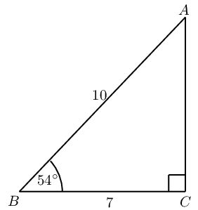
   Complete the following:
   2. Area \(\triangle ABC\) = \(\frac{1}{2} \times \ldots
                                                                              \times AC\)
   4. \(\sin \hat{B} = \ldots\) and \(AC = \ldots \times
                                                                              \ldots\)
   6. Therefore area \(\triangle ABC\) = \(\ldots \times
                                                                              \ldots \times \ldots \times \ldots\)
4. Consider \(\triangle A'B'C'\):
   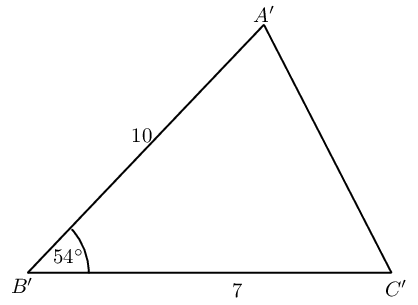
   Complete the following:
   2. How is \(\triangle A'B'C'\) different from
                                                                              \(\triangle ABC\)?
   4. Calculate area \(\triangle A'B'C'\).
6. Use your results to write a general formula for determining the area
                                                           of \(\triangle PQR\):
   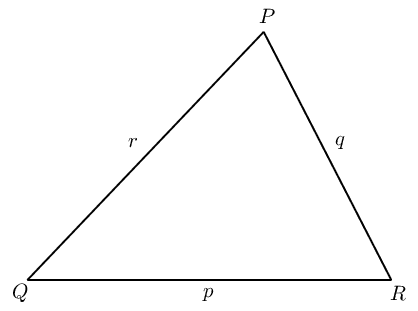

For any \(\triangle ABC\) with \(AB = c, BC = a\) and \(AC = b\), we can construct a
                                perpendicular height (\(h\)) from vertex \(A\) to the line \(BC\):

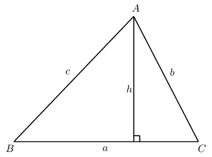

In \(\triangle ABC\):

                        \begin{align*}
                        \sin \hat{B}&= \frac{h}{c} \\
                        \therefore h &= c \sin \hat{B}
                        \end{align*}

And we know that

                        \begin{align*}
                        \text{Area } \triangle ABC &= \frac{1}{2} \times a \times h \\
                        &= \frac{1}{2} \times a \times c \sin \hat{B} \\
                        \therefore \text{Area } \triangle ABC &= \frac{1}{2} ac \sin \hat{B}
                        \end{align*}

Alternatively, we could write that

                        \begin{align*}
                        \sin \hat{C}&= \frac{h}{b} \\
                        \therefore h &= b \sin \hat{C}
                        \end{align*}

And then we would have that

                        \begin{align*}
                        \text{Area } \triangle ABC &= \frac{1}{2} \times a \times h \\
                        &= \frac{1}{2} ab \sin \hat{C}
                        \end{align*}

Similarly, by constructing a perpendicular height from vertex \(B\) to the line \(AC\), we
                                can also show that area \(\triangle ABC = \frac{1}{2} bc \sin \hat{A}\).

**The area rule**

In any \(\triangle ABC\):

                        \begin{align*}
                        \text{Area } \triangle ABC
                        &= \frac{1}{2} bc \sin \hat{A} \\
                        &= \frac{1}{2} ac \sin \hat{B} \\
                        &= \frac{1}{2} ab \sin \hat{C}
                        \end{align*}

<Callout type="tip" title="Worked example 22: The area rule">
**Question:**
Find the area of \(\triangle ABC\) (correct to two decimal places):

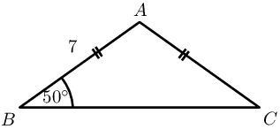

**Use the given information to determine unknown angles and
                                                sides:**
\[\begin{array}{rll}
                                        AB = AC &= 7 & (\text{given}) \\
                                        \therefore \hat{B} = \hat{C} &= \text{50}\text{°} & (\angle \text{s
                                        opp. equal sides}) \\
                                        \text{And } \hat{A} &= \text{180}\text{°} - \text{50}\text{°} -
                                        \text{50}\text{°} & (\angle \text{s sum of } \triangle ABC) \\
                                        \therefore \hat{A} &= \text{80}\text{°} &
                                        \end{array}\]

**Use the area rule to calculate the area of \(\triangle ABC\):**
Notice that we do not know the length of side \(a\) and must therefore choose
                                                the form of the area rule that does not include this side of the
                                                triangle.

In \(\triangle ABC\):

                                        \[\begin{array}{rll}
                                        \text{Area } &= \frac{1}{2} bc \sin \hat{A} & \\
                                        &= \frac{1}{2} (7)(7) \sin \text{80}\text{°} & \\
                                        &= \text{24,13} &
                                        \end{array}\]

**Write the final answer:**
Area of \(\triangle ABC = \text{24,13}\) square units.
</Callout>

<Callout type="tip" title="Worked example 23: The area rule">
**Question:**
Show that the area of \(\triangle DEF = \frac{1}{2} df \sin \hat{E}\).

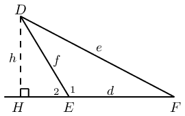

**Construct a perpendicular height \(h\):**
Draw \(DH\) such that \(DH \perp EF\) and let \(DH = h\), \(D\hat{E}F =
                                                \hat{E}_1\) and \(D\hat{E}H = \hat{E}_2\).

In \(\triangle DHE\):

                                        \[\begin{array}{rll}
                                        \sin \hat{E}_2 &= \dfrac{h}{f} & \\
                                        h &= f \sin (\text{180}\text{°} - \hat{E}_1) & (\angle \text{s on
                                        str. line})\\
                                        &= f \sin \hat{E}_1 &
                                        \end{array}\]

**Use the area rule to calculate the area of \(\triangle DEF\):**
In \(\triangle DEF\):

                                        \begin{align*}
                                        \text{Area } &= \frac{1}{2} d \times h \\
                                        &= \frac{1}{2} df \sin \hat{E}_1
                                        \end{align*}
</Callout>

**The area rule**

In any \(\triangle PQR\):

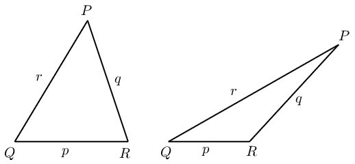

The area rule states that the area of any triangle is equal to half the product of the
                                lengths of the two sides of the triangle multiplied by the sine of the angle included by
                                the two sides.

## The area rule

### Textbook
                                                Exercise 6.10

Draw a sketch and calculate the area of \(\triangle PQR\)
                                                                given:

**Problem:**
\(\hat{Q}=\text{30}\text{°}\); \(r=10\) and
                                                                        \(p=7\)

**Solution:**
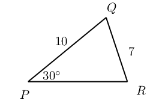

**Problem:**
\(\hat{R}=\text{110}\text{°}\); \(p=8\) and
                                                                        \(q=9\)

**Solution:**
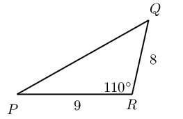

**Problem:**
Find the area of \(\triangle XYZ\) given \(XZ =
                                                                \text{52}\text{ cm}\), \(XY = \text{29}\text{ cm}\) and
                                                                \(\hat{X} = \text{58,9}\text{°}\).

**Solution:**
\begin{align*}
                                                        \text{Area } \triangle XYZ &= \frac{1}{2} (52)(29) \sin
                                                        \text{58,9}\text{°} \\
                                                        &= \text{645,6}\text{ square units }
                                                        \end{align*}

**Problem:**
Determine the area of a parallelogram in which two adjacent
                                                                sides are \(\text{10}\) \(\text{cm}\) and \(\text{13}\)
                                                                \(\text{cm}\) and the angle between them is
                                                                \(\text{55}\)\(\text{°}\).

**Solution:**
\begin{align*}
                                                        \text{Area } &= 2 \left( \frac{1}{2} (13)(10) \sin
                                                        \text{55}\text{°} \right) \\
                                                        &= \text{106,5}\text{ square units }
                                                        \end{align*}

**Problem:**
If the area of \(\triangle ABC\) is \(\text{5 000}\)
                                                                \(\text{m$^{2}$}\) with \(a=\text{150}\text{ m}\) and
                                                                \(b=\text{70}\text{ m}\), what are the two possible
                                                                sizes of \(\hat{C}\)?

**Solution:**
\begin{align*}
                                                        \text{Area } &= \frac{1}{2} (150)(70) \sin \hat{C} \\
                                                        \therefore \text{5 000} &= \text{5 250} \sin
                                                        \hat{C} \\
                                                        \therefore \sin \hat{C} &= \frac{\text{5 000}
                                                        }{\text{5 250} } \\
                                                        \therefore \hat{C} &= \text{72,2}\text{°} \\
                                                        \text{Or } \hat{C} &= \text{180}\text{°} -
                                                        \text{72,2}\text{°} \\
                                                        &= \text{107,8}\text{°}
                                                        \end{align*}

### The sine rule (EMBHR)

So far we have only applied the trigonometric ratios to right-angled triangles. We now expand
                                the application of the trigonometric ratios to triangles that do not have a right angle:

## The sine rule

In \(\triangle ABC\), \(AC = 15\), \(BC = 11\) and \(\hat{A} =
                                        \text{48}\text{°}\). Find \(\hat{B}\).

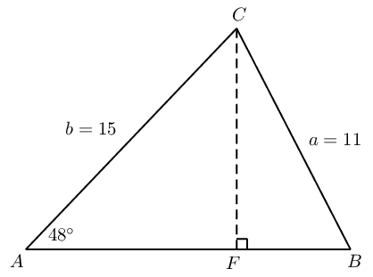

2. Method \(\text{1}\): using the sine ratio
   2. Draw a sketch of \(\triangle ABC\).
   4. Construct \(CF \perp AB\).
   6. In \(\triangle CBF\):
                                                                      \begin{align*}
                                                                      \frac{CF}{\ldots} &= \sin \hat{B} \\
                                                                      \therefore CF &= \ldots \times \sin \hat{B}
                                                                      \end{align*}
   8. In \(\triangle CAF\):
                                                                      \begin{align*}
                                                                      \frac{CF}{15} &= \ldots \\
                                                                      \therefore CF &= 15 \times \ldots
                                                                      \end{align*}
   10. Therefore we have that:
                                                                      \begin{align*}
                                                                      CF &= 15 \times \ldots \\
                                                                      \text{and } CF &= \ldots \times \sin \hat{B} \\
                                                                      \therefore 15 \times \ldots &= \ldots \times \sin
                                                                      \hat{B} \\
                                                                      \therefore \sin \hat{B} &= \ldots \ldots \ldots \\
                                                                      \therefore \hat{B} &= \ldots
                                                                      \end{align*}
4. Method \(\text{2}\): using the area rule
   2. In \(\triangle ABC\):
                                                                      \begin{align*}
                                                                      \text{Area } \triangle ABC &= \frac{1}{2} AB \times
                                                                      AC \times \ldots \\
                                                                      &= \frac{1}{2} AB \times \ldots \times \ldots
                                                                      \end{align*}
   4. And we also know that
                                                                      \[\text{Area } \triangle ABC = \frac{1}{2} AB \times
                                                                      \ldots \times \sin \hat{B}\]
   6. We can equate these two equations and solve for
                                                                              \(\hat{B}\):
                                                                              \begin{align*}
                                                                              \frac{1}{2} AB \times \ldots \times \sin \hat{B}
                                                                              &= \frac{1}{2} AB \times \ldots \times
                                                                              \ldots \\
                                                                              \therefore \ldots \times \sin \hat{B} &=
                                                                              \ldots \times \ldots \\
                                                                              \therefore \sin \hat{B} &= \ldots \times
                                                                              \ldots \\
                                                                              \therefore \hat{B} &= \ldots
                                                                              \end{align*}
6. Use your results to write a general formula for the sine rule given
                                                           \(\triangle PQR\):
   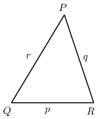

For any triangle \(ABC\) with \(AB = c, BC = a\) and \(AC = b\), we can construct a
                                perpendicular height (\(h\)) at \(F\):

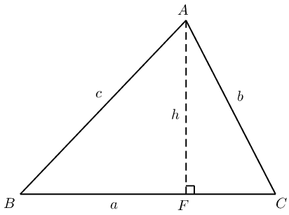

Method \(\text{1}\): using the sine ratio

In \(\triangle ABF\):

                        \begin{align*}
                        \sin \hat{B}&= \frac{h}{c} \\
                        \therefore h &= c \sin \hat{B}
                        \end{align*}

In \(\triangle ACF\):

                        \begin{align*}
                        \sin \hat{C}&= \frac{h}{b} \\
                        \therefore h &= b \sin \hat{C}
                        \end{align*}

We can equate the two equations

                        \begin{align*}
                        c \sin \hat{B}&= b \sin \hat{C} \\
                        \therefore \frac{\sin \hat{B}}{b} &= \frac{\sin \hat{C}}{c} \\
                        \text{or } \frac{b}{\sin \hat{B}} &= \frac{c}{\sin \hat{C}}
                        \end{align*}

Similarly, by constructing a perpendicular height from vertex \(B\) to the line \(AC\), we
                                can also show that:

                        \begin{align*}
                        \frac{\sin \hat{A}}{a} &= \frac{\sin \hat{C}}{c} \\
                        \text{or } \frac{a}{\sin \hat{A}} &= \frac{c}{\sin \hat{C}}
                        \end{align*}

Similarly, by constructing a perpendicular height from vertex \(B\) to the line \(AC\), we
                                can also show that area \(\triangle ABC = \frac{1}{2} bc \sin \hat{A}\).

Method \(\text{2}\): using the area rule

In \(\triangle ABC\):

                        \begin{align*}
                        \text{Area } \triangle ABC &= \frac{1}{2} ac \sin \hat{B} \\
                        &= \frac{1}{2} ab \sin \hat{C} \\
                        \therefore \frac{1}{2} ac \sin \hat{B} &= \frac{1}{2} ab \sin \hat{C} \\
                        c \sin \hat{B} &= b \sin \hat{C} \\
                        \frac{\sin \hat{B}}{b} &= \frac{\sin \hat{C}}{c} \\
                        \text{or } \frac{b}{\sin \hat{B}} &= \frac{c}{\sin \hat{C}}
                        \end{align*}

**The sine rule**

In any \(\triangle ABC\):

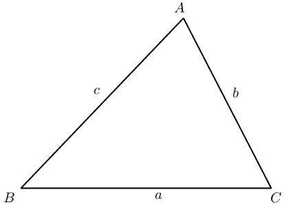

<Callout type="note" title="Note">
<VideoPlayer src="http://www.khanacademy.org/embed_video?v=APNkWrD-U1k" title="Video:
                                                233G" />
</Callout>

<QuizCard id="m11-06-05b" title="Interactive Exercise 6.12" question="The triangle below has sides labelled \( z,                 y \) , and \( x \) , and angles labelled \( Z,                 Y \) , and \( X \) . For this triangle, the sine rule states: \[                 \begin{aligned}                     \frac{\sin Z}{\; ? \;} = \frac{\sin Y}{y}                 \end{aligned}             \] Which of the following choices belongs in the place of the '?' in the formula?" options=["X", "x", "z"] answer="z" hint="" explanation="Connect the sides and angles in the diagram according to the sine rule In the sine rule, each fraction must contain a side and an angle. These values (the                     side and the angle) must be opposite (across from) each other in the triangle. For                     example, in the triangle in this question, the angle \( Z \) and side \( z \) are opposite each other. We are given the formula: \[                     \begin{aligned}                         \frac{\sin Z}{\; ? \;} = \frac{\sin Y}{y}                     \end{aligned}                 \] The question mark is in the position of one of the sides .                     The fraction with the question mark includes the angle \( Z \) . The side that we need must be opposite from that angle. Looking at the diagram, we can see that the answer is side \( z \) . The missing variable in the equation is the side z . Submit your answer as: z" />

<Callout type="tip" title="Worked example 24: The sine rule">
**Question:**
Given \(\triangle TRS\) with \(S\hat{T}R = \text{55}\text{°}\), \(TR =
                                                30\) and \(R\hat{S}T = \text{40}\text{°}\), determine \(RS, ST\)
                                                and \(T\hat{R}S\).

**Draw a sketch:**
Let \(RS = t\), \(ST = r\) and \(TR = s\).

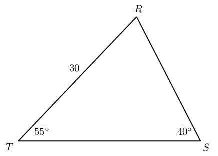

**Find \(T\hat{R}S\) using angles in a triangle:**
\[\begin{array}{rll}
                                        T\hat{R}S + R\hat{S}T + S\hat{T}R &= \text{180}\text{°} & (\angle
                                        \text{s sum of } \triangle TRS) \\
                                        \therefore T\hat{R}S &= \text{180}\text{°} - \text{40}\text{°} -
                                        \text{55}\text{°} & \\
                                        &= \text{85}\text{°} &
                                        \end{array}\]

**Determine \(t\) and \(r\) using the sine rule:**
\begin{align*}
                                        \frac{t}{\sin \hat{T}} &= \frac{s}{\sin \hat{S}} \\
                                        \frac{t}{\sin \text{55}\text{°}} &= \frac{30}{\sin
                                        \text{40}\text{°}} \\
                                        \therefore t &= \frac{30}{\sin \text{40}\text{°}} \times \sin
                                        \text{55}\text{°} \\
                                        &= \text{38,2}
                                        \end{align*}\begin{align*}
                                        \frac{r}{\sin \hat{R}} &= \frac{s}{\sin \hat{S}} \\
                                        \frac{r}{\sin \text{85}\text{°}} &= \frac{30}{\sin
                                        \text{40}\text{°}} \\
                                        \therefore r &= \frac{30}{\sin \text{40}\text{°}} \times \sin
                                        \text{85}\text{°} \\
                                        &= \text{46,5}
                                        \end{align*}
</Callout>

<Callout type="tip" title="Worked example 25: The sine rule">
**Question:**
Prove the sine rule for \(\triangle MNP\) with \(MS \perp NP\).

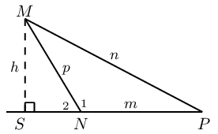

**Use the sine ratio to express the angles in the triangle in
                                                terms of the length of the sides:**
In \(\triangle MSN\):

                                        \[\begin{array}{rll}
                                        \sin \hat{N}_2&= \frac{h}{p} & \\
                                        \therefore h &= p \sin \hat{N}_2 & \\
                                        \text{and } \hat{N}_2 &= \text{180}\text{°}- \hat{N}_1 & \angle
                                        \text{s on str. line} \\
                                        \therefore h &= p \sin (\text{180}\text{°}- \hat{N}_1) & \\
                                        &= p \sin \hat{N}_1
                                        \end{array}\]

In \(\triangle MSP\):

                                        \begin{align*}
                                        \sin \hat{P}&= \frac{h}{n} \\
                                        \therefore h &= n \sin \hat{P}
                                        \end{align*}

**Equate the two equations to derive the sine rule:**
\begin{align*}
                                        p \sin \hat{N}_1 &= n \sin \hat{P} \\
                                        \therefore \frac{\sin \hat{N}_1}{n} &= \frac{\sin \hat{P}}{p} \\
                                        \text{or } \frac{n}{\sin \hat{N}_1} &= \frac{p}{\sin \hat{P}}
                                        \end{align*}
</Callout>

**The ambiguous case**

If two sides and an interior angle of a triangle are given, and the side opposite the given
                                angle is the shorter of the two sides, then we can draw two different triangles
                                (\(\triangle NMP\) and \(\triangle NMP'\)), both having the given dimensions. We call
                                this the ambiguous case because there are two ways of interpreting the given information
                                and it is not certain which is the required solution.

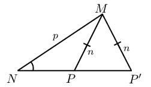

<Callout type="tip" title="Worked example 26: The ambiguous case">
**Question:**
In \(\triangle ABC\), \(AB = 82\), \(BC = 65\) and \(\hat{A} =
                                                \text{50}\text{°}\). Draw \(\triangle ABC\) and find \(\hat{C}\)
                                                (correct to one decimal place).

**Draw a sketch and identify the ambiguous case:**
We notice that for the given dimensions of \(\triangle ABC\), the side \(BC\)
                                                opposite \(\hat{A}\) is shorter than \(AB\). This means that we can draw
                                                two different triangles with the given dimensions.

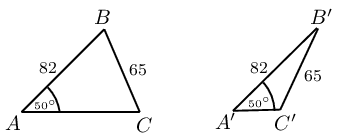

**Solve for unknown angle using the sine rule:**
In \(\triangle ABC\):

                                        \begin{align*}
                                        \frac{\sin \hat{A}}{BC} &= \frac{\sin \hat{C}}{AB} \\
                                        \frac{\sin \text{50}\text{°}}{65} &= \frac{\sin \hat{C}}{82} \\
                                        \therefore \frac{\sin \text{50}\text{°}}{65} \times 82 &= \sin \hat{C}
                                        \\
                                        \therefore \hat{C} &= \text{75,1}\text{°}
                                        \end{align*}

In \(\triangle A'B'C'\):

We know that \(\sin (\text{180} - \hat{C}) = \sin \hat{C}\), which means we
                                                can also have the solution

                                        \begin{align*}
                                        \hat{C'}&= \text{180}\text{°} - \text{75,1}\text{°} \\
                                        &= \text{104,9}\text{°}
                                        \end{align*}

Both solutions are correct.
</Callout>

<Callout type="tip" title="Worked example 27: Lighthouses">
**Question:**
There is a coastline with two lighthouses, one on either side of a beach. The
                                                two lighthouses are \(\text{0,67}\) \(\text{km}\) apart and one is
                                                exactly due east of the other. The lighthouses tell how close a boat is
                                                by taking bearings to the boat (a bearing is an angle measured clockwise
                                                from north). These bearings are shown on the diagram below.

Calculate how far the boat is from each lighthouse.

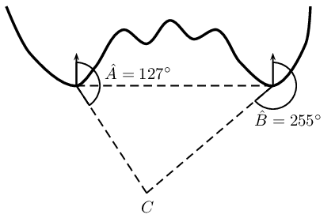

We see that the two lighthouses and the boat form a triangle. Since we know the
                                        distance between the lighthouses and we have two angles we can use trigonometry
                                        to find the remaining two sides of the triangle, the distance of the boat from
                                        the two lighthouses.

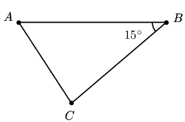

We need to determine the lengths of the two sides \(AC\) and \(BC\). We can use the
                                        sine rule to find the missing lengths.

                                \begin{align*}
                                \frac{BC}{\sin\hat{A}} &= \frac{AB}{\sin\hat{C}} \\
                                BC &= \frac{AB \cdot \sin\hat{A}}{\sin\hat{C}} \\
                                &= \frac{(\text{0,67}\text{ km})\sin \text{37}\text{°}}{\sin
                                \text{128}\text{°}} \\
                                &= \text{0,51}\text{ km}
                                \end{align*}\begin{align*}
                                \frac{AC}{\sin\hat{B}} &= \frac{AB}{\sin\hat{C}} \\
                                AC &= \frac{AB \cdot \sin\hat{B}}{\sin\hat{C}} \\
                                &= \frac{(\text{0,67}\text{ km})\sin \text{15}\text{°}}{\sin
                                \text{128}\text{°}} \\
                                &= \text{0,22}\text{ km}
                                \end{align*}
</Callout>

## Sine rule

### Textbook
                                                Exercise 6.11

Find all the unknown sides and angles of the
                                                                following
                                                                triangles:

**Problem:**
\(\triangle PQR\) in which
                                                                        \(\hat{Q}=\text{64}\text{°}\);
                                                                        \(\hat{R}=\text{24}\text{°}\) and
                                                                        \(r=3\)

**Solution:**
\begin{align*}
                                                                \frac{q}{\sin \hat{Q}} &= \frac{r}{\sin
                                                                \hat{R}} \\
                                                                \frac{q}{\sin \text{64}\text{°} } &=
                                                                \frac{3}{\sin\text{24}\text{°}} \\
                                                                q &= \frac{3\sin \text{64}\text{°}
                                                                }{\sin\text{24}\text{°}} \\
                                                                &= \text{6,6}\text{ units } \\
                                                                \hat{P} &= \text{180}\text{°} -
                                                                \text{64}\text{°} - \text{24}\text{°}
                                                                \\
                                                                &= \text{92}\text{°} \\
                                                                \frac{p}{\sin \hat{P}} &= \frac{r}{\sin
                                                                \hat{R}} \\
                                                                \frac{p}{\sin \text{92}\text{°} } &=
                                                                \frac{3}{\sin\text{24}\text{°}} \\
                                                                p &= \frac{3\sin \text{92}\text{°}
                                                                }{\sin\text{24}\text{°}} \\
                                                                &= \text{7,4}\text{ units }
                                                                \end{align*}

**Problem:**
\(\triangle KLM\) in which
                                                                        \(\hat{K}=\text{43}\text{°}\);
                                                                        \(\hat{M}=\text{50}\text{°}\) and
                                                                        \(m=1\)

**Solution:**
\begin{align*}
                                                                \frac{m}{\sin \hat{M}} &= \frac{l}{\sin
                                                                \hat{L}} \\
                                                                \frac{1}{\sin \text{50}\text{°} } &=
                                                                \frac{l}{\sin\text{87}\text{°}} \\
                                                                l &= \frac{\sin \text{87}\text{°}
                                                                }{\sin\text{50}\text{°}} \\
                                                                &= \text{1,3}\text{ units } \\
                                                                \hat{L} &= \text{180}\text{°} -
                                                                \text{50}\text{°} - \text{43}\text{°}
                                                                \\
                                                                &= \text{87}\text{°} \\
                                                                \frac{k}{\sin \hat{K}} &= \frac{m}{\sin
                                                                \hat{M}} \\
                                                                \frac{k}{\sin \text{43}\text{°} } &=
                                                                \frac{1}{\sin\text{50}\text{°}} \\
                                                                k &= \frac{\sin \text{43}\text{°}
                                                                }{\sin\text{50}\text{°}} \\
                                                                &= \text{0,89}\text{ units }
                                                                \end{align*}

**Problem:**
\(\triangle ABC\) in which \(\hat{A} =
                                                                        \text{32,7}\text{°}\); \(\hat{C} =
                                                                        \text{70,5}\text{°}\) and \(a =
                                                                        \text{52,3}\)

**Solution:**
\begin{align*}
                                                                \frac{c}{\sin \hat{C}} &= \frac{a}{\sin
                                                                \hat{A}} \\
                                                                \frac{c}{\sin \text{70,5}\text{°} } &=
                                                                \frac{\text{52,3}}{\sin\text{32,7}\text{°}}
                                                                \\
                                                                c &= \frac{\text{52,3} \sin
                                                                \text{70,5}\text{°}
                                                                }{\sin\text{32,7}\text{°}} \\
                                                                &= \text{91,3}\text{ units } \\
                                                                \hat{B} &= \text{180}\text{°} -
                                                                \text{70,5}\text{°} -
                                                                \text{32,7}\text{°} \\
                                                                &= \text{76,8}\text{°} \\
                                                                \frac{b}{\sin \hat{B}} &= \frac{a}{\sin
                                                                \hat{A}} \\
                                                                \frac{b}{\sin \text{76,8}\text{°} } &=
                                                                \frac{\text{52,3}}{\sin\text{32,7}\text{°}}
                                                                \\
                                                                b &= \frac{\text{52,3} \sin
                                                                \text{76,8}\text{°}
                                                                }{\sin\text{32,7}\text{°}} \\
                                                                &= \text{94,3}\text{ units }
                                                                \end{align*}

**Problem:**
\(\triangle XYZ\) in which
                                                                        \(\hat{X}=\text{56}\text{°}\);
                                                                        \(\hat{Z}=\text{40}\text{°}\) and
                                                                        \(x=50\)

**Solution:**
\begin{align*}
                                                                \frac{x}{\sin \hat{X}} &= \frac{z}{\sin
                                                                \hat{Z}} \\
                                                                \frac{50}{\sin \text{56}\text{°} } &=
                                                                \frac{z}{\sin\text{40}\text{°}} \\
                                                                z &= \frac{\text{50} \sin
                                                                \text{40}\text{°}
                                                                }{\sin\text{56}\text{°}} \\
                                                                &= \text{38,8}\text{ units } \\
                                                                \hat{Y} &= \text{180}\text{°} -
                                                                \text{56}\text{°} - \text{40}\text{°}
                                                                \\
                                                                &= \text{84}\text{°} \\
                                                                \frac{y}{\sin \hat{Y}} &= \frac{x}{\sin
                                                                \hat{X}} \\
                                                                \frac{y}{\sin \text{84}\text{°} } &=
                                                                \frac{\text{50}}{\sin\text{40}\text{°}} \\
                                                                y &= \frac{\text{50} \sin
                                                                \text{84}\text{°}
                                                                }{\sin\text{56}\text{°}} \\
                                                                &= \text{60}\text{ units }
                                                                \end{align*}

**Problem:**
In \(\triangle ABC\),
                                                                \(\hat{A}=\text{116}\text{°}\);
                                                                \(\hat{C}=\text{32}\text{°}\) and \(AC =
                                                                \text{23}\text{ m}\). Find the lengths of the
                                                                sides
                                                                \(AB\) and \(BC\).

**Solution:**
\begin{align*}
                                                        \hat{B} &= \text{180}\text{°} -
                                                        \text{116}\text{°}
                                                        - \text{32}\text{°} \\
                                                        &= \text{32}\text{°} \\
                                                        \frac{a}{\sin \hat{A}} &= \frac{b}{\sin \hat{B}} \\
                                                        \frac{a}{\sin \text{116}\text{°} } &=
                                                        \frac{23}{\sin\text{32}\text{°}} \\
                                                        a &= \frac{\text{23} \sin \text{116}\text{°}
                                                        }{\sin\text{32}\text{°}} \\
                                                        &= \text{39,01}\text{ units } \\
                                                        b &= \text{23}\text{ units }
                                                        \end{align*}

**Problem:**
In \(\triangle RST\),
                                                                \(\hat{R}=\text{19}\text{°}\);
                                                                \(\hat{S}=\text{30}\text{°}\) and \(RT =
                                                                \text{120}\text{ km}\). Find the length of the
                                                                side
                                                                \(ST\).

**Solution:**
\begin{align*}
                                                        \frac{s}{\sin \hat{S}} &= \frac{r}{\sin \hat{R}} \\
                                                        \frac{120}{\sin \text{30}\text{°} } &=
                                                        \frac{ST}{\sin\text{19}\text{°}} \\
                                                        ST &= \frac{\text{120} \sin \text{19}\text{°}
                                                        }{\sin\text{30}\text{°}} \\
                                                        &= \text{78,1}\text{ km }
                                                        \end{align*}

**Problem:**
In \(\triangle KMS\),
                                                                \(\hat{K}=\text{20}\text{°}\);
                                                                \(\hat{M}=\text{100}\text{°}\) and \(s =
                                                                \text{23}\text{ cm}\). Find the length of the
                                                                side
                                                                \(m\).

**Solution:**
\begin{align*}
                                                        \hat{S} &= \text{180}\text{°} -
                                                        \text{100}\text{°}
                                                        - \text{20}\text{°} \\
                                                        &= \text{60}\text{°} \\
                                                        \frac{m}{\sin \hat{M}} &= \frac{s}{\sin \hat{S}} \\
                                                        \frac{m}{\sin \text{100}\text{°} } &=
                                                        \frac{23}{\sin
                                                        \text{60}\text{°}} \\
                                                        m &= \frac{\text{23} \sin \text{100}\text{°}
                                                        }{\sin\text{60}\text{°}} \\
                                                        &= \text{26,2}\text{ units }
                                                        \end{align*}

**Problem:**
In \(\triangle ABD\), \(\hat{B} =
                                                                \text{90}\text{°}\),
                                                                \(AB = \text{10}\text{ cm}\) and \(A\hat{D}B =
                                                                \text{40}\text{°}\). In \(\triangle BCD\),
                                                                \(\hat{C} = \text{106}\text{°}\) and
                                                                \(C\hat{D}B =
                                                                \text{15}\text{°}\). Determine \(BC\).

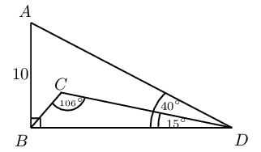

**Solution:**
\begin{align*}
                                                        \frac{BD}{\sin \text{50}\text{°} } &=
                                                        \frac{10}{\sin\text{40}\text{°}} \\
                                                        BD &= \frac{\text{10} \sin \text{50}\text{°}
                                                        }{\sin\text{40}\text{°}} \\
                                                        &= \text{11,92}\text{ units } \\
                                                        \frac{BC}{\sin \text{15}\text{°} } &=
                                                        \frac{\text{11,92}}{\sin \text{106}\text{°}} \\
                                                        BC &= \frac{\text{11,92} \sin \text{15}\text{°}
                                                        }{\sin\text{106}\text{°}} \\
                                                        &= \text{3,2}\text{ units }
                                                        \end{align*}

**Problem:**
In \(\triangle ABC\), \(\hat{A} =
                                                                \text{33}\text{°}\),
                                                                \(AC = \text{21}\text{ mm}\) and \(AB =
                                                                \text{17}\text{
                                                                mm}\). Can you determine \(BC\)?

**Solution:**
No, not enough information is given

### The cosine rule (EMBHS)

## The cosine rule

If a triangle is given with two sides and the included angle known, then we can not
                                        solve for the remaining unknown sides and angles using the sine rule. We
                                        therefore investigate the cosine rule:

In \(\triangle ABC, AB = 21, AC = 17\) and \(\hat{A} = \text{33}\text{°}\). Find
                                        \(\hat{B}\).

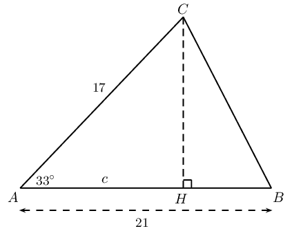

2. Determine \(CB\):
   2. Construct \(CH \perp AB\).
   4. Let \(AH = c\) and therefore \(HB = \ldots\)
   6. Applying the theorem of Pythagoras in the
                                                                              right-angled triangles:
      In\(\triangle CHB\):
                                                                      \begin{align*}
                                                                      CB^2 &= BH^2 + CH^2 \\
                                                                      &= (\ldots)^2 + CH^2 \\
                                                                      &= 21^2 -(2)(21)c + c^2 + CH^2 \ldots \ldots (1)
                                                                      \end{align*}
      In \(\triangle CHA\):
                                                                      \begin{align*}
                                                                      CA^2 &= c^2 + CH^2 \\
                                                                      17^2 &= c^2 + CH^2 \ldots \ldots (2)
                                                                      \end{align*}
      Substitute equation \((2)\) into equation \((1)\):
                                                                      \[CB^2 = 21^2 -(2)(21)c + 17^2\]
      Now \(c\) is the only remaining unknown. In
                                                                              \(\triangle CHA\):
                                                                      \begin{align*}
                                                                      \frac{c}{17} &= \cos \text{33}\text{°} \\
                                                                      \therefore c &= 17 \cos \text{33}\text{°}
                                                                      \end{align*}
      Therefore we have that
                                                                      \begin{align*}
                                                                      CB^2 &= 21^2 -(2)(21)c + 17^2 \\
                                                                      &= 21^2 -(2)(21)(17 \cos \text{33}\text{°}) +
                                                                      17^2 \\
                                                                      &= 21^2 + 17^2 -(2)(21)(17) \cos
                                                                      \text{33}\text{°} \\
                                                                      &= \text{131,189}\ldots \\
                                                                      \therefore CB &= \text{11,5}
                                                                      \end{align*}
4. Use your results to write a general formula for the cosine rule given
                                                           \(\triangle PQR\):
   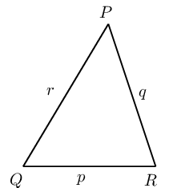

The cosine rule relates the length of a side of a triangle to the angle opposite it and the
                                lengths of the other two sides.

Consider \(\triangle ABC\) with \(CD \perp AB\):

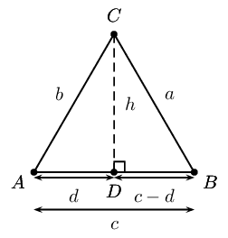

In \(\triangle DCB\): \(a^2 = (c-d)^2 + h^2\) from the theorem of Pythagoras.

In \(\triangle ACD\): \(b^2 = d^2 + h^2\) from the theorem of Pythagoras.

Since \(h^2\) is common to both equations we can write:
                                \begin{align*}
                                a^2 &= (c-d)^2 + h^2 \\
                                \therefore h^2 &= a^2 - (c-d)^2 \\
                                \text{And } b^2 &= d^2 + h^2 \\
                                \therefore h^2 &= b^2 - d^2 \\
                                \therefore b^2 - d^2 &= a^2 - (c-d)^2 \\
                                a^2 &= b^2 + (c^2 - 2cd + d^2) - d^2 \\
                                &= b^2 + c^2 - 2cd
                                \end{align*}

In order to eliminate \(d\) we look at \(\triangle ACD\), where we have: \(\cos\hat{A} =
                                \frac{d}{b}\). So, \(d = b \cos \hat{A}\).

Substituting back we get: \({a}^{2}={b}^{2}+{c}^{2}-2bc \cos \hat{A}\).

**The cosine rule**

In any \(\triangle ABC\):

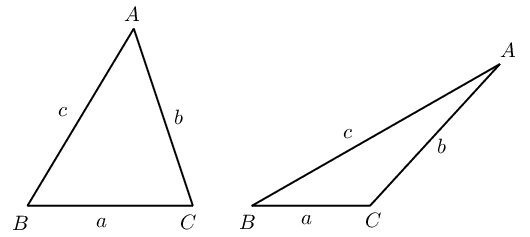

<Callout type="note" title="Note">
<VideoPlayer src="http://www.khanacademy.org/embed_video?v=pGaDcOMdw48" title="Video:
                                                233T" />
</Callout>

<QuizCard id="m11-06-05d" title="Interactive Exercise 6.14" question="To prove \(r^{2} = p^{2} + q^{2} - 2pq\cos{\hat{R}}\) , we need to make a construction. Which of the following represents a correct construction for this proof? I II III IV Using the construction, select the correct expression for the length of \(RS\) and \(QS\) . TIP: On a piece of paper, draw the construction diagram so that you can work from it. Name the sides of the triangle in the construction using the lower case letter of the opposite angle, eg. Side \(a\) opposite \(\hat{A}\) ." options=["I", "II", "III", "IV", "q.sinR", "q.cosR", "p.sinR", "-p.cosR", "p.cosR", "p.sinR", "p.tanR", "q.sinR", "sinR", "cos(180\u00b0 - R)", "cosR", "(q + x)\u00b2", "q\u00b2", "QS\u00b2", "p\u00b2 - x\u00b2", "p\u00b2 + x\u00b2", "x\u00b2 - p\u00b2", "2qx", "-2q", "-2qx"] answer="3, 0, 0" hint="" explanation="Choose a correct construction We need to construct a perpendicular height of the triangle \(PQR\) . Then we can write out two expressions using Pythagoras' theorem. A correct construction for this proof is: Option IV is correct. Write an expression for \(\cos{\hat{R}}\) and \(\sin{\hat{R}}\) Use the right-angled \(\Delta QSR\) to write an expression for \(\cos{(\text{180}\text{°} - \hat{R})}\) and \(\sin{(\text{180}\text{°} - \hat{R})}\) . \[                          \begin{aligned}                      		\cos{(\text{180}\text{°} - \hat{R})} & = \dfrac{RS}{p} \\         \cos{\hat{R}} & = {\color{red}{-}}\dfrac{RS}{p} \\         \therefore RS & = -p\cos{\hat{R}}                          \end{aligned}                      \] \[                          \begin{aligned}                      		\sin{(\text{180}\text{°} - \hat{R})} & = \dfrac{QS}{p} \\         \therefore QS & = p\sin{\hat{R}}                          \end{aligned}                      \] So, the correct expression for \(RS\) is \(-p\cos{\hat{R}}\) and the correct expression for \(QS\) is \(p\sin{\hat{R}}\) . Submit your answer as: IV and -p.cosR and p.sinR" />

<Callout type="tip" title="Worked example 28: The cosine rule">
**Question:**
Determine the length of \(QR\).

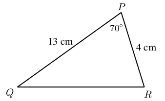

**Use the cosine rule to solve for the unknown side:**
\begin{align*}
                                        QR^2 &= PR^2 + QP^2 -2 (PR)(QP) \cos \hat{P} \\
                                        &= 4^2 + 13^2 -2 (4)(13) \cos \text{70}\text{°} \\
                                        &= \text{149,42}\ldots \\
                                        \therefore QR &= \text{12,2}
                                        \end{align*}

**Write the final answer:**
\(QR = \text{12,2}\text{ cm}\)
</Callout>

<Callout type="tip" title="Worked example 29: The cosine rule">
**Question:**
Determine \(\hat{A}\).

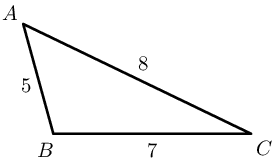

Applying the cosine rule:

                                \begin{align*}
                                {a}^{2} &= {b}^{2}+{c}^{2}-2bc \cos \hat{A} \\
                                \therefore \cos\hat{A} &= \frac{{b}^{2}+{c}^{2}-{a}^{2}}{2bc} \\
                                &= \frac{{8}^{2}+{5}^{2}-{7}^{2}}{2 \cdot 8 \cdot 5} \\
                                &= \text{0,5} \\
                                \therefore \hat{A} &= \text{60}\text{°}
                                \end{align*}

**It is very important:**

- not to round off before the final answer as this will affect accuracy;
- to take the square root;
- to remember to give units where applicable.

**How to determine which rule to use:**

2. Area rule:
   - if no perpendicular height is given
4. Sine rule:
   - if no right angle is given
   - if two sides and an angle are given (not the included angle)
   - if two angles and a side are given
6. Cosine rule:
   - if no right angle is given
   - if two sides and the included angle are given
   - if three sides are given
</Callout>

## The cosine rule

### Textbook
                                                Exercise 6.12

Solve the following triangles (that is, find all
                                                                unknown
                                                                sides and angles):

**Problem:**
\(\triangle ABC\) in which
                                                                        \(\hat{A}=\text{70}\text{°}\);
                                                                        \(b=4\) and
                                                                        \(c=9\)

**Solution:**
\begin{align*}
                                                                {a}^{2} &= {b}^{2}+{c}^{2}-2bc \cos \hat{A}
                                                                \\
                                                                {a}^{2} &= {4}^{2}+{9}^{2}-2(9)(4) \cos
                                                                \hat{\text{70}\text{°}} \\
                                                                &= \text{72,374} \ldots \\
                                                                \therefore a &= \text{8,5}
                                                                \end{align*}
                                                                \begin{align*}
                                                                {c}^{2} &= {b}^{2}+{a}^{2}-2ba \cos \hat{C}
                                                                \\
                                                                {9}^{2} &=
                                                                {4}^{2}+{\text{8,5}}^{2}-2(4)(\text{8,5})
                                                                \cos \hat{C} \\
                                                                \therefore \hat{C} &=
                                                                \text{83,9}\text{°}
                                                                \end{align*}
                                                                \begin{align*}
                                                                \hat{B} &= \text{180}\text{°} -
                                                                \text{70}\text{°} -\text{83,9}\text{°}
                                                                \\
                                                                \therefore \hat{B} &=
                                                                \text{26,1}\text{°}
                                                                \end{align*}

**Problem:**
\(\triangle RST\) in which \(RS=14\);
                                                                        \(ST=26\) and
                                                                        \(RT=16\)

**Solution:**
\begin{align*}
                                                                {r}^{2} &= {s}^{2}+{t}^{2}-2st \cos \hat{R}
                                                                \\
                                                                {26}^{2} &=
                                                                {16}^{2}+{\text{14}}^{2}-2(16)(\text{14}) \cos
                                                                \hat{R}
                                                                \\
                                                                \therefore \hat{R} &=
                                                                \text{120}\text{°}
                                                                \end{align*}
                                                                \begin{align*}
                                                                {s}^{2} &= {r}^{2}+{t}^{2}-2rt \cos \hat{S}
                                                                \\
                                                                {16}^{2} &=
                                                                {26}^{2}+{\text{14}}^{2}-2(26)(\text{14}) \cos
                                                                \hat{S}
                                                                \\
                                                                \therefore \hat{S} &=
                                                                \text{32,2}\text{°}
                                                                \end{align*}
                                                                \begin{align*}
                                                                \hat{T} &= \text{180}\text{°} -
                                                                \text{120}\text{°}
                                                                -\text{32,2}\text{°} \\
                                                                \therefore \hat{T} &=
                                                                \text{27,8}\text{°}
                                                                \end{align*}

**Problem:**
\(\triangle KLM\) in which \(KL=5\);
                                                                        \(LM=10\) and
                                                                        \(KM=7\)

**Solution:**
\begin{align*}
                                                                {m}^{2} &= {k}^{2}+{l}^{2}-2kl \cos \hat{M}
                                                                \\
                                                                {5}^{2} &=
                                                                {10}^{2}+{\text{7}}^{2}-2(10)(\text{7})
                                                                \cos \hat{M} \\
                                                                \therefore \hat{M} &=
                                                                \text{27,7}\text{°}
                                                                \end{align*}
                                                                \begin{align*}
                                                                {l}^{2} &= {k}^{2}+{m}^{2}-2km \cos \hat{L}
                                                                \\
                                                                {7}^{2} &=
                                                                {10}^{2}+{\text{5}}^{2}-2(10)(\text{5})
                                                                \cos \hat{L} \\
                                                                \therefore \hat{L} &=
                                                                \text{40,5}\text{°}
                                                                \end{align*}
                                                                \begin{align*}
                                                                \hat{K} &= \text{180}\text{°} -
                                                                \text{27,7}\text{°}
                                                                -\text{40,5}\text{°} \\
                                                                \therefore \hat{K} &=
                                                                \text{111,8}\text{°}
                                                                \end{align*}

**Problem:**
\(\triangle JHK\) in which
                                                                        \(\hat{H}=\text{130}\text{°}\);
                                                                        \(JH=13\)
                                                                        and \(HK=8\)

**Solution:**
\begin{align*}
                                                                {h}^{2} &= {j}^{2}+{k}^{2}-2jk \cos \hat{H}
                                                                \\
                                                                {h}^{2} &= {13}^{2}+{8}^{2}-2(13)(8) \cos
                                                                \hat{\text{130}\text{°}} \\
                                                                &= \text{366,69} \ldots \\
                                                                \therefore h &= \text{19,1}
                                                                \end{align*}
                                                                \begin{align*}
                                                                {k}^{2} &= {j}^{2}+{h}^{2}-2jh \cos \hat{K}
                                                                \\
                                                                {13}^{2} &=
                                                                {8}^{2}+{\text{19,1}}^{2}-2(8)(\text{19,1}) \cos
                                                                \hat{K}
                                                                \\
                                                                \therefore \hat{K} &=
                                                                \text{31,8}\text{°}
                                                                \end{align*}
                                                                \begin{align*}
                                                                \hat{J} &= \text{180}\text{°} -
                                                                \text{130}\text{°}
                                                                -\text{31,8}\text{°} \\
                                                                \therefore \hat{J} &=
                                                                \text{18,2}\text{°}
                                                                \end{align*}

**Problem:**
\(\triangle DEF\) in which \(d=4\); \(e=5\)
                                                                        and
                                                                        \(f=7\)

**Solution:**
\begin{align*}
                                                                {e}^{2} &= {d}^{2}+{f}^{2}-2df \cos \hat{E}
                                                                \\
                                                                {5}^{2} &=
                                                                {4}^{2}+{\text{7}}^{2}-2(4)(\text{7})
                                                                \cos \hat{E} \\
                                                                \therefore \hat{E} &=
                                                                \text{44,4}\text{°}
                                                                \end{align*}
                                                                \begin{align*}
                                                                {d}^{2} &= {e}^{2}+{f}^{2}-2ef \cos \hat{D}
                                                                \\
                                                                {4}^{2} &=
                                                                {5}^{2}+{\text{7}}^{2}-2(7)(\text{5})
                                                                \cos \hat{D} \\
                                                                \therefore \hat{D} &=
                                                                \text{34,0}\text{°}
                                                                \end{align*}
                                                                \begin{align*}
                                                                \hat{F} &= \text{180}\text{°} -
                                                                \text{44,4}\text{°}
                                                                -\text{34,0}\text{°} \\
                                                                \therefore \hat{F} &=
                                                                \text{101,6}\text{°}
                                                                \end{align*}

Find the length of the third side of the \(\triangle
                                                                XYZ\)
                                                                where:

**Problem:**
\(\hat{X} = \text{71,4}\text{°}\); \(y =
                                                                        \text{3,42}\text{ km}\) and \(z =
                                                                        \text{4,03}\text{ km}\)

**Solution:**
\begin{align*}
                                                                {x}^{2} &= {y}^{2}+{z}^{2}-2yz \cos \hat{X}
                                                                \\
                                                                {x}^{2} &=
                                                                {\text{3,42}}^{2}+{\text{4,03}}^{2}-2(\text{3,42})(\text{4,03})
                                                                \cos \hat{\text{71,4}\text{°}} \\
                                                                &= \text{19,14} \ldots \\
                                                                \therefore x &= \text{4,4}\text{ km}
                                                                \end{align*}

**Problem:**
\(x = \text{103,2}\text{ cm}\); \(\hat{Y} =
                                                                        \text{20,8}\text{°}\) and \(z =
                                                                        \text{44,59}\text{ cm}\)

**Solution:**
\begin{align*}
                                                                {y}^{2} &= {x}^{2}+{z}^{2}-2xz \cos \hat{Y}
                                                                \\
                                                                {y}^{2} &=
                                                                {\text{103,2}}^{2}+{\text{44,59}}^{2}-2(\text{103,2})(\text{44,59})
                                                                \cos \hat{\text{20,8}\text{°}} \\
                                                                &= \text{4 034,95} \ldots \\
                                                                \therefore y &= \text{63,5}\text{ cm}
                                                                \end{align*}

Determine the largest angle in:

**Problem:**
\(\triangle JHK\) in which \(JH=6\); \(HK=4\)
                                                                        and
                                                                        \(JK=3\)

**Solution:**
\begin{align*}
                                                                {k}^{2} &= {j}^{2}+{h}^{2}-2jh \cos \hat{K}
                                                                \\
                                                                {6}^{2} &=
                                                                {4}^{2}+{\text{3}}^{2}-2(4)(\text{3})
                                                                \cos \hat{K} \\
                                                                \therefore \hat{K} &=
                                                                \text{117,3}\text{°}
                                                                \end{align*}

**Problem:**
\(\triangle PQR\) where \(p=50\); \(q=70\)
                                                                        and
                                                                        \(r=60\)

**Solution:**
\begin{align*}
                                                                {q}^{2} &= {p}^{2}+{r}^{2}-2pr \cos \hat{Q}
                                                                \\
                                                                {70}^{2} &=
                                                                {60}^{2}+{\text{50}}^{2}-2(60)(\text{50}) \cos
                                                                \hat{Q}
                                                                \\
                                                                \therefore \hat{Q} &=
                                                                \text{78,5}\text{°}
                                                                \end{align*}

## Area, sine and cosine rule

### Textbook Exercise 6.13

\(Q\) is a ship at a point \(\text{10}\) \(\text{km}\) due
                                                                south of another ship \(P\).
                                                                \(R\) is a lighthouse on the coast such that \(\hat{P} =
                                                                \hat{Q} = \text{50}\text{°}\).

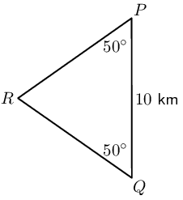

Determine:

**Problem:**
the distance \(QR\)

**Solution:**
\begin{align*}
                                                                \frac{QR}{\sin \text{50}\text{°} } &=
                                                                \frac{10}{ \sin \text{80}\text{°}} \\
                                                                QR &= \frac{10 \sin \text{50}\text{°} }{ \sin
                                                                \text{80}\text{°}} \\
                                                                \therefore QR &= \text{7,78}\text{ km}
                                                                \end{align*}

**Problem:**
the shortest distance from the lighthouse to the line
                                                                        joining the two ships (\(PQ\)).

**Solution:**
\begin{align*}
                                                                \frac{h}{5} &= \tan \text{50}\text{°} \\
                                                                \therefore h &= \text{6}\text{ km}
                                                                \end{align*}

**Problem:**
\(WXYZ\) is a trapezium, \(WX\parallel YZ\) with \(WX =
                                                                \text{3}\text{ m}\); \(YZ = \text{1,5}\text{ m}\);
                                                                \(\hat{Z}=\text{120}\text{°}\) and
                                                                \(\hat{W}=\text{30}\text{°}\).

Determine the distances \(XZ\) and \(XY\).

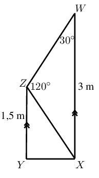

**Solution:**
\begin{align*}
                                                        \text{In } \triangle XWZ, \quad \frac{ZX}{\sin
                                                        \text{30}\text{°} } &= \frac{3}{ \sin
                                                        \text{120}\text{°}} \\
                                                        XZ &= \frac{3 \sin \text{30}\text{°} }{ \sin
                                                        \text{120}\text{°}} \\
                                                        \therefore XZ &= \text{1,73}\text{ km}
                                                        \end{align*}
                                                        \begin{align*}
                                                        X\hat{Z}Y &= \text{180}\text{°} -
                                                        \text{120}\text{°} -\text{30}\text{°} \\
                                                        \therefore X\hat{Z}Y &= \text{30}\text{°}
                                                        \end{align*}
                                                        \begin{align*}
                                                        \text{In } \triangle XZY, XY^2 &= (\text{1,73})^2 +
                                                        (\text{1,5})^2 - 2(\text{1,73})(\text{1,5}) \cos
                                                        \text{30}\text{°}\\
                                                        \therefore XY &= \text{0,87}\text{ km}
                                                        \end{align*}

On a flight from Johannesburg to Cape Town, the pilot
                                                                discovers that he has been flying
                                                                \(\text{3}\)\(\text{°}\) off course. At this point
                                                                the plane is \(\text{500}\) \(\text{km}\) from
                                                                Johannesburg. The direct distance between Cape Town and
                                                                Johannesburg airports is \(\text{1 552}\)
                                                                \(\text{km}\). Determine, to the nearest \(\text{km}\):

**Problem:**
The distance the plane has to travel to get to Cape
                                                                        Town and hence the extra distance that the plane
                                                                        has had to travel due to the pilot's error.

**Solution:**
\begin{align*}
                                                                x^2 &= (\text{500})^2 + (\text{1 552})^2 -
                                                                2(\text{500})(\text{1 552}) \cos
                                                                \text{3}\text{°}\\
                                                                \therefore x &= \text{1 053}\text{ km}
                                                                \end{align*}

**Problem:**
The correction, to one hundredth of a degree, to the
                                                                        plane's heading (or direction).

**Solution:**
\begin{align*}
                                                                \frac{\sin \theta }{\text{1 552}} &= \frac{
                                                                \sin \text{3}\text{°}}{\text{1 053}} \\
                                                                \sin \theta &= \frac{ \text{1 552} \sin
                                                                \text{3}\text{°}}{\text{1 053}} \\
                                                                \therefore \theta &= \text{4,42}\text{°}
                                                                \end{align*}

**Problem:**
\(ABCD\) is a trapezium (meaning that \(AB\parallel CD\)).
                                                                \(AB=x\); \(B\hat{A}D=a\); \(B\hat{C}D=b\) and
                                                                \(B\hat{D}C=c\).

Find an expression for the length of \(CD\) in terms of
                                                                \(x\), \(a\), \(b\) and \(c\).

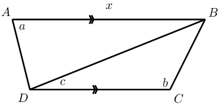

**Solution:**
\begin{align*}
                                                        \frac{DB}{\sin a } &= \frac{ x}{\sin
                                                        [\text{180}\text{°} - (a+c)]} \\
                                                        DB &= \frac{ x \sin a}{\sin (a+c)} \\
                                                        \text{And } \frac{DC}{\sin [\text{180}\text{°} - (b+c)] }
                                                        &= \frac{DB}{\sin b} \\
                                                        \therefore \frac{DC}{\sin (b+c)} &= \frac{ x \sin a}{\sin
                                                        (a+c) \sin b} \\
                                                        \text{Therefore } DC &= \frac{ x \sin a \sin (b+c)}{\sin
                                                        (a+c) \sin b}
                                                        \end{align*}

A surveyor is trying to determine the distance between points
                                                                \(X\) and \(Z\). However the distance cannot be
                                                                determined directly as a ridge lies between the two
                                                                points. From a point \(Y\) which is equidistant from
                                                                \(X\) and \(Z\), he measures the angle \(X\hat{Y}Z\).

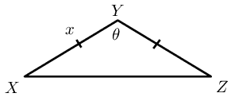

**Problem:**
If \(XY=x\) and \(X\hat{Y}Z=\theta\), show that \(XZ
                                                                        = x\sqrt{2(1- \cos \theta)}\).

**Solution:**
\begin{align*}
                                                                XZ^2 &= 2x^2 - 2x^2 \cos \theta \\
                                                                &= 2x^2 \left(1 - \cos \theta \right) \\
                                                                \therefore XZ &= \sqrt{2x^2 \left(1 - \cos \theta
                                                                \right)} \\
                                                                &= x\sqrt{2 \left(1 - \cos \theta \right)}
                                                                \end{align*}

**Problem:**
Calculate \(XZ\) (to the nearest kilometre) if
                                                                        \(x=\text{240}\) km and \(\theta =
                                                                        \text{132}\text{°}\).

**Solution:**
\begin{align*}
                                                                XZ^2 &= x\sqrt{2 \left(1 - \cos \theta \right)} \\
                                                                &= 240\sqrt{2 \left(1 - \cos \text{132}\text{°}
                                                                \right)} \\
                                                                &= \text{438,5}\text{ km}
                                                                \end{align*}

**Problem:**
Find the area of \(WXYZ\) (to two decimal places):

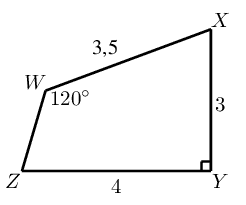

**Solution:**
\begin{align*}
                                                        \frac{\sin W\hat{Z}X }{\text{3,5}} &= \frac{\sin
                                                        \text{120}\text{°} }{\text{5}} \\
                                                        \therefore W\hat{Z}X &= \text{37,3}\text{°} \\
                                                        \therefore W\hat{X}Z &= \text{180}\text{°} -
                                                        \text{120}\text{°} - \text{37,3}\text{°} \\
                                                        &= \text{22,7}\text{°} \\
                                                        \therefore \text{Area} WXYZ &=
                                                        \frac{1}{2}(\text{3,5})(\text{5})\sin \text{22,7}\text{°} +
                                                        \frac{1}{2}(4)(3)\\
                                                        &= \text{9,38}\text{ m$^{2}$}
                                                        \end{align*}

**Problem:**
Find the area of the shaded triangle in terms of \(x\),
                                                                \(\alpha\), \(\beta\), \(\theta\) and \(\phi\):

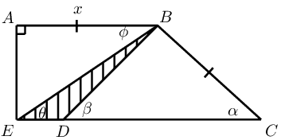

**Solution:**
\begin{align*}
                                                        \text{In } \triangle ABE, \quad \frac{x}{EB} &= \cos \theta
                                                        \\
                                                        \therefore EB &= \frac{x}{\cos \theta} \\
                                                        \text{In } \triangle BDC, \quad \frac{DB}{\sin \alpha} &=
                                                        \frac{x}{\sin \beta} \\
                                                        \therefore DB &= \frac{x \sin \alpha }{\sin \beta} \\
                                                        \therefore \text{Area} \triangle BED &=
                                                        \frac{1}{2}(BE)(BD)\sin (\beta - \theta)\\
                                                        &= \frac{1}{2} \times \frac{x}{\cos \theta} \times \frac{x
                                                        \sin \alpha }{\sin \beta} \times \sin (\beta - \theta)\\
                                                        &= \frac{x^2 \sin \alpha \sin (\beta - \theta) }{2 \cos
                                                        \theta \sin \beta}
                                                        \end{align*}
