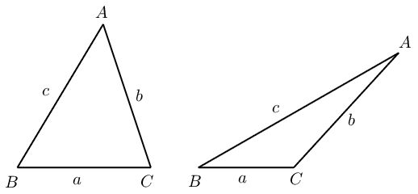
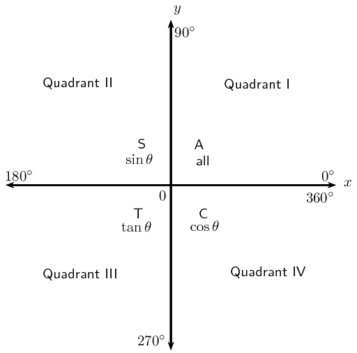

## 6.6 Summary (EMBHT)

| square identity | quotient identity |
| --- | --- |
| \(\cos^2\theta + \sin^2\theta = 1\) | \(\tan\theta = \dfrac{\sin\theta}{\cos\theta}\) |

| negative angles | periodicity identities | co-function identities |
| --- | --- | --- |
| \(\sin (-\theta) = - \sin \theta\) | \(\sin (\theta \pm \text{360}\text{°}) = \sin \theta\) | \(\sin (\text{90}\text{°} - \theta) = \cos \theta\) |
| \(\cos (-\theta) = \cos \theta\) | \(\cos (\theta \pm \text{360}\text{°}) = \cos \theta\) | \(\cos (\text{90}\text{°} - \theta) = \sin \theta\) |

| sine rule | area rule | cosine rule |
| --- | --- | --- |
| \(\frac{\sin A}{a} = \frac{\sin B}{b} = \frac{\sin C}{c}\) | area \(\triangle ABC = \frac{1}{2} bc \sin A\) | \(a^2 = b^2 + c^2 - 2 bc \cos A\) |
| \(\frac{a}{\sin A} = \frac{b}{\sin B} = \frac{c}{\sin C}\) | area \(\triangle ABC = \frac{1}{2} ac \sin B\) | \(b^2 = a^2 + c^2 - 2 ac \cos B\) |
|  | area \(\triangle ABC = \frac{1}{2} ab \sin C\) | \(c^2 = a^2 + b^2 - 2 ab \cos C\) |

**General solution:**

2. \begin{align*}
                   \text{If } \sin \theta &= x \\
                   \theta &= \sin^{-1}x + k \cdot \text{360}\text{°} \\
                   \text{or } \theta &= \left( \text{180}\text{°} - \sin^{-1}x \right) + k \cdot
                   \text{360}\text{°}
                   \end{align*}
4. \begin{align*}
                   \text{If } \cos \theta &= x \\
                   \theta &= \cos^{-1}x + k \cdot \text{360}\text{°} \\
                   \text{or } \theta &= \left( \text{360}\text{°} - \cos^{-1}x \right) + k \cdot
                   \text{360}\text{°}
                   \end{align*}
6. \begin{align*}
                   \text{If } \tan \theta &= x \\
                   \theta &= \tan^{-1}x + k \cdot \text{180}\text{°}
                   \end{align*}
   for \(k \in \mathbb{Z}\).

**How to determine which rule to use:**

- Area rule:
  - no perpendicular height is given
- Sine rule:
  - no right angle is given
  - two sides and an angle are given (not the included angle)
  - two angles and a side are given
- Cosine rule:
  - no right angle is given
  - two sides and the included angle angle are given
  - three sides are given

<QuizCard id="m11-06-06a" title="Interactive Exercise 6.17" question="The triangle below has sides labelled \( y, z \) , and \( x \) , and angles labelled \( Y, Z \) , and \( X \) . The cosine rule states: \[\begin{array}{c}x^{2} = (?)^{2} + y^{2} - 2(?)y \cdot \cos X\end{array}\] Which of the following choices belongs in the place of the '?' in the formula?" options=["Y", "Z", "z"] answer=" 2 " hint="" explanation="Connect the sides and angles in the diagram according to the cosine rule The cosine rule has three sides and one angle in it. We must make sure that the                     sides and angles go in the correct places in the formula! Specifically, the side                     which is opposite the angle in the triangle must go on the opposite side of the                     equation from the angle. In this question, we are looking for one of the sides: \[\begin{array}{c}x^{2} = (?)^{2} + y^{2} - 2(?)y \cdot \cos X\end{array}\] The formula already includes both the angle \( X \) and the side across from it, \( x \) . That leaves the other two sides of the triangle, \( z \) and \( y \) . Since \( y \) is already in the formula, the answer must be \( z \) . The correct choice from the list is z . Submit your answer as: z" />

<QuizCard id="m11-06-06a" title="Interactive Exercise 6.17" question="The triangle below has sides labelled \( b,                 m \) , and \( a \) , and angles labelled \( \beta,                 \theta \) , and \( \alpha \) . For this triangle, the sine rule states: \[                 \begin{aligned}                     \frac{\; ? \;}{\sin \theta} = \frac{b}{\sin \beta}                 \end{aligned}             \] Which of the following choices belongs in the place of the '?' in the formula?" options=["a", "m", "\u03b1"] answer="m" hint="" explanation="Connect the sides and angles in the diagram according to the sine rule In the sine rule, each fraction must contain a side and an angle. These values (the                     side and the angle) must be opposite (across from) each other in the triangle. For                     example, in the triangle in this question, the angle \( \theta \) and side \( m \) are opposite each other. We are given the formula: \[                     \begin{aligned}                         \frac{\; ? \;}{\sin \theta} = \frac{b}{\sin \beta}                     \end{aligned}                 \] The question mark is in the position of one of the sides .                     The fraction with the question mark includes the angle \( \theta \) . The side that we need must be opposite from that angle. Looking at the diagram, we can see that the answer is side \( m \) . The missing variable in the equation is the side m . Submit your answer as: m" />

<QuizCard id="m11-06-06a" title="Interactive Exercise 6.17" question="The triangle below has sides labelled \( x,                 y \) , and \( z \) , and angles labelled \( X,                 Y \) , and \( Z \) . For this triangle, the area rule says: \[\begin{array}{c}\text{Area} \Delta = \frac{1}{2} z y \cdot \sin \; (?) \;\end{array}\] Which of the following choices belongs in the place of the ' \(?\) ' in the formula?" options=["X", "Y", "Z", "x"] answer="X" hint="" explanation="Connect the sides and angles in the diagram according to the area rule The area rule states that the area of any triangle is given by the formula \( \text{Area} \Delta = \frac{1}{2} ab \cdot \sin C \) . The key thing to remember                     is that angle \( C \) must be the angle sitting between the two sides in the equation, \( a \) and \( b \) . In other words,                     the area rule formula must use one angle and the two sides of the triangle which are                     adjacent to that angle. For example, in the triangle for this question sides \( y \) and \( z \) are adjacent to                     angle \( X \) . In this question, the missing value ' \(?\) ' sits in the position of an angle : \[\begin{array}{c}\text{Area} \Delta = \frac{1}{2} z y                     \cdot \sin \; (?) \;\end{array}\] The two sides in this formula are \( z \) and \( y \) , so the angle we need is the angle which sits between those two sides. This angle is \( X \) . The value missing from the equation is X . Submit your answer as: X" />
