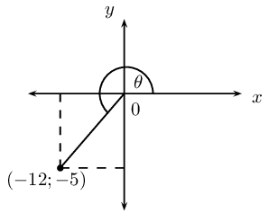
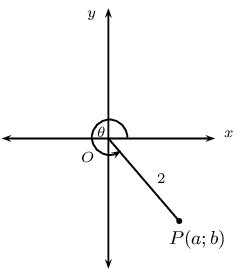
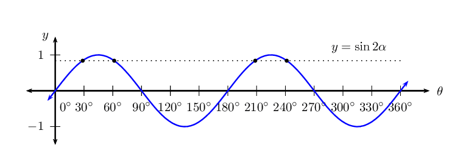
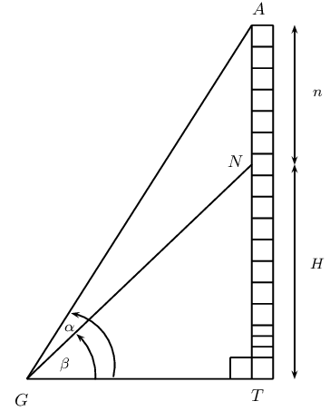
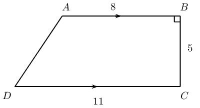
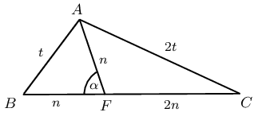

## End of chapter exercises

### Textbook Exercise 6.14

**Problem:**
Write the following as a single trigonometric ratio:
            \(\dfrac{\cos (\text{90}\text{°} - A) \sin \text{20}\text{°}}{\sin (\text{180}\text{°} - A)
            \cos \text{70}\text{°}} + \cos (\text{180}\text{°} + A) \sin (\text{90}\text{°} + A)\)

**Solution:**
\begin{align*}
          & \frac{\sin A \cdot \sin \text{20}\text{°}}{\sin A \cdot \sin( \text{90}\text{°} -
          \text{70}\text{°})} + (-\cos A)\cos (A) \\
          &= \frac{\sin A \cdot \sin \text{20}\text{°}}{\sin A \cdot \sin \text{20}\text{°}} + (-\cos
          A)\cos A\\
          &= 1 - \cos^2 A\\
          &= \sin^2 A
          \end{align*}

**Problem:**
Determine the value of the following expression without using a calculator:
            \(\sin\text{240}\text{°} \cos\text{210}\text{°} - \tan^2 \text{225}\text{°}
            \cos\text{300}\text{°} \cos\text{180}\text{°}\)

**Solution:**
\begin{align*}
          & \sin(\text{180}\text{°} + \text{60}\text{°}) \cdot \cos(\text{180}\text{°} +
          \text{30}\text{°}) - \tan^2(\text{180}\text{°} + \text{45}\text{°}) \cdot
          \cos(\text{360}\text{°} - \text{60}\text{°}) \cdot (-1)\\
          &= (-\sin \text{60}\text{°}) \cdot (-\cos \text{30}\text{°}) - (\tan^2 \text{45}\text{°})
          \cdot (\cos \text{60}\text{°} ) \cdot (-1) \\
          &= + \frac{\sqrt{3}}{2} \cdot \frac{\sqrt{3}}{2} - (1)^2 \cdot (\frac{1}{2}) \cdot (-1) \\
          &= \frac{3}{4} + \frac{1}{2} \\
          &= \frac{3 + 2}{4} \\
          &= 1 \frac{1}{4}
          \end{align*}

**Problem:**
Simplify:
            \(\dfrac{\sin (\text{180}\text{°} + \theta) \sin (\theta + \text{360}\text{°})}{\sin (-\theta)
            \tan (\theta - \text{360}\text{°})}\)

**Solution:**
\begin{align*}
          &\frac{\sin(\text{180}\text{°} + \theta) \cdot \sin(\theta + \text{360}\text{°})}{\sin(-\theta)
          \cdot \tan(\theta - \text{360}\text{°})}\\
          &= \frac{(- \sin \theta) \cdot \sin \theta}{(-\sin \theta) \cdot (- \tan(\text{360}\text{°} -
          \theta))}\\
          &= \frac{\sin \theta}{\tan \theta} = \frac{\sin \theta}{1} \cdot \frac{\cos \theta}{\sin \theta}\\
          &= \cos \theta
          \end{align*}

**Problem:**
Without the use of a calculator, evaluate:
            \(\dfrac{3\sin \text{55}\text{°} \sin^2 \text{325}\text{°}}{\cos (-\text{145}\text{°})} -
            3\cos \text{395}\text{°} \sin \text{125}\text{°}\)

**Solution:**
\begin{align*}
          & \frac{3 \sin \text{55}\text{°} . \sin^2 (\text{360}\text{°} - (\text{35}\text{°}))}{\cos
          (\text{145}\text{°}} - 3\cos((\text{360}\text{°} + (\text{35}\text{°}) .
          \sin(\text{90}\text{°} + \text{35}\text{°})\\
          &= \frac{3 \sin \text{55}\text{°} . (-\sin \text{35}\text{°})^2}{\cos (\text{90}\text{°} +
          \text{55}\text{°})} + 3\cos \text{35}\text{°} . \cos \text{35}\text{°}\\
          &= \frac{-3 \sin \text{55}\text{°} . \sin^2 \text{35}\text{°}}{-\sin \text{55}\text{°}} +
          3\cos^2 \text{35}\text{°}\\
          &= 3(\sin^2 \text{35}\text{°} + \cos^2 \text{35}\text{°})\\
          &= 3
          \end{align*}

Prove the following identities:

**Problem:**
\(\dfrac{1}{(\cos x - 1)(\cos x + 1)} = \dfrac{-1}{\tan^2x \cos^2x}\)

**Solution:**
\begin{align*}
            \text{ RHS }&=\frac{-1}{\frac{\sin^2x}{\cos^2x}\cdot\frac{\cos^2x}{1}} \\
            &=\frac{-1}{\sin^2x} \\
            \text{ LHS } &=\frac{1}{\cos^2x-1} \\
            &=\frac{1}{-(1-\cos^2x)} \\
            &=-\frac{1}{\sin^2x} \\
            &=\text{ RHS }
            \end{align*}

**Problem:**
\((1 - \tan \alpha) \cos \alpha = \sin(90 + \alpha) + \cos(90 + \alpha)\)

**Solution:**
\begin{align*}
            \text{LHS} &= (1 - \frac{\sin \alpha}{\cos \alpha}) . \cos \alpha \\
            &= (\frac{\cos \alpha - \sin \alpha}{\cos \alpha} ) \cos \alpha \\
            &= \cos \alpha - \sin \alpha \\
            \text{RHS} &= \cos (-\alpha) + \sin (-\alpha) \\
            &= \cos \alpha - \sin \alpha \\
            &= \text{LHS}
            \end{align*}

**Problem:**
Prove: \(\tan y + \dfrac{1}{\tan y} = \dfrac{1}{\cos^2y \tan y}\)

**Solution:**
\begin{align*}
            \text{LHS} &= \frac{\sin y}{\cos y} + \frac{1}{\frac{1}{\sin y}{\cos y}}\\
            &= \frac{\sin y}{\cos y} + \frac{\cos y}{\sin y}\\
            &= \frac{\sin^2 y + \cos^2 y}{\cos y . \sin y}\\
            &= \frac{1}{\cos y . \sin y}\\
            \text{RHS} &= \frac{1}{\cos^2 y \frac{\sin y}{\cos y}}\\
            &= \frac{\cos y}{\cos^2 y . \sin y}\\
            &= \frac{1}{\cos y \sin y}\\
            &= \text{LHS}
            \end{align*}

**Problem:**
For which values of \(y \in [\text{0}\text{°};\text{360}\text{°}]\) is the identity above
              undefined?

**Solution:**
\begin{align*}
            \tan y &= \text{0}\text{°}\\
            y &= \text{0}\text{°}; \text{180}\text{°}; \text{360}\text{°}\\
            \cos y &= \text{0}\text{°}\\
            y &= \text{90}\text{°}; \text{270}\text{°}
            \end{align*}

**Problem:**
Simplify: \(\dfrac{\sin(\text{180}\text{°} + \theta) \tan(\text{360}\text{°} -
              \theta)}{\sin(-\theta) \tan(\text{180}\text{°} + \theta)}\)

**Solution:**
\begin{align*}
            & \frac{(-\sin \theta) . (- \tan \theta)}{(-\sin \theta) . \tan \theta} \\
            & = -1
            \end{align*}

**Problem:**
Hence, solve the equation \(\dfrac{\sin(\text{180}\text{°} + \theta) \tan(\text{360}\text{°} -
              \theta)}{\sin(-\theta) \tan(\text{180}\text{°} + \theta)} = \tan \theta\) for \(\theta \in
              [\text{0}\text{°};\text{360}\text{°}]\).

**Solution:**
\begin{align*}
            \tan \theta &= -1 \\
            \therefore \theta &= \text{180}\text{°} - \text{45}\text{°} \text{ or } \theta =
            \text{360}\text{°} - \text{45}\text{°} \\
            &= \text{135}\text{°} \text{ or } \text{315}\text{°}
            \end{align*}

Given \(12 \tan \theta = 5\) and \(\theta > \text{90}\text{°}\).

**Problem:**
Draw a sketch.

**Solution:**

**Problem:**
Determine without using a calculator \(\sin \theta\) and \(\cos (\text{180}\text{°} + \theta)\).

**Solution:**
\begin{align*}
            OP &= \sqrt{(-12)^2 + (-5)^2} \\
            &= \sqrt{144 + 25} \\
            &= \sqrt{169}\\
            &= 13\\
            \sin \theta &= - \frac{5}{13}\\
            \cos (\text{180}\text{°} + \theta) &= - \cos \theta \\
            &= - (-\frac{12}{13}) \\
            &= \frac{12}{13}
            \end{align*}

**Problem:**
Use a calculator to find \(\theta\) (correct to two decimal places).

**Solution:**
\begin{align*}
            \tan \theta &= \frac{5}{12} \\
            \theta &= \text{180}\text{°} + \text{22,62}\text{°}\\
            &= \text{202,62}\text{°}
            \end{align*}

In the figure, \(P\) is a point on the Cartesian plane such that \(OP = 2\) units and \(\theta =
            \text{300}\text{°}\). Without the use of a calculator, determine:

**Problem:**
the values of \(a\) and \(b\)

**Solution:**
\begin{align*}
            \cos \text{300}\text{°} &= \cos \text{60}\text{°} \\
            & = \frac{1}{2}\\
            \therefore a &= 1 \\
            b &= - \sqrt{4-1} \\
            & = -\sqrt{3}
            \end{align*}

**Problem:**
the value of \(\sin (\text{180}\text{°} - \theta)\)

**Solution:**
\begin{align*}
            \sin (\text{180}\text{°} - \theta) &= \sin \theta \\
            &= \sin \text{300}\text{°} \\
            &= \sin (\text{360}\text{°} - \text{60}\text{°})\\
            &= \sin (-\text{60}\text{°})\\
            &= -\sin \text{60}\text{°}\\
            &= - \frac{\sqrt{3}}{2}
            \end{align*}

Solve for \(x\) with \(x \in [-\text{180}\text{°};\text{180}\text{°}]\) (correct to one decimal
            place):

**Problem:**
\(2 \sin \frac{x}{2} = \text{0,86}\)

**Solution:**
\begin{align*}
            \sin \frac{1}{2}x &= \text{0,43} \\
            \frac{1}{2}x &= \text{25,467}\text{°}\\
            x &= \text{50,9}\text{°} \\
            \text{Or } \quad \frac{1}{2}x &=\text{180}\text{°} - \text{25,467}\text{°}\\
            x &= \text{309,1}\text{°}
            \end{align*}

**Problem:**
\(\tan (x + \text{10}\text{°}) = \cos \text{202,6}\text{°}\)

**Solution:**
\begin{align*}
            \tan (x + \text{10}\text{°}) &= -\text{0,92}\\
            x + \text{10}\text{°} &= \text{180}\text{°} -\text{42,7}\text{°}\\
            &= \text{137,3}\text{°}\\
            x &= \text{127,3}\text{°}\\
            \text{Or} \quad x + \text{10}\text{°} &= \text{360}\text{°} - \text{42,7}\text{°}\\
            &= \text{317,3}\text{°}\\
            \therefore x &= \text{307,3}\text{°}
            \end{align*}

**Problem:**
\(\cos^2x - 4 \sin^2x = 0\)

**Solution:**
\begin{align*}
            \cos x - 2\sin x &= 0\\
            \cos x &= 2\sin x\\
            \frac{\sin x}{\cos x} &= \frac{1}{2}\\
            \tan x &= \frac{1}{2}\\
            x &= \text{26,6}\text{°}\\
            \text{or } x &= -\text{180}\text{°} + \text{26,6}\text{°} \\
            &= \text{206,6}\text{°}\\
            \text{Or } \quad \cos x + 2\sin x &= 0\\
            \cos x &= -2 \sin x\\
            \frac{\sin x}{\cos x} &= -\frac{1}{2}\\
            \tan x &= -\frac{1}{2}\\
            x &= \text{180}\text{°} - \text{26,6}\text{°}\\
            &= \text{153,4}\text{°}\\
            \text{or } x &= \text{360}\text{°} - \text{26,6}\text{°} \\
            &= \text{333,4}\text{°}
            \end{align*}

Find the general solution for the following equations:

**Problem:**
\(\frac{1}{2} \sin (x - \text{25}\text{°}) = \text{0,25}\)

**Solution:**
\begin{align*}
            \sin(x - \text{25}\text{°}) &= 0.5\\
            x - \text{25}\text{°} &= \text{30}\text{°} \\
            \text{ or } x - \text{25}\text{°} &= \text{180}\text{°} - \text{30}\text{°}\\
            x &= \text{55}\text{°} + \text{360}\text{°}n, n \in \mathbb{Z} \\
            \text{ or } x &= \text{175}\text{°} + \text{360}\text{°}n, n \in \mathbb{Z}
            \end{align*}

**Problem:**
\(\sin^2x + 2 \cos x = -2\)

**Solution:**
\begin{align*}
            \sin^2 x + 2\cos x + 2 &= 0\\
            1 - \cos^2 x + 2\cos x + 2 &= 0\\
            - \cos^2 x + 2\cos x + 3 &= 0\\
            \cos^2 x - 2\cos x - 3 &= 0\\
            (\cos x - 3)(\cos x + 1) &= 0\\
            \cos x &= 3 \\
            & \text{no solution} \\
            \text{OR} \cos x &= -1\\
            x &= \text{180}\text{°} + \text{360}\text{°}n, n \in \mathbb{Z}
            \end{align*}

Given the equation: \(\sin 2 \alpha = \text{0,84}\)

**Problem:**
Find the general solution of the equation.

**Solution:**
\begin{align*}
            \sin 2\alpha &= \text{0,84}\\
            2\alpha &= \text{57,14}\text{°} + \text{360}\text{°}n, n \in \mathbb{Z}\\
            \alpha &= \text{28,6}\text{°} + \text{180}\text{°}n\\
            \text{Or } 2\alpha &= \text{180}\text{°} - \text{57,14}\text{°} + \text{360}\text{°}n, n
            \in \mathbb{Z}\\
            2\alpha &= \text{122,86}\text{°} + \text{360}\text{°}n\\
            \alpha &= \text{61,43}\text{°} + \text{180}\text{°}n
            \end{align*}

**Problem:**
Illustrate how this equation could be solved graphically for \(\alpha \in
            [\text{0}\text{°}; \text{360}\text{°}]\).

**Solution:**

**Problem:**
Write down the solutions for \(\sin 2 \alpha = \text{0,84}\) for \(\alpha \in
            [\text{0}\text{°}; \text{360}\text{°}]\).

**Solution:**
\(\text{28,6}\text{°};
            \text{61,4}\text{°};
            \text{208,6}\text{°};
            \text{241,4}\text{°}\)

\(A\) is the highest point of a vertical tower \(AT\). At point \(N\) on the tower, \(n\) metres from the
            top of the tower, a bird has made its nest. The angle of inclination from \(G\) to point \(A\) is \(\alpha\)
            and the angle of inclination from \(G\) to point \(N\) is \(\beta\).

**Problem:**
Express \(A\hat{G}N\) in terms of \(\alpha\) and \(\beta\).

**Solution:**
\begin{align*}
            A\hat{G}N &= \alpha - \beta
            \end{align*}

**Problem:**
Express \(\hat{A}\) in terms of \(\alpha\) and/or \(\beta\).

**Solution:**
\begin{align*}
            \hat{A} &= \text{90}\text{°} - \alpha
            \end{align*}

**Problem:**
Show that the height of the nest from the ground (\(H\)) can be determined by the formula \[H = \frac{n
              \cos \alpha \sin \beta}{\sin(\alpha - \beta)}\]

**Solution:**
\begin{align*}
            \text{In } \triangle GNT, & \\
            \frac{H}{GN} &= \sin \beta \\
            \therefore H &= GN \sin \beta \\
            \text{In } \triangle AGN, & \\
            \frac{n}{\sin(\alpha - \beta)} &= \frac{GN}{\sin(\text{90}\text{°} - \alpha)}\\
            \therefore GN &= \frac{n \sin(\text{90}\text{°} - \alpha)}{\sin(\alpha - \beta)} \\
            & = \frac{n \cos \alpha}{\sin(\alpha - \beta)} \\
            \text{Substitute for } GN, & \\
            H &= \frac{n \cos \alpha \sin \beta}{\sin(\alpha-\beta)}
            \end{align*}

**Problem:**
Calculate the height of the nest \(H\) if \(n = \text{10}\text{ m}\), \(\alpha = \text{68}\text{°}\)
              and \(\beta = \text{40}\text{°}\) (give your answer correct to the nearest metre).

**Solution:**
\begin{align*}
            H &= \frac{n \cos \alpha \sin \beta}{\sin(\alpha-\beta)}\\
            &= \frac{10 \cos \text{68}\text{°} \sin \text{40}\text{°}}{\sin \text{28}\text{°}}\\
            &= \text{5,1}\text{ m}
            \end{align*}

Mr. Collins wants to pave his trapezium-shaped backyard, \(ABCD\). \(AB \parallel DC\) and \(\hat{B} =
            \text{90}\text{°}\). \(DC = \text{11}\text{ m}\), \(AB = \text{8}\text{ m}\) and \(BC = \text{5}\text{
            m}\).

**Problem:**
Calculate the length of the diagonal \(AC\).

**Solution:**
\begin{align*}
            AC^2 &= 8^2 + 5^2\\
            &= 64 + 25 = 89\\
            AC &= \text{9,43}\text{ m}
            \end{align*}

**Problem:**
Calculate the length of the side \(AD\).

**Solution:**
\begin{align*}
            \text{In } \triangle ABC, &\\
            \tan B\hat{A}C &= \frac{5}{8}\\
            \therefore B\hat{A}C &= \text{32}\text{°}\\
            A\hat{C}D = B\hat{A}C &= \text{32}\text{°} (AB \parallel DC)\\
            \text{In } \triangle ADC, &\\
            AD^2 &= AC^2 + DC^2 - 2.AC.AD.\cos(A\hat{C}D)\\
            &= (\text{9,4})^2 + (\text{11})^2 - 2 (\text{9,4})(\text{11}) \cos(\text{32}\text{°})\\
            &= 89 + 121 - 176\\
            &= 34\\
            \therefore AD &= \text{6,2}\text{ m}
            \end{align*}

**Problem:**
Calculate the area of the patio using geometry.

**Solution:**
\begin{align*}
            \text{Area } &= \frac{1}{2} \times (8+11) \times 5 \\
            &= \text{47,5}\text{ m$^{2}$}
            \end{align*}

**Problem:**
Calculate the area of the patio using trigonometry.

**Solution:**
\begin{align*}
            \text{Area } ABCD &= \text{area } \triangle ABC + \text{area } \triangle ADC \\
            &= \frac{1}{2} (8) (5) + \frac{1}{2} (9.43) (11) \sin \text{32}\text{°}\\
            &= 20 + \text{27,5}\\
            &= \text{47,5}\text{ m$^{2}$}
            \end{align*}

**Problem:**

In \(\triangle ABC\), \(AC = 2A\), \(AF = BF\), \(A\hat{F}B = \alpha\) and \(FC = 2AF\). Prove that \(\cos
            \alpha = \frac{1}{4}\).

**Solution:**
\begin{align*}
          \text{In } \triangle ABF & \\
          t^2 &= n^2 + n^2 - 2n^2 \cos \alpha \\
          t^2 &= 2n^2(1 - \cos \alpha) \\
          1 - \cos \alpha &= \frac{t^2}{2n^2}\\
          \cos \alpha &= 1 - \frac{t^2}{2n^2} \\
          \text{In } \triangle AFC & \\
          (2t)^2 &= n^2 + (2n)^2 - 4n^2 \cos (A\hat{F}C)\\
          4t^2 &= n^2 + 4n^2 - 4n^2 \cos (\text{180}\text{°} - \alpha) \\
          &= 5n^2 + 4n^2 \cos \alpha\\
          t^2 &= \frac{5}{4} n^2 + n^2 \cos \alpha \\
          \text{Substitute for } t^2 & \\
          \cos \alpha &= 1 - \frac{\frac{5}{4}n^2 + n^2 \cos \alpha}{2n^2}\\
          &= \frac{2n^2 - \frac{5}{4}n^2 - n^2 \cos \alpha}{2 n^2}\\
          &= \frac{\frac{3}{4}n^2 - n^2 \cos \alpha}{2n^2}\\
          &= \frac{3}{8} - \frac{\cos \alpha}{2}\\
          \frac{3}{2} \cos \alpha &= \frac{3}{8}\\
          \therefore \cos \alpha &= \frac{1}{4}
          \end{align*}
