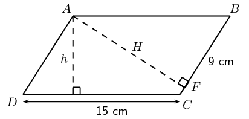
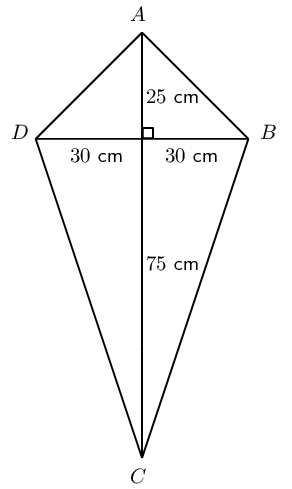
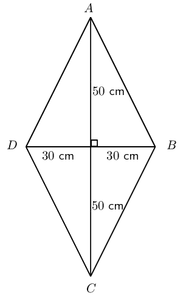
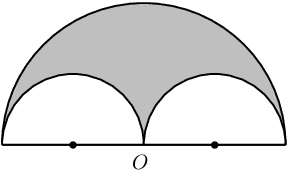
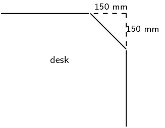

# Chapter 7: Measurement

- Use paper or cardboard for the net of solids to help learners see the different heights, particularly
          perpendicular and slanted heights.
- Units are compulsory when working with real life contexts.
- Sketches are valuable and important tools.
- Rounding off should only be done in the last step and level of accuracy should be relevant to the context.

This chapter is a revision of perimeters and areas of two dimensional objects and volumes of three dimensional
    objects. We also examine different combinations of geometric objects and calculate areas and volumes in a variety of
    real-life contexts.

<Callout type="note" title="Note">
<VideoPlayer src="https://www.youtube.com/embed/GDcVdBAnBdU" title="Video: 2356" />
</Callout>

## 7.1 Area of a polygon (EMBHV)

| Square |  | \(\text{Area}={s}^{2}\) |
| --- | --- | --- |
| Rectangle |  | \(\text{Area}=b\times h\) |
| Triangle |  | \(\text{Area}=\frac{1}{2}b\times h\) |

<Callout type="note" title="Note">
<VideoPlayer src="https://www.youtube.com/embed/GDcVdBAnBdU" title="Video: 2357" />
</Callout>

| Trapezium |  | \(\text{Area}=\frac{1}{2}\left(a+b\right)\times h\) |
| --- | --- | --- |
| Parallelogram |  | \(\text{Area}=b\times h\) |
| Circle |  | \(\text{Area}=\pi {r}^{2}\)

          \(\left(\text{Circumference}=2\pi r\right)\) |

<Callout type="note" title="Note">
<VideoPlayer src="https://www.youtube.com/embed/lDKjX5ouoic" title="Video: 2358" />
</Callout>

<QuizCard id="m11-07-01a" title="Interactive Exercise 7.1" question="For each of the shapes shown below, identify the correct formula for the area of the shape. Shape A Shape B Choice Area Formula 1 \(  A = b h \) 2 \( A = b^{2} \) 3 \( A = \frac{h \left(a + b\right)}{2} \) 4 \( A = \pi r^{2} \) 5 None of the above" options=["1", "2", "3", "4", "5", "1", "2", "3", "4", "5"] answer="2, 1" hint="" explanation="Area is the surface of a shape or object that you can cover or paint .  The pictures below show the shapes in the question \"painted\" in a colour; the painted place is the area of the shape. You need to memorise each of the area formulae! Trapezium: A trapezium looks like the picture below.  The correct formula for the area of a  trapezium is \( A_{\text{trapezium}} = \frac{h \left(a + b\right)}{2} \) . The two parallel sides of the trapezium ( \(a\) and \(b\) ) must be perpendicular to the height ( \(h\) ) of the trapezium. Square: A square looks like the picture below.  The correct formula for the area of a  square is \( A_{\text{square}} =  b^{2} \) . The area is just the product of the two (equal) sides. Submit your answer as: 3 and 2" />

<QuizCard id="m11-07-01a" title="Interactive Exercise 7.1" question="For each of the shapes shown below, identify the correct formula for the area of the shape. Shape A Shape B Choice Area Formula 1 \(  A = \pi r^{2} \) 2 \( A = \frac{h \left(a + b\right)}{2} \) 3 \( A = \frac{b h}{2} \) 4 \( A = b h \) 5 None of the above" options=["1", "2", "3", "4", "5", "1", "2", "3", "4", "5"] answer="3, 1" hint="" explanation="Area is the surface of a shape or object that you can cover or paint .  The pictures below show the shapes in the question \"painted\" in a colour; the painted place is the area of the shape. You need to memorise each of the area formulae! Rectangle: A rectangle looks like the picture below.  The correct formula for the area of a  rectangle is \( A_{\text{rectangle}} = b h \) . You can see the base ( \(b\) ) and the height ( \(h\) ) labelled in the diagram.  For a rectangle these two sides must be perpendicuar. Trapezium: A trapezium looks like the picture below.  The correct formula for the area of a  trapezium is \( A_{\text{trapezium}} =  \frac{h \left(a + b\right)}{2} \) . The two parallel sides of the trapezium ( \(a\) and \(b\) ) must be perpendicular to the height ( \(h\) ) of the trapezium. Submit your answer as: 4 and 2" />

<QuizCard id="m11-07-01a" title="Interactive Exercise 7.1" question="For each of the shapes shown below, identify the correct formula for the area of the shape. Shape A Shape B Choice Area Formula 1 \(  A = b h \) 2 \( A = \frac{b h}{2} \) 3 \( A = \frac{h \left(a + b\right)}{2} \) 4 \( A = b^{2} \) 5 None of the above" options=["1", "2", "3", "4", "5", "1", "2", "3", "4", "5"] answer="3, 1" hint="" explanation="Area is the surface of a shape or object that you can cover or paint .  The pictures below show the shapes in the question \"painted\" in a colour; the painted place is the area of the shape. You need to memorise each of the area formulae! Square: A square looks like the picture below.  The correct formula for the area of a  square is \( A_{\text{square}} = b^{2} \) . The area is just the product of the two (equal) sides. Triangle: A triangle looks like the picture below.  The correct formula for the area of a  triangle is \( A_{\text{triangle}} =  \frac{b h}{2} \) . The base ( \(b\) ) and the height ( \(h\) ) of a triangle are labelled in the picture below.  It is very important with a triangle that the base and the height are perpendicular to each other; otherwise this area formula will not give you the correct answer. Submit your answer as: 4 and 2" />

<QuizCard id="m11-07-01a" title="Interactive Exercise 7.1" question="For each of the shapes shown below, identify the correct formula for the area of the shape. Shape A Shape B Choice Area Formula 1 \(  A = b^{2} \) 2 \( A = \frac{h \left(a + b\right)}{2} \) 3 \( A = \frac{b h}{2} \) 4 \( A = \pi r^{2} \) 5 None of the above" options=["1", "2", "3", "4", "5", "1", "2", "3", "4", "5"] answer="1, 0" hint="" explanation="Area is the surface of a shape or object that you can cover or paint .  The pictures below show the shapes in the question \"painted\" in a colour; the painted place is the area of the shape. You need to memorise each of the area formulae! Trapezium: A trapezium looks like the picture below.  The correct formula for the area of a  trapezium is \( A_{\text{trapezium}} = \frac{h \left(a + b\right)}{2} \) . The two parallel sides of the trapezium ( \(a\) and \(b\) ) must be perpendicular to the height ( \(h\) ) of the trapezium. Square: A square looks like the picture below.  The correct formula for the area of a  square is \( A_{\text{square}} =  b^{2} \) . The area is just the product of the two (equal) sides. Submit your answer as: 2 and 1" />

<QuizCard id="m11-07-01a" title="Interactive Exercise 7.1" question="For each of the shapes shown below, identify the correct formula for the area of the shape. Shape A Shape B Choice Area Formula 1 \(  A = \pi r^{2} \) 2 \( A = b h \) 3 \( A = \frac{b h}{2} \) 4 \( A = b^{2} \) 5 None of the above" options=["1", "2", "3", "4", "5", "1", "2", "3", "4", "5"] answer="1, 2" hint="" explanation="Area is the surface of a shape or object that you can cover or paint .  The pictures below show the shapes in the question \"painted\" in a colour; the painted place is the area of the shape. You need to memorise each of the area formulae! Parallelogram: A parallelogram looks like the picture below.  The correct formula for the area of a  parallelogram is \( A_{\text{parallelogram}} = b h \) . It is very important that the base ( \(b\) ) and the height ( \(h\) ) are perpendicular to each other.  (You may notice that this is the same as the formula for the area of a rectangle.) Triangle: A triangle looks like the picture below.  The correct formula for the area of a  triangle is \( A_{\text{triangle}} =  \frac{b h}{2} \) . The base ( \(b\) ) and the height ( \(h\) ) of a triangle are labelled in the picture below.  It is very important with a triangle that the base and the height are perpendicular to each other; otherwise this area formula will not give you the correct answer. Submit your answer as: 2 and 3" />

<QuizCard id="m11-07-01a" title="Interactive Exercise 7.1" question="For each of the shapes shown below, identify the correct formula for the area of the shape. Shape A Shape B Choice Area Formula 1 \(  A = \frac{b h}{2} \) 2 \( A = b^{2} \) 3 \( A = b h \) 4 \( A = \frac{h \left(a + b\right)}{2} \) 5 None of the above" options=["1", "2", "3", "4", "5", "1", "2", "3", "4", "5"] answer="3, 0" hint="" explanation="Area is the surface of a shape or object that you can cover or paint .  The pictures below show the shapes in the question \"painted\" in a colour; the painted place is the area of the shape. You need to memorise each of the area formulae! Trapezium: A trapezium looks like the picture below.  The correct formula for the area of a  trapezium is \( A_{\text{trapezium}} = \frac{h \left(a + b\right)}{2} \) . The two parallel sides of the trapezium ( \(a\) and \(b\) ) must be perpendicular to the height ( \(h\) ) of the trapezium. Triangle: A triangle looks like the picture below.  The correct formula for the area of a  triangle is \( A_{\text{triangle}} =  \frac{b h}{2} \) . The base ( \(b\) ) and the height ( \(h\) ) of a triangle are labelled in the picture below.  It is very important with a triangle that the base and the height are perpendicular to each other; otherwise this area formula will not give you the correct answer. Submit your answer as: 4 and 1" />

<Callout type="tip" title="Worked example 1: Finding the area of a polygon">
**Question:**
\(ABCD\) is a parallelogram with \(DC = \text{15}\text{ cm}\), \(h = \text{8}\text{ cm}\) and \(BF =
          \text{9}\text{ cm}\).

Calculate:

2. the area of \(ABCD\)
4. the perimeter of \(ABCD\)

**Determine the area:**
The area of a parallelogram \(ABCD =\) base \(\times\) height:

        \begin{align*}
        \text{Area} &= \text{15} \times \text{8} \\
        &= \text{120}\text{ cm$^{2}$}
        \end{align*}

**Determine the perimeter:**
The perimeter of a parallelogram \(ABCD = 2DC + 2BC\).

To find the length of \(BC\), we use \(AF \perp BC\) and the theorem of Pythagoras.

        \begin{align*}
        \text{In } \triangle \text{ ABF:} \quad AF^2 &= AB^2 - BF^2 \\
        &= \text{15}^2 - \text{9}^2 \\
        &= \text{144} \\
        \therefore AF &= \text{12}\text{ cm}
        \end{align*}\begin{align*}
        \text{Area} ABCD &= BC \ \times AF \\
        \text{120} &= BC \times \text{12} \\
        \therefore BC &= \text{10}\text{ cm}
        \end{align*}\begin{align*}
        \therefore \text{Perimeter} ABCD &=2(\text{15})+2(\text{10}) \\
        &= \text{50}\text{ cm}
        \end{align*}
</Callout>

## Area of a polygon

### Textbook Exercise 7.1

Vuyo and Banele are having a competition to see who can build the best kite using balsa wood (a
              lightweight wood) and paper. Vuyo decides to make his kite with one diagonal \(\text{1}\) \(\text{m}\)
              long and the other diagonal \(\text{60}\) \(\text{cm}\) long. The intersection of the two diagonals cuts
              the longer diagonal in the ratio \(\text{1}:\text{3}\).

Banele also uses diagonals of length \(\text{60}\) \(\text{cm}\) and \(\text{1}\) \(\text{m}\), but he
              designs his kite to be rhombus-shaped.

**Problem:**
Draw a sketch of Vuyo's kite and write down all the known measurements.

**Solution:**

**Problem:**
Determine how much balsa wood Vuyo will need to build the outside frame of the kite
              (give answer correct to the nearest cm).

**Solution:**
\begin{align*}
              AD &= AB \\
              &= \sqrt{30^2+25^2} \quad (\text {Pythagoras}) \\
              AD&=\text{39}\text{ cm} \\
              DC&=BC \\
              &=\sqrt{30^2+75^2} \quad (\text {Pythagoras}) \\
              &=\text{81}\text{ cm} \\
              \therefore \text{Balsa wood: } &= 2(81+39)\\
              &=\text{240}\text{ cm}
              \end{align*}

**Problem:**
Calculate how much paper he will need to cover the frame of the kite.

**Solution:**
\begin{align*}
              \text{Area } &= 60 \times 100 \\
              &= \text{6 000}\text{ cm$^{2}$}\\
              &=\text{0,6}\text{ m$^{2}$}
              \end{align*}

**Problem:**
Draw a sketch of Banele's kite and write down all the known measurements.

**Solution:**

**Problem:**
Determine how much wood and paper Banele will need for his kite.

**Solution:**
\begin{align*}
              \text{Side length} &= \sqrt{50^2+30^2} \\
              &=\text{58,3}\text{ cm}\\
              \therefore \text{Wood for frame } &= 4 \times \text{58,3}\text{ cm} \\
              &= \text{233,2}\text{ cm}\\
              \text{Area }&= 60 \times 100 \\
              &= \text{6 000}\text{ cm$^{2}$}\\
              &=\text{0,6}\text{ m$^{2}$}
              \end{align*}

**Problem:**
Compare the two designs and comment on the similarities and differences. Which do you
              think is the better design? Motivate your answer.

**Solution:**
Same amount of paper is required for both designs. Vuyo's designs uses more balsa wood.

\(O\) is the centre of the bigger semi-circle with a radius of \(\text{10}\) \(\text{units}\). Two
              smaller semi-circles are inscribed into the bigger one, as shown on the diagram. Calculate the following
              (in terms of \(\pi\)):

**Problem:**
The area of the shaded figure.

**Solution:**
\begin{align*}
              \text{Area } &=\frac{1}{2}\pi(10)^2-2\left (\frac{1}{2}\pi(5)^2 \right )\\
              &=50\pi-25\pi \\
              &=25\pi \text{ units$^{2}$}
              \end{align*}

**Problem:**
The perimeter enclosing the shaded area.

**Solution:**
\begin{align*}
              \text{Perimeter }&=\frac{1}{2}(2\pi(10))+2\pi(5) \\
              &=10\pi+10\pi \\
              &=20\pi \text{ units$^{2}$}
              \end{align*}

Karen's engineering textbook is \(\text{30}\) \(\text{cm}\) long and \(\text{20}\) \(\text{cm}\) wide.
              She notices that the dimensions of her desk are in the same proportion as the dimensions of her textbook.

**Problem:**
If the desk is \(\text{90}\text{ cm}\) wide, calculate the area of the top of the desk.

**Solution:**
\begin{align*}
              \text{Ratio } &= \frac{\text{table width}}{\text{book width}} \\
              &=\frac{90}{20} \\
              &=\text{4,5} \\
              \therefore \text{Length of table } &= 30 \times \text{4,5} \text{ cm} \\
              &=\text{135}\text{ cm}\\
              \text{Area table} &= 135 \times 90 \\
              &=\text{12 150}\text{ cm$^{2}$}\\
              &=\text{1,2}\text{ m$^{2}$}
              \end{align*}

**Problem:**
Karen uses some cardboard to cover each corner of her desk with an isosceles triangle, as shown in the
                diagram:

Calculate the new perimeter and area of the visible part of the top of her desk.

**Solution:**
\begin{align*}
              x^2&=15^2+15^2 \\
              x&=\text{21,2}\text{ cm}\\
              \text{New length}&=135-2(15) \\
              &=\text{105}\text{ cm} \\
              \text{New breadth}&=90-2(15) \\
              &=\text{60}\text{ cm}\\
              \text{New perimeter }&=2(105)+2(60)+4(\text{21,2})\\
              &=\text{414,8}\text{ cm}
              \end{align*}
              \begin{align*}
              \text{Area cut off}&=2\times(15^2) \\
              &=\text{450}\text{ m$^{2}$} \\
              \text{New area } &= \text{12 150}\text{ cm$^{2}$} - \text{450}\text{ m$^{2}$} \\
              &= \text{11 700}\text{ cm$^{2}$}
              \end{align*}

**Problem:**
Use this new area to calculate the dimensions of a square desk with the same desk top
              area.

**Solution:**
\begin{align*}
              s^2&= \text{11 700}\text{ cm$^{2}$} \\
              \therefore s&= \text{108,2}\text{ cm}\\
              \text{Square table of length} &\approx 108 \times 108 \text{ cm$^{2}$}
              \end{align*}
