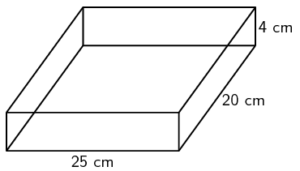
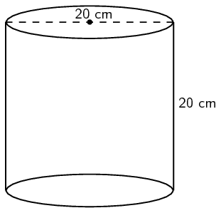
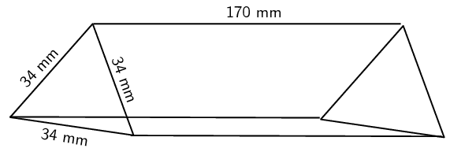
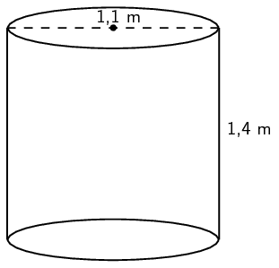
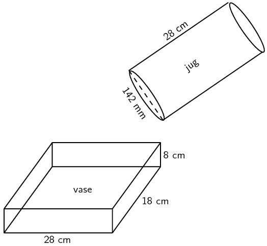
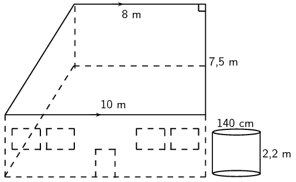
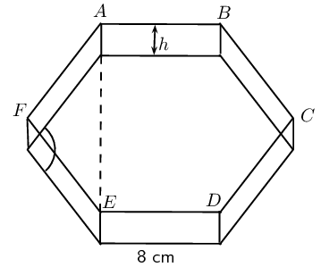
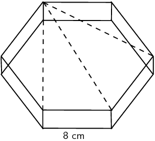
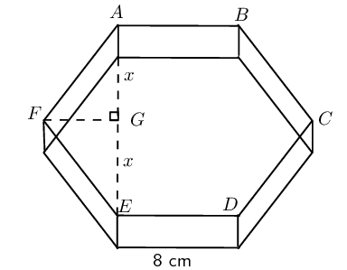

## 7.2 Right prisms and cylinders (EMBHW)

A right prism is a geometric solid that has a polygon as its base and vertical sides perpendicular to the base.
      The base and top surface are the same shape and size. It is called a “right” prism because the angles
      between the base and sides are right angles.

A triangular prism has a triangle as its base, a rectangular prism has a rectangle as its base, and a cube is a
      rectangular prism with all its sides of equal length. A cylinder is another type of right prism which has a circle
      as its base. Examples of right prisms are given below: a rectangular prism, a cube, a triangular prism and a
      cylinder.

### Surface area of prisms and cylinders (EMBHX)

Surface area is the total area of the exposed or outer surfaces of a prism.
        This is easier to understand if we imagine the prism to be a cardboard
        box that we can unfold. A solid that is unfolded like this is called
        a net. When a prism is unfolded into a net, we can clearly see each of
        its faces. In order to calculate the surface area of the prism, we can
        then simply calculate the area of each face, and add them all
        together.

For example, when a triangular prism is unfolded into a net, we can
        see that it has two faces that are triangles and three faces that are
        rectangles. To calculate the surface area of the prism, we find the
        area of each triangle and each rectangle, and add them together.

In the case of a cylinder the top and bottom faces are circles and the
        curved surface flattens into a rectangle with a length that is equal
        to the circumference of the circular base. To calculate the surface
        area we therefore find the area of the two circles and the rectangle
        and add them together.

Below are examples of right prisms that have been unfolded into nets.
        A rectangular prism unfolded into a net is made up of six rectangles.

A cube unfolded into a net is made up of six identical squares.

A triangular prism unfolded into a net is made up of two triangles and three rectangles. The sum of the lengths
        of the rectangles is equal to the perimeter of the triangles.

A cylinder unfolded into a net is made up of two identical circles and a rectangle with length equal to the
        circumference of the circles.

<QuizCard id="m11-07-02a" title="Interactive Exercise 7.3" question="Consider the object below. What is the name of the object? Choose the most correct net of the object. NOTE: The nets are not to scale." options=["wizard's hat", "sphere", "cylinder", "cone"] answer=" 0 ,  1 " hint="" explanation="Name the object There are a few special three-dimensional objects that you need to know.  The object in the picture above is a cone . Choose the correct net A net is what you get when you unfold the object and open it up to make it flat. The net of the cone looks like this: A cone is made up of \(\text{1}\) circle and \(\text{1}\) other surface. An important face of any three-dimensional shape is the 'base': in this case, the circle is the base of the cone. The correct option is B . Submit your answer as: cone and B" />

<QuizCard id="m11-07-02a" title="Interactive Exercise 7.3" question="Consider the object below. What is the name of the object? Choose the most correct net of the object. NOTE: The nets are not to scale." options=["square pyramid", "rectangular prism", "cube", "block"] answer=" 0 ,  1 " hint="" explanation="Name the object There are a few special three-dimensional objects that you need to know.  The object in the picture above is a rectangular prism . Choose the correct net A net is what you get when you unfold the object and open it up to make it flat. The net of the rectangular prism looks like this: A rectangular prism is made up of \(\text{3}\) pairs of \(\text{2}\) congruent (equal) rectangles. An important face of any three-dimensional shape is the 'base': in this case, the base is the rectangle on the bottom. The correct option is B . Submit your answer as: rectangular prism and B" />

<Callout type="tip" title="Worked example 2: Calculating surface area">
**Question:**
A box of chocolates has the following dimensions:

          \begin{align*}
          \text{length} &= \text{25}\text{ cm} \\
          \text{width} &= \text{20}\text{ cm} \\
          \text{height} &= \text{4}\text{ cm}
          \end{align*}

And a cylindrical tin of biscuits has the following dimensions:

          \begin{align*}
          \text{diameter} &= \text{20}\text{ cm} \\
          \text{height} &= \text{20}\text{ cm}
          \end{align*}

2. Calculate the area of the wrapping paper needed to cover the entire box (assume no overlapping at the
                 corners).
4. Determine if this same sheet of wrapping paper would be enough to cover the tin of biscuits.

**Determine the area of the rectangular box:**
\begin{align*}
          \text{Surface area} &= \text{2} \times (\text{25} \times \text{20}) + \text{2} \times (\text{20} \times
          \text{4}) + \text{2} \times (\text{25} \times \text{4}) \\
          &= \text{1 360}\text{ cm$^{2}$}
          \end{align*}

**Determine the area of the cylindrical tin:**
The radius of the cylinder \(= \frac{\text{20}}{\text{2}} = \text{10}\text{ cm}\).

          \begin{align*}
          \text{Surface area} &= \text{2} \times \pi (\text{10})^2 + \text{2} \pi (\text{10})(\text{20}) \\
          &= \text{1 885}\text{ cm$^{2}$}
          \end{align*}

**Write the final answer:**
No, the area of the sheet of wrapping paper used to cover the box is not big enough to cover the tin.
</Callout>

## Calculating surface area

### Textbook Exercise 7.2

**Problem:**
A popular chocolate container is an equilateral right triangular prism with sides of \(\text{34}\)
                \(\text{mm}\). The box is \(\text{170}\) \(\text{mm}\) long. Calculate the surface area of the box (to
                the nearest square centimetre).

**Solution:**
\begin{align*}
              h&=\sin\text{60}\text{°} \\
              \therefore h&=\text{29,4}\text{ mm} \\
              \text{Area }\bigtriangleup &= 2\times\frac{1}{2}\times34\times\text{29,4} \\
              &=\text{1 000}\text{ mm$^{2}$}\\
              \text{Area rectangular sides} &=3\times170\times34 \\
              &= \text{17 340}\text{ mm$^{2}$}\\
              \text{Total surface area }&= \text{27 340}\text{ mm$^{2}$} \\
              &= \text{273}\text{ cm$^{2}$}
              \end{align*}

**Problem:**
Gordon buys a cylindrical water tank to catch rain water off his roof. He discovers a full \(\text{2}\)
                \(\text{ℓ}\) tin of green paint in his garage and decides to paint the tank (not the base). If he
                uses \(\text{250}\) \(\text{ml}\) to cover \(\text{1}\) \(\text{m$^{2}$}\), will he have enough green
                paint to cover the tank with one layer of paint?

Dimensions of the tank:
                \begin{align*}
                \text{diameter} &= \text{1,1}\text{ m} \\
                \text{height} &= \text{1,4}\text{ m}
                \end{align*}

**Solution:**
\begin{align*}
              \text{Surface area }&=2\times\pi\times(\text{0,55})\times\text{1,4}+\pi(\text{0,55})^2 \\
              &=\text{5,788}\text{ m$^{2}$} \\
              \text{So, he needs } &\approx \text{6}\text{ m$^{2}$} \times \text{250}\text{ ml} \text{ paint} \\
              &=\text{1 500}\text{ ml} \\
              &= \text{1,5}\text{ ℓ}
              \end{align*}

Yes, he will have enough paint for \(\text{1}\) layer.

### Volume of prisms and cylinders (EMBHY)

Volume, sometimes also called capacity, is the three dimensional space occupied by an object, or the contents
        of an object. It is measured in cubic units.

The volume of a right prism is simply calculated by multiplying the area of the base of a solid by the height
        of the solid.

| Rectangular prism |  | \(\begin{aligned}
              \text{Volume} &= \text{area of base} \times \text{height} \\
              &= \text{area of rectangle} \times \text{height} \\
              &= l \times b \times h
              \end{aligned}\) |
| --- | --- | --- |
| Triangular prism |  | \(\begin{aligned}
              \text{Volume} &= \text{area of base} \times \text{height} \\
              &= \text{area of triangle} \times \text{height} \\
              &= \left(\frac{1}{2}b\times h\right)\times H
              \end{aligned}\) |
| Cylinder |  | \(\begin{aligned}
              \text{Volume} &= \text{area of base} \times \text{height} \\
              &= \text{area of circle} \times \text{height} \\
              & = \pi r^2 \times h
              \end{aligned}\) |

<Callout type="note" title="Note">
<VideoPlayer src="http://www.khanacademy.org/embed_video?v=ZqzAOZ9pP9Q" title="Video: 235G" />
</Callout>

<Callout type="tip" title="Worked example 3: Calculating volume">
**Question:**
A rectangular glass vase with dimensions \(\text{28}\text{ cm} \times \text{18}\text{ cm} \times
            \text{8}\text{ cm}\) is used for flower arrangements. A florist uses a platic cylindrical jug to pour water
            into the glass vase. The jug has a diameter of \(\text{142}\) \(\text{mm}\) and a height of \(\text{28}\)
            \(\text{cm}\).

2. Will the plastic jug hold \(\text{5}\) \(\text{ℓ}\) of water?
4. Will a full jug of water be enough to fill the glass vase?

**Determine the volume of the plastic jug:**
The diameter of the jug is \(\text{142}\) \(\text{mm}\), therefore the radius \(=
            \frac{\text{142}}{\text{2} \times \text{10}} = \text{7,1}\text{ cm}\).

Volume of a cylinder = area of the base \(\times\) height

          \begin{align*}
          \text{Volume of the jug} &= \pi r^2 \times h \\
          &= \pi \times (\text{7,1})^2 \times \text{28} \\
          &= \text{4 434}\text{ cm$^{3}$} \\
          \text{And }& \text{1 000}\text{ cm$^{3}$}= \text{1}\text{ ℓ} \\
          \therefore \text{Volume of the jug} &= \frac{\text{4 434}}{\text{1 000}} \\
          &= \text{4,434}\text{ ℓ}
          \end{align*}

No, the capacity of the jug is not enough to hold \(\text{5}\) \(\text{ℓ}\) of water.

**Determine the volume of the glass vase:**
Volume of a rectangular prism = area of the base \(\times\) height

          \begin{align*}
          \text{Volume of the vase} &= l \times b \times h \\
          &= \text{28} \times \text{18} \times \text{8} \\
          &= \text{4 032}\text{ cm$^{3}$} \\
          \therefore \text{Volume of the vase} &= \frac{\text{4 032}}{\text{1 000}} \\
          &= \text{4,032}\text{ ℓ}
          \end{align*}

Yes, the volume of the jug is greater than the volume of the vase.
</Callout>

<QuizCard id="m11-07-02c" title="Interactive Exercise 7.5" question="The figure here is a rectangular prism.  The height of the prism is \(\text{11}\) units; the other dimensions of the prism are \(\text{7}\) and \(\text{6}\) units. Calculate the volume of the figure.  (NOTE: The diagram is not necessarily drawn to scale.)" options=[] answer=" 462 " hint="You should enter a number here. If you want to, you can use a space to separate thousands.                Example: 12 800,25 For scientific notation you need to use the multiply symbol                ( ∗ ) and the exponent symbol ( ^ ). For example 6,673 × 10 −11 should be written as: 6,673 ∗ 10^−11" explanation="The volume of an object is the amount of space inside the object.  For example, when you eat lunch, the food goes into the volume of your body.  In fact, the volume of your body is filled with muscles, bones, and organs like your heart and so on. The formula for the volume of an object is: \(V = \text{area of base} \times \text{height}\) . Begin by finding the area of the base of the prism, which is the blue rectangle at the bottom of the prism (the blue rectangle is the same size as the rectangle on the top!).  Then multiply by the height of the prism. \[                     \begin{aligned}                     V_{\text{rectangular prism}} & =  \text{area of base} \times \text{height}		\\                     & = (b_{\text{blue rectangle}}h_{\text{blue rectangle}})(H)				\\                     & = (\text{6} \times \text{7})(\text{11})		\\                     & = \text{462}                     \end{aligned}                 \] The volume for the prism is \(\text{462}\) cubic units. Submit your answer as:" />

<QuizCard id="m11-07-02c" title="Interactive Exercise 7.5" question="The figure here is a rectangular prism.  The height of the prism is \(\text{8}\) units; the other dimensions of the prism are \(\text{8}\) and \(\text{7}\) units. Determine the volume of the figure.  (NOTE: The diagram is not necessarily drawn to scale.)" options=[] answer=" 448 " hint="You should enter a number here. If you want to, you can use a space to separate thousands.                Example: 12 800,25 For scientific notation you need to use the multiply symbol                ( ∗ ) and the exponent symbol ( ^ ). For example 6,673 × 10 −11 should be written as: 6,673 ∗ 10^−11" explanation="The volume of an object is the amount of space inside the object.  For example, when you eat lunch, the food goes into the volume of your body.  In fact, the volume of your body is filled with muscles, bones, and organs like your heart and so on. The formula for the volume of an object is: \(V = \text{area of base} \times \text{height}\) . Begin by finding the area of the base of the prism, which is the blue rectangle at the bottom of the prism (the blue rectangle is the same size as the rectangle on the top!).  Then multiply by the height of the prism. \[                     \begin{aligned}                     V_{\text{rectangular prism}} & =  \text{area of base} \times \text{height}		\\                     & = (b_{\text{blue rectangle}}h_{\text{blue rectangle}})(H)				\\                     & = (\text{7} \times \text{8})(\text{8})		\\                     & = \text{448}                     \end{aligned}                 \] The volume for the prism is \(\text{448}\) cubic units. Submit your answer as:" />

<QuizCard id="m11-07-02c" title="Interactive Exercise 7.5" question="The figure here is a triangular prism.  The height of the prism is \(\text{11} \ \text{units}\) . The triangles both contain right angles, and have a side of length \(\text{5}\) , a side of length \(\text{8,66}\) and a side of length \(\text{10} \ \text{units}\) . Find the volume of the figure. NOTE: The diagram is not necessarily drawn to scale. INSTRUCTION: Round to two decimal places if necessary." options=[] answer=" ['238.15', '2.38e+2'] " hint="You should enter a number here. If you want to, you can use a space to separate thousands.                Example: 12 800,25 For scientific notation you need to use the multiply symbol                ( ∗ ) and the exponent symbol ( ^ ). For example 6,673 × 10 −11 should be written as: 6,673 ∗ 10^−11" explanation="Determine the volume of the prism Volume is the space occupied by an object.  It is the space inside of the object.  For example, when you get into a bus, you are climbing into the volume of the bus. To calculate the volume of this triangular prism, you multiply the area of the base by the height of the prism: \(V = \text{area of base} \times \text{height}\) . In this case, the base is the blue triangle in the figure.  Remember that when you calculate the area of a triangle with the formula \(A_{\Delta} = \frac{1}{2}bh\) the base and the height must be perpendicular.  In this case, that means you must use the numbers \(\text{5}\) and \(\text{8,66}\) to calculate the area of the triangle.  (The hypotenuse of the triangle, \(\text{10}\) , is just a useless number in this question.)  Then you must also multiply by the height of the prism, \(H = \text{11}\) . \[                     \begin{aligned}                     V_{\Delta \text{ prism}} & = \text{area of base} \times \text{height}	\\                     & = \left[\frac{1}{2}b_{\Delta}h_{\Delta}  \right] (H)		\\                     & = \left[\frac{1}{2}(\text{5})(\text{8,66})  \right](\text{11})	\\                     & = (\text{21,65})(\text{11}) 	\\                     & = \text{238,15}\ \text{units$^{3}$}                     \end{aligned}                 \] The volume for the prism is \(\text{238,15}\ \text{units$^{3}$}\) . Submit your answer as:" />

<QuizCard id="m11-07-02c" title="Interactive Exercise 7.5" question="The figure here is a triangular prism.  The height of the prism is \(\text{8} \ \text{units}\) . The triangles both contain right angles, and have a side of length \(\text{4}\) , a side of length \(\text{6,93}\) and a side of length \(\text{8} \ \text{units}\) . Calculate the volume of the figure. NOTE: The diagram is not necessarily drawn to scale. INSTRUCTION: Round to two decimal places if necessary." options=[] answer=" ['110.88', '1.11e+2'] " hint="You should enter a number here. If you want to, you can use a space to separate thousands.                Example: 12 800,25 For scientific notation you need to use the multiply symbol                ( ∗ ) and the exponent symbol ( ^ ). For example 6,673 × 10 −11 should be written as: 6,673 ∗ 10^−11" explanation="Determine the volume of the prism Volume is the space occupied by an object.  It is the space inside of the object.  For example, when you get into a bus, you are climbing into the volume of the bus. To calculate the volume of this triangular prism, you multiply the area of the base by the height of the prism: \(V = \text{area of base} \times \text{height}\) . In this case, the base is the blue triangle in the figure.  Remember that when you calculate the area of a triangle with the formula \(A_{\Delta} = \frac{1}{2}bh\) the base and the height must be perpendicular.  In this case, that means you must use the numbers \(\text{4}\) and \(\text{6,93}\) to calculate the area of the triangle.  (The hypotenuse of the triangle, \(\text{8}\) , is just a useless number in this question.)  Then you must also multiply by the height of the prism, \(H = \text{8}\) . \[                     \begin{aligned}                     V_{\Delta \text{ prism}} & = \text{area of base} \times \text{height}	\\                     & = \left[\frac{1}{2}b_{\Delta}h_{\Delta}  \right] (H)		\\                     & = \left[\frac{1}{2}(\text{4})(\text{6,93})  \right](\text{8})	\\                     & = (\text{13,86})(\text{8}) 	\\                     & = \text{110,88}\ \text{units$^{3}$}                     \end{aligned}                 \] The volume for the prism is \(\text{110,88}\ \text{units$^{3}$}\) . Submit your answer as:" />

<QuizCard id="m11-07-02c" title="Interactive Exercise 7.5" question="The picture below shows a cylinder.  The height of the cylinder is \(\text{8}\ \text{units}\) ; the radius of the cylinder is \( r =  \text{4}\ \text{units}\) . The diagram is not necessarily drawn to scale. Determine the volume of the figure. INSTRUCTION: Round your answer to two decimal places." options=[] answer=" ['402.12', '4.02e+2', '401.92', '402.29'] " hint="You should enter a number here. If you want to, you can use a space to separate thousands.                Example: 12 800,25 For scientific notation you need to use the multiply symbol                ( ∗ ) and the exponent symbol ( ^ ). For example 6,673 × 10 −11 should be written as: 6,673 ∗ 10^−11" explanation="Determine the volume of the cylinder The volume of an object is the amount of space inside the object.  For example, when you pour water from a bottle into a cup, you are putting the water into the cup's volume... and you are taking the water out of the bottle's volume! The volume of any prism or cylinder is: \(V = \text{area of base} \times \text{height}\) . Begin by finding the area of the base of the cylinder, which is the circle.  Then multiply by the height fo the cylinder. \[                     \begin{aligned}                         V_{\text{cylinder}} & = (\text{area of circle})(H)	\\                         & = \left[\pi r^{2}\right](H) \\                         & = \left[\pi (\text{4})^{2}\right](\text{8})			\\                         & = \left[\pi (\text{16})\right](\text{8})			\\                         & = \text{402,12385...} \\ & \approx \text{402,12}\ \text{units$^{3}$}                     \end{aligned}                 \] Therefore, the volume of the cylinder is \(\text{402,12}\ \text{units$^{3}$}\) . Submit your answer as:" />

<QuizCard id="m11-07-02c" title="Interactive Exercise 7.5" question="The picture below shows a cylinder.  The height of the cylinder is \(\text{8}\ \text{units}\) ; the radius of the cylinder is \( r =  \text{5}\ \text{units}\) . The diagram is not necessarily drawn to scale. Determine the volume of the figure. INSTRUCTION: Round your answer to two decimal places." options=[] answer=" ['628.32', '6.28e+2', '628.00', '628.57', '6.29e+2'] " hint="You should enter a number here. If you want to, you can use a space to separate thousands.                Example: 12 800,25 For scientific notation you need to use the multiply symbol                ( ∗ ) and the exponent symbol ( ^ ). For example 6,673 × 10 −11 should be written as: 6,673 ∗ 10^−11" explanation="Determine the volume of the cylinder The volume of an object is the amount of space inside the object.  For example, when you pour water from a bottle into a cup, you are putting the water into the cup's volume... and you are taking the water out of the bottle's volume! The volume of any prism or cylinder is: \(V = \text{area of base} \times \text{height}\) . Begin by finding the area of the base of the cylinder, which is the circle.  Then multiply by the height fo the cylinder. \[                     \begin{aligned}                         V_{\text{cylinder}} & = (\text{area of circle})(H)	\\                         & = \left[\pi r^{2}\right](H) \\                         & = \left[\pi (\text{5})^{2}\right](\text{8})			\\                         & = \left[\pi (\text{25})\right](\text{8})			\\                         & = \text{628,31853...} \\ & \approx \text{628,32}\ \text{units$^{3}$}                     \end{aligned}                 \] Therefore, the volume of the cylinder is \(\text{628,32}\ \text{units$^{3}$}\) . Submit your answer as:" />

## Calculating volume

### Textbook Exercise 7.3

The roof of Phumza's house is the shape of a right-angled trapezium. A cylindrical water tank is
                positioned next to the house so that the rain on the roof runs into the tank. The diameter of the tank
                is \(\text{140}\) \(\text{cm}\) and the height is \(\text{2,2}\) \(\text{m}\).

**Problem:**
Determine the area of the roof.

**Solution:**
\begin{align*}
                \text{Area of roof } &=\frac{1}{2}(8+10) \times \text{7,5} \\
                &=\text{67,5}\text{ m$^{2}$}
                \end{align*}

**Problem:**
Determine how many litres of water the tank can hold.

**Solution:**
\begin{align*}
                \text{Volume of tank}&= \pi(\text{0,7})^2\times \text{2,2}\\
                &=\text{3,39}\text{ m$^{3}$} \\
                &=\text{3,39}\text{ ℓ}
                \end{align*}

The length of a side of a hexagonal sweet tin is \(\text{8}\) \(\text{cm}\) and its height is equal to
                half of the side length.

**Problem:**
Show that the interior angles are equal to \(\text{120}\)\(\text{°}\).

**Solution:**

**Problem:**
Determine the length of the line \(AE\).

**Solution:**

Construct line \(FG\) perpendicular to \(AE\) such that \(G\) lies on \(AE\). Let \(AG = x\) .

                \begin{align*}
                AG = GE &= x \\
                \text{In } \triangle AGF: \quad \frac{x}{8}&=\sin\text{60}\text{°} \\
                \therefore x&= \text{6,93}\text{ cm} \\
                \therefore AE &= 2 \times x \\
                &= \text{13,86}\text{ cm}
                \end{align*}

**Problem:**
Calculate the volume of the tin.

**Solution:**
\begin{align*}
                \text{Volume } &= \text{area} \times h \\
                &=(2\triangleleft 's+\square )\times 4\\
                FG^2&=8^2-(8\sin\text{60}\text{°})^2 \\
                \therefore FG &= \text{4}\text{ cm} \\
                \text{OR} \\
                \cos\text{60}\text{°}&= \frac{FG}{8} \\
                \frac{1}{2} &= \frac{FG}{8} \\
                \therefore FG &= \text{4}\text{ cm} \\
                \text{Volume of box }&=\left [ 2\left ( \frac{1}{2} \times 8\sin\text{60}\text{°} \times 4
                \right ) +(2(8\sin\text{60}\text{°}) \times 8)\right ]\times(4)\\
                &= \text{138,56} \times 4 \\
                &=\text{554,24}\text{ m$^{3}$}
                \end{align*}
