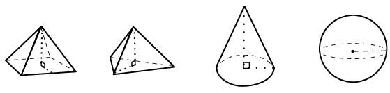
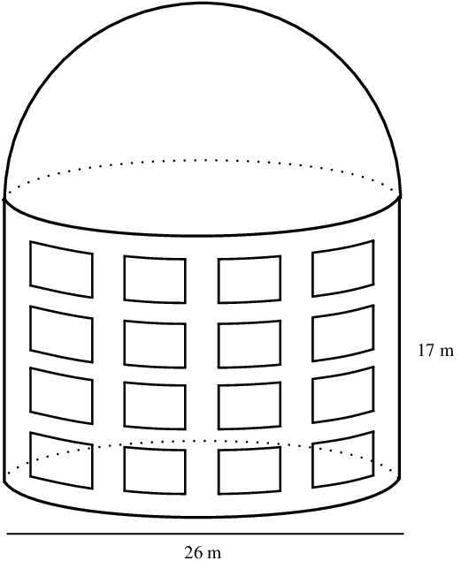
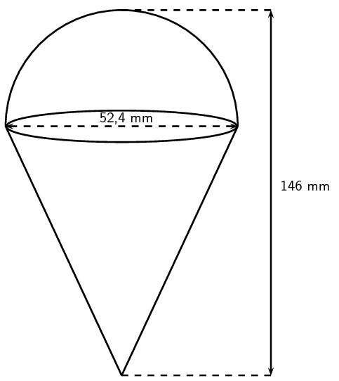
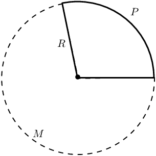

## 7.3 Right pyramids, right cones and spheres (EMBHZ)

A pyramid is a geometric solid that has a polygon as its base and sides that converge at a point called the apex.
      In other words the sides are **not** perpendicular to the base.

The triangular pyramid and square pyramid take their names from the shape of their base. We call a pyramid a
      “right pyramid” if the line between the apex and the centre of the base is perpendicular to the base.
      Cones are similar to pyramids except that their bases are circles instead of polygons. Spheres are solids that are
      perfectly round and look the same from any direction.

### Surface area of pyramids, cones and spheres (EMBJ2)

| Square pyramid |  | \(\begin{array}{r@{\;}c@{\;}l}
            \text{Surface area} &=& \text{area of base} \;+ \\
            && \text{area of triangular sides} \\
            &=& b^2 + \text{4}\left(\frac{1}{2}b{h}_{s}\right) \\
            &=& b\left(b+2{h}_{s}\right)
            \end{array}\) |
| --- | --- | --- |
| Triangular pyramid |  | \(\begin{array}{r@{\;}c@{\;}l}
            \text{Surface area} &= & \text{area of base} \;+ \\
            && \text{area of triangular sides} \\
            &=& \left(\frac{1}{2}b\times {h}_{b}\right)+3\left(\frac{1}{2}b\times {h}_{s}\right) \\
            &=& \frac{1}{2}b\left({h}_{b}+3{h}_{s}\right)
            \end{array}\) |
| Right cone |  | \(\begin{array}{r@{\;}c@{\;}l}
            \text{Surface area} &=& \text{area of base} \;+ \\
            && \text{area of walls} \\
            &=& \pi {r}^{2}+\frac{1}{2}\times 2\pi rh \\
            &=& \pi r\left(r+h\right)
            \end{array}\) |
| Sphere |  | \(\text{Surface area} = \text{4} \pi r^2\) |

<QuizCard id="m11-07-03a" title="Interactive Exercise 7.7" question="Calculate the surface area of the following square pyramid:" options=["mm", "mm\u00b2", "mm\u00b3"] answer="2625, 1" hint="You should enter a number here. If you want to, you can use a space to separate thousands.                Example: 12 800,25 For scientific notation you need to use the multiply symbol                ( ∗ ) and the exponent symbol ( ^ ). For example 6,673 × 10 −11 should be written as: 6,673 ∗ 10^−11" explanation="How do you calculate surface area? NOTE: The surface area of a solid is the area on the outside of the solid. We calculate surface area by calculating the areas of each of the faces and adding them together. This solid is a square pyramid . It has one square face (the bottom) and four identical triangular faces. It is useful to think about the net of the solid: \[                         \begin{array}{c}                             \text{Surface area} = {\color{teal}{A_{\text{square}}}} + 4 \times ({\color{green}{A_{\text{triangle}}}})                         \end{array}                     \] Calculate the surface area NOTE: Use the following formulas: \(A_{\text{square}} = s^2\) \(A_{\text{triangle}} = \dfrac{1}{2} b \times h\) \[                     \begin{aligned}                         \text{Surface area} &= {\color{teal}{A_{\text{square}}}} + 4 \times ({\color{green}{A_{\text{triangle}}}}) \\                                      &= s^2 + 4 \times (\frac{1}{2} b \times h) \\                                      &= \text{25}^2 + 4 \times (\frac{1}{2} \times \text{25} \times \text{40}) \\                                      &= \text{2 625}\ \text{mm$^{2}$}                     \end{aligned}                 \] Submit your answer as: and mm²" />

<QuizCard id="m11-07-03a" title="Interactive Exercise 7.7" question="The figure here is a sphere. The radius of the sphere is \( r =  \text{8}\ \text{units}\) . Determine the surface area of the figure. INSTRUCTION: Round your answer to two decimal places." options=[] answer=" ['804.25', '8.04e+2', '803.84', '804.57', '8.05e+2'] " hint="You should enter a number here. If you want to, you can use a space to separate thousands.                Example: 12 800,25 For scientific notation you need to use the multiply symbol                ( ∗ ) and the exponent symbol ( ^ ). For example 6,673 × 10 −11 should be written as: 6,673 ∗ 10^−11" explanation="Determine the surface area of the sphere The surface area of an object is the outside surface of the shape which you can cover or paint (like covering a table with a cloth or painting the outside of a building).  In the case of a sphere, the surface area is like the surface of the Earth in the picture below.  The surface is covered by water and land, which you can see easily in this photo. (Image from http://eclipse.gsfc.nasa.gov/) The formula for the surface area of a sphere is \( A = 4\pi r^{2}\) . You need to memorise this formula! \[                     \begin{aligned}                         A_{\text{sphere}} & = 4\pi r^{2}	\\                         & = 4\pi (\text{8})^{2}	\\                         & = 4\pi (\text{64})	\\                         & = \text{804,24771...} \\ & \approx \text{804,25}\ \text{units$^{2}$}                     \end{aligned}                 \] The total surface area of the sphere is \(\text{804,25}\ \text{units$^{2}$}\) . Submit your answer as:" />

<QuizCard id="m11-07-03a" title="Interactive Exercise 7.7" question="The figure here is a cone. The vertical height of the cone is \( H = \text{8,49}\ \text{units}\) and the slant height of the cone is \( h = \text{9}\ \text{units}\) ; the radius of the cone is shown, \( r =  \text{3}\ \text{units}\) . The diagram is not necessarily drawn to scale. Find the surface area of the figure. INSTRUCTION: Round your answer to two decimal places." options=[] answer=" ['113.10', '1.13e+2', '113.04', '113.14'] " hint="You should enter a number here. If you want to, you can use a space to separate thousands.                Example: 12 800,25 For scientific notation you need to use the multiply symbol                ( ∗ ) and the exponent symbol ( ^ ). For example 6,673 × 10 −11 should be written as: 6,673 ∗ 10^−11" explanation="Identify the components of the cone The surface area of an object is the outside surface of the shape which you can cover or paint (like covering a table with a cloth or painting the outside of a building).  We need to look at the 'net' of the cone to see all of its surfaces.  Imagine 'unfolding' the shape and letting it open up as if you want to look inside... it would look something like this: You can see that the cone is made of one circle and a larger unusual shape.  The total surface area of the cone is the sum of these two areas. \[ 	            	\begin{array}{c} 	                A_{\text{cone}} = \text{circle} + \text{other piece} 	                \end{array}   	            \] Find the surface area of the cone The area of each circle comes from the formula \( A = \pi r^{2}\) , and the radius of the circle is shown in the diagram. The other shape, which is an irregular shape, has an area of \( A = \frac{1}{2} \times 2\pi rh \) . You must memorise this formula if you want to get the correct answers. \[     	            \begin{aligned} 	                    A_{\text{cone}} & = \text{circle} + \text{other piece}	\\ 	                    & = \pi r^{2} \; + \; \frac{1}{2} \times 2\pi r h \\ 	                    & = \pi (\text{3})^{2} +  \pi (\text{3}) (\text{9})	\\ 	                    & = \pi (\text{9}) + \text{27}\pi 	\\ 	                    & = \text{28,27433...} + \text{84,82300...}\\ 	                    & = \text{113,09733...} \\ & \approx \text{113,10}\ \text{units$^{2}$}    	                \end{aligned}   	            \] Therefore, the surface area of the cone is \(\text{113,10}\ \text{units$^{2}$}\) . Submit your answer as:" />

<QuizCard id="m11-07-03a" title="Interactive Exercise 7.7" question="Calculate the surface area of the following square pyramid:" options=["mm", "mm\u00b2", "mm\u00b3"] answer="5075, 1" hint="You should enter a number here. If you want to, you can use a space to separate thousands.                Example: 12 800,25 For scientific notation you need to use the multiply symbol                ( ∗ ) and the exponent symbol ( ^ ). For example 6,673 × 10 −11 should be written as: 6,673 ∗ 10^−11" explanation="How do you calculate surface area? NOTE: The surface area of a solid is the area on the outside of the solid. We calculate surface area by calculating the areas of each of the faces and adding them together. This solid is a square pyramid . It has one square face (the bottom) and four identical triangular faces. It is useful to think about the net of the solid: \[                         \begin{array}{c}                             \text{Surface area} = {\color{red}{A_{\text{square}}}} + 4 \times ({\color{DarkOrange}{A_{\text{triangle}}}})                         \end{array}                     \] Calculate the surface area NOTE: Use the following formulas: \(A_{\text{square}} = s^2\) \(A_{\text{triangle}} = \dfrac{1}{2} b \times h\) \[                     \begin{aligned}                         \text{Surface area} &= {\color{red}{A_{\text{square}}}} + 4 \times ({\color{DarkOrange}{A_{\text{triangle}}}}) \\                                      &= s^2 + 4 \times (\frac{1}{2} b \times h) \\                                      &= \text{35}^2 + 4 \times (\frac{1}{2} \times \text{35} \times \text{55}) \\                                      &= \text{5 075}\ \text{mm$^{2}$}                     \end{aligned}                 \] Submit your answer as: and mm²" />

<QuizCard id="m11-07-03a" title="Interactive Exercise 7.7" question="The figure here is a cone. The vertical height of the cone is \( H = \text{9,54}\ \text{units}\) and the slant height of the cone is \( h = \text{10}\ \text{units}\) ; the radius of the cone is shown, \( r =  \text{3}\ \text{units}\) . The diagram is not necessarily drawn to scale. Calculate the surface area of the figure. INSTRUCTION: Round your answer to two decimal places." options=[] answer=" ['122.52', '1.23e+2', '122.46', '1.22e+2', '122.57'] " hint="You should enter a number here. If you want to, you can use a space to separate thousands.                Example: 12 800,25 For scientific notation you need to use the multiply symbol                ( ∗ ) and the exponent symbol ( ^ ). For example 6,673 × 10 −11 should be written as: 6,673 ∗ 10^−11" explanation="Identify the components of the cone The surface area of an object is the outside surface of the shape which you can cover or paint (like covering a table with a cloth or painting the outside of a building).  We need to look at the 'net' of the cone to see all of its surfaces.  Imagine 'unfolding' the shape and letting it open up as if you want to look inside... it would look something like this: You can see that the cone is made of one circle and a larger unusual shape.  The total surface area of the cone is the sum of these two areas. \[ 	            	\begin{array}{c} 	                A_{\text{cone}} = \text{circle} + \text{other piece} 	                \end{array}   	            \] Calculate the surface area of the cone The area of each circle comes from the formula \( A = \pi r^{2}\) , and the radius of the circle is shown in the diagram. The other shape, which is an irregular shape, has an area of \( A = \frac{1}{2} \times 2\pi rh \) . You must memorise this formula if you want to get the correct answers. \[     	            \begin{aligned} 	                    A_{\text{cone}} & = \text{circle} + \text{other piece}	\\ 	                    & = \pi r^{2} \; + \; \frac{1}{2} \times 2\pi r h \\ 	                    & = \pi (\text{3})^{2} +  \pi (\text{3}) (\text{10})	\\ 	                    & = \pi (\text{9}) + \text{30}\pi 	\\ 	                    & = \text{28,27433...} + \text{94,24777...}\\ 	                    & = \text{122,52211...} \\ & \approx \text{122,52}\ \text{units$^{2}$}    	                \end{aligned}   	            \] Therefore, the surface area of the cone is \(\text{122,52}\ \text{units$^{2}$}\) . Submit your answer as:" />

<QuizCard id="m11-07-03a" title="Interactive Exercise 7.7" question="The figure here is a sphere. The radius of the sphere is \( r =  \text{8}\ \text{units}\) . Calculate the surface area of the figure. INSTRUCTION: Round your answer to two decimal places." options=[] answer=" ['804.25', '8.04e+2', '803.84', '804.57', '8.05e+2'] " hint="You should enter a number here. If you want to, you can use a space to separate thousands.                Example: 12 800,25 For scientific notation you need to use the multiply symbol                ( ∗ ) and the exponent symbol ( ^ ). For example 6,673 × 10 −11 should be written as: 6,673 ∗ 10^−11" explanation="Calculate the surface area of the sphere The surface area of an object is the outside surface of the shape which you can cover or paint (like covering a table with a cloth or painting the outside of a building).  In the case of a sphere, the surface area is like the surface of the Earth in the picture below.  The surface is covered by water and land, which you can see easily in this photo. (Image from http://eclipse.gsfc.nasa.gov/) The formula for the surface area of a sphere is \( A = 4\pi r^{2}\) . You need to memorise this formula! \[                     \begin{aligned}                         A_{\text{sphere}} & = 4\pi r^{2}	\\                         & = 4\pi (\text{8})^{2}	\\                         & = 4\pi (\text{64})	\\                         & = \text{804,24771...} \\ & \approx \text{804,25}\ \text{units$^{2}$}                     \end{aligned}                 \] The total surface area of the sphere is \(\text{804,25}\ \text{units$^{2}$}\) . Submit your answer as:" />

### Volume of pyramids, cones and spheres (EMBJ3)

| Square pyramid |  | \(\begin{array}{r@{\;}c@{\;}l}
            \text{Volume} &=& \frac{1}{3}\times \text{area of base} \;\times \\
            && \text{height of pyramid} \\
            &=& \frac{1}{3}\times {b}^{2}\times H
            \end{array}\) |
| --- | --- | --- |
| Triangular pyramid |  | \(\begin{array}{r@{\;}c@{\;}l}
            \text{Volume} &=& \frac{1}{3}\times \text{area of base} \;\times \\
            && \text{height of pyramid} \\
            &=& \frac{1}{3}\times \frac{1}{2}bh\times H
            \end{array}\) |
| Right cone |  | \(\begin{array}{r@{\;}c@{\;}l}
            \text{Volume} &=& \frac{1}{3}\times \text{area of base} \;\times \\
            && \text{height of cone} \\
            &=& \frac{1}{3}\times \pi {r}^{2}\times H
            \end{array}\) |
| Sphere |  | \(\text{Volume}=\frac{4}{3}\pi {r}^{3}\) |

<QuizCard id="m11-07-03b" title="Interactive Exercise 7.8" question="The figure below shows a sphere.  The radius of the sphere is \( r =  \text{5}\ \text{units}\) . The diagram is not necessarily drawn to any particular scale. Determine the volume of the figure. INSTRUCTION: Round your answer to two decimal places." options=[] answer=" ['523.60', '5.24e+2', '523.33', '5.23e+2', '523.81'] " hint="You should enter a number here. If you want to, you can use a space to separate thousands.                Example: 12 800,25 For scientific notation you need to use the multiply symbol                ( ∗ ) and the exponent symbol ( ^ ). For example 6,673 × 10 −11 should be written as: 6,673 ∗ 10^−11" explanation="Determine the volume of the sphere The formula for the volume of a sphere - which you need to memorise - is: \(V_{\text{sphere}} = \frac{4}{3} \pi r^{3}\) . Substitute in the value of \( r \) and go for it! \[                     \begin{aligned}                         V_{\text{sphere}} & = \frac{4}{3} \pi r^{3}	\\                         & = \frac{4}{3} \pi (\text{5})^{3}	\\                         & = \frac{4}{3} \pi (\text{125})	\\                         & = \frac{500}{3} \pi	\\                         & = \text{523,59877...} \\ & \approx \text{523,60}\ \text{units$^{3}$}                     \end{aligned}                 \] The total volume for the sphere is \(\text{523,60}\ \text{units$^{3}$}\) . Submit your answer as:" />

<QuizCard id="m11-07-03b" title="Interactive Exercise 7.8" question="The diagram below shows a pyramid with a square base. The dimensions of the pyramid are as follows: the vertical height is \( H = \text{6} \ \text{units}\) . the slant height is \( h = \text{6,50}\ \text{units}\) . the length of a side of the base of the pyramid is \( b =  \text{5}\ \text{units}\) . NOTE: The diagram is not necessarily drawn to scale. Calculate the volume of the pyramid. INSTRUCTION: If the answer is not an integer, round the answer to two decimal places." options=[] answer=" 50 " hint="You should enter a number here. If you want to, you can use a space to separate thousands.                Example: 12 800,25 For scientific notation you need to use the multiply symbol                ( ∗ ) and the exponent symbol ( ^ ). For example 6,673 × 10 −11 should be written as: 6,673 ∗ 10^−11" explanation="Calculate the volume of the pyramid The volume of a square pyramid depends on the length of a side of the base and the vertical height, which is \(\text{6}\ \text{units}\) in this case.  For the formula we use, the volume does not depend on the slant height, which means that you should ignore the slant height of \(\text{6,50}\) in this question. The formula for the volume of a square pyramid is \(V_{\text{square pyramid}} = \frac{1}{3} b^{2}H\) where: \(b\) represents the length of a side of the square base and \(H\) represents the vertical height of the pyramid. You need to memorise this formula! \[                     \begin{aligned}                         V_{\text{square pyramid}} & = \frac{1}{3} b^{2}H		\\                         & = \frac{1}{3} (\text{5})^{2} (\text{6}) \\                         & = \frac{1}{3} (\text{25})(\text{6})	\\                         & = 50                     \end{aligned}                 \] The total volume for the pyramid is \(\text{50}\ \text{units$^{3}$}\) . NOTE: The famous pyramids in Egypt are square pyramids (well, not exactly square, but very close!). The Great Pyramid is approximately \(\text{138,8} \ \text{m}\) tall and has a base which is \(\text{230,4} \ \text{m}\) wide, giving it a volume of approximately \(\text{2 456 027} \ \text{m$^{3}$}\) !  This is so large that if you wanted to pack the entire volume of the great Pyramid with \(\text{1} \ \text{litre}\) juice boxes, you would need \(\text{2,4}\) billion juice boxes. Wow! (Image source: http://lunarscience.nasa.gov/wp-content/uploads/2012/09/pyramid.jpg) Submit your answer as:" />

<QuizCard id="m11-07-03b" title="Interactive Exercise 7.8" question="The figure here is a cone.  The vertical height of the cone is \( H = \text{12}\ \text{units}\) and the slant height is \( h = \text{12,17}\ \text{units}\) ; the radius of the cone is shown, \( r =  \text{2}\ \text{units}\) . The diagram is not necessarily drawn to scale. Find the volume of the figure. INSTRUCTION: Round your answer to two decimal places." options=[] answer=" ['50.27', '5.03e+1', '50.24', '5.02e+1', '50.29'] " hint="You should enter a number here. If you want to, you can use a space to separate thousands.                Example: 12 800,25 For scientific notation you need to use the multiply symbol                ( ∗ ) and the exponent symbol ( ^ ). For example 6,673 × 10 −11 should be written as: 6,673 ∗ 10^−11" explanation="Find the volume of the cone The volume of a cone depends on the radius of the base and the vertical height, which is \(\text{12}\ \text{units}\) in this case.  The volume does not depend on the slant height, which means that you can ignore the \(\text{12,17}\) in this question. The formula for the volume of a cone - which you need to memorise - is \(V_{\text{cone}} = \frac{1}{3} \times \pi r^{2}H\) . \[                     \begin{aligned}                         V_{\text{cone}} & = \frac{1}{3} \times \pi r^{2}H		\\                         & = \frac{1}{3} \times \pi (\text{2})^{2} (\text{12}) \\                         & = \frac{1}{3} \pi (\text{4})(\text{12})	\\                         & = 16\pi	\\                         & = \text{50,26548...} \\ & \approx \text{50,27}\ \text{units$^{3}$}                     \end{aligned}                 \] Therefore, the total volume of the cone is \(\text{50,27}\ \text{units$^{3}$}\) . Submit your answer as:" />

<QuizCard id="m11-07-03b" title="Interactive Exercise 7.8" question="The diagram below shows a pyramid with a square base. The dimensions of the pyramid are as follows: the vertical height is \( H = \text{5} \ \text{units}\) . the slant height is \( h = \text{5,83}\ \text{units}\) . the length of a side of the base of the pyramid is \( b =  \text{6}\ \text{units}\) . NOTE: The diagram is not necessarily drawn to scale. Determine the volume of the pyramid. INSTRUCTION: If the answer is not an integer, round the answer to two decimal places." options=[] answer=" 60 " hint="You should enter a number here. If you want to, you can use a space to separate thousands.                Example: 12 800,25 For scientific notation you need to use the multiply symbol                ( ∗ ) and the exponent symbol ( ^ ). For example 6,673 × 10 −11 should be written as: 6,673 ∗ 10^−11" explanation="Determine the volume of the pyramid The volume of a square pyramid depends on the length of a side of the base and the vertical height, which is \(\text{5}\ \text{units}\) in this case.  For the formula we use, the volume does not depend on the slant height, which means that you should ignore the slant height of \(\text{5,83}\) in this question. The formula for the volume of a square pyramid is \(V_{\text{square pyramid}} = \frac{1}{3} b^{2}H\) where: \(b\) represents the length of a side of the square base and \(H\) represents the vertical height of the pyramid. You need to memorise this formula! \[                     \begin{aligned}                         V_{\text{square pyramid}} & = \frac{1}{3} b^{2}H		\\                         & = \frac{1}{3} (\text{6})^{2} (\text{5}) \\                         & = \frac{1}{3} (\text{36})(\text{5})	\\                         & = 60                     \end{aligned}                 \] The total volume for the pyramid is \(\text{60}\ \text{units$^{3}$}\) . NOTE: The famous pyramids in Egypt are square pyramids (well, not exactly square, but very close!). The Great Pyramid is approximately \(\text{138,8} \ \text{m}\) tall and has a base which is \(\text{230,4} \ \text{m}\) wide, giving it a volume of approximately \(\text{2 456 027} \ \text{m$^{3}$}\) !  This is so large that if you wanted to pack the entire volume of the great Pyramid with \(\text{1} \ \text{litre}\) juice boxes, you would need \(\text{2,4}\) billion juice boxes. Wow! (Image source: http://lunarscience.nasa.gov/wp-content/uploads/2012/09/pyramid.jpg) Submit your answer as:" />

<QuizCard id="m11-07-03b" title="Interactive Exercise 7.8" question="The figure below shows a sphere.  The radius of the sphere is \( r =  \text{7}\ \text{units}\) . The diagram is not necessarily drawn to any particular scale. Find the volume of the figure. INSTRUCTION: Round your answer to two decimal places." options=[] answer=" ['1436.76', '1.44e+3', '1436.03', '1437.33'] " hint="You should enter a number here. If you want to, you can use a space to separate thousands.                Example: 12 800,25 For scientific notation you need to use the multiply symbol                ( ∗ ) and the exponent symbol ( ^ ). For example 6,673 × 10 −11 should be written as: 6,673 ∗ 10^−11" explanation="Find the volume of the sphere The formula for the volume of a sphere - which you need to memorise - is: \(V_{\text{sphere}} = \frac{4}{3} \pi r^{3}\) . Substitute in the value of \( r \) and go for it! \[                     \begin{aligned}                         V_{\text{sphere}} & = \frac{4}{3} \pi r^{3}	\\                         & = \frac{4}{3} \pi (\text{7})^{3}	\\                         & = \frac{4}{3} \pi (\text{343})	\\                         & = \frac{1372}{3} \pi	\\                         & = \text{1 436,75504...} \\ & \approx \text{1 436,76}\ \text{units$^{3}$}                     \end{aligned}                 \] The total volume for the sphere is \(\text{1 436,76}\ \text{units$^{3}$}\) . Submit your answer as:" />

<QuizCard id="m11-07-03b" title="Interactive Exercise 7.8" question="The figure here is a cone.  The vertical height of the cone is \( H = \text{11}\ \text{units}\) and the slant height is \( h = \text{13,04}\ \text{units}\) ; the radius of the cone is shown, \( r =  \text{7}\ \text{units}\) . The diagram is not necessarily drawn to scale. Calculate the volume of the figure. INSTRUCTION: Round your answer to two decimal places." options=[] answer=" ['564.44', '5.64e+2', '564.15', '564.67', '5.65e+2'] " hint="You should enter a number here. If you want to, you can use a space to separate thousands.                Example: 12 800,25 For scientific notation you need to use the multiply symbol                ( ∗ ) and the exponent symbol ( ^ ). For example 6,673 × 10 −11 should be written as: 6,673 ∗ 10^−11" explanation="Calculate the volume of the cone The volume of a cone depends on the radius of the base and the vertical height, which is \(\text{11}\ \text{units}\) in this case.  The volume does not depend on the slant height, which means that you can ignore the \(\text{13,04}\) in this question. The formula for the volume of a cone - which you need to memorise - is \(V_{\text{cone}} = \frac{1}{3} \times \pi r^{2}H\) . \[                     \begin{aligned}                         V_{\text{cone}} & = \frac{1}{3} \times \pi r^{2}H		\\                         & = \frac{1}{3} \times \pi (\text{7})^{2} (\text{11}) \\                         & = \frac{1}{3} \pi (\text{49})(\text{11})	\\                         & = \frac{539}{3}\pi	\\                         & = \text{564,43948...} \\ & \approx \text{564,44}\ \text{units$^{3}$}                     \end{aligned}                 \] Therefore, the total volume of the cone is \(\text{564,44}\ \text{units$^{3}$}\) . Submit your answer as:" />

<Callout type="note" title="Note">
<VideoPlayer src="http://www.khanacademy.org/embed_video?v=IelS2vg7JO8" title="Video: 235K" />
</Callout>

<Callout type="tip" title="Worked example 4: Finding surface area and volume">
**Question:**
The Southern African Large Telescope (SALT) is housed in a cylindrical building with a domed roof in the
            shape of a hemisphere. The height of the building wall is \(\text{17}\) \(\text{m}\) and the diameter is
            \(\text{26}\) \(\text{m}\).

2. Calculate the total surface area of the building.
4. Calculate the total volume of the building.

**Calculate the total surface area:**
\begin{align*}
          \text{Total surface area} &= \text{area of the dome} + \text{area of the cylinder} \\
          \text{Surface area} &= \left[\frac{1}{2}(4 \pi r^2)\right] + \left[2 \pi r \times h\right] \\
          &= \frac{1}{2}(4 \pi)(13)^2 + 2 \pi (\text{13})(\text{17}) \\
          &= \text{2 450}\text{ m$^{2}$}
          \end{align*}

**Calculate the total volume:**
\begin{align*}
          \text{Total volume} &= \text{volume of the dome} + \text{volume of the cylinder} \\
          \text{Volume} &= \left[\frac{1}{2} \times \left( \frac{4}{3} \pi r^3 \right)\right] + \left[\pi r^2
          h\right] \\
          &= \frac{2}{3} \pi (\text{13})^3 + \pi (\text{11})^2 (\text{13}) \\
          &= \text{9 543}\text{ m$^{3}$}
          \end{align*}
</Callout>

## Finding surface area and volume

### Textbook Exercise 7.4

An ice-cream cone has a diameter of \(\text{52,4}\) \(\text{mm}\) and a total height of \(\text{146}\)
                \(\text{mm}\).

**Problem:**
Calculate the surface area of the ice-cream and the cone.

**Solution:**
\begin{align*}
                \text{Radius }&=\frac{\text{52,4}}{2} \\
                &=\text{26,2}\text{ mm} \\
                \text{Height of cone }&= 146 - \text{26,2} \\
                &=\text{119,8}\text{ mm}
                \end{align*}

The surface area of the ice-cream is half a sphere:

                \begin{align*}
                \text{Surface area ice-cream:} &=\dfrac{1}{2}(4 \pi r^{2}) \\
                &= \dfrac{1}{2}(4 \times \pi \times (26,2)^{2}) \\
                &\approx \text{4313,03 mm}^{2}
                \end{align*}

The surface area of the cone must not include the surface area of the circular face.

                \begin{align*}
                \text{Surface area cone }&= \pi r(r + \sqrt{h^{2} + r^{2}}) - \pi r^{2} \\
                &= \pi \times \text{26,2} \times (\text{26,2}+\sqrt{(119,8)^{2} + (26,2)^{2}}) - \pi \times
                (26,2)^{2} \\
                &\approx \text{10093,76 mm}^{2} \\
                \therefore \text{Surface area ice-cream and cone} &= \text{4313,03} + \text{10093,76} \\
                &=\text{14406,79 mm}^{2} \\
                &\approx \text{144,07}\text{ cm$^{2}$}
                \end{align*}

**Problem:**
Calculate the total volume of the ice-cream and the cone.

**Solution:**
\begin{align*}
                \text{Volume}&=\text{volume(cone)}+\text{volume}(\frac{1}{2}\text{sphere}) \\
                &=\frac{1}{3}\pi r^2h+\frac{1}{2}\left(\frac{4}{3}\pi r^3\right) \\
                &=\frac{1}{3}\pi(\text{26,2})^2\times\text{119,8}+\frac{2}{3}\pi(\text{26,2})^3 \\
                &=\text{86 116,82}\ldots +\text{37 667,12}\ldots \\
                &=\text{123 783,953}\ldots \text{ mm$^{3}$} \\
                &\approx\text{124}\text{ cm$^{3}$}
                \end{align*}

**Problem:**
How many ice-cream cones can be made from a \(\text{5}\) \(\text{ℓ}\) tub of ice-cream (assume
                  the cone is completely filled with ice-cream)?

**Solution:**
\begin{align*}
                \text{1 000}\text{ cm$^{3}$}&=\text{1}\text{ ℓ} \\
                \therefore \text{5}\text{ ℓ}&= \text{5 000}\text{ cm$^{3}$}\\
                \therefore \frac{\text{5 000}}{124} &\approx 40 \text{ cones}
                \end{align*}

Consider the net of the cone given below. \(R\) is the length from the tip of the cone to its
                  perimeter, \(P\).

**Problem:**
Determine the value of \(R\).

**Solution:**
\(R\) is the slant height.

                  \begin{align*}
                  R &= \sqrt{r^{2} + h^{2}} \\
                  &= \sqrt{(\text{26,2})^{2} + (\text{119,8})^{2}} \\
                  &= \text{122,631}\ldots\text{ mm} \\
                  &\approx \text{123}\text{ mm}
                  \end{align*}

**Problem:**
Calculate the length of arc \(P\).

**Solution:**
\begin{align*}
                  P &=\text{circumference of cone} \\
                  & = 2\pi(\text{26,2}) \\
                  &\approx \text{165}\text{ mm}
                  \end{align*}

**Problem:**
Determine the length of arc \(M\).

**Solution:**
\begin{align*}
                  M&=2\pi(123)-165\\
                  &=\text{608}\text{ mm}
                  \end{align*}
