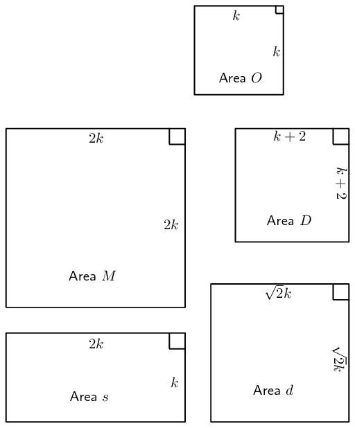

## 7.4 Multiplying a dimension by a constant factor (EMBJ4)

When one or more of the dimensions of a prism or cylinder is multiplied by a constant, the
      surface area and volume will change. The new surface area and volume can be calculated by
      using the formulae from the preceding section.

It is important to see a relationship between the change in dimensions and the resulting change
      in surface area and volume. These relationships make it simpler to
      calculate the new volume or surface area of an object when its dimensions are
      scaled up or down.

Consider a rectangular prism of dimensions \(l\), \(b\) and \(h\). Below we multiply one, two and
      three of its dimensions by a constant factor of \(\text{5}\) and calculate the new volume and surface area.

| Dimensions | Volume | Surface |
| --- | --- | --- |
| Original dimensions | \(\begin{aligned}
          V &= l \times b \times h \\
          & =lbh
          \end{aligned}\) | \(\begin{aligned}
          A & =2\left[\left(l\times h\right)+\left(l\times b\right)+\left(b\times h\right)\right]\\
          & =2\left(lh+lb+bh\right)
          \end{aligned}\) |
| Multiply one dimension by \(\text{5}\) | \(\begin{aligned}
          {V}_{1}&= l\times b\times 5h \\
          &= 5\left(lbh\right) \\
          &= 5V
          \end{aligned}\) | \(\begin{aligned}
          A_1 &= 2\left[\left(l\times 5h\right)+\left(l\times b\right)+\left(b\times 5h\right)\right] \\
          &= 2\left(5lh+lb+5bh\right)
          \end{aligned}\) |
| Multiply two dimensions by \(\text{5}\) | \(\begin{aligned}
          V &= 5l \times b \times 5h \\
          &= 5 \cdot 5 (lbh) \\
          &= 5^2 V
          \end{aligned}\) | \(\begin{aligned}
          & A_2 \\
          =& 2\left[ (5l\times 5h) + (5l\times b) + (b\times 5h) \right] \\
          =& 2\times 5 (5lh + lb + bh)
          \end{aligned}\) |
| Multiply all three dimensions by \(\text{5}\) | \(\begin{aligned}
          V &= 5l \times 5b \times 5h \\
          &= 5^3 (lbh) \\
          &= 5^3 V
          \end{aligned}\) | \(\begin{aligned}
          & A_3 \\
          =& 2\left[ (5l\times 5h) + (5l\times 5b) + (5b\times 5h) \right] \\
          =& 2\times (5^2lh + 5^2lb + 5^2bh) \\
          =& 5^2 \times 2 (lh + lb + bh) \\
          =& 5^2 A
          \end{aligned}\) |
| Multiply all three dimensions by \(k\) | \(\begin{aligned}
          V &= kl \times kb \times kh \\
          &= k^3 (lbh) \\
          &= k^3 V
          \end{aligned}\) | \(\begin{aligned}
          & A_k \\
          =& 2\left[ (kl\times kh) + (kl\times kb) + (kb\times kh) \right] \\
          =& 2\times (k^2lh + k^2lb + k^2bh) \\
          =& k^2 \times 2 (lh + lb + bh) \\
          =& k^2 A
          \end{aligned}\) |

<Callout type="tip" title="Worked example 5: The effects of \(k\)">
**Question:**
The Nash family wants to build a television room onto their house. The dad draws up the plans for the new
          square room of length \(k\) metres. The mum looks at the plans and decides that the area of the room needs to
          be doubled. To achieve this:

- the mum suggests doubling the length of the sides of the room
- the dad recommends adding \(\text{2}\) \(\text{m}\) to the length of the sides
- the daughter suggests multiplying the length of the sides by a factor of \(\sqrt{2}\)
- the son suggests doubling only the width of the room

Who's suggestion will double the area of the square room? Show all calculations.

**Draw a sketch:**

**Calculate and compare:**
First calculate the area of the square room in the original plan:
          \begin{align*}
          \text{Area } O &= \text{length} \times \text{length} \\
          &= k^2
          \end{align*}
          Therefore, double the area of the room would be \(2k^2\).

Consider the mum's suggestion of doubling the length of the sides of the room:
          \begin{align*}
          \text{Area } M &= \text{length} \times \text{length} \\
          &= 2k \times 2k \\
          &= 4k^2
          \end{align*}
          This area would be \(\text{4}\) times the original area.

The dad suggests adding \(\text{2}\) \(\text{m}\) to the length of the sides of the room:
          \begin{align*}
          \text{Area } D &= \text{length} \times \text{length} \\
          &= (k+2) \times (k+2) \\
          &= k^2 + 4k + 2 \\
          &\ne 2k^2
          \end{align*}
          This is not double the original area.

The daughter suggests multiplying the length of the sides by a factor of \(\sqrt{2}\):
          \begin{align*}
          \text{Area } d &= \text{length} \times \text{length} \\
          &= \sqrt{2}k \times \sqrt{2}k \\
          &= 2k^2
          \end{align*}
          The daughter's suggestion would double the area of the room. Practically, the length of the room could be
          multiplied by \(\sqrt{2} \approx \text{1,41}\) which would given an area of \(\text{1,96}\)
          \(\text{m$^{2}$}\).

The son suggests doubling only the width of the room:
          \begin{align*}
          \text{Area } s &= \text{length} \times \text{length} \\
          &= 2k \times k \\
          &= 2k^2
          \end{align*}
          The son's suggestion would double the area of the room, however the room would no longer be a square.

**Write the final answer:**
The daughter's suggestion of multiplying the length of the sides of the room by a factor of \(\sqrt{2}\)
          would keep the shape of the room a square and would double the area of the room.
</Callout>

## The effects of \(k\)

### Textbook Exercise 7.5

Complete the following sentences:

**Problem:**
If one dimension of a cube is multiplied by a factor \(\frac{1}{2}\), the volume of the cube \(\ldots\)

**Solution:**
Is halved

**Problem:**
If two dimensions of a cube are multiplied by a factor \(\text{7}\), the volume of the cube \(\ldots\)

**Solution:**
\begin{align*}
              \text{multiplied by } 7^2 &= 49 \\
              \therefore &\approx \text{ 50 times bigger}
              \end{align*}
              Approx. \(\text{50}\) times bigger

If three dimensions of a cube are multiplied by a factor \(\text{3}\), then:

**Problem:**
each side of the cube will \(\ldots\)

**Solution:**
become \(\text{3}\) times longer.

**Problem:**
the outer surface area of the cube will \(\ldots\)

**Solution:**
become \(3^2 = 9\) times bigger.

**Problem:**
the volume of the cube will \(\ldots\)

**Solution:**
become \(3^3 = 27\) times bigger.

If each side of a cube is halved, then:

**Problem:**
the outer surface area of the cube will \(\ldots\)

**Solution:**
be multiplied by a factor of \(\frac{1}{2}^2 = \frac{1}{4}\), therefore surface area
                become \(\text{4}\) times smaller.

**Problem:**
the volume of the cube will \(\ldots\)

**Solution:**
be multiplied by a factor of \(\frac{1}{2}^3 = \frac{1}{8}\), therefore surface area
                become \(\text{8}\) times smaller.

The municipality intends building a swimming pool of volume \(W^3\) cubic metres. However, they realise
              that it will be very expensive to fill the pool with water, so they decide to make the pool smaller.

**Problem:**
The length and breadth of the pool are reduced by a factor of
              \(\frac{\text{7}}{\text{10}}\). Express the new volume in terms of \(W\).

**Solution:**
\begin{align*}
              \text{Volume }&=W^3\\
              \text{New volume }&=\text{0,7}W\times \text{0,7}W\times W\\
              &=(\text{0,7})^2W^3\\
              &=\text{0,49}W^3 \\
              &\approx \text{0,5}W^3
              \end{align*}

**Problem:**
The dimensions of the pool are reduced so that the volume of the pool decreases by a factor of
                \(\text{0,8}\). Determine the new dimensions of the pool in terms of \(W\) (remember that the pool must
                be a cube).

**Solution:**
\begin{align*}
              \text{Volume}&=W^3\\
              \text{New volume}&=\text{0,8}W^3\\
              \therefore \text{side length}&=\sqrt[3]{\text{0,8}}\times W\\
              &=\text{0,93}\times W
              \end{align*}

Each side should now be slightly more than \(\frac{9}{10}\) of original length .
