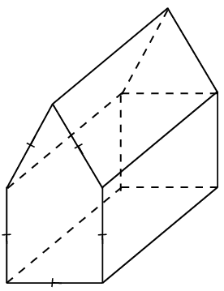
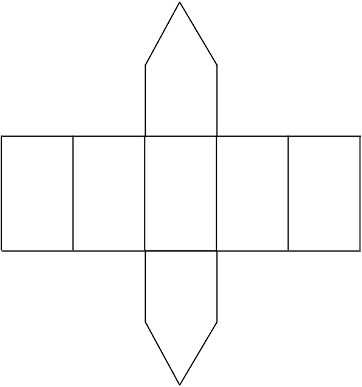
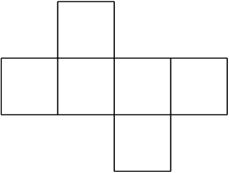
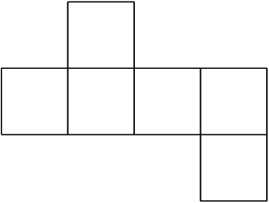
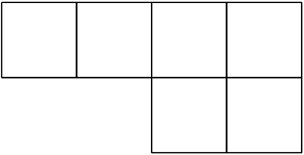
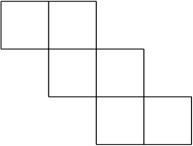
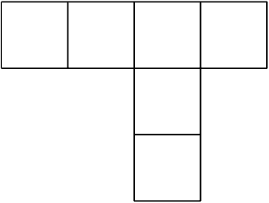
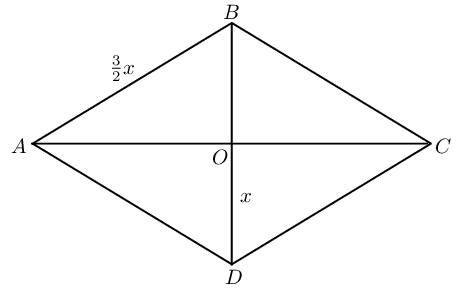
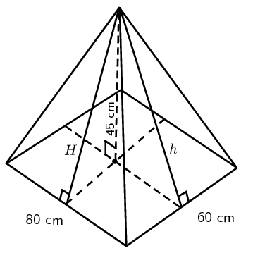

## End of chapter exercises

### Textbook Exercise 7.6

**Problem:**
Describe this figure in terms of a prism.

**Solution:**
Square prism with a triagonal prism on one side. Note that
                                                this is not a pentagonal prism since not all the angles are the same
                                                size.

**Problem:**
Draw a net of this figure.

**Solution:**

**Problem:**
Which of the following is a net of a cube?

2. 
4. 
6. 
8. 
10. 

**Solution:**
a and d

Name and draw the following figures:

**Problem:**
A prism with the least number of sides.

**Solution:**
Triangular prism

**Problem:**
A pyramid with the least number of vertices.

**Solution:**
Triangular pyramid

**Problem:**
A right prism with a kite base.

**Solution:**
Rhombic prism

**Problem:**
Determine how much paper is needed to make a box of width
                                                                \(\text{16}\) \(\text{cm}\), height \(\text{3}\)
                                                                \(\text{cm}\) and length \(\text{20}\) \(\text{cm}\)
                                                                (assume no overlapping at corners).

**Solution:**
\begin{align*}
                                                        \text{Box surface area}&=2[3\times16+3\times20+16\times20]
                                                        \\
                                                        &=2[428] \\
                                                        &= \text{856}\text{ cm$^{2}$}
                                                        \end{align*}

**Problem:**
Give a mathematical name for the shape of the box.

**Solution:**
Rectangular prism

**Problem:**
Calculate the volume of the box.

**Solution:**
\begin{align*}
                                                        \text{Volume } &=3\times16\times20 \\
                                                        &=\text{960}\text{ cm$^{3}$}
                                                        \end{align*}

**Problem:**
Determine how much paper is needed to make a cube with a capacity of
                                                        \(\text{1}\) \(\text{L}\).

**Solution:**
\begin{align*}
                                                1 \text{ L}&= \text{1 000}\text{ cm$^{3}$} \\
                                                \therefore \text{Side length }&= \text{10}\text{ cm} \\
                                                \text{Surface area}&=6\times(10\times10) \\
                                                &= \text{600}\text{ cm$^{2}$}
                                                \end{align*}

**Problem:**
Compare the box and the cube. Which has the greater volume and which
                                                        requires the most paper to make?

**Solution:**
The cube has a greater volume and the box requires more
                                                paper to make.

**Problem:**
\(ABCD\) is a rhombus with sides of length \(\frac{3}{2}x\) millimetres. The
                                                diagonals intersect at \(O\) and length \(DO = x\) millimetres. Express
                                                the area of \(ABCD\) in terms of \(x\).

**Solution:**
\begin{align*}
                                        AD &= \frac{3}{2}x \\
                                        DO&=x \\
                                        AO^2&=\left ( \frac{3}{2}x \right )^2-x^2 \quad (\text{ Pythagoras})\\
                                        &=\frac{9}{4}x^2-x^2\\
                                        &=\frac{5}{4}x^2 \\
                                        \therefore AO&=\frac{x\sqrt{5}}{2} \\
                                        \therefore AC&=x\sqrt{5} \\
                                        \text{Area }&=\frac{1}{2}AC\times BD\\
                                        &=\frac{1}{2}\times x \sqrt{5} \times 2x \\
                                        &=\sqrt{5} x^2
                                        \end{align*}

The diagram shows a rectangular pyramid with a base of length \(\text{80}\)
                                                \(\text{cm}\) and breadth \(\text{60}\) \(\text{cm}\). The vertical
                                                height of the pyramid is \(\text{45}\) \(\text{cm}\).

**Problem:**
Calculate the volume of the pyramid.

**Solution:**
\begin{align*}
                                                \text{Volume }&=\frac{1}{3}\times\text{area of
                                                base}\times\text{height} \\
                                                &=\frac{1}{3}(80\times60)\times45 \\
                                                &=\text{72 000}\text{ cm$^{3}$}
                                                \end{align*}

**Problem:**
Calculate \(H\) and \(h\).

**Solution:**
\begin{align*}
                                                H^2&=30^2+45^2 \quad (\text{ Pythagoras})\\
                                                &= \text{2 925} \\
                                                \therefore H&=\text{54}\text{ cm} \\
                                                h^2&=45^2+40^2 \quad (\text{ Pythagoras})\\
                                                h&=\text{60,2}\text{ cm}
                                                \end{align*}

**Problem:**
Calculate the surface area of the pyramid.

**Solution:**
\begin{align*}
                                                \text{Surface area }&=2 \left (\frac{1}{2}\times80\times H \right
                                                )+2\left ( \frac{1}{2} \times 60\times h\right )+80\times 60\\
                                                &=(80 \times 54)+(60 \times \text{60,2})+\text{4 800}\\
                                                &=\text{12 732}\text{ cm$^{2}$}
                                                \end{align*}

**Problem:**
A group of children are playing soccer in a field. The soccer ball has a
                                                capacity of \(\text{5 000}\) \(\text{cc}\) (cubic centimetres). A
                                                drain pipe in the corner of the field has a diameter of \(\text{20}\)
                                                \(\text{cm}\). Is it possible for the children to lose their ball down
                                                the pipe? Show your calculations.

**Solution:**
\begin{align*}
                                        \text{Volume of ball }&= \frac{4}{3}\pi r^3 \\
                                        &=\text{5 000}\\
                                        \therefore r&= \text{10,6} \\
                                        \text{And diameter }&=\text{21,2}\text{ cm}\\
                                        \text{Diameter of pipe}&=\text{20}\text{ cm}
                                        \end{align*}

No, the ball is too big to go down the drain pipe.

A litre of washing powder goes into a standard cubic container at the
                                                factory.

**Problem:**
Determine the length of the sides of the container.

**Solution:**
\[\text{Dimensions: } \text{10}\text{ cm}\times\text{10}\text{
                                                cm}\times\text{10}\text{ cm}\]

**Problem:**
Determine the dimensions of the cubic container required to
                                                hold double the volume of washing powder.

**Solution:**
\begin{align*}
                                                2l&=\text{2 000}\text{ cm$^{3}$}\\
                                                \therefore s&=\sqrt[3]{\text{2 000}} \\
                                                &=\text{12,6}\text{ cm}
                                                \end{align*}

A cube has sides of length \(k\) units.

**Problem:**
Describe the effect on the volume of the cube if the height
                                                is tripled.

**Solution:**
\begin{align*}
                                                \text{Volume }&=k \times k\times k \\
                                                &=k^3 \\
                                                \text{New volume }&=k\times k\times 3k \\
                                                &=3k^3
                                                \end{align*}

**Problem:**
If all three dimensions of the cube are tripled, determine
                                                the effect on the outer surface area.

**Solution:**
\begin{align*}
                                                \text{Surface area } &= 6\times k^2 \\
                                                &=6k^2 \\
                                                \text{Surface area }&= 6\times (3k)^2 \\
                                                &=54k^2
                                                \end{align*}

**Problem:**
If all three dimensions of the cube are tripled, determine
                                                the effect on the volume.

**Solution:**
\begin{align*}
                                                \text{Volume }&=k^3 \\
                                                \text{New volume }&=(3k)^3 \\
                                                &=27k^3
                                                \end{align*}
