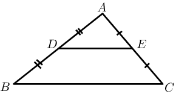

# Chapter 8: Euclidean geometry

## 8.1 Revision (EMBJ6)

### Parallelogram (EMBJ7)

- Discuss terminology.
- Converses are not examinable.
- Good practice for answering questions:
- make a neat and accurate drawing
- state triangle/figure being considered
- give statement and appropriate reason
- give a conclusion

A **parallelogram** is a quadrilateral with both pairs of opposite sides parallel.

Summary of the properties of a parallelogram:

- Both pairs of opposite sides are parallel.
- Both pairs of opposite sides are equal in length.
- Both pairs of opposite angles are equal.
- Both diagonals bisect each other.

<QuizCard id="m11-08-01a" title="Interactive Exercise 8.1" question="Given the following diagram: Select the most specific name for the figure from choices in the list below." options=["rectangle", "quadrilateral", "square", "kite", "parallelogram", "trapezium", "rhombus"] answer=" 5 " hint="" explanation="Select the most specific name for the shape shown This polygon has four sides, so it is a quadrilateral. In fact, we were given one pair of parallel sides. A trapezium is a quadrilateral with at least one pair of opposite sides parallel. So, this quadrilateral is a trapezium . NOTE: The shape is also a  quadrilateral. This question, however, asked for the most specific name for the shape! Submit your answer as: trapezium" />

<QuizCard id="m11-08-01a" title="Interactive Exercise 8.1" question="Given the following diagram: Select the most specific name for the figure from choices in the list below." options=["rectangle", "quadrilateral", "square", "kite", "parallelogram", "trapezium", "rhombus"] answer=" 5 " hint="" explanation="Select the most specific name for the shape shown This polygon has four sides, so it is a quadrilateral. In fact, we were given one pair of parallel sides. A trapezium is a quadrilateral with at least one pair of opposite sides parallel. So, this quadrilateral is a trapezium . NOTE: The shape is also a  quadrilateral. This question, however, asked for the most specific name for the shape! Submit your answer as: trapezium" />

### The mid-point theorem (EMBJ8)

The line joining the mid-points of two sides of a triangle
        is parallel to the third side and equal to half the length of the
        third side.

Given: \(AD = DB\) and \(AE = EC\), we can conclude that \(DE \parallel BC\) and \(DE = \frac{1}{2}BC\).

<QuizCard id="m11-08-01b" title="Interactive Exercise 8.2" question="In the figure below, \(\overline{KL} \parallel \overline{PM}\) , as labelled. 				Furthermore, the following lengths and angles are given: \(\overline{KL} = 				6 ; \overline{PM} = 3 ; \overline{LM} = 4,5;\overline{NP} = 4\) ; \(\hat{N} = 40°\) NOTE: The figure is drawn to scale. Find the length of \(\overline{KP}\) ." options=[] answer="
					4
				" hint="You should enter a number here. If you want to, you can use a space to separate thousands.                Example: 12 800,25 For scientific notation you need to use the multiply symbol                ( ∗ ) and the exponent symbol ( ^ ). For example 6,673 × 10 −11 should be written as: 6,673 ∗ 10^−11" explanation="You can answer this question using the mid-point theorem, but going kind of backwards! This diagram shows a triangle with two parallel segments where the smaller 					segment is exactly half of the larger segment ( \(\text{3}\) is half of \(\text{6}\) ). According to the mid-point 					theorem, both of these things will be true if the smaller segment joins the mid-points of two sides of the triangle! This means that \(M\) must be the mid-point of \(\overline{LN}\) and \(P\) must be the mid-point of \(\overline{KN}\) . A mid-point bisects a segment, which means you have two equal (smaller) 					pieces on each side of the mid-point. You can label these facts as shown below on the diagram. In geometry, you should always label things that you figure out on 					the diagram! Based on this, the answer is \(\overline{KP} = \text{4}\) . Here is a summary of the steps we followed to show that the answer is correct: \(\quad\) STEPS \(\quad\) REASONS \(M\) is mid-point of \(\overline{LN}\) and \(P\) is mid-point of \(\overline{KN}\) \(\overline{KL} \parallel 						\overline{PM} \; \) and \( \; \overline{MP} = 						\frac{1}{2} \times \overline{KL}\) (using the mid-point theorem) \(\overline{KP} \equiv 						\overline{NP}\) Definition of mid-point \(\overline{KP} = \text{4}\) Substitution Submit your answer as:" />

<QuizCard id="m11-08-01b" title="Interactive Exercise 8.2" question="In the figure below, \(\overline{GH} \parallel \overline{LJ}\) , as labelled. 				Furthermore, the following lengths and angles are given: \(\overline{GH} = 				18 ; \overline{LJ} = 9 ; \overline{JK} = 6;\overline{LG} = 7\) ; \(\hat{G} = 42° ; \hat{H} = 51° ; \hat{K} = 87°\) NOTE: The figure is drawn to scale. Calculate the length of \(\overline{GK}\) ." options=[] answer="
					14
				" hint="You should enter a number here. If you want to, you can use a space to separate thousands.                Example: 12 800,25 For scientific notation you need to use the multiply symbol                ( ∗ ) and the exponent symbol ( ^ ). For example 6,673 × 10 −11 should be written as: 6,673 ∗ 10^−11" explanation="You can answer this question using the mid-point theorem, but going kind of backwards! This diagram shows a triangle with two parallel segments where the smaller 					segment is exactly half of the larger segment ( \(\text{9}\) is half of \(\text{18}\) ). According to the mid-point 					theorem, both of these things will be true if the smaller segment joins the mid-points of two sides of the triangle! This means that \(J\) must be the mid-point of \(\overline{HK}\) and \(L\) must be the mid-point of \(\overline{GK}\) . A mid-point bisects a segment, which means you have two equal (smaller) 					pieces on each side of the mid-point. You can label these facts as shown below on the diagram. In geometry, you should always label things that you figure out on 					the diagram! Based on this, the answer is \(\overline{GK} = \text{14}\) . Here is a summary of the steps we followed to show that the answer is correct: \(\quad\) STEPS \(\quad\) REASONS \(J\) is mid-point of \(\overline{HK}\) and \(L\) is mid-point of \(\overline{GK}\) \(\overline{GH} \parallel 						\overline{LJ} \; \) and \( \; \overline{JL} = 						\frac{1}{2} \times \overline{GH}\) (using the mid-point theorem) \(\overline{GK} = 2 \times 						\overline{LG}\) Definition of mid-point \(\overline{GK} = \text{14}\) Substitution Submit your answer as:" />
