## 8.2 Circle geometry (EMBJ9)

**Terminology**

The following terms are regularly used when referring to circles:

- **Arc**
          — a portion of the circumference of a circle.
- **Chord**
          — a straight line joining the ends of an arc.
- **Circumference**
          — the perimeter or boundary line of a circle.
- **Radius (\(r\))**
          — any straight line from the centre of the circle to a point on the circumference.
- **Diameter**
          — a special chord that passes through the centre of the circle. A diameter is a straight line segment from
          one point on the circumference to another point on the circumference that passes through the centre of the
          circle.
- **Segment**
          — part of the circle that is cut off by a chord. A chord divides a circle into two segments.
- **Tangent**
          — a straight line that makes contact with a circle at only one point on the circumference.

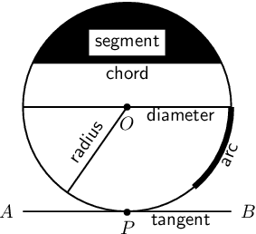

<QuizCard id="m11-08-02a" title="Interactive Exercise 8.3" question="Select a word from Column B that best fits the description in Column A:" options=["Arc", "Chord", "Diameter", "Radius", "Segment", "Tangent", "Arc", "Chord", "Diameter", "Radius", "Segment", "Tangent", "Arc", "Chord", "Diameter", "Radius", "Segment", "Tangent"] answer="0, 1, 4" hint="" explanation="The following diagram is c o l o u r c o d e d . In this diagram you see the different terms used when referring to circles. Each term is the same colour as the part of the circle it describes. Column A Column B A part of the circumference of a circle. Arc A straight line segment joining the ends of an arc. Chord The piece of a circle that is cut off by a chord and an arc. Segment Submit your answer as: Arc and Chord and Segment" />

<QuizCard id="m11-08-02a" title="Interactive Exercise 8.3" question="Select a word from Column B that best fits the description in Column A:" options=["Arc", "Chord", "Diameter", "Radius", "Segment", "Tangent", "Arc", "Chord", "Diameter", "Radius", "Segment", "Tangent", "Arc", "Chord", "Diameter", "Radius", "Segment", "Tangent"] answer="4, 5, 2" hint="" explanation="The following diagram is c o l o u r c o d e d . In this diagram you see the different terms used when referring to circles. Each term is the same colour as the part of the circle it describes. Column A Column B The piece of a circle that is cut off by a chord and an arc. Segment A line that makes contact with a circle at one point on the circle. Tangent A special chord that stretches from one point on the circumference to another point on the circumference and that passes through the centre of a circle. Diameter Submit your answer as: Segment and Tangent and Diameter" />

<QuizCard id="m11-08-02a" title="Interactive Exercise 8.3" question="The following diagram is c o l o u r c o d e d . In this diagram you see the different parts of the circle labelled from A-F, each label is the same colour as the part of the circle it describes. Select the label from Column B that best fits the word in Column A:" options=["A", "B", "C", "D", "E", "F", "A", "B", "C", "D", "E", "F", "A", "B", "C", "D", "E", "F"] answer="2, 1, 4" hint="" explanation="Column A Column B Radius C Chord (non-diameter) B Segment E NOTE: a diameter is also a chord.  However, this question asks you to identify a chord which is not a diameter, so the correct answer for Chord must be \"B\" and cannot be \"D.\" The following diagram is c o l o u r c o d e d . In this diagram you see the different terms used when referring to circles. Each term is the same colour as the part of the circle it describes. Submit your answer as: C and B and E" />

<QuizCard id="m11-08-02a" title="Interactive Exercise 8.3" question="The following diagram is c o l o u r c o d e d . In this diagram you see the different parts of the circle labelled from A-F, each label is the same colour as the part of the circle it describes. Select the label from Column B that best fits the word in Column A:" options=["A", "B", "C", "D", "E", "F", "A", "B", "C", "D", "E", "F", "A", "B", "C", "D", "E", "F"] answer="5, 4, 0" hint="" explanation="Column A Column B Tangent F Segment E Arc A The following diagram is c o l o u r c o d e d . In this diagram you see the different terms used when referring to circles. Each term is the same colour as the part of the circle it describes. Submit your answer as: F and E and A" />

<Callout type="note" title="Note">
<VideoPlayer src="http://www.khanacademy.org/embed_video?v=U2W7HPyC0cM" title="Video: 2365" />
</Callout>

**Axioms**

An axiom is an established or accepted principle. For this section, the following are accepted as axioms.

2. The theorem of Pythagoras states that the square of the hypotenuse of a right-angled triangle is equal to the
             sum of the squares of the other two sides.
   \[(AC)^2 = (AB)^2 + (BC)^2\]
   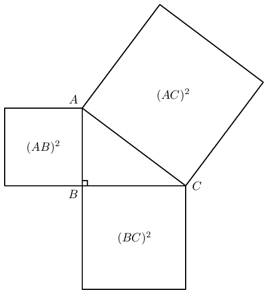
4. A tangent is perpendicular to the radius (\(OT \perp ST\)), drawn at the point of contact with the circle.
   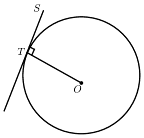

### Theorems (EMBJB)

A theorem is a hypothesis (proposition) that can be shown to be true by accepted mathematical operations and
        arguments. A proof is the process of showing a theorem to be correct.

The converse of a theorem is the reverse of the hypothesis and the conclusion. For example, given the theorem
        “if \(A\), then \(B\)”, the converse is “if \(B\), then \(A\)”.

# Perpendicular line from circle centre bisects chord

If a line is drawn from the centre of a circle perpendicular to a chord, then it bisects the chord.

(Reason: \(\perp\) from centre bisects chord)

Circle with centre \(O\) and line \(OP\) perpendicular to chord \(AB\).

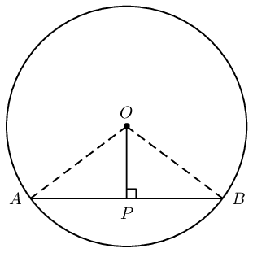

\(AP = PB\)

Draw \(OA\) and \(OB\).

In \(\triangle OPA\) and in \(\triangle OPB\),
            \[\begin{array}{rll}
            OA^2 &= OP^2 + AP^2 & \text{(Pythagoras)} \\
            OB^2 &= OP^2 + BP^2 & \text{(Pythagoras)}
            \end{array}\]

            and
            \[\begin{array}{rll}
            OA &= OB & \text{(equal radii)} \\
            \therefore AP^2 &= BP^2 & \\
            \therefore AP &= BP &
            \end{array}\]

            Therefore \(OP\) bisects \(AB\).

**Alternative proof:**

In \(\triangle OPA\) and in \(\triangle OPB\),
            \[\begin{array}{rll}
            O\hat{P}A &= O\hat{P}B & (\text{given } OP \perp AB) \\
            OA &= OB & \text{(equal radii)} \\
            OP &= OP & \text{(common side)} \\
            \therefore \triangle OPA & \equiv \triangle OPB & \text{(RHS)} \\
            \therefore AP &= PB &
            \end{array}\]

            Therefore \(OP\) bisects \(AB\).

# (PROOF NOT FOR EXAMS) Converse: Line from circle centre to mid-point of chord is perpendicular

If a line is drawn from the centre of a circle to the mid-point of a chord, then the line is perpendicular
            to the chord.

(Reason: line from centre to mid-point \(\perp\))

Circle with centre \(O\) and line \(OP\) to mid-point \(P\) on chord \(AB\).

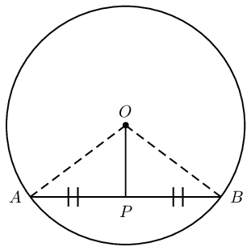

\(OP \perp AB\)

Draw \(OA\) and \(OB\).

In \(\triangle OPA\) and in \(\triangle OPB\),
            \[\begin{array}{rll}
            OA &= OB & \text{(equal radii)} \\
            AP &= PB & \text{(given)} \\
            OP &= OP & \text{(common side)} \\
            \therefore \triangle OPA & \equiv \triangle OPB & \text{(SSS)} \\
            \therefore O\hat{P}A &= O\hat{P}B & \\
            \text{and } O\hat{P}A + O\hat{P}B &= \text{180}\text{°} & (\angle \text{ on str. line}) \\
            \therefore O\hat{P}A = O\hat{P}B &= \text{90}\text{°} &
            \end{array}\]

            Therefore \(OP \perp AB\).

 

        
<a href="http://www.khanacademy.org/embed_video?v=q7eF5Ci944U">Video: 2366</a>

      

# Theorem: Perpendicular bisector of chord passes through circle centre

If the perpendicular bisector of a chord is drawn, then the line will pass through the centre of the
            circle.

(Reason: \(\perp\) bisector through centre)

Circle with mid-point \(P\) on chord \(AB\).

Line \(QP\) is drawn such that \(Q\hat{P}A = Q\hat{P}B = \text{90}\text{°}\).

Line \(RP\) is drawn such that \(R\hat{P}A = R\hat{P}B = \text{90}\text{°}\).

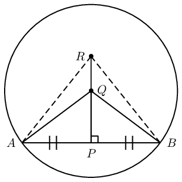

Circle centre \(O\) lies on the line \(PR\)

Draw lines \(QA\) and \(QB\).

Draw lines \(RA\) and \(RB\).

In \(\triangle QPA\) and in \(\triangle QPB\),
            \[\begin{array}{rll}
            AP &= PB & \text{(given)} \\
            QP &= QP & \text{(common side)} \\
            Q\hat{P}A = Q\hat{P}B &= \text{90}\text{°} & \text{(given)} \\
            \therefore \triangle QPA & \equiv \triangle QPB & \text{(SAS)} \\
            \therefore QA &= QB &
            \end{array}\]

Similarly it can be shown that in \(\triangle RPA\) and in \(\triangle RPB\), \(RA = RB\).

We conclude that all the points that are equidistant from \(A\) and \(B\) will lie on the line \(PR\)
            extended. Therefore the centre \(O\), which is equidistant to all points on the circumference, must also lie
            on the line \(PR\).

<Callout type="tip" title="Worked example 1: Perpendicular line from circle centre bisects chord">
**Question:**
Given \(OQ \perp PR\) and \(PR = 8\) units, determine the value of \(x\).

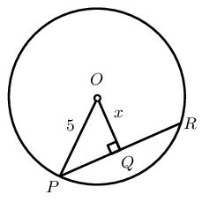

**Use theorems and the given information to find all equal angles and sides on the diagram:**
\(PQ = QR = 4 \qquad (\perp \text{ from centre bisects chord})\)

**Solve for \(x\):**
In \(\triangle OQP\):
            \[\begin{array}{rll}
            PQ &= 4 & (\perp \text{ from centre bisects chord}) \\
            OP^2 &= OQ^2 + QP^2 & (\text{Pythagoras}) \\
            5^2 &= x^2 + 4^2 & \\
            \therefore x^2 &= 25 - 16 & \\
            x^2 &= 9 & \\
            x &= 3 &
            \end{array}\]

**Write the final answer:**
\(x = 3\) units.
</Callout>

## Perpendicular line from center bisects chord

### Textbook Exercise 8.1

**Problem:**
In the circle with centre \(O\), \(OQ \perp PR\), \(OQ = 4\) units and \(PR=10\). Determine \(x\).

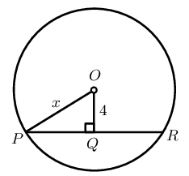

**Solution:**
\[\begin{array}{rll}
              PR &= 10 & (\perp \text{ given }) \\
              \therefore PQ &= 5 & (\perp \text{ from centre bisects chord}) \\
              OP^2 &= OQ^2 + QP^2 & (\text{Pythagoras}) \\
              x^2 &= 4^2 + 5^2 & \\
              \therefore x^2 &= 25 + 16 & \\
              x^2 &= 41 & \\
              x &= \sqrt{41} &
              \end{array}\]

**Problem:**
In the circle with centre \(O\) and radius \(= 10\) units, \(OQ \perp PR\) and \(PR=8\). Determine
                \(x\).

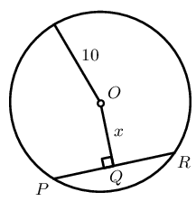

**Solution:**
\[\begin{array}{rll}
              PR &= 8 & (\perp \text{ given }) \\
              \therefore PQ &= 4 & (\perp \text{ from centre bisects chord}) \\
              OP^2 &= OQ^2 + QP^2 & (\text{Pythagoras}) \\
              10^2 &= x^2 + 4^2 & \\
              \therefore x^2 &= 100 - 16 & \\
              x^2 &= 84 & \\
              x &= \sqrt{84} &
              \end{array}\]

**Problem:**
In the circle with centre \(O\), \(OQ \perp PR\), \(PR = 12\) units and \(SQ = 2\) units. Determine
                \(x\).

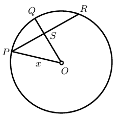

**Solution:**
\[\begin{array}{rll}
              SO &= x -2 & \\
              OP^2 &= OS^2 + SP^2 & (\text{Pythagoras}) \\
              x^2 &= (x-2)^2 + 6^2 & \\
              x^2 &= x^2 - 4x + 4 + 6^2 & \\
              4x &= 40 & \\
              \therefore x &= 10 &
              \end{array}\]

**Problem:**
In the circle with centre \(O\), \(OT \perp SQ\), \(OT \perp PR\), \(OP = 10\) units, \(ST = 5\) units
                and \(PU = 8\) units. Determine \(TU\).

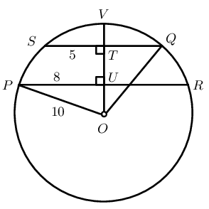

**Solution:**
\[\begin{array}{rll}
              \text{In } \triangle POU, \quad OP^2 &= OU^2 + PU^2 & (\text{Pythagoras}) \\
              10^2 &= OU^2 + 8^2 & \\
              100 - 64 &= OU^2 & \\
              \therefore OU^2 &= 36 & \\
              \therefore OU &= 6 & \\
              \text{In } \triangle QTO, \quad QO^2 &= OT^2 + TQ^2 & (\text{Pythagoras}) \\
              10^2 &= OT^2 + 5^2 & \\
              100 - 25 &= OT^2 & \\
              \therefore OT^2 &= 75 & \\
              \therefore OT &= \sqrt{75} & \\
              \therefore TU &= OT - OU & \\
              &= \sqrt{75} - 6 & \\
              &= \text{2,66} &
              \end{array}\]

**Problem:**
In the circle with centre \(O\), \(OT \perp QP\), \(OS \perp PR\), \(OT = 5\) units, \(PQ = 24\) units
                and \(PR = 25\) units. Determine \(OS = x\).

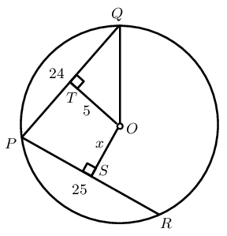

**Solution:**
\[\begin{array}{rll}
              \text{In } \triangle QTO, \quad QO^2 &= OT^2 + QT^2 & (\text{Pythagoras}) \\
              QO^2 &= 5^2 + 12^2 & \\
              &= 25 + 144 & \\
              \therefore QO^2 &= 169 & \\
              \therefore QO &= 13 & \\
              \text{In } \triangle OSR, \quad OR^2 &= SR^2 + OS^2 & (\text{Pythagoras}) \\
              13^2 &= \text{12,5}^2 + OS^2 & \\
              \therefore OS^2 &= \text{12,75} & \\
              \therefore OS &= \text{3,6} &
              \end{array}\]

## Angles subtended by an arc at the centre and the circumference of a circle

2. Measure angles \(x\) and \(y\) in each of the following graphs:
4. Complete the table:
   | \(x\) | \(y\) |
   | --- | --- |
6. Use your results to make a conjecture about the relationship between angles subtended by an arc at the
               centre of a circle and angles at the circumference of a circle.
8. Now draw three of your own similar diagrams and measure the angles to check your conjecture.

# Theorem: Angle at the centre of a circle is twice the size of the angle at the circumference

If an arc subtends an angle at the centre of a circle and at the circumference, then the angle at the
            centre is twice the size of the angle at the circumference.

(Reason: \(\angle \text{ at centre } = 2 \angle \text{ at circum.}\))

Circle with centre \(O\), arc \(AB\) subtending \(A\hat{O}B\) at the centre of the circle, and
            \(A\hat{P}B\) at the circumference.

\(A\hat{O}B= 2A\hat{P}B\)

Draw \(PO\) extended to \(Q\) and let \(A\hat{O}Q = \hat{O}_1\) and \(B\hat{O}Q = \hat{O}_2\).

          \[\begin{array}{rll}
          \hat{O}_1&= A\hat{P}O + P\hat{A}O & (\text{ext. } \angle \triangle = \text{sum int. opp. } \angle
          \text{s} ) \\
          \text{and } A\hat{P}O &= P\hat{A}O & (\text{equal radii, isosceles } \triangle APO)\\
          \therefore \hat{O}_1&= A\hat{P}O + A\hat{P}O & \\
          \hat{O}_1&= 2A\hat{P}O &
          \end{array}\]

Similarly, we can also show that \(\hat{O}_2 = 2B\hat{P}O\).

For the first two diagrams shown above we have that:
            \[\begin{array}{rll}
            A\hat{O}B &= \hat{O}_1 + \hat{O}_2 & \\
            &= 2A\hat{P}O + 2B\hat{P}O & \\
            &= 2(A\hat{P}O + B\hat{P}O) & \\
            \therefore A\hat{O}B &= 2(A\hat{P}B) &
            \end{array}\]

            And for the last diagram:
            \[\begin{array}{rll}
            A\hat{O}B &= \hat{O}_2 - \hat{O}_1 & \\
            &= 2B\hat{P}O - 2A\hat{P}O & \\
            &= 2(B\hat{P}O - A\hat{P}O) & \\
            \therefore A\hat{O}B &= 2(A\hat{P}B) &
            \end{array}\]

<Callout type="tip" title="Worked example 2: Angle at the centre of circle is twice angle at circumference">
**Question:**
Given \(HK\), the diameter of the circle passing through centre \(O\).

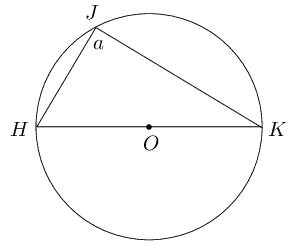

**Use theorems and the given information to find all equal angles and sides on the diagram:**

**Solve for \(a\):**
In \(\triangle HJK\):
            \[\begin{array}{rll}
            H\hat{O}K &= \text{180}\text{°} & (\angle \text{ on str. line)} \\
            &= 2a & (\angle \text{ at centre } = 2 \angle \text{ at circum.}) \\
            \therefore 2a &= \text{180}\text{°} & \\
            a &= \frac{\text{180}\text{°}}{2} & \\
            &= \text{90}\text{°} &
            \end{array}\]

**Conclusion:**
The diameter of a circle subtends a right angle at the circumference (angles in a semi-circle).
</Callout>

## Angle at the centre of circle is twice angle at circumference

### Textbook Exercise 8.2

Given \(O\) is the centre of the circle, determine the unknown angle in each of the following diagrams:

**Problem:**
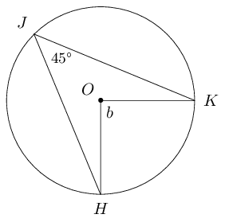

**Solution:**
\[\begin{array}{rll}
              b &= 2 \times \text{45}\text{°} & (\angle \text{ at centre } = 2 \angle \text{ at circum.})
              \\
              \therefore b &= \text{90}\text{°} & \end{array}\]

**Problem:**
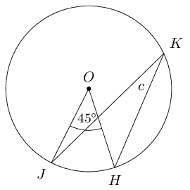

**Solution:**
\[\begin{array}{rll}
              c &= \frac{1}{2} \times \text{45}\text{°} & (\angle \text{ at centre } = 2 \angle \text{ at
              circum.}) \\
              \therefore c &= \text{22,5}\text{°} & \end{array}\]

**Problem:**
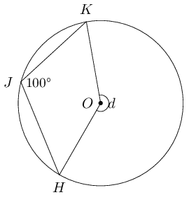

**Solution:**
\[\begin{array}{rll}
              d &= 2 \times \text{100}\text{°} & (\angle \text{ at centre } = 2 \angle \text{ at circum.})
              \\
              \therefore d &= \text{200}\text{°} & \end{array}\]

**Problem:**
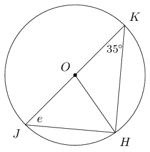

**Solution:**
\[\begin{array}{rll}
              e &= \text{100}\text{°} - \text{90}\text{°} - \text{35}\text{°} & (\angle \text{ in
              semi circle} ) \\
              \therefore e &= \text{55}\text{°} &
              \end{array}\]

**Problem:**
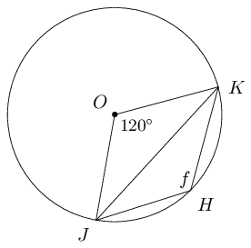

**Solution:**
\[\begin{array}{rll}
              f &= \frac{1}{2} \times \text{240}\text{°} & (\angle \text{ at centre } = 2 \angle \text{ at
              circum.}) \\
              \therefore f &= \text{120}\text{°} &
              \end{array}\]

## Subtended angles in the same segment of a circle

2. Measure angles \(a\), \(b\), \(c\), \(d\) and \(e\) in the diagram below:
   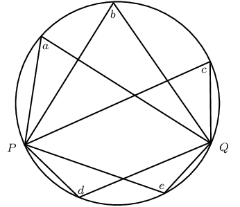
4. Choose any two points on the circumference of the circle and label them \(A\) and \(B\).
6. Draw \(AP\) and \(BP\), and measure \(A\hat{P}B\).
8. Draw \(AQ\) and \(BQ\), and measure \(A\hat{Q}B\).
10. What do you observe? Make a conjecture about these types of angles.

# Theorem: Subtended angles in the same segment of a circle are equal

If the angles subtended by a chord of the circle are on the same side of the chord, then the angles are
            equal.

(Reason: \(\angle\)s in same seg.)

Circle with centre \(O\), and points \(P\) and \(Q\) on the circumference of the circle. Arc \(AB\)
            subtends \(A\hat{P}B\) and \(A\hat{Q}B\) in the same segment of the circle.

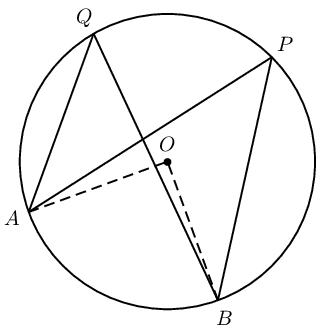

\(A\hat{P}B = A\hat{Q}B\)

          \[\begin{array}{rll}
          A\hat{O}B &= 2 A\hat{P}B & (\angle \text{ at centre } = 2 \angle \text{ at circum.}) \\
          A\hat{O}B &= 2 A\hat{Q}B & (\angle \text{ at centre } = 2 \angle \text{ at circum.}) \\
          \therefore 2 A\hat{P}B &= 2 A\hat{Q}B & \\
          A\hat{P}B &= A\hat{Q}B &
          \end{array}\]

**Equal arcs subtend equal angles**

From the theorem above we can deduce that if angles at the circumference of a circle are subtended by arcs of
        equal length, then the angles are equal. In the figure below, notice that if we were to move the two chords with
        equal length closer to each other, until they overlap, we would have the same situation as with the theorem
        above. This shows that the angles subtended by arcs of equal length are also equal.

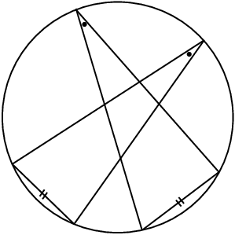

# (PROOF NOT FOR EXAMS) Converse: Concyclic points

If a line segment subtends equal angles at two other points on the same side of the line segment, then
            these four points are concyclic (lie on a circle).

Line segment \(AB\) subtending equal angles at points \(P\) and \(Q\) on the same side of the line segment
            \(AB\).

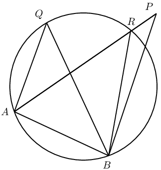

\(A\), \(B\), \(P\) and \(Q\) lie on a circle.

**Proof by contradiction:**

Points on the circumference of a circle: we know that there are only two possible options regarding a given
            point — it either lies on circumference or it does not.

We will assume that point \(P\) does not lie on the circumference.

We draw a circle that cuts \(AP\) at \(R\) and passes through \(A\), \(B\) and \(Q\).
            \[\begin{array}{rll}
            A\hat{Q}B &= A\hat{R}B & (\angle \text{s in same seg.}) \\
            \text{but } A\hat{Q}B &= A\hat{P}B & (\text{given}) \\
            \therefore A\hat{R}B &= A\hat{P}B & \\
            \text{but } A\hat{R}B &= A\hat{P}B + R\hat{B}P & (\text{ext. } \angle \triangle = \text{sum int.
            opp.}) \\
            \therefore R\hat{B}P &= \text{0}\text{°} &
            \end{array}\]

            Therefore the assumption that the circle does not pass through \(P\) must be false.

We can conclude that \(A\), \(B\), \(Q\) and \(P\) lie on a circle (\(A\), \(B\), \(Q\) and \(P\) are
            concyclic).

<Callout type="tip" title="Worked example 3: Concyclic points">
**Question:**
Given \(FH \parallel EI\) and \(E\hat{I}F = \text{15}\text{°}\), determine the value of \(b\).

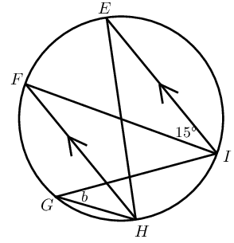

**Use theorems and the given information to find all equal angles on the diagram:**

**Solve for \(b\):**
\[\begin{array}{rll}
          H\hat{F}I &= \text{15}\text{°} & (\text{alt. } \angle, FH \parallel EI) \\
          \text{and } b &= H\hat{F}I & (\angle \text{s in same seg.}) \\
          \therefore b &= \text{15}\text{°} &
          \end{array}\]
</Callout>

## Subtended angles in the same segment

### Textbook Exercise 8.3

Find the values of the unknown angles.

**Problem:**
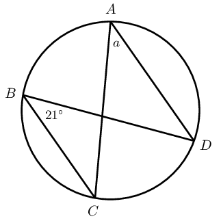

**Solution:**
\[\begin{array}{rll}
                a &= \text{21}\text{°} & (\angle \text{s in same seg.})
                \end{array}\]

**Problem:**
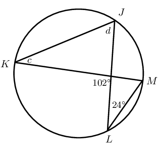

**Solution:**
\[\begin{array}{rll}
                c &= \text{24}\text{°} & (\angle \text{s in same seg.}) \\
                d &= \text{102}\text{°} - \text{24}\text{°} & (\text{ext. } \angle \triangle =
                \text{sum int. opp.}) \\
                \therefore d &= \text{78}\text{°} & \\
                \end{array}\]

**Problem:**
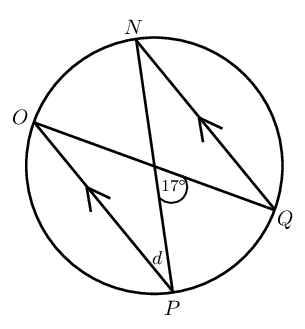

**Solution:**
\[\begin{array}{rll}
                d &= \hat{N} & (\text{alt. } \angle, PO \parallel QN ) \\
                \hat{N} &= \frac{1}{2} \times \text{17}\text{°} & (\angle \text{ at centre } = 2 \angle
                \text{ at circum.}) \\
                \hat{O} &= \hat{N} & (\angle \text{s in same seg.}) \\
                \text{17}\text{°} &= \hat{O} + d & ( \text{ ext. angle of } \triangle) \\
                \therefore 2d &= \text{17}\text{°} & \\
                \therefore d &= \text{8,5}\text{°} & (\text{alt. } \angle, PO \parallel QN )
                \end{array}\]

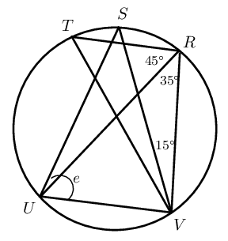

**Problem:**
Given \(T\hat{V}S = S\hat{V}R\), determine the value of \(e\).

**Solution:**
\[\begin{array}{rll}
                \text{In } \triangle TRV, \hat{T} &= \text{180}\text{°} - (\text{80}\text{°} +
                \text{30}\text{°}) & (\angle \text{s sum of } \triangle) \\
                \therefore \hat{T} &= \text{70}\text{°} & \\
                \therefore e &= \text{15}\text{°} + \text{70}\text{°} & \\
                &= \text{85}\text{°} & \\
                \end{array}\]

**Problem:**
Is \(TV\) a diameter of the circle? Explain your answer.

**Solution:**
No, since \(\text{45}\text{°} + \text{35}\text{°} \ne
                \text{90}\text{°}\)

**Problem:**
Given circle with centre \(O\), \(WT = TY\) and \(X\hat{W}T = \text{35}\text{°}\). Determine
                \(f\).

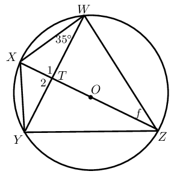

**Solution:**
\[\begin{array}{rll}
              \text{In } \triangle WTZ &\text{ and in } \triangle YTZ, \\
              WT &= YT & (\text{ given }) \\
              ZT &= ZT & (\text{ common side }) \\
              Y\hat{T}Z = W\hat{T}Z &= \text{90}\text{°} & (\text{ line from circle centre to mid-point })
              \\
              \therefore T\hat{Z}Y &= T\hat{Z}W & (\text{ SAS }) \\
              T\hat{Z}Y = T\hat{Z}W &= f & \\
              \text{And } T\hat{Z}Y &= \text{35}\text{°} & (\angle \text{s in same seg.}) \\
              \therefore T\hat{Z}W = f &= \text{35}\text{°} &
              \end{array}\]

**Cyclic quadrilaterals**

Cyclic quadrilaterals are quadrilaterals with all four vertices lying on the circumference of a circle
        (concyclic).

## Cyclic quadrilaterals

Consider the diagrams given below:

| Circle \(\text{1}\) | Circle \(\text{2}\) | Circle \(\text{3}\) |
| --- | --- | --- |

2. Complete the following:
   \(ABCD\) is a cyclic quadrilateral because \(\ldots \ldots\)
4. Complete the table:
   |  | Circle \(\text{1}\) | Circle \(\text{2}\) | Circle \(\text{3}\) |
   | --- | --- | --- | --- |
   | \(\hat{A} =\) |  |  |  |
   | \(\hat{B} =\) |  |  |  |
   | \(\hat{C} =\) |  |  |  |
   | \(\hat{D} =\) |  |  |  |
   | \(\hat{A} + \hat{C} =\) |  |  |  |
   | \(\hat{B} + \hat{D} =\) |  |  |  |
6. Use your results to make a conjecture about the relationship between angles of cyclic quadrilaterals.

# Theorem: Opposite angles of a cyclic quadrilateral

The opposite angles of a cyclic quadrilateral are supplementary.

(Reason: opp. \(\angle\)s cyclic quad.)

Circle with centre \(O\) with points \(A, B, P\) and \(Q\) on the circumference such that \(ABPQ\) is a
            cyclic quadrilateral.

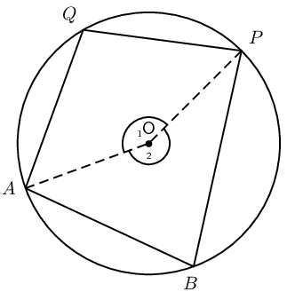

\(A\hat{B}P + A\hat{Q}P = \text{180}\text{°}\) and \(Q\hat{A}B + Q\hat{P}B = \text{180}\text{°}\)

Draw \(AO\) and \(OP\). Label \(\hat{O}_1\) and \(\hat{O}_2\).
            \[\begin{array}{rll}
            \hat{O}_1 &= 2A\hat{B}P & (\angle\text{ at centre} = 2\angle \text{ at circum.})\\
            \hat{O}_2 &= 2A\hat{Q}P & (\angle\text{ at centre} = 2\angle \text{ at circum.})\\
            \text{and } \hat{O}_1 + \hat{O}_2 &= \text{360}\text{°} & (\angle\text{s around a point}) \\
            \therefore 2A\hat{B}P + 2A\hat{Q}P &= \text{360}\text{°} & \\
            A\hat{B}P + A\hat{Q}P &= \text{180}\text{°} &
            \end{array}\]

            Similarly, we can show that \(Q\hat{A}B + Q\hat{P}B = \text{180}\text{°}\).

**Converse: interior opposite angles of a quadrilateral**

If the interior opposite angles of a quadrilateral are supplementary, then the quadrilateral is cyclic.

**Exterior angle of a cyclic quadrilateral**

If a quadrilateral is cyclic, then the exterior angle is equal to the interior opposite angle.

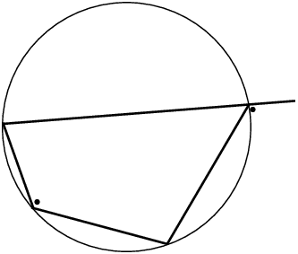

<Callout type="tip" title="Worked example 4: Opposite angles of a cyclic quadrilateral">
**Question:**
Given the circle with centre \(O\) and cyclic quadrilateral \(PQRS\). \(SQ\) is drawn and \(S\hat{P}Q =
            \text{34}\text{°}\). Determine the values of \(a\), \(b\) and \(c\).

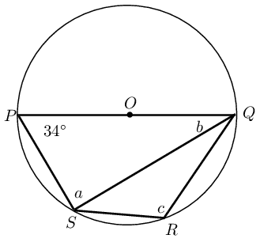

**Use theorems and the given information to find all equal angles on the diagram:**

**Solve for \(b\):**
\[\begin{array}{rll}
            S\hat{P}Q + c &= \text{180}\text{°} & (\text{opp. } \angle \text{s cyclic quad supp.}) \\
            \therefore c &= \text{180}\text{°} - \text{34}\text{°} & \\
            &= \text{146}\text{°} &
            \end{array}\]

            \[\begin{array}{rll}
            a &= \text{90}\text{°} & (\angle \text{ in semi circle})
            \end{array}\]

            In \(\triangle PSQ\):
            \[\begin{array}{rll}
            a + b + \text{34}\text{°} &= \text{180}\text{°} & (\angle \text{ sum of } \triangle) \\
            \therefore b &= \text{180}\text{°} - \text{90}\text{°} - \text{34}\text{°} & \\
            &= \text{56}\text{°} &
            \end{array}\]
</Callout>

**Methods for proving a quadrilateral is cyclic**

There are three ways to prove that a quadrilateral is a cyclic quadrilateral:

|  | Method of proof | Reason |
| --- | --- | --- |
|  | If \(\hat{P} + \hat{R} = \text{180}\text{°}\) or \(\hat{S} + \hat{Q} = \text{180}\text{°}\),
            then \(PQRS\) is a cyclic quad. | opp. int. angles suppl. |
|  | If \(\hat{P} = \hat{Q}\) or \(\hat{S} = \hat{R}\), then \(PQRS\) is a cyclic quad. | angles in the same seg. |
|  | If \(T\hat{Q}R = \hat{S}\), then \(PQRS\) is a cyclic quad. | ext. angle equal to int. opp. angle |

<Callout type="tip" title="Worked example 5: Proving a quadrilateral is a cyclic quadrilateral">
**Question:**
Prove that \(ABDE\) is a cyclic quadrilateral.

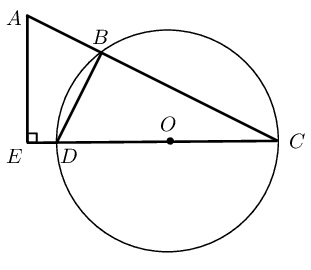

**Use theorems and the given information to find all equal angles on the diagram:**

**Prove that \(ABDE\) is a cyclic quadrilateral:**
\[\begin{array}{rll}
          D\hat{B}C &= \text{90}\text{°} & (\angle \text{ in semi circle}) \\
          \text{and } \hat{E} &= \text{90}\text{°} & (\text{given}) \\
          \therefore D\hat{B}C &= \hat{E} & \\
          \therefore ABDE \text{ is a cyclic} & \text{quadrilateral} & \text{(ext.\@ \(\angle\) equals int.\@
          opp.\@ \(\angle\))}
          \end{array}\]
</Callout>

## Cyclic quadrilaterals

### Textbook Exercise 8.4

Find the values of the unknown angles.

**Problem:**
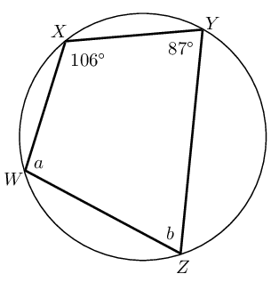

**Solution:**
\[\begin{array}{rll}
                a + \text{87}\text{°} &= \text{180}\text{°} & (\text{opp. angles of cyclic quad. supp.
                }) \\
                \therefore a &= \text{93}\text{°} & \\
                b + \text{106}\text{°} &= \text{180}\text{°} & (\text{opp. angles of cyclic quad.
                supp. }) \\
                \therefore b &= \text{74}\text{°} &
                \end{array}\]

**Problem:**
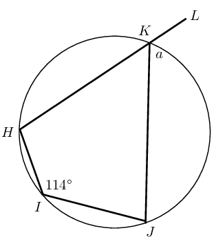

**Solution:**
\[\begin{array}{rll}
                a &= H\hat{I}J & \angle (\text{ ext. angle cyclic quad = int. opp }) \\
                &= \text{114}\text{°} &
                \end{array}\]

**Problem:**
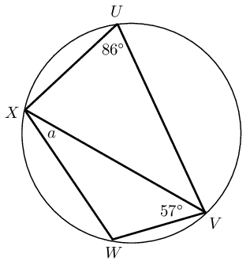

**Solution:**
\[\begin{array}{rll}
                \hat{W} + \text{86}\text{°} &= \text{180}\text{°} & (\text{opp. angles of cyclic quad.
                supp. }) \\
                \therefore \hat{W} &= \text{94}\text{°} & \\
                a + \hat{W} + \text{57}\text{°} &= \text{180}\text{°} & (\text{angles sum of }
                \triangle) \\
                \therefore a &= \text{29}\text{°} &
                \end{array}\]

Prove that \(ABCD\) is a cyclic quadrilateral:

**Problem:**
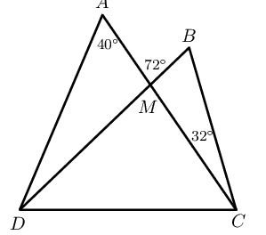

**Solution:**
\[\begin{array}{rll}
                A\hat{M}B &= \text{32}\text{°} + D\hat{B}C & (\text{ext angle of } \triangle = \text{sum
                int. opp. angles}) \\
                \therefore \text{72}\text{°} &= \text{32}\text{°} + D\hat{B}C & \\
                \therefore D\hat{B}C &= \text{40}\text{°} & (\text{angles sum of } \triangle) \\
                \therefore D\hat{B}C &= D\hat{A}C & \\
                \text{Therefore } ABCD &= \text{ is cyclic quad. } & ( \text{ angles in same seg.})
                \end{array}\]

**Problem:**
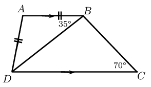

**Solution:**
\[\begin{array}{rll}
                \text{In } \triangle ABD, \quad A\hat{B}D = A\hat{D}B &= \text{35}\text{°} & (\angle
                \text{s opp. equal sides }) \\
                \therefore \text{35}\text{°} + \text{35}\text{°} + D\hat{A}B &= \text{180}\text{°}
                & (\angle \text{s sum of } \triangle) \\
                \therefore D\hat{A}B &= \text{110}\text{°} & (\text{angles sum of } \triangle) \\
                \text{And } D\hat{A}B + D\hat{C}B &= \text{180}\text{°} & \\
                \text{Therefore } ABCD &= \text{ is cyclic quad. } & ( \text{ opp. int. angles supp.})
                \end{array}\]

**Tangent line to a circle**

A tangent is a line that touches the circumference of a circle at only one place. The radius of a circle is
        perpendicular to the tangent at the point of contact.

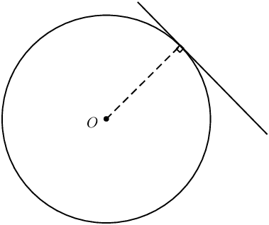

# Theorem: Two tangents drawn from the same point outside a circle

If two tangents are drawn from the same point outside a circle, then they are equal in length.

(Reason: tangents from same point equal)

Circle with centre \(O\) and tangents \(PA\) and \(PB\), where \(A\) and \(B\) are the respective points of
            contact for the two lines.

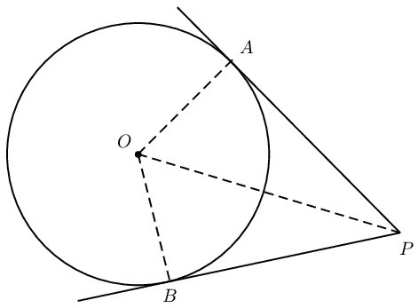

\(AP = BP\)

In \(\triangle AOP\) and \(\triangle BOP\),
            \[\begin{array}{rll}
            O\hat{A}P = O\hat{B}P &= \text{90}\text{°} & (\text{tangent} \perp \text{radius})\\
            AO &= BO & (\text{equal radii}) \\
            OP &= OP & (\text{common side}) \\
            \therefore \triangle AOP &\equiv \triangle BOP & (\text{RHS}) \\
            \therefore AP &= BP &
            \end{array}\]

<Callout type="tip" title="Worked example 6: Tangents from the same point outside a circle">
**Question:**
In the diagram below \(AE = \text{5}\text{ cm}\), \(AC = \text{8}\text{ cm}\) and \(CE = \text{9}\text{
            cm}\). Determine the values of \(a\), \(b\) and \(c\).

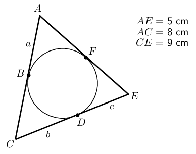

**Use theorems and the given information to find all equal angles on the diagram:**

**Solve for \(a\), \(b\) and \(c\):**
\[\begin{array}{rll}
          AB = AF&= a & (\text{tangents from } A) \\
          EF = ED&= c & (\text{tangents from } E) \\
          CB = CD&= b & (\text{tangents from } C) \\
          \therefore AE = a + c &= 5 & \\
          \text{and } AC = a + b &= 8 & \\
          \text{and } CE = b + c &= 9 &
          \end{array}\]

**Solve for the unknown variables using simultaneous equations:**
\[\begin{array}{rll}
          a + c &= 5 & \ldots (1)\\
          a + b &= 8 & \ldots (2)\\
          b + c &= 9 & \ldots (3)
          \end{array}\]

Subtract equation \((1)\) from equation \((2)\) and then substitute into equation \((3)\):

          \[\begin{array}{rll}
          (2) - (1) \quad b-c &= 8-5 & \\
          &= 3 & \\
          \therefore b &= c + 3 & \\
          \text{Substitute into } (3) \quad c + 3 + c &= 9 & \\
          2c &= 6 & \\
          c &= 3 & \\
          \therefore a &= 2 & \\
          \text{ and } b &= 6 &
          \end{array}\]
</Callout>

## Tangents to a circle

### Textbook Exercise 8.5

Find the values of the unknown lengths.

**Problem:**
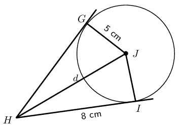

**Solution:**
\[\begin{array}{rll}
              HI &= HG & (\text{tangents same pt. }) \\
              \text{In } \triangle HIJ, \quad d^2 &= 8^2 + 5^2 & (\text{Pythagoras, radius perp. tangent }) \\
              \therefore d^2 &= 89 & \\
              \therefore d &= \text{9,4}\text{ cm} &
              \end{array}\]

**Problem:**
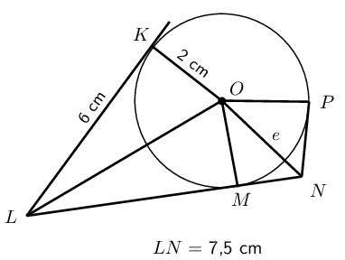

**Solution:**
\[\begin{array}{rll}
              LM = LK &= 6 & (\text{tangents same pt. }) \\
              LN &= \text{7,5}\text{ cm} & (\text{ given }) \\
              \therefore MN = \text{7,5} - \text{6} &= \text{1,5}\text{ cm} & \\
              OM &= \text{2}\text{ cm} & (\text{ radius }) \\
              \text{In } \triangle OMN, \quad e^2 &= 2^2 + (\text{1,5})^2 & (\text{Pythagoras, radius perp.
              tangent }) \\
              \therefore e^2 &= \text{6,25} & \\
              \therefore e &= \text{2,5}\text{ cm} &
              \end{array}\]

**Problem:**
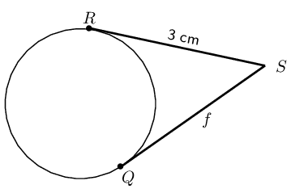

**Solution:**
\(f=\text{3}\text{ cm}\)

## Tangent-chord theorem

Consider the diagrams given below:

| Diagram \(\text{1}\) | Diagram \(\text{2}\) | Diagram \(\text{3}\) |
| --- | --- | --- |

2. Measure the following angles with a protractor and complete the table:
   |  | Diagram \(\text{1}\) | Diagram \(\text{2}\) | Diagram \(\text{3}\) |
   | --- | --- | --- | --- |
   | \(A\hat{B}C =\) |  |  |  |
   | \(\hat{D} =\) |  |  |  |
   | \(\hat{E} =\) |  |  |  |
4. Use your results to complete the following: the angle between a tangent to a circle and a chord is
               \(\ldots \ldots\) to the angle in the alternate segment.

# Theorem: Tangent-chord theorem

The angle between a tangent to a circle and a chord drawn at the point of contact, is equal to the angle
            which the chord subtends in the alternate segment.

(Reason: tan. chord theorem)

Circle with centre \(O\) and tangent \(SR\) touching the circle at \(B\). Chord \(AB\) subtends
            \(\hat{P}_1\) and \(\hat{Q}_1\).

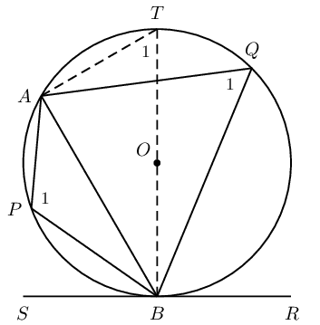

2. \(A\hat{B}R = A\hat{P}B\)
4. \(A\hat{B}S = A\hat{Q}B\)

Draw diameter \(BT\) and join \(T\) to \(A\).

Let \(A\hat{T}B = T_1\).
            \[\begin{array}{rll}
            A\hat{B}S + A\hat{B}T &= \text{90}\text{°} & (\text{tangent} \perp \text{radius}) \\
            B\hat{A}T &= \text{90}\text{°} & (\angle \text{ in semi circle}) \\
            \therefore A\hat{B}T + T_1 &= \text{90}\text{°} & (\angle \text{ sum of } \triangle BAT) \\
            \therefore A\hat{B}S &= T_1 & \\
            \text{but } Q_1 &= T_1 & (\angle \text{s in same segment}) \\
            \therefore Q_1 &= A\hat{B}S &
            \end{array}\]

            \[\begin{array}{rll}
            A\hat{B}S + A\hat{B}R &= \text{180}\text{°} & (\angle \text{s on str. line}) \\
            \hat{Q}_1 + \hat{P}_1 &= \text{180}\text{°} & (\text{opp. } \angle \text{s cyclic quad. supp.})
            \\
            \therefore A\hat{B}S + A\hat{B}R &= Q_1 + P_1 & \\
            \text{and } A\hat{B}S &= Q_1 & \\
            \therefore A\hat{B}R &= P_1 &
            \end{array}\]

<Callout type="tip" title="Worked example 7: Tangent-chord theorem">
**Question:**
Determine the values of \(h\) and \(s\).

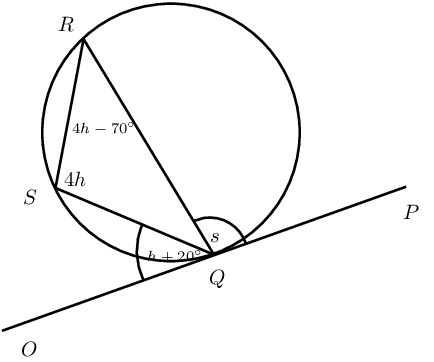

**Use theorems and the given information to find all equal angles on the diagram:**

**Solve for \(h\):**
\[\begin{array}{rll}
          O\hat{Q}S &= S\hat{R}Q & (\text{tangent chord theorem}) \\
          h + \text{20}\text{°} &= 4h - \text{70}\text{°} & \\
          \text{90}\text{°} &= 3h & \\
          \therefore h &= \text{30}\text{°} &
          \end{array}\]

**Solve for \(s\):**
\[\begin{array}{rll}
          P\hat{Q}R &= Q\hat{S}R & (\text{tangent chord theorem}) \\
          s &= 4h & \\
          &= 4(\text{30}\text{°}) & \\
          &= \text{120}\text{°} &
          \end{array}\]
</Callout>

## Tangent-chord theorem

### Textbook Exercise 8.6

Find the values of the unknown letters, stating reasons.

**Problem:**
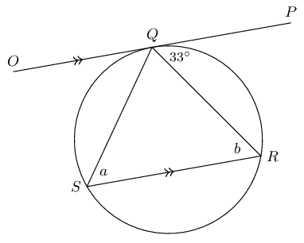

**Solution:**
\[\begin{array}{rll}
                a &= \text{33}\text{°} & (\text{tangent-chord }) \\
                b &= \text{33}\text{°} & (\text{alt. angles, } OP \parallel SR )
                \end{array}\]

**Problem:**
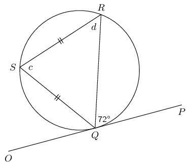

**Solution:**
\[\begin{array}{rll}
                c &= \text{72}\text{°} & (\text{tangent-chord}) \\
                d &= \dfrac{\text{180}\text{°} - \text{72}\text{°} }{2} & (\text{isosceles triangle})
                \\
                &= \text{54}\text{°} & (\text{alt. angles, } OP \parallel SR )
                \end{array}\]

**Problem:**
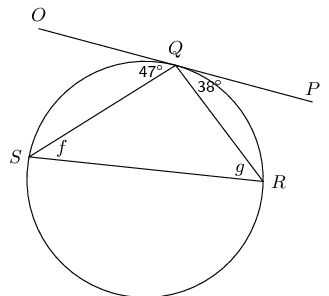

**Solution:**
\[\begin{array}{rll}
                f &= \text{38}\text{°} & (\text{tangent-chord}) \\
                g &= \text{47}\text{°} & (\text{tangent-chord})
                \end{array}\]

**Problem:**
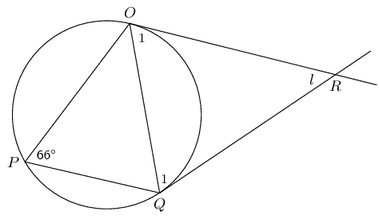

**Solution:**
\[\begin{array}{rll}
                \hat{O}_1 = \hat{Q}_1 &= \text{66}\text{°} & (\text{isosceles, tangent-chord}) \\
                \therefore l &= \text{180}\text{°} - 2 \times \text{66}\text{°} & (\text{angles sum }
                \triangle) \\
                &= \text{48}\text{°} &
                \end{array}\]

**Problem:**
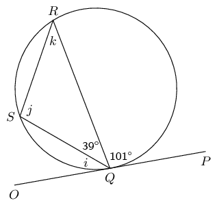

**Solution:**
\[\begin{array}{rll}
                i &= \text{180}\text{°} - \text{101}\text{°} - \text{39}\text{°} & (\angle
                \text{s on str. line }) \\
                \therefore i &= \text{40}\text{°} & \\
                j &= \text{101}\text{°} & (\text{ tangent-chord}) \\
                k = i &= \text{40}\text{°} & (\text{ tangent-chord})
                \end{array}\]

**Problem:**

**Solution:**
\[\begin{array}{rll}
                n &= \text{34}\text{°} & (\text{ tangent-chord}) \\
                o &= \text{180}\text{°} - \text{90}\text{°} - \text{34}\text{°} & (\text{angles
                sum } \triangle) \\
                \therefore o &= \text{56}\text{°} & \\
                m &= \text{56}\text{°} & (\text{ tangent-chord})
                \end{array}\]

**Problem:**

**Solution:**
\[\begin{array}{rll}
                q &= \text{52}\text{°} & (\text{ tangent-chord}) \\
                p &= \text{90}\text{°} - \text{52}\text{°} & (\text{tangent perp. radius }) \\
                \therefore p &= \text{38}\text{°} & \\
                r &= \text{90}\text{°} & ( \angle \text{ in semi-circle})
                \end{array}\]

**Problem:**
\(O\) is the centre of the circle and \(SPT\) is a tangent, with \(OP \perp ST\). Determine \(a\),
                \(b\) and \(c\), giving reasons.

**Solution:**
\[\begin{array}{rll}
              a &= \text{90}\text{°} - \text{64}\text{°} & (\text{tangent perp. radius}) \\
              &= \text{26}\text{°} & \\
              b &= \text{64}\text{°} & (\text{tangent chord}) \\
              c &= 2 \times \text{64}\text{°} & (\angle\text{ at centre} = 2\angle \text{ at circum.}) \\
              &= \text{128}\text{°} & \\
              \end{array}\]

Given \(AB = AC\), \(AP \parallel BC\) and \(\hat{A}_2 = \hat{B}_2\). Prove:

**Problem:**
\(PAL\) is a tangent to the circle \(ABC\).

**Solution:**
\[\begin{array}{rll}
                \hat{A}_1 &= A\hat{C}B & (\text{alt. angles}, AP \parallel BC) \\
                A\hat{C}B &= A\hat{B}C & (\angle \text{s opp. equal sides }, AB = AC) \\
                \therefore \hat{A}_1 &= A\hat{B}C & \\
                \text{Therefore } PAL & \text{is a tangent to circle } ABC & (\angle\text{ between line chord} =
                \angle\text{ in alt. seg.})
                \end{array}\]

**Problem:**
\(AB\) is a tangent to the circle \(ADP\).

**Solution:**
\[\begin{array}{rll}
                \hat{A}_2 &= \hat{B}_2 & (\text{ given }) \\
                \text{And } A\hat{P}B &= \hat{B}_2 & (\text{alt. angles}, AP \parallel BC) \\
                \text{Therefore } A\hat{P}B &= \hat{A}_2 ABC & \\
                \text{Therefore } AB & \text{is a tangent to circle } ADP & (\angle\text{ between line chord} =
                \angle\text{ in alt. seg.})
                \end{array}\]

**Converse: tangent-chord theorem**

If a line drawn through the end point of a chord forms an angle equal to the angle subtended by the chord in
        the alternate segment, then the line is a tangent to the circle.

(Reason: \(\angle\) between line and chord \(= \angle\) in alt. seg. )

<Callout type="tip" title="Worked example 8: Applying the theorems">
**Question:**

\(BD\) is a tangent to the circle with centre \(O\), with \(BO \perp AD\).

Prove that:

2. \(CFOE\) is a cyclic quadrilateral
4. \(FB=BC\)
6. \(\angle A\hat{O}C = 2 B\hat{F}C\)
8. Will \(DC\) be a tangent to the circle passing through \(C,F,O\) and \(E\)? Motivate your answer.

**Prove \(CFOE\) is a cyclic quadrilateral by showing opposite angles are supplementary:**
\[\begin{array}{rll}
          BO & \perp OD & (\text{given}) \\
          \therefore F\hat{O}E &= \text{90}\text{°} & \\
          F\hat{C}E &= \text{90}\text{°} & (\angle \text{ in semi circle}) \\
          \therefore CFOE & \text{is a cyclic quad.} & (\text{opp. } \angle \text{s suppl.})
          \end{array}\]

**Prove \(BFC\) is an isosceles triangle:**
To show that \(FB = BC\) we first prove \(\triangle BFC\) is an isosceles triangle by showing that
            \(B\hat{F}C = B\hat{C}F\).

          \[\begin{array}{rll}
          B\hat{C}F &= C\hat{E}O & (\text{tangent-chord}) \\
          C\hat{E}O &= B\hat{F}C & (\text{ext. } \angle \text{ cyclic quad. } CFOE) \\
          \therefore B\hat{F}C &= B\hat{C}F \\
          \therefore FB &= BC & (\triangle BFC \text{ isosceles})
          \end{array}\]

**Prove \(A\hat{O}C = 2 B\hat{F}C\):**
\[\begin{array}{rll}
          A\hat{O}C &= 2 A\hat{E}C & (\angle \text{ at centre } = 2 \angle \text{ at circum.}) \\
          \text{and } A\hat{E}C &= B\hat{F}C & (\text{ext. } \angle \text{ cyclic quad. } CFOE) \\
          \therefore A\hat{O}C &= 2 B\hat{F}C
          \end{array}\]

**Determine if \(DC\) is a tangent to the circle through \(C\), \(F\), \(O\) and \(E\):**
Proof by contradiction.

Let us assume that \(DC\) is a tangent to the circle passing through the points \(C\), \(F\), \(O\) and
            \(E\):
            \[\begin{array}{rll}
            \therefore D\hat{C}E = C\hat{O}E \quad (\text{tangent-chord})
            \end{array}\]

            And using the circle with centre \(O\) and tangent \(BD\) we have that:
            \[\begin{array}{rll}
            D\hat{C}E &= C\hat{A}E & (\text{tangent-chord}) \\
            \text{but } C\hat{A}E &= \frac{1}{2} C\hat{O}E & (\angle \text{ at centre} = 2 \angle \text{ at
            circum.}) \\
            \therefore D\hat{C}E &\ne C\hat{O}E &
            \end{array}\]

            Therefore our assumption is not correct and we can conclude that \(DC\) is not a tangent to the circle
            passing through the points \(C\), \(F\), \(O\) and \(E\).
</Callout>

<Callout type="tip" title="Worked example 9: Applying the theorems">
**Question:**

\(FD\) is drawn parallel to the tangent \(CB\)

Prove that:

2. \(FADE\) is a cyclic quadrilateral
4. \(F\hat{E}A = \hat{B}\)

**Prove \(FADE\) is a cyclic quadrilateral using angles in the same segment:**
\[\begin{array}{rll}
          F\hat{D}C &= D\hat{C}B & (\text{alt. } \angle\text{s } FD \parallel CB) \\
          \text{and } D\hat{C}B &= C\hat{A}E & (\text{tangent-chord}) \\
          \therefore F\hat{D}C &= C\hat{A}E \\
          \therefore FADE & \text{is a cyclic quad.} & (\angle \text{s in same seg.})
          \end{array}\]

**Prove \(F\hat{E}A = \hat{B}\):**
\[\begin{array}{rll}
          F\hat{D}A &= \hat{B} & (\text{corresp. } \angle\text{s } FD \parallel CB) \\
          \text{and } F\hat{E}A &= F\hat{D}A & (\angle \text{s same seg.\@ cyclic quad.\@ } FADE) \\
          \therefore F\hat{E}A &= \hat{B}
          \end{array}\]
</Callout>
