## End of chapter exercises

### Textbook Exercise 8.7

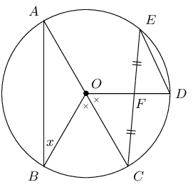

\(AOC\) is a diameter of the circle with centre \(O\). \(F\) is the mid-point of chord \(EC\). \(B\hat{O}C
            = C\hat{O}D\) and \(\hat{B} = x\). Express the following angles in terms of \(x\), stating reasons:

**Problem:**
\(\hat{A}\)

**Solution:**
\[\begin{array}{rll}
            \hat{A} &= x & (\text{radius } OA = OB)
            \end{array}\]

**Problem:**
\(C\hat{O}D\)

**Solution:**
\[\begin{array}{rll}
            C\hat{O}B &= \text{2}x & (\text{angles at centre and on circumference})\\
            &= C\hat{O}D & \text{(given)}\\
            &= \text{2} x &
            \end{array}\]

**Problem:**
\(\hat{D}\)

**Solution:**
\[\begin{array}{rll}
            \hat{E} &= \frac{1}{2} C\hat{O}D & \\
            &= x & (\angle\text{'s at centre and circumference})\\
            \therefore\hat{D} &= \text{90}\text{°} - x & (\text{sum } \angle {s } \triangle =
            \text{180}\text{°})
            \end{array}\]

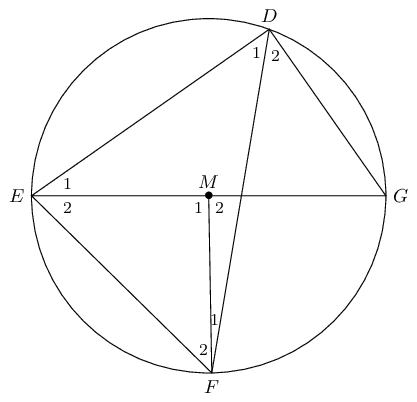

\(D\), \(E\), \(F\) and \(G\) are points on circle with centre \(M\). \(\hat{F}_1 = \text{7}\text{°}\)
            and \(\hat{D}_2 = \text{51}\text{°}\). Determine the sizes of the following angles, stating reasons:

**Problem:**
\(\hat{M}_1\)

**Solution:**
\[\begin{array}{rll}
            \hat{M_2} &= 2 \times \text{51}\text{°} & (\angle \text{ at centre } = \text{2}\times
            \text{circumference})\\
            \therefore \hat{M_2} &= \text{102}\text{°} & \\
            \hat{M_1} &= \text{180}\text{°} - \text{102}\text{°} & (\angle \text{ on str.line })\\
            \therefore \hat{M_1} &= \text{78}\text{°} &
            \end{array}\]

**Problem:**
\(\hat{D}_1\)

**Solution:**
\[\begin{array}{rll}
            \hat{D_1} &= \frac{1}{2} \times \text{78}\text{°} & (\angle \text{ at centre } = \text{2}
            \times \text{ circumference})\\
            \therefore \hat{D_1} &= \text{39}\text{°} &
            \end{array}\]

**Problem:**
\(\hat{F}_2\)

**Solution:**
\[\begin{array}{rll}
            \hat{F_2} + \hat{E_2} &= \text{102}\text{°} & (\text{exterior } \angle \triangle) \\
            \hat{F_2} &= \hat{E_2} &(ME = MF)\\
            &= \text{51}\text{°} &
            \end{array}\]

**Problem:**
\(\hat{G}\)

**Solution:**
\[\begin{array}{rll}
            \hat{G} &= E\hat{F}D & (\angle \text{s on same chord})\\
            &= \text{58}\text{°} &
            \end{array}\]

**Problem:**
\(\hat{E}_1\)

**Solution:**
\[\begin{array}{rll}
            \hat{E_1} &= \text{180}\text{°} - \text{90}\text{°} - \hat{G} & \\
            &= \text{180}\text{°} - \text{90}\text{°} - \text{58}\text{°}& \\
            \therefore \hat{E_1} &= \text{32}\text{°} &
            \end{array}\]

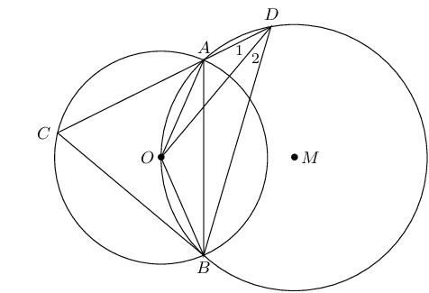

\(O\) is a point on the circle with centre \(M\). \(O\) is also the centre of a second circle. \(DA\) cuts
            the smaller circle at \(C\) and \(\hat{D}_1 = x\). Express the following angles in terms of \(x\), stating
            reasons:

**Problem:**
\(\hat{D}_2\)

**Solution:**
\[\begin{array}{rll}
            \hat{D_2} &= \hat{D_1} &(\angle\text{s on same chord} OA = OB) \\
            &= x &
            \end{array}\]

**Problem:**
\(O\hat{A}B\)

**Solution:**
\[\begin{array}{rll}
            O\hat{A}B &= x &(\angle\text{'s on same chord})
            \end{array}\]

**Problem:**
\(O\hat{B}A\)

**Solution:**
\[\begin{array}{rll}
            O\hat{B}A &= x &(\text{equal radii} OA=OB)
            \end{array}\]

**Problem:**
\(A\hat{O}B\)

**Solution:**
\[\begin{array}{rll}
            A\hat{O}B &= \text{180}\text{°} - \text{2}x &(\text{sum } \angle\text{s } \triangle =
            \text{180}\text{°})
            \end{array}\]

**Problem:**
\(\hat{C}\)

**Solution:**
\[\begin{array}{rll}
            \hat{C} &= \text{90}\text{°} - x &(\angle\text{'s on same chord})
            \end{array}\]

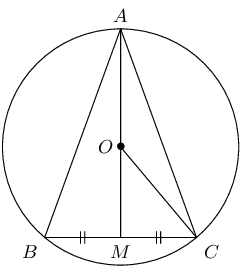

\(O\) is the centre of the circle with radius \(\text{5}\) \(\text{cm}\) and chord \(BC = \text{8}\text{
            cm}\). Calculate the lengths of:

**Problem:**
\(OM\)

**Solution:**
\[\begin{array}{rll}
            \text{In } OMC, \quad OC^2 &= OM^2 + MC^2 &({Pythagoras})\\
            5^2 &= OM^2 + 4^2 & \\
            \therefore OM &= \text{3}\text{ cm} &
            \end{array}\]

**Problem:**
\(AM\)

**Solution:**
\[\begin{array}{rll}
            AM &= \text{5} + \text{3} & \\
            \therefore AM &= \text{8}\text{ cm} & \\
            \end{array}\]

**Problem:**
\(AB\)

**Solution:**
\[\begin{array}{rll}
            \text{In } ABM, \quad AB^2 &= BM^2 + AM^2 &({Pythagoras}) \\
            AB^2 &= 8^2 + 4^2 & \\
            AB &= \sqrt{80} & \\
            \therefore AB &= 4\sqrt{5}\text{cm} &
            \end{array}\]

**Problem:**
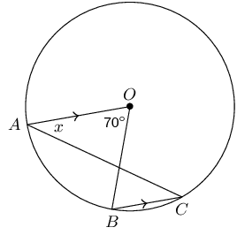

\(AO \parallel CB\) in circle with centre \(O\). \(A\hat{O}B = \text{70}\text{°}\) and \(O\hat{A}C =
            x\). Calculate the value of \(x\), giving reasons.

**Solution:**
\[\begin{array}{rll}
          \hat{C} &= \frac{1}{2} A\hat{O}B & (\angle\text{s at centre = twice circumference})\\
          &= \text{35}\text{°} & \\
          \therefore x &= \text{35}\text{°} &(\text{alt. } \angle\text{'s, } AO \parallel BC)
          \end{array}\]

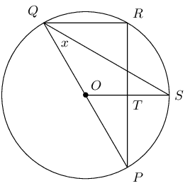

\(PQ\) is a diameter of the circle with centre \(O\). \(SQ\) bisects \(P\hat{Q}R\) and \(P\hat{Q}S = x\).

**Problem:**
Write down two other angles that are also equal to \(x\).

**Solution:**
\[\begin{array}{rll}
            R\hat{Q}S &= x & \\
            Q\hat{S}O &= x &
            \end{array}\]

**Problem:**
Calculate \(P\hat{O}S\) in terms of \(x\), giving reasons.

**Solution:**
\[\begin{array}{rll}
            P\hat{O}S &= \text{2}\times P\hat{Q}S&(\angle \text{'s at centre and circumference on same chord})
            \\
            &= \text{2}x &
            \end{array}\]

**Problem:**
Prove that \(OS\) is a perpendicular bisector of \(PR\).

**Solution:**
\[\begin{array}{rll}
            x_1 &= x_2 & (\text{proven}) \\
            \therefore QR &\parallel OS & \\
            \therefore \hat{R} &= R\hat{T}S & (\text{alt. } \angle \text{'s, } QR \parallel OS)\\
            &= \text{90}\text{°} &(\hat{R} = \angle \text{ in semi-circle})\\
            \therefore PT &= TR & \\
            \therefore OS &\text{ is perpendicular bisector of } PR &
            \end{array}\]

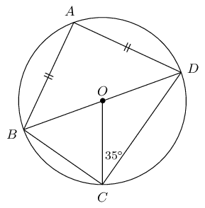

\(B\hat{O}D\) is a diameter of the circle with centre \(O\). \(AB = AD\) and \(O\hat{C}D =
            \text{35}\text{°}\). Calculate the value of the following angles, giving reasons:

**Problem:**
\(O\hat{D}C\)

**Solution:**
\[\begin{array}{rll}
            O\hat{D}C &= \text{35}\text{°}&(\text{radii } OC=OD)
            \end{array}\]

**Problem:**
\(C\hat{O}D\)

**Solution:**
\[\begin{array}{rll}
            C\hat{O}D &= \text{180}\text{°} - \text{70}\text{°} &(\text{sum} \angle\text{'s }
            \triangle = \text{180}\text{°}) \\
            &=\text{110}\text{°} &
            \end{array}\]

**Problem:**
\(C\hat{B}D\)

**Solution:**
\[\begin{array}{rll}
            C\hat{B}D &= \frac{1}{2} C\hat{O}D&(\angle\text{'s on } CD)\\
            &= \text{55}\text{°} &
            \end{array}\]

**Problem:**
\(B\hat{A}D\)

**Solution:**
\[\begin{array}{rll}
            B\hat{A}D &= \text{90}\text{°} & (\angle\text{ in semi-circle})
            \end{array}\]

**Problem:**
\(A\hat{D}B\)

**Solution:**
\[\begin{array}{rll}
            A\hat{D}B &= \frac{\text{180}\text{°}-\text{90}\text{°}}{2}&(\text{sum } \angle\text{'s in
            } \triangle = \text{180}\text{°})\\
            &= \text{45}\text{°} &
            \end{array}\]

**Problem:**
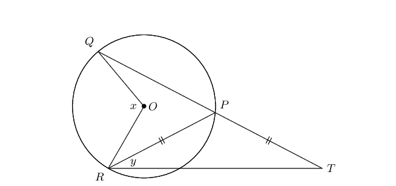

\(QP\) in the circle with centre \(O\) is protracted to \(T\) so that \(PR = PT\). Express \(y\) in terms
            of \(x\).

**Solution:**
\[\begin{array}{rll}
          T &= y &(PT = PR)\\
          \therefore Q\hat{P}R &= \text{2}y &(\text{ext. } \angle \triangle = \text{ sum interior }
          \angle\text{'s})\\
          \therefore x &= \text{2}(\text{2}y)& (\angle\text{'s at centre and circumference on } QR)\\
          x &= 4y &
          \end{array}\]

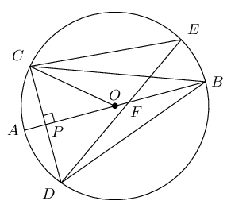

\(O\) is the centre of the circle with diameter \(AB\). \(CD \perp AB\) at \(P\) and chord \(DE\) cuts
            \(AB\) at \(F\). Prove that:

**Problem:**
\(C\hat{B}P = D\hat{P}B\)

**Solution:**
\[\begin{array}{rll}
            \text{In } \triangle CBP &\text{ and } \triangle DBP\text{:}& \\
            CP &= DP& (OP \perp CD)\\
            C\hat{P}B &= D\hat{P}B = \text{90}\text{°} & (\text{given}) \\
            BP &= BP & (\text{common})\\
            \therefore \triangle CBP &\equiv DBP &(\text{SAS} )
            \end{array}\\\]

**Problem:**
\(C\hat{E}D = 2 C\hat{B}A\)

**Solution:**
\[\begin{array}{rll}
            C\hat{E}D &= C\hat{B}D& (\angle\text{'s on chord } CD)\\
            \text{But } C\hat{B}A &= D\hat{B}A & (\triangle CBP \equiv \triangle DBP)\\
            \therefore C\hat{E}D &= 2 C\hat{B}A
            \end{array}\]

**Problem:**
\(A\hat{B}D = \frac{1}{2} C\hat{O}A\)

**Solution:**
\[\begin{array}{rll}
            D\hat{B}A &= C\hat{B}A & (\triangle CBP \equiv \triangle DBP)\\
            C\hat{B}A &= \frac{1}{2} C\hat{O}A & (\angle\text{'s at centre and circumference on arc } AC)\\
            \therefore A\hat{B}D &= \frac{1}{2} C\hat{O}A &
            \end{array}\]

**Problem:**
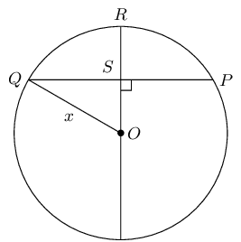

In the circle with centre \(O\), \(OR \perp QP\), \(PQ = \text{30}\text{ mm}\) and \(RS = \text{9}\text{
            mm}\). Determine the length of \(OQ\).

**Solution:**
\[\begin{array}{rll}
          \text{In } &\triangle QOS, & \\
          QO^2 &= OS^2 + QS^2 & ( \text{Pythagoras }) \\
          x^2 &= (x-9)^2 + 15^2 & \\
          x^2 &= x^2 - 18x + 81 + 225 & \\
          \therefore 18x &= 306 & \\
          \therefore x &= 17 &
          \end{array}\]

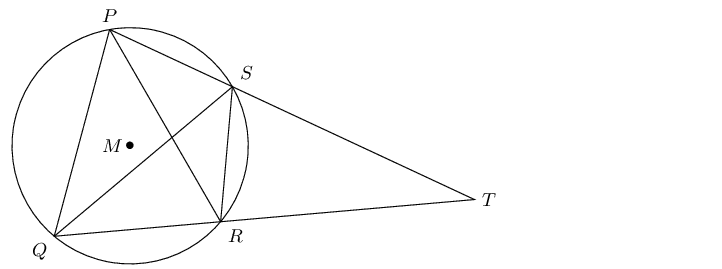

\(P\), \(Q\), \(R\) and \(S\) are points on the circle with centre \(M\). \(PS\) and \(QR\) are extended
            and meet at \(T\). \(PQ = PR\) and \(P\hat{Q}R = \text{70}\text{°}\).

**Problem:**
Determine, stating reasons, three more angles equal to \(\text{70}\text{°}\).

**Solution:**
\(Q\hat{R}P,Q\hat{S}P,R\hat{S}T\)

**Problem:**
If \(Q\hat{P}S = \text{80}\text{°}\), calculate \(S\hat{R}T\), \(S\hat{T}R\) and \(P\hat{Q}S\).

**Solution:**
\[\begin{array}{rll}
            \text{In } &\triangle QOS, & \\
            S\hat{R}T &= \text{80}\text{°} & ( \text{ext. angle cyclic quad. }) \\
            S\hat{T}R &= \text{180}\text{°}- \text{80}\text{°}- \text{30}\text{°} & (\angle
            \text{s sum of } \triangle) \\
            \therefore S\hat{T}R = \text{30}\text{°} & \\
            In \triangle PQS, \quad P\hat{Q}S &= \text{180}\text{°}- \text{80}\text{°}-
            \text{30}\text{°} & (\angle \text{s sum of } \triangle) \\
            \therefore P\hat{Q}S &= \text{30}\text{°} &
            \end{array}\]

**Problem:**
Explain why \(PQ\) is a tangent to the circle \(QST\) at point \(Q\).

**Solution:**
\(P\hat{Q}S = Q\hat{T}S = \text{30}\text{°}\), therefore \(PQ\) is a tangent to the
            circle through \(QST\), (angle between line and chord equals angle in alt. seg.)

**Problem:**
Determine \(P\hat{M}Q\).

**Solution:**
\[\begin{array}{rll}
            In \triangle PMQ, \quad P\hat{M}Q &= \text{180}\text{°}- \text{30}\text{°}-
            \text{40}\text{°} & (\angle \text{s sum of } \triangle) \\
            \therefore P\hat{M}Q &= \text{110}\text{°} &
            \end{array}\]

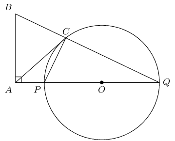

\(POQ\) is a diameter of the circle with centre \(O\). \(QP\) is protruded to \(A\) and \(AC\) is a tangent
            to the circle. \(BA \perp AQ\) and \(BCQ\) is a straight line. Prove:

**Problem:**
\(P\hat{C}Q = B\hat{A}P\)

**Solution:**
\[\begin{array}{rll}
            P\hat{C}Q &= \text{90}\text{°} & (\angle \text{ in semi-circle } ) \\
            B\hat{A}Q &= \text{90}\text{°} & ( \text{ given } BA \perp AQ) \\
            \therefore P\hat{C}Q &= B\hat{A}Q &
            \end{array}\]

**Problem:**
\(BAPC\) is a cyclic quadrilateral

**Solution:**
\[\begin{array}{rll}
            P\hat{C}Q &= B\hat{A}Q & ( \text{ proven } ) \\
            \therefore &BAPC \text{ is a cyclic quad. } & ( \text{ ext. angle = int. opp. angle } )
            \end{array}\]

**Problem:**
\(AB = AC\)

**Solution:**
\[\begin{array}{rll}
            C\hat{P}Q &= A\hat{B}C & ( \text{ ext. angle of cyclic quad. } ) \\
            B\hat{C}P &= C\hat{P}Q + C\hat{Q}P & ( \text{ ext. angle of } \triangle ) \\
            A\hat{C}P &= C\hat{Q}P & ( \text{ tangent-chord } ) \\
            \therefore B\hat{C}A &= C\hat{P}Q & \\
            \therefore &= A\hat{B}C & \\
            \therefore AB &= AC & \text{ angles opp. equal sides}
            \end{array}\]

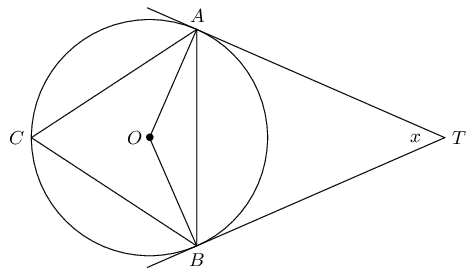

\(TA\) and \(TB\) are tangents to the circle with centre \(O\). \(C\) is a point on the circumference and
            \(A\hat{T}B = x\). Express the following in terms of \(x\), giving reasons:

**Problem:**
\(A\hat{B}T\)

**Solution:**
\(A\hat{B}T = \text{90}\text{°} - \frac{x}{2}\)

**Problem:**
\(O\hat{B}A\)

**Solution:**
\(O\hat{B}A = \frac{x}{2}\)

**Problem:**
\(\hat{C}\)

**Solution:**
\(\hat{C} = \text{90}\text{°} - \frac{x}{2}\)

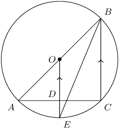

\(AOB\) is a diameter of the circle \(AECB\) with centre \(O\). \(OE \parallel BC\) and cuts \(AC\) at
            \(D\).

**Problem:**
Prove \(AD = DC\)

**Solution:**
\[\begin{array}{rll}
            BC &\parallel OE & ( \text{ given } ) \\
            A\hat{C}B &= \text{90}\text{°} & (\angle \text{ in semi-circle } ) \\
            \therefore O\hat{D}C &= \text{90}\text{°} & ( \text{ corresp. } \angle, BC \parallel OE ) \\
            \therefore AD &= DC & ( \text{ perp. from centre to mid-point. } )
            \end{array}\]

**Problem:**
Show that \(A\hat{B}C\) is bisected by \(EB\)

**Solution:**
\[\begin{array}{rll}
            O\hat{E}B &= E\hat{B}C & ( \text{ alt. } \angle, OE \parallel BC ) \\
            OE &= OB & (\angle \text{ equal radii} ) \\
            \therefore O\hat{E}B &= O\hat{B}E & (\angle \text{ opp. equal sides } ) \\
            \therefore O\hat{B}E &= E\hat{B}C & \\
            \therefore A\hat{B}C &\text{ is bisected} &
            \end{array}\]

**Problem:**
If \(O\hat{E}B = x\), express \(B\hat{A}C\) in terms of \(x\)

**Solution:**
\[\begin{array}{rll}
            \text{In } &\triangle BAC, & \\
            B\hat{A}C &= \text{180}\text{°} - \text{90}\text{°} -2x & (\angle \text{ sum of }
            \triangle ) \\
            \therefore B\hat{A}C &= \text{90}\text{°} -2x &
            \end{array}\]

**Problem:**
Calculate the radius of the circle if \(AC = \text{10}\text{ cm}\) and \(DE = \text{1}\text{ cm}\)

**Solution:**
\[\begin{array}{rll}
            \text{In } &\triangle AOD, & \\
            \text{Let } AO &=r & \\
            AO^2 &= 5^2 + (r-1)^2 & (\text{ Pythagoras }) \\
            r^2 &= 25 + r^2 - 2r + 1 & \\
            2r &= 26 & \\
            \therefore r &= \text{13}\text{ cm} &
            \end{array}\]

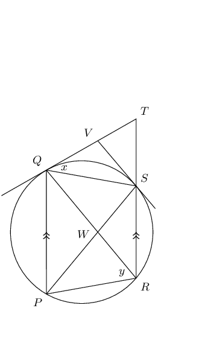

\(PQ\) and \(RS\) are chords of the circle and \(PQ \parallel RS\). The tangent to the circle at \(Q\)
            meets \(RS\) protruded at \(T\). The tangent at \(S\) meets \(QT\) at \(V\). \(QS\) and \(PR\) are drawn.

Let \(T\hat{Q}S = x\) and \(Q\hat{R}P = y\). Prove that:

**Problem:**
\(T\hat{V}S = 2 Q\hat{R}S\)

**Solution:**
\[\begin{array}{rll}
            \text{In } &\triangle VQS, & \\
            VQ &= VS & ( \text{ tangents from same pt. } ) \\
            \therefore V\hat{S}Q &= V\hat{Q}S = x & (\angle \text{s opp. equal sides }) \\
            \therefore T\hat{V}S &= x + x & (\text{ext. angle of } \triangle ) \\
            &= 2x & \\
            \text{And } Q\hat{R}S &= Q\hat{P}S = x & (\angle \text{ same seg. }) \\
            \therefore T\hat{V}S &= 2Q\hat{R}S &
            \end{array}\]

**Problem:**
\(QVSW\) is a cyclic quadrilateral

**Solution:**
\[\begin{array}{rll}
            T\hat{V}S &= 2Q\hat{R}S & ( \text{ proven } )\\
            V\hat{Q}S &= Q\hat{P}S & ( \text{ tangent-chord } )\\
            Q\hat{P}S &= P\hat{S}R = x & ( \text{ alt. } \angle, PQ \parallel RT )\\
            \text{And } Q\hat{W}S &= 2Q\hat{R}S & (\angle \text{ ext. angle of } \triangle WSR ) \\
            \therefore T\hat{V}S &= Q\hat{W}S &= 2x \\
            \therefore QVSW &= \text{ is cyclic quad. } & \text{ext. angle = int. opp. angle }
            \end{array}\]

**Problem:**
\(Q\hat{P}S + \hat{T} = P\hat{R}T\)

**Solution:**
\[\begin{array}{rll}
            \hat{Q} &= Q\hat{R}P = y & ( \text{ tangent-chord } )\\
            \hat{Q} &= \hat{T} = y & ( \text{ alt. } \angle, PQ \parallel RT )\\
            P\hat{R}T &= x + y & \\
            \text{And } Q\hat{P}S &= x & (\angle \text{ proven } ) \\
            \therefore Q\hat{P}S + \hat{T} &= x + y &= P\hat{R}T
            \end{array}\]

**Problem:**
\(W\) is the centre of the circle

**Solution:**
\[\begin{array}{rll}
            Q\hat{R}S &= x & ( \text{ proven } )\\
            Q\hat{W}S &= 2x & ( \text{ proven } )\\
            \therefore W &= \text{ is circle centre. } & (\angle \text{ centre = 2 angle at circum. }
            \end{array}\]

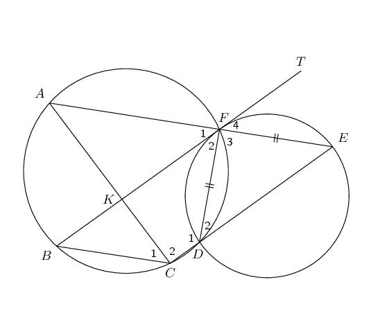

The two circles shown intersect at points \(F\) and \(D\). \(BFT\) is a tangent to the smaller circle at
            \(F\). Straight line \(AFE\) is drawn such that \(DF = EF\). \(CDE\) is a straight line and chord \(AC\) and
            \(BF\) cut at \(K\). Prove that:

**Problem:**
\(BT \parallel CE\)

**Solution:**
\[\begin{array}{rll}
            \hat{E} &= \hat{D}_2 & (\angle \text{s opp. equal sides } )\\
            \hat{F}_4 &= \hat{F}_1 & ( \text{ vert. opp angles } )\\
            \text{ and } \hat{F}_4 &= \hat{D}_2 & ( \text{ tangent-chord} )\\
            \therefore \hat{F}_1 &= \hat{D}_2 & \\
            \therefore BT &\parallel CE & (\angle \text{ corresp. angles }
            \end{array}\]

**Problem:**
\(BCEF\) is a parallelogram

**Solution:**
\[\begin{array}{rll}
            \therefore BT & \parallel CE & ( \text{ proven}) \\
            \therefore \hat{F}_1 &= \hat{C}_1 & ( \text{ angles same seg.}) \\
            \therefore AE &\parallel BC & (\angle \text{ alt. angles } \\
            \therefore BCEF &\text{ is parallelogram } & (\angle \text{ both opp. sides } \parallel
            \end{array}\]

**Problem:**
\(AC = BF\)

**Solution:**
\[\begin{array}{rll}
            \hat{F}_1 &= \hat{C}_1 & ( \text{ proven }) \\
            \hat{F}_1 &= \hat{E} & ( \text{ proven }) \\
            \hat{A} &= \hat{C}_1 & ( \text{ alt. angles }, AE \parallel BC ) \\
            \therefore \hat{A} &= \hat{E} & \\
            \therefore AC &= CE & (\angle \text{ angles opp. equal sides } \\
            BF &= CE & (\angle \text{ opp. sides parm. =}) \\
            \therefore AC &= BF &
            \end{array}\]
