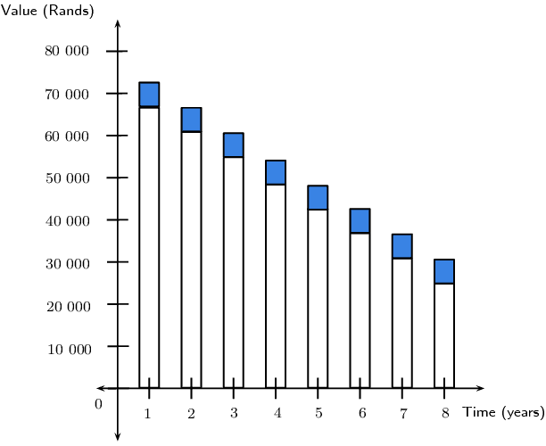

## 9.2 Simple and compound depreciation (EMBJF)

As soon as a new car leaves the dealership, its value decreases and it is considered “second-hand”.
      Vehicles, equipment, machinery and other similar assets, all lose value over time as a result of usage and age.
      This loss in value is called depreciation. Assets that have a relatively long useful lifetime, such as machines,
      trucks, farming equipment etc., depreciate slower than assets like office equipment, computers, furniture etc.
      which need to be replaced more often and therefore depreciate more quickly.

Depreciation is used to calculate the value of a company's assets, which determines how much tax a company must
      pay. Companies can take depreciation into account as an expense, and thereby reduce their taxable income. A lower
      taxable income
      means that the company will pay less income tax to SARS (South African Revenue Service).

We can calculate two different kinds of depreciation: simple decay and compound decay. Decay is also a term used
      to describe a reduction or decline in value. Simple decay is also called straight-line depreciation and compound
      decay can also be referred to as reducing-balance depreciation. In the straight-line method the value of the asset
      is reduced by a constant amount each year, which is calculated on the principal amount. In reducing-balance
      depreciation we calculate the depreciation on the reduced value of the asset. This means that the value of an
      asset decreases by a different amount each year.

## Simple and compound depreciation

2. Mr. Sontange buys an Opel Fiesta for \(\text{R}\,\text{72 000}\). He expects that the value of the car will
               depreciate by \(\text{R}\,\text{6 000}\) every year. He draws up a table to calculate the depreciated value
               of his Opel Fiesta.
   Complete Mr. Sontange's table of values for the \(\text{7}\) year period:
   | Year | Value at beginning of year | Depreciation amount | Value at end of year |
   | --- | --- | --- | --- |
   | \(\text{1}\) | \(\text{R}\,\text{72 000}\) | \(\text{R}\,\text{6 000}\) | \(\text{R}\,\text{66 000}\) |
   | \(\text{2}\) | \(\text{R}\,\text{66 000}\) | \(\text{R}\,\text{6 000}\) |  |
   | \(\text{3}\) |  |  |  |
   | \(\text{4}\) |  |  |  |
   | \(\text{5}\) |  |  |  |
   | \(\text{6}\) |  |  |  |
   | \(\text{7}\) |  |  |  |
4. His son, David, does not agree that the value of the car will reduce by the same amount each year. David
               thinks that the car will depreciate by \(\text{10}\%\) every year.
   Complete David's table of values:
   | Year | Value at beginning of year | Depreciation amount | Value at end of year |
   | --- | --- | --- | --- |
   | \(\text{1}\) | \(\text{R}\,\text{72 000}\) | \(\text{R}\,\text{7 200}\) | \(\text{R}\,\text{64 800}\) |
   | \(\text{2}\) | \(\text{R}\,\text{64 800}\) | \(\text{R}\,\text{6 480}\) |  |
   | \(\text{3}\) |  |  |  |
   | \(\text{4}\) |  |  |  |
   | \(\text{5}\) |  |  |  |
   | \(\text{6}\) |  |  |  |
   | \(\text{7}\) |  |  |  |
6. Compare and discuss the results of the two different tables.
8. Consider the graph below, which represents Mr. Sontange's table of values:
   
   2. Draw a similar graph using David's table of values.
   4. Interpret the two graphs and discuss the differences between them.
   6. Explain how the graphs can be used to determine the total depreciation in each case.
   8. 2. Draw two new graphs by plotting the maximum value of each bar.
      4. Join the points with a line to show the general trend.
      6. Is it mathematically correct to join these points? Explain your answer.

### Simple depreciation (EMBJG)

<Callout type="tip" title="Worked example 3: Straight-line depreciation">
**Question:**
A new smartphone costs \(\text{R}\,\text{6 000}\) and depreciates at \(\text{22}\%\) p.a. on a
            straight-line basis. Determine the value of the smartphone at the end of each year over a \(\text{4}\) year
            period.

**Calculate depreciation amount:**
\begin{align*}
          \text{Depreciation} &= \text{6 000} \times \frac{22}{\text{100}} \\
          &= \text{1 320}
          \end{align*}

Therefore the smartphone depreciates by \(\text{R}\,\text{1 320}\) every year.

**Complete a table of values:**
| Year | Value at beginning of year | Depreciation amount | Value at end of year |
| --- | --- | --- | --- |
| \(\text{1}\) | \(\text{R}\,\text{6 000}\) | \(\text{R}\,\text{1 320}\) | \(\text{R}\,\text{4 680}\) |
| \(\text{2}\) | \(\text{R}\,\text{4 680}\) | \(\text{R}\,\text{1 320}\) | \(\text{R}\,\text{3 360}\) |
| \(\text{3}\) | \(\text{R}\,\text{3 360}\) | \(\text{R}\,\text{1 320}\) | \(\text{R}\,\text{2 040}\) |
| \(\text{4}\) | \(\text{R}\,\text{2 040}\) | \(\text{R}\,\text{1 320}\) | \(\text{R}\,\text{720}\) |
</Callout>

We notice that

      \[\text{Total depreciation} = P \times i \times n\]

where

      \begin{align*}
      P &= \text{principal amount} \\
      i &= \text{interest rate written as a decimal} \\
      n &= \text{time period in years}
      \end{align*}

Therefore the depreciated value of the asset (also called the book value) can be calculated as:

      \[A = P(1 - in)\]

Note the similarity to the simple interest formula \(A = P(1 + in)\). Interest increases the value of the
        principal amount, whereas with simple decay, depreciation reduces the value of the principal amount.

**Important:** to get an accurate answer do all calculations in one step on your calculator. Do
        not round off answers in your calculations until the final answer. In the worked examples in this chapter, we
        use dots to show that the answer has not been rounded off. We always round the final answer to two decimal
        places (cents).

<Callout type="tip" title="Worked example 4: Straight-line depreciation method">
**Question:**
A car is valued at \(\text{R}\,\text{240 000}\). If it depreciates at \(\text{15}\%\) p.a. using
            straight-line depreciation, calculate the value of the car after \(\text{5}\) years.

**Write down the known variables and the simple decay formula:**
\begin{align*}
          P &= \text{240 000} \\
          i &= \text{0,15} \\
          n &= 5
          \end{align*}\[A = P(1 - in)\]

**Substitute the values and solve for \(A\):**
\begin{align*}
          A &= \text{240 000}(1 - \text{0,15} \times 5) \\
          &= \text{240 000}(\text{0,25}) \\
          &= \text{60 000}
          \end{align*}

**Write the final answer:**
At the end of \(\text{5}\) years, the car is worth \(\text{R}\,\text{60 000}\).
</Callout>

<QuizCard id="m11-09-02a" title="Interactive Exercise 9.2" question="A truck is worth \(\text{R}\,\text{84 000}\) now. It depreciates at a rate of \(\text{8}\%\) p.a. on a straight-line basis.  What is the truck worth in \(\text{9}\) years' time?" options=[] answer="23520" hint="You should enter a number here. If you want to, you can use a space to separate thousands.                Example: 12 800,25 For scientific notation you need to use the multiply symbol                ( ∗ ) and the exponent symbol ( ^ ). For example 6,673 × 10 −11 should be written as: 6,673 ∗ 10^−11" explanation="Examine the given information Determine what has been provided and what is required: \[                     \begin{aligned}                     \text{the value now} & = \text{84 000}\\                     \text{rate of depreciation} & = \text{8}\% = \text{0,08}\\                     \text{number of years} & = \text{9}\\                     \text{the final value} & = ?                     \end{aligned}                 \] Substitute in to the formula for simple depreciation This is a simple depreciation problem.  Write down the formula and substitute in what you know. \[                     \begin{aligned}                     A & = P(1 - in)    \\                     A & = \text{84 000}\left(1 - (\text{0,08} \times \text{9})\right)                     \end{aligned}                 \] Solve for \(A\) Solve the problem: \[                     \begin{aligned}                     A & = \text{84 000}(1 - \text{0,72})\\                     & = \text{84 000} (\text{0,28})\\                     & = \text{23 520}                     \end{aligned}                 \] In \(\text{9}\) years' time the truck will be worth \(\text{R}\,\text{23 520}\) . Submit your answer as:" />

<Callout type="tip" title="Worked example 5: Simple decay">
**Question:**
A small business buys a photocopier for \(\text{R}\,\text{12 000}\). For the tax return the owner
            depreciates this asset over \(\text{3}\) years using a straight-line depreciation method. What amount will
            he fill in on his tax form at the end of each year?

**Write down the known variables:**
The owner of the business wants the photocopier to have a book value of \(\text{R}\,\text{0}\) after
            \(\text{3}\) years.

          \begin{align*}
          A &= 0 \\
          P &= \text{12 000} \\
          n &= 3
          \end{align*}

Therefore we can calculate the annual depreciation as
            \begin{align*}
            \text{Depreciation}
            &= \frac{P}{n} \\
            &= \frac{\text{12 000}}{3} \\
            &= \text{R}\,\text{4 000}
            \end{align*}

**Determine the book value at the end of each year:**
\begin{align*}
          \text{Book value end of first year} &= \text{12 000} - \text{4 000} \\
          &= \text{R}\,\text{8 000} \\
          \\
          \text{Book value end of second year} &= \text{8 000} - \text{4 000} \\
          &= \text{R}\,\text{4 000} \\
          \\
          \text{Book value end of third year} &= \text{4 000} - \text{4 000} \\
          &= \text{R}\,\text{0}
          \end{align*}
</Callout>

## Simple decay

### Textbook Exercise 9.2

**Problem:**
A business buys a truck for \(\text{R}\,\text{560 000}\). Over a period of \(\text{10}\) years the
                value of the truck depreciates to \(\text{R}\,\text{0}\) using the straight-line method. What is the
                value of the truck after \(\text{8}\) years?

**Solution:**
\begin{align*}
              \text{Depreciation} &= \frac{\text{560 000}}{10} \\
              &= \text{R}\,\text{56 000}\text{ per year} \\
              \text{For } n &= 8 \\
              A &= \text{560 000} - 8(\text{56 000}) \\
              &= \text{R}\,\text{112 000}
              \end{align*}

**Problem:**
Harry wants to buy his grandpa's donkey for \(\text{R}\,\text{800}\). His grandpa is quite pleased with
                the offer, seeing that it only depreciated at a rate of \(\text{3}\%\) per year using the straight-line
                method. Grandpa bought the donkey \(\text{5}\) years ago. What did grandpa pay for the donkey then?

**Solution:**
\begin{align*}
              A &= P(1 - in) \\
              \text{800} &= P(1 - (\text{0,03} \times 5)) \\
              \therefore \frac{\text{800}}{\text{0,85}} &= P \\
              \therefore P &= \text{R}\,\text{941,18}
              \end{align*}

**Problem:**
Seven years ago, Rocco's drum kit cost him \(\text{R}\,\text{12 500}\). It has now been valued at
                \(\text{R}\,\text{2 300}\). What rate of simple depreciation does this represent?

**Solution:**
\begin{align*}
              A &= P(1 - in) \\
              \text{2 300} &= \text{12 500}(1 - (i \times 7)) \\
              \therefore \frac{\text{2 300}}{\text{12 500}} &= 1 - 7i \\
              \text{0,184} - 1 &= - 7i \\
              \frac{-\text{0,816}}{-7} &= i \\
              \therefore i &= \text{11,66}\%
              \end{align*}

**Problem:**
Fiona buys a DStv satellite dish for \(\text{R}\,\text{3 000}\). Due to weathering, its value
                depreciates simply at \(\text{15}\%\) per annum. After how long will the satellite dish have a book
                value of zero?

**Solution:**
\begin{align*}
              \text{Depreciation} &= \text{3 000} \times \frac{15}{\text{100}} \\
              &= \text{R}\,\text{450}\text{ per year} \\
              \therefore n &= \frac{\text{3 000}}{\text{450}} \\
              &= \text{6,666} \ldots \\
              \therefore n &= \text{7}\text{ years}
              \end{align*}

Or

              \begin{align*}
              A &= P(1 - in) \\
              0 &= \text{3 000}(1 - \text{0,15} \times n) \\
              \therefore 0 &= 1 - \text{0,15}n \\
              \text{0,15}n &= 1 \\
              n &= \frac{1}{\text{0,15}} \\
              &= \text{6,666} \ldots \\
              \therefore n &= \text{7}\text{ years}
              \end{align*}

### Compound depreciation (EMBJH)

<Callout type="tip" title="Worked example 6: Reducing-balance depreciation">
**Question:**
A second-hand farm tractor worth \(\text{R}\,\text{60 000}\) has a limited useful life of \(\text{5}\)
            years and depreciates at \(\text{20}\%\) p.a. on a reducing-balance basis. Determine the value of the
            tractor at the end of each year over the \(\text{5}\) year period.

**Write down the known variables:**
\begin{align*}
          P &= \text{60 000} \\
          i &= \text{0,2} \\
          n &= 5
          \end{align*}

When we calculate depreciation using the reducing-balance method:

2. the depreciation amount changes for each year.
4. the depreciation amount gets smaller each year.
6. the book value at the end of a year becomes the principal amount for the next year.
8. the asset will always have some value (the book value will never equal zero).

**Complete a table of values:**
| Year | Book value | Depreciation | Value at end of year |
| --- | --- | --- | --- |
| \(\text{1}\) | \(\text{R}\,\text{60 000}\) | \(\text{60 000} \times \text{0,2} = \text{12 000}\) | \(\text{R}\,\text{48 000}\) |
| \(\text{2}\) | \(\text{R}\,\text{48 000}\) | \(\text{48 000} \times \text{0,2} = \text{9 600}\) | \(\text{R}\,\text{38 400}\) |
| \(\text{3}\) | \(\text{R}\,\text{38 400}\) | \(\text{38 400} \times \text{0,2} = \text{7 680}\) | \(\text{R}\,\text{30 720}\) |
| \(\text{4}\) | \(\text{R}\,\text{30 720}\) | \(\text{30 720} \times \text{0,2} = \text{6 144}\) | \(\text{R}\,\text{24 576}\) |
| \(\text{5}\) | \(\text{R}\,\text{24 576}\) | \(\text{24 576} \times \text{0,2} = \text{4 915,20}\) | \(\text{R}\,\text{19 660,80}\) |
</Callout>

Notice in the example above that we could also write the book value at the end of each year as:

      \[\begin{array}{l@{\;}l@{\;}l}
      \text{Book value end of first year} &= \text{60 000}(1 - \text{0,2}) & \\
      \text{Book value end of second year} &= \text{48 000}(1 - \text{0,2}) &= \text{60 000} (1 -
      \text{0,2})^2 \\
      \text{Book value end of third year} &= \text{38 400}(1 - \text{0,2}) &= \text{60 000} (1 -
      \text{0,2})^3 \\
      \text{Book value end of fourth year} &= \text{30 720}(1 - \text{0,2}) &= \text{60 000} (1 -
      \text{0,2})^4 \\
      \text{Book value end of fifth year} &= \text{24 576}(1 - \text{0,2}) &= \text{60 000} (1 -
      \text{0,2})^5
      \end{array}\]

Using the formula for simple decay and the observed pattern in the calculation above, we obtain the following
        formula for compound decay:

      \[A = P(1 - i)^n\]

where

      \begin{align*}
      A &= \text{book value or depreciated value} \\
      P &= \text{principal amount} \\
      i &= \text{interest rate written as a decimal} \\
      n &= \text{time period in years}
      \end{align*}

Again, notice the similarity to the compound interest formula \(A = P(1 + i)^n\).

<Callout type="tip" title="Worked example 7: Reducing-balance depreciation">
**Question:**
The number of pelicans at the Berg river mouth is decreasing at a compound rate of \(\text{12}\%\) p.a. If
            there are currently \(\text{3 200}\) pelicans in the wetlands of the Berg river mouth, what will the
            population be in \(\text{5}\) years?

**Write down the known variables and the compound decay formula:**
\begin{align*}
          P &= \text{3 200} \\
          i &= \text{0,12} \\
          n &= 5
          \end{align*}\[A = P(1 - i)^n\]

**Substitute the values and solve for \(A\):**
\begin{align*}
          A &= \text{3 200}(1 - \text{0,12})^5 \\
          &= \text{3 200}(\text{0,88})^5 \\
          &= \text{1 688,7421} \ldots
          \end{align*}

**Write the final answer:**
In \(\text{5}\) years, the pelican population will be approximately \(\text{1 689}\).
</Callout>

<QuizCard id="m11-09-02c" title="Interactive Exercise 9.4" question="Farmer Nthofeela buys a tractor for \(\text{R}\,\text{242 000}\) . The tractor depreciates by \(\text{18}\%\) per year on a reducing-balance basis. What is the depreciated value of the tractor after \(\text{14}\) years?" options=[] answer=" 15038.67 " hint="You should enter a number here. If you want to, you can use a space to separate thousands.                Example: 12 800,25 For scientific notation you need to use the multiply symbol                ( ∗ ) and the exponent symbol ( ^ ). For example 6,673 × 10 −11 should be written as: 6,673 ∗ 10^−11" explanation="Write down the information from the question This is a financial maths question. So there are specific values we expect to need.                     To start, organise the information by writing down what we know. \[                     \begin{aligned}                     \text{original value} & = \text{R}\,\text{242 000}\\                     \text{rate of depreciation} & = \text{18}\% = \text{0,18}\\                     \text{number of years} & = \text{14}\\                     \text{the final value} & = ?                     \end{aligned}                 \] Substitute into the depreciation formula This is a compound depreciation question.  Write down the compound depreciation                     formula and go for it! \[                     \begin{aligned}                     A & = P(1 - i)^{n}     \\                     A & = 242000(1 - \text{0,18})^{\text{14}}                     \end{aligned}                 \] Evaluate to get the answer Solve the problem: \[                     \begin{aligned}                     A & = 242000( \text{0,82})^{\text{14}}\\                     & = 242000 \times \text{0,0621...}\\                     & = \text{15 038,6654...}                     \end{aligned}                 \] Write the final answer (remember to round off to two decimal places because the                     answer represents money): The value of the tractor after \(\text{14}\) years is \(\text{R}\,\text{15 038,67}\) . Submit your answer as:" />

<Callout type="tip" title="Worked example 8: Compound decay">
**Question:**
2. A school buys a minibus for \(\text{R}\,\text{950 000}\), which depreciates at \(\text{13,5}\%\) per
                   annum. Determine the value of the minibus after \(\text{3}\) years if the depreciation is calculated:
   2. on a straight-line basis.
   4. on a reducing-balance basis.
4. Which is the better option?

**Write down known variables:**
\begin{align*}
          P &= \text{950 000} \\
          i &= \text{0,135} \\
          n &= 3
          \end{align*}

**Use the simple decay formula and solve for \(A\):**
\begin{align*}
          A &= \text{950 000}(1 - 3 \times \text{0,135}) \\
          &= \text{950 000}(\text{0,865}) \\
          &= \text{565 250} \\
          \therefore A &= \text{R}\,\text{565 250}
          \end{align*}

**Use the compound decay formula and solve for \(A\):**
\begin{align*}
          A &= \text{950 000}(1 - \text{0,135})^3 \\
          &= \text{950 000}(\text{0,865})^3 \\
          &= \text{614 853,89} \\
          \therefore A &= \text{R}\,\text{614 853,89}
          \end{align*}

**Interpret the answers:**
After a period of \(\text{3}\) years, the value of the minibus calculated on the straight-line method is
            less than the value of the minibus calculated on the reducing-balance method. The value of the minibus
            depreciated less on the reducing-balance basis because the amount of depreciation is calculated on a smaller
            amount every year, whereas the straight-line method is based on the full value of the minibus every year.
</Callout>

<Callout type="tip" title="Worked example 9: Compound depreciation">
**Question:**
Farmer Jack bought a tractor and it has depreciated by \(\text{20}\%\) p.a. on a reducing-balance basis. If
            the current value of the tractor is \(\text{R}\,\text{52 429}\), calculate how much Farmer Jack paid for his
            tractor if he bought it \(\text{7}\) years ago.

**Write down known variables and compound decay formula:**
\begin{align*}
          A &= \text{52 429} \\
          i &= \text{0,2} \\
          n &= 7
          \end{align*}\[A = P(1 - i)^n\]

**Substitute the values and solve for \(P\):**
\begin{align*}
          \text{52 429} &= P(1 - \text{0,2})^7 \\
          &= P(\text{0,8})^7 \\
          \therefore P &= \frac{\text{52 429}}{(\text{0,8})^7} \\
          &= \text{250 000,95} \ldots
          \end{align*}

**Write the final answer:**
\(\text{7}\) years ago, Farmer Jack paid \(\text{R}\,\text{250 000}\) for his tractor.
</Callout>

## Compound depreciation

### Textbook Exercise 9.3

**Problem:**
Jwayelani buys a truck for \(\text{R}\,\text{89 000}\) and depreciates it by \(\text{9}\%\) p.a. using
                the compound depreciation method. What is the value of the truck after \(\text{14}\) years?

**Solution:**
\begin{align*}
              A &= P(1 - i)^n \\
              &= \text{89 000}(1 - \text{0,09})^{14} \\
              &= \text{89 000}(\text{0,91})^{14} \\
              \therefore A &= \text{R}\,\text{23 766,73}
              \end{align*}

**Problem:**
The number of cormorants at the Amanzimtoti river mouth is decreasing at a compound rate of
                \(\text{8}\%\) p.a. If there are now \(\text{10 000}\) cormorants, how many will there be in
                \(\text{18}\) years' time?

**Solution:**
\begin{align*}
              A &= P(1 - i)^n \\
              &= \text{10 000}(1 - \text{0,08})^{18} \\
              &= \text{10 000}(\text{0,92})^{18} \\
              &= \text{2 229,36} \ldots \\
              \therefore A &= \text{2 229}\text{ cormorants}
              \end{align*}

**Problem:**
On January \(\text{1}\), \(\text{2 008}\) the value of my Kia Sorento is \(\text{R}\,\text{320
                000}\). Each year after that, the car's value will decrease \(\text{20}\%\) of the previous year's
                value. What is the value of the car on January \(\text{1}\), \(\text{2 012}\)?

**Solution:**
\begin{align*}
              A &= P(1 - i)^n \\
              &= \text{320 000}(1 - \text{0,2})^4 \\
              &= \text{320 000}(\text{0,8})^4 \\
              \therefore A &= \text{R}\,\text{131 072}
              \end{align*}

**Problem:**
The population of Bonduel decreases at a reducing-balance rate of \(\text{9,5}\%\) per annum as people
                migrate to the cities. Calculate the decrease in population over a period of \(\text{5}\) years if the
                initial population was \(\text{2 178 000}\).

**Solution:**
\begin{align*}
              A &= P(1 - i)^n \\
              &= \text{2 178 000}(1 - \text{0,095})^5 \\
              &= \text{2 178 000}(\text{0,905})^5 \\
              \therefore A &= \text{132 221}
              \end{align*}

**Problem:**
A \(\text{20}\) \(\text{kg}\) watermelon consists of \(\text{98}\%\) water. If it is left outside in
                the sun it loses \(\text{3}\%\) of its water each day. How much does it weigh after a month of
                \(\text{31}\) days?

**Solution:**
\begin{align*}
              A &= P(1 - i)^n \\
              A &= \left( 20 \times \frac{98}{\text{100}} \right) (1 - \text{0,03})^{31} \\
              &= \text{19,6}(\text{0,97})^{31} \\
              \therefore A &= \text{7,62}\text{ kg}
              \end{align*}

**Problem:**
Richard bought a car \(\text{15}\) years ago and it depreciated by \(\text{17}\%\) p.a. on a compound
                depreciation basis. How much did he pay for the car if it is now worth \(\text{R}\,\text{5 256}\)?

**Solution:**
\begin{align*}
              A &= P(1 - i)^n \\
              \text{5 256} &= P (1 - \text{0,17})^{15} \\
              \frac{\text{5 256}}{{\text{0,83}}^{15}}&= P\\
              \therefore P &= \text{R}\,\text{85 997,13}
              \end{align*}

### Finding \(i\) (EMBJJ)

<Callout type="tip" title="Worked example 10: Finding \(i\) for simple decay">
**Question:**
After \(\text{4}\) years, the value of a computer is halved. Assuming simple decay, at what annual rate did
            it depreciate? Give your answer correct to two decimal places.

**Write down known variables and simple decay formula:**
Let the value of the computer be \(x\), therefore:

          \begin{align*}
          A &= \frac{x}{2} \\
          P &= x \\
          n &= 4
          \end{align*}\[A = P(1 - in)\]

**Substitute the values and solve for \(i\):**
\begin{align*}
          \frac{x}{2} &= x (1 - 3i) \\
          \frac{1}{2} &= 1 - 3i \\
          \therefore 3i &= 1 - \frac{1}{2} \\
          \therefore i &= \text{0,1667}
          \end{align*}

**Write the final answer:**
The computer depreciated at a rate of \(\text{16,67}\%\) p.a.
</Callout>

<QuizCard id="m11-09-02e" title="Interactive Exercise 9.6" question="Justine deposits \(\text{R}\,\text{7 500}\) into a savings account which earns simple interest.  The account grows to a value of \(\text{R}\,\text{13 080,00}\) in \(\text{12}\) years.  Determine the value of \(i\) , the rate of interest paid by the bank. INSTRUCTION: Give your answer as a percentage rounded to one decimal place." options=[] answer="6.2" hint="You should enter a number here. If you want to, you can use a space to separate thousands.                Example: 12 800,25 For scientific notation you need to use the multiply symbol                ( ∗ ) and the exponent symbol ( ^ ). For example 6,673 × 10 −11 should be written as: 6,673 ∗ 10^−11" explanation="Write down the given information. \(A = \text{13 080} \) \(P = \text{7 500} \) \(n = \text{12}\) \(i = ?\) The question says, \"earns simple interest,\" so we need to use the simple interest formula. Substitute in what you know! \[                     \begin{aligned}                     A & = P(1+in) \\                     \text{13 080} & = \text{7 500}\left( 1 + i (\text{12}) \right)                     \end{aligned}                 \] Solve for \( i \) . The first step is to divide by \(\text{7 500}\) which will let us get into the brackets. Then solve it! \[                     \begin{aligned}                     \text{13 080} & = \text{7 500}\left( 1 +  \text{12}i \right)    \\                     \frac{\text{13 080}}{\text{7 500}} & = \left( 1 + \text{12}i \right)    \\                     \text{1,744} & = 1 +\text{12}i    \\                     \text{0,744} & = \text{12}i    \\                     \frac{\text{0,744}}{\text{12}} & = i    \\                     \text{0,062} & = i                     \end{aligned}                 \] Finally, multiply by \(\text{100}\) to change into a percentage. Then round to one decimal place if necessary. \( i = 100(\text{0,062}) = \text{6,2}\% \) . Submit your answer as:" />

<QuizCard id="m11-09-02e" title="Interactive Exercise 9.6" question="Angelique deposits \(\text{R}\,\text{4 000}\) into a savings account which pays simple interest.  The account grows to a value of \(\text{R}\,\text{7 036,00}\) in \(\text{11}\) years.  What is the interest rate for this account? INSTRUCTION: Give your answer as a percentage rounded to one decimal place." options=[] answer="6.9" hint="You should enter a number here. If you want to, you can use a space to separate thousands.                Example: 12 800,25 For scientific notation you need to use the multiply symbol                ( ∗ ) and the exponent symbol ( ^ ). For example 6,673 × 10 −11 should be written as: 6,673 ∗ 10^−11" explanation="Write down the given information. \(A = \text{7 036} \) \(P = \text{4 000} \) \(n = \text{11}\) \(i = ?\) The question says, \"pays simple interest,\" so we need to use the simple interest formula. Substitute in what you know! \[                     \begin{aligned}                     A & = P(1+in) \\                     \text{7 036} & = \text{4 000}\left( 1 + i (\text{11}) \right)                     \end{aligned}                 \] Solve for \( i \) . The first step is to divide by \(\text{4 000}\) which will let us get into the brackets. Then solve it! \[                     \begin{aligned}                     \text{7 036} & = \text{4 000}\left( 1 +  \text{11}i \right)    \\                     \frac{\text{7 036}}{\text{4 000}} & = \left( 1 + \text{11}i \right)    \\                     \text{1,759} & = 1 +\text{11}i    \\                     \text{0,759} & = \text{11}i    \\                     \frac{\text{0,759}}{\text{11}} & = i    \\                     \text{0,069} & = i                     \end{aligned}                 \] Finally, multiply by \(\text{100}\) to change into a percentage. Then round to one decimal place if necessary. \( i = 100(\text{0,069}) = \text{6,9}\% \) . Submit your answer as:" />

<Callout type="tip" title="Worked example 11: Finding \(i\) for compound decay">
**Question:**
Cristina bought a fridge at the beginning of \(\text{2 009}\) for \(\text{R}\,\text{8 999}\) and sold
            it at the end of \(\text{2 011}\) for \(\text{R}\,\text{4 500}\). At what rate did the value of her
            fridge depreciate assuming a reducing-balance method? Give your answer correct to two decimal places.

**Write down known variables and compound decay formula:**
\begin{align*}
          A &= \text{4 500} \\
          P &= \text{8 999} \\
          n &= 3
          \end{align*}\[A = P(1 - i)^n\]

**Substitute the values and solve for \(i\):**
\begin{align*}
          \text{4 500} &= \text{8 999} (1 - i)^3 \\
          \frac{\text{4 500}}{\text{8 999}}&= (1 - i)^3 \\
          \sqrt[3]{\frac{\text{4 500}}{\text{8 999}}} &= 1 - i \\
          \therefore i &= 1 - \sqrt[3]{\frac{\text{4 500}}{\text{8 999}}} \\
          &= \text{0,206}
          \end{align*}

**Write the final answer:**
Cristina's fridge depreciated at a rate of \(\text{20,6}\%\) p.a.
</Callout>

<QuizCard id="m11-09-02f" title="Interactive Exercise 9.7" question="Kutlwano deposits \(\text{R}\,\text{5 000}\) into a savings account which earns compound interest.  The account grows to a value of \(\text{R}\,\text{8 175,40}\) in \(\text{6}\) years.  Determine the value of \(i\) , the rate of interest paid by the bank. INSTRUCTION: Give your answer as a percentage rounded to two decimal places." options=[] answer="8.54" hint="You should enter a number here. If you want to, you can use a space to separate thousands.                Example: 12 800,25 For scientific notation you need to use the multiply symbol                ( ∗ ) and the exponent symbol ( ^ ). For example 6,673 × 10 −11 should be written as: 6,673 ∗ 10^−11" explanation="Write down the given information. \(A = \text{R}\,\text{8 175,40} \) \(P = \text{R}\,\text{5 000} \) \(n = \text{6}\) \(i = ?\) The question says, \"earns compound interest,\" so we need to use the compound interest formula. Substitute in what you know! \[                     \begin{aligned}                     A & = P(1+i)^{n} \\                     \text{8 175,4} & = \text{5 000}\left( 1 + i \right)^{\text{6}}                     \end{aligned}                 \] Solve for \( i \) . The first step is to divide by \(\text{5 000}\) . Then we will deal with the exponent. \[                     \begin{aligned}                     \text{8 175,4} & = \text{5 000}\left( 1 +  i \right)^{\text{6}}    \\                     \frac{\text{8 175,4}}{\text{5 000}} & = \left( 1 + i \right)^{\text{6}}    \\                     1,63507\ldots & = \left( 1 + i \right)^{\text{6}}                     \end{aligned}                 \] At this point we must use our exponent skills from earlier in the year! To remove the exponent on the right side of the equation, we need to take a root to kill the exponent of \( \text{6} \) . (Rather than a root, we can also use an exponent of \( \frac{1}{\text{6}} \) - it means the same thing.) \[                     \begin{aligned}                     \sqrt[\text{6}]{1,63507\ldots} & = \sqrt[\text{6}]{\left( 1 + i \right)^{\text{6}}}    \\                     1,08540\ldots & = 1 + i    \\                     0,08540\ldots & = i                     \end{aligned}                 \] Finally, change the decimal into a percentage (multiply by \(\text{100}\) ) and then round to two decimal places: \( i = 100(0,08540\ldots) = \text{8,54}\% \) . Submit your answer as:" />

<QuizCard id="m11-09-02f" title="Interactive Exercise 9.7" question="Ntombebhongo deposits \(\text{R}\,\text{3 000}\) into a savings account which pays compound interest.  The account grows to a value of \(\text{R}\,\text{4 031,75}\) in \(\text{5}\) years.  What is the interest rate for this account? INSTRUCTION: Give your answer as a percentage rounded to two decimal places." options=[] answer="6.09" hint="You should enter a number here. If you want to, you can use a space to separate thousands.                Example: 12 800,25 For scientific notation you need to use the multiply symbol                ( ∗ ) and the exponent symbol ( ^ ). For example 6,673 × 10 −11 should be written as: 6,673 ∗ 10^−11" explanation="Write down the given information. \(A = \text{R}\,\text{4 031,75} \) \(P = \text{R}\,\text{3 000} \) \(n = \text{5}\) \(i = ?\) The question says, \"pays compound interest,\" so we need to use the compound interest formula. Substitute in what you know! \[                     \begin{aligned}                     A & = P(1+i)^{n} \\                     \text{4 031,75} & = \text{3 000}\left( 1 + i \right)^{\text{5}}                     \end{aligned}                 \] Solve for \( i \) . The first step is to divide by \(\text{3 000}\) . Then we will deal with the exponent. \[                     \begin{aligned}                     \text{4 031,75} & = \text{3 000}\left( 1 +  i \right)^{\text{5}}    \\                     \frac{\text{4 031,75}}{\text{3 000}} & = \left( 1 + i \right)^{\text{5}}    \\                     1,34391\ldots & = \left( 1 + i \right)^{\text{5}}                     \end{aligned}                 \] At this point we must use our exponent skills from earlier in the year! To remove the exponent on the right side of the equation, we need to take a root to kill the exponent of \( \text{5} \) . (Rather than a root, we can also use an exponent of \( \frac{1}{\text{5}} \) - it means the same thing.) \[                     \begin{aligned}                     \sqrt[\text{5}]{1,34391\ldots} & = \sqrt[\text{5}]{\left( 1 + i \right)^{\text{5}}}    \\                     1,06090\ldots & = 1 + i    \\                     0,06090\ldots & = i                     \end{aligned}                 \] Finally, change the decimal into a percentage (multiply by \(\text{100}\) ) and then round to two decimal places: \( i = 100(0,06090\ldots) = \text{6,09}\% \) . Submit your answer as:" />

## Finding \(i\)

### Textbook Exercise 9.4

**Problem:**
A machine costs \(\text{R}\,\text{45 000}\) and has a scrap value of \(\text{R}\,\text{9 000}\) after
                \(\text{10}\) years. Determine the annual rate of depreciation if it is calculated on the reducing
                balance method.

**Solution:**
\begin{align*}
              A &= P(1 - i)^n \\
              \text{9 000} &= \text{45 000} (1 - i)^{10} \\
              \frac{\text{9 000}}{\text{45 000}}&= (1 - i)^{10} \\
              \sqrt[10]{\frac{\text{9 000}}{\text{45 000}}} - 1 &= -i \\
              \therefore i &= \text{14,9}\%
              \end{align*}

**Problem:**
After \(\text{15}\) years, an aeroplane is worth \(\frac{1}{6}\) of its original value. At what annual
                rate was depreciation compounded?

**Solution:**
\begin{align*}
              A &= P(1 - i)^n \\
              \frac{1}{6}P &= P (1 - i)^{15} \\
              \frac{1}{6} &= (1 - i)^{15} \\
              \sqrt[10]{\frac{1}{6}} - 1 &= -i \\
              \therefore i &= \text{16,4}\%
              \end{align*}

**Problem:**
Mr. Mabula buys furniture for \(\text{R}\,\text{20 000}\). After \(\text{6}\) years he sells the
                furniture for \(\text{R}\,\text{9 300}\). Calculate the annual compound rate of depreciation of the
                furniture.

**Solution:**
\begin{align*}
              A &= P(1 - i)^n \\
              \text{9 300} &= \text{20 000}(1 - i)^6 \\
              \frac{\text{9 300}}{\text{20 000}} &= (1 - i)^6 \\
              \sqrt[6]{\frac{\text{9 300}}{\text{20 000}}} - 1 &= -i \\
              \therefore i &= \text{12,0}\%
              \end{align*}

**Problem:**
Ayanda bought a new car \(\text{7}\) years ago for double what it is worth today. At what yearly
                compound rate did her car depreciate?

**Solution:**
\begin{align*}
              A &= P(1 - i)^n \\
              \frac{1}{2} P &= P(1 - i)^7 \\
              \frac{1}{2}&= (1 - i)^7 \\
              \frac{1}{2}&= (1 - i)^7 \\
              \sqrt[7]{\frac{1}{2}} - 1 &= -i \\
              \therefore i &= \text{9,4}\%
              \end{align*}
