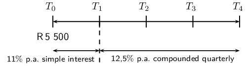
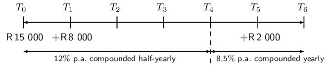
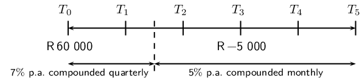
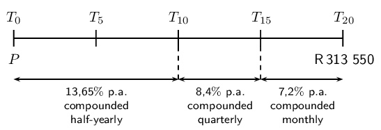
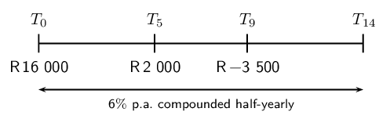
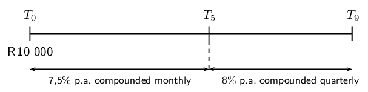
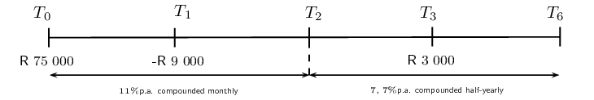
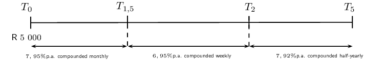

## 9.3 Timelines (EMBJK)

Interest can be compounded more than once a year. For example, an investment can be compounded
                        monthly or quarterly. Below is a table of compounding terms and their corresponding numeric
                        value (\(p\)). When amounts are compounded more than once per annum, we multiply the number of
                        years by \(p\) and we also divide the interest rate by \(p\).

| Term | \(p\) |
| --- | --- |
| yearly / annually | \(\text{1}\) |
| half-yearly / bi-annually | \(\text{2}\) |
| quarterly | \(\text{4}\) |
| monthly | \(\text{12}\) |
| weekly | \(\text{52}\) |
| daily | \(\text{365}\) |

<QuizCard id="m11-09-03a" title="Interactive Exercise 9.9" question="One of your classmates is making a timeline diagram for the situation described here: Qiniso goes to We Pay More Bank and deposits \(\text{R}\,\text{3 000,00}\) into an account which pays \(\text{11,8}\%\) p.a. compounded two times per year.  After \(\text{8}\) years the interest rate changes to \(\text{11,4}\%\) p.a., now compounded every month. Qiniso leaves the money in the account for a total of \(\text{11}\) years. Here is the diagram she started. However, she is not finished yet. She needs help with this information: \(11,4\% \textrm{ compounded every month}\) \(\text{R}\,\text{3 000}  \) Do these values belong at A , B , C , or D on the diagram?" options=["A", "B", "C", "D", "A", "B", "C", "D"] answer="3, 0" hint="" explanation="The key thing when solving a timeline problem is to find the changes which happen and when they happen : does the interest rate change?  Is more money added to the account? And in what year does the change occur? In this question there is a change after \(\text{8}\) years; the compounding period for the interest changes (no money is added or withdrawn from the account). Notice the line between the beginning and the end which must be the place where the change happens (above the B ). We need to locate \( 11,4\% \textrm{ compounded every month} \) on the diagram. \(\text{11,4}\%\) is the second interest rate, starting from \(\text{8}\) years after the beginning. Therefore, this information must go at position D . We also need to find the correct place for \( \text{R}\,\text{3 000}   \) . This is the amount of money which Qiniso deposits at the very beginning of the story, so it belongs at the start, at position A . The complete timeline diagram looks like this: Submit your answer as: D and A" />

<QuizCard id="m11-09-03a" title="Interactive Exercise 9.9" question="What change happened to the account, and in which year did it happen?" options=[] answer="
                        0
                    ,
                        7
                    " hint="" explanation="There is a lot of information in the story about the investment.  The key part for this question is: ' After \(\text{7}\) years the bank changes the interest rate .' During this investment, The interest percentage rate changed. and it happens 7 years after Bokamoso opens the account. Submit your answer as: The interest percentage rate changed. and" />

<Callout type="tip" title="Worked example 12: Timelines">
**Question:**
\(\text{R}\,\text{5 500}\) is invested for a period of \(\text{4}\) years in a
                                        savings account. For the first year, the investment grows at a simple interest
                                        rate of \(\text{11}\%\) p.a. and then at a rate of \(\text{12,5}\%\) p.a.
                                        compounded quarterly for the rest of the period. Determine the value of the
                                        investment at the end of the \(\text{4}\) years.

**Draw a timeline and write down known variables:**

In the timeline above, the intervals are given in years. For example, \(T_0\) is the
                                        start of the investment, \(T_1\) is the end of the first year and \(T_4\) is the
                                        end of the fourth year.

**Use the simple interest formula to calculate \(A\) at \(T_1\):**
\begin{align*}
                                A &= P(1 + in) \\
                                &= \text{5 500}(1 + \text{0,11}) \\
                                &= \text{R}\,\text{6 105}
                                \end{align*}

**Use the compound interest formula to calculate \(A\) at \(T_4\):**
The investment is compounded quarterly, therefore:

                                \begin{align*}
                                n &= 3 \times 4 \\
                                &= 12 \\
                                \text{and } i &= \frac{\text{0,125}}{4}
                                \end{align*}

Also notice that the accumulated amount at the end of the first year becomes the
                                        principal amount at the beginning of the second year.

                                \begin{align*}
                                A &= P(1 + i)^n \\
                                &= \text{6 105} \left( 1 + \frac{\text{0,125}}{4} \right)^{12} \\
                                &= \text{R}\,\text{8 831,88}
                                \end{align*}

**Write the final answer:**
The value of the investment at the end of the \(\text{4}\) years is
                                        \(\text{R}\,\text{8 831,88}\).
</Callout>

<QuizCard id="m11-09-03b" title="Interactive Exercise 9.10" question="How much money will Ntombebhongo have in her account \(\text{7}\) years after the original investment?" options=[] answer="10936.39" hint="You should enter a number here. If you want to, you can use a space to separate thousands.                Example: 12 800,25 For scientific notation you need to use the multiply symbol                ( ∗ ) and the exponent symbol ( ^ ). For example 6,673 × 10 −11 should be written as: 6,673 ∗ 10^−11" explanation="This question describes a \(\text{7}\) year period which is broken into two sections because of the change in the interest rate: the first section lasts \(\text{4}\) years (while the interest rate is \(\text{7,4}\%\) ); the second section lasts \(\text{3}\) years (when the rate is \(\text{6,5}\%\) ). Determine what has been provided and what is required for the first \(\text{4}\) years: \[                         \begin{aligned}                         P & = \text{6 750}\\                         i &=\text{7,4} \% = \text{0,074}\\                         n & = \text{4}\\                         A & = \text{ ?}                         \end{aligned}                     \] This is a compound interest problem: \[                         \begin{aligned}                         \quad A = P(1+i)^n                         \end{aligned}                     \] Solve the first part of the problem. Remember that we must multiply the number of years by \(\text{2}\) and divide the interest rate by \(\text{2}\) because the interest is compounded semi-annually. \[                         \begin{aligned}                         & \\                         A & = \text{6 750} \left( 1 + \frac{\text{0,074}} {\text{2}} \right) ^                         {(\text{4} \times                         \text{2})}\\                         A & = \text{6 750}(\text{1,037})^{\text{8}}\\                         & = \text{6 750} (\text{1,337...})\\                         & = \text{R}\,\text{9 026,80}                         \end{aligned}                     \] This is the amount after \(\text{4}\) years. Determine what has been provided and what is required for the next \(\text{3}\) years.  All of the money from the above calculation remains in the account - it is the starting point for the last \(\text{3}\) years. \[                         \begin{aligned}                         P & = \text{R}\,\text{9 026,80}\\                         i &=\text{6,5} \% = \text{0,065}\\                         n & = \text{3}\\                         A & = \text{ ?}                         \end{aligned}                     \] Now solve the second part of the problem, the last \(\text{3}\) years (again, we must adjust the interest rate and the the number of years by \(\text{2}\) .): \[                         \begin{aligned}                         A & = \text{9 026,8} \left( 1 + \frac{\text{0,065}}                         {\text{2}} \right) ^                         {(\text{3} \times                         \text{2})}\\                         & = \text{9 026,8}(\text{1,032...})^\text{6}\\                         & = \text{9 026,8} (\text{1,211...})\\                         & = \text{R}\,\text{10 936,39}                         \end{aligned}                     \] After \(\text{7}\) years, Ntombebhongo will have \(\text{R}\,\text{10 936,39}\) in her account. Submit your answer as:" />

<QuizCard id="m11-09-03b" title="Interactive Exercise 9.10" question="How much money will Minenhle have in her account \(\text{7}\) years after the original investment?" options=[] answer="8722.4" hint="You should enter a number here. If you want to, you can use a space to separate thousands.                Example: 12 800,25 For scientific notation you need to use the multiply symbol                ( ∗ ) and the exponent symbol ( ^ ). For example 6,673 × 10 −11 should be written as: 6,673 ∗ 10^−11" explanation="This question describes a \(\text{7}\) year period which is broken into two sections because of the change in the interest rate: the first section lasts \(\text{4}\) years (while the interest rate is \(\text{7,2}\%\) ); the second section lasts \(\text{3}\) years (when the rate is \(\text{5,9}\%\) ). Determine what has been provided and what is required for the first \(\text{4}\) years: \[                         \begin{aligned}                         P & = \text{5 500}\\                         i &=\text{7,2} \% = \text{0,072}\\                         n & = \text{4}\\                         A & = \text{ ?}                         \end{aligned}                     \] This is a compound interest problem: \[                         \begin{aligned}                         \quad A = P(1+i)^n                         \end{aligned}                     \] Solve the first part of the problem. Remember that we must multiply the number of years by \(\text{4}\) and divide the interest rate by \(\text{4}\) because the interest is compounded quarterly. \[                         \begin{aligned}                         & \\                         A & = \text{5 500} \left( 1 + \frac{\text{0,072}} {\text{4}} \right) ^                         {(\text{4} \times                         \text{4})}\\                         A & = \text{5 500}(\text{1,018})^{\text{16}}\\                         & = \text{5 500} (\text{1,330...})\\                         & = \text{R}\,\text{7 316,90}                         \end{aligned}                     \] This is the amount after \(\text{4}\) years. Determine what has been provided and what is required for the next \(\text{3}\) years.  All of the money from the above calculation remains in the account - it is the starting point for the last \(\text{3}\) years. \[                         \begin{aligned}                         P & = \text{R}\,\text{7 316,90}\\                         i &=\text{5,9} \% = \text{0,059}\\                         n & = \text{3}\\                         A & = \text{ ?}                         \end{aligned}                     \] Now solve the second part of the problem, the last \(\text{3}\) years (again, we must adjust the interest rate and the the number of years by \(\text{4}\) .): \[                         \begin{aligned}                         A & = \text{7 316,9} \left( 1 + \frac{\text{0,059}}                         {\text{4}} \right) ^                         {(\text{3} \times                         \text{4})}\\                         & = \text{7 316,9}(\text{1,014...})^\text{12}\\                         & = \text{7 316,9} (\text{1,192...})\\                         & = \text{R}\,\text{8 722,40}                         \end{aligned}                     \] After \(\text{7}\) years, Minenhle will have \(\text{R}\,\text{8 722,40}\) in her account. Submit your answer as:" />

<Callout type="tip" title="Worked example 13: Timelines">
**Question:**
\(\text{R}\,\text{150 000}\) is deposited in an investment account for a period of
                                        \(\text{6}\) years at an interest rate of \(\text{12}\%\) p.a. compounded
                                        half-yearly for the first \(\text{4}\) years and then \(\text{8,5}\%\) p.a.
                                        compounded yearly for the rest of the period. A deposit of \(\text{R}\,\text{8
                                        000}\) is made into the account after the first year and then another deposit of
                                        \(\text{R}\,\text{2 000}\) is made \(\text{5}\) years after the initial
                                        investment. Calculate the value of the investment at the end of the \(\text{6}\)
                                        years.

**Draw a timeline and write down known variables:**

Remember to show when the additional deposits of \(\text{R}\,\text{8 000}\) and
                                        \(\text{R}\,\text{2 000}\) where made into the account. It is very important to
                                        note that the interest rate changes at \(T_4\).

We break this question down into parts and consider each amount separately.

**The initial deposit at \(T_0\):**
Between \(T_0\) and \(T_4\):

We notice that interest for the first \(\text{4}\) years is compounded half-yearly,
                                        therefore:

                                \begin{align*}
                                n_1 &= 4 \times 2 \\
                                &= 8 \\
                                \text{and } i_1 &= \frac{\text{0,12}}{2}
                                \end{align*}

Between \(T_4\) and \(T_6\):

                                \begin{align*}
                                n_2 &= 2 \\
                                \text{and } i_2 &= \text{0,085}
                                \end{align*}

Therefore the total growth of the initial deposit over the \(\text{6}\) years is:

                                \begin{align*}
                                A &= P(1 + i_1)^{n_1}(1 + i_2)^{n_2} \\
                                &= \text{150 000} \left( 1 + \frac{\text{0,12}}{2} \right)^8 \left(1 +
                                \text{0,085}\right)^2
                                \end{align*}

**The deposit at \(T_1\):**
Between \(T_1\) and \(T_4\):

Interest on this deposit is compounded half-yearly for \(\text{3}\) years, therefore:

                                \begin{align*}
                                n_3 &= 3 \times 2 \\
                                &= 6 \\
                                \text{and } i_3 &= \frac{\text{0,12}}{2}
                                \end{align*}

Between \(T_4\) and \(T_6\):

                                \begin{align*}
                                n_4 &= 2 \\
                                \text{and } i_4 &= \text{0,085}
                                \end{align*}

Therefore the total growth of the deposit over the \(\text{5}\) years is:

                                \begin{align*}
                                A &= P(1 + i_3)^{n_3}(1 + i_4)^{n_4} \\
                                &= \text{8 000} \left(1 + \frac{\text{0,12}}{2} \right)^6 \left(1 +
                                \text{0,085}\right)^2
                                \end{align*}

**The deposit at \(T_5\):**
Accumulate interest for only \(\text{1}\) year:

                                \begin{align*}
                                A &= P(1 + i)^n \\
                                &= \text{2 000}(1 + \text{0,085})^1
                                \end{align*}

**Determine the total calculation:**
To get as accurate an answer as possible, we do the the calculation on the calculator
                                        in one step. Using the memory and answer recall function on the calculator, we
                                        avoid rounding off until we get the final answer.

                                \begin{align*}
                                A &= \text{150 000} \left( 1 + \frac{\text{0,12}}{2} \right)^8 (1 +
                                \text{0,085})^2 + \text{8 000} \left( 1 + \frac{\text{0,12}}{2} \right)^6 (1 +
                                \text{0,085})^2 + \text{2 000}(1 + \text{0,085})^1 \\
                                &= \text{R}\,\text{296 977,00}
                                \end{align*}

**Write the final answer:**
The value of the investment at the end of the \(\text{6}\) years is
                                        \(\text{R}\,\text{296 977,00}\).
</Callout>

<QuizCard id="m11-09-03c" title="Interactive Exercise 9.11" question="Save More Bank offers a savings account which gets \(\text{11,3}\%\) interest p.a. compounded semi-annually. Phetoho decides to open an account, and deposits \(\text{R}\,\text{4 500}\) .                 His account accrues interest for \(\text{7}\) years until he puts \(\text{R}\,\text{3 000}\) more into the account.                 After that, Phetoho leaves the money in the account until \(\text{13}\) years after his original deposit.                 How much money will be in the account in the end?" options=[] answer="24587.06" hint="You should enter a number here. If you want to, you can use a space to separate thousands.                Example: 12 800,25 For scientific notation you need to use the multiply symbol                ( ∗ ) and the exponent symbol ( ^ ). For example 6,673 × 10 −11 should be written as: 6,673 ∗ 10^−11" explanation="This question describes a period of \(\text{13}\) years.  This period is broken into two sections: \(\text{7}\) years after Phetoho opens his account, and then the last \(\text{6}\) years after he puts \(\text{R}\,\text{3 000}\) more into his account.  We must calculate the value in the account separately for these two sections of time. For the first \(\text{7}\) years we have: \[                     \begin{aligned}                     P & = \text{R}\,\text{4 500}\\                     i &=\text{11,3}\%  = \text{0,113}\\                     n & = \text{7}\\                     A & = \text{ ?}                     \end{aligned}                 \] The question tells us that the interest rate is \" \(\text{11,3}\%\) interest p.a. compounded semi-annually\" - this means that we should use the compound interest formula.  We also must remember to multiply the exponent by \(\text{2}\) and divide the interest rate by \(\text{2}\) because the interest compounds semi-annually. \[                     \begin{aligned}                     A &= P(1+i)^n \\                     A & = \text{4 500} \left( 1 + \frac{\text{0,113}} {\text{2}} \right) ^                     {(\text{7} \times                     \text{2})}\\                     & = \text{4 500}(\text{1,056...})^{\text{14}}\\                     & = \text{4 500} (\text{2,158...})\\                     & = \text{R}\,\text{9 713,72}                     \end{aligned}                 \] The amount after \(\text{7}\) years. Now we must work out what happens when Phetoho puts \(\text{R}\,\text{3 000}\) more into his account: did Phetoho                     put more money in, or take money out? You must add or subtract that money now                     because the amount of money in the account is changing! \[                     \begin{aligned}                     P & = \text{9 713,72} \text{+3 000} = \text{R}\,\text{12 713,72} \\                     i &=\text{11,3}\% = \text{0,113}\\                     n & = \text{6}\\                     A & = \text{ ?}                     \end{aligned}                 \] Now solve the second part of the problem, the last \(\text{6}\) years.                     (As above, we must adjust the exponent and the interest rate.) \[                     \begin{aligned}                     A & = \text{12 713,72} \left( 1 + \frac{\text{0,113}}                     {\text{2}} \right) ^                     {(\text{6} \times                     \text{2})}\\                     & = \text{12 713,72}(\text{1,056...})^\text{12}\\                     & = \text{12 713,72} (\text{1,933...})\\                     & = \text{R}\,\text{24 587,06}                     \end{aligned}                 \] In the end (after \(\text{13}\) years), Phetoho will have \(\text{R}\,\text{24 587,06}\) in his account at the bank. Submit your answer as:" />

<QuizCard id="m11-09-03c" title="Interactive Exercise 9.11" question="Cha-ching Bank offers a savings account which receives \(\text{10,6}\%\) interest p.a. compounded each quarter. Louis decides to open an account, and deposits \(\text{R}\,\text{3 500}\) .                 His account accrues interest for \(\text{4}\) years until he takes \(\text{R}\,\text{2 500}\) from the account.                 After that, Louis leaves the money in the account until \(\text{9}\) years after his original deposit.                 How much money will be in the account in the end?" options=[] answer="4755.97" hint="You should enter a number here. If you want to, you can use a space to separate thousands.                Example: 12 800,25 For scientific notation you need to use the multiply symbol                ( ∗ ) and the exponent symbol ( ^ ). For example 6,673 × 10 −11 should be written as: 6,673 ∗ 10^−11" explanation="This question describes a period of \(\text{9}\) years.  This period is broken into two sections: \(\text{4}\) years after Louis opens his account, and then the last \(\text{5}\) years after he takes \(\text{R}\,\text{2 500}\) from his account.  We must calculate the value in the account separately for these two sections of time. For the first \(\text{4}\) years we have: \[                     \begin{aligned}                     P & = \text{R}\,\text{3 500}\\                     i &=\text{10,6}\%  = \text{0,106}\\                     n & = \text{4}\\                     A & = \text{ ?}                     \end{aligned}                 \] The question tells us that the interest rate is \" \(\text{10,6}\%\) interest p.a. compounded each quarter\" - this means that we should use the compound interest formula.  We also must remember to multiply the exponent by \(\text{4}\) and divide the interest rate by \(\text{4}\) because the interest compounds each quarter. \[                     \begin{aligned}                     A &= P(1+i)^n \\                     A & = \text{3 500} \left( 1 + \frac{\text{0,106}} {\text{4}} \right) ^                     {(\text{4} \times                     \text{4})}\\                     & = \text{3 500}(\text{1,026...})^{\text{16}}\\                     & = \text{3 500} (\text{1,519...})\\                     & = \text{R}\,\text{5 318,77}                     \end{aligned}                 \] The amount after \(\text{4}\) years. Now we must work out what happens when Louis takes \(\text{R}\,\text{2 500}\) from his account: did Louis                     put more money in, or take money out? You must add or subtract that money now                     because the amount of money in the account is changing! \[                     \begin{aligned}                     P & = \text{5 318,77} -\text{2 500} = \text{R}\,\text{2 818,77} \\                     i &=\text{10,6}\% = \text{0,106}\\                     n & = \text{5}\\                     A & = \text{ ?}                     \end{aligned}                 \] Now solve the second part of the problem, the last \(\text{5}\) years.                     (As above, we must adjust the exponent and the interest rate.) \[                     \begin{aligned}                     A & = \text{2 818,77} \left( 1 + \frac{\text{0,106}}                     {\text{4}} \right) ^                     {(\text{5} \times                     \text{4})}\\                     & = \text{2 818,77}(\text{1,026...})^\text{20}\\                     & = \text{2 818,77} (\text{1,687...})\\                     & = \text{R}\,\text{4 755,97}                     \end{aligned}                 \] In the end (after \(\text{9}\) years), Louis will have \(\text{R}\,\text{4 755,97}\) in his account at the bank. Submit your answer as:" />

<Callout type="tip" title="Worked example 14: Timelines">
**Question:**
\(\text{R}\,\text{60 000}\) is invested in an account which offers interest at
                                        \(\text{7}\%\) p.a. compounded quarterly for the first \(\text{18}\) months.
                                        Thereafter the interest rate changes to \(\text{5}\%\) p.a. compounded monthly.
                                        Three years after the initial investment, \(\text{R}\,\text{5 000}\) is
                                        withdrawn from the account. How much will be in the account at the end of
                                        \(\text{5}\) years?

**Draw a timeline and write down known variables:**

Remember to show when the withdrawal of \(\text{R}\,\text{5 000}\) was taken out of
                                        the account. It is also important to note that the interest rate changes after
                                        \(\text{18}\) months (\(T_{1\frac{1}{2}}\)).

We break this question down into parts and consider each amount separately.

**The initial deposit at \(T_0\):**
Interest for the first \(\text{1,5}\) years is compounded quarterly, therefore:

                                \begin{align*}
                                n_1 &= \text{1,5} \times 4 \\
                                &= 6 \\
                                \text{and } i_1 &= \frac{\text{0,07}}{4}
                                \end{align*}

Interest for the remaining \(\text{3,5}\) years is compounded monthly, therefore:

                                \begin{align*}
                                n_2 &= \text{3,5} \times 12 \\
                                &= 42 \\
                                \text{and } i_2 &= \frac{\text{0,05}}{12}
                                \end{align*}

Therefore the total growth of the initial deposit over the \(\text{5}\) years is:

                                \begin{align*}
                                A &= P(1 + i_1)^{n_1} (1 + i_2)^{n_2} \\
                                &= \text{60 000} \left( 1 + \frac{\text{0,07}}{4} \right)^6 \left(1 +
                                \frac{\text{0,05}}{12} \right)^{42}
                                \end{align*}

**The withdrawal at \(T_3\):**
We calculate the interest that the \(\text{R}\,\text{5 000}\) would have earned if it
                                        had remained in the account:

                                \begin{align*}
                                n &= 2 \times 12 \\
                                &= 24 \\
                                \text{and } i &= \frac{\text{0,05}}{12}
                                \end{align*}

Therefore we have that:

                                \begin{align*}
                                A &= P(1 + i)^n \\
                                &= \text{5 000} \left(1 + \frac{\text{0,05}}{12} \right)^{24}
                                \end{align*}

**Determine the total calculation:**
We subtract the withdrawal and the interest it would have earned from the accumulated
                                        amount at the end of the \(\text{5}\) years:

                                \begin{align*}
                                A &= \text{60 000} \left( 1 + \frac{\text{0,07}}{4} \right)^6 \left(1 +
                                \frac{\text{0,05}}{12}\right)^{42} - \text{5 000} \left(1 + \frac{\text{0,05}}{12}
                                \right)^{24} \\
                                &= \text{R}\,\text{73 762,19}
                                \end{align*}

**Write the final answer:**
The value of the investment at the end of the \(\text{5}\) years is
                                        \(\text{R}\,\text{73 762,19}\).
</Callout>

## Timelines

### Textbook Exercise 9.5

**Problem:**
After a \(\text{20}\)-year period Josh's lump sum investment matures
                                                        to an
                                                        amount of \(\text{R}\,\text{313 550}\). How much did he invest
                                                        if his money earned
                                                        interest at a rate of \(\text{13,65}\%\) p.a. compounded half
                                                        yearly
                                                        for the first \(\text{10}\) years, \(\text{8,4}\%\) p.a.
                                                        compounded quarterly for
                                                        the next five years and \(\text{7,2}\%\) p.a. compounded monthly
                                                        for
                                                        the remaining period?

**Solution:**

**Problem:**
Sindisiwe wants to buy a motorcycle. The cost of the motorcycle is
                                                        \(\text{R}\,\text{55 000}\). In \(\text{1 998}\) Sindisiwe
                                                        opened an account at Sutherland Bank with \(\text{R}\,\text{16
                                                        000}\). Then in \(\text{2 003}\) she added
                                                        \(\text{R}\,\text{2 000}\) more into the account. In
                                                        \(\text{2 007}\) Sindisiwe made another change: she took
                                                        \(\text{R}\,\text{3 500}\) from the account. If the account pays
                                                        \(\text{6}\%\) p.a. compounded half-yearly, will Sindisiwe have
                                                        enough money in the account at the end of \(\text{2 012}\)
                                                        to buy the motorcycle?

**Solution:**

**Problem:**
A loan has to be returned in two equal semi-annual instalments. If
                                                        the rate of interest is \(\text{16}\%\) per annum, compounded
                                                        semi-annually and each instalment is \(\text{R}\,\text{1 458}\),
                                                        find the sum borrowed.

**Solution:**
\begin{align*}
                                                A &= P(1 + i)^n \\
                                                &= P_1(1 + \frac{\text{0,16}}{2})^1 \\
                                                &= P_1(\text{1,08}) \\
                                                \text{Therefore } P_1(\text{1,08}) &= \text{1 458} + P_2 \\
                                                \text{and } P_2(\text{1,08})&= \text{1 458} \\
                                                \therefore P_2 &= \frac{\text{1 458}}{\text{1,08}} \\
                                                \therefore P_1(\text{1,08}) &= \text{1 458} + P_2 \\
                                                \therefore P_1 &= \frac{\text{1 458}}{\text{1,08}}+
                                                \frac{\text{1 458}}{(\text{1,08})^2} \\
                                                &=\text{R}\,\text{2 600}
                                                \end{align*}

**Problem:**
A man named Phillip invests \(\text{R}\,\text{10 000}\) into an
                                                        account at North Bank at an interest rate of \(\text{7,5}\%\)
                                                        p.a. compounded monthly. After \(\text{5}\) years the bank
                                                        changes the interest rate to \(\text{8}\%\) p.a. compounded
                                                        quarterly. How much money will Phillip have in his account
                                                        \(\text{9}\) years after the original deposit?

**Solution:**

**Problem:**
\(\text{R}\,\text{75 000}\) is invested in an account which offers
                                                        interest at \(\text{11}\%\) p.a. compounded monthly for the
                                                        first \(\text{24}\) months. Then the interest rate changes to
                                                        \(\text{7,7}\%\) p.a. compounded half-yearly. If
                                                        \(\text{R}\,\text{9 000}\) is withdrawn from the account after
                                                        one year and then a deposit of \(\text{R}\,\text{3 000}\) is
                                                        made three years after the initial investment, how much will be
                                                        in the account at the end of \(\text{6}\) years?

**Solution:**

**Problem:**
Christopher wants to buy a computer, but right now he doesn't have
                                                        enough money. A friend told Christopher that in \(\text{5}\)
                                                        years the computer will cost \(\text{R}\,\text{9 150}\). He
                                                        decides to start saving money today at Durban United Bank.
                                                        Christopher deposits \(\text{R}\,\text{5 000}\) into a savings
                                                        account with an interest rate of \(\text{7,95}\%\) p.a.
                                                        compounded monthly. Then after \(\text{18}\) months the bank
                                                        changes the interest rate to \(\text{6,95}\%\) p.a. compounded
                                                        weekly. After another \(\text{6}\) months, the interest rate
                                                        changes again to \(\text{7,92}\%\) p.a. compounded two times per
                                                        year. How much money will Christopher have in the account after
                                                        \(\text{5}\) years, and will he then have enough money to buy
                                                        the computer?

**Solution:**

