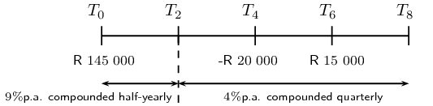

## End of chapter exercises

### Textbook Exercise 9.7

Thabang buys a Mercedes worth \(\text{R}\,\text{385 000}\) in \(\text{2 007}\). What will the
                  value of the Mercedes be at the end of \(\text{2 013}\) if:

**Problem:**
the car depreciates at \(\text{6}\%\) p.a. straight-line depreciation.

**Solution:**
\begin{align*}
                  A &= P(1 - in) \\
                  &= \text{385 000}(1 - \text{0,06} \times 6) \\
                  &= \text{385 000}(\text{0,64}) \\
                  \therefore i &= \text{R}\,\text{246 400}
                  \end{align*}

**Problem:**
the car depreciates at \(\text{6}\%\) p.a. reducing-balance depreciation.

**Solution:**
\begin{align*}
                  A &= P(1 - in) \\
                  &= \text{385 000}(1 - \text{0,06})^6 \\
                  &= \text{385 000}(\text{0,94})^6 \\
                  \therefore i &= \text{R}\,\text{265 599,87}
                  \end{align*}

**Problem:**
Greg enters into a \(\text{5}\)-year hire-purchase agreement to buy a computer for \(\text{R}\,\text{8
                  900}\). The interest rate is quoted as \(\text{11}\%\) per annum based on simple interest. Calculate
                  the required monthly payment for this contract.

**Solution:**
\begin{align*}
               A &= P(1 + in) \\
               &= \text{8 900}(1 + \text{0,11} \times 5) \\
               &= \text{8 900}(\text{1,55}) \\
               &= \text{R}\,\text{13 795} \\
               \therefore \text{ monthly repayment} &= \frac{\text{13 795}}{5 \times 12} \\
               &= \text{R}\,\text{229,92}
               \end{align*}

A computer is purchased for \(\text{R}\,\text{16 000}\). It depreciates at \(\text{15}\%\) per annum.

**Problem:**
Determine the book value of the computer after \(\text{3}\) years if depreciation is calculated
                     according to the straight-line method.

**Solution:**
\begin{align*}
                  A &= P(1 - in) \\
                  &= \text{16 000}(1 - \text{0,15} \times 3) \\
                  &= \text{16 000}(\text{0,55}) \\
                  &= \text{R}\,\text{8 800}
                  \end{align*}

**Problem:**
Find the rate according to the reducing-balance method that would yield, after \(\text{3}\) years,
                     the same book value as calculated in the previous question.

**Solution:**
\begin{align*}
                  A &= P(1 - i)^n \\
                  \text{8 800} &= \text{16 000}(1 - i)^3 \\
                  \frac{\text{8 800}}{\text{16 000}} &= (1 - i)^3 \\
                  \sqrt[3]{\frac{\text{8 800}}{\text{16 000}}} &= 1 - i \\
                  \sqrt[3]{\frac{\text{8 800}}{\text{16 000}}} - 1 &= - i \\
                  \therefore i &= \text{0,180678} \ldots \\
                  \therefore i &= \text{18,1}\%
                  \end{align*}

**Problem:**
Maggie invests \(\text{R}\,\text{12 500}\) for \(\text{5}\) years at \(\text{12}\%\) per annum
                  compounded monthly for the first \(\text{2}\) years and \(\text{14}\%\) per annum compounded
                  semi-annually for the next \(\text{3}\) years. How much will Maggie receive in total after
                  \(\text{5}\) years?

**Solution:**
\begin{align*}
               A &= P(1 + i)^n \\
               &= \text{125 000} \left(1 + \frac{\text{0,12}}{12} \right)^{2 \times 12} \left(1 +
               \frac{\text{0,14}}{2} \right)^{3 \times 2} \\
               &= \text{125 000} \left(\text{1,01} \right)^{24} \left(\text{1,07} \right)^{6} \\
               \therefore A &= \text{R}\,\text{238 191,17}
               \end{align*}

Tintin invests \(\text{R}\,\text{120 000}\). He is quoted a nominal interest rate of \(\text{7,2}\%\)
                  per annum compounded monthly.

**Problem:**
Calculate the effective rate per annum (correct to two decimal places).

**Solution:**
\begin{align*}
                  1 + i &= \left( 1 + \frac{i^{(m)}}{m} \right)^{m} \\
                  i &= \left( 1 + \frac{\text{0,072}}{12} \right)^{12} - 1 \\
                  &= \text{0,074424} \ldots \\
                  \therefore i &= \text{7,44}\%
                  \end{align*}

**Problem:**
Use the effective rate to calculate the value of Tintin's investment if he invested the money for
                     \(\text{3}\) years.

**Solution:**
\begin{align*}
                  A &= P(1 + i)^n \\
                  &= \text{120 000} \left( 1 + \text{0,0744} \right)^{3}\\
                  &= \text{120 000} \left( \text{1,0744} \right)^{3} \\
                  \therefore A &= \text{R}\,\text{148 826,15}
                  \end{align*}

**Problem:**
Suppose Tintin invests his money for a total period of \(\text{4}\) years, but after \(\text{18}\)
                     months makes a withdrawal of \(\text{R}\,\text{20 000}\), how much will he receive at the end of
                     the \(\text{4}\) years?

**Solution:**
\begin{align*}
                  A &= P(1 + i)^n \\
                  &= \text{120 000} \left( 1 + \text{0,0744} \right)^{4} - \text{20 000} \left( 1 +
                  \text{0,0744} \right)^{\text{2,5}} \\
                  &= \text{120 000} \left( \text{1,0744} \right)^{4} - \text{20 000} \left( \text{1,0744}
                  \right)^{\text{2,5}} \\
                  \therefore A &= \text{R}\,\text{135 968,69}
                  \end{align*}

Ntombi opens accounts at a number of clothing stores and spends freely. She gets herself into terrible
                  debt and she cannot pay off her accounts. She owes Fashion World \(\text{R}\,\text{5 000}\) and the
                  shop agrees to let her pay the bill at a nominal interest rate of \(\text{24}\%\) compounded monthly.

**Problem:**
How much money will she owe Fashion World after two years?

**Solution:**
\begin{align*}
                  A &= P(1 + i)^n \\
                  &= \text{5 000} \left( 1 + \frac{\text{0,24}}{12} \right)^{2 \times 12}\\
                  &= \text{5 000} \left( \text{1,02} \right)^{24} \\
                  \therefore A &= \text{R}\,\text{8 042,19}
                  \end{align*}

**Problem:**
What is the effective rate of interest that Fashion World is charging her?

**Solution:**
\begin{align*}
                  1 + i &= \left( 1 + \frac{i^{(m)}}{m} \right)^{m} \\
                  i &= \left( 1 + \frac{\text{0,24}}{12} \right)^{12} - 1 \\
                  &= \text{0,268241} \ldots \\
                  \therefore i &= \text{26,82}\%
                  \end{align*}

**Problem:**
John invests \(\text{R}\,\text{30 000}\) in the bank for a period of \(\text{18}\) months. Calculate
                  how much money he will have at the end of the period and the effective annual interest rate if the
                  nominal interest of \(\text{8}\%\) is compounded:

|  | Calculation | Accumulated amount | Effective annual interest rate |
| --- | --- | --- | --- |
| yearly |  |  |  |
| half-yearly |  |  |  |
| quarterly |  |  |  |
| monthly |  |  |  |
| daily |  |  |  |

**Solution:**
|  | Calculation | Accumulated amount | Effective annual interest rate |
| --- | --- | --- | --- |
| yearly | \(\text{30 000} \left( 1 + \text{0,08} \right)^{1}\) | \(\text{R}\,\text{33 671,07}\) |  |
| half-yearly | \(\text{30 000} \left( 1 + \frac{\text{0,08}}{2} \right)^{\text{1,5} \times 2}\) | \(\text{R}\,\text{33 745,92}\) | \(\left( 1 + \frac{\text{0,08}}{2} \right)^{2} - 1 = \text{8,16}\%\) |
| quarterly | \(\text{30 000} \left( 1 + \frac{\text{0,08}}{4} \right)^{\text{1,5} \times 4}\) | \(\text{R}\,\text{33 784,87}\) | \(\left( 1 + \frac{\text{0,08}}{4} \right)^{4} - 1 = \text{8,24}\%\) |
| monthly | \(\text{30 000} \left( 1 + \frac{\text{0,08}}{12} \right)^{\text{1,5} \times 12}\) | \(\text{R}\,\text{33 811,44}\) | \(\left( 1 + \frac{\text{0,08}}{12} \right)^{12} - 1 = \text{8,30}\%\) |
| daily | \(\text{30 000} \left( 1 + \frac{\text{0,08}}{\text{365}} \right)^{\text{1,5} \times
                        \text{365}}\) | \(\text{R}\,\text{33 828,17}\) | \(\left( 1 + \frac{\text{0,08}}{\text{365}} \right)^{\text{365}} - 1 = \text{8,33}\%\) |

Convert an effective annual interest rate of \(\text{11,6}\%\) p.a. to a nominal interest rate
                  compounded:

**Problem:**
half-yearly

**Solution:**
\begin{align*}
                  1 + i &= \left( 1 + \frac{i^{(m)}}{m} \right)^{m} \\
                  1 + \text{0,116} &= \left( 1 + \frac{i^{(2)}}{2} \right)^{2} \\
                  \sqrt[2]{\text{1,116}} - 1 &= \frac{i^{(2)}}{2} \\
                  2 \left( \sqrt[2]{\text{1,116}} - 1 \right) &= i^{(2)} \\
                  \therefore i^{(2)} &= \text{11,3}\%
                  \end{align*}

**Problem:**
quarterly

**Solution:**
\begin{align*}
                  1 + i &= \left( 1 + \frac{i^{(m)}}{m} \right)^{m} \\
                  1 + \text{0,116} &= \left( 1 + \frac{i^{(4)}}{4} \right)^{4} \\
                  \sqrt[4]{\text{1,116}} - 1 &= \frac{i^{(4)}}{4} \\
                  4 \left( \sqrt[4]{\text{1,116}} - 1 \right) &= i^{(4)} \\
                  \therefore i^{(4)} &= \text{11,1}\%
                  \end{align*}

**Problem:**
monthly

**Solution:**
\begin{align*}
                  1 + i &= \left( 1 + \frac{i^{(m)}}{m} \right)^{m} \\
                  1 + \text{0,116} &= \left( 1 + \frac{i^{(12)}}{12} \right)^{12} \\
                  \sqrt[12]{\text{1,116}} - 1 &= \frac{i^{(12)}}{12} \\
                  12 \left( \sqrt[12]{\text{1,116}} - 1 \right) &= i^{(12)} \\
                  \therefore i^{(12)} &= \text{11,0}\%
                  \end{align*}

**Problem:**
Joseph must sell his plot on the West Coast and he needs to get \(\text{R}\,\text{300 000}\) on the
                  sale of the land. If the estate agent charges him \(\text{7}\%\) commission on the selling price, what
                  must the buyer pay for the plot?

**Solution:**
\begin{align*}
               \text{Let the selling price} &= k \\
               \text{300 000} + \frac{7}{\text{100}} \times k &= k \\
               \text{300 000} &= k - \text{0,07}k \\
               \text{300 000} &= \text{0,93}k \\
               \frac{\text{300 000}}{\text{0,93}} &= k \\
               \therefore k &= \text{R}\,\text{322 580,65}
               \end{align*}

Mrs. Brown retired and received a lump sum of \(\text{R}\,\text{200 000}\). She deposited the money in
                  a fixed deposit savings account for \(\text{6}\) years. At the end of the \(\text{6}\) years the value
                  of the investment was \(\text{R}\,\text{265 000}\). If the interest on her investment was compounded
                  monthly, determine:

**Problem:**
the nominal interest rate per annum

**Solution:**
\begin{align*}
                  \text{Let the selling price} &= k \\
                  \text{265 000} &= \text{200 000} \left( 1 + \frac{i}{12} \right)^{6 \times 12} \\
                  \frac{\text{265 000}}{\text{200 000}} &= \left( 1 + \frac{i}{12} \right)^{72} \\
                  \sqrt[72]{\frac{\text{265 000}}{\text{200 000}}} - 1 &= \frac{i}{12} \\
                  \therefore i &= 12 \left( \sqrt[72]{\frac{\text{265 000}}{\text{200 000}}} - 1 \right)
                  \\
                  &= \text{0,046993} \ldots \\
                  \therefore i &= \text{4,7}\%
                  \end{align*}

**Problem:**
the effective annual interest rate

**Solution:**
\begin{align*}
                  1 + i &= \left( 1 + \frac{i^{(m)}}{m} \right)^{m} \\
                  1 + i &= \left( 1 + \frac{\text{0,047}}{12} \right)^{12} \\
                  i &= \left( 1 + \frac{\text{0,047}}{12} \right)^{12} - 1\\
                  \therefore i &= \text{4,8}\%
                  \end{align*}

**Problem:**
\(\text{R}\,\text{145 000}\) is invested in an account which offers interest at \(\text{9}\%\) p.a.
                  compounded half-yearly for the first \(\text{2}\) years. Then the interest rate changes to
                  \(\text{4}\%\) p.a. compounded quarterly. Four years after the initial investment,
                  \(\text{R}\,\text{20 000}\) is withdrawn. \(\text{6}\) years after the initial investment, a deposit
                  of \(\text{R}\,\text{15 000}\) is made. Determine the balance of the account at the end of
                  \(\text{8}\) years.

**Solution:**

