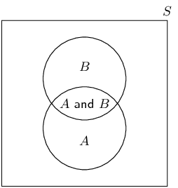
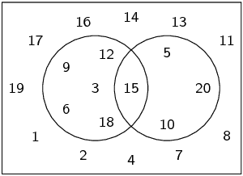
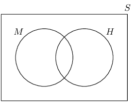
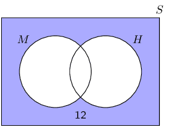
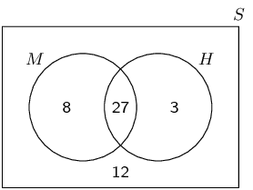
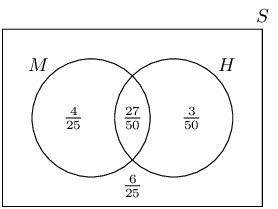
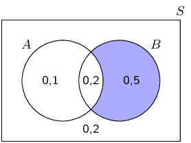
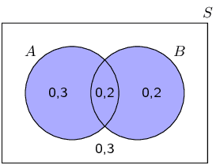
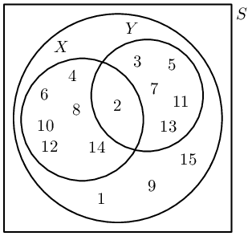

# Chapter 10: Probability

## 10.1 Revision (EMBJP)

### Terminology (EMBJQ)

- Discuss terminology. This chapter has many words that can be confusing for learners.
- This chapter provides good opportunity for experiments and activities in classroom.
- Union and intersection symbols have been included, but “and” and “or” is the
              preferred notation.
- The prime symbol has been included, but “not” is the preferred notation.
- It is very important to define the events: fair dice, full deck of cards etc.

**Outcome**: a single observation of an uncertain or random process (called an
        *experiment*).
        For example, when you accidentally drop a book, it might fall on its cover, on its back or on its side.
        Each of these options is a possible outcome.

**Sample space** of an experiment: the set of all possible outcomes of the experiment.
        For example, the sample space when you roll a single \(\text{6}\)-sided die is the set
        \(\left\{1;2;3;4;5;6\right\}\).
        For a given experiment, there is exactly one sample space.
        The sample space is denoted by the letter \(S\).

**Event**: a set of outcomes of an experiment.
        For example, during radioactive decay of \(\text{1}\) gramme of uranium-\(\text{234}\), one possible event is
        that the number of alpha-particles emitted during \(\text{1}\) microsecond is between \(\text{225}\) and
        \(\text{235}\).

**Probability** of an event: a real number between \(\text{0}\) and \(\text{1}\) that describes
        how likely it is that the event will occur.
        A probability of \(\text{0}\) means the outcome of the experiment will never be in the event set.
        A probability of \(\text{1}\) means the outcome of the experiment will always be in the event set.
        When all possible outcomes of an experiment have equal chance of occurring, the probability of an event is the
        number of outcomes in the event set as a fraction of the number of outcomes in the sample space.

**Relative frequency** of an event: the number of times that the event occurs during experimental
        trials, divided by the total number of trials conducted.
        For example, if we flip a coin \(\text{10}\) times and it landed on heads \(\text{3}\) times, then the relative
        frequency of the heads event is \(\frac{3}{10} = \text{0,3}\).

**Union** of events: the set of all outcomes that occur in at least one of the events.
        For \(\text{2}\) events called \(A\) and \(B\), we write the union as “\(A \text{ or } B\)”.
        Another way of writing the union is using set notation: \(A \cup B\).

**Intersection** of events: the set of all outcomes that occur in all of the events.
        For \(\text{2}\) events called \(A\) and \(B\), we write the intersection as “\(A \text{ and } B\)”.
        Another way of writing the intersection is using set notation: \(A \cap B\).

**Mutually exclusive events**: events with no outcomes in common, that is \((A \text{ and } B) =
        \emptyset\).
        Mutually exclusive events can never occur simultaneously.
        For example the event that a number is even and the event that the same number is odd are mutually exclusive,
        since a number can never be both even and odd.

**Complementary events**: two mutually exclusive events that together contain all the outcomes in
        the sample space.
        For an event called \(A\), we write the complement as “\(\text{not } A\)”.
        Another way of writing the complement is as \(A'\).

<Callout type="note" title="Note">
<VideoPlayer src="http://www.khanacademy.org/embed_video?v=uzkc-qNVoOk" title="Video: 239K" />
</Callout>

### Identities (EMBJR)

The **addition rule** (also called the sum rule) for any \(\text{2}\) events, \(A\) and \(B\) is
        \[P(A \text{ or } B) = P(A) + P(B) - P(A \text{ and } B)\]

        This rule relates the probabilities of \(\text{2}\) events with the probabilities of their union and
        intersection.

The **addition rule for \(\text{2}\) mutually exclusive events** is
        \[P(A \text{ or } B) = P(A) + P(B)\]

        This rule is a special case of the previous rule.
        Because the events are mutually exclusive, \(P(A \text{ and } B) = 0\).

The **complementary rule** is
        \[P(\text{not } A) = 1 - P(A)\]

        This rule is a special case of the previous rule. Since \(A\) and \((\text{not } A)\) are mutually exclusive,
        \(P(A \text{ or } (\text{not } A)) = 1\).

<Callout type="note" title="Note">
<VideoPlayer src="http://www.khanacademy.org/embed_video?v=QE2uR6Z-NcU" title="Video: 239M" />
</Callout>

<QuizCard id="m11-10-01a" title="Interactive Exercise 10.1" question="A student finds a textbook ( \(\text{100}\) pages) and then selects one page from the textbook. What is the probability that the page has an even page number? INSTRUCTION: Write your answer as a simplified fraction ." options=[] answer="
                    ['1/2', '0.5']
                " hint="You should enter a number here. If you want to, you can use a space to separate thousands.                Example: 12 800,25 For scientific notation you need to use the multiply symbol                ( ∗ ) and the exponent symbol ( ^ ). For example 6,673 × 10 −11 should be written as: 6,673 ∗ 10^−11" explanation="Use the formula for theoretical probability To calculate probability, we first recall the formula: \[\begin{array}{c}P(E) = \frac{n(E)}{n(S)}\end{array}\] Secondly we identify the values for the situation described in the question: \[                     \begin{aligned}                     n(E) & = \text{number of outcomes in the event set} \\                     &= \text{50} \\                     n(S) & = \text{number of possible outcomes in the sample space} \\                     &= \text{100}                     \end{aligned}                 \] Finally, we substitute into the formula and work out the answer. \[                     \begin{aligned}                     P(E) & = \frac{n(E)}{n(S)} \\                     & = \frac{\text{50}}{\text{100}} \\                     P(E) & = \dfrac{1}{2}                     \end{aligned}                 \] Therefore, the probability that the page has an even page number \(=  \dfrac{1}{2}\) . Submit your answer as:" />

<QuizCard id="m11-10-01a" title="Interactive Exercise 10.1" question="What is the most likely outcome of her next flip?" options=["heads is most likely", "tails is most likely", "both outcomes are equally likely", "impossible to know", "A", "B", "C", "D", "E"] answer=" 2 " hint="" explanation="Use the theoretical probability to determine the answer In this question, Thandolwethu is flipping a coin. She already flipped the coin \(\text{4}\) times. From the list of results we can see that  she got heads \(\text{3}\) times and tails \(\text{1}\) time. The question asks us what is likely to happen in the next flip. The key is to realise that the past outcomes do not change the theoretical probability of the next flip. The theoretical probability for heads and tails is \( \frac{1}{2} \) and that does not change based on earlier outcomes. Since there are more heads than tails in the first \(\text{4}\) flips, it is tempting to think that the next flip is likely to be tails. But that is not true. Even if someone flips a coin and gets heads \(\text{10}\) times in a row, the theoretical probability is still \( \frac{1}{2} \) that the next flip will be heads again. The correct choice from the list is: both outcomes are equally likely . Submit your answer as: both outcomes are equally likely" />

<QuizCard id="m11-10-01a" title="Interactive Exercise 10.1" question="How many outcomes are there which are multiples of \(\text{5}\) ?" options=[] answer="3" hint="You should enter a number here. If you want to, you can use a space to separate thousands.                Example: 12 800,25 For scientific notation you need to use the multiply symbol                ( ∗ ) and the exponent symbol ( ^ ). For example 6,673 × 10 −11 should be written as: 6,673 ∗ 10^−11" explanation="Identify the regions on the diagram where the outcomes are multiples of \(\text{5}\) We need to determine the number of outcomes which are multiples of \(\text{5}\) . The first thing to do is identify which regions on the Venn diagram correspond to the outcomes which are multiples of \(\text{5}\) . On the diagram we can shade out the regions that do not have the outcomes we want. TIP: Test one of the numbers that remains to make sure that it agrees with what you are looking for. This is a way to verify that you have found the correct regions on the Venn diagram. For example, let's check \(\text{5}\) . In this case we want outcomes which are multiples of \(\text{5}\) . Does the number \(\text{5}\) fit? Yes! Count the outcomes in the unshaded area Now we can count how many outcomes are in the unshaded area of the diagram. The numbers are: \[                         \begin{array}{c}                             5; \;10; \;15                         \end{array}                     \] The number of outcomes which are multiples of \(\text{5}\) is \(\text{3}\) . Submit your answer as:" />

<QuizCard id="m11-10-01a" title="Interactive Exercise 10.1" question="A group of students have the following Venn diagram, which shows sets \(A\) and \(B\) : The sample space in the diagram below is made of the first \(\text{15}\) natural numbers. The students need to identify the union of sets \(A\) and \(B\) , also written as \( \left(A \text { or }  B\right) \) . They get stuck, and you offer to help them find it. Which of the choices below is correct for \(A \text { or }  B\) ?" options=["{2;3;4;5;6;7;8;9;10;11;12;13;14;15}", "{1;10;15}", "{2;3;4;5;6;7;8;9;11;12;13;14}", "{3;4;5;6;7;9;10;11;12;13;15}", "{3;4;5;6;7;9;11;12;13}"] answer="{2;3;4;5;6;7;8;9;10;11;12;13;14;15}" hint="" explanation="Locate the union on the Venn diagram, and then read off the answer The union of two sets is the combination of all of the elements in the two sets. For example, the union of all final year students at a school and the school's rugby team will include every final year student and all of the rugby players, including the ones who are not in the final year. The union between set \(A\) and set \(B\) , also written as \(A \text { or }  B\) , can be shaded as shown below. All of the numbers in the shaded area belong in \(A \text { or }  B\) . Therefore, the correct choice for \(A \text { or }  B\) is the set {2;3;4;5;6;7;8;9;10;11;12;13;14;15} . Submit your answer as: {2;3;4;5;6;7;8;9;10;11;12;13;14;15}" />

<QuizCard id="m11-10-01a" title="Interactive Exercise 10.1" question="Suppose we have two sets, \( A \) and \( B \) , which are in some sample space \(S\) . Furthermore, suppose we know the following probabilities about events from these sets: \(P \left(A \right) = \dfrac{2}{5} \qquad\) \(P \left(B \right) = \dfrac{3}{5} \qquad\) \(P \left(A \text{ and } B \right) = \dfrac{1}{10}\) Use the probability identity to calculate \( P \left( A \text{ or } B \right) \) . INSTRUCTION: Give an exact answer (do not round off)." options=[] answer=" 9/10 " hint="You should enter a number here. If you want to, you can use a space to separate thousands.                Example: 12 800,25 For scientific notation you need to use the multiply symbol                ( ∗ ) and the exponent symbol ( ^ ). For example 6,673 × 10 −11 should be written as: 6,673 ∗ 10^−11" explanation="Substitute the values into the probablity identity and work out the answer This question is about the probability identity: \[\begin{array}{c}P(A \text{ or } B) = P(A) + P(B) - P(A \text{ and } B)\end{array}\] This formula applies to any two sets inside of a sample space. We have the three probabilities on the right hand side of the equation, so we just need to substitute in the values from the question and solve for \( P \left( A \text{ or } B \right) \) . \[                     \begin{aligned}                         &P \left( A \text{ or } B \right) \\[0.1cm]                         & = \left( \dfrac{2}{5} \right) + \left( \dfrac{3}{5} \right) - \left( \dfrac{1}{10} \right) \\[0.1cm]                         & = \frac{9}{10}                     \end{aligned}                 \] The answer is \( P \left( A \text{ or } B \right) = \dfrac{9}{10} \) . Submit your answer as:" />

<QuizCard id="m11-10-01a" title="Interactive Exercise 10.1" question="What does it mean if two events are mutually exclusive ?" options=["Yes", "No", "Impossible to know"] answer="
                        1
                    " hint="" explanation="Identify the statement which means the same thing as \"mutually exclusive\" The words \"mutually exclusive\" refer to two things that exclude each other. They cannot both be true at the same time. For example: \"I passed the last exam\" and \"I failed the last exam.\" If one of these statements is true, the other must be false. They are                         mutually exclusive statements. The choice from the list which has the same meaning as this is: that two things cannot occur at the same time . Submit your answer as: that two things cannot occur at the same time." />

<QuizCard id="m11-10-01a" title="Interactive Exercise 10.1" question="Consider this sample space: \[\begin{array}{c}S = \{ 2; 3; 4; 5; 6; 8; 9; 10 \}\end{array}\] Here is a set in the sample space: \[\begin{array}{c}X = \{  \}\end{array}\] Identify set \( X ' \) . Choose your answer from the list below." options=["{6; 9}", "{2; 3; 4; 5; 8; 9; 10}", "{11; 12; 13; 14; 15; 16; 17; 18}", "\u2205 (the empty set)", "none of the above"] answer="none of the above" hint="" explanation="List the values which are in \(S\) but not in \( X \) In this question we need to identify the correct set for \( X' \) , which is the complement of set \( X \) . A complementary set includes all of the elements which are not included in the original set. Another way to think about it is like this: a set together with its complement will always contain all of the elements in the sample space. In this case, we have the sample space: \[\begin{array}{c}S = \{ 2; 3; 4; 5; 6; 8; 9; 10 \}\end{array}\] and the set: \[\begin{array}{c}X = \{  \}\end{array}\] To find \( X' \) , take the elements in \( X \) out of \(S\) . Whatever elements remain belong in \( X' \) : \[\begin{array}{c}X' = \{ 2; 3; 4; 5; 6; 8; 9; 10 \}\end{array}\] In this case, there are \(\text{8}\) elements which remain. It turns out that \( X' \) contains all of the elements in \(S\) . This is true because set \( X \) has no numbers in it at all. The answer above is not in the list of options in the question. Therefore, the answer to the question must be 'none of the above.' Submit your answer as: none of the above" />

<Callout type="tip" title="Worked example 1: Events">
**Question:**
You take all the hearts from a deck of cards.
            You then select a random card from the set of hearts.
            What is the sample space?
            What is the probability of each of the following events?

2. The card is the ace of hearts.
4. The card has a prime number on it.
6. The card has a letter of the alphabet on it.

**Write down the sample space:**
Since we are considering only one suit from the deck of cards (the hearts), we need to write down only the
            letters and numbers on the cards.
            Therefore the sample space is
            \[S = \{\text{A}; 2; 3; 4; 5; 6; 7; 8; 9; 10; \text{J}; \text{Q}; \text{K}\}\]

**Write down the event sets:**
- ace of hearts: \(\{\text{A}\}\)
- prime number: \(\{2; 3; 5; 7\}\)
- letter of alphabet: \(\{\text{A}; \text{J}; \text{Q}; \text{K}\}\)

**Compute the probabilities:**
The probability of an event is defined as the number of elements in the event set divided by the number of
            elements in the sample space.
            There are \(\text{13}\) elements in the sample space. So the probability of each event is

- ace of hearts: \(\frac{1}{13}\)
- prime number: \(\frac{4}{13}\)
- letter of alphabet: \(\frac{4}{13}\)
</Callout>

<Callout type="tip" title="Worked example 2: Events">
**Question:**
You roll two \(\text{6}\)-sided dice.
            Let \(E\) be the event that the total number of dots on the dice is \(\text{10}\).
            Let \(F\) be the event that at least one die is a \(\text{3}\).

2. Write down the event sets for \(E\) and \(F\).
4. Determine the probabilities for \(E\) and \(F\).
6. Are \(E\) and \(F\) mutually exclusive? Why or why not?

**Write down the sample space:**
The sample space of a single \(\text{6}\)-sided die is just \(\{1;2;3;4;5;6\}\).
            To get the sample space of two \(\text{6}\)-sided dice, we have to take every possible pair of numbers from
            \(\text{1}\) to \(\text{6}\).

          \[S = \left\{\begin{array}{cccccc}
          (1;1) & (1;2) & (1;3) & (1;4) & (1;5) & (1;6) \\
          (2;1) & (2;2) & (2;3) & (2;4) & (2;5) & (2;6) \\
          (3;1) & (3;2) & (3;3) & (3;4) & (3;5) & (3;6) \\
          (4;1) & (4;2) & (4;3) & (4;4) & (4;5) & (4;6) \\
          (5;1) & (5;2) & (5;3) & (5;4) & (5;5) & (5;6) \\
          (6;1) & (6;2) & (6;3) & (6;4) & (6;5) & (6;6)
          \end{array}\right\}\]

**Write down the events:**
For \(E\) the dice have to add to \(\text{10}\).

          \[E = \{(4;6); (5;5); (6;4)\}\]

For \(F\) at least one die has to be \(\text{3}\).

          \[F = \{(1;3);(3;1);(2;3);(3;2);(3;3);(4;3);(3;4);(5;3);(3;5);(6;3);(3;6)\}\]

**Compute the probabilities:**
The probability of an event is defined as the number of elements in the event set divided by the number of
            elements in the sample space.
            There are

- \(6 \times 6 = 36\) outcomes in the sample space, \(S\);
- \(\text{3}\) outcomes in event \(E\); and
- \(\text{11}\) outcomes in event \(F\).

          Therefore
          \[P(E) = \frac{3}{36} = \frac{1}{12}\]

          and
          \[P(F) = \frac{11}{36}\]

**Are they mutually exclusive:**
To test whether two events are mutually exclusive, we have to test whether their intersection is empty.
            Since \(E\) has no outcomes that contain a \(\text{3}\) on one of the dice, the intersection of \(E\) and
            \(F\) is empty: \((E \text{ and } F) = \emptyset\).
            This means that the events are mutually exclusive.
</Callout>

<Callout type="note" title="Note">
<VideoPlayer src="http://www.khanacademy.org/embed_video?v=yUaI0JriZtY" title="Video: 239N" />
</Callout>

## Revision

### Textbook Exercise 10.1

**Problem:**
A bag contains \(r\) red balls, \(b\) blue balls and \(y\) yellow balls. What is the probability that a
                ball drawn from the bag at random is yellow?

**Solution:**
To get the probability of drawing a yellow ball, we need to count the number of outcomes that result in
                a yellow ball and divide by the total number of possible outcomes.
                The number of yellow balls is \(y\) and the total number of balls is \(r+b+y\).
                So, the probability of drawing a yellow ball is
                \[P(\text{yellow}) = \frac{y}{r+b+y}\]

**Problem:**
A packet has yellow and pink sweets.
                The probability of taking out a pink sweet is \(\frac{7}{12}\).
                What is the probability of taking out a yellow sweet?

**Solution:**
Since there are only yellow and pink sweets in the packet the event of getting a yellow sweet is the
                complement of the event of getting a pink sweet. So,
                \begin{align*}
                P(\text{yellow})
                &= 1 - P(\text{pink}) \\
                &= 1 - \frac{7}{12} \\
                &= \frac{5}{12}
                \end{align*}

**Problem:**
You flip a coin \(\text{4}\) times.
                What is the probability that you get \(\text{2}\) heads and \(\text{2}\) tails?
                Write down the sample space and the event set to determine the probability of this event.

**Solution:**
The sample space is the collection of all the ways in which a coin can land when we flip it
                \(\text{4}\) times.
                We use \(H\) to represent heads and \(T\) to represent tails.
                The sample space is
                \[S = \left\{\begin{array}{cccc}
                (H;H;H;H) & (H;H;H;T) & (H;H;T;H) & (H;H;T;T) \\
                (H;T;H;H) & (H;T;H;T) & (H;T;T;H) & (H;T;T;T) \\
                (T;H;H;H) & (T;H;H;T) & (T;H;T;H) & (T;H;T;T) \\
                (T;T;H;H) & (T;T;H;T) & (T;T;T;H) & (T;T;T;T)
                \end{array}\right\}\]

We want to compute the probability of the event of getting \(\text{2}\) heads and \(\text{2}\) tails.
                From the sample space, we find all the outcomes for which this is true:
                \[E = \left\{(H;H;T;T); (H;T;H;T); (H;T;T;H); (T;H;H;T); (T;H;T;H); (T;T;H;H)\right\}\]

Since there are \(\text{6}\) outcomes in the event \(E\) and \(\text{16}\) outcomes in the sample space
                \(S\), the probability of the event is \[P(E) = \frac{6}{16} = \frac{3}{8}\]

**Problem:**
In a class of \(\text{37}\) children, \(\text{15}\) children walk to school, \(\text{20}\) children
                have pets at home and \(\text{12}\) children who have a pet at home also walk to school. How many
                children walk to school and do not have a pet at home?

**Solution:**
Let \(E\) be the event that a child walks to school; and let \(F\) be the event that a child has a pet
                at home.
                Then, from the information in the problem statement
                \begin{align*}
                n(E) &= 15 \\
                n(F) &= 20 \\
                n(E \text{ and } F) &= 12
                \end{align*}

We are asked to compute \(n(E \text{ and } (\text{not } F))\).

              \begin{align*}
              n(E \text{ and } (\text{not } F))
              &= n(E) - n(E \text{ and } F) \\
              &= 15 - 12 \\
              &= \text{3}
              \end{align*}

**Problem:**
You roll two \(\text{6}\)-sided dice and are interested in the following two events:

- \(A\): the sum of the dice equals \(\text{8}\)
- \(B\): at least one of the dice shows a \(\text{1}\)

Show that these events are mutually exclusive.

**Solution:**
The event \(A\) has the following elements:
                \[\{(2;6); (3;5); (4;4); (5;3); (6;2)\}\]

                Since \(A\) does not include any outcomes where a die shows a \(\text{1}\) and since \(B\) requires that
                a die shows at least one \(1\), the two events can have no outcomes in common: \((A \text{ and } B) =
                \emptyset\).
                Therefore the events are, by definition, mutually exclusive.

**Problem:**
You ask a friend to think of a number from \(\text{1}\) to \(\text{100}\).
                You then ask her the following questions:

- Is the number even?
- Is the number divisible by \(\text{7}\)?

How many possible numbers are less than \(\text{80}\) if she answered “yes” to both
                questions?

**Solution:**
The first question requires the number to be divisible by \(\text{2}\).
                The second question requires the number to be divisible by \(\text{7}\).
                Therefore we should count the multiples of \(\text{14}\) that are less than \(\text{80}\).
                These are \(\{14; 28; 42; 56; 70\}\), giving a total of \(\text{5}\) numbers.

In a group of \(\text{42}\) pupils, all but \(\text{3}\) had a packet of chips or a Fanta or both.
                If \(\text{23}\) had a packet of chips and \(\text{7}\) of these also had a Fanta, what is the
                probability that one pupil chosen at random has:

**Problem:**
both chips and Fanta

**Solution:**
\(\frac{7}{42} = \frac{1}{6}\)

**Problem:**
only Fanta

**Solution:**
Since \(42 - 3 = 39\) had at least one of chips and a Fanta, and \(\text{23}\) had a packet of chips,
                  then \(39 - 23 = 16\) had only Fanta.

                \[\frac{16}{42} = \frac{8}{21}\]

Tamara has \(\text{18}\) loose socks in a drawer.
                Eight of these are orange and two are pink.
                Calculate the probability that the first sock taken out at random is:

**Problem:**
orange

**Solution:**
\(\frac{8}{18} = \frac{4}{9}\)

**Problem:**
not orange

**Solution:**
\(1 - \frac{4}{9} = \frac{5}{9}\)

**Problem:**
pink

**Solution:**
\(\frac{2}{18} = \frac{1}{9}\)

**Problem:**
not pink

**Solution:**
\(1 - \frac{1}{9} = \frac{8}{9}\)

**Problem:**
orange or pink

**Solution:**
\(\frac{1}{9} + \frac{4}{9} = \frac{5}{9}\)

**Problem:**
neither orange nor pink

**Solution:**
\(1 - \frac{5}{9} = \frac{4}{9}\)

A box contains coloured blocks. The number of blocks of each colour is given in the following table.

| Colour | Purple | Orange | White | Pink |
| --- | --- | --- | --- | --- |
| Number of blocks | \(\text{24}\) | \(\text{32}\) | \(\text{41}\) | \(\text{19}\) |

A block is selected randomly. What is the probability that the block will be:

**Problem:**
purple

**Solution:**
Before we answer the questions we first work out how many blocks there are in total.
                  This gives us the size of the sample space as
                  \[n(S) = 24 + 32 + 41 + 19 = \text{116}\]

The probability that a block is purple is:
                  \begin{align*}
                  P(\text{purple})
                  &= \frac{n(E)}{n(S)} \\
                  &= \frac{24}{\text{116}} \\
                  &= \text{0,21}
                  \end{align*}

**Problem:**
purple or white

**Solution:**
The probability that a block is either purple or white is:
                  \begin{align*}
                  P(\text{purple or white})
                  &= P(\text{purple}) + P(\text{white}) \\
                  &= \frac{24}{\text{116}} + \frac{41}{\text{116}} \\
                  &= \text{0,56}
                  \end{align*}

**Problem:**
pink and orange

**Solution:**
Since one block cannot be two colours the probability of this event is \(\text{0}\).

**Problem:**
not orange?

**Solution:**
We first work out the probability that a block is orange:
                  \begin{align*}
                  P(\text{orange})
                  &= \frac{\text{32}}{\text{116}} \\
                  &= \text{0,28}
                  \end{align*}

The probability that a block is not orange is:
                  \begin{align*}
                  P(\text{not orange})
                  &= \text{1} - \text{0,28} \\
                  &= \text{0,72}
                  \end{align*}

**Problem:**
The surface of a soccer ball is made up of \(\text{32}\) faces.
                \(\text{12}\) faces are regular pentagons, each with a surface area of about \(\text{37}\)
                \(\text{cm$^{2}$}\).
                The other \(\text{20}\) faces are regular hexagons, each with a surface area of about \(\text{56}\)
                \(\text{cm$^{2}$}\).

You roll the soccer ball.
                What is the probability that it stops with a pentagon touching the ground?

**Solution:**
Since a soccer ball is round, the probability of stopping on a face is proportional to the area of the
                face.
                There are \(\text{12}\) pentagons each with an area of \(\text{37}\) \(\text{cm$^{2}$}\), for a total
                area of \(12 \times 37 = \text{444}\text{ cm$^{2}$}\).
                There are \(\text{20}\) hexagons each with an area of \(\text{56}\) \(\text{cm$^{2}$}\), for a total
                area of \(20 \times 56 = \text{1 120}\text{ cm$^{2}$}\).
                So the probability of stopping on a pentagon is
                \begin{align*}
                \frac{\text{area of pentagons}}{\text{total area}}
                &= \frac{444}{444+1120} \\
                &= \text{0,28}
                \end{align*}
                to \(\text{2}\) decimal places.

### Venn diagrams (EMBJS)

A Venn diagram is used to show how events are related to one another.
        A Venn diagram can be very helpful when doing calculations with probabilities.
        In a Venn diagram each event is represented by a shape, often a circle or a rectangle.
        The region inside the shape represents the outcomes included in the event and the region outside the shape
        represents the outcomes that are not in the event.

A Venn diagram representing a sample space, \(S\), as a square; and two events, \(A\) and \(B\), as
            circles. The intersection of the two circles contains outcomes that are in both \(A\) and \(B\).

Venn diagrams can be used in slightly different ways and it is important to notice the differences between
        them.
        The following \(\text{3}\) examples show how a Venn diagram is used to represent

- the outcomes included in each event;
- the number of outcomes in each event; and
- the probability of each event.

<QuizCard id="m11-10-01c" title="Interactive Exercise 10.3" question="The car \"VW Beetle\" is an element of which set of cars?" options=["Only BMW", "Only Toyota", "Both BMW and Toyota", "Neither BMW nor Toyota"] answer=" 3 " hint="" explanation="Find out which set or sets \"VW Beetle\" belongs to The key things about a Venn diagram are: if something is inside a circle in a Venn diagram,                         then it belongs in that group if something is outside a circle in a Venn diagram,                         then it does not belong in that group For example, \"Yaris\" is an element of (belongs in) set \(\text{Toyota}\) because it is inside of the                         orange circle. In this question, the sets do not share any elements at all: that is why the two circles are not touching each other. This makes sense: BMW and Toyota do not make the same kinds of cars! From the Venn diagram, we can write each set as a list: \[                         \begin{aligned}                         \text{BMW} & = \{ \text{120d} \; \, ; \text{330d} \; \, ; \text{725i} \; \, ; \text{M5} \;  \} \\                         \text{Toyota} & = \{ \text{Hilux} \; \, ; \text{Quantum} \; \, ; \text{RAV4} \; \, ; \text{Verso} \; \, ; \text{Yaris} \ \}                         \end{aligned}                     \] The element \"VW Beetle\" is not in either of the sets in this question. The correct answer is: Neither BMW nor Toyota . Submit your answer as: Neither BMW nor Toyota" />

<QuizCard id="m11-10-01c" title="Interactive Exercise 10.3" question="The Venn diagram below shows Sets \(A\) and \(B\) in the sample space \(S\) . Part of the diagram is highlighted in yellow. Which of the probability statements below corresponds to the highlighted area? A \(P\left(A \text{ and } B\right)\) B \(P\left(A \text{ and }\left(\text{not } B\right)\right)\) C \(P\left(A \text{ or } B\right)\) D \(P\left(B \text{ and }\left(\text{not } A\right)\right)\)" options=["A", "B", "C", "D"] answer="A" hint="" explanation="Think about which region or regions are highlighted We need to figure out which of the probability statements in the table matches the figure. The figure shows part of the sample space highlighted. Which region or regions are highlighted? Does it include Set \(A\) , or part of Set \(A\) ? Does it include any part of Set \(B\) ? The only highlighted area is where Set \(A\) and Set \(B\) overlap. In other words, the highlighted area is where we would find outcomes which are in \(A\) and in \(B\) . NOTE: In maths, and means what you expect. When we say \(A\) and \(B\) , we are talking about any outcomes which belong in both sets at the same time . The correct probability statement is \(P\left(A \text{ and } B\right)\) , which is choice A . Submit your answer as: A" />

<QuizCard id="m11-10-01c" title="Interactive Exercise 10.3" question="How many learners in the class are                     not fans of hip-hop and                     are not interested in chemistry?" options=["7", "15", "18", "31", "53", "7", "15", "18", "31", "53"] answer="
                        15
                    " hint="You should enter a number here. If you want to, you can use a space to separate thousands.                Example: 12 800,25 For scientific notation you need to use the multiply symbol                ( ∗ ) and the exponent symbol ( ^ ). For example 6,673 × 10 −11 should be written as: 6,673 ∗ 10^−11" explanation="Compare the numbers given to find the answer We need to determine the number of learners who are                         not fans of hip-hop and                         are not interested in chemistry. Let's call that \(n\) . Let's start by finding the number of learners who are                         fans of hip-hop and who are interested in chemistry.                         If we subtract that from the total number of learners, we will have the number                         we want. But the calculation below is not correct : \[                         \begin{aligned}                             n &= 53 - 25 -                                 31 \\                             & \text{Incorrect!}                         \end{aligned}                     \] The calculation above is wrong because it double-counts the learners who                         are interested in chemistry and                         are fans of hip-hop. The question says                         there are \(\text{18}\) learners                         who are interested in chemistry and                         are fans of hip-hop. The calculation above                         subtracts those students twice . That happens because they are included                         in both the \(\text{25}\) and in the \(\text{31}\) . We need to adjust the                         calculation. Here are two ways we can do that: Method 1 \[                         \begin{aligned}                             n & = 53 - \left(25                                 - 18 \right) - 31\\                             & = 53 - 25 +                                    18 - 31  \\                             & = 15                         \end{aligned}                     \] Method 2 \[                         \begin{aligned}                             n & = 53 - 25 -                                \left(31 - 18\right)\\                             & = 53 - 25 -                             31 +  18  \\                             & = 15                         \end{aligned}                     \] NOTE: Both methods shown above are equivalent to: \[                             \begin{array}{c}                             	 n = 53 - 25 -                                  31 + 18                             \end{array}                         \] The last term adds the \(\text{18}\) students who are interested in chemistry and are fans of hip-hop                             back into the calculation. So instead of subtracting those students twice,                             now we have only subtracted them once. The number of learners in the class who are                         not fans of hip-hop and                         are not interested in chemistry is \(\text{15}\) . Submit your answer as:" />

<Callout type="tip" title="Worked example 3: Venn diagrams with outcomes">
**Question:**
Choose a number between \(\text{1}\) and \(\text{20}\).
            Draw a Venn diagram to answer the following questions.

2. What is the probability that the number is a multiple of \(\text{3}\)?
4. What is the probability that the number is a multiple of \(\text{5}\)?
6. What is the probability that the number is a multiple of \(\text{3}\) or \(\text{5}\)?
8. What is the probability that the number is a multiple of \(\text{3}\) and \(\text{5}\)?

**Draw a Venn diagram:**
The Venn diagram should show the sample space of all numbers from \(\text{1}\) to \(\text{20}\).
            It should also show an event set that contains all the multiples of \(\text{3}\), let \(A =
            \{3;6;9;12;15;18\}\), and another event set that contains all the multiples of \(\text{5}\), let \(B =
            \{5;10;15;20\}\).
            Note that there is one shared outcome between these two events, namely \(\text{15}\).

**Compute probabilities:**
The probability of an event is the number of outcomes in the event set divided by the number of outcomes in
            the sample space.
            There are \(\text{20}\) outcomes in the sample space.

2. Since there are \(\text{6}\) outcomes in the multiples of \(\text{3}\) event set, the probability of a
                   multiple of \(\text{3}\) is \(P(A) = \frac{6}{20} = \frac{3}{10}\).
4. Since there are \(\text{4}\) outcomes in the multiples of \(\text{5}\) event set, the probability of a
                   multiple of \(\text{5}\) is \(P(B) = \frac{4}{20} = \frac{1}{5}\).
6. The event that the number is a multiple of \(\text{3}\) or \(\text{5}\) is the union of the above two
                   event sets.
                   There are \(\text{9}\) elements in the union of the event sets, so the probability is \(\frac{9}{20}\).
8. The event that the number is a multiple of \(\text{3}\) and \(\text{5}\) is the intersection of the two
                 event sets.
                 There is \(\text{1}\) element in the intersection of the event sets, so the probability is
                 \(\frac{1}{20}\).
</Callout>

<Callout type="tip" title="Worked example 4: Venn diagrams with counts">
**Question:**
In a group of \(\text{50}\) learners, \(\text{35}\) take Mathematics and \(\text{30}\) take History, while
            \(\text{12}\) take neither of the two subjects. Draw a Venn diagram representing this information. If a
            learner is chosen at random from this group, what is the probability that he takes both Mathematics and
            History?

**Draw outline of Venn diagram:**
There are \(\text{2}\) events in this question, namely

- \(M\): that a learner takes Mathematics; and
- \(H\): that a learner takes History.

          We need to do some calculations before drawing the full Venn diagram, but with the information above we can
          already draw the outline.

**Write down sizes of the event sets, their union and intersection:**
We are told that \(\text{12}\) learners take neither of the two subjects. Graphically we can represent this
            as:

Since there are \(\text{50}\) elements in the sample space, we can see from this figure that there are
            \(50-12=38\) elements in \((M\text{ or }H)\). So far we know

- \(n(M) = 35\)
- \(n(H) = 30\)
- \(n(M\text{ or }H) = 38\)

          From the addition rule,
          \begin{align*}
          n(M\text{ or }H) &= n(M) + n(H) - n(M\text{ and }H) \\
          \therefore n(M\text{ and }H) &= 35+30-38 \\
          &= 27
          \end{align*}

**Draw the final Venn diagram:**

</Callout>

<Callout type="tip" title="Worked example 5: Venn diagrams with probabilities">
**Question:**
Draw a Venn diagram to represent the same information as in the previous example, except showing the
            probabilities of the different events, rather than the counts.

If a learner is chosen at random from this group, what is the probability that she takes both Mathematics
            and History?

**Use counts to compute probabilities:**
Since there are \(\text{50}\) elements (learners) in the sample space, we can compute the probability of
            any event by dividing the size of the event set by \(\text{50}\).
            This gives the following probabilities:

- \(P(M) = \frac{35}{50} = \frac{7}{10}\)
- \(P(H) = \frac{30}{50} = \frac{3}{5}\)
- \(P(M\text{ or }H) = \frac{38}{50} = \frac{19}{25}\)
- \(P(M\text{ and }H) = \frac{27}{50}\)

**Draw the Venn diagram:**
Next we replace each count from the Venn diagram in the previous example with a probability.

**Find the answer:**
The probability that a random learner will take both Mathematics and History is \(P(M\text{ and }H) =
            \frac{27}{50}\).
</Callout>

<Callout type="note" title="Note">
<VideoPlayer src="http://www.khanacademy.org/embed_video?v=obZzOq_wSCg" title="Video: 23B2" />
</Callout>

## Venn diagram revision

### Textbook Exercise 10.2

**Problem:**
Given the following information:

- \(P(A) = \text{0,3}\)
- \(P(B \text{ and } A) = \text{0,2}\)
- \(P(B) = \text{0,7}\)

              First draw a Venn diagram to represent this information.
              Then compute the value of \(P(B \text{ and } (\text{not } A))\).

**Solution:**

\(P(B \text{ and } (\text{not } A)) = \text{0,5}\) is marked in blue on the Venn diagram.

**Problem:**
You are given the following information:

- \(P(A) = \text{0,5}\)
- \(P(A \text{ and } B) = \text{0,2}\)
- \(P(\text{not } B) = \text{0,6}\)

Draw a Venn diagram to represent this information and determine \(P(A \text{ or } B)\).

**Solution:**

\(P(A \text{ or } B) = \text{0,7}\) is marked in blue on the Venn diagram.

**Problem:**
A study was undertaken to see how many people in Port Elizabeth owned either a Volkswagen or a Toyota.
                \(\text{3}\%\) owned both, \(\text{25}\%\) owned a Toyota and \(\text{60}\%\) owned a Volkswagen.
                What percentage of people owned neither car?

**Solution:**
Let \(T\) be the event that a person owns a Toyota; and \(V\) be the event that a person owns a
                Volkswagen.
                According to the information in the problem:
                \begin{align*}
                P(T \text{ and } V) &= \text{0,03} \\
                P(T) &= \text{0,25} \\
                P(V) &= \text{0,6}
                \end{align*}
                We are asked to compute \(P(\text{not } (T \text{ or } V))\).

              \[\begin{array}{rll}
              & P(\text{not } (T \text{ or } V)) \\
              =& 1 - P(T \text{ or } V) & \text{(complementary rule)} \\
              =& 1 - (P(T) + P(V) - P(T \text{ and } V)) & \text{(sum rule)} \\
              =& 1 - (\text{0,25} + \text{0,6} - \text{0,03}) \\
              =& \text{0,18}
              \end{array}\]

**Problem:**
Let \(S\) denote the set of whole numbers from \(\text{1}\) to \(\text{15}\), \(X\) denote the set of
                even numbers from \(\text{1}\) to \(\text{15}\) and \(Y\) denote the set of prime numbers from
                \(\text{1}\) to \(\text{15}\).
                Draw a Venn diagram depicting \(S\), \(X\) and \(Y\).

**Solution:**

