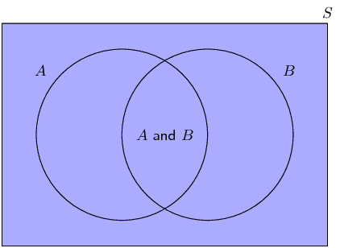
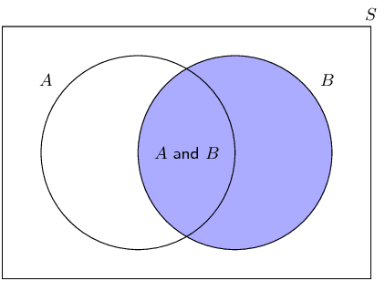
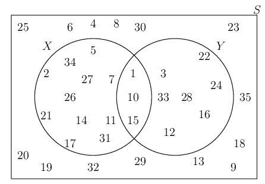

## 10.2 Dependent and independent events (EMBJT)

Sometimes the presence or absence of one event tells us something about other events.
                        We call events dependent if knowing whether one of them happened tells us something about
                        whether the others happened.
                        Independent events give us no information about one another; the probability of one event
                        occurring does not affect the probability of the other events occurring.

Independent events

Two events, \(A\) and \(B\) are independent if and only if
                                        \[P(A \text{ and } B) = P(A) \times P(B)\]

At first it might not be clear why we should call events that satisfy the equation above independent.
                        We will explore this further using a number of examples.

## Independence

Roll a single \(\text{6}\)-sided die and consider the following two events:

- \(E\): you get an even number
- \(T\): you get a number that is divisible by three

Now answer the following questions:

- What is the probability of \(E\)?
- What is the probability of getting an even number if you are told that the number
                                          was also divisible by three?
- Does knowing that the number was divisible by \(\text{3}\) change the probability
                                          that the number was even?

Are the events \(E\) and \(T\) dependent or independent according to the definition? (Hint:
                                compute the probabilities in the definition of independence.)

<Callout type="note" title="Note">
<VideoPlayer src="http://www.khanacademy.org/embed_video?v=Za7G_eWKiF4" title="Video: 23B7" />
</Callout>

So, why do we call it **independence** when \(P(A\text{ and }B) = P(A) \times P(B)\)?
                        For two events, \(A\) and \(B\), independence means that knowing the outcome of \(B\) does not
                        affect the probability of \(A\).

Consider the following Venn diagram.

The probability of \(A\) is the ratio between the number of outcomes in \(A\) and the number of
                        outcomes in the sample space, \(S\).
                        \[P(A) = \frac{n(A)}{n(S)}\]

Now, let's say that we **know** that event \(B\) happened.
                        How does this affect the probability of \(A\)?
                        Here is how the Venn diagram changes:

A lot of the possible outcomes (all of the outcomes outside \(B\)) are now out of the picture,
                        because we know that they did not happen. Now the probability of \(A\) happening, given that we
                        know that \(B\) happened, is the ratio between the size of the region where \(A\) is present
                        (\(A\text{ and }B\)) and the size of all possible events (\(B\)).
                        \[P(A\text{ if we know }B) = \frac{n(A\text{ and }B)}{n(B)}\]

                        If \(P(A) = P(A\text{ if we know }B)\) we call them independent, because knowing \(B\) does not
                        change the probability of \(A\).

With some algebra, we can prove that this statement of independence is the same as the definition of
                        independence that we saw at the beginning of this section. For independent events
                        \[P(A\text{ and }B) = P(A) \times P(B)\]

                        This is equivalent to
                        \begin{align*}
                        P(A) &= P(A\text{ and }B) \div P(B) \\
                        &= \frac{n(A\text{ and }B)}{n(S)} \div \frac{n(B)}{n(S)} \\
                        &= \frac{n(A\text{ and }B)}{n(B)} \\
                        &= P(A\text{ if we know }B)
                        \end{align*}
                        That is why we call events independent!

**(For enrichment only)**:

The ratio
                        \[\frac{P(A \text{ and } B)}{P(B)}\]

                        is called a **conditional probability** and written using the notation
                        \(P(A\;|\;B)\).
                        This notation is read as “the probability of \(A\) given \(B\).”

If (and only if) \(A\) and \(B\) are independent: \(P(A\;|\;B) = P(A)\) and \(P(B\;|\;A) = P(B)\).
                        Try to prove this using the definition of independence.

<Callout type="tip" title="Worked example 6: Independent and dependent events">
**Question:**
A bag contains \(\text{5}\) red and \(\text{5}\) blue balls. We remove a random ball
                                        from the bag, record its colour and put it back into the bag. We then remove
                                        another random ball from the bag and record its colour.

2. What is the probability that the first ball is red?
4. What is the probability that the second ball is blue?
6. What is the probability that the first ball is red and the second ball is
                                                   blue?
8. Are the first ball being red and the second ball being blue independent
                                                   events?

**Probability of a red ball first:**
Since there are a total of \(\text{10}\) balls, of which \(\text{5}\) are red, the
                                        probability of getting a red ball is
                                        \[P(\text{first ball red}) = \frac{5}{10} = \frac{1}{2}\]

**Probability of a blue ball second:**
The problem states that the first ball is placed back into the bag before we take the
                                        second ball.
                                        This means that when we draw the second ball, there are again a total of
                                        \(\text{10}\) balls in the bag, of which \(\text{5}\) are blue.
                                        Therefore the probability of drawing a blue ball is
                                        \[P(\text{second ball blue}) = \frac{5}{10} = \frac{1}{2}\]

**Probability of red first and blue second:**
When drawing two balls from the bag, there are \(\text{4}\) possibilities.
                                        We can get

- a red ball and then another red ball;
- a red ball and then a blue ball;
- a blue ball and then a red ball;
- a blue ball and then another blue ball.

We want to know the probability of the second outcome, where we have to get a red
                                        ball first.
                                        Since there are \(\text{5}\) red balls and \(\text{10}\) balls in total, there
                                        are \(\frac{5}{10}\) ways to get a red ball first.
                                        Now we put the first ball back, so there are again \(\text{5}\) red balls and
                                        \(\text{5}\) blue balls in the bag.
                                        Therefore there are \(\frac{5}{10}\) ways to get a blue ball second if the first
                                        ball was red.
                                        This means that there are
                                        \[\frac{5}{10}\times\frac{5}{10}=\frac{25}{\text{100}}\]
                                        ways to get a red ball first and a blue ball second.
                                        So, the probability of getting a red ball first and a blue ball second is
                                        \(\frac{1}{4}\).

**Dependent or independent?:**
According to the definition, events are independent if and only if
                                        \[P(A\text{ and }B) = P(A) \times P(B)\]

In this problem:

- \(P(\text{first ball red}) = \frac{1}{2}\)
- \(P(\text{second ball blue}) = \frac{1}{2}\)
- \(P(\text{first ball red and second ball blue}) = \frac{1}{4}\)

                                Since \(\frac{1}{4} = \frac{1}{2}\times\frac{1}{2}\), the events are independent.
</Callout>

<Callout type="note" title="Note">
<VideoPlayer src="http://www.khanacademy.org/embed_video?v=2MYA8Ba2PvM " title="Video: 23B8" />
</Callout>

<QuizCard id="m11-10-02a" title="Interactive Exercise 10.5" question="Fill in the missing word or term for the sentence." options=["50%", "0%", "1", "100%"] answer="50%" hint="" explanation="Complete the definition For a list of terminology and definitions see the beginning of the Probability chapter in Everything Maths. A probability of \(\text{0}\%\) means the outcome of the experiment will never be in the event set. Submit your answer as: 0%" />

<QuizCard id="m11-10-02a" title="Interactive Exercise 10.5" question="Adapted from DBE Nov 2015 Grade 12, P1, Q11.1 Maths formulas For two events \(M\) and \(N\) , it is given that: \(P(M) = \text{0,35}\) \(P(N) = \text{0,6}\) \(P(M \text{ and } N) = \text{0,21}\) Are the events, \(M\) and \(N\) , dependent or independent? Perform an appropriate calculation and construct a reason for your answer using the pairs of quantities in the table below: A \(P(M \text{ or } N)\) \(P(M) + P(N)\) B \(P(M \text{ and } N)\) \(P(M) + P(N)\) C \(P(M \text{ or } N)\) \(P(M) \times P(N)\) D \(P(M \text{ and } N)\) \(P(M) \times P(N)\)" options=["dependent", "independent", "A", "B", "C", "D", "equal", "mutually exclusive", "not equal", "less than 1"] answer="1, 3, 0" hint="" explanation="Determine whether \(M\) and \(N\) are independent Two events \(X\) and \(Y\) are independent if \[                     \begin{aligned}                         P(X) \times P(Y) = P(X \text{ and } Y)                      \end{aligned}                 \] In our question: \[                     \begin{aligned}                         P(M) \times P(N) & = \text{0,35} \times \text{0,6} \\                         & = \text{0,21}  \\                         P(M \text{ and } N) & = \text{0,21}                     \end{aligned}                 \] The values are equal , so the events \(M\) and \(N\) are independent . Submit your answer as: independent and D and equal" />

<Callout type="tip" title="Worked example 7: Independent and dependent events">
**Question:**
In the previous example, we picked a random ball and put it back into the bag before
                                        continuing.
                                        This is called **sampling with replacement**.
                                        In this example, we will follow the same process, except that we will not put
                                        the first ball back into the bag.
                                        This is called **sampling without replacement**.

So, from a bag with \(\text{5}\) red and \(\text{5}\) blue balls, we remove a random
                                        ball and record its colour.
                                        Then, without putting back the first ball, we remove another random ball from
                                        the bag and record its colour.

2. What is the probability that the first ball is red?
4. What is the probability that the second ball is blue?
6. What is the probability that the first ball is red and the second ball is
                                                   blue?
8. Are the first ball being red and the second ball being blue independent
                                                   events?

**Count the number of outcomes:**
We will look directly at the number of possible ways in which we can get the
                                        \(\text{4}\) possible outcomes when removing \(\text{2}\) balls.
                                        In the previous example, we saw that the \(\text{4}\) possible outcomes are

- a red ball and then another red ball;
- a red ball and then a blue ball;
- a blue ball and then a red ball;
- a blue ball and then another blue ball.

For the first outcome, we have to get a red ball first.
                                        Since there are \(\text{5}\) red balls and \(\text{10}\) balls in total, there
                                        are \(\frac{5}{10}\) ways to get a red ball first.
                                        After we have taken out a red ball, there are now \(\text{4}\) red balls and
                                        \(\text{5}\) blue balls left.
                                        Therefore there are \(\frac{4}{9}\) ways to get a red ball second if the first
                                        ball was also red.
                                        This means that there are \[\frac{5}{10}\times\frac{4}{9}=\frac{20}{90}\]
                                        ways to get a red ball first and a red ball second.
                                        The probability of the first outcome is \(\frac{2}{9}\).

For the second outcome, we have to get a red ball first.
                                        As in the first outcome, there are \(\frac{5}{10}\) ways to get a red ball
                                        first; and there are now \(\text{4}\) red balls and \(\text{5}\) blue balls
                                        left.
                                        Therefore there are \(\frac{5}{9}\) ways to get a blue ball second if the first
                                        ball was red.
                                        This means that there are \[\frac{5}{10}\times\frac{5}{9}=\frac{25}{90}\]
                                        ways to get a red ball first and a blue ball second.
                                        The probability of the second outcome is \(\frac{5}{18}\).

We can compute the probabilities of the third and fourth outcomes in the same way as
                                        the first two, but there is an easier way.
                                        Notice that there are only \(\text{2}\) types of ball and that there are exactly
                                        equal numbers of them at the start.
                                        This means that the problem is completely symmetric in red and blue.
                                        We can use this symmetry to compute the probabilities of the other two outcomes.

In the third outcome, the first ball is blue and the second ball is red.
                                        Because of symmetry this outcome must have the same probability as the second
                                        outcome (when the first ball is red and the second ball is blue).
                                        Therefore the probability of the third outcome is \(\frac{5}{18}\).

In the fourth outcome, the first and second balls are both blue.
                                        From symmetry, this outcome must have the same probability as the first outcome
                                        (when both balls are red).
                                        Therefore the probability of the fourth outcome is \(\frac{2}{9}\).

To summarise, these are the possible outcomes and their probabilities:

- first ball red and second ball red: \(\frac{2}{9}\);
- first ball red and second ball blue: \(\frac{5}{18}\);
- first ball blue and second ball red: \(\frac{5}{18}\);
- first ball blue and second ball blue: \(\frac{2}{9}\).

**Probability of a red ball first:**
To determine the probability of getting a red ball on the first draw, we look at all
                                        of the outcomes that contain a red ball first.
                                        These are

- a red ball and then another red ball;
- a red ball and then a blue ball.

The probability of the first outcome is \(\frac{2}{9}\) and the probability of the
                                        second outcome is \(\frac{5}{18}\).
                                        By adding these two probabilities, we see that the probability of getting a red
                                        ball first is
                                        \[P(\text{first ball red}) = \frac{2}{9} + \frac{5}{18} = \frac{1}{2}\]

This is the same as in the previous exercise, which should not be too surprising
                                        since the probability of the first ball being red is not affected by whether or
                                        not we put it back into the bag before drawing the second ball.

**Probability of a blue ball second:**
To determine the probability of getting a blue ball on the second draw, we look at
                                        all of the outcomes that contain a blue ball second.
                                        These are

- a red ball and then a blue ball;
- a blue ball and then another blue ball.

The probability of the first outcome is \(\frac{5}{18}\) and the probability of the
                                        second outcome is \(\frac{2}{9}\).
                                        By adding these two probabilities, we see that the probability of getting a blue
                                        ball second is
                                        \[P(\text{second ball blue}) = \frac{5}{18} + \frac{2}{9} = \frac{1}{2}\]

This is also the same as in the previous exercise!
                                        You might find it surprising that the probability of the second ball is not
                                        affected by whether or not we replace the first ball.
                                        The reason why this probability is still \(\frac{1}{2}\) is that we are
                                        computing the probability that the second ball is blue without knowing the
                                        colour of the first ball.
                                        Because there are only two equal possibilities for the second ball (red and
                                        blue) and because we don't know whether the first ball is red or blue, there is
                                        an equal chance that the second ball will be one colour or the other.

**Probability of red first and blue second:**
We have already calculated the probability that the first ball is red and the second
                                        ball is blue.
                                        It is \(\frac{5}{18}\).

**Dependent or independent?:**
According to the definition, events are independent if and only if
                                        \[P(A\text{ and }B) = P(A) \times P(B)\]

In this problem:

- \(P(\text{first ball red}) = \frac{1}{2}\)
- \(P(\text{second ball blue}) = \frac{1}{2}\)
- \(P(\text{first ball red and second ball blue}) = \frac{5}{18}\)

                                Since \(\frac{5}{18} \ne \frac{1}{2}\times\frac{1}{2}\), the events are dependent.
</Callout>

<Callout type="warning" title="Note">
Just because two events are mutually exclusive does not necessarily mean that they are
                                independent.
                                To test whether events are mutually exclusive, always check that \(P(A \text{ and } B) =
                                0\).
                                To test whether events are independent, always check that \(P(A \text{ and } B) = P(A)
                                \times P(B)\).
                                See the exercises below for examples of events that are mutually exclusive and
                                independent in different combinations.
</Callout>

## Dependent and independent events

### Textbook Exercise 10.3

Use the following Venn diagram to determine whether events \(X\) and
                                                        \(Y\) are

**Problem:**
mutually exclusive or not mutually exclusive;

**Solution:**
The events are mutually exclusive if and only if \((X \text{
                                                                and } Y) = \emptyset\).
                                                                From the Venn diagram we see that \((X \text{ and } Y)\)
                                                                contains \(\text{3}\) elements.
                                                                Therefore \(X\) and \(Y\) are not mutually exclusive.

**Problem:**
dependent or independent.

**Solution:**
The events are independent if and only if \(P(X \text{ and }
                                                                Y) = P(X) \times P(Y)\).
                                                                In this case,
                                                                \begin{align*}
                                                                P(X \text{ and } Y) &= \frac{3}{35} \\
                                                                P(X) &= \frac{14}{35} \\
                                                                P(Y) &= \frac{10}{35}
                                                                \end{align*}
                                                                So \(P(X) \times P(Y) = \frac{4}{35} \ne P(X \text{ and
                                                                } Y)\).
                                                                Therefore \(X\) and \(Y\) are dependent.

Of the \(\text{30}\) learners in a class \(\text{17}\) have
                                                        black
                                                        hair, \(\text{11}\) have brown hair and \(\text{2}\)
                                                        have red
                                                        hair.
                                                        A learner is selected from the class at random.

**Problem:**
What is the probability that the learner
                                                        has black
                                                        hair?

**Solution:**
\(\frac{17}{30}\)

**Problem:**
What is the probability that the learner
                                                        has brown
                                                        hair?

**Solution:**
\(\frac{11}{30}\)

**Problem:**
Are these two events mutually exclusive?

**Solution:**
Yes, since each learner has only one hair
                                                        colour,
                                                        so \(P(\text{black and brown}) = 0\).

**Problem:**
Are these two events independent?

**Solution:**
No, since \(P(\text{black and brown}) = 0
                                                        \ne
                                                        P(\text{black}) \times P(\text{brown})\).

**Problem:**
\(P(M) = \text{0,45}\); \(P(N) = \text{0,3}\) and \(P(M
                                                        \text{ or }
                                                        N) = \text{0,615}\).
                                                        Are the events \(M\) and \(N\) mutually exclusive,
                                                        independent
                                                        or neither mutually exclusive nor independent?

**Solution:**
From the sum rule,
                                                        \begin{align*}
                                                        P(M \text{ and } N)
                                                        &= P(M) + P(N) - P(M \text{ or } N) \\
                                                        &= \text{0,45} + \text{0,3} - \text{0,615} \\
                                                        &= \text{0,135}
                                                        \end{align*}
                                                        \(P(M \text{ and } N) \ne 0\), therefore the events are
                                                        not
                                                        mutually exclusive.

Therefore the events are independent since
                                                        \[P(M) \times P(N) = \text{0,135} = P(M \text{ and }
                                                        N)\]

**Problem:**
(For enrichment)

Prove that if event \(A\) and event \(B\) are mutually
                                                        exclusive with
                                                        \(P(A) \ne 0\) and \(P(B) \ne 0\), then \(A\) and \(B\)
                                                        are
                                                        always dependent.

**Solution:**
Proof by contradiction.

Assume that \(A\) and \(B\) are independent events.
                                                        From the definition of independence, we then have \(P(A
                                                        \text{
                                                        and } B) = P(A) \times P(B)\).
                                                        Since \(A\) and \(B\) are mutually exclusive, we know
                                                        that \(P(A
                                                        \text{ and } B) = 0\).
                                                        Therefore \(P(A) \times P(B) = 0\).

For the product of two numbers to be zero, at least one of
                                                        the two
                                                        numbers must be zero.
                                                        But in the problem statement, we were told \(P(A) \ne
                                                        0\) and
                                                        \(P(B) \ne 0\).
                                                        Therefore we have a contradiction and our original
                                                        assumption,
                                                        that \(A\) and \(B\) are independent events, must be
                                                        false.

Conclusion: \(A\) and \(B\) are dependent.
