## 10.3 More Venn diagrams (EMBJV)

<QuizCard id="m11-10-03a" title="Interactive Exercise 10.7" question="How many learners in the class are                     not fans of hip-hop and                     are not interested in chemistry?" options=["7", "15", "18", "31", "53", "7", "15", "18", "31", "53"] answer="
                        15
                    " hint="You should enter a number here. If you want to, you can use a space to separate thousands.                Example: 12 800,25 For scientific notation you need to use the multiply symbol                ( ∗ ) and the exponent symbol ( ^ ). For example 6,673 × 10 −11 should be written as: 6,673 ∗ 10^−11" explanation="Compare the numbers given to find the answer We need to determine the number of learners who are                         not fans of hip-hop and                         are not interested in chemistry. Let's call that \(n\) . Let's start by finding the number of learners who are                         fans of hip-hop and who are interested in chemistry.                         If we subtract that from the total number of learners, we will have the number                         we want. But the calculation below is not correct : \[                         \begin{aligned}                             n &= 53 - 25 -                                 31 \\                             & \text{Incorrect!}                         \end{aligned}                     \] The calculation above is wrong because it double-counts the learners who                         are interested in chemistry and                         are fans of hip-hop. The question says                         there are \(\text{18}\) learners                         who are interested in chemistry and                         are fans of hip-hop. The calculation above                         subtracts those students twice . That happens because they are included                         in both the \(\text{25}\) and in the \(\text{31}\) . We need to adjust the                         calculation. Here are two ways we can do that: Method 1 \[                         \begin{aligned}                             n & = 53 - \left(25                                 - 18 \right) - 31\\                             & = 53 - 25 +                                    18 - 31  \\                             & = 15                         \end{aligned}                     \] Method 2 \[                         \begin{aligned}                             n & = 53 - 25 -                                \left(31 - 18\right)\\                             & = 53 - 25 -                             31 +  18  \\                             & = 15                         \end{aligned}                     \] NOTE: Both methods shown above are equivalent to: \[                             \begin{array}{c}                             	 n = 53 - 25 -                                  31 + 18                             \end{array}                         \] The last term adds the \(\text{18}\) students who are interested in chemistry and are fans of hip-hop                             back into the calculation. So instead of subtracting those students twice,                             now we have only subtracted them once. The number of learners in the class who are                         not fans of hip-hop and                         are not interested in chemistry is \(\text{15}\) . Submit your answer as:" />

<QuizCard id="m11-10-03a" title="Interactive Exercise 10.7" question="The Venn diagram below shows sets \(A\) , \(B\) , and \(C\) . Identify set \(\left( A \text{ or } B \text{ or } C \right)'\) from the drop down list:" options=["{ Z ; W ; U ; M ; P }", "{  }", "{ k ; j ; g ; M ; P ; u ; y ; Z ; W ; U }", "none of the above"] answer="{  }" hint="" explanation="Which region or regions of the Venn diagram hold the elements \(A \text{ or } B \text{ or } C\) ? What is left over? The question asked for: \(\left(A \text{ or } B \text{ or } C\right) '\) . In other words the complementary set of \(A \text{ or } B \text{ or } C\) . So the first step is to identify the \(A \text{ or } B \text{ or } C\) region on the diagram. The yellow shaded area below represents the region \(A \text{ or } B \text{ or } C\) : Represented as a set: \[                     \begin{aligned}                     A \text{ or } B \text{ or } C &= \{E ; F ; M ; P ; U ; W ; Z ; b ; e ; g ; j ; k ; p ; q ; u ; y\}                     \end{aligned}                 \] A complementary set includes all of the elements which are not included in the set \(A \text{ or } B \text{ or } C\) . If we take out all the elements from the shaded area above, then we are left with the only other elements, in the complementary set of \(A \text{ or } B \text{ or } C\) . \[                     \begin{aligned}                     \left(A \text{ or } B \text{ or } C\right)'  &= \{\}                     \end{aligned}                 \] There are no elements in this set. The set \(A \text{ or } B \text{ or } C\) holds all the available elements in the Venn diagram so there are no other elements left for \(\left(A \text{ or } B \text{ or } C\right)'\) . Therefore the correct set for \(\left(A \text{ or } B \text{ or } C\right) ' = \{\}\) . Submit your answer as: {  }" />

In the rest of this chapter we will look at tools and techniques for working with probability
                        problems.

When working with more complex problems, we can have three or more events that intersect in various
                        ways.
                        To solve these problems, we usually want to count the number (or percentage) of outcomes in an
                        event, or a combination of events.
                        Venn diagrams are a useful tool for recording and visualising the counts.

## Venn diagram for \(\text{3}\) events

The diagram below shows a general Venn diagram for \(\text{3}\) events.

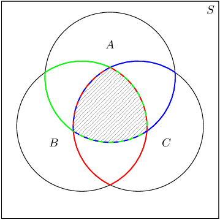

Write down the sets corresponding to each of the three coloured regions and also to the
                                shaded region.
                                Remember that the intersections between circles represent the intersections between the
                                different events.

What is the event for

- the red region;
- the green region;
- the blue region; and
- the shaded region?

<Callout type="tip" title="Worked example 8: Venn diagram for \(\text{3}\) events">
**Question:**
Draw a Venn diagram that shows the following sample space and events:

- \(S\): all the integers from \(\text{1}\) to \(\text{30}\)
- \(P\): prime numbers
- \(M\): multiples of \(\text{3}\)
- \(F\): factors of \(\text{30}\)

**Write down the sample space and event sets:**
The sample space contains all the positive integers up to \(\text{30}\).
                                        \[S = \{1; 2; 3; \ldots; 30\}\]

The prime numbers between \(\text{1}\) and \(\text{30}\) are
                                        \[P = \{2; 3; 5; 7; 11; 13; 17; 19; 23; 29\}\]

The multiples of \(\text{3}\) between \(\text{1}\) and \(\text{30}\) are
                                        \[M = \{3; 6; 9; 12; 15; 18; 21; 24; 27; 30\}\]

The factors of \(\text{30}\) are
                                        \[F = \{1; 2; 3; 5; 6; 10; 15; 30\}\]

**Draw the outline of the Venn diagram:**
There are \(\text{3}\) events, namely \(P\), \(M\) and \(F\), and the sample space,
                                        \(S\).
                                        Put this information on a Venn diagram:

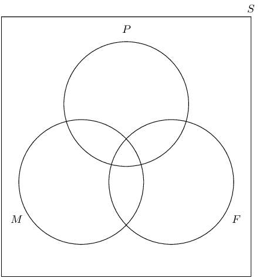

**Place the outcomes in the appropriate event sets:**
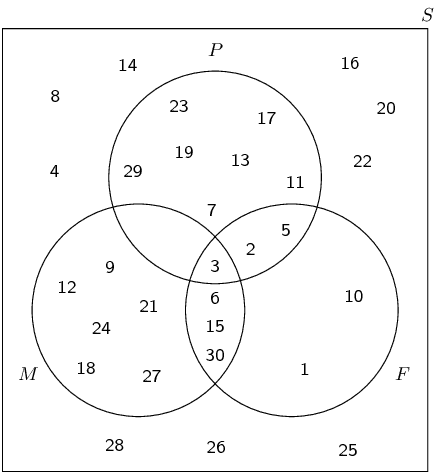
</Callout>

<Callout type="tip" title="Worked example 9: Venn diagram for \(\text{3}\) events">
**Question:**
At Dawnview High there are \(\text{400}\) Grade \(\text{11}\) learners.
                                        \(\text{270}\) do Computer Science, \(\text{300}\) do English and \(\text{50}\)
                                        do Business studies.
                                        All those doing Computer Science do English, \(\text{20}\) take Computer Science
                                        and Business studies and \(\text{35}\) take English and Business studies.
                                        Using a Venn diagram, calculate the probability that a pupil drawn at random
                                        will take:

2. English, but not Business studies or Computer Science
4. English but not Business studies
6. English or Business studies but not Computer Science
8. English or Business studies

**Draw the outline of the Venn diagram:**
We need to be careful with this problem.
                                        In the question statement we are told that all the learners who do Computer
                                        Science also do English.
                                        This means that the circle for Computer Science on the Venn diagram needs to be
                                        inside the circle for English.

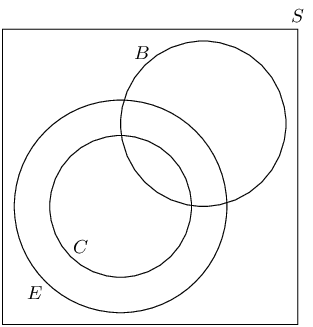

**Fill in the counts on the Venn diagram:**
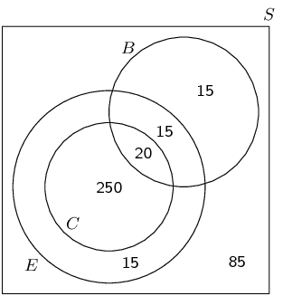

**Compute probabilities:**
To find the number of learners taking English, but not Business studies or Computer
                                        Science, we need to look at this region of the Venn diagram:

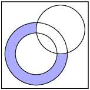

The count in this region is \(\text{15}\) and there are a total of \(\text{400}\)
                                        learners in the grade.
                                        Therefore the probability that a learner will take English but not Business
                                        studies or Computer Science is \(\frac{15}{\text{400}} = \frac{3}{80}\).

To find the number of learners taking English but not Business studies, we need to
                                        look at this region of the Venn diagram:

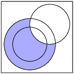

The count in this region is \(\text{265}\).
                                        Therefore the probability that a learner will take English but not Business
                                        studies is \(\frac{\text{265}}{\text{400}} = \frac{53}{80}\).

To find the number of learners taking English or Business studies but not Computer
                                        Science, we need to look at this region of the Venn diagram:

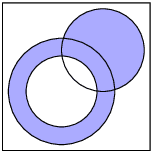

The count in this region is \(\text{45}\).
                                        Therefore the probability that a learner will take English or Business studies
                                        but not Computer Science is \(\frac{45}{\text{400}} = \frac{9}{80}\).

To find the number of learners taking English or Business studies, we need to look at
                                        this region of the Venn diagram:

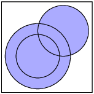

The count in this region is \(\text{315}\).
                                        Therefore the probability that a learner will take English or Business studies
                                        is \(\frac{\text{315}}{\text{400}} = \frac{63}{80}\).
</Callout>

There are some words that tell you which part of the Venn diagram should be filled in.
                        The following table summarises the most important ones:

| Words | Symbols | Venn diagram |
| --- | --- | --- |
| “all” | \(A \text{ and } B \text{ and } C\) / \(A \cap B \cap C\) |  |
| “none” |  |  |
| “at least one” | \(A \text{ or } B \text{ or } C\) / \(A \cup B \cup C\) |  |
| “both A and B” | \(A \text{ and } B\) / \(A \cap B\) |  |
| “A or B” | \(A \text{ or } B\) / \(A \cup B\) |  |

## Venn diagrams

### Textbook Exercise 10.4

Use the Venn diagram below to answer the following questions.
                                                        Also given: \(n(S) = \text{120}\).

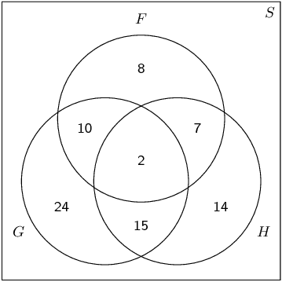

**Problem:**
Compute \(P(F)\).

**Solution:**
\(\frac{27}{120} = \frac{9}{40}\)

**Problem:**
Compute \(P(G\text{ or }H)\).

**Solution:**
\(\frac{72}{120} = \frac{3}{5}\)

**Problem:**
Compute \(P(F\text{ and }G)\).

**Solution:**
\(\frac{12}{120} = \frac{1}{10}\)

**Problem:**
Are \(F\) and \(G\) dependent or independent?

**Solution:**
\begin{align*}
                                                                P(F) \times P(G)
                                                                &= \frac{9}{40} \times \frac{51}{120} \\
                                                                &= \frac{153}{1600}
                                                                \end{align*}
                                                                and
                                                                \[P(F\text{ and }G) = \frac{1}{10}\]

                                                                Therefore \(P(F\text{ and }G) \ne P(F) \times P(G)\) and
                                                                the events are dependent.

**Problem:**
The Venn diagram below shows the probabilities of \(\text{3}\)
                                                        events.
                                                        Complete the Venn diagram using the additional information
                                                        provided.

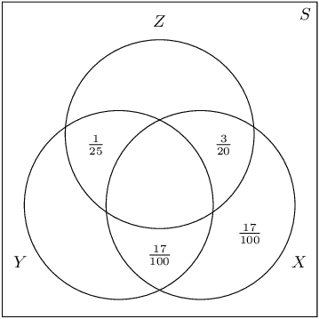

- \(P(Z\text{ and (not }Y)) = \frac{31}{\text{100}}\)
- \(P(Y\text{ and }X) = \frac{23}{\text{100}}\)
- \(P(Y) = \frac{39}{\text{100}}\)

After completing the Venn diagram, compute the following:
                                                        \[P\left(Z\text{ and not }(X\text{ or }Y)\right)\]

**Solution:**
The completed Venn diagram is below.

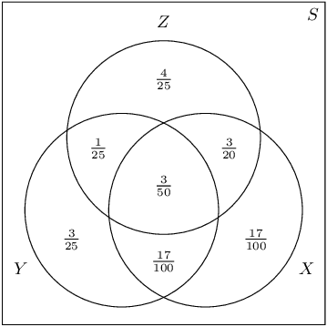

\(\left(Z\text{ and not }(X\text{ or }Y)\right)\) is the top part of
                                                        \(Z\), which excludes all of \(X\) and \(Y\). Therefore
                                                        \(P\left(Z\text{ and not }(X\text{ or }Y)\right) =
                                                        \frac{4}{25}\).

There are \(\text{79}\) Grade \(\text{10}\) learners at school.
                                                        All of these take some combination of Maths, Geography and
                                                        History.
                                                        The number who take Geography is \(\text{41}\); those who take
                                                        History is \(\text{36}\); and \(\text{30}\) take Maths.
                                                        The number who take Maths and History is \(\text{16}\); the
                                                        number who take Geography and History is \(\text{6}\), and there
                                                        are \(\text{8}\) who take Maths only and \(\text{16}\) who take
                                                        History only.

**Problem:**
Draw a Venn diagram to illustrate all this
                                                        information.

**Solution:**
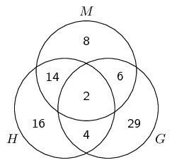

**Problem:**
How many learners take Maths and Geography but not
                                                        History?

**Solution:**
Each student must do exactly one of the following:

- take only Geography;
- only take Maths and/or History.

                                                        There are \(30+36-16=50\) learners taking Maths and/or History,
                                                        therefore there must be \(79-50=29\) learners doing only
                                                        Geography.

Each learner must do exactly one of the following:

- take only Geography (\(\text{29}\) learners);
- take only Maths (\(\text{8}\) learners);
- take History (\(\text{36}\) learners);
- take Geography and Maths, but not History.

                                                        Given the number of learners list for each of the first three
                                                        items above, the final answer is that \(79-29-8-36 = \text{6}\)
                                                        learners take Geography and Maths, but not History.

**Problem:**
How many learners take Geography only?

**Solution:**
Calculated already: \(\text{29}\) learners.

**Problem:**
How many learners take all three subjects?

**Solution:**
Each learner must take exactly one of:

- Geography;
- only Maths;
- only History;
- Maths and History but not Geography.

                                                        Using the same method as before, the number of learners in the
                                                        last group is \(79-41-8-16 = 14\).
                                                        But, \(\text{16}\) learners do Maths and History, so there must
                                                        be \(16 - 14 = \text{2}\) learners who do all three.

**Problem:**
Draw a Venn diagram with \(\text{3}\) mutually exclusive events.
                                                        Use the diagram to show that for \(\text{3}\) mutually exclusive
                                                        events, \(A\), \(B\) and \(C\), the following is true:
                                                        \[P(A\text{ or }B\text{ or }C) = P(A) + P(B) + P(C)\]

This is the addition rule for \(\text{3}\) mutually exclusive events.

**Solution:**
Recall for events to be mutually exclusive, they must have no
                                                        elements in common.
                                                        This mean that in the Venn diagram there must be no overlap
                                                        between any of \(A\), \(B\) and \(C\).

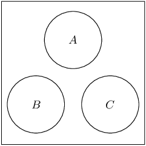

From the Venn diagram we can see that the probability of the three
                                                        events together is simply the sum of their individual
                                                        probabilities.
                                                        So \(P(A\text{ or }B\text{ or }C) = P(A) + P(B) + P(C)\).
                                                        This will be true for any mutually exclusive events since they
                                                        never overlap in the Venn diagram.
