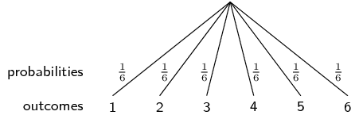
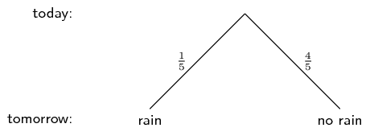
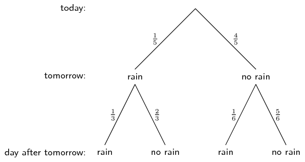
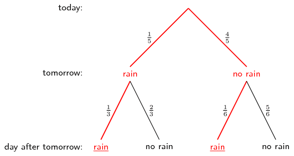
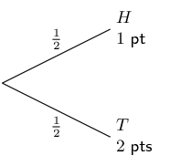
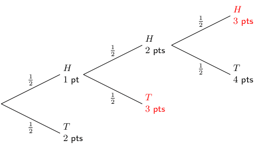
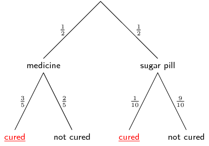
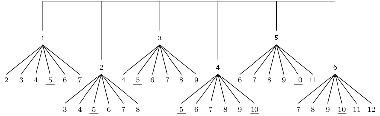
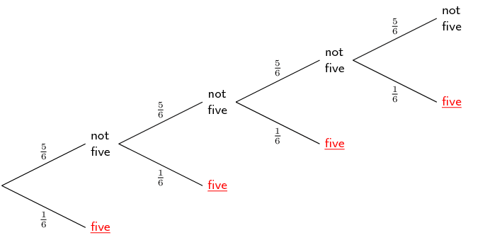

## 10.4 Tree diagrams (EMBJW)

<QuizCard id="m11-10-04a" title="Interactive Exercise 10.9" question="Adapted from DBE Nov 2015 Grade 12, P1, Q11.1 Maths formulas For two events \(G\) and \(H\) , it is given that: \(P(G) = \text{0,9}\) \(P(H) = \text{0,31}\) \(P(G \text{ and } H) = \text{0,73}\) Are the events, \(G\) and \(H\) , dependent or independent? Perform an appropriate calculation and construct a reason for your answer using the pairs of quantities in the table below: A \(P(G \text{ or } H)\) \(P(G) \times P(H)\) B \(P(G \text{ or } H)\) \(P(G) + P(H)\) C \(P(G \text{ and } H)\) \(P(G) + P(H)\) D \(P(G \text{ and } H)\) \(P(G) \times P(H)\)" options=["dependent", "independent", "A", "B", "C", "D", "not equal", "equal", "less than 1", "mutually exclusive"] answer="0, 3, 0" hint="" explanation="Determine whether \(G\) and \(H\) are independent Two events \(X\) and \(Y\) are independent if \[                     \begin{aligned}                         P(X) \times P(Y) = P(X \text{ and } Y)                      \end{aligned}                 \] In our question: \[                     \begin{aligned}                         P(G) \times P(H) & = \text{0,9} \times \text{0,31} \\                         & = \text{0,279}  \\                         P(G \text{ and } H) & = \text{0,73}                     \end{aligned}                 \] The values are not equal , so the events \(G\) and \(H\) are dependent . Submit your answer as: dependent and D and not equal" />

<QuizCard id="m11-10-04a" title="Interactive Exercise 10.9" question="Represent the information on a tree diagram. Show the probabilities associated with each branch as well as the possible outcomes. Now compare your tree diagram to the one given below, and answer the questions that follow. What is the value of \(b\) ? What is the value of \(c\) ? What is the correct outcome for the branch with dashed lines?" options=[] answer="0.3, 0.8, 3" hint="You should enter a number here. If you want to, you can use a space to separate thousands.                Example: 12 800,25 For scientific notation you need to use the multiply symbol                ( ∗ ) and the exponent symbol ( ^ ). For example 6,673 × 10 −11 should be written as: 6,673 ∗ 10^−11" explanation="Draw and label a tree diagram Therefore we can say that: \(b=\text{0,3}\) \(c=\text{0,8}\) On the dashed path, it was dry on the first day and also on the second. Submit your answer as: and and It was dry on the first day and also on the second" />

Tree diagrams are useful for organising and visualising the different possible outcomes of a sequence
                        of events.
                        For each possible outcome of the first event, we draw a line where we write down the probability
                        of that outcome and the state of the world if that outcome happened.
                        Then, for each possible outcome of the second event we do the same thing.

Below is an example of a simple tree diagram, showing the possible outcomes of rolling a
                        \(\text{6}\)-sided die.

Note that each outcome (the numbers \(\text{1}\) to \(\text{6}\)) is shown at the end of a line; and
                        that the probability of each outcome (all \(\frac{1}{6}\) in this case) is shown shown on a
                        line.
                        The probabilities have to add up to \(\text{1}\) in order to cover all of the possible outcomes.
                        In the examples below, we will see how to draw tree diagrams with multiple events and how to
                        compute probabilities using the diagrams.

Earlier in this chapter you learned about dependent and independent events.
                        Tree diagrams are very helpful for analysing dependent events.
                        A tree diagram allows you to show how each possible outcome of one event affects the
                        probabilities of the other events.

Tree diagrams are not so useful for independent events since we can just multiply the probabilities
                        of separate events to get the probability of the combined event.
                        Remember that for independent events:
                        \[P(A\text{ and }B) = P(A) \times P(B)\]

                        So if you already know that events are independent, it is usually easier to solve a problem
                        without using tree diagrams.
                        But if you are uncertain about whether events are independent or if you know that they are not,
                        you should use a tree diagram.

<Callout type="tip" title="Worked example 10: Drawing a tree diagram">
**Question:**
If it rains on a given day, the probability that it rains the next day is
                                        \(\frac{1}{3}\).
                                        If it does not rain on a given day, the probability that it rains the next day
                                        is \(\frac{1}{6}\).
                                        The probability that it will rain tomorrow is \(\frac{1}{5}\).
                                        What is the probability that it will rain the day after tomorrow?
                                        Draw a tree diagram of all the possibilities to determine the answer.

**Draw the first level of the tree diagram:**
Before we can determine what happens on the day after tomorrow, we first have to
                                        determine what might happen tomorrow.
                                        We are told that there is a \(\frac{1}{5}\) probability that it will rain
                                        tomorrow.
                                        Here is how to represent this information using a tree diagram:

**Draw the second level of the tree diagram:**
We are also told that if it **does** rain on one day, there is a
                                        \(\frac{1}{3}\) probability that it will also rain on the following day.
                                        On the other hand, if it **does not** rain on one day, there is
                                        only a \(\frac{1}{6}\) probability that it will also rain on the following day.
                                        Using this information we complete the tree diagram:

**Compute the probability:**
We are asked what the probability is that it will rain the day after tomorrow.
                                        On the tree diagram above we can see that there are \(\text{2}\) situations
                                        where it rains on the day after tomorrow.
                                        They are marked in red below.

To get the probability for the first situation (that it rains tomorrow and the day
                                        after tomorrow) we have to multiply the probabilies along the first red line.
                                        \begin{align*}
                                        &P(\text{rain tomorrow and rain day after tomorrow}) \\
                                        =& \frac{1}{5} \times \frac{1}{3} \\
                                        =& \frac{1}{15}
                                        \end{align*}

To get the probability for the second situation (that it does not rain tomorrow, but
                                        it does rain the day after tomorrow) we have to multiply the probabilies along
                                        the second red line.
                                        \begin{align*}
                                        &P(\text{not rain tomorrow and rain day after tomorrow}) \\
                                        =& \frac{4}{5} \times \frac{1}{6} \\
                                        =& \frac{2}{15}
                                        \end{align*}

Therefore the total probability that it will rain the day after tomorrow is the sum
                                        of the probabilities along the two red paths, namely
                                        \[\frac{1}{15} + \frac{2}{15} = \frac{1}{5}\]
</Callout>

<Callout type="tip" title="Worked example 11: Drawing a tree diagram">
**Question:**
You play the following game.
                                        You flip a coin. If it comes up tails, you get \(\text{2}\) points and your turn
                                        ends.
                                        If it comes up heads, you get only \(\text{1}\) point, but you can flip the coin
                                        again.
                                        If you flip the coin multiple times in one turn, you add up the points.
                                        You can flip the coin at most \(\text{3}\) times in one turn.
                                        What is the probability that you will get exactly \(\text{3}\) points in one
                                        turn?
                                        Draw a tree diagram to visualise the different possibilities.

**Write down the events and their symbols:**
Each coin toss has on of two possible outcomes, namely heads (\(H\)) and tails
                                        (\(T\)).
                                        Each outcome has a probability of \(\frac{1}{2}\).
                                        We are asked to count the number of points, so we will also indicate how many
                                        points we have for each outcome.

**Draw the first level of the tree diagram:**

This tree diagram shows the possible outcomes after \(\text{1}\) flip of the coin.
                                        Remember that we can have up to \(\text{3}\) flips, so the diagram is not
                                        complete yet.
                                        If the coin comes up heads, we flip the coin again.
                                        If the coin comes up tails, we stop.

**Draw the second and third level of the tree diagram:**

In this tree diagram you can see that we add up the points we get with each coin
                                        flip.
                                        After three coin flips, the game is over.

**Find the relevant outcomes and compute the probability:**
We are interested in getting exactly \(\text{3}\) points during the game.
                                        To find these outcomes we look only at the tips of the tree.
                                        We end with exactly \(\text{3}\) points when the coin flips are

- \((H; T)\) with probability \(\frac{1}{2}\times\frac{1}{2}=\frac{1}{4}\);
- \((H; H; H)\) with probability
                                                  \(\frac{1}{2}\times\frac{1}{2}\times\frac{1}{2}=\frac{1}{8}\).

                                Notice that we compute the probability of an outcome by multiplying all the
                                probabilities along the path from the start of the tree to the tip where the outcome is.
                                We add the above two probabilites to obtain the final probability of getting exactly
                                \(\text{3}\) points as \(\frac{1}{4}+\frac{1}{8}=\frac{3}{8}\).
</Callout>

<Callout type="tip" title="Worked example 12: Drawing a tree diagram">
**Question:**
A person takes part in a medical trial that tests the effect of a medicine on a
                                        disease.
                                        Half the people are given medicine and the other half are given a sugar pill,
                                        which has no effect on the disease.
                                        The medicine has a \(\text{60}\%\) chance of curing someone.
                                        But, people who do not get the medicine still have a \(\text{10}\%\) chance of
                                        getting well.
                                        There are \(\text{50}\) people in the trial and they all have the disease.
                                        Talwar takes part in the trial, but we do not know whether he got the medicine
                                        or the sugar pill.
                                        Draw a tree diagram of all the possible cases.
                                        What is the probability that Talwar gets cured?

**Summarise the information in the problem:**
There are two uncertain events in this problem.
                                        Each person either receives medicine (probability \(\frac{1}{2}\)) or a sugar
                                        pill (probability \(\frac{1}{2}\)).
                                        Each person also gets cured (probability \(\frac{3}{5}\) with medicine and
                                        \(\frac{1}{10}\) without) or stays ill (probability \(\frac{2}{5}\) with
                                        medicine and \(\frac{9}{10}\) without).

**Draw the tree diagram:**

In the first level of the tree diagram we show that Talwar either gets the medicine
                                        or the sugar pill.
                                        The second level of the tree diagram shows whether Talwar is cured or not,
                                        depending on which one of the pills he got.

**Compute the required probability:**
We multiply the probabilites along each path in the tree diagram that leads to Talwer
                                        being cured:
                                        \begin{align*}
                                        \frac{1}{2} \times \frac{3}{5} &= \frac{3}{10} \\
                                        \frac{1}{2} \times \frac{1}{10} &= \frac{1}{20}
                                        \end{align*}
                                        We then add these probabilites to get the final answer.
                                        The probability that Talwar is cured is \(\frac{7}{20}\).
</Callout>

## Tree diagrams

### Textbook Exercise 10.5

**Problem:**
You roll a die twice and add up the dots to get a score.
                                                        Draw a tree diagram to represent this experiment.
                                                        What is the probability that your score is a multiple of
                                                        \(\text{5}\)?

**Solution:**

The tree diagram for the experiment is shown above.
                                                        To save space, probabilities were not indicated on the branches
                                                        of the tree, but every branch has a probability of
                                                        \(\frac{1}{6}\).
                                                        The multiples of \(\text{5}\) are underlined.
                                                        Since the probability of each of the underlined outcomes in
                                                        \(\frac{1}{6}\times\frac{1}{6} = \frac{1}{36}\) and since there
                                                        are \(\text{7}\) outcomes that are multiples of \(\text{5}\),
                                                        the probability of getting a multiple of \(\text{5}\) is
                                                        \(\frac{7}{36}\).

**Problem:**
What is the probability of throwing at least one five in four rolls
                                                        of a regular \(\text{6}\)-sided die?
                                                        Hint: do not show all possible outcomes of each roll of the die.
                                                        We are interested in whether the outcome is \(\text{5}\) or not
                                                        \(\text{5}\) only.

**Solution:**

The outcomes that lead to at least one \(\text{5}\) in four rolls of
                                                        the die are marked on the tree diagram above.
                                                        Summing the probabilities along all the branches gives
                                                        \[\left(\frac{1}{6}\right) +
                                                        \left(\frac{5}{6}\times\frac{1}{6}\right) +
                                                        \left(\frac{5}{6}\times\frac{5}{6}\times\frac{1}{6}\right) +
                                                        \left(\frac{5}{6}\times\frac{5}{6}\times\frac{5}{6}\times\frac{1}{6}\right)
                                                        = \frac{671}{1296}\]

You flip one coin \(\text{4}\) times.

**Problem:**
What is the probability of getting exactly \(\text{3}\)
                                                                heads?

**Solution:**
There are \(2^4=16\) possible outcomes for \(\text{4}\) coin
                                                                tosses.
                                                                There are \(\text{4}\) outcomes that contain exactly
                                                                \(\text{3}\) heads, namely \(\{H;H;H;T\}\),
                                                                \(\{H;H;T;H\}\), \(\{H;T;H;H\}\), \(\{T;H;H;H\}\).
                                                                Therefore the probability of getting exactly
                                                                \(\text{3}\) heads is \(\dfrac{4}{16} = \dfrac{1}{4}.\)

**Problem:**
What is the probability of getting at least \(\text{3}\)
                                                                heads?

**Solution:**
Getting **at least** \(\text{3}\) heads is the
                                                                same as getting either exactly \(\text{3}\) heads or
                                                                exactly \(\text{4}\) heads.
                                                                We have already seen that there are \(\text{4}\) ways to
                                                                get exactly \(\text{3}\) heads.
                                                                There is \(\text{1}\) way of getting exactly
                                                                \(\text{4}\) heads, namely the outcome \(\{H;H;H;H\}\).
                                                                Hence there are \(\text{5}\) ways of getting at least
                                                                \(\text{3}\) heads and the probability of this event is
                                                                \(\dfrac{5}{16}\).

You flip \(\text{4}\) different coins at the same time.

**Problem:**
What is the probability of getting exactly \(\text{3}\)
                                                                heads?

**Solution:**
The mathematics of this problem is exactly the same as the
                                                                previous problem since it does not matter whether we
                                                                flip \(\text{4}\) different coins at the same time or
                                                                the same coin \(\text{4}\) different times.
                                                                The correct answer is \(\dfrac{1}{4}\).

**Problem:**
What is the probability of getting at least \(\text{3}\)
                                                                heads?

**Solution:**
\(\dfrac{5}{16}\)
