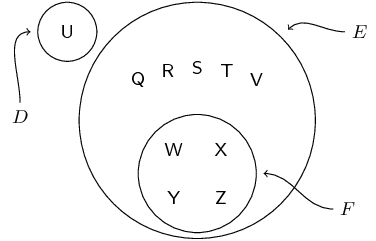
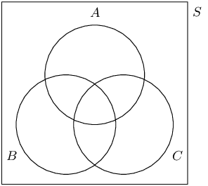
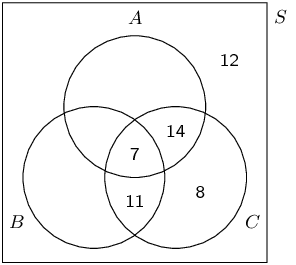
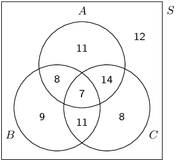
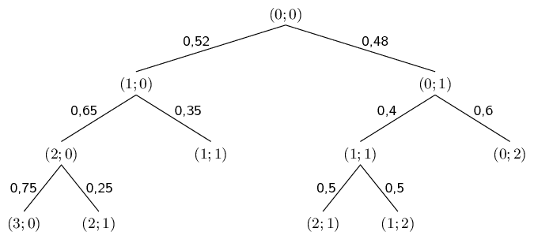
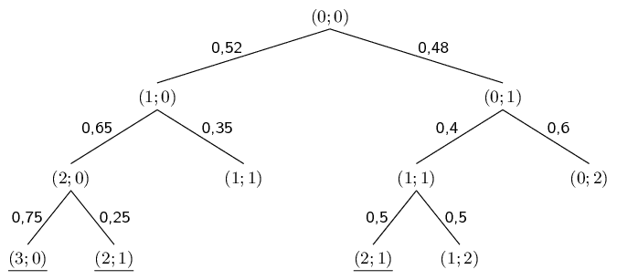
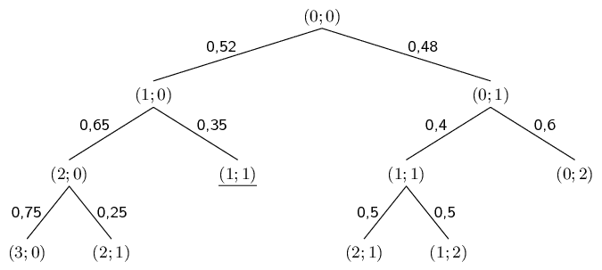
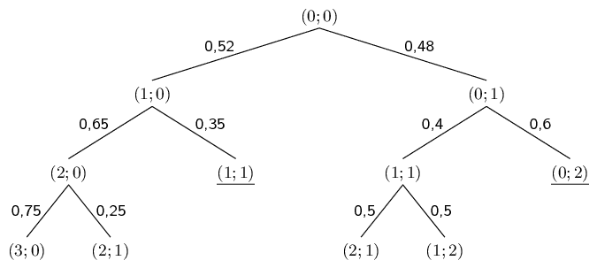
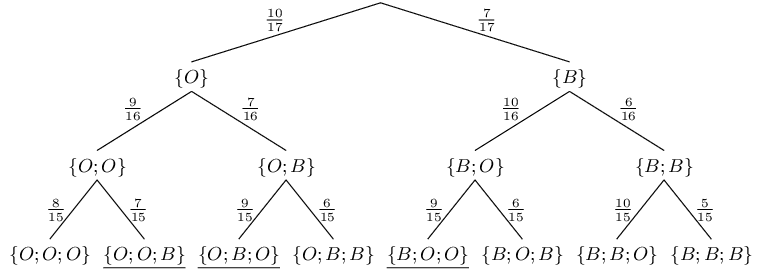

## End of chapter exercises

### Textbook Exercise 10.7

**Problem:**
Jane invested in the stock market.
                                    The probability that she will not lose all her money is \(\text{0,32}\).
                                    What is the probability that she will lose all her money?
                                    Explain.

**Solution:**
Since the events “Jane will lose all her money” and “Jane will not
                                    lose all her money” are complementary events, their probabilities sum to
                                    \(\text{1}\).
                                    Therefore the probability that Jane will lose all her money is \(1 - \text{0,32} =
                                    \text{0,68}\).

**Problem:**
If \(D\) and \(F\) are mutually exclusive events, with \(P(\text{not } D) =
                                    \text{0,3}\) and \(P(D \text{ or } F) = \text{0,94}\), find \(P(F)\).

**Solution:**
Since \(D\) and \(F\) are mutually exclusive, the sum rule for mutually exclusive
                                    events applies:
                                    \[P(D \text{ or } F) = P(D) + P(F)\]

                                    We are given \(P(\text{not } D) = \text{0,3}\), therefore \(P(D) = 1 - \text{0,3} =
                                    \text{0,7}\).
                                    From the sum rule we have
                                    \begin{align*}
                                    P(F)
                                    &= P(D \text{ or } F) - P(D) \\
                                    &= \text{0,94} - \text{0,7} \\
                                    &= \text{0,24}
                                    \end{align*}

A car sales person has pink, lime-green and purple models of car \(A\) and purple,
                                    orange and multicolour models of car \(B\).
                                    One dark night a thief steals a car.

**Problem:**
What is the experiment and sample space?

**Solution:**
The experiment is the outcome of selecting a particular model and colour car from
                                          the sample space of available cars.

The sample space is \(\{\)pink model \(A\); lime-green model \(A\); purple model
                                          \(A\); purple model \(B\); orange model \(B\); multicolour model \(B\)\(\}\).

**Problem:**
What is the probability of stealing either a model of \(A\) or a
                                    model of \(B\)?

**Solution:**
Since there are only two models, namely \(A\) and \(B\), the probability of
                                          stealing one of the two models is \(\text{1}\).

**Problem:**
What is the probability of stealing both a model of \(A\) and a model
                                    of \(B\)?

**Solution:**
Since there is no overlap between the two models and since the thief steals only
                                          one car, the probability of stealing both of the models is \(\text{0}\).

**Problem:**
The probability of event \(X\) is \(\text{0,43}\) and the probability of event \(Y\) is
                                    \(\text{0,24}\).
                                    The probability of both occurring together is \(\text{0,10}\).
                                    What is the probability that \(X\) or \(Y\) will occur?

**Solution:**
From the addition rule
                                    \begin{align*}
                                    P(X \text{ or } Y) &= P(X) + P(Y) - P(X \text{ and } Y) \\
                                    &= \text{0,43} + \text{0,24} - \text{0,10} \\
                                    &= \text{0,57}
                                    \end{align*}

\(P(H) = \text{0,62}\); \(P(J) = \text{0,39}\) and \(P(H \text{ and } J) =
                                    \text{0,31}\).
                                    Calculate:

**Problem:**
\(P(H')\)

**Solution:**
\(P(H') = 1-P(H) = 1-\text{0,62} = \text{0,38}\)

**Problem:**
\(P(H \text{ or } J)\)

**Solution:**
From the addition rule:
                                          \begin{align*}
                                          P(H\text{ or }J) &= P(H) + P(J) - P(H\text{ and }J) \\
                                          &= \text{0,62} + \text{0,39} - \text{0,31} \\
                                          &= \text{0,7}
                                          \end{align*}

**Problem:**
\(P(H' \text{ or } J')\)

**Solution:**
We draw a Venn diagram to get an idea of what the event \((H' \text{ or } J')\)
                                          looks like.

| \(H'\) | \(J'\) | \(H' \text{ or } J'\) |
| --- | --- | --- |

From the third diagram above we can see that
                                          \begin{align*}
                                          P(H' \text{ or } J')
                                          &= 1 - P(H\text{ and }J) \\
                                          &= \text{0,69}
                                          \end{align*}

**Problem:**
\(P(H' \text{ or } J)\)

**Solution:**
We draw a Venn diagram to get an idea of what the event \((H' \text{ or } J)\)
                                          looks like.

| \(H'\) | \(J\) | \(H' \text{ or } J\) |
| --- | --- | --- |

From the third diagram above we can see that
                                          \begin{align*}
                                          P(H' \text{ or } J)
                                          &= P(H') + P(H\text{ and }J) \\
                                          &= \text{0,38} + \text{0,31} \\
                                          &= \text{0,69}
                                          \end{align*}

**Problem:**
\(P(H' \text{ and } J')\)

**Solution:**
We draw a Venn diagram to get an idea of what the event \((H' \text{ and } J')\)
                                          looks like.

| \(H'\) | \(J'\) | \(H' \text{ and } J'\) |
| --- | --- | --- |

From the third diagram above we can see that
                                          \begin{align*}
                                          P(H' \text{ and } J')
                                          &= 1 - P(H\text{ or }J) \\
                                          &= \text{0,3}
                                          \end{align*}

The last ten letters of the alphabet are placed in a hat and people are asked to pick
                                    one of them.
                                    Event \(D\) is picking a vowel, event \(E\) is picking a consonant and event \(F\)
                                    is picking one of the last four letters.
                                    Draw a Venn diagram showing the outcomes in the sample space and the different
                                    events.
                                    Then calculate the following probabilities:

**Problem:**
\(P(\text{not } F)\)

**Solution:**
The Venn diagram is shown below. (Note that Y is not a vowel.)

We can then read off all the required probabilities.

\(P(\text{not } F) = 1 - \frac{4}{10} = \frac{3}{5}\)

**Problem:**
\(P(F \text{ or } D)\)

**Solution:**
\(\frac{5}{10} = \frac{1}{2}\)

**Problem:**
\(P(\text{neither } E \text{ nor } F)\)

**Solution:**
This leaves only the outcomes in \(D\), so \(P(\text{neither } E \text{ nor } F)
                                          = \frac{1}{10}\).

**Problem:**
\(P(D \text{ and } E)\)

**Solution:**
\(\text{0}\) since \(D\) and \(E\) are mutually exclusive.

**Problem:**
\(P(E \text{ and } F)\)

**Solution:**
\(\frac{4}{10} = \frac{2}{5}\)

**Problem:**
\(P(E \text{ and } D')\)

**Solution:**
Since \(D\) and \(E\) are complementary (a letter is either a vowel or a
                                          consonant), \(D' = E\), so \(P(E \text{ and } D') = P(E \text{ and } E) = P(E)
                                          = \frac{9}{10}\).

Thobeka compares three neighbourhoods (we'll call them \(A\), \(B\) and \(C\)) to see
                                    where the best place is to live.
                                    She interviews \(\text{80}\) people and asks them whether they like each of the
                                    neighbourhoods, or not.

- \(\text{40}\) people like neighbourhood \(A\).
- \(\text{35}\) people like neighbourhood \(B\).
- \(\text{40}\) people like neighbourhood \(C\).
- \(\text{21}\) people like both neighbourhoods \(A\) and \(C\).
- \(\text{18}\) people like both neighbourhoods \(B\) and \(C\).
- \(\text{68}\) people like at least one neighbourhood.
- \(\text{7}\) people like all three neighbourhoods.

**Problem:**
Use this information to draw a Venn diagram.

**Solution:**
We first draw the outline of the Venn diagram.

Next, we determine the counts of the different regions in the diagram, using the
                                          information provided.

- There are \(\text{7}\) people who like all three neighbourhoods, so
                                                  \(n(A\text{ and }B\text{ and }C) = 7\).
- There are \(\text{21}\) people who like \(A\) and \(C\), so \(n(A\text{
                                                  and }C) = 21\).
- There are \(\text{18}\) people who like \(B\) and \(C\), so \(n(B\text{
                                                  and }C) = 18\).
- There are \(\text{40}\) people who like \(C\), so \(n(C) = 40\).
- Since \(\text{68}\) people like at least one neighbourhood and since there
                                                  are \(\text{80}\) people in total, \(\text{12}\) people like none of the
                                                  neighbourhoods.

Using the above information we can complete part of the Venn diagram.

Since \(n(A\text{ or }B\text{ or }C) = 68\), we can see from the diagram above
                                          that \(n(A\text{ or }B) = 60\).
                                          From the sum rule
                                          \[n(A\text{ and }B) = n(A) + n(B) - n(A\text{ or }B) = 40 + 35 - 60 = 15\]

                                          This allows us to complete the diagram:

**Problem:**
How many people like none of the neighbourhoods?

**Solution:**
\(\text{12}\)

**Problem:**
How many people like neighbourhoods \(A\) and \(B\), but not \(C\)?

**Solution:**
\(\text{8}\)

**Problem:**
What is the probability that a randomly chosen person from the survey
                                    likes at least one of the neighbourhoods?

**Solution:**
\(P(A\text{ or }B\text{ or }C) = \frac{68}{80} = \frac{17}{20}\)

Let \(G\) and \(H\) be two events in a sample space.
                                    Suppose that \(P(G) = \text{0,4}\); \(P(H) = h\); and \(P(G \text{ or } H) =
                                    \text{0,7}\).

**Problem:**
For what value of \(h\) are \(G\) and \(H\) mutually exclusive?

**Solution:**
\(G\) and \(H\) are mutually exclusive when \(P(G \text{ and } H) = 0\).

From the sum rule we have
                                          \[P(G \text{ or } H) = P(G) + P(H) - P(G \text{ and } H)\]

                                          By substituting in the given values and \(P(G \text{ and } H) = 0\), we get
                                          \[\text{0,7} = \text{0,4} + h - 0\]

                                          Therefore \(h = \text{0,3}\).

**Problem:**
For what value of \(h\) are \(G\) and \(H\) independent?

**Solution:**
\(G\) and \(H\) are independent when \(P(G \text{ and } H) = P(G) \times P(H)\).

From the sum rule we have
                                          \[P(G \text{ or } H) = P(G) + P(H) - P(G \text{ and } H)\]

                                          By substituting in the given values and \(P(G \text{ and } H) = P(G) \times
                                          P(H)\), we get
                                          \begin{align*}
                                          \text{0,7} &= \text{0,4} + h - \text{0,4} \times h \\
                                          \text{0,3} &= \text{0,6} \times h
                                          \end{align*}
                                          Therefore \(h = \text{0,5}\).

The following tree diagram represents points scored by two teams in a soccer game.
                                    At each level in the tree, the points are shown as (points for Team \(\text{1}\);
                                    points for Team \(\text{2}\)).

Use this diagram to determine the probability that:

**Problem:**
Team \(\text{1}\) will win

**Solution:**
The outcomes where Team 1 wins (when the first score is greater than the second
                                          score) are underlined in the tree diagram below.

We compute the probability of Team 1 winning by multiplying the probabilities
                                          along each path and adding them up.
                                          \begin{align*}
                                          \text{0,52} \times \text{0,65} \times \text{0,75} &= \text{0,2535} \\
                                          \text{0,52} \times \text{0,65} \times \text{0,25} &= \text{0,0845} \\
                                          \text{0,48} \times \text{0,4} \times \text{0,5} &= \text{0,096} \\
                                          \\
                                          \text{0,2535} + \text{0,0845} + \text{0,096} &= \underline{\text{0,434}}
                                          \end{align*}

**Problem:**
The game will be a draw

**Solution:**
The outcomes where the game is a draw (when the first score equals the second
                                          score) are underlined in the tree diagram below.

There is only one such outcome and so the probability of a draw is the product of
                                          the probabilities along the path.
                                          \[\text{0,52} \times \text{0,35} = \text{0,182}\]

**Problem:**
The game will end with an even number of total points

**Solution:**
The outcomes where the sum of the points is even are underlined in the tree
                                          diagram below.

\begin{align*}
                                          \text{0,52} \times \text{0,35} &= \text{0,182} \\
                                          \text{0,48} \times \text{0,6} &= \text{0,288} \\
                                          \\
                                          \text{0,182} + \text{0,288} &= \underline{\text{0,47}}
                                          \end{align*}

**Problem:**
A bag contains \(\text{10}\) orange balls and \(\text{7}\) black balls.
                                    You draw \(\text{3}\) balls from the bag **without replacement**.
                                    What is the probability that you will end up with exactly \(\text{2}\) orange balls?
                                    Represent this experiment using a tree diagram.

**Solution:**
The tree diagram for the experiment is shown below.
                                    Since balls are drawn without replacement, the total number of balls (which appears
                                    in the denominators of the fractions) decreases by \(\text{1}\) at each step.
                                    Depending on whether the ball drawn was orange or black, the numerator either
                                    decreases by \(\text{1}\) or stays the same.
                                    The outcomes containing exactly \(\text{2}\) orange balls are underlined.

**Problem:**
Complete the following contingency table and determine whether the events are dependent
                                    or independent.

|  | Durban | Bloemfontein | Totals |
| --- | --- | --- | --- |
| Liked living there | \(\text{130}\) | \(\text{30}\) |  |
| Did not like living there | \(\text{140}\) |  | \(\text{340}\) |
| Totals |  | \(\text{230}\) | \(\text{500}\) |

**Solution:**
We complete the contingency table by making sure that all the rows and columns sum to
                                    the correct totals.

|  | Durban | Bloemfontein | Totals |
| --- | --- | --- | --- |
| Liked living there | \(\text{130}\) | \(\text{30}\) | \(\text{160}\) |
| Did not like living there | \(\text{140}\) | \(\text{200}\) | \(\text{340}\) |
| Totals | \(\text{270}\) | \(\text{230}\) | \(\text{500}\) |

Since

- \(P(\text{Durban}) = \frac{270}{500} = \text{0,54}\);
- \(P(\text{liked living there}) = \frac{160}{500} = \text{0,32}\);
- \(P(\text{Durban and liked living there}) = \frac{130}{500} = \text{0,26}\);

                              and since \(\text{0,54} \times \text{0,32} = \text{0,1728} \ne \text{0,26}\) the events
                              are dependent.

**Problem:**
Summarise the following information about a medical trial with \(\text{2}\) types of
                                    multivitamin in a contingency table and determine whether the events are dependent
                                    or independent.

- \(\text{960}\) people took part in the medical trial.
- \(\text{540}\) people used multivitamin \(A\) for a month and \(\text{400}\) of
                                            those people showed an improvement in their health.
- \(\text{300}\) people showed an improvement in health when using multivitamin
                                            \(B\) for a month.

If the events are independent, it means that the two multivitamins have the same effect
                                    on people.
                                    If the events are dependent, it means that one multivitamin is better than the
                                    other.
                                    Which multivitamin is better than the other, or are the both equally effective?

**Solution:**
From the information in the problem, we can draw up the following partially completed
                                    contingency table.

|  | Multivitamin \(A\) | Multivitamin \(B\) | Totals |
| --- | --- | --- | --- |
| Improvement in health | \(\text{400}\) | \(\text{300}\) |  |
| No improvement in health |  |  |  |
| Totals | \(\text{540}\) |  | \(\text{960}\) |

We complete the table by ensuring that all rows and columns add up to the correct
                                    totals.

|  | Multivitamin \(A\) | Multivitamin \(B\) | Totals |
| --- | --- | --- | --- |
| Improvement in health | \(\text{400}\) | \(\text{300}\) | \(\text{700}\) |
| No improvement in health | \(\text{140}\) | \(\text{120}\) | \(\text{260}\) |
| Totals | \(\text{540}\) | \(\text{420}\) | \(\text{960}\) |

Since

- \(P(\text{Multivitamin A}) = \frac{540}{960} = \frac{9}{16}\);
- \(P(\text{Improvement in health}) = \frac{700}{960} = \frac{35}{48}\);
- \(P(\text{Multivitamin A and Improvement in health}) = \frac{400}{960} =
                                            \frac{5}{12}\);

                              and since \(\frac{9}{16} \times \frac{35}{48} = \frac{105}{256} \ne \frac{5}{12}\) the
                              events are dependent.

With Multivitamin A, \(\frac{400}{540} = \text{74,1}\%\) of the people showed an
                                    improvement in health.
                                    With Multivitamin B, \(\frac{300}{420} = \text{71,4}\%\) of the people showed an
                                    improvement in health.
                                    Therefore Multivitamin A is more effective than Multivitamin B.
