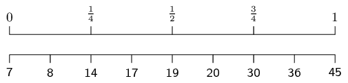
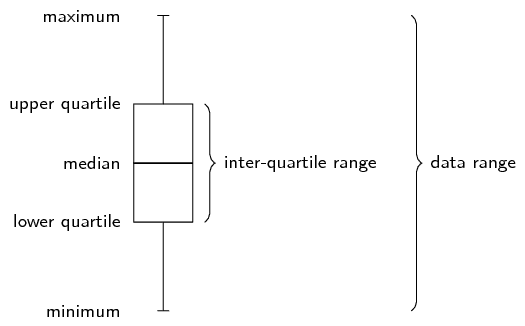
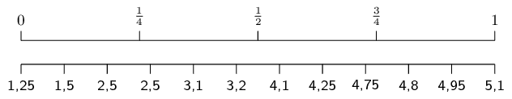
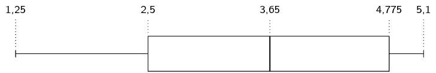
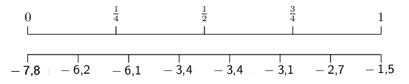
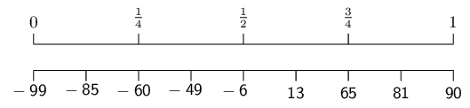
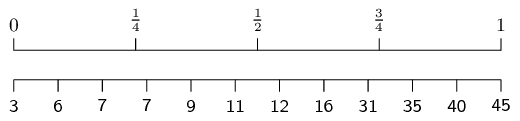
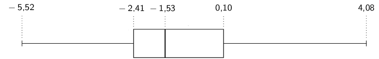
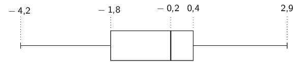

# Chapter 11: Statistics

## 11.1 Revision (EMBJZ)

<QuizCard id="m11-11-01a" title="Interactive Exercise 11.1" question="The following statement is about the median and median interval for a grouped data set. Is the statement true or false? Statement: The median value for a data set might be outside of the median interval." options=["true", "false", "impossible to know"] answer="false" hint="" explanation="Create a data set which can help answer the question This question is about how the median for a data set compares to the median interval when the same data are grouped. It takes some imagination to figure out the answer. Suppose you have a data set with \(\text{15}\) values and you group the data into three intervals. Can you think of a way for the median to be somewhere outside of the median interval? Here is a data set which can help us decide: \[                     \begin{array}{c}                         \text{2}\, ; \text{2}\, ; \text{3}\, ; \text{4}\, ; \text{6}\, ; \\         \text{6}\, ; \text{7}\, ; \text{11}\, ; \text{11}\, ; \text{11}\, ; \\         \text{12}\, ; \text{12}\, ; \text{13}\, ; \text{13}\, ; \text{14} \\[0.2cm]                         \text{median}\, = \text{11}                     \end{array}                 \] If we group these data into three intervals, where each interval has a width of \(\text{5}\) , we get: The median is \(\text{11}\) , which is the seventh value (out of \(\text{15}\) ). This is in the third interval. And that makes the third interval the median interval. So the median is in the median interval. The median is always in the median interval because we find the median interval by counting through the values to find the one in the middle. That is the same way that we find the median. Therefore the statement that the median value for a data set might be outside of the median interval is false . Submit your answer as: false" />

<QuizCard id="m11-11-01a" title="Interactive Exercise 11.1" question="The data set below has already been ordered for you. Identify the item at the \(71^{\text{st}}\) percentile. \[\begin{array}{c}\{   -30\, ; \,  -29\, ; \,  -25\, ; \,  -17\, ; \,  -4\, ; \,  -3\, ; \,  -3\, ; \,  0\, ; \,  9\, ; \,  14\, ; \,  16\, ; \,  18\, ; \,  20\, ; \,  27 \}\end{array}\]" options=[] answer="['14']" hint="You should enter a number here. If you want to, you can use a space to separate thousands.                Example: 12 800,25 For scientific notation you need to use the multiply symbol                ( ∗ ) and the exponent symbol ( ^ ). For example 6,673 × 10 −11 should be written as: 6,673 ∗ 10^−11" explanation="Determine the rank of the item at the \(71^{\text{st}}\) percentile We have a data set with \(\text{14}\) items in it, and the question asks us to determine the rank of the \(71^{\text{st}}\) percentile in the data set. For this we use the formula: \[\begin{array}{c}r = \frac{p}{100}(n - 1) + 1\end{array}\] where: \(p\) is the percentile value \(n\) is the number of items in the data set \(r\) is the rank (position) of the \(p^{\text{th}}\) percentile in the data set For this question, we have \(p = 71\) and \(n = 14\) . Substitute these values into the formula above to find the rank. \[                     \begin{aligned}                             r & = \frac{p}{100}(n - 1) + 1\\                               & = \frac{(71)}{100} \times \left((14) - 1\right) + 1\\                               & = \frac{71}{100} \times (13) + 1\\                               & = \text{9,23} + 1\\                               & = \text{10,23}                     \end{aligned}                 \] The rank of the \(71^{\text{st}}\) percentile in the data set is \(\text{10,23}\) . Use the rank of the \(71^{\text{st}}\) percentile to find the correct item in the data set Now we need to find the item in the data set which corresponds to the \(71^{\text{st}}\) percentile. We use the rank to do this because the rank tells us the position of an item in an ordered list. In this case we want to know which item has a rank of \(\text{10,23}\) . But the rank of an item must be an integer because it represents a position. We need to find the closest position value to \(\text{10,23}\) . The rank value \(\text{10,23}\) is closest to tenth position in the data set. So the \(71^{\text{st}}\) percentile corresponds to \(14\) . The item at the \(71^{\text{st}}\) percentile is \(14\) . Submit your answer as:" />

### Measures of central tendency (EMBK2)

- Ogives are not always grounded at \((0;0)\).
- Histograms must have bars of equal widths.
- The formula for population variance is used and not sample variance.
- Encourage learners to use the STATS functions on their calculators.
- Learners do not need to draw scatter plots, they need only identify
                                                  outliers.
- Discuss the misuse of statistics in the real world and encourage awareness.

The mean and median of a data set both give an indication where the centre of the data
                                distribution is located.
                                The **mean**, or average, is calculated as
                                \[\overline{x} = \frac{\sum_{i=1}^n x_i}{n}\]

                                where the \(x_i\) are the data and \(n\) is the number of data.
                                We read \(\overline{x}\) as “x bar”.

The **median** is the middle value of an ordered data set.
                                To find the median, we first sort the data and then pick out the value in the middle of
                                the sorted list.
                                If the middle is in between two values, the median is the average of those two values.

<Callout type="tip" title="Worked example 1: Computing measures of central tendency">
**Question:**
Compute the mean and median of the following data set:
                                                \[\text{72,5}\ ;\ \text{92,6}\ ;\ \text{15,6}\ ;\ \text{53,0}\ ;\
                                                \text{86,4}\ ;\ \text{89,9}\ ;\ \text{90,9}\ ;\ \text{21,7}\ ;\
                                                \text{46,0}\ ;\ \text{4,1}\ ;\ \text{51,7}\ ;\ \text{2,2}\]

**Compute the mean:**
Using the formula for the mean, we first compute the sum of the values and
                                                then divide by the number of values.

                                        \begin{align*}
                                        \overline{x} &= \frac{\text{626,6}}{\text{12}} \\
                                        &\approx \text{52,22}
                                        \end{align*}

**Compute the median:**
To find the median, we first have to sort the data:
                                                \[\text{2,2}\ ;\ \text{4,1}\ ;\ \text{15,6}\ ;\ \text{21,7}\ ;\
                                                \text{46,0}\ ;\ \text{51,7}\ ;\ \text{53,0}\ ;\ \text{72,5}\ ;\
                                                \text{86,4}\ ;\ \text{89,9}\ ;\ \text{90,9}\ ;\ \text{92,6}\]

Since there are an even number of values, the median will lie between two
                                                values.
                                                In this case, the two values in the middle are \(\text{51,7}\) and
                                                \(\text{53,0}\).
                                                Therefore the median is \(\text{52,35}\).
</Callout>

### Measures of dispersion (EMBK3)

Measures of dispersion tell us how spread out a data set is.
                                If a measure of dispersion is small, the data are clustered in a small region.
                                If a measure of dispersion is large, the data are spread out over a large region.

The **range** is the difference between the maximum and minimum values in the
                                data set.

The **inter-quartile range** is the difference between the first and third
                                quartiles of the data set.
                                The quartiles are computed in a similar way to the median.
                                The median is halfway into the ordered data set and is sometimes also called the second
                                quartile.
                                The first quartile is one quarter of the way into the ordered data set; whereas the
                                third quartile is three quarters of the way into the ordered data set.

<Callout type="note" title="Note">
<VideoPlayer src="http://www.khanacademy.org/embed_video?v=E4HAYd0QnRc" title="Video:
                                                23CB" />
</Callout>

<Callout type="tip" title="Worked example 2: Range and inter-quartile range">
**Question:**
Determine the range and the inter-quartile range of the following data set.
                                                \[14\ ;\ 17\ ;\ 45\ ;\ 20\ ;\ 19\ ;\ 36\ ;\ 7\ ;\ 30\ ;\ 8\]

**Sort the values in the data set:**
To determine the range we need to find the minimum and maximum values in the
                                                data set.
                                                To determine the inter-quartile range we need to compute the first and
                                                third quartiles of the data set.
                                                For both of these requirements, it is easier to order the data set
                                                first.

The sorted data set is
                                                \[7\ ;\ 8\ ;\ 14\ ;\ 17\ ;\ 19\ ;\ 20\ ;\ 30\ ;\ 36\ ;\ 45\]

**Find the minimum, maximum and range:**
The minimum value is the first value in the ordered data set, namely
                                                \(\text{7}\).
                                                The maximum is the last value in the ordered data set, namely
                                                \(\text{45}\).
                                                The range is the difference between the minimum and maximum: \(45 - 7 =
                                                38\).

**Find the quartiles and inter-quartile range:**
The diagram below shows how we find the quartiles one quarter, one half and
                                                three quarters of the way into the ordered list of values.

From this diagram we can see that the first quartile is at a value of
                                                \(\text{14}\), the second quartile (median) is at a value of
                                                \(\text{19}\) and the third quartile is at a value of \(\text{30}\).

The inter-quartile range is the difference between the first and third
                                                quartiles.
                                                The first quartile is \(\text{14}\) and the third quartile is
                                                \(\text{30}\).
                                                Therefore the inter-quartile range is \(30 - 14 = 16\).
</Callout>

### Five number summary (EMBK4)

The **five number summary** combines a measure of central tendency, namely the
                                median, with measures of dispersion, namely the range and the inter-quartile range.
                                This gives a good overview of the overall data distribution.
                                More precisely, the five number summary is written in the following order:

- minimum;
- first quartile;
- median;
- third quartile;
- maximum.

The five number summary is often presented visually using a **box and whisker
                                        diagram**.
                                A box and whisker diagram is shown below, with the positions of the five relevant
                                numbers labelled.
                                Note that this diagram is drawn vertically, but that it may also be drawn horizontally.

<Callout type="tip" title="Worked example 3: Five number summary">
**Question:**
Draw a box and whisker diagram for the following data set:
                                                \[\text{1,25}\ ;\ \text{1,5}\ ;\ \text{2,5}\ ;\ \text{2,5}\ ;\
                                                \text{3,1}\ ;\ \text{3,2}\ ;\ \text{4,1}\ ;\ \text{4,25}\ ;\
                                                \text{4,75}\ ;\ \text{4,8}\ ;\ \text{4,95}\ ;\ \text{5,1}\]

**Determine the minimum and maximum:**
Since the data set is already ordered, we can read off the minimum as the
                                                first value (\(\text{1,25}\)) and the maximum as the last value
                                                (\(\text{5,1}\)).

**Determine the quartiles:**
There are \(\text{12}\) values in the data set.

Using the figure above we can see that the median is between the sixth and
                                                seventh values, making it.
                                                \[\frac{\text{3,2}+\text{4,1}}{2} = \text{3,65}\]

The first quartile lies between the third and fourth values, making it
                                                \[Q_1 = \frac{\text{2,5}+\text{2,5}}{2} = \text{2,5}\]

The third quartile lies between the ninth and tenth values, making it
                                                \[Q_3 = \frac{\text{4,75}+\text{4,8}}{2} = \text{4,775}\]

**Draw the box and whisker diagram:**
We now have the five number summary as (\(\text{1,25}\); \(\text{2,5}\);
                                                \(\text{3,65}\); \(\text{4,775}\); \(\text{5,1}\)).
                                                The box and whisker diagram representing the five number summary is
                                                given below.

</Callout>

## Revision

### Textbook Exercise 11.1

For each of the following data sets, compute the mean and all the
                                                        quartiles.
                                                        Round your answers to one decimal place.

**Problem:**
\(-\text{3,4}\) ; \(-\text{3,1}\) ; \(-\text{6,1}\) ;
                                                                \(-\text{1,5}\) ; \(-\text{7,8}\) ; \(-\text{3,4}\) ;
                                                                \(-\text{2,7}\) ; \(-\text{6,2}\)

**Solution:**
Mean:
                                                                \begin{align*}
                                                                \overline{x}
                                                                &= \frac{(-\text{3,4}) + (-\text{3,1}) +
                                                                (-\text{6,1}) + (-\text{1,5}) + (-\text{7,8}) +
                                                                (-\text{3,4}) + (-\text{2,7}) + (-\text{6,2})}{8} \\
                                                                &\approx -\text{4,3}
                                                                \end{align*}

To compute the quartiles, we order the data:

\(-\text{7,8}\) ; \(-\text{6,2}\) ; \(-\text{6,1}\) ;
                                                                \(-\text{3,4}\) ; \(-\text{3,4}\) ; \(-\text{3,1}\) ;
                                                                \(-\text{2,7}\) ; \(-\text{1,5}\)

We use the diagram below to find at or between which values
                                                                the quartiles lie.

For the first quartile the position is between the second and
                                                                third values.
                                                                The second value is \(-\text{6,2}\) and the third value
                                                                is \(-\text{6,1}\), which means that the first quartile
                                                                is \(\frac{-\text{6,2} - \text{6,1}}{2}=-\text{6,15}\).

For the median (second quartile) the position is halfway
                                                                between the fourth and fifth values.
                                                                Since both these values are \(-\text{3,4}\), the median
                                                                is \(-\text{3,4}\).

For the third quartile the position is between the sixth and
                                                                seventh values.
                                                                Therefore the third quartile is \(-\text{2,9}\).

**Problem:**
\(-\text{6}\) ; \(-\text{99}\) ; \(\text{90}\) ;
                                                                \(\text{81}\) ; \(\text{13}\) ; \(-\text{85}\) ;
                                                                \(-\text{60}\) ; \(\text{65}\) ; \(-\text{49}\)

**Solution:**
Mean:
                                                                \begin{align*}
                                                                \overline{x}
                                                                &= \frac{(-\text{6}) + (-\text{99}) + (\text{90}) +
                                                                (\text{81}) + (\text{13}) + (-\text{85}) + (-\text{60})
                                                                + (\text{65}) + (-\text{49})}{9} \\
                                                                &\approx -\text{5,6}
                                                                \end{align*}

To compute the quartiles, we order the data:

\(-\text{99}\) ; \(-\text{85}\) ; \(-\text{60}\) ;
                                                                \(-\text{49}\) ; \(-\text{6}\) ; \(\text{13}\) ;
                                                                \(\text{65}\) ; \(\text{81}\) ; \(\text{90}\)

We use the diagram below to find at or between which values
                                                                the quartiles lie.

We see that the quartiles are at \(-\text{60}\);
                                                                \(-\text{6}\); and \(\text{65}\).

**Problem:**
\(\text{7}\) ; \(\text{45}\) ; \(\text{11}\) ; \(\text{3}\) ;
                                                                \(\text{9}\) ; \(\text{35}\) ; \(\text{31}\) ;
                                                                \(\text{7}\) ; \(\text{16}\) ; \(\text{40}\) ;
                                                                \(\text{12}\) ; \(\text{6}\)

**Solution:**
The mean is \(\overline{x} = \text{18,5}\).

To compute the quartiles, we order the data:

                                                        \[3\ ;\ 6\ ;\ 7\ ;\ 7\ ;\ 9\ ;\ 11\ ;\ 12\ ;\ 16\ ;\ 31\ ;\ 35\
                                                        ;\ 40\ ;\ 45\]

We use the diagram below to find at or between which values
                                                                the quartiles lie.

For the first quartile the position is between the third and
                                                                fourth values.
                                                                Since both these values are equal to \(\text{7}\), the
                                                                first quartile is \(\text{7}\).

For the median (second quartile) the position is halfway
                                                                between the sixth and seventh values.
                                                                The sixth value is \(\text{11}\) and the seventh value
                                                                is \(\text{12}\), which means that the median is
                                                                \(\frac{11+12}{2}=\text{11,5}\).

For the third quartile the position is between the ninth and
                                                                tenth values.
                                                                Therefore the third quartile is \(\frac{31+35}{2}=33\).

**Problem:**
Use the following box and whisker diagram to determine the range and
                                                        inter-quartile range of the data.

**Solution:**
The range is the difference between the minimum and maximum values.
                                                        From the box-and-whisker diagram, the minimum is
                                                        \(-\text{5,52}\) and the maximum is \(\text{4,08}\).
                                                        Therefore the range is \(\text{4,08} - (-\text{5,52}) =
                                                        \text{9,6}\).

The inter-quartile range is the difference between the first and
                                                        third quartiles.
                                                        From the box-and-whisker diagram, the first quartile is
                                                        \(-\text{2,41}\) and the third quartile is \(\text{0,10}\).
                                                        Therefore the inter-quartile is \(\text{0,10} - (-\text{2,41}) =
                                                        \text{2,51}\).

**Problem:**
Draw the box and whisker diagram for the following data.

                                                \[\text{0,2}\ ;\ -\text{0,2}\ ;\ -\text{2,7}\ ;\ \text{2,9}\ ;\
                                                -\text{0,2}\ ;\ -\text{4,2}\ ;\ -\text{1,8}\ ;\ \text{0,4}\ ;\
                                                -\text{1,7}\ ;\ -\text{2,5}\ ;\ \text{2,7}\ ;\ \text{0,8}\ ;\
                                                -\text{0,5}\]

**Solution:**

